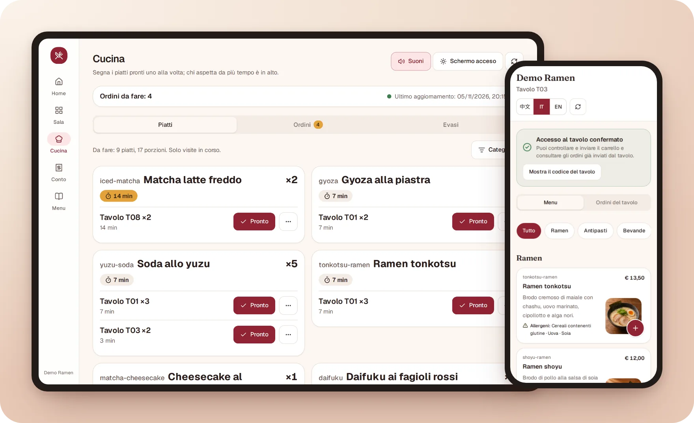
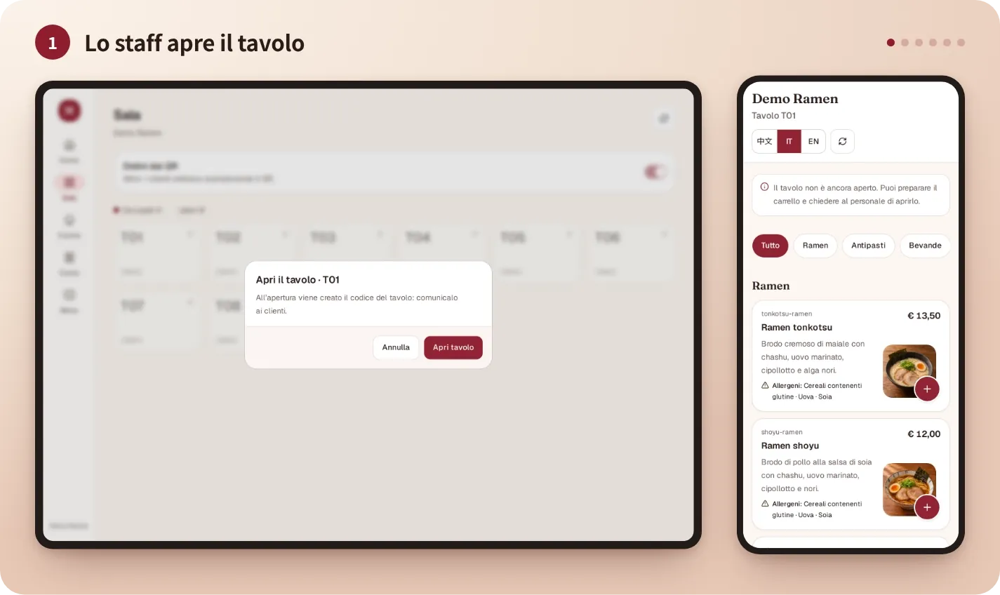
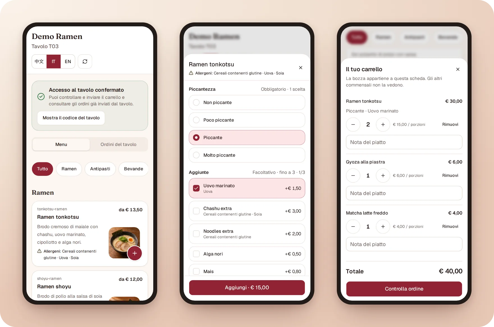
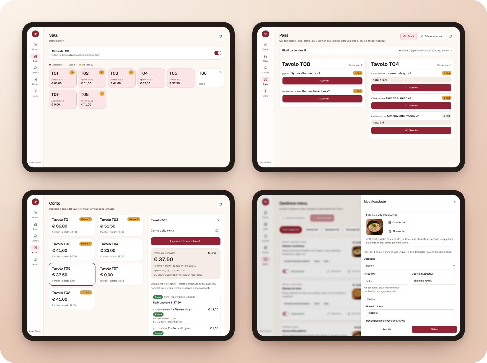
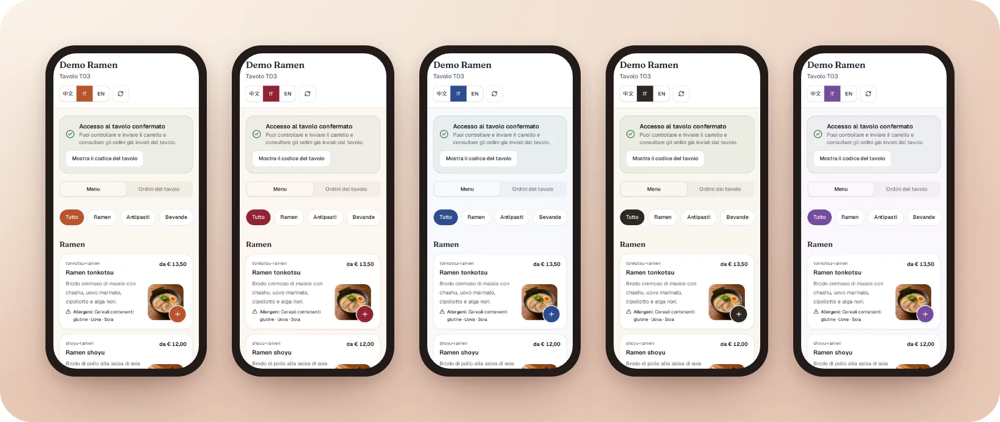
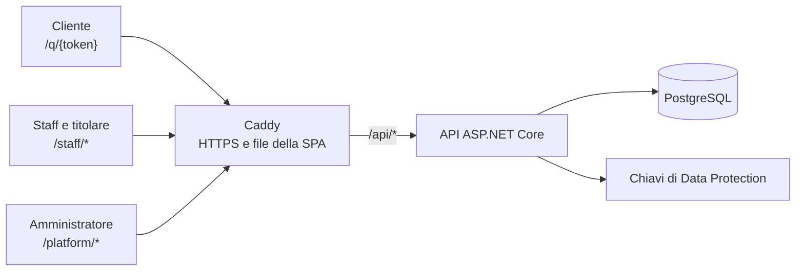

[English](README.md) · **Italiano** · [中文](README.zh-CN.md)

# Qiao TavoloFlow

Un'app di ordinazione al tavolo tramite QR per piccoli ristoranti, da installare sul proprio server. I
clienti scansionano il QR del tavolo e ordinano dal telefono; cucina e pass vedono i piatti appena
arrivano; il titolare chiude il conto dopo aver incassato alla cassa.

[](https://github.com/lorenzoyang/TavoloFlow/actions/workflows/ci.yml)
[](LICENSE)
[](https://dotnet.microsoft.com)
[](https://react.dev)
[](https://www.postgresql.org)



Tutte le interfacce (cliente, staff, amministratore) sono in italiano, inglese e cinese. L'area staff
si installa come PWA su telefoni e tablet della cucina. L'app non gestisce pagamenti online e non
sostituisce il registratore di cassa.

## Cosa fa

- **I clienti** scansionano il QR fisso del tavolo, consultano il menu con foto e allergeni, entrano
  nella visita del tavolo con un codice di quattro caratteri e ordinano tutte le volte che vogliono
  durante il pasto.
- **Lo staff** apre i tavoli in Sala, segue gli ordini in Cucina (raggruppati per piatto o per ordine,
  con un avviso sonoro e le categorie filtrate per schermo) e segna i piatti serviti dal Pass.
- **Il titolare** gestisce menu e tavoli, scarica i QR e i segnatavolo da stampare, chiude il conto
  dopo l'incasso e consulta lo storico dei conti.
- **L'amministratore della piattaforma** crea i ristoranti e i loro account, sceglie il tema di colori
  di ogni ristorante e registra i periodi di abbonamento e le tariffe pagate fuori dall'app.

Non ci sono stampa delle comande, pagamenti online, divisione del conto, gestione del magazzino,
asporto o notifiche push. I [requisiti del prodotto](docs/reference/product-requirements.md), in
inglese, descrivono tutto il perimetro.

## Schermate

**Un tavolo dall'inizio alla fine** (circa 20 secondi): apertura del tavolo, ordine dal telefono,
cucina, pass e conto.



**Clienti**: il menu con foto e allergeni, il carrello e gli ordini del tavolo.



**Staff e titolare**: Sala, Pass, Conto e modifica di un piatto su un tablet.



**Temi**: cinque palette di colori, scelte per ogni ristorante dall'amministratore della piattaforma.



Tutte le schermate mostrano il ristorante fittizio Demo Ramen della [demo veloce](#demo-veloce) qui
sotto.

## Demo veloce

Servono Git e Docker con Compose v2 (su Windows, Docker Desktop con i container Linux). Non servono
.NET, Node né un file `.env`.

```bash
git clone https://github.com/lorenzoyang/TavoloFlow.git
cd TavoloFlow
docker compose -f demo/compose.yaml up -d
```

Docker scarica le immagini già pronte dell'ultima release, oppure le costruisce dal tuo checkout se non
riesce a scaricarle (qualche minuto); aggiungi `--build` per costruirle sempre dal checkout. Poi apri
<http://127.0.0.1:8080>.

| Ruolo                            | Utente             | Password | Dove si entra                                           |
| -------------------------------- | ------------------ | -------- | ------------------------------------------------------- |
| Titolare                         | `demo.ramen.owner` | `123456` | [/staff/login](http://127.0.0.1:8080/staff/login)       |
| Staff                            | `demo.ramen.staff` | `123456` | [/staff/login](http://127.0.0.1:8080/staff/login)       |
| Amministratore della piattaforma | `demo.admin`       | `123456` | [/platform/login](http://127.0.0.1:8080/platform/login) |

Il ristorante inventato **Demo Ramen** ha otto tavoli liberi e dodici piatti con foto generate
dall'AI. Un giro di cinque minuti: da titolare copia il link del tavolo T01 da **Tavoli e QR**; apri
T01 in **Sala**; incolla il link in un'altra scheda, inserisci il codice del tavolo e ordina; segna i
piatti **Pronto** in **Cucina** e **Servito** dal **Pass**; chiudi il conto da **Conto**. La
[guida all'esecuzione in locale](docs/it/local-development.md) spiega la demo nei dettagli, anche come
azzerarla e modificarne i dati.

## Architettura



Una single-page app React e un'API ASP.NET Core condividono un'unica origine HTTPS dietro Caddy:
niente CORS, e i cookie non passano mai da un dominio all'altro. Un solo processo API serve tre tipi
di utenti, e il percorso della richiesta decide quale cookie usare: `/api/public` per i clienti,
`/api/platform` per gli amministratori, tutto il resto per lo staff del ristorante.

Quasi tutte le scelte di progettazione rispondono a due domande: cosa succede quando due persone fanno
qualcosa nello stesso momento, e cosa succede quando la rete cade a metà di una scrittura? Le
[note di sviluppo](docs/it/development-notes.md) le spiegano una per una; in breve:

- **Lock di riga in un ordine fisso.** I service bloccano le righe da cui dipende una decisione con
  `SELECT ... FOR SHARE/FOR UPDATE`, sempre nell'ordine ristorante → tavolo → visita: le scritture
  concorrenti si mettono in fila invece di andare in deadlock. Gli UPDATE condizionali sono una
  seconda difesa.
- **Regole garantite dal database.** Un indice unico parziale permette una sola visita aperta per
  tavolo, le chiavi esterne composte tengono separati i dati dei ristoranti e i check constraint
  mantengono coerenti gli stati.
- **Una versione ottimistica del conto.** Il titolare conferma la versione e il totale che ha visto;
  se nel frattempo è arrivato un ordine, il server risponde `BILL_CHANGED` invece di chiudere il conto
  sbagliato.
- **Ordini idempotenti.** Ogni ordine porta un ID di richiesta generato dal browser e protetto da un
  indice unico: una riprova dopo una risposta persa non crea mai un ordine doppio.
- **Recupero solo con GET.** Dopo una scrittura con risultato sconosciuto, il browser legge soltanto
  la risorsa originale e chiede a una persona di confermare di nuovo; non rimanda mai una POST da solo.
- **Polling invece di WebSocket.** Gli schermi si aggiornano ogni 10–30 secondi e scoprono il lavoro
  nuovo da un watermark letto da un indice: per un ristorante piccolo basta, ed è molto più semplice
  da gestire.
- **Cookie e token CSRF per identità**, invece di JWT in `localStorage`: HttpOnly, revocabili grazie a
  una versione delle credenziali, e ogni token CSRF vale solo per la sua identità.
- **Migrazioni esplicite.** L'API non migra mai all'avvio; ogni rilascio applica un bundle di
  migrazioni di EF Core dopo aver fatto un backup.

## Stack tecnologico

| Area          | Tecnologie                                                                                             |
| ------------- | ------------------------------------------------------------------------------------------------------ |
| Backend       | C#, ASP.NET Core 10 (controller), EF Core con Npgsql, SkiaSharp per le foto dei piatti                 |
| Database      | PostgreSQL 18                                                                                          |
| Frontend      | React 19, TypeScript, Vite, TanStack Router e Query, Tailwind CSS, shadcn/ui su Base UI                |
| Test          | test di integrazione xUnit su PostgreSQL vero (Testcontainers), test runner di Node per la logica pura |
| Distribuzione | Docker Compose e Caddy su una sola VPS, pacchetti di rilascio costruiti in locale                      |

## Struttura del repository

| Cartella    | Contenuto                                                                |
| ----------- | ------------------------------------------------------------------------ |
| `backend/`  | l'API, le entità e le migrazioni, i test di integrazione su PostgreSQL   |
| `frontend/` | la SPA di clienti, staff e amministratori, i test della logica e la PWA  |
| `demo/`     | la demo Docker autonoma e i suoi dati inventati                          |
| `deploy/`   | Compose di produzione, script di rilascio, migrazioni, backup e rollback |
| `docs/`     | le guide (italiano, inglese, cinese) e il riferimento in inglese         |

## Eseguire in locale

Per sviluppare servono il .NET SDK indicato in `global.json`, Node 24 e Docker. Dalla cartella del
repository:

```bash
cp .env.example .env
# Imposta POSTGRES_PASSWORD in .env, poi avvia il database
docker compose up -d db
dotnet tool restore
dotnet user-secrets set 'ConnectionStrings:Default' \
  'Host=localhost;Port=5432;Database=tavoloflow_dev;Username=tavoloflow;Password=LA_TUA_PASSWORD' \
  --project backend/TavoloFlow.Api
dotnet ef database update --project backend/TavoloFlow.Api
# Facoltativo: importa i dati della demo nel database vuoto
Demo__DataPath="$PWD/demo" dotnet run --project backend/TavoloFlow.Api --launch-profile http -- --seed-demo
# Avvia l'API su http://localhost:5093
dotnet run --project backend/TavoloFlow.Api --launch-profile http
```

In un secondo terminale:

```bash
cd frontend
npm ci
npm run dev
```

Apri <http://localhost:5173/staff/login>; Vite inoltra `/api` all'API. La
[guida all'esecuzione in locale](docs/it/local-development.md) spiega ogni passo, i test e come
provare l'app da un telefono sulla tua rete Wi-Fi.

## Distribuzione

Il pacchetto di rilascio si costruisce in locale per un'origine pubblica e si installa sul server con
uno script:

```bash
PUBLIC_ORIGIN=https://app.esempio.it bash deploy/build-release.sh
```

La [guida al self-hosting](docs/it/self-hosting.md) accompagna nella prima installazione su una VPS
Ubuntu: DNS e HTTPS, migrazioni esplicite, backup notturni, ripristini e rollback.

## Test

```bash
# Test di integrazione del backend (Docker deve essere avviato)
dotnet test TavoloFlow.slnx
# Frontend
cd frontend
node --test --test-isolation=none tests/*.test.ts
npm run build
npm run lint
```

Ogni classe di test del backend avvia un suo PostgreSQL usa e getta, con le migrazioni vere.

## Documentazione

- **Guide**, scritte in italiano e tradotte: note di sviluppo, esecuzione in locale e self-hosting, in
  [italiano](docs/it/), [inglese](docs/en/) e [cinese](docs/zh-CN/).
- **Riferimento**, in inglese: [requisiti del prodotto](docs/reference/product-requirements.md),
  [schema del database](docs/reference/er-diagram.png) e i contratti delle funzionalità elencati
  nell'[indice della documentazione](docs/README.md).
- Le convenzioni di codice e interfaccia sono in [AGENTS.md](AGENTS.md); come contribuire è in
  [CONTRIBUTING.md](CONTRIBUTING.md), in inglese.

## Come è nato

È il mio primo progetto full stack. Ho progettato il prodotto e preso le decisioni di architettura; la
maggior parte del codice l'ho scritta insieme ad agenti AI di programmazione (Claude Code e Codex).
L'ho pensato per i ristoranti cinesi in Italia, e continuo a offrirlo come servizio su
[qiaotavoloflow.it](https://qiaotavoloflow.it). Visitando i ristoranti ho capito cosa gli manca
ancora, prima di tutto la stampa delle comande. Ho reso il codice open source perché chiunque possa
studiarlo o installarlo sul proprio server. Le [note di sviluppo](docs/it/development-notes.md)
raccontano tutta la storia e spiegano il perché di ogni scelta.

## Licenza

Copyright (c) 2026 lorenzoyang. Distribuito con licenza [GNU Affero General Public License
v3.0](LICENSE): se modifichi TavoloFlow e lo offri agli utenti tramite una rete, devi rendere
disponibile a quegli utenti il codice sorgente modificato con la stessa licenza.
