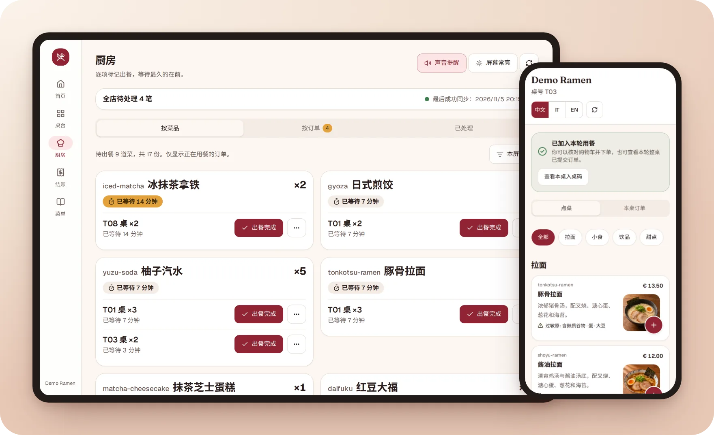
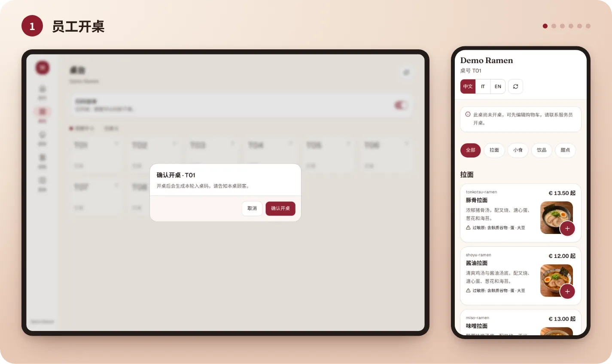
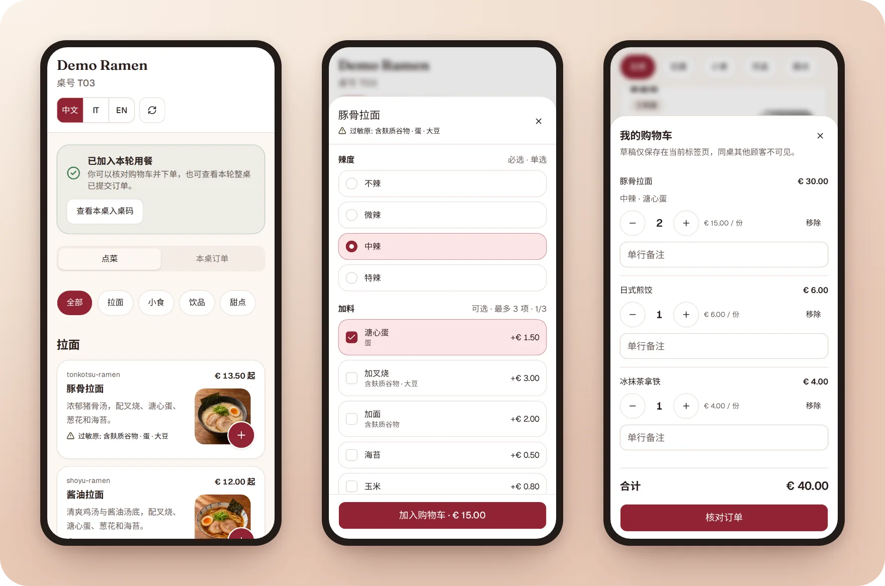
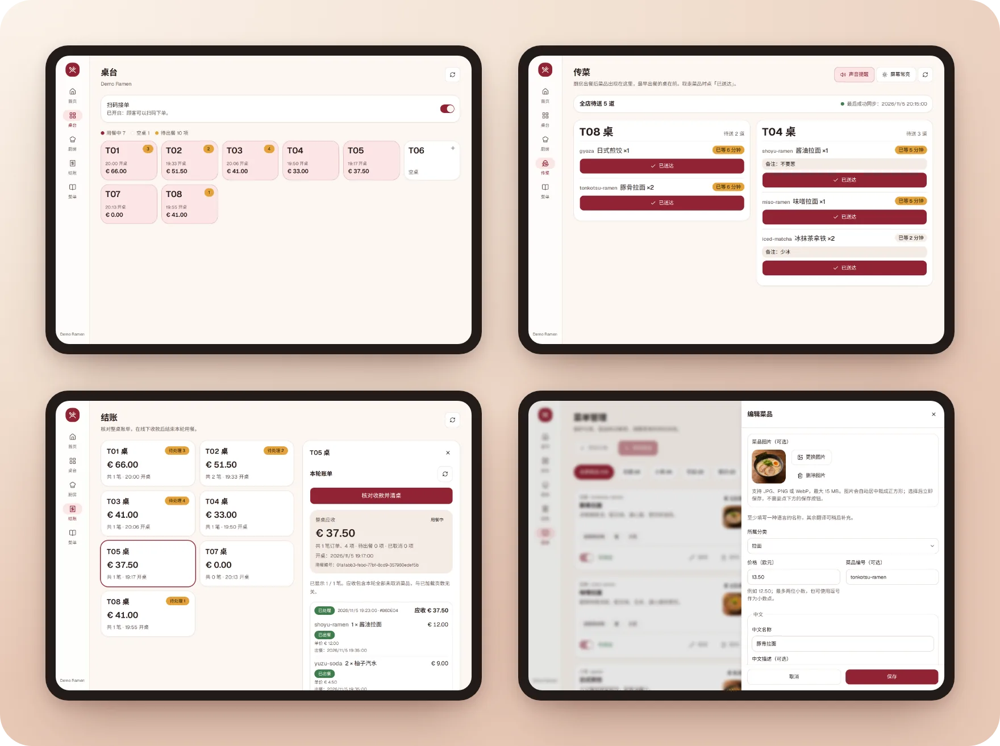
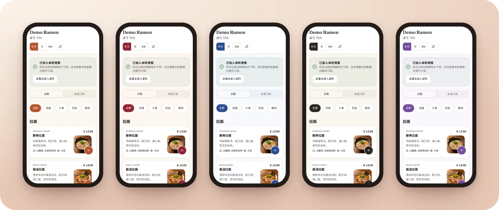
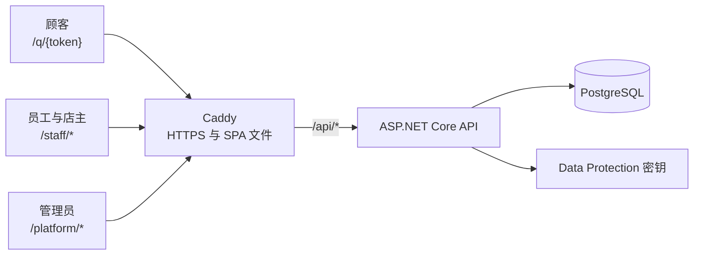

[English](README.md) · [Italiano](README.it.md) · **中文**

# Qiao TavoloFlow

一个面向小餐厅、可以自行部署的扫码点餐应用。顾客扫桌上的二维码，用手机点餐；厨房和传菜台在菜品到达时
立即看到；店主在收银台收款后关闭账单。

[](https://github.com/lorenzoyang/TavoloFlow/actions/workflows/ci.yml)
[](LICENSE)
[](https://dotnet.microsoft.com)
[](https://react.dev)
[](https://www.postgresql.org)



所有界面（顾客、员工、管理员）都支持中文、意大利语和英语。员工端可以作为 PWA 安装在手机和厨房平板上。
本应用不处理在线支付，也不替代收银机。

## 功能

- **顾客**扫桌上固定的二维码，浏览带照片和过敏原的菜单，用四位入桌码加入本桌这一轮用餐，用餐期间可以
  多次下单。
- **员工**在「桌台」开桌，在「厨房」跟进订单（按菜品或按订单分组，有提示音，每块屏幕可以只显示部分
  分类），在「传菜」页面把菜标为已送达。
- **店主**管理菜单和桌位，下载二维码和可打印的桌卡，收款后关闭账单，查看历史账单。
- **平台管理员**创建餐厅及其账号，为每家餐厅选择配色主题，登记服务期和在应用之外收取的年费。

不包含：厨房单打印、在线支付、分单结账、库存管理、外卖和推送通知。完整范围见
[产品需求](docs/reference/product-requirements.md)（英文）。

## 截图

**一桌客人的完整流程**（约 20 秒）：开桌、手机点菜、厨房、传菜和结账。



**顾客**：带照片和过敏原的菜单、购物车和本桌订单。



**员工和店主**：平板上的桌台、传菜、结账和菜品编辑页面。



**主题**：五套配色，由平台管理员为每家餐厅选择。



所有截图都来自下面[快速体验](#快速体验)里的虚构餐厅 Demo Ramen。

## 快速体验

需要 Git 和带 Compose v2 的 Docker（Windows 上用使用 Linux 容器的 Docker Desktop）。不需要 .NET、
Node，也不需要 `.env` 文件。

```bash
git clone https://github.com/lorenzoyang/TavoloFlow.git
cd TavoloFlow
docker compose -f demo/compose.yaml up -d
```

Docker 会下载最新版本预先构建好的镜像；下载不到时会用你的代码在本地构建（需要几分钟）。加上 `--build`
则总是用本地代码构建。然后打开 <http://127.0.0.1:8080>。

| 角色       | 用户名             | 密码     | 登录地址                                                |
| ---------- | ------------------ | -------- | ------------------------------------------------------- |
| 店主       | `demo.ramen.owner` | `123456` | [/staff/login](http://127.0.0.1:8080/staff/login)       |
| 员工       | `demo.ramen.staff` | `123456` | [/staff/login](http://127.0.0.1:8080/staff/login)       |
| 平台管理员 | `demo.admin`       | `123456` | [/platform/login](http://127.0.0.1:8080/platform/login) |

虚构的示例餐厅 **Demo Ramen** 有八张空桌和十二道菜，照片由 AI 生成。五分钟体验：以店主身份在
**桌位与二维码**里复制 T01 桌的链接；在**桌台**为 T01 开桌；在另一个标签页粘贴链接，输入入桌码并下单；
在**厨房**点**出餐完成**，在**传菜**点**已送达**；在**结账**里关闭账单。
[本地运行指南](docs/zh-CN/local-development.md)详细介绍了演示，包括如何重置和修改演示数据。

## 架构



React 单页应用和 ASP.NET Core API 在 Caddy 后面共用同一个 HTTPS 源：没有 CORS，cookie 也从不跨域。
一个 API 进程服务三类用户，由请求路径决定使用哪个 cookie 身份：`/api/public` 是顾客，`/api/platform`
是管理员，其余都是餐厅员工。

大多数设计选择都在回答两个问题：两个人在同一时刻操作会怎样？写操作进行到一半网络断了会怎样？
[开发笔记](docs/zh-CN/development-notes.md)逐一解释了它们；简单来说：

- **按固定顺序加行锁。** service 用 `SELECT ... FOR SHARE/FOR UPDATE` 锁住决策所依赖的行，顺序始终是
  餐厅 → 桌位 → 用餐，并发的写操作会排队，而不会死锁。条件 UPDATE 是第二道防线。
- **由数据库保证的规则。** 部分唯一索引保证每张桌只有一轮进行中的用餐，复合外键让各餐厅的数据互不
  混杂，检查约束让状态字段始终一致。
- **账单的乐观版本。** 店主确认的是自己看到的版本和总额；如果期间来了新订单，服务器返回
  `BILL_CHANGED`，而不会关错账单。
- **幂等的订单。** 每个订单都带有浏览器生成的请求 ID，并由唯一索引保护：响应丢失后重试，也永远不会
  产生重复订单。
- **只用 GET 恢复。** 写操作结果未知时，浏览器只读取原始资源，并请人重新确认；它从不自动重发 POST。
- **用轮询而不是 WebSocket。** 页面每 10–30 秒刷新一次，通过从索引读取的「水位线」发现新工作：对小
  餐厅来说足够，运维也简单得多。
- **cookie 和按身份隔离的 CSRF 令牌**，而不是存在 `localStorage` 里的 JWT：HttpOnly，可以通过凭据版本
  撤销，每个 CSRF 令牌只对自己的身份有效。
- **显式迁移。** API 从不在启动时迁移；每次发布都会先备份，再执行 EF Core 的迁移包。

## 技术栈

| 领域   | 技术                                                                                          |
| ------ | --------------------------------------------------------------------------------------------- |
| 后端   | C#、ASP.NET Core 10（控制器）、EF Core + Npgsql、处理菜品照片的 SkiaSharp                     |
| 数据库 | PostgreSQL 18                                                                                 |
| 前端   | React 19、TypeScript、Vite、TanStack Router 和 Query、Tailwind CSS、基于 Base UI 的 shadcn/ui |
| 测试   | 在真实 PostgreSQL 上运行的 xUnit 集成测试（Testcontainers），纯逻辑用 Node 自带的测试运行器   |
| 部署   | 单台 VPS 上的 Docker Compose 和 Caddy，发布包在本地构建                                       |

## 仓库结构

| 目录        | 内容                                              |
| ----------- | ------------------------------------------------- |
| `backend/`  | API、实体和迁移，以及基于 PostgreSQL 的集成测试   |
| `frontend/` | 顾客、员工和管理员共用的 SPA，逻辑测试和 PWA 资源 |
| `demo/`     | 独立的 Docker 演示及其虚构数据                    |
| `deploy/`   | 生产环境的 Compose，发布、迁移、备份和回滚脚本    |
| `docs/`     | 指南（中文、意大利语、英语）和英文的参考文档      |

## 在本地运行

开发需要 `global.json` 指定的 .NET SDK、Node 24 和 Docker。在仓库目录下：

```bash
cp .env.example .env
# 在 .env 里设置 POSTGRES_PASSWORD，然后启动数据库
docker compose up -d db
dotnet tool restore
dotnet user-secrets set 'ConnectionStrings:Default' \
  'Host=localhost;Port=5432;Database=tavoloflow_dev;Username=tavoloflow;Password=你的密码' \
  --project backend/TavoloFlow.Api
dotnet ef database update --project backend/TavoloFlow.Api
# 可选：把演示数据导入空数据库
Demo__DataPath="$PWD/demo" dotnet run --project backend/TavoloFlow.Api --launch-profile http -- --seed-demo
# 启动 API，地址 http://localhost:5093
dotnet run --project backend/TavoloFlow.Api --launch-profile http
```

在第二个终端里：

```bash
cd frontend
npm ci
npm run dev
```

打开 <http://localhost:5173/staff/login>；Vite 会把 `/api` 转发给 API。
[本地运行指南](docs/zh-CN/local-development.md)介绍了每一步、测试，以及如何用同一 Wi-Fi 下的手机试用。

## 部署

发布包在本地针对一个公开地址构建，再用脚本安装到服务器上：

```bash
PUBLIC_ORIGIN=https://app.example.com bash deploy/build-release.sh
```

[自托管指南](docs/zh-CN/self-hosting.md)一步步介绍在 Ubuntu VPS 上的首次安装：DNS 和 HTTPS、显式迁移、
每晚备份、恢复和回滚。

## 测试

```bash
# 后端集成测试（Docker 必须在运行）
dotnet test TavoloFlow.slnx
# 前端
cd frontend
node --test --test-isolation=none tests/*.test.ts
npm run build
npm run lint
```

每个后端测试类都会启动一个自己的一次性 PostgreSQL，并执行真实的迁移。

## 文档

- **指南**，用意大利语写成并翻译：开发笔记、本地运行和自托管，有[中文](docs/zh-CN/)、
  [意大利语](docs/it/)和[英语](docs/en/)版本。
- **参考文档**，英文：[产品需求](docs/reference/product-requirements.md)、
  [数据库结构](docs/reference/er-diagram.png)，以及[文档索引](docs/README.md)里列出的各功能约定。
- 代码和界面规范见 [AGENTS.md](AGENTS.md)；如何参与贡献见 [CONTRIBUTING.md](CONTRIBUTING.md)（英文）。

## 它是怎么来的

这是我的第一个全栈项目。产品是我设计的，架构上的决策也是我做的；大部分代码是我和 AI 编程智能体
（Claude Code 和 Codex）一起写的。它是为意大利的中餐馆做的，我现在仍在
[qiaotavoloflow.it](https://qiaotavoloflow.it) 为餐厅提供托管服务。拜访餐厅之后，我知道了它还缺什么，
最重要的是打印厨房单。我把代码开源，是为了让任何人都能研究它，或者部署到自己的服务器上。
[开发笔记](docs/zh-CN/development-notes.md)讲述了完整的经过，并解释了每个选择背后的原因。

## 许可证

Copyright (c) 2026 lorenzoyang。本项目采用 [GNU Affero 通用公共许可证 第 3 版（AGPL-3.0）](LICENSE)：如果你修改了 TavoloFlow 并通过网络向用户提供服务，就必须以同样的许可证向这些用户公开修改后的源代码。

许可证只授权代码，不包括 Qiao TavoloFlow 这个名称：如果你分发或在线提供修改后的版本，请给它换一个名字。
