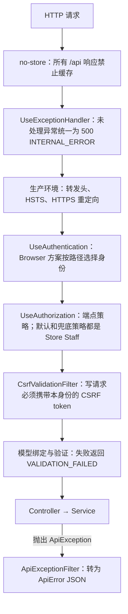
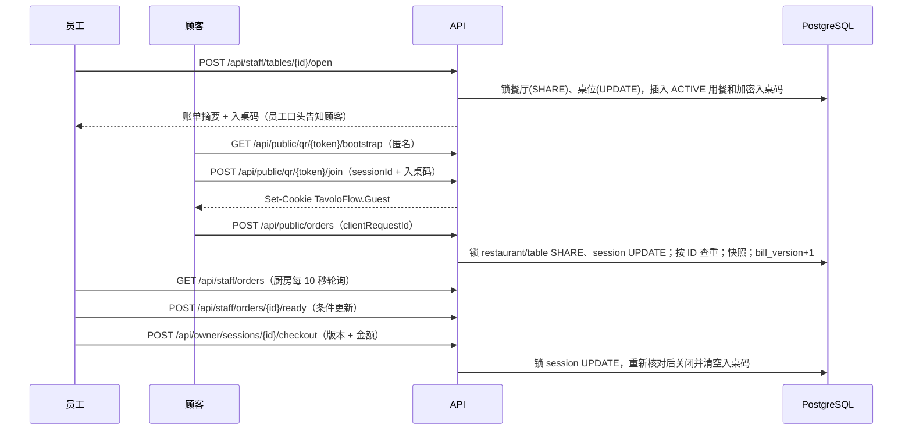
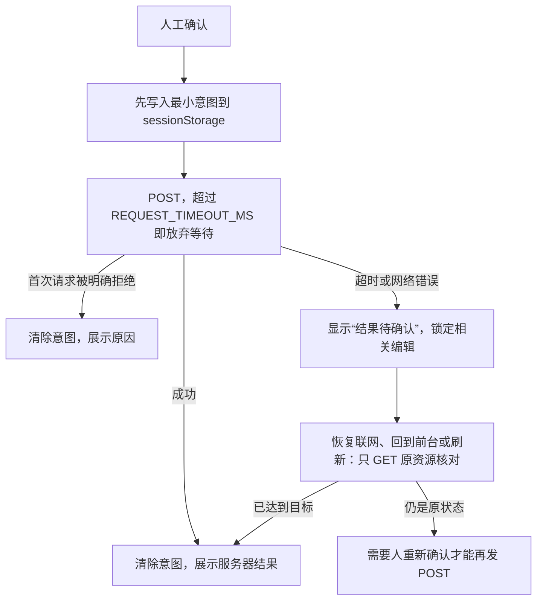

# TavoloFlow 架构说明与重构记录

本文面向项目开发者，用一份文档讲清楚整个系统：分层与请求管线、三种身份、数据不变量、并发设计、端到端数据流、前端状态管理，以及 2026-10 全面代码检查与重构的每一项改动和理由。各阶段的接口细节和练习仍以对应的阶段文档为准（见文末“推荐阅读顺序”）。

## 1. 系统全貌

```mermaid
flowchart LR
  G[顾客手机<br>/q/{token}] --> C
  S[店铺设备<br>/staff/*] --> C
  P[平台管理员<br>/platform/*] --> C
  C[Caddy<br>HTTPS · 静态前端] -->|/api/*| A[ASP.NET Core API]
  A --> D[(PostgreSQL)]
  A --> K[Data Protection 密钥目录]
```

- **同源部署**：前端是 Vite 构建的单页应用，与 API 同域，通过 `/api` 访问后端，因此 Cookie 不需要跨域。
- **一个 API 进程，三种浏览器身份**：店铺（OWNER/STAFF）、顾客（入桌后获得的用餐授权）和平台管理员，各用一个独立的 Cookie。
- **PostgreSQL 是正确性的最后防线**：唯一索引、检查约束和行锁保证“一桌一个活动用餐”“同一请求最多一单”“账单核对与关闭原子完成”。前端只负责改善交互，不承担安全或一致性。

## 2. 后端分层与请求管线

### 2.1 目录分层

| 层 | 位置 | 职责 |
|---|---|---|
| 入口 | `Program.cs` | 注册服务、配置中间件；`Operations/MaintenanceCommands.cs` 提供一次性命令行（初始化账号、恢复平台密码、健康探测） |
| 横切 | `Common/` | 错误信封与全局异常过滤器、浏览器身份与 CSRF、分页游标、枚举文本、输入规则、限流器 |
| 控制器 | `Controllers/` | 只做三件事：声明授权策略、取可信身份、调用服务 |
| 业务模块 | `Accounts/` `Menus/` `Tables/` `Dining/` `Guests/` `Ordering/` `Kitchen/` `Billing/` `Platform/` | 每个模块包含 `XxxContracts.cs`（DTO 与错误工厂）和 `XxxService.cs`（事务与规则） |
| 数据 | `Data/`、`Entities/` | EF Core 映射与迁移、行锁 `RowLocks`、目录删除服务 |

模块之间的依赖是单向的：`Billing` 依赖 `Dining`（会话摘要），`Ordering` 依赖 `Guests` 与 `Dining`，`Kitchen` 依赖 `Ordering`。`Common/` 不依赖任何业务模块；三种身份的方案名常量也定义在 `Common/BrowserSecurity.cs` 中，再由各模块引用。

### 2.2 一次请求经过什么



几个要点：

- **认证与授权分离**。店铺和平台 Cookie 每次请求都在 `ValidatePrincipal` 中回查数据库，比对 `credential_version`、启用状态和角色，所以改密、重置或禁用后旧 Cookie 立即失效。顾客 Cookie 只证明“这个浏览器曾为某一轮用餐输对入桌码”，用餐是否仍为 ACTIVE 由每个顾客服务自行检查。
- **默认安全**。没有显式 `[Authorize]` 的端点会落到兜底策略（Store Staff），新端点不会意外公开。
- **统一错误信封**。所有业务错误都是 `{ code, message, requestId, errors, ...extensions }`。服务抛出 `ApiException`（通常经由模块工厂，如 `DiningErrors.SessionClosed()`），全局过滤器负责转换。少数错误码带扩展字段，例如 `MENU_CHANGED.changes` 和账单冲突的 `currentBill`。

## 3. 三种身份与 Cookie/CSRF 作用域

| 身份 | 路径 | Cookie（Path、有效期） | 可信身份来源 |
|---|---|---|---|
| Store | 除下面两类之外的所有 `/api` | `TavoloFlow.Store`（`/`，固定 16 小时） | `CurrentAccount` |
| Guest | `/api/public/*` | `TavoloFlow.Guest`（`/api/public`，固定 12 小时） | `GuestIdentity` |
| Platform | `/api/platform/*` | `TavoloFlow.Platform`（`/api/platform`，固定 8 小时） | `CurrentPlatformAccount` |

`Common/BrowserSecurity.SchemeFor(path)` 是唯一的“路径 → 身份”映射，有两个用途：

1. 默认认证方案 `Browser` 用它选择该请求由哪个 Cookie 方案认证，从而决定 `HttpContext.User`。
2. `BrowserCsrfScope` 用它给 CSRF token 附加作用域数据（`store`/`guest`/`platform`），使为一种身份获取的 token 无法通过另一种身份的写请求。

前端对应四种请求函数（`lib/api.ts`）：`request`/`write`（店铺）、`publicRequest`（匿名，不带 Cookie）、`guestRequest`/`guestWrite`（顾客）、`platformRequest`/`platformWrite`（平台）。每个写请求都会先从本身份的 `/csrf` 端点取一个新 token，再携带在 `X-CSRF-TOKEN` 头中发送。

## 4. 数据模型与不变量

九张表的完整定义见 `er-diagram.dbml`。理解系统时最重要的是数据库保证的这些不变量：

| 不变量 | 实现方式 |
|---|---|
| 一桌最多一个活动用餐 | 部分唯一索引 `uq_active_session_per_table (table_id) WHERE status = 'ACTIVE'` |
| 同一提交意图最多一单 | 唯一索引 `(dining_session_id, client_request_id)` |
| 租户隔离 | 复合外键 `(id, restaurant_id)`：订单只能指向同店的用餐，明细只能指向同店的订单 |
| 状态与字段一致 | 检查约束 `ck_session_lifecycle`、`ck_order_lifecycle`：例如 CLOSED 必有关闭时间、原因和金额，且入桌码密文为空 |
| 历史不可改写 | 订单明细保存名称、价格和过敏原快照；删除菜品或桌位只断开可空引用，快照保留 |
| 枚举文本 | 数据库与 JSON 都使用大写名称（`ApiEnum` + `UppercaseEnumConverter`），并有检查约束限制取值 |

金额统一使用整数欧分（`long`），上限是 JavaScript 的安全整数 `InputRules.MaxSafeCents`，保证浏览器能精确表示。时间统一存储为 UTC `timestamptz`，界面按 Europe/Rome 显示。

## 5. 并发设计

### 5.1 全局锁顺序

所有事务都按同一顺序加行锁，因此不会互相死锁（`Data/RowLocks.cs`）：

```
restaurant → table → dining session          restaurant → menu item
```

| 操作 | 加锁 |
|---|---|
| 开桌 | restaurant SHARE → table UPDATE |
| 顾客入桌、读码 | restaurant SHARE → table SHARE → session SHARE（`DiningEntrance.LockAsync`） |
| 顾客下单 | restaurant SHARE → table SHARE → session UPDATE |
| 顾客读订单、员工读账单 | session SHARE |
| 厨房完成或取消、三种关桌 | 只锁 session UPDATE，此后不再反向锁餐厅或桌位 |
| 菜单写入、删除菜品 | restaurant UPDATE（删除菜品时再加 menu item UPDATE） |
| 接单开关、平台启停服务 | restaurant UPDATE |
| 桌位改名、启停、删除 | table UPDATE |

为什么下单对餐厅加 SHARE？菜单写入持有餐厅 UPDATE，二者互斥，所以下单时读到的价格和快照不会与改价交错；而不同桌的下单都只持有 SHARE，彼此兼容，可以并行。

### 5.2 `bill_version`：账单的乐观版本

- 新用餐的版本从 1 开始。每成功创建一单、每实际取消一单，版本 +1；READY、幂等重放和关桌都不改变版本。
- 老板确认时提交自己看到的版本和金额。关桌事务锁住 session 后重新计算账单，任一项不一致都返回 `409 BILL_CHANGED` 并附上 `currentBill`，由老板重新核对。
- 下单、取消和关桌都需要同一个 session UPDATE 锁。如果下单先拿到锁，关桌会看到新版本而被拒绝；如果关桌先拿到锁，下单随后看到 CLOSED 而被拒绝。

三种关桌共用 `BillingService.CloseAsync`，检查顺序固定：

1. 零账单确认（仅 EMPTY/VOIDED）
2. 加锁并重新计算账单
3. 若已关闭：原因、版本和金额都相同则返回原结果（幂等），否则返回 `SESSION_CLOSED`
4. 版本不一致 → `BILL_CHANGED`
5. EMPTY 但曾有任何订单 → `SESSION_HAS_ORDERS`
6. 金额不一致 → `BILL_CHANGED`
7. 有 NEW 订单 → `ORDERS_PENDING`
8. PAID 但金额 ≤ 0 → `SESSION_NOT_PAYABLE`
9. VOIDED 但并非所有订单都已取消 → `SESSION_NOT_VOIDABLE`
10. 钳制关闭时间（不早于开桌时间和最后一次订单事件），再做条件 UPDATE（`WHERE status = 'ACTIVE'`）

### 5.3 条件更新，而不是“先读后写”

厨房把 NEW 改为 READY 时，先锁住该订单所属的 session（UPDATE），再重新读取订单状态，最后执行 `UPDATE orders SET status = 'READY' ... WHERE id = @id AND status = 'NEW'` 并检查受影响行数。session 锁已经把同一用餐的所有订单写入串行化，后到的请求会读到新状态并返回 `ORDER_CHANGED`。UPDATE 中的状态条件是第二道防线：即使将来某条写入路径忘了加锁，也不会无条件覆盖别人的结果。不要只在 C# 中读出状态后无条件保存：没有锁时，两个请求可能都读到 NEW。

### 5.4 下单幂等

顾客确认下单时，前端生成 `client_request_id` 并先写入 `sessionStorage`，再发送 POST。后端加锁并确认本轮用餐仍为 ACTIVE、授权匹配之后，**先**按这个 ID 查询；如果已经存在就直接返回原订单（200），不再执行输入、价格或接单开关等检查。只有首次提交才会校验并保存（201）。所以响应丢失后，用同一个 ID 重试也绝不会产生第二单。

### 5.5 一致快照读

楼面、厨房列表与计数、菜单、公开菜单 bootstrap 和历史查询都在 Repeatable Read 事务中执行，因此同一个响应里的列表和统计来自同一时刻的数据。

## 6. 端到端数据流



关闭之后，旧的顾客 Cookie 虽然仍在浏览器中，但每个顾客接口都会检查 session 状态，返回 `SESSION_CLOSED`。历史账单只读取关闭时保存的总额和订单快照。

## 7. 前端架构

### 7.1 三层状态

| 层 | 存放位置 | 例子 |
|---|---|---|
| 远端数据 | TanStack Query 缓存 | 菜单、楼面、厨房队列、账单 |
| 本地意图 | 标签页 `sessionStorage` | 购物车、待确认的下单/开桌/关桌/平台操作标识 |
| 终态 | 组件状态 + `sessionStorage` | “本次用餐已结束”、冻结的确认值 |

查询 key 的第一段决定缓存数据属于哪种身份（`lib/query-scope.ts`）：`public`、`guest`、`platform`、`["auth","me"]`，其他都算店铺私有。店铺身份变化时，`replaceAccount` 只清除店铺私有缓存，以及变量里可能含密码的 mutation 缓存；顾客与平台的数据不受影响。各功能的 key 都由 `api.ts` 中的工厂函数生成，例如嵌套的 `guestKeys`：用一个前缀就能清除整轮用餐、整张桌或全部顾客数据。

### 7.2 “结果未知”只用 GET 恢复

网络超时或断线时，写操作可能已经成功，只是响应丢失了。项目对所有写操作采用同一套模式：



唯一的例外是顾客下单：允许顾客手动点击“重试原订单”，但必须使用原 `client_request_id` 和完全相同的内容，由后端幂等保证不会重复下单。

### 7.3 实时视图的新鲜度

厨房和账单页面只在页面可见且在线时轮询（`isLive()`）。写操作要求最近一次成功同步发生在页面上次恢复之后，并且不超过 30 秒（`lib/live-view.ts` 的 `syncIsFresh`），否则禁止操作，避免依据过期数据做决定。异步请求通过 epoch 计数器和 `AbortController` 丢弃迟到的响应：页面隐藏、断网或身份变化后，旧请求的结果不再写入界面。

## 8. 设计取舍

- **开桌不做幂等键**：结果未知时只 GET 核对，空桌必须由员工再次确认（PRD 明确接受极小概率的误开桌）。下单不能接受这种风险，所以保留 `client_request_id`；结账也不能，所以保留 `bill_version`。
- **菜单最后写入覆盖**：不做菜单版本冲突提示，但下单时始终由服务器重新核价和核对售罄。
- **限流在进程内**：多实例或重启后计数会重置。入桌码只有约 20 位熵，因此按 IP 和按 session 两层限流，正式公网运营前需要重新评估。
- **自定义错误信封而不是 ProblemDetails**：前端已经按 `code` 处理错误；统一由一个过滤器生成，比切换标准格式的成本低。
- **原始 SQL 行锁**：EF Core 没有 LINQ 形式的 `FOR UPDATE`。`RowLocks` 把所有锁语句集中在一个文件里，并在文件头写明锁顺序。
- **前端没有组件测试**：可测试的逻辑都放在纯模块（`state.ts`、`lib/*.ts`）中，用 `node --test` 验证；完整流程由 Playwright 试运营用例覆盖。

## 9. 本次重构记录（2026-10）

重构分为 8 个提交，每个提交都通过了全部 216 个后端集成测试和前端构建、lint 与单元测试。业务规则和 URL 没有变化；唯一的语义调整见 9.3。后端代码量基本持平（约 4.0k 行）：删除的重复实现被新增的说明性注释和共享组件抵消，收益在于每条规则只有一处定义。

### 9.1 统一错误处理（`backend: unify api error handling`）

**问题**：6 个模块各有自己的异常类型和过滤器 Attribute，每个 Controller 必须记得挂上正确的 Attribute。漏挂一个，业务错误就会变成 500。

```csharp
// 之前：每个模块一对异常 + 过滤器，每个 Controller 自己声明
[DiningErrors] [OrderErrors]
public sealed class KitchenController(...) { ... }
throw new DiningException(409, "SESSION_CLOSED", "本次用餐已结束。");

// 之后：一个异常类型，Program.cs 中全局注册一个过滤器
throw DiningErrors.SessionClosed();   // 返回 ApiException
```

限流（429 + `Retry-After`）和改密结果也改为抛出 `ApiException`，店铺与平台的认证控制器因此共享同一套映射。

### 9.2 公共分页、枚举与输入规则（`backend: share paging, enum and input rules`）

- `Common/Paging.cs`：游标编解码、`limit` 校验以及“读 limit+1 行算下一页”此前各写了 3–4 份。游标 record 仍留在各服务内部，因为它定义了游标绑定的范围（租户、会话、筛选条件）。
- `ApiEnum`：替换 9 处 `.ToString().ToUpperInvariant()` 和 5 处手写字符串 switch。解析只接受精确的大写名称。
- `InputRules`：安全整数上限、语言列表和空白转 NULL 原来分别定义了 3 份、4 份和 2 份。
- `KitchenService`：用显式的目标状态取代“`reason` 为 null 表示 READY”的隐式约定，并且只查一次订单所属的用餐。

### 9.3 行锁与会话摘要/关桌统一（`backend, frontend: unify session summaries and closures`）

- `DiningLocks` 移为 `Data/RowLocks`。锁模式参数从 `bool forUpdate` 改为 `RowLock.Share/Update`，调用处一眼就能看懂；另外 5 处手写的 `FOR UPDATE` SQL 也改用它。
- `SessionResponse` 与 `BillSummaryResponse` 几乎相同，有两份投影和两套嵌套三元表达式；EMPTY 关桌也是 PAID/VOIDED 逻辑的第二份拷贝。现在所有会话读取和三种关闭都返回同一个 `BillSummaryResponse`，前端 `useClosure` 不再需要 `"sessionId" in result ? ...` 这样的结构转换。
- **唯一的语义变化**：对已关闭的会话用旧版本号重试 EMPTY，现在与 PAID/VOIDED 一样返回 `SESSION_CLOSED`，此前返回 `BILL_CHANGED`。
- EF Core 小知识：`SessionSummaries.Project` 在最终投影中调用 `ApiEnum.Text`，EF Core 允许这种“客户端求值”，计数与求和仍在一条 SQL 中完成（已用 `ToQueryString()` 验证）。

### 9.4 启动组合与横切关注点（`backend: reorganize startup, browser security and rate limits`）

- **隐藏的顺序依赖**：默认认证方案原来由 `AddStoreAccounts` 先设为 Store，再由写在 `GuestAuthentication.cs` 里的 `AddDiningAndGuests` 改成 Browser，调换调用顺序就会出错。现在由 `AddBrowserSecurity` 显式设置，各身份模块只注册自己的 Cookie 方案和策略。
- `Program.cs` 集中列出全局设置和全部业务服务，命令行部分移到 `MaintenanceCommands`。
- `FixedWindowLimiter` 合并了两份分区限流代码；平台限流器改为 keyed singleton，去掉了一个包装类。
- 依赖整理：API 项目原本依靠设计时包 `Microsoft.EntityFrameworkCore.Design` 把 EF Core 运行时间接拉到 10.0.13（Npgsql 只依赖 10.0.4），测试项目只好额外引用一次。现在 API 直接固定运行时版本。

### 9.5 前端基础整理（`frontend: move shared helpers into lib and remove dead code`）

- 通用代码原来散落在最先用到它的功能里（`money` 在 orders、`priceText` 在 menu、`billTime` 在 billing、`syncIsFresh` 在 kitchen、`useLiveView` 在 billing），`lib/api.ts` 甚至依赖 billing 的类型。现在集中到 `lib/format.ts`、`ids.ts`、`language.ts`、`live-view.ts`、`useLiveView.ts` 和 `query-client.ts`。
- 认证失败处理不再依靠 import 的副作用注册，改为在 `main.tsx` 中显式注册。
- 删除死代码：从未被设置的 `meta.identityScope` 标记、登录、改密或退出后多发的一次 CSRF 请求、已被 billing 取代的楼面 `"close"` 恢复类型，以及没有任何代码读取的 `ApiError.changes`。
- 新增 `tests/lib.test.ts`，覆盖金额解析与格式化（此前没有单元测试）和 UUID 生成。

### 9.6 恢复类 hook 的机械简化（`frontend: simplify recovery hooks with shared helpers`）

- 每个功能的 `api.ts` 收拢自己用到的全部端点；写操作以“请求 thunk”的形式传入，例如 `mutation.mutate(() => saveItem(id, body))`、`run(intent, signal => createRestaurant(input, signal))`。
- `withTimeout`、`isLive`、`onLifecycleChange`、`uniqueBy` 和 `isSameAccount` 取代了十余处重复的样板代码。
- **严格保持语义**：状态转换、effect 的依赖、轮询间隔和恢复时机都没有改变。对于监听事件集合不是“online + offline + visibilitychange”的 hook（如 `useCart`），监听代码保持原样。

### 9.7 Prettier（`frontend: format with prettier`）

此前 `MenuPage.tsx` 是展开格式，而多数 hook 一行写多条语句。引入 Prettier（行宽 100）后统一了整个前端。格式化把原本一行的清理函数拆成多行，使 4 处 `oxlint-disable-next-line` 不再指向被抑制的那一行，已逐一移到对应行；另有 7 处从未生效的抑制注释被删除。

### 9.8 刻意保留的部分

三套独立身份不做泛型合并；前端恢复状态机不改变语义；自定义限流器、自定义错误信封和原始 SQL 行锁维持现状（理由见第 8 节）；数据库结构和迁移不变；员工端单语言文案继续内联在组件中，顾客端三语文案留在 `messages.ts`。

## 10. 推荐阅读顺序与练习

1. **后端主干**：`Program.cs` → `Common/BrowserSecurity.cs` → `Common/ApiErrors.cs` → `Accounts/StoreAuthentication.cs`
2. **一次下单的完整路径**：`Controllers/OrderController.cs` → `Ordering/OrderService.cs` → `Dining/DiningEntrance.cs` → `Data/RowLocks.cs`
3. **关桌事务**：`Billing/BillingService.cs` 的 `CloseAsync`，配合 `BillingTests.cs`
4. **前端主干**：`lib/api.ts` → `lib/query-scope.ts` → `features/accounts/queries.ts` → `features/orders/useCart.ts`（结果未知模式最完整的实现）
5. 各阶段细节：[店铺账号](store-accounts.md)、[菜单](menu-management.md)、[桌位与公开菜单](tables-public-menu.md)、[开桌与顾客授权](dining-guest-access.md)、[购物车与下单](cart-ordering.md)、[厨房与取消](kitchen-cancellation.md)、[结账与历史](billing-history.md)、[平台与试运营](platform-pilot.md)、[数据层](data-layer.md)

**练习**（请在临时分支上做，做完丢弃）：

- 在 `KitchenTests.cs` 中找到 `LockGate`，说明它如何把一个事务卡在指定的 SQL 语句处，从而构造出确定的竞争顺序。
- 把 `OrderService.CreateAsync` 改为先锁 session、再锁餐厅，运行 `OrderTests` 和 `BillingTests`，观察哪些竞争测试失败，并用 5.1 节的锁顺序解释原因。
- 删除 `KitchenService.ChangeAsync` 中条件 UPDATE 的 `o.Status == from`，运行 `KitchenTests`。测试为什么仍然通过？（提示：session 锁。）再想一想，在什么情况下这道条件会成为唯一的保护。
- 在浏览器开发者工具中把网络设为离线后提交订单，观察 `sessionStorage` 中保存的意图，以及恢复联网后发出的 GET 请求。
