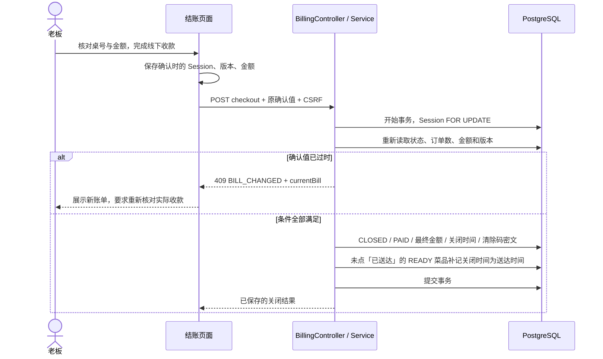

# 第七阶段：结账与历史

本阶段完成“核对整桌账单 → 线下收款 → PAID 关桌 → 顾客授权失效 → 查询历史”，并补齐全部菜品取消后的 VOIDED 关闭。
老板从导航的「结账」进入 `/staff/orders`（也可以在「桌台」打开本桌详情直接结账）；历史入口是首页「管理」中的「历史账单」（`/staff/history`）。员工在 `/staff/floor` 查看活动账单并关闭 EMPTY / VOIDED。
继续使用九张表和已有迁移，没有增加支付交易、支付方式、退款、关桌备注、操作人字段或运行时依赖。

## 1. 按四个小步骤理解

| 步骤 | 入口 | 要理解的问题 |
|---|---|---|
| 账单读取 | `Billing/BillingContracts.cs`、`BillingService.ReadAsync` | 为什么应收是整桌总额，而不是当前页订单之和？为什么使用历史快照？ |
| 关闭事务 | `BillingService.CloseAsync`、`BillingTests.cs` | Session 行锁怎样协调下单、取消与结账？版本为什么不在关闭时增加？ |
| 界面确认与恢复 | `features/billing/state.ts`、`useBill.ts`、`useClosure.ts`、`BillViews.tsx` | 用户确认的金额为什么不能被轮询替换？超时为什么只 GET 核对？ |
| 历史查询 | `BillingService.HistoryAsync`、`HistoryPage.tsx` | 餐厅的“今天”和 UTC 有什么区别？删桌之后为什么还能查询历史？ |

Controller 验证访问策略、接收 DTO、读取可信餐厅；Service 负责事务与业务条件；纯状态函数决定关闭类型、确认是否过时和恢复标识；Hook 管理查询和生命周期；页面收集人的确认。

## 2. 接口契约

所有接口使用店铺 Cookie、首次改密策略和可信 `CurrentAccount.RestaurantId`。写操作要求店铺 CSRF。
响应均 `Cache-Control: no-store`，不接受客户端自报餐厅或角色，不返回入桌码、凭据或 `client_request_id`。

| 方法与路径 | 权限 | 输入 / 输出 |
|---|---|---|
| `GET /api/staff/sessions/{id}/bill` | STAFF / OWNER | 活动用餐账单；`cursor`、`limit` 默认 50 / 最大 100 |
| `POST /api/owner/sessions/{id}/checkout` | OWNER | `{ expectedBillVersion, confirmedTotalCents }`；200 关闭后的账单摘要 |
| `POST /api/staff/sessions/{id}/close-void` | STAFF / OWNER | `{ expectedBillVersion, confirmedTotalCents: 0, guestsLeftConfirmed: true }`；200 关闭后的账单摘要 |
| `POST /api/staff/sessions/{id}/close-empty` | STAFF / OWNER | URL 不变；与 PAID/VOIDED 共用 `BillingService` 关闭路径，200 账单摘要 |
| `GET /api/owner/history` | OWNER | 日期、桌号、关闭原因及游标分页 |
| `GET /api/owner/history/{id}` | OWNER | 已关闭用餐账单；`cursor`、`limit` 与活动账单相同 |
| `GET /api/staff/sessions/{id}` | STAFF / OWNER | 保留现有摘要接口，用于只读核对原用餐的关闭结果 |

账单响应为 `{ summary, orders, nextCursor }`。`summary` 包含：

```text
sessionId, tableId, tableLabel, status, openedAt, closedAt, closeReason,
billVersion, orderCount, itemCount, newItemCount, cancelledItemCount, totalAmountCents
```

订单复用厨房的快照 DTO，包含整单 NEW/PROCESSED 状态、原金额、应收金额及逐项 NEW/READY/CANCELLED、完成/取消时间、菜名、单价、数量和备注。取消原因不存储或展示。
明细按 `(created_at, id)` 升序分页；游标绑定餐厅、Session、活动/历史模式和 `billVersion`。
活动账单版本变化后继续使用旧游标会得到 `409 BILL_CHANGED`，前端从第一页重新读取。
READY 不增加账单版本；每次轮询重新读取已加载分页，以获得处理状态更新。
同一响应内的金额、计数与明细在 Session SHARE 锁保护下读取；跨请求分页不表示冻结的数据库快照。

`totalAmountCents` 始终是整桌金额，不受分页影响。活动用餐累计非 CANCELLED 明细的单价乘数量；历史读取 `closed_total_cents`。
取消菜品的原金额和明细继续保留，界面划掉该行原金额并标记不计应收；订单 payableAmountCents 为剩余应收。
floor 中的活动 Session 摘要增加 `orderCount`、`newItemCount` 和 `totalAmountCents`，同一次 Repeatable Read 快照读取桌位与汇总。

## 3. 三种关闭与事务

| 类型 | 必须满足的条件 | 执行人 |
|---|---|---|
| PAID | 正数应收、没有 NEW、版本和确认金额一致，已经完成线下收款 | OWNER |
| EMPTY | 从未产生任何订单，确认金额为零、版本一致、确认顾客离桌 | STAFF / OWNER |
| VOIDED | 存在订单且所有明细全部 CANCELLED，确认金额为零、版本一致、确认顾客离桌 | STAFF / OWNER |

只有零金额不足以允许 VOIDED；从未下单不能使用 VOIDED，全部取消也不能使用 EMPTY。
界面里的“已完成线下收款”是老板确认；系统不接入支付渠道，不能验证线下款项是否实际到账。



- 关闭只取得 Session UPDATE 锁，不在之后申请餐厅或桌位行锁。下单、取消和 READY 使用同一 Session 锁。
- 下单/取消先完成时，旧确认得到 `BILL_CHANGED`；关闭先完成时，后续下单/取消/READY 得到 `SESSION_CLOSED`。
- NEW 尚未完成时返回 `409 ORDERS_PENDING`；不符合 VOIDED 返回 `409 SESSION_NOT_VOIDABLE`；零账单不能 PAID，返回 `409 SESSION_NOT_PAYABLE`。
- `BILL_CHANGED`、`ORDERS_PENDING` 和关闭条件冲突附带 `currentBill` 摘要，前端保留该信息用于说明，并重新查询明细。
- 关闭更新原子提交，任何中途异常均回滚；不修改订单快照，不增加 BillVersion。结账时菜品必然已经上桌，所以同一事务把仍为 READY 且 `served_at` 为空的菜品补记关闭时间为送达时间，传菜屏不再列出它们。关闭时间至少等于开桌和本轮最新业务时间，容忍服务器时钟向后调整。
- 同一 Session 以相同类型、版本和金额重复关闭返回已有结果；不重新写时间、金额或原因。不匹配的关闭请求拒绝。
- 暂停服务、停用桌位或暂停接单不会阻止处理现有账单。关闭不自动开启下一轮。
- 关闭后的顾客保护沿用每次请求的实时 Session 检查；Cookie 即使留在浏览器，旧访问也被拒绝。

## 4. 页面、确认和未知结果

`/staff/orders` 显示活动桌位、应收与待处理数量。选定用餐的 ID 保存在 URL，刷新后仍读取原用餐。
`/staff/floor` 同样保留所选 Session；查看入桌码的功能不变，零账单确认使用共享账单组件。
老板可以从结账页或桌位详情完成关闭；STAFF 没有收款能力。历史/结账的 OWNER 页面先判断角色，再挂载业务查询。

在线且可见时，活动账单每 30 秒刷新；前台恢复、重连、修改成功时主动刷新。
超过 30 秒没有成功同步、查询失败或页面不在活动状态时，禁止关闭操作。
打开账单或回到前台后，在成功同步之前同样禁止关闭，但与厨房一样只在超过 3 秒仍未同步时才提示（`syncIsStalled`），
离线或失败则立即提示，正常加载不会闪出“账单正在同步或已过期”。
点击进入确认时复制账单摘要；后续轮询不能替换这个确认。发现版本、金额、订单数量或状态变化时，原确认失效。
最终 POST 使用用户看过的版本和金额，不依赖“再 GET 一次就不会竞争”的假设。

超时、断网和 5xx 显示“结果待确认”。每次写入前，按标签页/餐厅/账号保存最小 `{ sessionId, kind }`，不保存完整账单、入桌码或凭据。
存储不可用时保留内存恢复并提示刷新前记录编号；URL 仍保留原 Session。
恢复入口、定时核对和页面恢复都只 GET 原 Session，不自动重发 POST。

| 核对结果 | 界面行为 |
|---|---|
| 原 Session 已关闭 | 展示实际关闭原因和金额，请核对实际收款；不声称一定由本次操作完成 |
| 原 Session 仍活动 | 重新读取账单，必须再次由人确认才能关闭 |
| 原 Session 不存在/不可访问 | 停止重试，提示人工核对，不改用同桌下一轮 |
| GET 仍失败 | 保留待确认标识，继续只读核对 |

待确认期间禁止再次关闭同一 Session。页面或账号切换、隐藏、断网会中止旧工作并推进操作代次；迟到响应不能填充新身份的界面。
这属于状态核对，不是操作级幂等追踪。旧 POST 仍可能延迟到达，但固定 Session、确认值比较及终态保护避免重复关桌或影响下一轮。
关闭成功后刷新桌位、账单、厨房和历史的私有查询。顾客沿用访问校验与轮询，确认结束后清空本轮草稿和受保护响应。

## 5. 历史筛选

查询参数为 `fromDate`、`toDate`（均为 `YYYY-MM-DD`）、`tableLabel`、`closeReason`、`cursor`、`limit`。
起止日期同时省略时，后端用餐厅时区和 `TimeProvider` 计算当天；否则必须成对提供，结束日期包含当天。
后端转换为 UTC 的 `[当地起始日零点, 当地结束日次日零点)`，因此夏令时切换日可以是 23 或 25 小时。
返回 `{ items, nextCursor, totalCount, fromDate, toDate, timeZone }`，分页游标固定已解析的日期范围，跨午夜不移动范围。
列表按 `(closed_at, id)` 倒序；默认 50、最大 100。游标还绑定餐厅、桌号与关闭原因，不得跨筛选复用。
桌号按 trim 后的历史快照精确匹配，大小写敏感；PAID、EMPTY 和 VOIDED 都可以查询。
历史详情通过 Session ID 定位，与列表当前筛选独立；删除菜品/桌位后继续展示原快照和最终金额。没有修改、重开或删除历史的业务接口。

## 6. 自己动手验证

1. 顾客点两单。老板打开结账页，观察有 NEW 时不能收款；厨房完成后，应收不变，收款入口出现。
2. 老板核对 €15 并进入确认，另一设备再加单。刷新后原确认失效；即使没有刷新就提交，服务器也返回 `BILL_CHANGED`，不能按 €15 关闭。
3. 取消全部待出餐菜品，用 STAFF 关闭 VOIDED。另开一轮不下单，关闭 EMPTY，比较两条历史的原因。
4. 用浏览器拦截 checkout 响应，模拟数据库已成功但响应丢失。刷新，观察只 GET 原 Session，Network 中不会自动出现第二次 checkout POST。
5. PAID 关闭后刷新顾客页，核对结束提示、购物车和订单清理；重新开同桌，旧授权仍不可用。
6. 删除已关闭账单关联的菜品和桌位，按旧桌号查询历史，核对菜名、单价、备注与金额。
7. 将两台老板设备停留在同一账单，同时确认关闭，核对最终只有同一个关闭时间和结果。
8. 断网或切到后台后尝试操作，确认按钮锁定；恢复后需要成功同步，并重新进行人的确认。

## 7. 验证

```bash
dotnet test TavoloFlow.slnx
```

前端目录：

```bash
node --test --test-isolation=none tests/*.test.ts
npm run build
npm run lint
```

后端测试使用临时 PostgreSQL 和真实迁移，包含权限、金额、分页、并发锁竞争、重复关闭、关闭失败回滚、历史快照、关桌后保护和罗马夏令时边界。
前端纯逻辑测试覆盖关闭资格、确认值冻结、最小恢复标识、只读恢复路径、身份/生命周期隔离和查询范围。
浏览器验收使用独立测试数据库，不修改开发数据库。

### 2026-10-23 实际验证记录

| 检查 | 结果 |
|---|---|
| 后端完整回归 | `dotnet test TavoloFlow.slnx --no-restore -m:1 /p:UseSharedCompilation=false --verbosity minimal`：192 项通过，包含本阶段新增 18 项 |
| 前端纯逻辑 | Node 24 执行上述 `node --test`：42 项通过，包含本阶段新增 9 项 |
| 前端构建 | `npm run build` 通过，路由树由 Vite 生成 |
| 静态检查 | `npm run lint` 和 `git diff --check` 通过 |
| 浏览器 | Chromium 的独立 OWNER / STAFF / Guest 上下文，独立临时 PostgreSQL，桌面 1280px 和移动端 390px 验收通过；没有页面 JavaScript 异常 |

浏览器实际覆盖：NEW 阻止收款；另一顾客加单导致提交冲突；PAID 成功响应丢失后刷新并只 GET 恢复；顾客结束状态；STAFF 的 VOIDED / EMPTY；STAFF 直接访问老板页面不发送受限业务查询；餐厅当天历史、桌号/原因筛选；删菜、删桌后快照不变。

额外用 52 笔订单验证活动/历史明细分页、取消明细的原金额和状态、后台刷新后旧确认金额保持不变且不可提交、断网恢复后重新确认、原关闭请求未到服务器时刷新只读核对 ACTIVE、页面隐藏后丢弃迟到响应并恢复实际关闭状态、退出登录后历史不可访问。自动恢复均未增加关闭 POST 次数。

截图为虚构验收数据，可点击查看完整页面：

| 页面 | 桌面 | 移动端 |
|---|---|---|
| 账单与收款确认 | [结账桌面](screenshots/billing-history/billing-desktop.png) | [结账移动端](screenshots/billing-history/billing-mobile.png) |
| 历史筛选与快照 | [历史桌面](screenshots/billing-history/history-desktop.png) | [历史移动端](screenshots/billing-history/history-mobile.png) |

此前阶段文档中的测试数字是各阶段当时的记录，继续保留；本节记录第七阶段完成时的整体结果。
