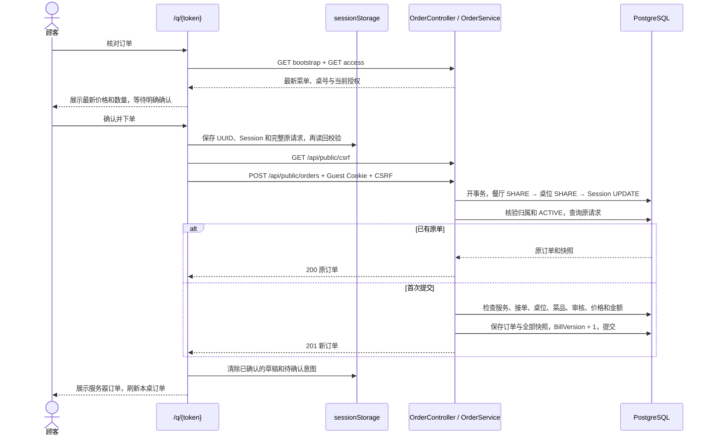

# 第五阶段：购物车与下单

本阶段完成“浏览菜单 → 编辑购物车 → 验证入桌 → 核对并下单 → 查看本桌订单 → 继续加单”。
顾客继续使用 `/q/{token}`，员工在 `/staff/floor` 开始或暂停接单。沿用九张表、现有迁移、顾客 Cookie 和 CSRF，没有新增数据库迁移或依赖。

**当前边界：** 新订单及明细状态为 `NEW`；整单处理后为 `PROCESSED`。逐项 READY 和取消已由[第六阶段](kitchen-cancellation.md)接续实现；PAID/VOIDED 关闭、完整账单与历史页已由[第七阶段](billing-history.md)接续实现。
一旦本轮存在任何订单，就不能使用 EMPTY 关闭；接单开关也不会关闭用餐。练习时建议使用测试餐厅和测试桌位。

## 1. 按四个小步骤阅读代码

| 步骤 | 入口 | 建议先回答的问题 |
|---|---|---|
| 订单接口、事务和接单开关 | `backend/TavoloFlow.Api/Controllers/OrderController.cs`、`Ordering/OrderService.cs`、`Ordering/OrderContracts.cs`、`Dining/DiningService.cs` | 为什么查原请求要在核价前？哪些锁会阻止改价或关桌？ |
| 购物车纯状态与存储 | `frontend/src/features/orders/state.ts`、`response.ts`、`frontend/tests/orders.test.ts` | 两行什么时候合并？为什么保存失败不能发送？ |
| 页面联调与恢复 | `features/orders/useCart.ts`、`OrderViews.tsx`、`messages.ts`、`features/guests/useGuestVisit.ts` | 什么情况可以解锁？过期授权与结束用餐有什么不同？ |
| 验收与文档 | `backend/TavoloFlow.Api.Tests/OrderTests.cs`、本文第 6–7 节 | 如何证明重复请求只有一单，而不只是按钮防连点？ |

先读每一步对应的测试，再读实现。纯状态函数负责数量、金额和请求内容；Hook 负责网络、存储和生命周期；Controller 解析协议并交给 Service；Service 在事务内决定能否保存。

## 2. 一笔订单的请求链路



匿名看菜单使用 `publicRequest`，不携带凭据。下单、读取订单和恢复使用 `guestRequest/guestWrite`，不会调用店铺 `/api/auth/me`。
店铺登录不等于顾客已入桌。餐厅、桌位与用餐归属来自服务端验证后的 `GuestIdentity`，不接受客户端自报餐厅 ID。

### 接口约定

| 方法与路径 | 输入 | 成功与关键错误 |
|---|---|---|
| `POST /api/public/orders` | 下方 JSON；顾客 Cookie 与对应 CSRF | 首次 `201`，同键已存在 `200`；`409 MENU_CHANGED`、`ORDERING_PAUSED` 等 |
| `GET /api/public/sessions/{id}/orders` | 可选 `cursor`、`limit`，默认 50、最多 100 | `{ items, nextCursor, totalAmountCents }`；总额是本轮全部非取消明细的金额，不是本页合计 |
| `GET /api/public/sessions/{id}/orders/by-request/{requestId}` | 原 Session、原 UUID | 原订单；`404 ORDER_NOT_FOUND` 仅表示暂未查到 |
| `PATCH /api/staff/accepting-orders` | `{ "enabled": true }`；OWNER/STAFF、店铺 CSRF | `{ "orderingEnabled": true }`；只更新本店接单字段 |

```json
{
  "sessionId": "00000000-0000-4000-8000-000000000001",
  "clientRequestId": "00000000-0000-4000-8000-000000000002",
  "items": [
    {
      "menuItemId": "00000000-0000-4000-8000-000000000003",
      "quantity": 2,
      "remark": "少盐",
      "expectedUnitPriceCents": 1250
    }
  ]
}
```

以上 ID 只是示例，实际请求须使用当前环境的资源 ID。备注去首尾空白，空白备注保存为 null。
订单 DTO 包含订单 ID、Session、时间、状态、总额、备注、默认语言快照和明细快照；不返回 `clientRequestId`、账号或顾客票据。
列表按 `(CreatedAt, Id)` 倒序分页，游标绑定本轮 Session；餐厅改单价或删除菜品后，历史订单仍显示原名称、编号、过敏原、单价及数量。
服务端订单响应禁止缓存，前端也不会将服务器订单响应保存到本地存储。

`MENU_CHANGED` 的 `changes` 包含相关 `menuItemId`、`reason`、`currentUnitPriceCents` 和 `isAvailable`。
原因包括 `MISSING`、`UNAVAILABLE`、`PRICE_CHANGED`。前端刷新菜单并要求再次核对；不会静默删除原明细，也不会自动以新价下单。
首次提交被明确拒绝可以编辑并重新确认；已经未知的原请求遵循后面的保守恢复规则。

## 3. 事务、锁与金额为什么这样写

下单的事务一直持有餐厅 SHARE、桌位 SHARE、Session UPDATE，直到提交或回滚：

- 菜单维护和删菜先锁餐厅 UPDATE。若下单先拿到 SHARE，则按该时点的菜单完成；若菜单修改先提交，下单读到新价格并要求重新确认。
- 接单开关更新餐厅行、桌位启停更新桌位行，都会与对应 SHARE 冲突，不会在检查之后偷偷改变首次提交的条件。
- 同桌下单、EMPTY 关闭都用 Session UPDATE。同一桌的不同订单依次更新账单版本；不同桌仍可并行。
- 读取订单在事务中持有 Session SHARE，与厨房取消、关桌及结账协调。读取完成前不会关桌；关桌先完成则读取被拒绝。读路径不再向上获取餐厅/桌位锁。
- 暂停接单、停用服务或桌位时，**既有有效授权**仍可读活动用餐的原订单，也可恢复已经存在的订单；新订单会被拒绝。重新入桌验证仍遵循第四阶段的入口限制。

“按钮只能点一次”不能抵挡重发。数据库既有唯一约束 `(dining_session_id, client_request_id)` 是底线；Session 锁使同键并发请求依次看到原单。
原单查询位于首次提交业务校验之前，所以重发内容不同、后来售罄或停用服务，都不会创建第二单或把已存在的结果错误当作未下单。
HTTP 请求仍须能够解析、具备有效的 Session/请求标识并通过身份与 CSRF 校验；未知字段和非法 JSON 不属于可恢复的业务载荷。

首次成功同时保存订单、全部明细和 `BillVersion + 1`；故障会整体回滚。读取、重复请求和接单开关不改变版本。
新 Session 从版本 1 开始，第一笔成功后为 2。

数量限制为每单 1–30 行、每行 1–20 份、总计不超过 100 份；单行备注最多 200 个字符；订单没有整单备注。
所有金额用整数欧分。前端用 `BigInt` 检查运算后再转换成安全整数；后端检查单价乘数量、整单合计、整桌非取消明细合计都不超过 `9,007,199,254,740,991`。
后端还阻止 `BillVersion` 达到 `int` 上限后的递增，不能把溢出留给数据库异常处理。

## 4. 页面与未知结果恢复

购物车 key 为 `tavoloflow:cart:{restaurantId}:{tableId}`，内容含所见 Session。不同标签页独立；切桌时重建组件并读取目标桌自己的草稿。
未开桌时可以先加菜，Session 为 null；首次开桌后，确认画面明确提示确认本轮归属。旧轮次已明确结束则清空，不能自动迁入下一轮。
同菜品且备注去首尾空白后相同的行合并，不同备注分行。

只有最终确认后才生成 UUID。使用 `crypto.getRandomValues()` 填充 16 字节并设置 UUIDv4 的版本/变体位，兼容局域网 HTTP 下没有 `randomUUID()` 的浏览器。参见 [MDN getRandomValues](https://developer.mozilla.org/en-US/docs/Web/API/Crypto/getRandomValues)。

| 状态/事件 | 界面与持久化处理 | 下一步允许的网络操作 |
|---|---|---|
| 编辑草稿 | 可以增减、移除、修改备注；尚无提交意图 | 读取最新入口、授权和菜单 |
| 等待最终确认 | 展示桌号、最新单价、明细及金额 | 顾客确认后保存 UUID 和完整内容，再获取 CSRF 并 POST |
| 提交中 | 冻结购物车，仍可浏览菜单 | 等待本次结果，不生成第二个 ID |
| 网络异常、超时、解析失败或 5xx | 保留原意图，显示结果待确认 | 自动恢复只有 GET；不自动重发 POST |
| GET 找到原单 | 校验完整服务器结果，清除对应草稿/意图，显示原单 | 可以开始新的加单 |
| GET 暂未找到 | 继续冻结；404 不能证明原 POST 不会稍后提交 | 再次查询，或顾客主动点击“重试原订单” |
| 手动重试 | 同一 ID、同一内容，获取新的 CSRF token | 显式 POST；后续业务拒绝也不能解除已有未知意图 |
| 首次请求明确被业务规则拒绝 | 保留草稿、解除本次意图，必要时刷新菜单 | 顾客重新核对后才创建新意图 |
| Cookie 过期或被另一标签页替换 | 隐藏并移除受保护响应，保留原轮次草稿/意图 | 重新验证同轮，之后 GET 原结果 |
| 确认关桌或原 Session 已被替换 | 取消请求、清除本轮数据，未知结果提示联系员工 | 停止恢复；主动重新浏览也不迁移旧草稿 |
| 存储不可用或内容损坏 | 可以浏览；存储不可用仍可编辑，但阻止正式提交 | 修复存储前不 POST；损坏意图应先联系员工核对 |

**本阶段唯一的写请求恢复例外是顾客手动重试原订单。** 开桌、EMPTY 关闭、接单设置仍沿用 GET 核对流程；所有操作都没有自动 POST 重试或离线队列。
若未知意图的后续重试被永久性菜品变化阻挡，当前 MVP 不提供“丢弃未知意图并换 ID”按钮，应请员工核对，避免延迟原请求造成重复点餐。

刷新、恢复联网和回到前台时，先核验原 Session/授权，再查询原请求；正常前台约每 30 秒更新本桌订单及待确认结果。
请求使用取消信号和操作代次检查。授权广播、失去可用授权、页面隐藏/离线、切桌和关桌时，旧响应不能重新填回受保护界面。
本桌列表支持手动刷新和游标加载更多，查询 key 为 `guest + restaurantId + tableId + sessionId + orders`，不会被店铺账号切换清掉。

## 5. 本地运行与体验顺序

数据库、开发账号及服务激活沿用 [第四阶段的开发环境说明](dining-guest-access.md#6-本地运行和学习实验)。接单开关不能把平台 `SUSPENDED` 状态改成 `ACTIVE`。
本阶段没有迁移，不需重建数据库。开发服务器仍使用 Vite `/api` 同源代理。

1. OWNER 在菜单页准备一款已审核、可售的菜品，在桌位页创建测试桌。
2. OWNER 或 STAFF 打开 `/staff/floor`，点击“开始接单”，确认服务和桌位可用。
3. 顾客先打开该桌 `/q/{token}`，未开桌也可加菜。员工开桌并告知入桌码。
4. 顾客验证后点击“核对订单”，核对桌号、数量、备注和最新金额，再点击“确认并下单”。
5. 用另一个浏览器/无痕窗口模拟另一台设备，验证同轮入桌码；两端看到本桌已提交订单，草稿各自独立。
6. 加一笔订单，检查员工用餐摘要中的订单数、总额与版本。暂停接单后还能读原订单，但不能提交新订单。

第七阶段已提供 PAID/VOIDED 关闭；应通过正常业务流程结束测试用餐。真实验收应像自动测试一样使用独立数据库，不改动正在使用的业务数据。

## 6. 三个学习实验

### 实验 A：重复发送同一请求

在浏览器开发者工具 Network 中找到一次成功的 `POST /api/public/orders`，记录原 body。在同一个已验证顾客页面的 Console 中执行：

```javascript
// 填入刚才的原始 body；保持 sessionId、clientRequestId 和 items 完整不变。
const original = { /* Network 中复制的 JSON */ };
async function repeatOriginal() {
  const { token } = await fetch('/api/public/csrf', { credentials: 'same-origin', cache: 'no-store' }).then(r => r.json());
  const response = await fetch('/api/public/orders', {
    method: 'POST', credentials: 'same-origin',
    headers: { 'Content-Type': 'application/json', 'X-CSRF-TOKEN': token },
    body: JSON.stringify(original)
  });
  return { status: response.status, order: await response.json() };
}
await Promise.all(Array.from({ length: 10 }, repeatOriginal));
```

预期：都返回 `200` 和同一订单 ID，员工摘要的版本不再增加。再暂停接单或把菜品设为售罄后重发，仍返回原单。
思考：若把幂等查询移动到“是否接单”之后，会让顾客产生什么误解？

### 实验 B：下单前改价

顾客停在“确认本次订单”画面；OWNER 在另一浏览器把同一菜品从 €12.50 改成 €14.50。
顾客点击正式确认，应收到 `409 MENU_CHANGED`，没有新订单、没有版本递增。
再次点击“核对订单”后会看到 €14.50，必须再次明确确认。已提交旧订单的快照仍为 €12.50。
思考：前端先取最新菜单为什么还不够，后端为什么必须在锁内重新检查？

### 实验 C：丢弃成功响应

使用 Playwright 在**独立测试环境**拦截 POST，先让请求真实到达服务器，再把成功响应体替换为无效 JSON：

```javascript
await page.route('**/api/public/orders', async route => {
  const response = await route.fetch();
  await route.fulfill({ response, body: '{' });
});
```

预期：购物车冻结且原请求仍保存在 sessionStorage；刷新后先核验授权，再 GET 原请求，找到原单后恢复成功，期间没有自动 POST。
如需观察稳定的待确认画面，可暂时阻断 `**/orders/by-request/*` 的 GET，再解除阻断。
把拦截改为 `route.abort('failed')` 可模拟请求未到服务器：查询显示“暂未查到”，只有点击“重试原订单”才再次 POST，ID 和 body 必须完全相同。
进一步实验：在待确认时暂停接单再手动重试；即便收到拒绝，购物车仍不能解除原未知意图。

## 7. 本次验证记录

2026-10-22，所有数据库验收使用可丢弃 PostgreSQL 容器及独立 Data Protection 密钥，没有使用或修改开发数据库。

| 验证 | 结果 |
|---|---|
| `dotnet test TavoloFlow.slnx --no-restore -m:1 /p:UseSharedCompilation=false --verbosity minimal` | 162 项通过；其中新增订单测试 38 项 |
| `npm run build`（`frontend/`） | Vite 构建及 TypeScript 检查通过 |
| `npm run lint` | 通过，无警告 |
| `node --test --test-isolation=none tests/*.test.ts` | 29 项通过，其中本阶段新增 12 项 |
| Playwright / Chromium，本地临时 API + Vite | 两台顾客下单/加单、三语、360px 布局、备注分行、键盘验证、长度限制、刷新保留草稿 |
| 浏览器故障与生命周期 | 已保存但响应损坏、请求未到达、GET 恢复、原内容手动重试、改价重新确认、暂停接单、存储失败、跨标签页换授权、SPA 切桌隔离、迟到列表/下单响应丢弃、关桌清理 |

后端覆盖十次同键并发、不同意图并发、跨归属/过期/CSRF/闭桌拒绝、历史快照、分页、金额边界，以及下单与改价、售罄、删除、停桌、暂停接单、EMPTY 关闭的两种锁执行顺序；还验证读取与关闭竞争，以及版本更新后注入故障的整体回滚。
浏览器验收为桌面 Chromium 模拟移动视口，未声称已在真实 iOS/Android 设备上验收。
另在禁用 `crypto.randomUUID` 的浏览器上下文中完成下单，验证 UUIDv4 实现只依赖 `getRandomValues`。

主要界面截图：

- [接单工作台](screenshots/orders-accepting-staff.png)
- [中文购物车与不同备注](screenshots/cart-mobile-zh.png)
- [意大利语购物车](screenshots/cart-mobile-it.png)
- [英文核对订单](screenshots/order-confirm-mobile-en.png)
- [待确认结果与原请求重试](screenshots/order-unknown-mobile-en.png)
- [中文本桌订单](screenshots/table-orders-mobile-zh.png)
- [存储不可用](screenshots/order-storage-mobile-en.png)
- [关桌后未知结果提示](screenshots/order-ended-mobile-en.png)

## 逐菜处理后的响应与恢复

订单原始 `totalAmountCents` 保持下单快照，`payableAmountCents` 是未取消明细之和。每行增加 `status`（NEW/READY/CANCELLED）、`readyAt`、`cancelledAt`；整单 `status` 为 NEW/PROCESSED。顾客看到 NEW 为“已收到”，READY 为“已出餐”，取消明确不计应收。

下单未知结果恢复必须同时验证原始总额等于全部明细之和、应收等于未取消明细之和；全部取消后应收为零仍是有效的原请求结果。数量和原始正文不因厨房处理而变化。同一请求 ID 的恢复与显式重试仍优先返回已有订单。
