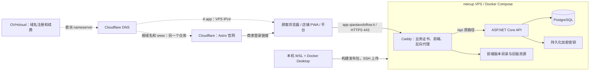

# 从 Windows / WSL 部署 Qiao TavoloFlow 到 netcup

本教程对应仓库的 `deploy/` 目录，把业务系统部署到 `https://app.qiaotavoloflow.it`：在本机 WSL 构建发布包并上传，由 netcup VPS 长期运行。

- **A. 首次部署**（第 1–12 节）：只做一次。换服务器时按第 16 节重做其中一部分。
- **B. 日常运维**（第 13–17 节）：发布新版本、回退、下载备份、恢复和维护，以后反复执行。
- **C. 常见问题**、**D. 上线清单**。

全文约定：

| 写法 | 含义 |
|---|---|
| `~/.ssh/tavoloflow` | 本机 WSL 的 SSH 私钥；公钥是 `~/.ssh/tavoloflow.pub` |
| `VPS_IP` | VPS 的公网 IPv4，执行前替换成实际地址 |
| `RELEASE` | 发布包版本号，即文件名 `tavoloflow-<版本号>.tar.gz` 中间的部分 |
| **操作位置** | 命令在哪里执行：本机 WSL、VPS 终端，或某个网页控制台 |

## 0. 整体结构

| 服务 | 平台 | 管理什么 |
|---|---|---|
| 域名注册与续费 | OVHcloud | `qiaotavoloflow.it` 的续费、nameserver、DNSSEC |
| 权威 DNS | Cloudflare 免费计划 | 解析记录；业务 `app` 使用灰云（DNS only） |
| 业务服务器 | netcup | VPS、操作系统、公网 IP、远程控制台 |
| 业务 HTTPS | VPS 内的 Caddy | 为 `app.qiaotavoloflow.it` 自动申请和续期证书 |
| 官网 | Cloudflare（另一个仓库） | 根域名和 `www`，与本仓库无关 |



- 域名、DNS 和服务器分属三家公司，互不绑定。更换 VPS 只需改 Cloudflare 的一条 A 记录，不用改二维码、Caddy 或数据库配置。
- VPS 上运行三个容器：`caddy`（唯一对外开放 80/443）、`api`、`db`。API 和数据库没有对外端口。
- **卷**保存数据库、加密密钥和证书，更新或重建容器不会清空卷。
- 前端和 `/api` 在同一个子域名下，没有跨域请求，Cookie 只属于业务域名。
- 本机和 VPS 各有一个 Docker。生产维护命令只在 VPS 上通过 `tf.sh` 执行，不要在本机的开发 Compose 上执行。

---

# A. 首次部署

## 1. 准备 SSH 密钥

**操作位置：本机 WSL。** 已有 `~/.ssh/tavoloflow` 就跳过生成，不要覆盖。

```bash
# 生成 Ed25519 密钥；-C 是注释，只用于识别
ssh-keygen -t ed25519 -C "tavoloflow" -f ~/.ssh/tavoloflow
# 查看公钥，下一节要粘贴到 netcup
cat ~/.ssh/tavoloflow.pub
```

- `tavoloflow` 是**私钥**，永远留在本机；`tavoloflow.pub` 是**公钥**，交给服务器。
- 复制公钥时要复制完整的一行（`ssh-ed25519 ... tavoloflow`），不要复制指纹或私钥。也可以用 `clip.exe < ~/.ssh/tavoloflow.pub` 直接放进 Windows 剪贴板。

## 2. 购买 netcup VPS 并安装 Ubuntu

### 2.1 选择产品

**操作位置：netcup 网站。**

- 最低要求：**x86-64 / AMD64**、2 vCPU、4 GB 内存、40 GB 磁盘、带公网 IPv4，欧洲机房。当前使用的是 [VPS Lite](https://www.netcup.com/en/server/vps-lite) 1 G12.5s。
- 必须是 AMD64：构建脚本只构建 `linux/amd64` 镜像。不要选 ARM64、纯 IPv6 或 vLAN-only 规格。
- 网络选 **IPv4 and IPv6 connectivity**，部署只使用 IPv4。
- 不需要购买管理面板、Windows 或付费 SSL 证书。

### 2.2 区分三个入口

| 入口 | 用途 |
|---|---|
| Customer Control Panel（CCP） | 订单、账单 |
| Server Control Panel（SCP） | 开关机、重装系统、Screen 远程控制台、网络。和 `scp` 命令只是重名 |
| Linux SSH | 登录服务器执行命令。首次用 `root`，之后用 `deploy` |

在 SCP 的服务器信息页面记录公网 IPv4，即后文的 `VPS_IP`。参见 [netcup 首次使用服务器](https://www.netcup.com/en/helpcenter/documentation/server/accessing-server)。

### 2.3 在 SCP 保存公钥

**操作位置：netcup SCP 网页。**

1. 打开顶部 **Options → SSH Keys**。
2. 新增公钥：名称填 `tavoloflow`，内容粘贴第 1 节复制的整行公钥。
3. 确认它出现在列表中。

这一步只是把公钥存在 netcup 账号里，下一步安装系统时选中它，安装器才会把它写入新系统。参见 [SCP 说明](https://www.netcup.com/en/helpcenter/documentation/server/scp-home)。

### 2.4 安装 Ubuntu 24.04 LTS

**操作位置：netcup SCP 网页，选中这台 VPS。** netcup 默认交付的系统可能是 Debian。

1. 进入 **Media → Images → Official Images**。
2. 选择 **Ubuntu 24.04 LTS** 的 Minimal 镜像，选择占用整块磁盘的大分区布局，保持 UEFI 设置。
3. 在 SSH 公钥区域选中 `tavoloflow`。
4. 确认安装。页面要求确认密码时，输入的是 SCP 登录密码。**这会清空服务器磁盘。**
5. 记录安装后显示的 root 密码，在 SCP 的 **Screen** 确认系统已启动。

参见 [netcup 镜像安装说明](https://www.netcup.com/en/helpcenter/documentation/server/media)。netcup 快照不能替代第 12 节的数据库和密钥备份。

## 3. 首次登录并建立 deploy 账号

### 3.1 首次以 root 登录

**操作位置：SCP → Screen**，用 root 密码登录，查看服务器指纹：

```bash
ssh-keygen -lf /etc/ssh/ssh_host_ed25519_key.pub
```

**操作位置：本机 WSL。**

```bash
ssh -o IdentitiesOnly=yes -i ~/.ssh/tavoloflow root@VPS_IP
```

首次连接显示的 ED25519 指纹应与 Screen 中看到的一致，再输入 `yes`。这能确认连接的是自己的服务器。

**操作位置：VPS root 终端。** 确认系统和架构：

```bash
cat /etc/os-release   # 预期 Ubuntu 24.04
uname -m              # 预期 x86_64
```

只有确实重装了这台服务器、并在 Screen 核对过新指纹后，才用 `ssh-keygen -R VPS_IP` 清除本机旧的指纹记录。

### 3.2 创建 deploy 用户并安装公钥

**操作位置：VPS root 终端。** 保持这个会话，暂不禁用 root 登录。

日常使用普通用户 `deploy`，需要时才 `sudo`。这样登录需要私钥，提权还需要 deploy 的密码，之后也能禁止 root 远程登录。

```bash
apt update
apt install -y sudo openssh-server nano
# 创建用户和家目录，按提示设置 deploy 的密码（只用于 sudo），姓名等可留空
adduser deploy
# 加入 sudo 组；-a 表示追加，不能漏
usermod -aG sudo deploy
# 创建 .ssh 目录，只有 deploy 能访问
install -d -m 700 -o deploy -g deploy /home/deploy/.ssh
# 粘贴完整的一行公钥；Ctrl+O 回车保存，Ctrl+X 退出
nano /home/deploy/.ssh/authorized_keys
# nano 以 root 创建的文件归 root，要改回 deploy
chown deploy:deploy /home/deploy/.ssh/authorized_keys
chmod 600 /home/deploy/.ssh/authorized_keys
```

- 在 Screen 里无法粘贴时，可以复制 root 已导入的公钥：`cp /root/.ssh/authorized_keys /home/deploy/.ssh/authorized_keys`，然后同样执行 `chown` 和 `chmod`。
- 所有者或权限不对时，sshd 会忽略这把公钥，表现为密钥正确却无法登录。

**操作位置：新开一个 WSL 终端。**

```bash
ssh -o IdentitiesOnly=yes -i ~/.ssh/tavoloflow deploy@VPS_IP
whoami    # 预期 deploy
sudo -v   # 输入 deploy 的密码，预期成功
```

成功后，后面所有服务器命令都以 deploy 登录执行。

### 3.3 更新系统、设置时区、配置防火墙

**操作位置：VPS deploy 终端。**

```bash
sudo apt update
sudo apt upgrade -y
sudo apt install -y ca-certificates curl openssl python3 ufw dnsutils nano
sudo timedatectl set-timezone Europe/Rome
# 先放行 SSH 再启用防火墙，避免把自己锁在外面
sudo ufw allow OpenSSH
sudo ufw allow 80/tcp
sudo ufw allow 443/tcp
sudo ufw enable
sudo ufw status
```

- 预期只允许 SSH、80 和 443。80 也要开：Caddy 申请证书和把 HTTP 跳转到 HTTPS 都要用。
- 时区设为意大利，每日备份按罗马时间 03:30 运行。
- 保持 netcup SCP 防火墙的默认策略。如果自定义了 SCP 防火墙规则，必须保留 22、80、443 入站，也不要限制出站，否则会影响 DNS、时间同步、下载镜像和签发证书。参见 [netcup 防火墙说明](https://www.netcup.com/en/helpcenter/documentation/server/firewall)。
- 提示需要重启时执行 `sudo reboot`，稍后用 deploy 重新登录。

### 3.4 关闭 SSH 密码登录和 root 登录

**操作位置：VPS deploy 终端。** 保持一个已登录且 sudo 可用的会话，直到第 4 步验证通过。

```bash
sudo tee /etc/ssh/sshd_config.d/00-tavoloflow.conf >/dev/null <<'EOF'
PasswordAuthentication no
KbdInteractiveAuthentication no
PermitRootLogin no
PubkeyAuthentication yes
EOF
# 检查语法，不应有输出
sudo sshd -t
# 检查实际生效值，三项都应为 no
sudo sshd -T | grep -E 'passwordauthentication|kbdinteractiveauthentication|permitrootlogin'
```

- 文件以 `00-` 开头：sshd 对同一配置项采用**最先读到**的值，这样不会被镜像自带的其他配置文件覆盖。
- `-T` 不是 `no` 时，说明有其他配置抢先设置了同一项，先排查，不要继续。

确认无误后重载：

```bash
sudo systemctl reload ssh
```

**新开一个 WSL 终端**，再次验证 deploy 能用密钥登录且 `sudo -v` 成功，然后才关闭原来的会话。万一无法登录，在 SCP 的 Screen 或 Rescue System 中修复。

## 4. 在 VPS 安装 Docker

**操作位置：VPS deploy 终端。** 服务器只装 Docker Engine 和 Compose 插件，不需要 Node、.NET SDK 或源码。按 [Docker 官方 Ubuntu 安装步骤](https://docs.docker.com/engine/install/ubuntu/)：

```bash
# 添加 Docker 官方软件源及其签名密钥
sudo install -m 0755 -d /etc/apt/keyrings
sudo curl -fsSL https://download.docker.com/linux/ubuntu/gpg -o /etc/apt/keyrings/docker.asc
sudo chmod a+r /etc/apt/keyrings/docker.asc
sudo tee /etc/apt/sources.list.d/docker.sources >/dev/null <<EOF
Types: deb
URIs: https://download.docker.com/linux/ubuntu
Suites: $(. /etc/os-release && echo "$VERSION_CODENAME")
Components: stable
Architectures: $(dpkg --print-architecture)
Signed-By: /etc/apt/keyrings/docker.asc
EOF
# 安装并设为开机自启
sudo apt update
sudo apt install -y docker-ce docker-ce-cli containerd.io docker-buildx-plugin docker-compose-plugin
sudo systemctl enable --now docker
# 验证
sudo docker version
sudo docker compose version
sudo docker run --rm hello-world
```

- 预期看到 Client 和 Server 两组版本，以及 hello-world 的成功消息。
- **不要把 deploy 加入 docker 组**：docker 组成员实际上等同于 root。所有 Docker 命令都用 `sudo`。
- Docker 发布的端口可能绕过 UFW，所以本项目的 API 和数据库没有配置宿主机端口。不要额外开放 5432 或 8080。

## 5. 配置域名 DNS

### 5.1 把整个域名的 DNS 交给 Cloudflare

**操作位置：Cloudflare 和 OVHcloud 控制台。** 域名仍在 OVHcloud 续费，只是改由 Cloudflare 负责解析。

1. 在 Cloudflare 添加 `qiaotavoloflow.it`，选择免费计划。
2. 检查自动导入的记录。有邮箱的话，保留 MX、SPF、DKIM、DMARC 等记录。
3. 记下 Cloudflare 分配的两个 nameserver。
4. 在 OVHcloud 打开该域名。如果启用了 DNSSEC，先关闭，等待旧 DS 记录移除。
5. 打开 **DNS servers**，换成 Cloudflare 的两个 nameserver。这是更换域名服务器，不是在旧 DNS zone 里添加 NS 记录。
6. 回到 Cloudflare，等待域名状态变为 Active。
7. 生效后可以在 Cloudflare 重新启用 DNSSEC，并把它给出的 DS 信息填到 OVHcloud。

参见 [Cloudflare nameserver 接入流程](https://developers.cloudflare.com/dns/zone-setups/full-setup/setup/)。

### 5.2 创建业务子域名

**操作位置：Cloudflare → `qiaotavoloflow.it` → DNS → Records → Add record。**

| 字段 | 填写 |
|---|---|
| Type | `A` |
| Name | `app` |
| IPv4 address | VPS 的公网 IPv4，不含 `https://`、端口或路径 |
| Proxy status | **DNS only（灰云）** |
| TTL | `Auto` |

- 必须是灰云：浏览器直接连到 VPS，由 Caddy 提供证书。橙云会让请求经过 Cloudflare，API 拿不到访客真实 IP，HTTPS 和缓存也要另外配置。
- 不添加 `app` 的 AAAA（IPv6）记录。
- 根域名 `@` 和 `www` 留给官网，**不要指向 VPS**。官网未上线时根域名无法访问是正常的。

### 5.3 验证解析

**操作位置：本机 WSL 或 VPS。**

```bash
dig +short NS qiaotavoloflow.it                  # 预期 Cloudflare 分配的 nameserver
dig @1.1.1.1 +short A app.qiaotavoloflow.it      # 预期 VPS 的 IPv4
dig @1.1.1.1 +short AAAA app.qiaotavoloflow.it   # 预期没有输出
```

解析不正确时先修复 DNS，再进行第 8 节（Caddy 要靠正确的解析申请证书）。WSL 没有 `dig` 时先 `sudo apt install dnsutils`。

## 6. 构建并上传发布包

**操作位置：本机 WSL，项目根目录。** Docker Desktop 要在运行。

```bash
cd /home/yangr/personal-projects/TavoloFlow
docker version
bash deploy/build-release.sh
```

- 脚本在容器里用 Node 24 和 .NET 10 构建 Linux AMD64 镜像，结果不依赖本机安装的版本。首次需要下载基础镜像，可能要几分钟。
- 前端默认使用 `https://app.qiaotavoloflow.it` 构建，可用 `PUBLIC_ORIGIN` 指定其他业务域名；不读取本地 `.env.local`，二维码不会混入局域网地址。
- 发布包只包含白名单内的文件，不会带入真实 `.env`、密钥、开发数据或 `node_modules`。
- 版本号由 UTC 构建时间和当前提交编号组成，所以构建前先提交代码。

本教程部署到默认业务域名。自托管到其他域名时，把构建命令替换为：

```bash
PUBLIC_ORIGIN=https://app.example.com bash deploy/build-release.sh
```

将 `app.example.com` 换成实际业务主机名。`PUBLIC_ORIGIN` 必须为小写 HTTPS origin，不含端口、路径或末尾斜杠。
它在构建时写入前端的 `VITE_PUBLIC_BASE_URL` 和发布包的 `public-origin.txt`；服务器 `.env` 的 `DOMAIN`
必须等于这个地址的主机名。首次部署和后续更新都要传入同一个值，只改服务器 `.env` 不会改动前端二维码地址。

成功后终端会输出两个文件的路径，例如：

```text
artifacts/tavoloflow-20261026T094909Z-4c9535b.tar.gz
artifacts/tavoloflow-20261026T094909Z-4c9535b.tar.gz.sha256
```

上传到 VPS 的暂存目录（正式目录归 root，`scp` 以 deploy 身份无法直接写入）：

```bash
# 改成脚本实际输出的版本号
RELEASE=20261026T094909Z-4c9535b
ssh -i ~/.ssh/tavoloflow deploy@VPS_IP 'mkdir -p ~/tavoloflow-upload'
scp -i ~/.ssh/tavoloflow \
  "artifacts/tavoloflow-$RELEASE.tar.gz" \
  "artifacts/tavoloflow-$RELEASE.tar.gz.sha256" \
  deploy@VPS_IP:~/tavoloflow-upload/
```

上传失败可以重传同一个包。本机 `artifacts/` 至少保留当前版和上一版，用于回退和重建服务器。

## 7. 准备正式目录和 `.env`

### 7.1 校验、解压并安装运维文件

**操作位置：VPS deploy 终端。** 本机的变量不会传到服务器，要重新设置 `RELEASE`。

```bash
RELEASE=20261026T094909Z-4c9535b
cd ~/tavoloflow-upload
# 外层校验，预期显示 OK
sha256sum -c "tavoloflow-$RELEASE.tar.gz.sha256"
mkdir "$RELEASE"
tar -xzf "tavoloflow-$RELEASE.tar.gz" -C "$RELEASE"
cd "$RELEASE"
# 内层校验，没有输出即成功
sha256sum --check --quiet SHA256SUMS
# 正式目录和运维文件归 root
sudo install -d -o root -g root -m 755 /opt/tavoloflow
sudo install -o root -g root -m 644 ops/* ops/.env.example /opt/tavoloflow/
# 创建生产 .env，只有 root 可读写。仅首次安装执行！
sudo install -o root -g root -m 600 ops/.env.example /opt/tavoloflow/.env
# 生成数据库密码
openssl rand -hex 32
sudo nano /opt/tavoloflow/.env
```

- 校验失败就重新上传，不要跳过。
- `install` 在这里是"复制文件并设置所有者和权限"。`ops/*` 不匹配隐藏文件，所以 `.env.example` 单独列出。
- **以后更新绝不再执行创建 `.env` 的那一行**，否则会覆盖已填好的配置。

**为什么正式目录必须归 root**：每日备份任务以 root 身份运行 `/opt/tavoloflow` 里的脚本。如果 deploy 能修改这些脚本或它们所在的目录，就能让 root 替它执行任意命令。所以目录是 `755`（deploy 只能读、不能增删文件），脚本和配置是 `644`，`.env` 是 `600`（只有 root 可读）。不要用 `cp -a` 复制，它会保留 deploy 的所有权。

### 7.2 填写 `.env`

| 配置 | 填写 |
|---|---|
| `POSTGRES_PASSWORD` | `openssl rand -hex 32` 生成的 64 个十六进制字符 |
| `ACME_EMAIL` | 自己的真实邮箱，用于证书通知 |
| `DOMAIN` | 将模板的 `app.example.com` 替换为 `app.qiaotavoloflow.it`；自托管时填 `PUBLIC_ORIGIN` 的实际主机名，不含 `https://`、端口或路径，不能填本项目官网根域名 |

- 其余值保留默认。值不加引号，`=` 两边不加空格。nano 保存是 `Ctrl+O`、回车，退出是 `Ctrl+X`。
- 安装脚本会检查：密码是 64 位十六进制、邮箱不是占位值、`https://` 加 `DOMAIN` 与发布包 `public-origin.txt` 中的构建地址完全一致；不一致即停止。
- `POSTGRES_PASSWORD` 是数据库密码，不是网站登录密码。它**只在数据库首次初始化时生效**，上线后只改 `.env` 不会改数据库里的密码。
- 不要运行会打印完整配置（含密码）的 `docker compose config`，校验用 `config --quiet`。
- `PROXY_SUBNET`、`PROXY_DYNAMIC_RANGE`、`CADDY_IP` 定义 Caddy 与 API 之间的固定网段，API 只信任来自 `CADDY_IP` 的代理头。只有 VPS 上已有其他 Docker 网络占用了 `172.30.80.0/24` 时，才需要在首次部署前把三个值一起修改。

### 7.3 检查权限

**操作位置：VPS deploy 终端。** 首次准备后、每次更新后、启用每日备份前都可以检查。

```bash
sudo stat -c '%U:%G %a %n' /opt/tavoloflow /opt/tavoloflow/backup.sh /opt/tavoloflow/lib.sh /opt/tavoloflow/compose.yaml /opt/tavoloflow/.env
sudo find /opt/tavoloflow \( ! -user root -o ! -group root -o \( ! -type l -perm /022 \) \) -print
test ! -w /opt/tavoloflow && test ! -w /opt/tavoloflow/backup.sh && echo 'deploy 无法直接修改或替换备份脚本'
```

- 预期：所有者都是 `root:root`，目录 `755`、脚本和配置 `644`、`.env` `600`；`find` 没有输出；最后一条打印成功提示。
- 最后一条**不要加 sudo**，它验证的是 deploy 自己没有写权限。
- 不符合时先修正权限（`sudo chown -hR root:root /opt/tavoloflow`、`sudo chmod -R go-w /opt/tavoloflow`），再启用定时备份。

## 8. 安装发布版本并初始化管理员

**操作位置：VPS，仍在解压后的发布目录**（例如 `~/tavoloflow-upload/<版本号>/`）。

```bash
sudo bash ops/install-release.sh "$PWD" /opt/tavoloflow
```

脚本依次：检查校验和与 `.env` → 修复正式目录权限 → 载入并核对 API 镜像 → 启动数据库并等待就绪 → 执行数据库迁移 → 安装前端 → 启动 API → 切换前端版本 → 启动 Caddy（首次会申请证书）→ 记录版本号。

- 首次出现下载 PostgreSQL 和 Caddy 镜像是正常的。
- 迁移是显式执行的（API 启动时不会自动迁移），可以重复运行，已应用的会跳过。迁移出错会停止，不会删除数据库卷。

成功后执行：

```bash
# 预期 db、api、caddy 都在运行且 healthy
sudo bash /opt/tavoloflow/tf.sh ps
# 确认证书申请成功
sudo bash /opt/tavoloflow/tf.sh logs --tail 80 caddy
# 交互式创建第一个平台管理员
sudo bash /opt/tavoloflow/bootstrap-admin.sh
```

- 管理员密码 6–128 个字符，输入时不回显是正常的。它只用于这一次性容器，不会保存在 `.env` 或 API 的运行环境里。同名管理员已存在时不会覆盖密码。
- `tf.sh` 是生产 Compose 的封装，总是使用 `/opt/tavoloflow/.env`、`compose.yaml` 和已记录的版本号。所有 Compose 命令都通过它执行。
- 容器由 Docker 在后台运行并会自动重启，不需要保持 SSH 窗口，也不需要运行 `npm run dev` 或 `dotnet run`。

## 9. 检查 HTTPS 和三类入口

**操作位置：本机 WSL 和浏览器。**

```bash
curl -I http://app.qiaotavoloflow.it
curl -I https://app.qiaotavoloflow.it/staff/login
curl -I https://app.qiaotavoloflow.it/sw.js
curl -I https://app.qiaotavoloflow.it/staff.webmanifest
curl -i https://app.qiaotavoloflow.it/api/auth/csrf
```

预期：

- HTTP 跳转到 HTTPS，店铺页面返回 200，没有证书错误。
- `sw.js` 是 JavaScript，manifest 是 `application/manifest+json`，两者都是 `Cache-Control: no-cache`。
- CSRF 接口返回 JSON 和 `no-store`。
- 不要用 `curl -k` 跳过正式站点的证书问题。

在浏览器打开并刷新：

- 平台管理员：`https://app.qiaotavoloflow.it/platform/login`
- 餐厅 OWNER / STAFF：`https://app.qiaotavoloflow.it/staff/login`
- 顾客：创建桌位后得到的 `https://app.qiaotavoloflow.it/q/{token}`

打开 `https://app.qiaotavoloflow.it/` 会跳转到 `/staff`。用其他主机名或直接用 IP 访问会得到 404，这是正常的。

## 10. 创建第一家餐厅

**操作位置：正式站点浏览器。**

1. 用平台管理员登录 `/platform/login`。
2. 创建餐厅：填写餐厅名、默认语言、OWNER/STAFF 用户名和服务周期。
3. 返回的两个临时密码**只显示一次**，立即保存并交给对应人员。
4. OWNER 登录 `/staff/login`，完成首次改密，录入菜单分类、菜品、价格、过敏原和桌位。
5. STAFF 首次登录并修改临时密码。
6. 平台把餐厅设为 ACTIVE，再由店铺开启接单。恢复服务不会自动开启接单。
7. 打印桌位二维码，确认扫码结果是 `https://app.qiaotavoloflow.it/q/{token}`，不是 localhost 或局域网地址。
8. 走通一遍：开桌 → 手机扫码、输入加入码、下单 → 厨房出餐 → OWNER 确认收款并关账 → 查看历史账单。

平台管理员不能代替 OWNER 结账。正式库里的测试订单会成为业务历史，建议先用一家明确标注为测试的餐厅，不要用 SQL 清空真实门店的历史。

## 11. 安装和验收 PWA

**操作位置：店铺的手机、平板和电脑。** 从 `https://app.qiaotavoloflow.it/staff` 安装。

- Android / 电脑的 Chrome、Edge：使用首页的安装入口或浏览器菜单。
- iPhone / iPad Safari：分享菜单 →"添加到主屏幕"。第一次打开可能需要重新登录。
- 从图标打开，确认首页、厨房、账单正常；厨房打开声音和屏幕常亮，必要时先点一下页面以允许声音。
- 断网后重新打开应显示离线提示，恢复网络后能重新加载。离线时不能下单。
- 切到后台后轮询可能暂停，厨房设备应保持应用在前台、屏幕常亮。
- 顾客二维码页和平台页面不应出现安装邀请。

本项目没有后台推送。更多行为见 [PWA 说明](../pwa.md)。

## 12. 启用每日备份

**操作位置：VPS deploy 终端。** 在录入真实餐厅数据之前完成。先按第 7.3 节确认权限正确，因为备份任务以 root 运行 `/opt/tavoloflow/backup.sh`。

```bash
# 先手动备份一次，确认脚本正常
sudo bash /opt/tavoloflow/backup.sh
# 安装 systemd 服务和定时器
sudo install -o root -g root -m 644 /opt/tavoloflow/tavoloflow-backup.service /etc/systemd/system/
sudo install -o root -g root -m 644 /opt/tavoloflow/tavoloflow-backup.timer /etc/systemd/system/
sudo systemctl daemon-reload
# 启用定时器（开机自动生效，并立即开始计时）
sudo systemctl enable --now tavoloflow-backup.timer
# 查看下次运行时间和已有备份
sudo systemctl list-timers tavoloflow-backup.timer
sudo ls -lh /opt/tavoloflow/backups/
```

- 每天罗马时间 03:30 左右运行，随机延迟最多 5 分钟；那时关机的话，开机后补做。
- 备份与发布、回退共用一把锁，遇到正在发布会失败退出，之后可以手动补做。
- 备份内容：数据库转储、Data Protection 密钥、`.env` 副本、Compose/Caddy 配置和版本记录。不包含镜像和前端（由本机的发布包提供）以及证书（换服务器时重新申请）。
- 自动删除超过 7 天的备份（包括发布和回退时产生的备份）。文件名里的时间是 UTC。
- 备份包含真实密码和密钥，不能放进公开目录或 Git。

查看备份日志：

```bash
sudo journalctl -u tavoloflow-backup.service --since yesterday --no-pager
```

---

# B. 日常运维

## 13. 发布新版本

### 发布前

1. 代码已验证并提交。
2. Docker Desktop 正在运行。
3. 检查是否有新的数据库迁移。线上版本号末尾是上次部署的提交编号（在 VPS 上 `sudo cat /opt/tavoloflow/state/current` 查看）：

   ```bash
   # 本机项目根目录；把 4c9535b 换成线上版本号末尾的提交编号，没有输出即没有新迁移
   git log --oneline 4c9535b..HEAD -- backend/TavoloFlow.Api/Data/Migrations
   ```

4. 有新迁移或是重要更新时，先按第 15 节把最近的备份下载到本机。
5. 安排在非营业时间：发布期间 API 会短暂不可用。

### 构建并上传

**操作位置：本机 WSL。**

```bash
cd /home/yangr/personal-projects/TavoloFlow
# 自定义域名部署须和首次构建一样，在命令前设置 PUBLIC_ORIGIN。
bash deploy/build-release.sh
RELEASE=新版本号
scp -i ~/.ssh/tavoloflow \
  "artifacts/tavoloflow-$RELEASE.tar.gz" \
  "artifacts/tavoloflow-$RELEASE.tar.gz.sha256" \
  deploy@VPS_IP:~/tavoloflow-upload/
```

### 安装

**操作位置：VPS deploy 终端。** 不要重新复制或编辑 `.env`。

```bash
RELEASE=新版本号
cd ~/tavoloflow-upload
sha256sum -c "tavoloflow-$RELEASE.tar.gz.sha256"
mkdir "$RELEASE"
tar -xzf "tavoloflow-$RELEASE.tar.gz" -C "$RELEASE"
# 当前在 ~/tavoloflow-upload，所以路径前加 $RELEASE/
sudo bash "$RELEASE/ops/install-release.sh" "$PWD/$RELEASE" /opt/tavoloflow
sudo bash /opt/tavoloflow/tf.sh ps
```

更新时脚本的顺序是：停止 API → 备份 → 迁移 → 启动新 API → 切换前端 → 重建 Caddy。每次更新都会备份并执行迁移，与是否有新迁移无关。

### 发布后

- 检查登录、一次业务读取和 PWA 页面切换。
- 如果某个写操作显示"结果未知"，按界面提示查询结果，不要盲目重发。
- 前端通过原子替换符号链接切换；`web/assets/` 保留历史版本的文件，长时间开着的厨房 PWA 仍能加载旧版页面。新代码在刷新或重新打开后生效，所以 API 修改要兼容旧客户端，否则要安排刷新。
- 如果这次修改了 `tavoloflow-backup.service` 或 `.timer`，安装脚本只会更新 `/opt/tavoloflow/` 里的副本，需要重新执行第 12 节的两条 `install` 和 `daemon-reload`。

## 14. 发布失败与应用回退

### 发布失败

脚本出错会立即停止。先看终端提示和日志：

```bash
sudo bash /opt/tavoloflow/tf.sh logs --tail 100 api db caddy
```

- 不要删除卷，不要急着恢复数据库。
- 如果 API 已停止，保持非营业状态。
- 修复后用**新的版本号**重新构建和发布（同一版本号会被拒绝）。迁移可以重复执行。

首次安装就失败、还没有 `state/current` 时，手动传入版本号读日志（`sudo` 会清空前面设置的环境变量，所以用 `env`）：

```bash
sudo env RELEASE_ID=失败的版本号 bash /opt/tavoloflow/tf.sh logs --tail 100 api db caddy
```

### 应用回退

```bash
sudo cat /opt/tavoloflow/state/current
sudo cat /opt/tavoloflow/state/previous
# 只有确认旧代码兼容当前数据库结构后才执行
sudo bash /opt/tavoloflow/rollback.sh --schema-compatible 上一版本号
```

- 回退会先备份，然后切换 API 镜像和前端。**不回滚数据库**，也不撤回已发生的订单。
- 新版本只新增了表或可为空的列时，旧代码通常能运行；删除、重命名了列，或新增了必填且无默认值的列时，旧代码会出错，不能回退。
- 不兼容时，修复后向前发布新版本，或在停止营业后按第 16 节恢复数据库。
- 不要用 `dotnet ef database update 0` 回退，它会删除表和数据。

## 15. 下载备份到本机

服务器上的备份防不了服务器本身丢失。建议**每周一次，外加每次重要更新前**下载到本机。

`deploy` 读不了 root 的备份，`sudo` 又需要交互输入密码，所以不能一条 `ssh ... sudo cat` 直接下载。做法是先在 VPS 上复制一份归 deploy 的临时副本。

**操作位置：VPS 的交互式 deploy 终端。** 先用 `sudo ls -lh /opt/tavoloflow/backups/` 找到实际文件名：

```bash
BACKUP=tavoloflow-实际时间和编号.tar.gz
install -d -m 700 /home/deploy/tavoloflow-download
sudo install -m 600 -o deploy -g deploy \
  "/opt/tavoloflow/backups/$BACKUP" "/home/deploy/tavoloflow-download/$BACKUP"
```

**操作位置：本机 WSL。**

```bash
BACKUP=tavoloflow-实际时间和编号.tar.gz
umask 077
mkdir -p ~/tavoloflow-backups
scp -i ~/.ssh/tavoloflow \
  "deploy@VPS_IP:/home/deploy/tavoloflow-download/$BACKUP" \
  "$HOME/tavoloflow-backups/$BACKUP"
# 能列出内容说明文件完整
tar -tzf "$HOME/tavoloflow-backups/$BACKUP"
```

**操作位置：VPS。** 确认下载成功后删除临时副本（`/opt/tavoloflow/backups/` 里的原件保留）：

```bash
rm -- "/home/deploy/tavoloflow-download/$BACKUP"
```

需要无人值守的异地备份时，再接入对象存储。

## 16. 恢复演练和灾难恢复

### 在临时数据库验证备份

**操作位置：VPS。** 临时容器没有网络，使用独立的匿名卷，不连接生产库。如果同名容器已存在，先确认是否是上次演练留下的，不要覆盖未知容器。

```bash
sudo install -d -m 700 /root/tavoloflow-restore-check
sudo tar -xzf /opt/tavoloflow/backups/替换为备份文件名.tar.gz -C /root/tavoloflow-restore-check
sudo bash -c 'cd /root/tavoloflow-restore-check && sha256sum --check --quiet SHA256SUMS'
sudo docker run -d --name tavoloflow-restore-check --network none \
  -e POSTGRES_PASSWORD=temporary-restore-check-only \
  -v /var/lib/postgresql postgres:18-alpine
sudo docker exec tavoloflow-restore-check pg_isready -U postgres
```

等最后一条显示 `accepting connections`，再恢复并检查：

```bash
sudo cat /root/tavoloflow-restore-check/database.dump | \
  sudo docker exec -i tavoloflow-restore-check pg_restore -U postgres -d postgres \
    --no-owner --no-privileges --exit-on-error
sudo docker exec tavoloflow-restore-check psql -U postgres -d postgres \
  -c 'SELECT count(*) FROM restaurants;' -c 'SELECT count(*) FROM orders;'
sudo tar -tzf /root/tavoloflow-restore-check/keys.tar.gz
```

预期恢复退出码为 0、能查出数量、密钥归档可读。完成后只删除这次演练的资源：

```bash
sudo docker rm -fv tavoloflow-restore-check
sudo rm -rf /root/tavoloflow-restore-check
```

### 服务器丢失后恢复到新服务器

以下会清空目标数据库，**只能用于新的、尚未对外营业的服务器**。旧服务器必须保持停机，避免两边同时接单。

1. 按第 2–4 节准备新 VPS（系统、SSH、deploy、防火墙、Docker），**暂不修改 DNS**。
2. 把异地备份上传到新 VPS，解压到权限 700 的 `/root/tavoloflow-restore`，并校验其中的 `SHA256SUMS`。
3. 查看备份中的 `state/current`，找到对应版本的发布包，按第 6、7.1 节上传和准备 `/opt/tavoloflow`。但**不要用模板创建 `.env`**，而是把备份里的 `production.env` 安装为 `/opt/tavoloflow/.env`（`root:root`、`600`）。
4. 按第 8 节运行 `install-release.sh` 安装这个版本。它会创建空数据库和新的临时密钥。**不要初始化管理员或创建餐厅。** 此时 DNS 未切换，Caddy 申请证书失败是正常的。
5. 用备份替换数据库和密钥（数据库用户名、密码和库名在容器内从恢复的 `.env` 读取）：

```bash
sudo bash /opt/tavoloflow/tf.sh stop api caddy
sudo bash /opt/tavoloflow/tf.sh exec -T db sh -ec \
  'dropdb -U "$POSTGRES_USER" "$POSTGRES_DB"; createdb -U "$POSTGRES_USER" "$POSTGRES_DB"'
sudo cat /root/tavoloflow-restore/database.dump | \
  sudo bash /opt/tavoloflow/tf.sh exec -T db sh -ec \
    'exec pg_restore -U "$POSTGRES_USER" -d "$POSTGRES_DB" --no-owner --no-privileges --exit-on-error'
sudo cat /root/tavoloflow-restore/keys.tar.gz | \
  sudo bash /opt/tavoloflow/tf.sh run --rm -T --no-deps --entrypoint sh api -ec \
    'find /var/tavoloflow/keys -maxdepth 1 -type f -delete; tar -xzf - -C /var/tavoloflow/keys --no-same-owner'
sudo bash /opt/tavoloflow/tf.sh up -d --wait api
```

6. 检查 API 和数据：

```bash
sudo bash /opt/tavoloflow/tf.sh ps
sudo bash /opt/tavoloflow/tf.sh exec -T db sh -c \
  'psql -U "$POSTGRES_USER" -d "$POSTGRES_DB" -c "SELECT count(*) FROM orders;"'
```

7. 在 Cloudflare 把 `app` 的 A 记录改为新 IP（保持灰云），用 `dig @1.1.1.1 +short A app.qiaotavoloflow.it` 确认已切换，**然后**启动 Caddy（证书验证需要域名已指向新服务器）：

```bash
sudo bash /opt/tavoloflow/tf.sh up -d caddy
sudo bash /opt/tavoloflow/tf.sh logs --tail 80 caddy
```

8. 确认 HTTPS、登录、历史账单和仍在营业桌位的加入码正常，再恢复营业，并按第 12 节重新启用每日备份。

数据库只能恢复到备份时刻，之后的订单需要人工核对。不要只恢复数据库而漏掉密钥，否则所有登录和加入码都会失效。

## 17. 日常维护

### 检查状态

**操作位置：VPS。**

```bash
sudo bash /opt/tavoloflow/tf.sh ps
sudo bash /opt/tavoloflow/tf.sh logs --tail 100 api
sudo docker stats --no-stream
free -h
df -h
sudo docker system df
sudo du -sh /opt/tavoloflow/web /opt/tavoloflow/backups
# 是否发生过内存耗尽（OOM）
sudo journalctl -k --no-pager | grep -i -E 'out of memory|oom'
```

- 内存看 `free -h` 的 `available` 列。
- 磁盘接近 80% 时主动清理；内存持续紧张、发生 OOM 或高峰时持续变慢，先分析再升级 VPS。
- 每个容器的日志限制为 3 × 10 MB，会自动轮换。

### 清理空间

```bash
# 当前版和上一版必须保留
sudo cat /opt/tavoloflow/state/current /opt/tavoloflow/state/previous
# 删除暂存区的旧版本（使用完整版本号，本机 artifacts/ 中仍有原件）
rm -rf ~/tavoloflow-upload/tavoloflow-完整旧版本号.tar.gz* ~/tavoloflow-upload/完整旧版本号
# 删除过期的 API 镜像
sudo docker image ls tavoloflow-api
sudo docker image rm tavoloflow-api:完整旧版本号
```

- 前端的 `web/releases/` 和 `web/assets/` 每版只增加约 1 MB，保留不清理，供旧页面和回退使用。
- 备份自动只保留 7 天。
- **不要使用带 `--volumes` 的全局清理命令或 `docker volume prune`**，它们可能删除数据库卷。

### 系统与镜像更新

在非营业时间执行：

```bash
# 系统安全更新（建议每月）
sudo apt update
sudo apt upgrade -y
test -f /var/run/reboot-required && echo '需要重启'
sudo reboot   # 仅在需要时；容器会自动恢复
```

- PostgreSQL 和 Caddy 镜像不会随应用发布更新。小版本更新前先备份并做恢复演练，再执行 `sudo bash /opt/tavoloflow/tf.sh pull db caddy` 和 `sudo bash /opt/tavoloflow/tf.sh up -d --wait db caddy`。
- 不要直接把 PostgreSQL 18 改为 19，大版本升级需要另外规划。
- API 镜像的 .NET 运行时在每次构建发布包时更新到当前主版本的最新补丁，已构建的包保持原样。代码没有变化时，也可以定期重新构建、发布一次以获取安全补丁。

### 忘记平台管理员密码

```bash
sudo bash /opt/tavoloflow/bootstrap-admin.sh --reset-platform-password
```

输入已有的管理员用户名和新密码，该管理员的旧登录全部失效。这不会重新启用被禁用的账号。餐厅 OWNER/STAFF 的密码通过平台或店铺设置页面重置。

---

# C. 常见问题

| 现象 | 先检查什么 |
|---|---|
| WSL 的 Docker permission denied / 无 Server | Docker Desktop 是否运行、是否启用当前 WSL 的 integration；不要在 WSL 里另装一套 Docker |
| SSH 连接超时 | IP、VPS 状态、22 端口、netcup SCP 防火墙；必要时打开 Screen |
| app 子域名 NXDOMAIN / SERVFAIL | nameserver 是否已委派到 Cloudflare、旧 DNSSEC DS 是否已移除、Cloudflare 中是否有 `A app`；不要在 OVHcloud 旧 DNS zone 添加记录 |
| 根域名官网无法访问 | 官网在另一个项目独立部署；不要把根域名指向 VPS |
| Caddy 无法获取证书 | `app` 的 A 记录是否指向这台服务器且为灰云、80/443 是否可达、CAA 记录、`DOMAIN` 是否正确、Caddy 日志 |
| 发布报 DOMAIN 与前端 origin 不一致 | `.env` 的 `DOMAIN` 是否为 `app.qiaotavoloflow.it`；发布包是否由当前代码构建 |
| HTTPS 重定向循环 / CSRF 验证失败 | 是否误开橙云、代理网段与 `CADDY_IP` 是否匹配、是否始终使用 `https://app.qiaotavoloflow.it`；清理该站点 Cookie 后重新登录 |
| 页面能打开，API 返回 502 | `tf.sh ps` 中 API 是否 healthy；查看 API 日志和数据库状态 |
| 数据库连接失败 | `.env` 中的密码是否与首次初始化时一致；改 `.env` 不会改数据库密码 |
| 深链接刷新 404 | 是否使用本项目的 Caddyfile、`web/current` 是否正确、发布包是否完整 |
| 脚本返回 HTML 或 MIME 错误 | `/assets/*` 文件是否存在；静态资源不能走 SPA 回退 |
| PWA 未出现安装按钮 | HTTPS 是否有效、是否在 `/staff`、是否已安装、浏览器是否允许；iOS 使用分享菜单 |
| PWA 更新后页面出错 | `web/assets/` 是否被误删；刷新应用，并检查新旧 API 兼容性 |
| 定时备份失败 | `journalctl -u tavoloflow-backup.service`、磁盘空间、数据库是否运行、是否遇到发布锁 |
| 发布后权限错误 | 按第 7.3 节检查；API 是否可写密钥卷；不要用 `chmod -R 777` |

# D. 上线清单

换服务器或重新部署后逐项确认：

- [ ] Cloudflare 的 `A app` 为灰云并指向 VPS IPv4；HTTP 跳转 HTTPS，证书有效，深链接刷新正常。
- [ ] 平台、OWNER、STAFF 登录和首次改密正常，身份互相隔离。
- [ ] 二维码指向 `https://app.qiaotavoloflow.it/q/{token}`；开桌、加入、下单、厨房、结账、历史完整走通。
- [ ] Android 与 iOS 真机安装、声音、常亮、离线提示和恢复已检查。
- [ ] VPS 重启后服务自动恢复，数据库和密钥保留。
- [ ] 每日备份已启用，异地副本已下载，并成功恢复到临时空库。
- [ ] 当前版和上一版发布包保存在本机，知道日志、回退和密码恢复命令。

配置和脚本的自动化验证记录见 [部署验证与清理记录](../deployment-validation.md)。
