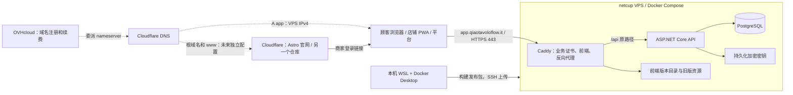

# 从 Windows / WSL 部署 Qiao TavoloFlow 到 netcup

这份教程对应本仓库的 `deploy/` 文件。目标是让业务系统 `https://app.qiaotavoloflow.it` 上线，支持最初 1–3 家餐厅试运营。
你在 WSL 构建并上传，netcup VPS 负责长期运行。生产数据库从空库开始，本地 Docker 测试数据无需迁移。
`https://qiaotavoloflow.it` 和 `www` 预留给你在另一个 GitHub 仓库开发的 Astro 官网，由 Cloudflare 独立托管。
本教程只部署业务系统；官网尚未开发或上线，不影响先部署商家、平台和顾客入口。

**你已经重新生成了名为 `tavoloflow` 的 SSH 密钥，下一步从第 2 节购买 netcup VPS 开始，
然后按第 3.1 节查看公钥并导入 netcup。** 本文统一使用私钥 `~/.ssh/tavoloflow`、
公钥 `~/.ssh/tavoloflow.pub`，生成时的注释也为 `tavoloflow`。
后续登录、上传发布包和下载备份都使用这把密钥，不必再次生成。

## 1. 域名在 OVHcloud，会影响使用 netcup 吗？

**不会。域名、DNS 和服务器可以分别由三家公司提供。`app` 是现有域名的子域名，不需要转移域名、购买第二个域名或为子域名单独续费。**

| 服务 | 本次使用的平台 | 你在这里管理什么 |
|---|---|---|
| 域名注册与续费 | OVHcloud | `qiaotavoloflow.it` 的续费、nameserver 和 DNSSEC 的 DS 信息 |
| 权威 DNS | Cloudflare 免费计划 | 整个域名的解析记录，其中业务 `app` 使用灰云 DNS only |
| 业务服务器 | netcup | VPS、操作系统、公网 IP、远程控制台 |
| 业务 HTTPS | VPS 内的 Caddy | 只为 `app.qiaotavoloflow.it` 自动申请与续期证书 |
| 官网（之后另行开发） | Cloudflare 静态托管 | 独立 Astro 仓库、根域名和 `www` 的官网发布及 HTTPS |

你需要在 OVHcloud 把域名服务器改为 Cloudflare 分配的 nameserver，再在 Cloudflare 创建 **名称为 `app` 的 A 记录**，指向 **netcup 的公网 IPv4**。
无需将域名加入 netcup 的 DNS 或购买 netcup 的域名/Webhosting。具体操作在第 5 节。
这种接入方式不要求域名注册商和服务器提供商相同，参见 [Cloudflare nameserver 接入流程](https://developers.cloudflare.com/dns/zone-setups/full-setup/setup/)。



- **VPS** 是一直开着的远程 Linux 电脑。关闭你的 Windows 电脑不会让网站下线。
- **DNS** 告诉浏览器域名对应哪个 IP。业务 `app` 使用灰云 DNS only，请求直接到 netcup VPS；官网的托管和代理设置独立管理。
- **Caddy** 对外接收请求、自动管理 HTTPS 证书，发送前端文件，并把 API 请求转给后端。
- **Docker 镜像** 是打包好的程序；**容器**是正在运行的程序；**卷（volume）**保存数据库和密钥，更新容器不会清空卷。
- PWA 仍依赖服务器和网络。这里支持安装和离线提示，不支持离线点单或推送通知。

本机和 VPS 各有一个 Docker。不要在本机根目录的开发 Compose 上执行生产维护命令。
部署文件没有绑定 OVHcloud 的 IP 或 API，更换 VPS 提供商不需要改域名、二维码、Caddy 或数据库配置。
本仓库的前端和 `/api` 同在业务子域名，Cookie 仅限业务主机；官网只需提供商家登录链接，无需跨域 API 或共享 Cookie。

## 2. 购买 netcup VPS，并安装 Ubuntu

### 2.1 选择产品和网络

**操作位置：netcup 网站。**

以 **x86-64 / AMD64、至少 2 vCPU、4 GB 内存、40 GB 磁盘、带公网 IPv4** 为起点，选择欧洲机房。
当前构建脚本明确使用 `linux/amd64`，因此本教程选择 x86 产品；不要购买 ARM64、纯 IPv6 或 Cloud vLAN-only 规格来套用本教程。
网络选项选择 **IPv4 and IPv6 connectivity**，首次部署先使用 IPv4。

预算优先时可以查看 [VPS Lite](https://www.netcup.com/en/server/vps-lite)：2026-10-25 查到的
**VPS Lite 1 G12.5s** 为 2 vCore x86、4 GB RAM、80 GB SSD，欧洲地点按库存分配。
若需要自己选择具体机房，查看 [常规 VPS](https://www.netcup.com/en/server/vps)，例如同样满足起步要求的 VPS 500 系列。
以购买页实际库存、最低合约期、续费、IPv4 选项和意大利适用税额为准，不把网页展示的最低月价当作最终总价。
这是试运营起点，后续通过第 15 节监控资源；不需要购买管理面板、Windows 或付费 SSL 证书。

### 2.2 区分控制台和 Linux 登录信息

购买后，netcup 会发送相关登录信息。三个入口的密码不是同一个概念：

| 入口 | 用途 | 说明 |
|---|---|---|
| Customer Control Panel（CCP） | 订单、账单和产品管理 | 客户账号 |
| Server Control Panel（SCP） | 开关机、系统镜像、Screen 远程控制台、网络 | 使用 netcup 提供的 SCP 登录方式 |
| Linux SSH | 登录服务器执行命令 | 首次用 `root`；后文创建 `deploy` 用户 |

在 SCP 的服务器信息/网络页面记录公网 IPv4，本文用 `VPS_IP` 表示。把所有命令中的 `VPS_IP` 替换成实际地址。
SCP 这个网页名称与后面上传文件的 `scp` 命令不是同一件事。
参见 [netcup 首次使用服务器](https://www.netcup.com/en/helpcenter/documentation/server/accessing-server) 和
[默认 Linux 登录信息](https://www.netcup.com/en/helpcenter/documentation/server/troubleshooting-server-login)。

### 2.3 安装 Ubuntu 24.04 LTS

netcup 默认交付系统可能是 Debian，不能直接把 Ubuntu 的安装命令用于 Debian。
这里分成三步：**在 WSL 复制公钥 → 在 SCP 账号中保存公钥 → 安装 Ubuntu 时选择该公钥**。
第一步不需要先 SSH 登录服务器；仅在 SCP 保存公钥，也不会自动修改服务器上已经安装的系统。

#### 2.3.1 在本机 WSL 查看和复制公钥

**操作位置：本机 WSL 终端，任意目录。** 使用你已经生成的密钥，不重新运行 `ssh-keygen`：

```bash
cat ~/.ssh/tavoloflow.pub
```

终端会显示一整行，开头是 `ssh-ed25519`，中间是较长的编码，末尾是你设置的注释 `tavoloflow`。
复制这一整行，包括开头的 `ssh-ed25519` 和末尾注释；不要复制终端提示符，也不要把显示时的自动折行变成多行。
在 Windows Terminal 中，可以选中内容后按 `Ctrl+Shift+C` 复制。

如果 WSL 可以调用 Windows 程序，也可以直接把公钥放进 Windows 剪贴板：

```bash
clip.exe < ~/.ssh/tavoloflow.pub
```

此命令成功时没有输出；随后在浏览器的公钥输入框中按 `Ctrl+V` 粘贴即可。
若提示找不到 `clip.exe`，使用上一种手动复制方式。若 `.pub` 文件不存在，按第 3.1 节检查生成位置。

只复制 **`tavoloflow.pub` 公钥的内容**。没有 `.pub` 后缀的 `tavoloflow` 是私钥，留在 WSL；不要上传它，
也不要把私钥口令、`SHA256:...` 指纹或登录密码当作公钥粘贴。

#### 2.3.2 在 netcup SCP 保存公钥

**操作位置：Windows 浏览器中的 netcup SCP 网页。**

1. 打开 netcup 邮件中提供的 **Server Control Panel（SCP）** 入口，用 SCP 登录信息登录。
   这里不是 SSH 终端，也不是域名管理页面。
2. 在 SCP 顶部打开 **Options**，进入 **SSH Keys**。这是账号级的公钥管理入口，不是在某台服务器的 Media 页面添加。
3. 找到新增公钥的表单或按钮。如果页面要求填写 Name / Description（名称或说明），填写 `tavoloflow`，便于安装时识别。
4. 在公钥内容输入框中，粘贴第 2.3.1 节复制的整行 `ssh-ed25519 ... tavoloflow`。这里的 `...` 只是说明格式，
   实际粘贴的是你自己 `.pub` 文件中的完整内容。
5. 提交新增表单，确认公钥已出现在列表中。若提示格式错误，重新复制 `.pub` 完整的一行，检查是否误粘贴了提示符、指纹或私钥。

到这里，公钥只是保存到了 SCP 账号中，供安装器选择。**接下来安装时选中它，安装器才会把它写入新系统。**
如果服务器已经装好 Ubuntu，之后仅在此列表新增公钥不会让现有系统立即接受这把密钥；可通过第 3.2 节的 root 密码或 Screen 进入系统，
再按第 3.3 节为 `deploy` 用户安装公钥，无需为了添加密钥重装系统。

参见 [netcup SCP：Options 与 SSH Keys](https://www.netcup.com/en/helpcenter/documentation/server/scp-home)。

#### 2.3.3 安装 Ubuntu，并选择刚保存的公钥

**操作位置：netcup SCP 网页，选中刚购买且尚无业务数据的 VPS。**

1. 从服务器列表或顶部服务器选择框进入自己的 VPS，再打开 **Media → Images → Official Images**。
2. 选择 **Ubuntu 24.04 LTS** 的 Minimal 镜像，选择占用整块磁盘的大分区布局，保持官方镜像要求的 UEFI 设置。
3. 在安装设置的 SSH 公钥选择区域，选中第 2.3.2 节保存的 `tavoloflow` 对应公钥。
   如果没有出现，先返回 **Options → SSH Keys** 确认已保存，再重新进入安装流程。
4. 核对选中的 VPS、系统和公钥，再确认安装；如果页面要求确认密码，使用 **SCP 登录密码**，不是 SSH 私钥口令。
   这个操作会清空服务器磁盘，适用于你尚未部署数据的新 VPS。
5. 等待安装完成，记录安装后页面提供的新的 Linux `root` 密码，并通过 SCP 的 **Screen** 确认系统已启动，接着执行第 3 节。
   若未成功导入公钥，仍可按第 3.2 节用 root 密码完成初次配置。

如果已是 Ubuntu 24.04，无需为了本教程重复重装。系统选择页面和名称可能调整；先确认镜像版本，
不要在已有业务数据的机器上重新安装。参见 [SCP 公钥管理](https://www.netcup.com/en/helpcenter/documentation/server/scp-home)
和 [netcup 镜像安装说明](https://www.netcup.com/en/helpcenter/documentation/server/media)。
netcup 的快照可作为额外保障，但不能替代第 13–14 节的数据库和密钥备份。

## 3. 复用已有 SSH 密钥，建立日常管理账号

### 3.1 查看已有公钥，不重新运行 ssh-keygen

**操作位置：本机 WSL 终端，任意目录。**
若已按第 2.3.1–2.3.2 节复制并保存公钥，这里只核对本机文件和指纹，不必再次添加到 SCP。

```bash
ls -l ~/.ssh/tavoloflow ~/.ssh/tavoloflow.pub
ssh-keygen -lf ~/.ssh/tavoloflow.pub
cat ~/.ssh/tavoloflow.pub
```

最后一条显示的整行 `ssh-ed25519 ...` 就是导入 netcup 的公钥。没有 `.pub` 后缀的文件是私钥，保留在本机，不能上传到控制台。
如果文件不存在，先检查自己执行 `ssh-keygen` 时选用的路径：`ls -la ~/.ssh`；若在 Windows PowerShell 生成，则检查 Windows 用户的 `.ssh` 目录。
不要因此覆盖或删除已有密钥。接下来所有本机命令都在保存这把密钥的 WSL 环境运行。

### 3.2 首次以 root 登录

**操作位置：netcup SCP → Screen。** 用安装后得到的 root 凭据登录，查看服务器的 SSH 指纹：

```bash
ssh-keygen -lf /etc/ssh/ssh_host_ed25519_key.pub
```

**操作位置：WSL。** 如果安装镜像时已导入公钥：

```bash
ssh -o IdentitiesOnly=yes -i ~/.ssh/tavoloflow root@VPS_IP
```

首次连接提示中的 ED25519 指纹应与 Screen 中看到的一致，再确认连接。
如果没有导入公钥，可用安装后的 **Linux root 密码** 登录（不是 CCP/SCP 密码）：

```bash
ssh root@VPS_IP
```

若 root 密码 SSH 被镜像禁用，直接在 SCP 的 Screen 里执行下一节。只有重装了自己这台服务器并在 Screen 核对新指纹后，
才用 `ssh-keygen -R VPS_IP` 清理旧的本机指纹记录；不要遇到指纹变化就盲目删除记录。

**操作位置：服务器的 root 终端（SSH 或 Screen）。**

```bash
cat /etc/os-release
uname -m
```

预期系统为 Ubuntu 24.04，架构为 `x86_64`。如果是 Debian 或 `aarch64`，先处理系统/产品选择，不继续执行后面的安装步骤。

### 3.3 创建 deploy 用户并安装公钥

**操作位置：服务器 root 终端。** 保留此会话，暂不禁用 root 登录。

```bash
apt update
apt install -y sudo openssh-server nano
adduser deploy
usermod -aG sudo deploy
install -d -m 700 -o deploy -g deploy /home/deploy/.ssh
nano /home/deploy/.ssh/authorized_keys
```

`adduser` 要求设置 `deploy` 的 Linux 密码，妥善保存；后续 `sudo` 使用这个密码，SSH 密钥口令是另一个密码。
其余姓名等字段可留空。在 nano 中粘贴第 3.1 节显示的完整公钥，保持一行；`Ctrl+O`、回车保存，`Ctrl+X` 退出。
如果从 Screen 操作且无法粘贴，可以在已确认 root 使用这把公钥的情况下，改用
`cp /root/.ssh/authorized_keys /home/deploy/.ssh/authorized_keys` 复制已导入的公钥文件。

```bash
chown deploy:deploy /home/deploy/.ssh/authorized_keys
chmod 600 /home/deploy/.ssh/authorized_keys
```

**操作位置：新开的第二个 WSL 终端。**

```bash
ssh -o IdentitiesOnly=yes -i ~/.ssh/tavoloflow deploy@VPS_IP
whoami
sudo -v
```

预期 `whoami` 输出 `deploy`，`sudo -v` 输入 deploy 的 Linux 密码后成功。
**这一步成功后，后续服务器命令都使用 `deploy` 用户和 `sudo`。** 不要照旧教程使用 `ubuntu@VPS_IP`。

### 3.4 更新系统和配置防火墙

**操作位置：服务器 deploy 终端。** 看到 `deploy@…` 是远程服务器；自己的 WSL 用户名是本机。

```bash
sudo apt update
sudo apt upgrade -y
sudo apt install -y ca-certificates curl openssl python3 ufw dnsutils nano
sudo timedatectl set-timezone Europe/Rome
sudo ufw allow OpenSSH
sudo ufw allow 80/tcp
sudo ufw allow 443/tcp
sudo ufw enable
sudo ufw status
```

预期允许 SSH、80 和 443。初次部署保持 **netcup SCP 防火墙的默认策略**，先用以上 UFW 规则完成部署。
如果你另外创建了 SCP 防火墙规则，必须保留 SSH 22、HTTP 80、HTTPS 443 的入站访问及系统所需流量。
netcup 添加自定义规则会改变对应方向的默认行为，不要只添加一条 443 规则就保存；也不要随手限制出站流量，
否则可能影响 DNS、时间同步、下载镜像和签发证书。参见 [netcup 防火墙说明](https://www.netcup.com/en/helpcenter/documentation/server/firewall)。
本文保持 SSH 22 端口；若系统提示重启，执行 `sudo reboot`，稍等后用 deploy 密钥登录重新连接。

### 3.5 确认 deploy 可登录后，关闭 SSH 密码和 root 登录

**操作位置：服务器 deploy 终端。** 保留一个已登录且 sudo 可用的会话，确认第二个新会话能以 deploy 密钥登录。

```bash
sudo tee /etc/ssh/sshd_config.d/00-tavoloflow.conf >/dev/null <<'EOF'
PasswordAuthentication no
KbdInteractiveAuthentication no
PermitRootLogin no
PubkeyAuthentication yes
EOF
sudo sshd -t
sudo sshd -T | grep -E 'passwordauthentication|kbdinteractiveauthentication|permitrootlogin'
```

`sshd -t` 不应报错，三个查询结果均应为 `no`；如果不符，先检查其他 sshd 配置，保持原会话，不急着断开。
确认输出后重载：

```bash
sudo systemctl reload ssh
```

再从第三个 WSL 终端验证 deploy 密钥登录和 `sudo -v`，成功后才关闭原来的 root 会话。
这只关闭 SSH 密码登录，deploy 的 Linux 密码仍用于 sudo。若失去网络登录，在 netcup SCP 的 Screen 或 Rescue System 中恢复。

## 4. 在 VPS 安装 Docker Engine 和 Compose

**操作位置：VPS 终端。** 服务器安装 Docker Engine，不安装 Docker Desktop，也不需要安装 Node、.NET SDK 或 GitHub 凭据。

以下按 [Docker 官方 Ubuntu 安装步骤](https://docs.docker.com/engine/install/ubuntu/)使用 apt 软件源：

```bash
sudo install -m 0755 -d /etc/apt/keyrings
sudo curl -fsSL https://download.docker.com/linux/ubuntu/gpg -o /etc/apt/keyrings/docker.asc
sudo chmod a+r /etc/apt/keyrings/docker.asc
sudo tee /etc/apt/sources.list.d/docker.sources >/dev/null <<EOF
Types: deb
URIs: https://download.docker.com/linux/ubuntu
Suites: $(. /etc/os-release && echo "$VERSION_CODENAME")
Components: stable
Architectures: $(dpkg --print-architecture)
Signed-By: /etc/apt/keyrings/docker.asc
EOF
sudo apt update
sudo apt install -y docker-ce docker-ce-cli containerd.io docker-buildx-plugin docker-compose-plugin
sudo systemctl enable --now docker
sudo docker version
sudo docker compose version
sudo docker run --rm hello-world
```

预期看到 Client 和 Server 两组 Docker 版本，以及 hello-world 的成功消息。本教程在 VPS 使用 `sudo`，不必将用户加入 docker 组。
如果是已使用过的服务器、存在 `docker.io` 等冲突包，按官方文档先处理；新购的纯 Ubuntu 通常没有这些包。

Docker 发布的容器端口可能绕过 UFW，所以本项目的 API 和数据库**没有配置宿主机端口**。不要额外开放 5432 或 8080。

## 5. 把 OVHcloud 域名交给 Cloudflare DNS，并创建 app 子域名

### 5.1 委派整个域名的 DNS

**操作位置：Cloudflare 和 OVHcloud 控制台。** 域名仍在 OVHcloud 购买和续费，只改变权威 DNS 服务。

1. 在 Cloudflare 添加现有域名 `qiaotavoloflow.it`，选择免费计划。
2. 检查导入的记录。如果已经有邮箱，保留并核对 MX、SPF、DKIM、DMARC 等记录；扫描结果可能不完整。
3. Cloudflare 会分配两个 nameserver，复制自己页面上的值，不要使用别人教程里的 nameserver。
4. 在 OVHcloud 的域名列表打开 `qiaotavoloflow.it`。若已启用 DNSSEC，先关闭并等待旧 DS 记录移除。
5. 打开该域名的 **DNS servers / Serveurs DNS / Server DNS**，更换为 Cloudflare 分配的两个服务器。
   这是修改域名服务器，不是在原 DNS zone 里随便新增两条 NS 记录。
6. 返回 Cloudflare 等待域名状态变成 Active。通常较快，也可能需要等待 DNS 缓存更新。
7. 生效后可以在 Cloudflare 重新启用 DNSSEC，并按页面给出的 DS 信息在 OVHcloud 配置。不要保留旧提供商的 DS。

完整说明见 [Cloudflare nameserver 接入流程](https://developers.cloudflare.com/dns/zone-setups/full-setup/setup/)。

### 5.2 创建业务子域名

**操作位置：Cloudflare 控制台 → `qiaotavoloflow.it` → DNS → Records → Add record。**

| 字段 | 填写内容 |
|---|---|
| Type（类型） | `A` |
| Name（名称） | `app` |
| IPv4 address | netcup VPS 的实际公网 IPv4，不含 `https://`、端口或路径 |
| Proxy status（代理状态） | **DNS only，灰云** |
| TTL | `Auto` |

点击 **Save**，这条记录就创建了 `app.qiaotavoloflow.it`。无需在 OVHcloud 再购买或创建子域名，
也无需把 `app.qiaotavoloflow.it` 单独添加为 Cloudflare zone 或为 `app` 配置 NS 委派。
域名委派生效后，解析记录在 Cloudflare 修改；继续编辑 OVHcloud 的旧 DNS zone 不会改变当前生效的解析。

若已存在名称为 `app` 的 A/CNAME/AAAA，先核对用途，再处理冲突或过期记录。首次仅用 IPv4，未验证 IPv6 前不添加 `app` 的 AAAA。
不要因此删除邮箱或其他子域名的记录。根域名 `@` 和 `www` 的官网接入留给以后独立的 Astro 项目，**本次不把它们指向 VPS**，
也不创建 `www.app`。没有官网记录时根域名可能暂时无法访问，这是正常的，不影响业务子域名。

灰云模式下 Cloudflare 的 SSL 模式和 CDN 缓存不会接管业务请求，浏览器证书由 VPS 内的 Caddy 提供。
以后如需橙云代理，需要另行配置可信代理链和缓存，不能只切换图标后假设配置仍然完整。
参见 [Cloudflare 创建子域名记录](https://developers.cloudflare.com/dns/manage-dns-records/how-to/create-subdomain/)。

### 5.3 验证解析

**操作位置：WSL 或 VPS。**

```bash
dig +short NS qiaotavoloflow.it
dig @1.1.1.1 +short A app.qiaotavoloflow.it
dig @1.1.1.1 +short AAAA app.qiaotavoloflow.it
```

预期整个域名的 NS 是 Cloudflare 分配的名称，`app` 的 A 返回 VPS 公网 IPv4，未配置 IPv6 时 AAAA 没有输出。
WSL 没有 `dig` 可先 `sudo apt install dnsutils`。如果解析不正确，先修复 DNS，再启动 Caddy 申请证书。

## 6. 在 WSL 构建发布包

**操作位置：本机 WSL，项目根目录。** 这里继续使用 Docker Desktop。

```bash
cd /home/yangr/personal-projects/TavoloFlow
docker version
bash deploy/build-release.sh
```

脚本固定构建 Linux AMD64 镜像，使用 Node 24 和 .NET 10 构建环境。首次会下载镜像和依赖，可能花数分钟。
前端在隔离环境中使用 `https://app.qiaotavoloflow.it` 构建；不会读取你本地 `.env.local` 中的 LAN 地址。
构建上下文与发布包均排除真实 `.env`、开发数据、密钥和 `node_modules`。

成功后显示带本次版本号的两个文件。也可以直接使用本次已准备的发布包：

```text
artifacts/tavoloflow-netcup-permissions-20261026.tar.gz
artifacts/tavoloflow-netcup-permissions-20261026.tar.gz.sha256
```

此前构建的发布包没有本次运维权限修复，**不要再用旧包执行安装或更新**；最早的 `netcup-initial-20261025` 和
`ovh-initial-20261025` 还使用旧根域名。保留历史文件用于核对，首次部署请使用下面的新包或从修复后的代码重新构建。
后续命令里的 `RELEASE` 必须与发布包匹配。如果直接使用本次提供的发布包，版本号是 `netcup-permissions-20261026`；
自己重新构建时则改成脚本实际输出的版本号：

```bash
RELEASE=netcup-permissions-20261026
ssh -i ~/.ssh/tavoloflow deploy@VPS_IP 'mkdir -p ~/tavoloflow-upload'
scp -i ~/.ssh/tavoloflow \
  "artifacts/tavoloflow-$RELEASE.tar.gz" \
  "artifacts/tavoloflow-$RELEASE.tar.gz.sha256" \
  deploy@VPS_IP:~/tavoloflow-upload/
```

上传失败可以重传同一个包，不必重新构建。保留当前版和上一版的本地发布包，以便回退或重建服务器。

## 7. 准备生产目录和密码

### 7.1 首次安装

**操作位置：VPS 终端。** 重新设置 `RELEASE`，因为本机变量不会自动传到服务器。

```bash
RELEASE=netcup-permissions-20261026
cd ~/tavoloflow-upload
sha256sum -c "tavoloflow-$RELEASE.tar.gz.sha256"
mkdir "$RELEASE"
tar -xzf "tavoloflow-$RELEASE.tar.gz" -C "$RELEASE"
cd "$RELEASE"
sha256sum --check --quiet SHA256SUMS
sudo install -d -o root -g root -m 755 /opt/tavoloflow
sudo install -o root -g root -m 644 ops/* ops/.env.example /opt/tavoloflow/
sudo install -o root -g root -m 600 ops/.env.example /opt/tavoloflow/.env
openssl rand -hex 32
sudo nano /opt/tavoloflow/.env
```

外层校验显示 `OK`，内部校验没有输出即成功。校验失败应重新上传，不要跳过。
上面的复制 `.env.example` **仅首次安装执行**；后续更新绝不覆盖 `.env`。

这里的 `install` 是复制文件并明确设置所有者、权限，不是安装软件包。
`~/tavoloflow-upload` 归 deploy 管理；正式目录 `/opt/tavoloflow` 和运维文件归 `root:root` 管理，deploy 必须通过 sudo 才能修改。
目录 `755` 允许其他用户读取、进入，但不能增加或替换文件；普通配置和脚本 `644` 允许读取但不能修改；生产 `.env` 为 `600`，只有 root 可读写。
脚本由 `bash 脚本路径` 执行，不需要给其他用户写权限或执行权限。

旧写法 `sudo cp -a ops/. /opt/tavoloflow/` 会保留 deploy 的所有权，甚至改变目标目录的所有权。
备份定时任务以 root 运行，如果 deploy 能修改 `backup.sh`、它加载的 `lib.sh` 或 Compose 配置，就能影响 root 执行的内容。
因此不能只保护 `.env`，也不能只修改 `backup.sh` 而留下可写的父目录。后续发布脚本同样会保持这组权限。

将生成的 64 个十六进制字符填到 `POSTGRES_PASSWORD`，将 `ACME_EMAIL` 改成自己的真实邮箱。
确认 `DOMAIN=app.qiaotavoloflow.it`，其余值保留默认即可；`DOMAIN` 不含 `https://` 或路径，不能填官网根域名。
脚本会核对它与包内的前端正式地址，避免生成指向错误站点的二维码。
值不用额外加引号，等号两边不加空格。nano 保存是 `Ctrl+O`、回车，退出是 `Ctrl+X`。
`POSTGRES_PASSWORD` 是数据库密码，不是网站登录密码。

该密码只在 PostgreSQL 空卷首次初始化时建立用户密码。上线后只改 `.env` 不会修改数据库内的密码；需要专门的密码轮换操作。
不要运行会把完整配置打印出来的 `docker compose config`，校验使用 `config --quiet`。

如果 VPS 已有其他 Docker 网络，可先检查是否与 `172.30.80.0/24` 重叠；冲突时在首次部署前同时修改
`PROXY_SUBNET`、其中用于动态分配的 `PROXY_DYNAMIC_RANGE`，以及动态范围之外的 `CADDY_IP`。
例如默认子网 `.0/24`、动态范围 `.128/25`、Caddy 地址 `.2`；后端信任的代理地址会随 Compose 配置同步。

### 7.2 已按旧教程复制过文件：先修复现有权限

**只有 VPS 上已经存在 `/opt/tavoloflow` 时才执行本节；尚未部署则直接按第 7.1 节继续。**
这些命令在 VPS 的 deploy 终端运行。它们不覆盖 `.env`、不修改数据库、不重启 API；Docker 数据库和密钥卷不在此目录内。
如果已经启用第 13 节的定时备份，先停止备份定时器和备份任务（不影响网站容器）：

```bash
sudo systemctl stop tavoloflow-backup.timer tavoloflow-backup.service
```

修复目录和已有文件，包含隐藏配置及旧前端资源；`-hR` 修改符号链接自身的所有权，不沿 `web/current` 遍历其他目标：

```bash
sudo chown -hR root:root /opt/tavoloflow
sudo chmod -R go-w /opt/tavoloflow
sudo chmod 755 /opt/tavoloflow
sudo chmod 600 /opt/tavoloflow/.env
sudo find /opt/tavoloflow -maxdepth 1 -type d \( -name state -o -name backups \) -exec chmod 700 {} +
```

如果还没有创建 `.env`，先按第 7.1 节完成首次准备。以上步骤纠正权限，不校验文件内容；如果已发现账号被盗或文件被篡改，应先处理入侵，不能仅改权限后继续信任旧脚本。

按第 12 节使用**包含本次修复的新包**更新。新安装器也会在执行旧备份前修正已有目录的权限；上面手动步骤可以先关闭等待发布期间的提权路径。
如果之前已启用定时备份，更新成功后按第 13 节重新安装服务文件并启用定时器。
若需要回退业务版本，使用第 12 节的 `rollback.sh`；它只切换业务镜像和前端，不会重新安装旧包中有问题的运维脚本。

### 7.3 检查权限

**操作位置：VPS 的 deploy 终端。** 首次准备、修复旧安装和每次更新后均可检查：

```bash
sudo stat -c '%U:%G %a %n' /opt/tavoloflow /opt/tavoloflow/backup.sh /opt/tavoloflow/lib.sh /opt/tavoloflow/compose.yaml /opt/tavoloflow/.env
sudo find /opt/tavoloflow \( ! -user root -o ! -group root -o \( ! -type l -perm /022 \) \) -print
test ! -w /opt/tavoloflow && test ! -w /opt/tavoloflow/backup.sh && echo 'deploy 无法直接修改或替换备份脚本'
```

预期所有者都是 `root:root`；目录为 `755`，新安装的脚本/配置为 `644`，`.env` 为 `600`；`find` 没有输出。
旧文件手动修复后可能保留只读或执行权限，但不能允许组或其他用户写入。最后一条**不要加 sudo**，它验证的是 deploy 自身没有写权限。
如 `find` 输出路径或最后一条没有成功提示，先修正权限，再启用定时备份。

## 8. 安装发布版本并初始化管理员

**操作位置：VPS，仍位于解压后的发布目录。**

```bash
sudo bash ops/install-release.sh "$PWD" /opt/tavoloflow
```

脚本依次检查校验和与必要配置、导入镜像、启动数据库、等待就绪、显式执行 EF 迁移、启动 API、切换前端版本、启动 Caddy。
必须通过 sudo 执行；脚本会保护正式目录、修复旧所有权，并以 root 所有权安装新脚本、配置和前端文件。
第一次出现下载 PostgreSQL 和 Caddy 镜像是正常的。迁移报错会停止，不会删除数据库卷，也不会自动跳过错误。
同一迁移重复运行不会重复建表；应用每次普通启动不会自行迁移。

成功后执行：

```bash
sudo bash /opt/tavoloflow/tf.sh ps
sudo bash /opt/tavoloflow/tf.sh logs --tail 80 caddy
sudo bash /opt/tavoloflow/bootstrap-admin.sh
```

最后一个命令交互式输入平台管理员用户名和两次密码。密码不回显，这是正常现象。
密码应为你自己保存的强密码；程序接受 6–128 字符，不能全部为空白。
脚本复用现有 `--seed-platform-admin`，不会在日常运行的 API 环境中保存这个初始密码。
同名管理员已创建时不会覆盖密码；忘记密码时使用后文专用恢复命令。

`tf.sh` 是生产 Compose 包装器：总会读取 `/opt/tavoloflow/.env` 和已记录的版本号，避免你忘记选择生产配置。
服务器后台持续运行程序，不需要保持 SSH 窗口打开，也不需要运行 `npm run dev`、`vite preview` 或 `dotnet run`。

## 9. 检查 HTTPS 和三类入口

**操作位置：WSL 和浏览器。**

```bash
curl -I http://app.qiaotavoloflow.it
curl -I https://app.qiaotavoloflow.it/staff/login
curl -I https://app.qiaotavoloflow.it/sw.js
curl -I https://app.qiaotavoloflow.it/staff.webmanifest
curl -i https://app.qiaotavoloflow.it/api/auth/csrf
```

预期业务域名 HTTP 跳到同域名 HTTPS，店铺页面返回 200，浏览器没有证书警告；
`sw.js` 为 JavaScript，manifest 为 `application/manifest+json`，两者都是 `Cache-Control: no-cache`；
CSRF 接口返回 JSON 和 `no-store`。最后一条返回的是临时 CSRF 信息，无需保存或分享。
**不要用 `curl -k` 跳过正式站点的证书问题。**

浏览器直接打开并刷新：

- 平台管理员：`https://app.qiaotavoloflow.it/platform/login`
- 餐厅 OWNER / STAFF：`https://app.qiaotavoloflow.it/staff/login`
- 顾客：之后创建桌位得到的 `https://app.qiaotavoloflow.it/q/{token}`

浏览器打开 `https://app.qiaotavoloflow.it/` 时仍由应用跳转到 `/staff`。
此 VPS 不提供根域名、`www.qiaotavoloflow.it` 或 `www.app.qiaotavoloflow.it` 的网站与证书，不把官网可访问作为业务上线的前提。
HTTP 请求如果使用其他主机名或直接访问 VPS IP，会得到 404；请使用上面的业务子域名验证网站。

API 不需要独立子域名和 CORS 配置。Data Protection 密钥独立持久化；丢失它会导致既有登录和开桌加入码失效，
因此密钥和数据库都需要备份。证书由 Caddy 自动申请、更新，无需额外安装 Certbot。
参见 [Caddy 自动 HTTPS](https://caddyserver.com/docs/automatic-https)。

## 10. 从空系统创建第一家餐厅

**操作位置：正式站点浏览器。**

1. 使用刚创建的平台管理员登录 `/platform/login`。
2. 在平台创建餐厅，填写餐厅名、默认语言、OWNER/STAFF 用户名及需要的服务周期信息。
3. 创建成功返回的两个临时密码只展示一次，立即安全保存并交给对应人员。
4. 用 OWNER 登录 `/staff/login`，完成首次改密，添加菜单分类、菜品、价格、过敏原和桌位。
5. STAFF 也应首次登录并修改临时密码。
6. 平台把餐厅服务状态改为 ACTIVE；再由店铺开启接单。恢复服务不会自动开启接单。
7. 下载或打印正式桌位二维码，检查扫码结果是 `https://app.qiaotavoloflow.it/q/{token}`，不能是官网根域名、localhost 或局域网地址。
8. 开桌，使用手机扫描对应二维码、输入本次加入码，完成一笔测试订单；厨房标记出餐，OWNER 确认线下收款并关账，再检查历史账单。

平台账号和店铺账号是不同身份，平台管理员不能直接代替 OWNER 执行店铺结账。
正式库里的测试订单会成为业务历史，建议先创建一间清楚标注为测试用途的餐厅；不要把真实门店的历史直接用 SQL 清空。

## 11. 安装和验收 PWA

**操作位置：真实手机、平板和电脑。**

从 `https://app.qiaotavoloflow.it/staff` 安装；下面所有 `/staff` 路径均相对于这个业务域名。
官网的域名与 PWA 身份独立，旧本地测试地址安装的应用不会自动变成正式应用。

- Android Chrome / 电脑 Chrome、Edge：打开 `/staff`，使用首页安装入口或浏览器菜单安装。
- iPhone / iPad Safari：打开 `/staff`，使用分享菜单中的“添加到主屏幕”。第一次在独立应用中可能需要重新登录。
- 从图标打开，确认首页、厨房、账单页面正常；厨房开启声音和常亮，必要时先点一下页面允许声音。
- 关闭网络，重新打开应用应出现离线提示；恢复网络后能重新加载。离线时不应出现可提交的离线订单队列。
- 切到后台后轮询可能暂停，厨房设备应保持应用前台和屏幕常亮。
- 顾客二维码页和平台页面不应出现本项目的 PWA 安装邀请。

证书、推送权限和声音权限是不同概念，本项目没有实现后台推送。更多行为见 [PWA 说明](pwa.md)。

## 12. 后续发布与应用回退

### 发布新版本

**操作位置：WSL。** 修改代码并验证后再次 `bash deploy/build-release.sh`，上传新包及其 `.sha256`。
**操作位置：VPS。** 设置新的 `RELEASE`、校验、解压，与第 7 节一致，但**不要重新复制或编辑生产 `.env`**。
如果之前按旧教程部署且还未修复文件所有权，先完成第 7.2 节。

```bash
RELEASE=替换为新版本号
cd ~/tavoloflow-upload
sha256sum -c "tavoloflow-$RELEASE.tar.gz.sha256"
mkdir "$RELEASE"
tar -xzf "tavoloflow-$RELEASE.tar.gz" -C "$RELEASE"
sudo bash "$RELEASE/ops/install-release.sh" "$PWD/$RELEASE" /opt/tavoloflow
sudo bash /opt/tavoloflow/tf.sh ps
```

安排在非营业时间：脚本先停止 API 的写入、备份当前数据，再迁移并更新，期间 API 会短暂不可用。
确认成功后重新检查登录、一次业务读取和 PWA 页面切换。若某个写操作显示结果未知，按界面提示查询，避免盲目重发。

前端通过原子符号链接切换；哈希资源池保留历史文件，因此长期打开的厨房 PWA 仍能加载旧版路由。
新代码通常在页面刷新或重新打开后使用。保留旧资源解决文件可用性，未来 API 变更仍要兼容旧客户端或安排刷新。

### 失败处理与回退

发布错误会停止执行。首先查看终端提示和 `tf.sh logs --tail 100 api db caddy`，不要删除卷或自动恢复数据库。
如果 API 已停止，先保持非营业状态。修复后使用**新的版本号**重新构建和发布；迁移可以重复执行。
首次失败、尚无 `state/current` 时，可从终端提示中的版本号手动读取日志：

```bash
sudo env RELEASE_ID=替换为失败版本号 bash /opt/tavoloflow/tf.sh logs --tail 100 api db caddy
```

查看可回退版本：

```bash
sudo cat /opt/tavoloflow/state/current
sudo cat /opt/tavoloflow/state/previous
```

**只有确认旧代码兼容当前数据库结构后**，才执行应用回退：

```bash
sudo bash /opt/tavoloflow/rollback.sh --schema-compatible 替换为上一版本号
```

该操作会备份、切换 API 镜像和前端，不回滚数据库，也不撤回已发生的订单。
若新迁移与旧代码不兼容，应修复向前发布，或者在停止营业后按第 14 节恢复数据库。
不要把 `dotnet ef database update 0` 当作回退方案。

## 13. 每日备份与下载到自己的电脑

**操作位置：VPS。** 第一次手动备份，再启用每日任务：
先按第 7.3 节确认运维目录和文件仅 root 可修改；服务中的 `User=root` 只是明确运行身份，不能代替文件权限保护。

```bash
sudo bash /opt/tavoloflow/backup.sh
sudo install -o root -g root -m 644 /opt/tavoloflow/tavoloflow-backup.service /etc/systemd/system/
sudo install -o root -g root -m 644 /opt/tavoloflow/tavoloflow-backup.timer /etc/systemd/system/
sudo systemctl daemon-reload
sudo systemctl enable --now tavoloflow-backup.timer
sudo systemctl list-timers tavoloflow-backup.timer
sudo ls -lh /opt/tavoloflow/backups/
```

每天 Europe/Rome 03:30 附近运行，最多随机延迟五分钟；错过的任务会在开机后补做。
任务与部署互斥；遇到正在发布会失败退出，可之后手动补做并查看日志。

```bash
sudo journalctl -u tavoloflow-backup.service --since yesterday --no-pager
```

备份包含 PostgreSQL 一致性逻辑转储、加密密钥、生产环境配置、Compose/Caddy 配置和版本记录，本机保留最近七天。
它不包含镜像及前端；这部分由本地保留的发布包提供。Caddy 证书卷持续保留，但不放进备份，重建服务器时可重新申请。
备份包含真实密码和密钥，权限为仅拥有者可读，不能放入公开目录或 Git。

`deploy` 用户的 sudo 默认需要输入密码，不能通过无终端的 `ssh ... sudo cat` 直接下载 root 拥有的备份。
使用以下步骤复制一份临时下载文件，完成后移除。

**操作位置：VPS 的交互式 deploy SSH 终端。** 先在前面的 `ls` 输出中找到实际备份文件名并替换：

```bash
BACKUP=tavoloflow-实际时间和编号.tar.gz
install -d -m 700 /home/deploy/tavoloflow-download
sudo install -m 600 -o deploy -g deploy \
  "/opt/tavoloflow/backups/$BACKUP" "/home/deploy/tavoloflow-download/$BACKUP"
```

**操作位置：本机 WSL。** 设置同一个实际备份文件名：

```bash
BACKUP=tavoloflow-实际时间和编号.tar.gz
umask 077
mkdir -p ~/tavoloflow-backups
scp -i ~/.ssh/tavoloflow \
  "deploy@VPS_IP:/home/deploy/tavoloflow-download/$BACKUP" \
  "$HOME/tavoloflow-backups/$BACKUP"
tar -tzf "$HOME/tavoloflow-backups/$BACKUP"
```

确认 scp 成功、文件非零且 tar 可以读取，再回到 **VPS 终端** 删除下载副本（自动备份目录中的原件仍保留）：

```bash
rm -- "/home/deploy/tavoloflow-download/$BACKUP"
```

至少每天/每次重要更新前下载一次到服务器之外；需要无人值守异地备份时再接入对象存储。

## 14. 恢复演练和灾难恢复

### 在独立临时数据库验证备份

**操作位置：VPS。** 此操作不连接生产库，临时容器没有公网端口。
把归档文件名换成实际值。若临时容器名已存在，先确认它是否属于上次演练，不要覆盖未知容器。

```bash
sudo install -d -m 700 /root/tavoloflow-restore-check
sudo tar -xzf /opt/tavoloflow/backups/替换为备份文件名.tar.gz -C /root/tavoloflow-restore-check
sudo bash -c 'cd /root/tavoloflow-restore-check && sha256sum --check --quiet SHA256SUMS'
sudo docker run -d --name tavoloflow-restore-check --network none \
  -e POSTGRES_PASSWORD=temporary-restore-check-only \
  -v /var/lib/postgresql postgres:18-alpine
sudo docker exec tavoloflow-restore-check pg_isready -U postgres
```

等待最后一条显示 `accepting connections`，再恢复：

```bash
sudo cat /root/tavoloflow-restore-check/database.dump | \
  sudo docker exec -i tavoloflow-restore-check pg_restore -U postgres -d postgres \
    --no-owner --no-privileges --exit-on-error
sudo docker exec tavoloflow-restore-check psql -U postgres -d postgres \
  -c 'SELECT count(*) FROM restaurants;' -c 'SELECT count(*) FROM orders;'
sudo tar -tzf /root/tavoloflow-restore-check/keys.tar.gz
```

预期恢复退出码为 0、表可读取、密钥归档可读。完成后仅删除这次演练资源：

```bash
sudo docker rm -fv tavoloflow-restore-check
sudo rm -rf /root/tavoloflow-restore-check
```

### 服务器丢失后恢复到新服务器

下面会替换目标数据库内容，**仅用于新的、尚未对外营业的恢复服务器**。旧服务器应保持停机，避免两边同时接单。

1. 按前面的 SSH、Docker 步骤准备新 VPS，暂不切换 DNS。
2. 从异地备份解压到权限 700 的 `/root/tavoloflow-restore`，校验内部 SHA256SUMS。
3. 查看归档的 `state/current`，找到对应发布包；准备 `/opt/tavoloflow`，将 `production.env` 安装为权限 600 的 `.env`。
4. 安装这个对应版本。它会创建空数据库和新的临时密钥；不要初始化管理员或创建餐厅。
5. 执行以下恢复命令，数据库密码、用户名和库名从已恢复的环境中读取：

```bash
sudo bash /opt/tavoloflow/tf.sh stop api caddy
sudo bash /opt/tavoloflow/tf.sh exec -T db sh -ec \
  'dropdb -U "$POSTGRES_USER" "$POSTGRES_DB"; createdb -U "$POSTGRES_USER" "$POSTGRES_DB"'
sudo cat /root/tavoloflow-restore/database.dump | \
  sudo bash /opt/tavoloflow/tf.sh exec -T db sh -ec \
    'exec pg_restore -U "$POSTGRES_USER" -d "$POSTGRES_DB" --no-owner --no-privileges --exit-on-error'
sudo cat /root/tavoloflow-restore/keys.tar.gz | \
  sudo bash /opt/tavoloflow/tf.sh run --rm -T --no-deps --entrypoint sh api -ec \
    'find /var/tavoloflow/keys -maxdepth 1 -type f -delete; tar -xzf - -C /var/tavoloflow/keys --no-same-owner'
sudo bash /opt/tavoloflow/tf.sh up -d --wait api
```

6. 检查 API 健康和业务数据，确认后将 Cloudflare 灰云 A 记录改为新 IP，等待解析切换，启动 Caddy：

```bash
sudo bash /opt/tavoloflow/tf.sh up -d caddy
sudo bash /opt/tavoloflow/tf.sh logs --tail 80 caddy
```

7. 确认 HTTPS、登录、历史账单及仍在营业桌位的加入码正常，再恢复营业和每日备份。

数据库只能恢复到备份时刻；之后的订单需要人工核对。不要仅恢复数据库而遗漏 Data Protection 密钥。

## 15. 日常维护、密码恢复与空间检查

**操作位置：VPS。**

```bash
sudo bash /opt/tavoloflow/tf.sh ps
sudo bash /opt/tavoloflow/tf.sh logs --tail 100 api
sudo docker stats --no-stream
free -h
df -h
sudo docker system df
sudo du -sh /opt/tavoloflow/web /opt/tavoloflow/backups
```

磁盘接近 80% 时主动处理；内存持续紧张、发生 OOM 或高峰响应持续变慢时，先分析再升级 VPS。
Compose 为每个容器限制日志为 3 × 10 MB。所有历史前端资源默认保留；至少保留七天并保留当前版、上一版。
暂时不自动清理发布版本，便于新手回退。可以删除已经成功导入且本地仍保存的旧上传包，释放服务器空间。
清理 API 镜像时只删除明确过期的 `tavoloflow-api:版本号`，并保留当前和上一版本；不要使用带 `--volumes` 的全局清理命令。

定期在非营业时间执行系统安全更新；Docker、Caddy、PostgreSQL 小版本更新前先备份并做恢复演练。
应用发布不会自动拉取更新数据库镜像；不要直接将 PostgreSQL 18 改为 19，大版本升级需要另外规划。
Dockerfile 的主版本标签会在构建新发布包时获取更新，现有发布包保留当时的镜像。

忘记平台密码时：

```bash
sudo bash /opt/tavoloflow/bootstrap-admin.sh --reset-platform-password
```

输入已有管理员用户名和新密码；旧登录会失效。这不会重新启用被禁用的账号。
店铺 OWNER/STAFF 的密码重置仍通过现有平台/店铺设置页面操作。

## 16. 常见问题

| 现象 | 先检查什么 |
|---|---|
| WSL 的 Docker permission denied / 无 Server | Docker Desktop 是否运行、是否启用当前 WSL 的 integration；不要盲目安装第二套 WSL Docker |
| SSH 连接超时 | IP、VPS 状态、22 端口、netcup SCP 防火墙；必要时打开 Screen |
| app 子域名 NXDOMAIN / SERVFAIL | 整个域名的 NS 是否已委派到 Cloudflare、旧 DNSSEC DS 是否已移除、Cloudflare 中是否有 `A app`；不要只在 OVHcloud 旧 DNS zone 添加记录 |
| 根域名官网暂时无法访问 | 官网在另一个项目独立部署；先验证 `app.qiaotavoloflow.it`，不要把根域名改指向 VPS 来修复官网 |
| Caddy 无法获取证书 | `app` 的 A/AAAA 是否指向正确服务器、灰云、80/443 是否可达、CAA 是否限制证书颁发机构、`DOMAIN` 是否正确、Caddy 日志 |
| 发布报 DOMAIN 与前端 origin 不一致 | 是否使用本教程的业务子域名新包，以及 `DOMAIN=app.qiaotavoloflow.it`；旧根域名包应重新构建，不能只修改服务器环境变量 |
| HTTPS 重定向循环 / CSRF 验证失败 | 是否误开橙云、代理 IP 与网段是否匹配、是否始终使用 `https://app.qiaotavoloflow.it`；清理该业务站点 Cookie 后重新登录 |
| 页面打开，API 502 | `tf.sh ps` 中 API 是否健康；检查 API 日志和数据库状态 |
| 数据库连接失败 | `.env` 与首次初始化密码是否一致；修改环境文件不会自动改数据库密码 |
| 深链接刷新 404 | 是否使用本项目 Caddyfile、`web/current` 是否正确、发布包是否完整 |
| 脚本返回 HTML 或 MIME 错误 | 检查 `/assets/*` 文件是否存在，不能让静态资源走 SPA 回退 |
| PWA 未出现安装按钮 | HTTPS 是否有效、是否在 `/staff`、是否已安装、浏览器是否允许；iOS 使用分享菜单 |
| PWA 更新后页面出错 | 检查旧资源池是否误删；刷新应用，并检查新旧 API 兼容性 |
| 定时备份失败 | `journalctl -u tavoloflow-backup.service`、磁盘空间、数据库是否运行、是否碰到发布互斥锁 |
| 发布后权限错误 | API 是否可写密钥卷；不要用 `chmod -R 777` 修复整个项目 |

## 17. 上线完成清单

- [ ] Cloudflare 的 `A app` 灰云解析到 VPS IPv4；业务子域名 HTTP 转 HTTPS，证书有效，深链接刷新正常。
- [ ] 平台/OWNER/STAFF 登录、首次改密及身份隔离正常。
- [ ] 二维码指向 `https://app.qiaotavoloflow.it/q/{token}`，开桌、加入、下单、厨房、结账、历史完整走通。
- [ ] Android 与 iOS 真机安装、声音、常亮、离线提示和恢复已检查。
- [ ] VPS 重启后服务自动恢复，数据库和密钥保留。
- [ ] 每日备份已启用，异地副本已下载，并成功恢复到独立空库。
- [ ] 当前和上一版发布包已保存，知道日志、回退和密码恢复命令。

配置和脚本的自动化验证记录见 [部署验证与清理记录](deployment-validation.md)。
