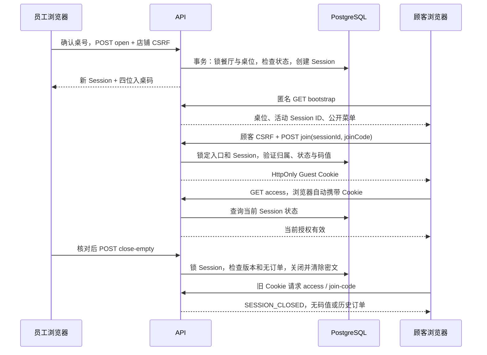

# 第四阶段：开桌、顾客授权与空桌关闭

本阶段完成“员工确认开桌 → 告知入桌码 → 顾客验证 → 刷新恢复授权 → 关闭空桌 → 旧授权失效”。
员工入口为 `/staff/floor`，顾客继续使用 `/q/{token}`。OWNER、STAFF 均可开桌和关闭空桌。
菜单和桌位维护保持原入口。购物车、下单与接单开关已由[第五阶段](cart-ordering.md)接续实现；厨房和取消已由[第六阶段](kitchen-cancellation.md)接续实现；收款结账、VOIDED 关闭和历史查询已由[第七阶段](billing-history.md)接续实现。本文的第四阶段测试数字保留为当时记录。

沿用现有九张表、活动用餐唯一索引及历史结构，没有新增迁移。

## 1. 按四步阅读代码

| 步骤 | 主要位置 | 应理解的问题 |
| --- | --- | --- |
| 员工用餐操作 | `Dining/DiningService.cs`、`Data/RowLocks.cs`、`Dining/DiningEntrance.cs`、`Controllers/DiningController.cs` | 为什么开桌锁桌位，而关桌锁 Session？ |
| 顾客授权 | `Guests/GuestAuthentication.cs`、`Guests/GuestService.cs`、`Dining/JoinCodes.cs` | 入桌码、Cookie 和用餐 ID 各有什么作用？ |
| 页面联调 | `features/dining/`、`features/guests/`、`lib/api.ts` | 请求响应丢失为什么只能先查结果？ |
| 验收 | `DiningAndGuestTests.cs`、`frontend/tests/dining-guest.test.ts` | 怎样用两个独立数据库连接验证竞争？ |

上表后端路径相对于 `backend/TavoloFlow.Api/`，前端路径相对于 `frontend/src/`；
集成测试位于 `backend/TavoloFlow.Api.Tests/`。



## 2. 身份、秘密与生命周期

- **QR token**：固定公开入口，识别桌位；不授予顾客权限。
- **Session ID**：某一轮用餐的业务 ID。新一轮创建新 ID，旧记录保留，不能重新激活。
- **四位入桌码**：首次加入用餐的共享短码；数据库只保存加密后的密文。
- **Guest Cookie**：浏览器的受保护凭据，绑定餐厅、桌位、Session，内容不包含入桌码。

入桌码字符集为 `23456789ABCDEFGHJKLMNPQRSTUVWXYZ`，用安全随机数生成。
输入去除首尾空白并转大写。Data Protection 的用途链固定前缀加餐厅、桌位和 Session ID，
不能将一轮的密文搬到另一轮使用。密文无法解密时返回 `503 JOIN_CODE_UNAVAILABLE`，不生成新码覆盖。

顾客输入框关闭自动纠错，编辑时原样保存浏览器的输入值，不在 `onChange` 中转大写、过滤或截断，
避免打断中文输入法的组合输入并导致重复字符、空白或光标异常。大小写归一化由后端在验证时处理，小写码同样有效。

顾客 Cookie 名为 `TavoloFlow.Guest`，Path 为 `/api/public`，采用 HttpOnly、SameSite=Lax，
不指定 Domain；生产 Secure，Development 随请求协议。它是浏览器会话 Cookie，票据固定 12 小时，
不滑动续期。与店铺的 `TavoloFlow.Store`、固定 30 天的持久票据相互独立；店铺登录期限调整不会延长顾客本轮用餐授权。

默认 `Browser` 认证方案将 `/api/public/*` 请求交给 `Guest`，其他请求交给 `Store`；
店铺权限策略仍明确指定 Store，顾客权限策略明确指定 Guest。
即使同一浏览器同时登录员工账号并验证入桌，两个身份也不能替代彼此。

CSRF 沿用框架服务和现有 CSRF Cookie，但请求 token 分别从 `/api/auth/csrf`、
`/api/public/csrf` 按各自身份取得；写前重新获取。店铺身份的 token 不能授权顾客写操作。
公开 bootstrap 继续使用 `credentials: omit`；顾客授权请求携带 Cookie，但不会触发后台登出回调。

**Cookie 仍存在不代表授权仍有效。** 每次受保护访问都会检查目标归属和数据库当前状态。
关闭将状态改为 CLOSED 并清空密文，所有旧 Cookie 随即无法访问本轮内容。
无需清除其他浏览器的 Cookie，也无需增加授权表。再次开桌即使偶然生成相同短码，旧 Cookie 仍然无效。

同一浏览器只保留一份 Guest Cookie；验证另一桌会替换它。旧标签页要求重新验证，
不会删除另一标签页的新凭据。前端用 BroadcastChannel 通知同源标签页重新检查授权，不广播码值或票据。

## 3. 接口契约

所有接口均返回 `Cache-Control: no-store`。员工接口限定可信店铺身份并要求完成首次改密。
写接口要求 `X-CSRF-TOKEN`，请求 DTO 拒绝未定义字段。

| 方法与路径 | 成功响应/用途 |
| --- | --- |
| `GET /api/staff/floor` | `serviceStatus`、`orderingEnabled`、`tables[]`；每桌包含 `id/tableLabel/isEnabled/session`，session 为 null 或 `{ id, openedAt }` |
| `POST /api/staff/tables/{tableId}/open` | 无业务输入；201 `{ session, joinCode }` |
| `GET /api/staff/sessions/{id}` | Session 摘要，包含已关闭记录，用于核对原操作 |
| `GET /api/staff/sessions/{id}/join-code` | `{ sessionId, joinCode }`，仅活动用餐 |
| `POST /api/staff/sessions/{id}/close-empty` | 输入确认信息，200 账单摘要（与 PAID/VOIDED 相同；现由 `BillingService` 实现） |
| `GET /api/public/csrf` | `{ token }`，匿名或当前顾客均可取得 |
| `POST /api/public/qr/{token}/join` | `{ sessionId, joinCode }` → Cookie 及 `{ restaurantId, tableId, sessionId }`，不回传码值 |
| `GET /api/public/sessions/{id}/access` | `{ restaurantId, tableId, sessionId, status, serviceStatus, isTableEnabled, orderingEnabled }` |
| `GET /api/public/sessions/{id}/join-code` | `{ sessionId, joinCode }`，要求当前有效顾客授权及可用入口 |

Session 摘要字段：`id`、可空 `tableId`、历史 `tableLabel`、`status`、`openedAt`、
可空 `closedAt/closeReason`、`billVersion`、`orderCount`、`totalAmountCents`。
不包含订单明细、账号归属或码值。已关闭记录的金额来自关闭快照。

关闭空桌输入示例：

```json
{
  "expectedBillVersion": 1,
  "confirmedTotalCents": 0,
  "guestsLeftConfirmed": true
}
```

后端在锁内重新核验，无任何订单才允许 EMPTY。所有订单已取消也不能走 EMPTY。
成功保存 `CLOSED / EMPTY / closed_at / closed_total_cents=0`，清除密文；版本不递增。
同一确认重复提交到已 EMPTY 关闭的相同 Session，返回原摘要；不会作用于后来的用餐。

| 错误码 | 处理 |
| --- | --- |
| `400 VALIDATION_FAILED` / `CSRF_VALIDATION_FAILED` | 修正输入或重新获取页面验证 token |
| `401 GUEST_AUTH_REQUIRED` | 没有有效顾客票据，提示验证；不退出员工账号 |
| `401 JOIN_CODE_INCORRECT` | 短码错误，保留输入供修改 |
| `403 GUEST_SESSION_MISMATCH` | Cookie 属于另一轮用餐；不替换目标、不删除其他标签页的 Cookie |
| `404 TABLE_NOT_FOUND / SESSION_NOT_FOUND / QR_NOT_FOUND` | 资源不存在或不属于当前允许范围 |
| `409 SESSION_ALREADY_ACTIVE` | 读取当前桌位，不重开、不换码 |
| `409 SESSION_CLOSED` | 顾客清除受保护状态，显示结束提示 |
| `409 SERVICE_SUSPENDED / TABLE_DISABLED` | 阻止新增开桌、验证及顾客读码 |
| `409 BILL_CHANGED / SESSION_HAS_ORDERS` | 不关闭，重新核对版本或改走后续订单处理流程 |
| `429 RATE_LIMITED` | 按 `Retry-After` 等待 |
| 网络、超时、`5xx` | 结果可能未知，先读取状态，不自动重发写操作 |

## 4. 锁、限流与状态开关

锁顺序：

- 开桌：餐厅 `FOR SHARE` → 桌位 `FOR UPDATE` → 检查无活动 Session → 插入。
- 入桌验证/顾客读码：餐厅 → 桌位 → Session，均为 `FOR SHARE`，检查与取码在同一事务。
- 空桌关闭：Session `FOR UPDATE` → 检查版本、无订单 → 写关闭结果。
- 员工读码：Session `FOR SHARE`；不受餐厅或桌位停用限制，仍要求活动用餐。

共享锁可以并行读取，并与 UPDATE/DELETE 的冲突锁协调。第五阶段下单和第六阶段厨房完成/取消已使用该 Session 行锁，第七阶段结账也使用
同一 Session 行锁，不能仅先查询再无条件保存。桌位唯一活动 Session 索引继续提供最后一道约束。
`RowLocks` 必须在调用方拥有的事务内使用；不要给现有目录删除服务再包外层事务。

暂停接单不阻止开桌、验证或读码。餐厅服务停用/桌位停用阻止新开桌、顾客验证和顾客读码；
既有授权可查询用餐状态，员工可查看当前码、核对并关闭空桌，公开菜单仍可浏览。

`GuestRateLimits:JoinsPerIpPerMinute` 默认为 60，`JoinsPerSessionPerFiveMinutes` 默认为 30。
成功和失败的实际验证尝试都计数，无等待队列，超限记录不含码值的警告。
这是单实例内存限制，重启会重置；部署多实例前需共享或边缘限流，不应直接依赖单实例计数。

## 5. 前端如何恢复未知结果

员工新写操作共享 15 秒超时，不自动重试、不离线排队。第五阶段仅对下单提供“手动重试原请求”这一例外；自动恢复仍仅 GET，详见[订单恢复状态](cart-ordering.md#4-页面与未知结果恢复)。发送前将操作类型、桌位和必要的原 Session ID
记录到 sessionStorage，按餐厅及账号隔离；不保存码值。响应未知时暂停新操作，恢复连接或刷新后先 GET：

- 开桌查到活动用餐：显示当前详情，由员工核对后主动取码。
- 开桌查到空桌：提示重新确认，只有再次点击才发送新的 POST。
- 关闭：按原 Session ID 查询是否已经结束，不用桌位后来新开的 Session 推断原结果。

缺少开桌幂等键仍意味着延迟旧请求可能造成非预期开桌；以上恢复流程不承诺操作级精确去重。
可通过核对后关闭空桌处理。本阶段不增加 `open_request_id` 或 `table_version`。

顾客每 30 秒及恢复前台/联网时核对入口和授权。未验证也可先看菜单；跳过状态按标签页和当前 Session 保存。
验证返回结果不明时只读取 access；如果 Cookie 已经收到，可恢复已验证状态，否则由顾客再次明确提交。
关闭时隐藏菜单及码值并保存结束标记，刷新仍显示结束；“重新浏览菜单”会先取得新的公开入口快照。

`public` 查询保留匿名菜单；`guest` 查询按餐厅、桌位、Session 隔离；员工退出只清理店铺私有查询及 mutation。
码值只短暂放在组件内存。断网、失效、切桌、隐藏页面或授权重查时清除显示，并忽略已失效读取的迟到响应。
本地存储和界面只负责恢复体验，最终权限由后端决定。

## 6. 本地运行和学习实验

按 [店铺账号模块](store-accounts.md) 启动数据库、应用迁移、初始化账号并启动 API/Vite。
Windows + WSL 的手机扫码操作步骤见 [本地手机测试流程](zh-CN/local-wsl-testing.md)。
开发账号初始化仍默认创建 SUSPENDED 餐厅。本阶段没有平台管理入口，不会自动改变服务状态。

如需在**自己的开发数据库**启用测试餐厅，先在账号页确认餐厅 ID，再连接 Compose 数据库：

```bash
docker compose exec db sh -c 'psql -U "$POSTGRES_USER" -d "$POSTGRES_DB"'
```

将下例 UUID 替换为刚确认的开发餐厅 ID，先查询再明确更新该行。不要对生产数据库运行此练习。

```sql
SELECT id, name, service_status FROM restaurants
WHERE id = 'YOUR_DEV_RESTAURANT_UUID';

UPDATE restaurants SET service_status = 'ACTIVE'
WHERE id = 'YOUR_DEV_RESTAURANT_UUID';
```

接单开关可保持关闭，仍能完成本阶段练习。打开 `/staff/floor`：

1. STAFF 给 8 号桌开桌，观察 open 请求和响应；数据库密文与页面短码不同。
2. 无痕窗口扫码，跳过验证并刷新，观察菜单仍可看且不会再次要求展开输入。
3. 输入码、验证、刷新，观察自动请求 access，页面从未调用 `/api/auth/me`。
4. 查看入桌码后模拟断网，确认码隐藏，恢复后没有自动重新 POST join。
5. 同浏览器另一标签页验证另一桌，回到旧标签页，观察需重新验证且另一桌授权未被删除。
6. 员工核对零订单并勾选离桌确认后关闭；顾客刷新看到结束状态。
7. 再开同一桌，观察不同 Session ID；旧页面须主动重新浏览并验证。
8. 浏览器网络面板检查 Cookie：Guest 为 HttpOnly，本地存储没有票据、密码或入桌码。
9. iPhone Chrome 无痕窗口使用中文输入法，逐字输入含连续字母的入桌码（例如 `2NZZ`），
   确认第三、四位不重复、不插入额外空白；删除、重新输入及中间替换均正常。再用实际入桌码的小写形式验证可入桌。

```bash
dotnet test TavoloFlow.slnx
```

在 `frontend/` 执行：

```bash
npm run build
npm run lint
node --test --test-isolation=none tests/*.test.ts
```

集成测试使用临时 PostgreSQL 和 WebApplicationFactory；并发测试用拦截器在取得锁后暂停，
让第二连接实际发起竞争，再释放锁验证两种先后顺序。测试不连接开发数据库。

## 7. 本次验收记录（2026-10-22）

- 后端全套测试：124 项通过，包括本阶段新增的 21 个测试用例；无新增数据库迁移。
- 前端：`npm run build`、`npm run lint` 通过，Node 纯逻辑测试 17 项通过。
- Chromium 浏览器使用独立 OWNER、STAFF、顾客上下文及临时 PostgreSQL，验证开桌、两台顾客设备验证、
  刷新恢复、空桌关闭、旧授权失效和重新开桌。未修改开发数据库。
- 模拟开桌和关闭响应丢失：每次只有一次 POST，刷新后 GET 核对原操作；模拟顾客验证响应损坏但 Cookie
  已收到：通过 access 恢复，没有自动重发 join。
- 验证跨标签页换桌、三语切换、先看菜单后刷新、离线恢复、自动轮询检测结束、键盘 Enter 与焦点、
  复制反馈以及禁用 sessionStorage 后仍可浏览和验证。360px 视口未出现水平溢出。
- 延迟读码响应，期间断网或关闭用餐：旧码不会重新显示；关桌取消请求后仍能点击“重新浏览菜单”。

浏览器验收使用桌面 Chromium 的移动视口；实际手机及局域网扫码可按
[第三阶段的局域网设置](tables-public-menu.md) 继续在自己的设备上验证。

主要页面截图（使用临时测试数据）：

| 页面 | 截图 |
| --- | --- |
| STAFF 桌面开桌工作台 | [查看](screenshots/floor-staff-desktop.png) |
| OWNER 手机工作台 | [查看](screenshots/floor-owner-mobile.png) |
| 顾客输入码 | [查看](screenshots/guest-join-mobile-zh.png) |
| 顾客已验证（中文） | [查看](screenshots/guest-verified-mobile-zh.png) |
| 顾客已验证（英文） | [查看](screenshots/guest-verified-mobile-en.png) |
| 用餐结束 | [查看](screenshots/guest-ended-mobile.png) |
