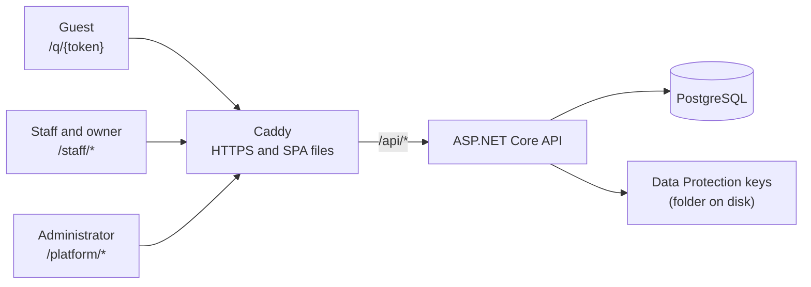
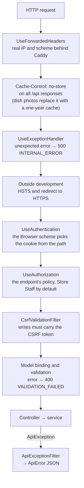
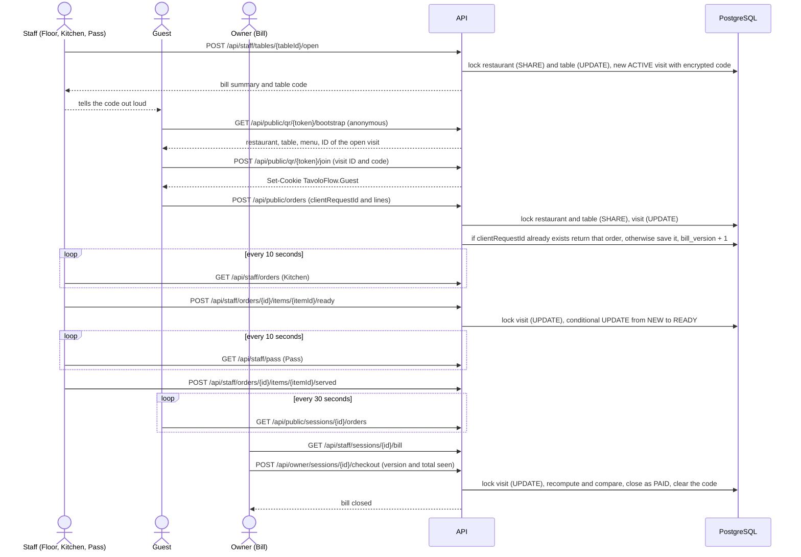
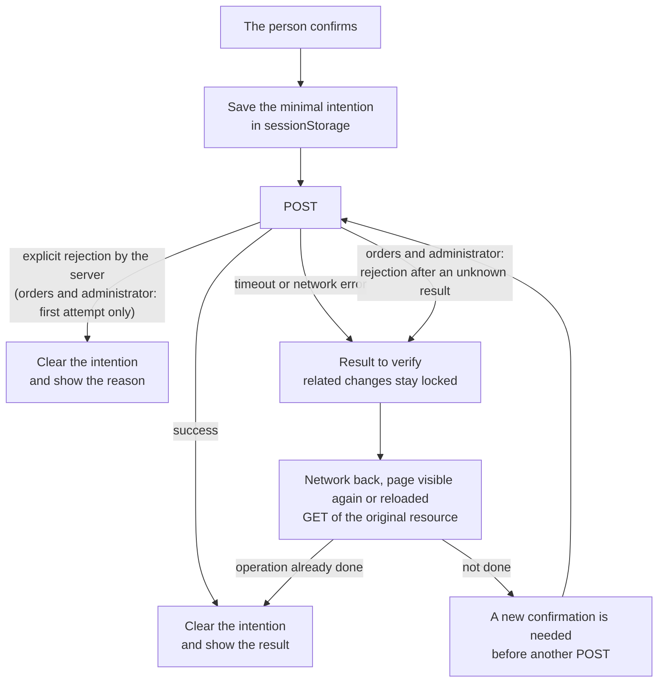

**English** · [Italiano](../it/development-notes.md) · [中文](../zh-CN/development-notes.md)

# Development notes

In these notes I tell how TavoloFlow was born and how it is built: why I developed it, what it does and doesn't do, which technologies I chose, how the architecture is organized, which design decisions I made and which limits I see today. I developed it mainly with AI agents such as Claude Code and Codex: I took part more in the design and in the decisions about the project's direction than in writing the code and in the implementation details.

It is my first full-stack web project. I started it after years of studying computer science, when I realized I had never built a real web app, and decided to make one. That decision, though, came right in the middle of the AI era: on one side I saw AI generate seemingly perfect code from a simple prompt, on the other I had in front of me the study of several frameworks, in huge dedicated books or in the official documentation. The ending was predictable: I decided to use AI to develop this project.

Thinking about it now, I don't think it was a problem. I already had the theoretical foundations from my studies, and the best way to learn to build a project and to use frameworks is precisely to build a real one: to discover the difficulties yourself and ask yourself (or the AI): "instead of doing this by hand, why can't I have something that does it for me?". That is how frameworks are born: to meet real needs. They are designed and built a certain way because they solve a set of problems that people used to run into often, and if you understand the needs and the difficulties they remove, you understand the framework much more easily and quickly. After all, they are products made of code too: only, instead of the business logic of an e-commerce site or a management system, their "business logic" solves problems that come up often when developing a certain kind of software.

So I had three roads in front of me. The first was to watch a tutorial and, together with an LLM chat, get a complete overview of what I was about to do, and then pick up the pieces I needed right away by reading the relevant parts of the documentation or of a dedicated book. The second was to dive into an existing open-source project similar to what I wanted to build, read its code while asking the AI questions, and study the corresponding parts in the documentation or in books, as in the first road. But then I asked myself: why not build a project of my own together with the AI, and then study my own project? A project developed with the help of AI doesn't have worse code than the projects you find at random on GitHub. Why not do it that way? That is where the third road came from, the one I chose.

At this point it is clear why I am starting to write these notes: input is not enough, I also have to produce some output. I have to get my hands dirty to consolidate memory and strengthen the neural connections, and so learn better and more deeply. And also to leave in this project something more my own, which sets it apart from a project generated entirely by AI.

## Why this project

At first I just wanted to build a full-stack project: a web app to publish online, on a server, with its own database and accessible to everyone, something I had never done before. I only had experience with serverless services such as Vercel and Cloudflare. But since I had to build a project anyway, why not make a genuinely useful one, maybe one that could earn me a bit of money?

That is how I got the idea of an ordering system based on scanning a QR code. From a first, not very thorough, survey it seemed a great idea, with a good market at least among Chinese restaurants, where few offered this service to their customers. At first I thought those few used a service provided by the point-of-sale companies, already built into their products.

Only after the release did I discover that the restaurants that didn't offer QR ordering to their customers either didn't need it, or didn't know a possible supplier: and that is where I came in. But the web app I built doesn't support printing kitchen tickets: when an order arrives, it can't print it on a connected printer. I didn't build it both because of the complexity, since I knew that sooner or later I would have to go back and read the code, and because the printers compatible with how the app works are expensive. They are cloud printers (for example those with Star CloudPRNT or Epson Server Direct Print) with a built-in system that periodically asks my server whether there are new orders; when there are, the server returns them in a format the printer can print. Without a printer to try it on, I wasn't sure I could build this feature, and so I lost most of the customers I visited.

Then, as if that weren't enough, after discovering that practically all potential customers needed to print orders, I made another discovery: the restaurants that already offered QR ordering didn't use, as I had first thought, a feature built into the point-of-sale system, but relied on a Chinese SaaS company called 二维火 (2Dfire). Given all this, I wrote the project off as a source of income and decided to make it open source, haha.

## What it does

TavoloFlow is a QR-code table ordering system. Every table has a fixed QR code: the guest scans it with their phone, orders from the menu and the order arrives in the kitchen. Payment stays the same as always, at the till: the app only records that the bill has been paid. There are four kinds of users, and each has its own part of the app.

**Guest**, from their own phone, without installing anything and without signing up:

- scans the QR code and browses the menu in Chinese, Italian or English, with photos, allergens and sold-out dishes;
- joins the table's visit opened by the staff, entering the table code (four characters) if the restaurant requires it;
- builds a cart, with a note for each dish, and sends the order; they can order several times during the meal;
- sees the orders of the whole table and the status of each dish: received, ready, cancelled.

**Staff**, from a phone or tablet; the staff area can be installed as an app (PWA):

- **Floor**: sees the tables and their bills, opens a table when guests arrive and tells them the code; pauses or resumes new orders; closes without payment a table with no orders or with every dish cancelled;
- **Kitchen**: receives new orders with an alert sound, refreshed every 10 seconds; sees them in the Dishes (grouped by dish), Orders and Done views; in the Dishes view each screen can show only some menu categories (for example a screen just for drinks); marks each dish as ready or cancels it;
- **Pass**: on a tablet at the counter, shows the ready dishes to take to the tables; when a dish reaches the table, you tap "Served";
- **Menu**: marks a dish as sold out or available again;
- the interface is in Chinese, Italian or English, chosen per device; until someone chooses, it follows the browser language.

**Owner**: everything the staff does, plus:

- manages the menu: categories, dishes in three languages, prices, allergens, photos;
- manages the tables and downloads their QR code and the printable table card;
- in the Bill section closes the visit after payment, and in Bill history browses closed bills;
- resets the staff account's password and sees the status of their own subscription.

**Platform administrator**, that is whoever offers the service to restaurants:

- creates a restaurant together with its two accounts (owner and staff), with temporary passwords; later can deactivate these accounts or reset their password;
- suspends or reactivates a restaurant, chooses its color theme, decides whether the table code is required, permanently deletes a suspended restaurant;
- manages the owner's contact, the annual fee and the subscription periods, and records the payment of each period, received outside the app;
- their interface is also in Chinese, Italian or English, with the same per-device choice as the staff.

## What it doesn't do (and why)

- **Online payments.** Handling payments means fees, payment data security and refunds: too much for a first version.
- **Fiscal receipts.** TavoloFlow replaces neither the till nor the fiscal register: the receipt is still issued by the restaurant's point-of-sale system.
- **Printing kitchen tickets.** For the reasons explained above: it needs a compatible cloud printer, and I didn't have one to try it on.
- **Push notifications.** Kitchen, pass and bills update by asking the server at regular intervals (polling). For a small restaurant it is enough, and much simpler.
- **Offline operation.** The app doesn't store pages or data on the device to use them without a network: orders and bills must always be up to date. If the connection drops, an already open page shows the latest data with a warning, but blocks operations (for example closing a bill) until a refresh succeeds; if a page is opened without a network, the staff area only shows a page saying so.
- **Personal accounts for every waiter.** Each restaurant has a single, shared staff account, plus the owner's. For a small restaurant that is enough, and there is no need to know who did what.
- **Takeaway and delivery.** Table orders only. A version with pickup orders was developed and then removed, to keep the first version simple.
- **Split bills and sales statistics.** Each visit has a single bill, and apart from the history of closed bills there are no reports.
- **All you can eat.** No ordering rounds or per-person limits: the restaurants I had in mind (ramen, Chinese food, bubble tea) work à la carte.

## Choosing the tech stack

At first, actually, I built a prototype of this idea with TypeScript, Hono and a React SPA, all on Cloudflare, without a database of my own but with the one Cloudflare offers (D1), under the illusion of keeping maintenance costs to a minimum. With a detailed prompt I had the AI generate the project, but the result was completely incomprehensible to me. Never having built a project, I didn't know the problems and difficulties you run into, and so I didn't know which problems all the tools, libraries and frameworks the AI had introduced were solving. I immediately had a cognitive overload and gave up; I only used it to get an overview of what my project was supposed to become.

So I moved to something more stable. Thinking about stability and about value on the job market, Java and C# came to mind. I know both, but C# is more expressive and has a more uniform ecosystem, a lower barrier to entry and a more "batteries-included" framework. In the end I chose C# with .NET, so ASP.NET Core as the web framework for the backend and EF Core as the ORM, with Npgsql as the PostgreSQL provider. "Batteries-included" really shows here: cookie authentication, policy-based authorization, data protection (Data Protection, used among other things to protect cookies and encrypt each visit's code), rate limiting and dependency injection are all built into the framework, and the backend uses no external library for these things. The only third-party library, besides Npgsql, is SkiaSharp, to resize and convert dish photos. EF Core offers no API for row locks (`SELECT ... FOR UPDATE`), so in those places I use hand-written SQL. For tests I use xUnit with real integration tests: Testcontainers starts a throwaway PostgreSQL in Docker for each test class, and `WebApplicationFactory` starts the API in memory to send it HTTP requests as a browser would.

For the database I chose PostgreSQL simply because it is the most used open-source database, and also one of the most powerful.

For the frontend, having just finished studying the basics of React, I chose React, which is also a great fit for this web app: it is essentially an SPA, and the staff area also works as a PWA. The rest of the stack:

- **TypeScript**, to have types on the frontend too and find errors at build time;
- **Vite**, for the development server and the build;
- **TanStack Router**, for routes defined as files, with typed parameters and query strings: a link to a page that doesn't exist, or with a wrong parameter, doesn't compile;
- **TanStack Query**, for data coming from the server: it keeps the cache, handles the polling of the kitchen and the bills, and reloads data after every change;
- **Tailwind CSS** and **shadcn/ui** (on Base UI), for styling and components: shadcn copies the components into the project instead of installing them as a library, so they can be changed freely;
- **qrcode**, to generate the table QR codes directly in the browser;
- **Oxlint** and **Prettier**, for linting and formatting, and Node's built-in test runner to test the pure logic without installing a test framework.

For deployment I use **Docker Compose** on a VPS, with **Caddy** as the reverse proxy, which obtains the HTTPS certificate by itself. Database migrations don't run when the API starts: at each release I apply them explicitly with an EF Core migrations bundle. All the steps are in the [self-hosting](self-hosting.md) guide.

## Architecture

In this section I describe how TavoloFlow is built: what the pieces are, where each one's code lives and how data moves from one part to another. The reasons behind the most important choices (locks, versions, idempotency, polling…) are in the next section, "Design decisions".

### Overview



Everything goes through a single address. The browser only talks to Caddy, which does two things:

- it returns the static files of the SPA, that is those produced by `vite build`: an almost empty `index.html` plus the JavaScript and CSS files in `assets/`. The browser downloads them and runs React, which builds the page directly on the device: this is so-called client-side rendering (CSR);
- it forwards to the API (ASP.NET Core's web server, Kestrel) every request starting with `/api`.

In development this role is played by the Vite proxy, which sends `/api` to `http://localhost:5093`. Frontend and API are therefore on the same origin (same scheme, domain and port): cookies don't have to travel from one domain to another and there is no CORS to configure.

A minimal explanation of CORS: it is a browser rule. When a page's JavaScript makes a request, the browser compares the page's origin (where it loaded `index.html` from, for example `https://app.example.com`) with the origin of the URL being called. If they are the same, as here (`https://app.example.com/api/...`), the request is "same-origin" and CORS doesn't come into play. That Caddy then forwards the request to the API inside the server, the browser doesn't even know. If instead the API lived on another domain, for example `api.example.com`, the server would have to answer with specific headers (`Access-Control-Allow-Origin` and others), otherwise the browser would block the response, and cookies would also be harder to handle.

A few points to keep in mind:

- **One API process, three kinds of users.** The same ASP.NET Core application serves guests, staff and administrators. Each has its own cookie, and the backend understands which one to use by looking at the request URL's path, that is the part after the domain, for example `/api/public/orders` (see "Three identities" below).
- **Three containers in production:** `db` (PostgreSQL), `api` and `caddy`. Only Caddy exposes ports to the outside (80 and 443): the database and the API can only be reached from Docker's internal network.
- **The Data Protection keys** live in a persistent folder. Data Protection is ASP.NET Core's system for encrypting and signing data, and these are its secret keys. The login cookie, in fact, doesn't point to a session stored on the server: it directly contains the account's "ticket" (see "Three identities"), encrypted and signed with these keys, so the browser can neither read it nor forge it. The same keys also protect the CSRF tokens (explained in "Cookies, CSRF and same-origin") and the table codes stored in the database. If the keys lived only inside the container, they would be lost at every new release: everyone would have to sign in again and the codes of open visits could no longer be read. That is why the folder is set in `DataProtection:KeyRingPath` and lives on a persistent volume.

### Data model

The database has eleven tables. The complete schema is in [`er-diagram.dbml`](../reference/er-diagram.dbml), and there is also an [image](../reference/er-diagram.png). Grouped by topic:

| Group               | Tables                                                                                                                                              |
| ------------------- | --------------------------------------------------------------------------------------------------------------------------------------------------- |
| Accounts            | `platform_users` (administrators), `restaurant_users` (one owner and one staff account per restaurant)                                              |
| Restaurant and menu | `restaurants`, `menu_categories`, `menu_items`, `menu_item_images` (the photo bytes, kept apart so menu reads don't load them), `restaurant_tables` |
| Service             | `dining_sessions`, `orders`, `order_items`                                                                                                          |
| Subscription        | `restaurant_subscription_periods`                                                                                                                   |

The central concept is the **visit** (`DiningSession`, table `dining_sessions`). When guests arrive, the staff opens the table from Floor and an `ACTIVE` visit is born, with its own (encrypted) table code and a bill version number, `bill_version`. Guests have no accounts: to the system, a guest is just "a browser that joined this visit".

Each order belongs to a visit and has one or more lines (`order_items`), one per dish, with the quantity and an optional note. Each line has its own status: it is born `NEW`, then the kitchen moves it to `READY` or `CANCELLED`; when the dish reaches the table, the Pass fills in `served_at`. The order also has a summary status: `NEW` while at least one line is `NEW`, then `PROCESSED` (that is the difference between the Kitchen's Orders and Done views).

When the visit closes (after payment, or without payment if there were no orders or they were all cancelled), it becomes `CLOSED` and stores the reason (`PAID`, `EMPTY` or `VOIDED`), the total and the closing time. A closed visit never reopens: the next guests get a new visit.

The frontend makes things more convenient, but guarantees nothing. Some rules, moreover, aren't checked only by the C# code: the database guarantees them directly, so they stay true even if one day the code had a bug.

| Rule                                      | How PostgreSQL guarantees it                                                                                                                                                                                                                                                             |
| ----------------------------------------- | ---------------------------------------------------------------------------------------------------------------------------------------------------------------------------------------------------------------------------------------------------------------------------------------- |
| A table has at most one open visit        | partial unique index `uq_active_session_per_table` on `table_id`, only for rows with `status = 'ACTIVE'`                                                                                                                                                                                 |
| A guest request creates at most one order | unique index `uq_order_one_per_request` on `(dining_session_id, client_request_id)`                                                                                                                                                                                                      |
| Data of different restaurants never mixes | every business table has `restaurant_id` (except `menu_item_images`, which reaches the restaurant through its dish) and the foreign keys are composite, `(id, restaurant_id)`: an order can only point to a visit of the same restaurant, a line only to an order of the same restaurant |
| Status and fields are always consistent   | check constraints such as `ck_session_lifecycle`: an `ACTIVE` visit has the encrypted code and no closing data, a `CLOSED` one has time, reason and total, and the code is cleared; `ck_order_item_lifecycle` does the same for lines                                                    |
| Only allowed values                       | enums are stored as uppercase text (`ACTIVE`, `READY`…) and a check constraint lists the valid values                                                                                                                                                                                    |

Order history, on the other hand, is not protected by the database. Each line stores a copy (snapshot) of the dish's name, price and allergens: if the dish later changes price, the line stays as it was. But PostgreSQL doesn't prevent a direct UPDATE of these copies or of closed bills: that they don't change is guaranteed by the services, which never modify them. Deleting a dish or a table also goes through a service, `CatalogDeletionService`: first it clears the reference (`menu_item_id` in the lines, `table_id` in closed visits), then it deletes, and the copy stays. Here the database only acts as a check: the foreign key doesn't allow deleting a dish or a table that is still referenced.

Other conventions:

- **Money in integer cents** (`long`, `*_cents` columns), never decimal numbers. The maximum is the largest integer JavaScript represents exactly (2⁵³ − 1, `InputRules.MaxSafeCents`), so the browser loses no precision.
- **Times in UTC** (`timestamptz`), shown in the restaurant's time zone (Europe/Rome). Only subscription periods use plain dates (`date`).
- **snake_case names**, mapped by hand in `Data/Configurations/`, one class per entity.
- **One database for all restaurants** (multi-tenant): they all live in the same tables, separated by `restaurant_id`. Deleting a restaurant removes all its rows with `ON DELETE CASCADE`.
- **Migrations** in `Data/Migrations/`, generated by EF Core and forward-only; they never run at startup (see "Choosing the tech stack").

### Backend: modules and the path of a request

The backend is a single project, `backend/TavoloFlow.Api/`, organized by topic rather than by kind of class:

| Folder               | Contents                                                                                                                                                                                                           |
| -------------------- | ------------------------------------------------------------------------------------------------------------------------------------------------------------------------------------------------------------------ |
| `Program.cs`         | the starting point: registers the services and the middleware pipeline. With an option like `--seed-dev-accounts` it becomes a one-off command instead, which runs and exits (`Operations/MaintenanceCommands.cs`) |
| `Controllers/`       | 14 controllers, all very thin                                                                                                                                                                                      |
| `Common/`            | cross-cutting code: the error format (`ApiError`, `ApiException` and the global filter), identity selection and CSRF (`BrowserSecurity`), cursor paging, enums as text, input rules and the rate limiter           |
| `Accounts/`          | login, logout and password change for owner and staff                                                                                                                                                              |
| `Menus/`             | menu management, availability, dish photos, reading the public menu                                                                                                                                                |
| `Tables/`            | tables and QR tokens                                                                                                                                                                                               |
| `Dining/`            | opening a table, the Floor, the encrypted table code, the shared bill summary, pausing new orders                                                                                                                  |
| `Guests/`            | the guest joining the visit, and their cookie                                                                                                                                                                      |
| `Ordering/`          | idempotent order creation and the table's orders                                                                                                                                                                   |
| `Kitchen/`           | the Kitchen queue, dish ready or cancelled, the Pass                                                                                                                                                               |
| `Billing/`           | the bill, the three closures (`PAID`, `VOIDED`, `EMPTY`), Bill history                                                                                                                                             |
| `Platform/`          | administrator area: restaurants, accounts, subscriptions                                                                                                                                                           |
| `Data/`, `Entities/` | `ApplicationDbContext`, the EF Core mappings and migrations, the row locks (`RowLocks`), the deletion service; the 11 entities                                                                                     |

Each module has an `XxxContracts.cs` file with the DTOs (what goes into and comes out of the API) and the error factories, for example `DiningErrors.SessionClosed()`, plus one or more services with the rules and the transactions.

Dependencies between modules go in one direction only and follow the path of a visit: `Guests` uses `Dining`; `Ordering` uses `Guests` and `Dining`; `Kitchen` uses `Ordering` and `Dining`; `Billing` uses `Dining` and `Kitchen` (only to reuse the order format in the bill response); `Platform` uses `Accounts`. `Common/` depends on no business module.

**Thin controllers.** A controller does only three things: it declares who can call the endpoint, takes the trusted identity and calls the service. For example, marking a dish as ready:

```csharp
[ApiController]
[Authorize(Policy = StoreAuthentication.StaffPolicy)]
public sealed class KitchenController(KitchenService kitchen, CurrentAccount current) : ControllerBase
{
    [HttpPost("api/staff/orders/{id:guid}/items/{itemId:guid}/ready")]
    public async Task<IActionResult> Ready(Guid id, Guid itemId, CancellationToken ct) =>
        Ok(await kitchen.ReadyAsync(current.RequireUser().RestaurantId, id, itemId, ct));
}
```

The restaurant ID never comes from the client: it comes from the cookie, through `CurrentAccount`. So a staff member can't touch another restaurant's data even by changing the IDs in the URL: the service looks up the order filtering by restaurant too, doesn't find it and answers 404.

Services are registered as scoped: each request has its own instance, which shares the request's `DbContext`. Each service opens and closes its own transactions, and reads the time from an injected `TimeProvider` instead of `DateTime.UtcNow`, so tests can move time forward.

**The path of a request.** Here is what a request goes through, in the order `Program.cs` assembles the pieces:



- **Authentication.** It reads the cookie of the identity the path belongs to and builds `HttpContext.User`. For staff and administrators it also rechecks the account in the database (`ValidatePrincipal`, see "Three identities").
- **Authorization.** Each controller declares a policy: `StoreStaff`, `StoreOwner`, `StoreAccount` (valid even before the first password change, only for operations on one's own account), `GuestAccess` or `PlatformAdmin`. An endpoint without `[Authorize]` falls into the fallback policy, which is Store Staff: a new endpoint is protected even if you forget to declare one. Login, the public menu, joining the visit and requesting the CSRF token are opened explicitly with `[AllowAnonymous]`. The 401 and 403 responses are written by the cookie events, before the MVC filters, but in the same JSON format.
- **CSRF.** `CsrfValidationFilter` is registered on all controllers: every POST, PUT, PATCH and DELETE must carry the `X-CSRF-TOKEN` header obtained by the same identity, otherwise the response is 400 `CSRF_VALIDATION_FAILED` (see "Cookies, CSRF and same-origin").
- **Errors.** A service rejects a request by throwing an `ApiException` with an HTTP status, a code and a message. The global `ApiExceptionFilter` always turns it into the same JSON:

  ```json
  {
    "code": "SESSION_CLOSED",
    "message": "本次用餐已结束。",
    "requestId": "0HN…:00000001",
    "errors": null
  }
  ```

  Some codes add fields: for example `BILL_CHANGED` also carries `currentBill`, the updated bill. The server's messages are in Chinese; in Italian and English the frontend doesn't show them, but picks the text based on `code` (`lib/api-messages.ts`).

### Frontend: how features are organized

The frontend (`frontend/src/`) is a single SPA with three areas, one per kind of user: `/q/{token}` for the guest, `/staff/*` for owner and staff, `/platform/*` for the administrator.

**Routes.** With TanStack Router, routes are files in `routes/`, and the file name is the URL: `staff.kitchen.tsx` becomes `/staff/kitchen`, `q.$token.tsx` becomes `/q/{token}` with the `token` parameter. From these files the Vite plugin generates `routeTree.gen.ts`, which is never edited by hand. `staff.tsx` and `platform.tsx` are layout routes: they wrap all the pages of their area (for staff, `StaffLayout` shows the navigation and makes the area installable as a PWA). Route files stay very thin and hand over to the feature right away:

```tsx
export const Route = createFileRoute("/staff/kitchen")({
  component: KitchenPage,
});
```

**Features.** The real code lives in `features/`, one folder per part of the product:

| Feature         | Pages                                                                                           |
| --------------- | ----------------------------------------------------------------------------------------------- |
| `public-menu`   | the guest menu, `/q/{token}`                                                                    |
| `guests`        | the guest joining the visit, with the table code                                                |
| `orders`        | cart, sending the order, the table's orders                                                     |
| `accounts`      | login, password change, Home, navigation, PWA installation                                      |
| `dining`        | Floor, `/staff/floor`                                                                           |
| `kitchen`       | Kitchen, `/staff/kitchen`                                                                       |
| `pass`          | Pass, `/staff/pass`                                                                             |
| `billing`       | Bill, `/staff/orders`, and Bill history, `/staff/history`                                       |
| `menu`          | Menu, `/staff/menu`                                                                             |
| `tables`        | Tables & QR, `/staff/tables`                                                                    |
| `subscriptions` | the owner's Subscription, `/staff/subscription`, and subscription periods for the administrator |
| `platform`      | administrator area, `/platform/*`, and Staff account, `/staff/settings`                         |

Each feature has more or less the same shape:

- `api.ts`: all of the feature's server calls, the query keys and the response types. Components and hooks never write a URL;
- `state.ts`: pure logic, without React or browser APIs (validation, cart rules, recovery after a network error), tested with `node --test`;
- `use<Feature>.ts`: hooks for polling, for stopping when the page is hidden or offline and for discarding late responses;
- `*Page.tsx` and `*Views.tsx`: rendering;
- `messages.ts`: the interface text, one object per language (Chinese, Italian and English). Each language has the same type as the Chinese object, so if a translation is missing the project doesn't compile.

Shared code lives in `lib/` (`api.ts` with the request functions, price and time formatting, languages, themes…), in `components/` (the common page pieces: `PageHeader`, `Notice`, `ConfirmDialog`, `MasterDetail`…) and in `components/ui/`, where the shadcn/ui components live.

**Where data lives.** The frontend has three kinds of state, and each has its own place:

| Kind                 | Where                | Examples                                                |
| -------------------- | -------------------- | ------------------------------------------------------- |
| Server data          | TanStack Query cache | menu, Floor, Kitchen queue, bills                       |
| Tab-local intentions | `sessionStorage`     | cart, identifiers of operations awaiting confirmation   |
| Device preferences   | `localStorage`       | interface language, Kitchen sound and hidden categories |

The first piece of each query key says which identity the data belongs to: `public` (anonymous menu), `guest`, `platform`, `["auth", "me"]` (the staff identity); everything else counts as private restaurant data. When the staff signs in or out, `lib/query-scope.ts` clears only the staff cache, and the guest's or administrator's data open in the same tab stays.

### Three identities: staff, guest, platform

The same browser can hold up to three identities at once, for example the owner trying the guest menu on their own phone. Each has its own cookie, and they don't get in each other's way:

| Identity | Who              | API paths                          | Cookie                                      | Lifetime                                     | In the backend           |
| -------- | ---------------- | ---------------------------------- | ------------------------------------------- | -------------------------------------------- | ------------------------ |
| Store    | owner and staff  | all of `/api` except the two below | `TavoloFlow.Store`, path `/`                | fixed 30 days, survives closing the browser  | `CurrentAccount`         |
| Guest    | guest at a table | `/api/public/*`                    | `TavoloFlow.Guest`, path `/api/public`      | fixed 12 hours, gone when the browser closes | `GuestIdentity`          |
| Platform | administrator    | `/api/platform/*`                  | `TavoloFlow.Platform`, path `/api/platform` | fixed 30 days, survives closing the browser  | `CurrentPlatformAccount` |

No cookie renews itself with use: when it expires you have to sign in again (or, for the guest, join the visit again). They are all `HttpOnly`, so JavaScript can't read them.

**The path decides the identity.** Everything rests on a single function, `BrowserSecurity.SchemeFor(path)`:

```csharp
public static string SchemeFor(PathString path) =>
    path.StartsWithSegments("/api/platform") ? PlatformScheme :
    path.StartsWithSegments("/api/public") ? GuestScheme : StoreScheme;
```

Two pieces use it:

1. The default authentication scheme, `Browser`, reads no cookie: it looks at the path and hands the request to the right scheme (Store, Guest or Platform), which reads its own cookie and builds `HttpContext.User`.
2. CSRF: each token is bound to the identity of the path it was requested for (`store`, `guest` or `platform`), so a token obtained as a guest isn't valid for a staff write.

Cookie paths help too: the browser sends the Guest cookie only to requests under `/api/public` and the Platform cookie only under `/api/platform`.

**What is in the cookie and what gets rechecked.**

- Store and Platform: the cookie contains the account ID, the role and the credential version (`credential_version`), plus the restaurant ID for staff. On every request `ValidatePrincipal` rereads the account from the database: if it has been deactivated or the version has changed (password change or reset), the cookie is rejected. So changing a password signs out all other devices immediately.
- Guest: the cookie contains restaurant, table and visit, plus a random identifier generated at every join, to which the CSRF token is bound. It only proves that "this browser joined this visit"; whether the visit is still open is checked by every guest service, on every request. After closing, the cookie stays in the browser, but every request answers `SESSION_CLOSED`.

**In the frontend**, `lib/api.ts` has a family of functions for each identity: `request`/`write` for staff, `publicRequest` for anonymous reads (without cookies, like the public menu), `guestRequest`/`guestWrite` for the guest and `platformRequest`/`platformWrite` for the administrator. Each write first asks its own identity's `csrf` endpoint for a fresh CSRF token and sends it in the `X-CSRF-TOKEN` header.

Why cookies and not JWT tokens, and how the CSRF protection works, I explain in "Cookies, CSRF and same-origin".

### The full flow of a visit

To see how all the parts work together, here is a visit from opening the table to closing the bill, for a restaurant that requires the table code:



1. **Opening.** From Floor the staff opens the table. The backend locks the restaurant row in shared mode and the table row exclusively, checks that the table doesn't already have an open visit and creates the new visit with the encrypted code. If the restaurant doesn't use the code, the response has `joinCode: null`.
2. **Bootstrap.** The guest scans the QR code. The `/q/{token}` page reads, without any cookie, restaurant, table, menu and the ID of the open visit, all in a single Repeatable Read transaction. The bootstrap creates nothing and never reveals the code.
3. **Joining.** The guest enters the code (or, if the restaurant doesn't require it, the page joins by itself). If the code is right, the backend answers with the Guest cookie, bound to that visit. A rate limit per IP and per visit prevents guessing the code by brute force.
4. **Order.** The frontend generates a `clientRequestId`, saves it in `sessionStorage` together with the order and only then sends the POST. After the locks, the backend first looks for an order with the same ID: if there is one, it returns it. Otherwise it checks that the restaurant accepts orders, that the dishes are available and that the prices haven't changed, then saves the order with the dish copies and increments `bill_version`, all in the same transaction.
5. **Kitchen and Pass.** The Kitchen asks the server every 10 seconds and plays a sound when a new order arrives. Marking a dish as ready is a conditional UPDATE (`WHERE status = 'NEW'`) under the visit lock; from the Pass, `served_at` is then set the same way. The guest sees the dishes' status update every 30 seconds.
6. **Closing.** The owner confirms the bill by sending the version and the total they saw. The backend locks the visit, recomputes everything and, if something has changed in the meantime, answers `409 BILL_CHANGED` with the updated bill. If everything matches, it closes the visit as `PAID`, stores the total, clears the code and marks as served the ready dishes still waiting at the Pass. From this moment the guest's cookie is no longer any use: every request answers `SESSION_CLOSED`.

The details of each step (why exactly those locks, why `clientRequestId`, why `bill_version`, why polling) are in "Design decisions".

## Design decisions

In this section I explain the reasons behind the most important technical choices. Almost all of them answer two questions: what happens when two people do something at the same moment, and what happens when the network drops halfway through an operation? In a restaurant both happen all the time: several waiters and several guests use the app together, and the Wi-Fi is not always good.

### Concurrency: row locks and lock order

**The problem.** Two waiters tap "Open table" on the same table at the same instant; a guest sends an order right while the owner closes the bill; the owner changes a price while a guest is ordering that dish. If each request reads the data, decides and then writes, two parallel requests can both read the old state and make incompatible decisions, for example open two visits on the same table.

**The choice: PostgreSQL row locks.** Inside a transaction, before deciding, the service locks the rows the decision depends on:

- `SELECT ... FOR SHARE` (shared lock): other transactions can take the same shared lock, but none can modify the row or lock it exclusively until the transaction ends;
- `SELECT ... FOR UPDATE` (exclusive lock): waits for the other locks on the row to be released, then blocks anyone who wants to modify it or take a lock on it, even a shared one.

Normal reads, without locks, are not blocked: thanks to MVCC, PostgreSQL shows them the latest already-committed version of the row.

EF Core has no LINQ API for these locks, so I write them in SQL with `FromSql`, which turns interpolated values into parameters and is therefore safe against SQL injection. The ones on restaurant, table, visit and dish are collected in a single file, `Data/RowLocks.cs`, with the lock order written at the top of the file, so they are easy to check (the few locks on accounts live directly in the platform services):

```csharp
db.DiningSessions.FromSql(
    $"SELECT * FROM dining_sessions WHERE restaurant_id = {restaurantId} AND id = {id} FOR UPDATE")
    .AsNoTracking().SingleOrDefaultAsync(ct);
```

A lock stays active until the end of the transaction: that is why each service opens and closes its own.

**Lock order.** If transaction A locks the table and then waits for the visit, while transaction B has already locked the visit and waits for the table, neither can move on: it's a deadlock. PostgreSQL notices and aborts one of the two, but for the user it is still an error. To avoid it, all operations take locks in the same order:

```
restaurant → table → visit          restaurant → dish
```

Each operation takes only a stretch of this chain, always in this direction: whoever starts from the visit never goes back to the table or the restaurant.

| Operation                                                   | Locks, in order                                                     |
| ----------------------------------------------------------- | ------------------------------------------------------------------- |
| Opening a table                                             | restaurant SHARE → table UPDATE                                     |
| Joining the visit (guest)                                   | restaurant SHARE → table SHARE → visit SHARE                        |
| Sending an order                                            | restaurant SHARE → table SHARE → visit UPDATE                       |
| Reading the table's orders or the bill                      | visit SHARE                                                         |
| Dish ready or cancelled, "Served", closing the bill         | visit UPDATE only                                                   |
| Changing the menu                                           | restaurant UPDATE (when deleting a dish, then also the dish UPDATE) |
| Pausing new orders, suspending the restaurant, subscription | restaurant UPDATE                                                   |
| Renaming, enabling or deleting a table                      | table UPDATE                                                        |

Why does the order take the restaurant in SHARE? Whoever changes the menu takes the restaurant in UPDATE, so while an order is in progress nobody can change prices or availability, and the prices copied into the order are exactly the ones just checked. Two orders from different tables, instead, both take a SHARE lock: they are compatible and run in parallel.

Order, Kitchen and bill closing all take the same visit in UPDATE, so on the same visit they queue up. If the order arrives first, the closing finds the bill changed (`BILL_CHANGED`, see below); if the closing arrives first, the order finds the visit closed (`SESSION_CLOSED`).

**The conditional UPDATE as a second line of defense.** When the Kitchen marks a dish as ready, the service locks the visit, rereads the line and then doesn't simply "save": it runs an UPDATE that applies only if the line is still `NEW`, and checks how many rows it changed (simplified code from `KitchenService`):

```csharp
var changed = await db.OrderItems
    .Where(i => i.RestaurantId == restaurantId && i.OrderId == id && i.Id == itemId &&
        i.Status == OrderItemStatus.New)
    .ExecuteUpdateAsync(u => u.SetProperty(i => i.Status, OrderItemStatus.Ready)
        .SetProperty(i => i.ReadyAt, now), ct);
if (changed != 1) throw Changed(); // 409 ORDER_ITEM_CHANGED
```

With the visit lock, a second request on the same dish arrives later anyway and finds it already `READY`. The condition in the UPDATE is there in case another write path one day forgot the lock: even then, nobody would overwrite someone else's result. The last word belongs to the database, with the unique indexes and check constraints seen in "Data model".

**How it is tested.** A race between two requests can't be reproduced by hoping for luck. In the integration tests (`KitchenTests.cs`) there is `LockGate`, a subclass of EF Core's `DbCommandInterceptor` that stops a transaction at a precise point; meanwhile the test sends the other request and checks that it waits or is rejected as expected.

The alternatives were the Serializable isolation level, with transactions to retry when PostgreSQL detects a conflict, or an optimistic version on every table. With explicit locks, instead, the order of events can be understood by reading the code and nothing needs to be retried.

### Optimistic bill version (BillVersion)

**The problem.** The owner opens a table's Bill, sees €45 and goes to the till. Meanwhile a guest orders another drink, or the Kitchen cancels a dish. When the owner confirms, the closed bill must be exactly the one they saw and collected. A lock is not enough here: I can't keep a database row locked for as long as a person looks at the screen.

**The choice: an optimistic version.** Each visit has `bill_version`, which starts at 1 and goes up by 1 for everything that changes the amount: a new order or the cancellation of a dish. It doesn't change when a dish becomes ready or served, when the same order is repeated with the same `clientRequestId`, or with the closing.

The frontend freezes the version and the total shown in the confirmation (polling updates the screen, but doesn't silently replace the values to confirm) and sends them with the checkout:

```json
{ "expectedBillVersion": 7, "confirmedTotalCents": 4500 }
```

The backend locks the visit in UPDATE, recomputes the bill from the rows in the database and compares. If the version or the total differs, it answers `409 BILL_CHANGED` and attaches `currentBill`, the updated bill: the frontend shows it and the owner has to confirm again. The version alone would be enough to recognize a change; the total is the value the owner actually confirmed, and comparing it too is an extra check. Other checks follow, for example no dish still to prepare (`ORDERS_PENDING`) and a total greater than zero for a paid bill. If everything is fine, the visit closes.

If the same closing arrives again (same reason, same version, same total) on an already closed visit, the backend returns the stored result instead of an error; a different closing, instead, can't rewrite the stored one.

The two techniques complement each other: the pessimistic lock protects the milliseconds of the transaction, the optimistic version protects the seconds or minutes in which a person decides.

### Idempotent orders

**The problem.** The guest taps "Confirm and place order" on weak Wi-Fi. The request reaches the server and the order is saved, but the response gets lost on the way. The phone shows an error, the guest taps again and the kitchen receives the same order twice.

**The choice: make order creation idempotent**, that is make repeating the same request have the same effect as doing it once.

1. The browser generates a `clientRequestId`, a UUID v4 created with `crypto.getRandomValues` (`lib/ids.ts`). Unlike `crypto.randomUUID`, it also works without HTTPS, for example when I try the app on the local network.
2. It saves the complete order together with the ID in `sessionStorage`, and only then sends the POST. From this moment the cart is locked until we know how it went.
3. After the locks and after checking that the visit is open and matches the cookie, the backend looks **first of all** for an order with the same ID in the visit:

   ```csharp
   var original = await Orders(guest).SingleOrDefaultAsync(o => o.ClientRequestId == input.ClientRequestId, ct);
   if (original is not null)
   {
       await transaction.CommitAsync(ct);
       return new(OrderResponse.From(original), false); // 200: order already exists
   }
   // only on the first request: ordering pause, availability, prices, saving (201)
   ```

   The order of the checks matters. If a repeat checked prices and availability again, a guest retrying after the dish ran out would get an error, even though their order already exists and is in the kitchen.

4. The unique index `uq_order_one_per_request` on `(dining_session_id, client_request_id)` is the final guarantee: even with a bug in the code, the database wouldn't accept a second order with the same ID.

The frontend never resends the POST by itself. After an unknown result it looks for the order with a GET (`/api/public/sessions/{id}/orders/by-request/{requestId}`); the guest can check again with "Check order result" or tap "Retry original order", which resends the same ID with exactly the same content. It is always the guest who decides.

### Writes with an unknown result: recovery by GET only

The order problem applies to every write: opening a table, marking a dish ready, closing a bill, creating a restaurant. When the network drops, or the timeout expires, the result is unknown: the write may or may not have succeeded. The timeout isn't automatic: only operations that use `withTimeout` (`lib/api.ts`) stop waiting after 15 seconds (`REQUEST_TIMEOUT_MS`), that is those of Floor, Kitchen, Pass, Bill, subscriptions and the guest (orders and joining the visit); menu changes and the administrator's operations on restaurants and accounts don't use it.

For the most delicate writes I use the same pattern: opening a table and pausing new orders on Floor, dish ready or cancelled in Kitchen, closing the bill, guest orders and the administrator's operations on restaurants and accounts.



Guest orders and administrator operations are more cautious. If a request's result was already unknown, the rejection of a retry doesn't prove the first request failed: the intention stays, and for orders the cart stays locked. On the first attempt, moreover, an order releases the intention only for the rejections it understands, such as `MENU_CHANGED` or `ORDERING_PAUSED` (`submissionFailure` in `orders/state.ts`). Even a GET answering 404, for an order, only means "not found yet": the first POST might reach the server later.

The minimal intention contains only identifiers and the kind of action (for example the order ID, the dish ID and "ready"), saved under a key that includes restaurant and account, such as `tavoloflow:kitchen:{restaurantId}:{userId}`. Only the cart saves the whole order, because a retry must send the same content.

**Why GET only.** A GET changes nothing, so it can be repeated as often as needed. An automatically repeated POST, instead, might do the same thing twice, for example reopen a table that was just closed. So, after an unknown result, the frontend only reads the state of the original resource; if the operation doesn't appear done, a person has to confirm it again.

**Why `sessionStorage`.** It is valid for a single tab and disappears when the tab closes, so two tabs don't confuse each other. And only identifiers end up there, never passwords or codes.

There are three exceptions to the pattern:

- the guest's order, which can be retried by hand with the same ID because the backend is idempotent (see above);
- subscription writes in the administrator area, which save nothing: each write carries the subscription version read earlier, so for each version at most one write can succeed. After an unknown result you reread and confirm again;
- "Served" on the Pass, which saves nothing: the UPDATE applies only to a dish that is ready and not yet served, so repeating it does no harm, and the refreshed list shows by itself whether the write went through.

The other writes (menu and photos, tables, login and passwords) save no intention. In the menu and tables, for example, if the response gets lost the form stays filled in and the page asks you to reread the list and check before retrying.

Finally, in the flows that follow the pattern, late responses are discarded: when the page is hidden, the network drops or the user changes, in-flight requests are aborted with `AbortController` and their results no longer touch the screen.

### Polling instead of WebSocket

**The choice.** Kitchen, Pass, Floor and Bill receive no notifications from the server: they ask it at regular intervals with TanStack Query's `refetchInterval`.

| Page                                    | Interval   |
| --------------------------------------- | ---------- |
| Kitchen, Pass                           | 10 seconds |
| Floor, Bill, the table's orders (guest) | 30 seconds |
| Subscription reminders                  | 60 seconds |

Polling stops when the page is hidden or the device is offline, and restarts when it becomes visible again.

**Why it is enough.** A small restaurant has few devices, and for the kitchen a 10-second delay is acceptable. In return polling is much simpler than WebSocket or SignalR: no open connection to maintain and to reconnect after an interruption, no special configuration in the proxy, and every request is a normal GET that goes through the usual authentication and rules. After a network outage, the next poll brings everything back in sync.

**Lightweight reads.** Since these requests repeat constantly, they read only open visits and never count or scan a restaurant's history. To know whether something new has arrived, a "watermark" is enough: the time of the newest order (`latestCreatedAt`) or of the newest ready dish (`latestReadyAt`), read from the end of an index. When the watermark moves forward compared to the previous read, Kitchen or Pass plays a sound (`watermarkAdvanced` in `lib/live-view.ts`). On first load and when the page becomes visible again, the read only serves as a baseline, without a sound.

**Fresh data before writing.** A page that hasn't refreshed for a while shows old data, and deciding on old data is dangerous, for example closing a bill that has changed in the meantime. That is why writes are blocked if the last successful refresh is more than 30 seconds old or predates the page's last return to the foreground (`syncIsFresh`). The warning, though, appears only if the block lasts more than 3 seconds, or immediately if you are offline or the last request failed (`syncIsStalled`): that way a normal refresh doesn't make warnings flash.

The cost is a delay of up to 10 seconds, and the number of requests grows with the number of devices switched on (see "Current limits").

### Cookies, CSRF and same-origin

**Why cookies and not JWT.** A common choice in SPAs is a JWT token saved in `localStorage` and sent by hand in a header. I preferred ASP.NET Core's authentication cookies:

- they are `HttpOnly`: JavaScript can't read them, so not even a malicious script injected into the page (XSS) can steal them and use them elsewhere;
- the browser sends them by itself, and with frontend and API on the same origin no configuration is needed;
- they can be revoked: thanks to the `credential_version` check on every request (see "Three identities"), changing or resetting a password, or deactivating an account, immediately invalidates all old cookies. A JWT is usually verified without the database, and to revoke it before it expires you would need a server-side check anyway: at that point its main advantage disappears.

The fixed lifetime, without automatic renewal (see the table in "Three identities"), is predictable: a lost tablet stops working after 30 days at the latest, and immediately if the password is changed.

**The price of cookies: CSRF.** Precisely because the browser attaches cookies by itself, another site could take advantage of it: a malicious page opened by the owner could contain a hidden form that sends a POST to `https://app.example.com/api/...`, and the browser would attach the owner's login cookie. This is called Cross-Site Request Forgery (CSRF). There are two defenses:

1. `SameSite=Lax` on the login cookies: the browser doesn't attach them to POSTs coming from another site.
2. ASP.NET Core's antiforgery token. Before every write the frontend asks its own identity's `csrf` endpoint for a fresh token and sends it back in the `X-CSRF-TOKEN` header: it costs one extra request, but avoids using an old token after a login, a logout or a change of identity. The server compares it with the antiforgery cookie (`TavoloFlow.Csrf`, `HttpOnly` and `SameSite=Strict`) and with the current user. Another site can't read the response containing the token, because the browser's same-origin policy prevents it, so it can't build a valid request. In addition, each token is valid only for the identity it was requested for (`BrowserCsrfScope`, see "Three identities").

The check is done by `CsrfValidationFilter`, registered globally because `AddControllers` alone doesn't validate the token for JSON requests: that way even a new endpoint is protected without doing anything.

### A PWA for staff

**Why a PWA and not a native app.** Staff use phones and tablets, often already in the restaurant. A native app would mean more code (Android and iOS), publishing in the stores and updates to install on every device. With a PWA the same React code becomes an installable app: an icon on the home screen, a full-screen window, and updates reach everyone without going through the stores, the next time the app is opened or reloaded. An already open page, instead, keeps using the previous version: that is why the server keeps the JavaScript and CSS files of every version (see [self-hosting](self-hosting.md#releasing-a-new-version)).

**Only `/staff`.** The manifest (`/staff.webmanifest`) is not linked in `index.html`: only `StaffLayout` links it, and it also registers the service worker `/sw.js` with scope `/staff`. So guests on `/q/*`, who scan the QR code only once, are never offered to install the app. The manifest's `id`, `start_url` and `scope` are `/staff` without a trailing slash, because the router removes the trailing slash from URLs and the page must stay within the scope.

**A service worker that caches nothing.** The service worker handles only page loads: it always tries the network first, and only if the load fails does it show an offline page written inside it. It doesn't use Cache Storage and leaves all other requests to the browser, including those to `/api`. I give up offline operation, but I never have to worry about old data or an old version of the app stuck in a cache, one of the most common PWA problems. I keep it for the offline page: without a service worker, whoever opens the app without a network would see only the browser's error page. For installation, instead, it is no longer needed today: [Chrome's current criteria](https://web.dev/articles/install-criteria) for offering it don't require a service worker.

**What you gain by installing it:**

- in the app installed with Chrome (on Android or on a computer), Kitchen and Pass can play sounds as soon as they open, without anyone touching the screen: browsers' autoplay rules allow it for installed apps;
- a switch keeps the screen on (Screen Wake Lock API), useful for the kitchen tablet;
- on iOS the installed app has no browser Back button, so pages outside the tabs have a link to go back (`PageHeader`).

I postponed push notifications (Web Push): they would require VAPID keys and device subscriptions stored on the backend, and for now polling is enough.

### Other trade-offs

- **Opening a table is not idempotent.** Unlike the order, opening has no request ID. If the response gets lost, the frontend rereads the Floor and the staff decide whether to open again; a second opening on the same table gets `SESSION_ALREADY_ACTIVE`, and the unique index guarantees a single open visit per table anyway. One risk remains, which I accepted consciously for the first version: an old request arriving very late, when the table has already been closed, opening a visit nobody wanted, to be closed later without payment. If it happened often in real use, I would add a request ID to opening too. For an order or a bill such a risk wouldn't be acceptable, and that is why `clientRequestId` and `bill_version` exist there.
- **Menu: the last change wins.** If the owner edits the same dish from two devices, the last save wins, without conflict warnings. It isn't serious, because what matters is checked by the order: the backend always rechecks prices and availability and, if something changed, answers `MENU_CHANGED` with the list of changes.
- **An error format of my own instead of ProblemDetails.** ASP.NET Core supports a standard error format (ProblemDetails, RFC 9457), but the frontend was already built around the `code` field. Generating everything from a single filter cost less than switching to the standard format, which for a public API would still be the more correct choice.
- **Subscriptions without history.** The initial design had a subscription events table, with the history of changes, notices to the owner and an ID for each operation against duplicates. I removed it when it became clear that `subscription_version` alone was enough to guarantee that each write is applied at most once. I lost the history, but for a first version it wasn't needed.

## Limits and what I would do differently

### Current limits

- **Designed for a single instance.** The rate limiter (`FixedWindowLimiter`) keeps its counters in memory: they reset at every restart and, with several API instances, each would have its own. To scale you would need a shared store, for example Redis or PostgreSQL itself.
- **The table code is short.** Four characters from an alphabet of 32 make about a million combinations (2²⁰). Against someone trying to guess it, only the rate limit protects it, per IP and per visit: before real public use it should be reconsidered, perhaps with a longer code.
- **Polling.** The load on the server grows with the number of devices switched on: with many restaurants it would be worth moving to WebSocket or Server-Sent Events.
- **Tests.** The backend has over 150 integration tests, which run on a real PostgreSQL in Docker; the frontend has only pure-logic tests with `node --test`. The repository lacks component tests and end-to-end tests, and there is no CI: tests are run by hand before every release.
- **Error messages in Chinese.** The table the frontend uses to translate error codes into Italian and English (`lib/api-messages.ts`, see "Backend: modules and the path of a request") has to be kept in sync with the backend by hand.
- **Hand-made release process.** A single VPS, release scripts run by hand, backups left to a systemd timer, no monitoring or alerting system: if the server stops, I only notice when someone complains.
- **A complex frontend in places.** Handling unknown results (for example in `useCart`) is very robust, but also heavy to read and maintain for a first version.

### What I would do differently

- **Talk to restaurants before writing code.** I evaluated the idea with a quick survey, and only after the release did I discover that almost everyone wanted to print kitchen tickets and that those who already offered QR ordering used 二维火 (see "Why this project"). A few visits before starting would have made me design printing from the beginning, or maybe change my mind.
- **Release earlier, with fewer features.** I added things a first version didn't need: I developed takeaway and then removed it, I deleted the subscription events table. A smaller product, put in front of customers sooner, would have given me sooner the information that mattered.
- **Set up CI from day one.** A GitHub Action that on every push runs the backend tests and the frontend build, lint and tests costs little, and would have spared me having to remember to do it.
