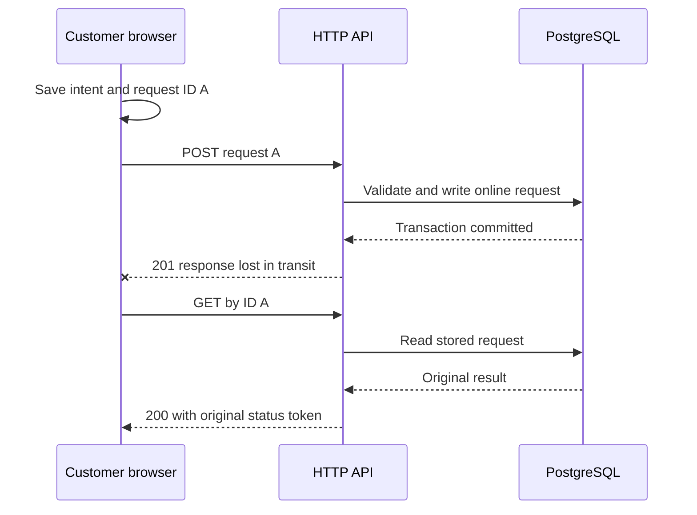

# 1. HTTP and a single order

A customer taps Submit, watches a spinner and loses the phone connection. All the browser knows is that it has no usable response. To tell whether the restaurant received the request, you must find the point where the data became a durable record. Follow it across the network.

## From the address bar to the database

In production, DNS resolves the restaurant domain and TLS protects the connection. Caddy serves two purposes at one origin (scheme, host and port). Navigation to `/r/…` can return the frontend HTML entry point. The browser loads JavaScript and React renders the menu. Requests to `/api/…` go to ASP.NET Core. In development, Vite proxies the same relative API paths. Similar URL prefixes can therefore lead to different handlers and response types. [Caddyfile](../../../deploy/Caddyfile) · [vite.config.ts](../../../frontend/vite.config.ts)

An HTTP request carries a method, a target, headers and optionally a body. GET expresses the intent to read a menu. For submission, the JSON body includes dishes, confirmed prices, fulfilment choice and `clientRequestId`. HTTP success and order status answer different questions. `201 Created` means an online request exists and can still be awaiting a staff decision. `200 OK` can return the original result of the same submission. An HTTP error category helps generic clients, while an application error code guides the next UI action. [OnlineOrderController.cs](../../../backend/TavoloFlow.Api/Controllers/OnlineOrderController.cs) · [RFC 9110, HTTP semantics](https://www.rfc-editor.org/rfc/rfc9110.html)

Methods shape assumptions made by clients and intermediaries. A safe method requests a read. Idempotency means repeating the same operation has the same intended effect as doing it once. PUT can change state and be idempotent. HTTP gives POST no general idempotency guarantee, so applications can define duplicate handling per operation. Here a delivery quote sends the address in a POST body to keep it out of URLs. A POST can thus request a quote without creating an order. [OnlineOrderController.cs](../../../backend/TavoloFlow.Api/Controllers/OnlineOrderController.cs)

## Three paths seen from two sides

Trace a successful commit followed by a lost response. Startup, identity context and CSRF calls are omitted. At what point do the database and phone each know the outcome?

| Stage | First success | Same intent submitted again | First success, response lost |
| --- | --- | --- | --- |
| Browser prepares | Save confirmed contents and ID A in this tab’s `sessionStorage` | Reuse A | Still holds A |
| API executes | Begin transaction, validate, insert, commit, then queue a notification | Find A and return its original result | May already have committed |
| Browser observes | 201, then the status page | 200 and the same status token | Outcome unknown. GET by A restores the status page once found. |

Consider another timing. The client times out, the first write is still running, and the recovery GET reaches the database first. It can legitimately miss A. The page retains the original intent and automatically recovers by reading. An explicit retry checks first and only resends the original intent when appropriate. Generating a fresh ID would give the server reason to create a second purchase. Count HTTP attempts and persisted business records separately. [useOnlineCart.ts](../../../frontend/src/features/online-order/useOnlineCart.ts) · [OnlineRequestService.cs](../../../backend/TavoloFlow.Api/Online/OnlineRequestService.cs)

Staff acceptance creates the session, order and order items. The kitchen then marks dishes ready, the pass confirms service and the owner closes the bill after confirming offline payment. One customer journey spans several HTTP exchanges and short transactions. A database record carries it through the minutes spent waiting for staff. [OnlineStaffService.cs](../../../backend/TavoloFlow.Api/Online/OnlineStaffService.cs) · [OnlineStaffTests.cs](../../../backend/TavoloFlow.Api.Tests/OnlineStaffTests.cs)

## Exercise and self-check

Open the local demo customer link during opening hours. In the browser’s Network panel enable Preserve log, reload, and record the menu document URL and response type. Filter on `/api/`, add a dish and submit one pickup order. Record the creation and status URLs. Find the order number and `statusToken` in the creation response and watch the address change to `/o/…`. Distinguish HTML from API JSON and check for 201 on creation. For a code-only exercise, find `Submit_ConcurrentRepeats_StoreOneRequest` in `OnlineOrderingTests`. Six concurrent calls get the same result and leave one row. [Local development guide](../local-development.md) · [OnlineOrderingTests.cs](../../../backend/TavoloFlow.Api.Tests/OnlineOrderingTests.cs)

**Self-check** — The phone received 201 but the staff device stayed silent. Should the customer place the order again?

Show the answer

Check the status page and the staff waiting list. Notifications are delivered on a best-effort basis after commit. Delivery and a successful database write are separate events.

## Interview practice in Italian

**«Che differenza c’è tra un metodo HTTP sicuro e uno idempotente?»** Explain the requested action, then the effect of repeating it.

*Un metodo sicuro esprime una lettura, come GET. L’idempotenza riguarda invece l’effetto di più richieste uguali: per esempio posso inviare due volte lo stesso PUT e ottenere lo stesso stato finale. Nel nostro progetto la creazione usa POST e abbiamo definito noi come riconoscere il secondo invio, tramite un identificativo della richiesta.*

**Follow-up** — How can 201 on the first call and 200 on the second still be idempotent? Consider the durable effect.

**«Se il client va in timeout, come capisci se l’ordine è arrivato?»** Separate the client’s observation from the commit point.

*Il timeout mi dice solo che il client ha smesso di aspettare. Il server potrebbe aver già concluso la transazione. Prima dell’invio salvo un identificativo insieme ai dati confermati. Quando torno online cerco la richiesta con quell’identificativo. Se serve un nuovo tentativo esplicito, riutilizzo lo stesso identificativo, così il server può restituire il risultato originale.*

**Follow-up** — Which timings could lead to an immediate 404 on recovery? Add an uncommitted transaction to the timeline.

[Course overview](../learning-notes.md) · [Next chapter](02-aspnet-core.md)
