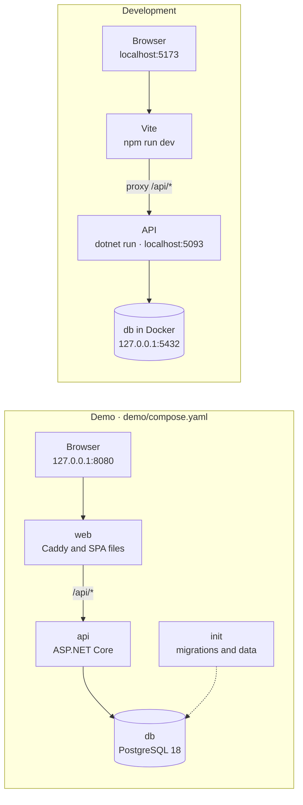
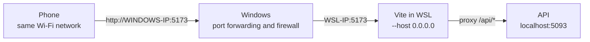

**English** · [Italiano](../it/local-development.md) · [中文](../zh-CN/local-development.md)

_Translated from the Italian original, which is the reference version._

# Running TavoloFlow locally

This guide is for anyone who wants to run TavoloFlow on their own computer: to see it in action in a few minutes, to change its code, or to try it from a real phone. How to put it online on a server is in the [self-hosting](self-hosting.md) guide; how it works inside is in the [development notes](development-notes.md).

There are three ways, from the simplest to the most complete:

- the **demo** (Part 1): a single Docker command and a ready-made sample restaurant, without installing .NET or Node;
- the **development environment** (Part 2): the database in Docker, the API and the frontend started by hand, with the frontend updating as you edit it; Part 3 explains how to run the tests;
- the **phone** (Part 4): the development environment reachable from a phone on the same Wi-Fi network, to scan a real QR code.

I developed everything on Windows 11 with WSL2 (Ubuntu) and Docker Desktop. The commands in Part 2 are for Bash, so for Linux, macOS or WSL; the demo also starts from PowerShell on Windows.

## Overview

|           | Demo                      | Development                                       | From a phone                                   |
| --------- | ------------------------- | ------------------------------------------------- | ---------------------------------------------- |
| You need  | Git, Docker               | Git, Docker, .NET SDK 10, Node 24                 | the development environment and the same Wi-Fi |
| Address   | `http://127.0.0.1:8080`   | `http://localhost:5173`                           | `http://COMPUTER-IP:5173`                      |
| Data      | the Demo Ramen restaurant | whatever you create, or the same data as the demo | the development environment's data             |
| Use it to | see the app, show it      | change the code, run the tests                    | really try the QR code and the guest page      |



In both cases the browser sees a single address, as in production: in the demo the entry point is Caddy, in development the Vite proxy (see the [architecture overview](development-notes.md#overview)). Frontend and API share the same origin, so there is no CORS to configure.

**Demo on `127.0.0.1`, development on `localhost`.** If you run them together, don't open both from `localhost`. The browser binds cookies to the host name, not to the port: to it, `localhost:8080` and `localhost:5173` are the same site, and the login cookies of the two apps, which have the same names (`TavoloFlow.Store`, `TavoloFlow.Csrf`…), would overwrite each other. The result is constant logouts and CSRF errors. `127.0.0.1` and `localhost`, instead, are two different hosts, each with its own cookies. Two browser profiles work too.

## Part 1: the demo

### Starting it

All you need is Git and Docker with Compose v2. On Windows, Docker Desktop with Linux containers is enough, and the commands run directly from PowerShell: no .NET, Node, Bash or `.env` file needed.

```bash
git clone https://github.com/lorenzoyang/TavoloFlow.git
cd TavoloFlow
docker compose -f demo/compose.yaml up -d --build
```

The first time, Docker downloads the base images and builds the API and the frontend: it takes a few minutes. When the command finishes, open <http://127.0.0.1:8080>.

| Role                   | Username           | Password | Where to sign in                       |
| ---------------------- | ------------------ | -------- | -------------------------------------- |
| Owner                  | `demo.ramen.owner` | `123456` | <http://127.0.0.1:8080/staff/login>    |
| Staff                  | `demo.ramen.staff` | `123456` | <http://127.0.0.1:8080/staff/login>    |
| Platform administrator | `demo.admin`       | `123456` | <http://127.0.0.1:8080/platform/login> |

Unlike a real restaurant, the demo accounts don't have to change their password at first sign-in. These passwords are public: they are only fine on your own computer.

The interface follows your browser's language. To change it, pick a language under the logo on the sign-in page (中文 · Italiano · English), or later on Home, in the account card.

### What it contains

The **Demo Ramen** restaurant: LACQUER theme, euro and the Rome time zone, English as the default menu language, with names and descriptions in three languages. Service and ordering are on, and guests have to enter the table code.

- 8 tables, T01 to T08, all free; the QR tokens are generated at random during initialization;
- 4 categories and 12 dishes, with prices, descriptions, sample allergens and one photo each;
- a one-year subscription period of €199, already paid (visible in the administrator area and on the owner's Subscription page);
- no visits, no orders, no bills: you start by opening a table.

The restaurant and the dishes are made up, allergens included, and the photos are AI-generated (details in [`demo/images/README.md`](../../demo/images/README.md)).

### A five-minute tour

1. Sign in as the **owner**. From Home open **Tables & QR**, tap **"QR"** on table T01 and then **"Copy link"**: it is the address a guest would open by scanning the QR code.
2. Go to **Floor**, choose T01 and confirm with **"Open table"**. The table code appears: four characters.
3. Paste the link into another tab: you are now the guest. Enter the code and tap **"Verify code"**, add a few dishes with **"Add to cart"**, then **"Review order"** and **"Confirm and place order"**.
4. Go back to the staff area and open **Kitchen**: the order has arrived. Mark the dishes **"Ready"**. For the sound, the browser first wants a tap on the page.
5. From Home open **Pass** and mark the dishes **"Served"**.
6. Open **Bill**, choose T01 and tap **"Take payment, free table"**; tick the confirmation and close with **"Paid, free table"**. You will find the closed bill in **Bill history**, from Home.
7. If you like, also sign in as the administrator at `/platform/login`, in the same browser: the guest, staff and administrator identities have separate cookies and don't get in each other's way (see ["Three identities"](development-notes.md#three-identities-staff-guest-platform)).

All normal tabs of a browser share the same staff-area login: to use owner and staff at the same time you need another profile, another browser or a private window.

### How it is built

The demo is a separate Compose project, [`demo/compose.yaml`](../../demo/compose.yaml), with four containers:

| Service | What it does                                                                                             |
| ------- | -------------------------------------------------------------------------------------------------------- |
| `db`    | PostgreSQL 18, with the data in the `postgres_data` volume                                               |
| `init`  | applies the migrations with `efbundle`, then imports the data with `--seed-demo`; when done, it exits    |
| `api`   | the ASP.NET Core API, with the Data Protection keys in the `protection_keys` volume                      |
| `web`   | Caddy, without HTTPS, with the prebuilt SPA files; it is the only container with a port on your computer |

- **Compose decides the start order.** `init` starts when `db` is ready (`condition: service_healthy`), `api` only when `init` has finished without errors (`service_completed_successfully`), `web` when the API answers on `/health/ready`. That is why `docker compose ps -a` shows `init` as `Exited (0)`: it's normal, its job is done.
- **The rules are the production ones.** Migrations are applied by an explicit step, not by the API at startup. The `database` network is `internal`, and the `web` port is published only on `127.0.0.1`: the demo can't be reached from the local network. The main difference is that the API runs in the Development environment, the only one where `--seed-demo` works.
- **The data is imported only once.** If the database already has a restaurant or an administrator, `--seed-demo` does nothing and says so in the log: it never overwrites your changes. It imports everything in a single transaction, and the photos go through the same processing as real uploads (`MenuImages`).
- **The QR codes use the address you opened.** The demo frontend is built with an empty `VITE_PUBLIC_BASE_URL`, so the QR links take the browser's current origin, port included.

### Managing it

From the repository folder:

```bash
# Container status: -a also shows init, which has already finished
docker compose -f demo/compose.yaml ps -a
# The latest logs
docker compose -f demo/compose.yaml logs --tail 100 init api web
# Stop it: data, changed passwords and keys stay in the volumes
docker compose -f demo/compose.yaml down
# Start it again
docker compose -f demo/compose.yaml up -d
```

**Resetting it.** With `-v`, `down` also deletes the volumes of this Compose project (`tavoloflow-demo`): database and keys. On the next start `init` finds an empty database and imports the initial data again, with the original passwords. Other projects, including the development database of Part 2, are not touched.

```bash
docker compose -f demo/compose.yaml down -v
docker compose -f demo/compose.yaml up -d --build
```

After a reset, old logins and old table links no longer work: the QR tokens are new.

**Another port.** If 8080 is already taken:

```bash
DEMO_PORT=8081 docker compose -f demo/compose.yaml up -d --build
```

In PowerShell, set the variable first with `$env:DEMO_PORT = "8081"`, then run the same command.

### Changing the demo data

The data lives in [`demo/data/`](../../demo/data/): `restaurant.json`, `accounts.json`, `tables.json` and `menu.json`. The photos are in [`demo/images/`](../../demo/images/), as 640×640 WebP, and the prompts I generated them with are in `demo/image-prompts.json`.

These files are copied into the `init` image at build time, so after a change you need `--build`. And they only apply to an empty database: to see them on a demo that already ran, you have to reset it. The seeder is strict: a JSON field it doesn't know makes the import fail, and the reason is in the `init` logs.

## Part 2: the development environment

### Requirements

| Tool         | Version                               | Used for                                                                   |
| ------------ | ------------------------------------- | -------------------------------------------------------------------------- |
| .NET SDK     | 10, at least 10.0.112 (`global.json`) | backend and tests                                                          |
| Node.js      | 24                                    | frontend; the tests run with Node's test runner, which executes TypeScript |
| Docker       | with Compose v2                       | the development database and the integration tests                         |
| Git and Bash |                                       | on Linux, macOS or WSL                                                     |

In my case: WSL2 with Ubuntu and Docker Desktop, with WSL integration enabled.

### 1. The database

```bash
# From the repository folder
cp .env.example .env
# Replace POSTGRES_PASSWORD with a password of your own
nano .env
docker compose up -d db
```

[`compose.yaml`](../../compose.yaml) starts only PostgreSQL 18, on port 5432 but only on `127.0.0.1`: it can't be seen from the local network. The data lives in the `postgres_data` volume of the `tavoloflow` Compose project.

The `.env` file is read only by Docker Compose, to create the database: the API doesn't read it. And, as in production, the password only counts when the volume is first created: if you change it later, PostgreSQL doesn't know.

### 2. Connecting the API to the database

```bash
# Install the repository's .NET tools: dotnet-ef, at the pinned version
dotnet tool restore
# The connection string: database name, user and password the same as in .env
dotnet user-secrets set 'ConnectionStrings:Default' \
  'Host=localhost;Port=5432;Database=tavoloflow_dev;Username=tavoloflow;Password=YOUR_PASSWORD' \
  --project backend/TavoloFlow.Api
```

**User secrets** are .NET's way of keeping development secrets out of the repository. They end up in a JSON file in your user folder (`~/.microsoft/usersecrets/<UserSecretsId>/secrets.json`, where the ID is the one written in `TavoloFlow.Api.csproj`), and ASP.NET Core reads them only in the Development environment. `dotnet user-secrets list --project backend/TavoloFlow.Api` shows what you have set.

The repository contains no connection string: if it's missing, the API stops at startup with a message saying so. Instead of user secrets you can use an environment variable, `ConnectionStrings__Default`: in environment variable names, the double underscore replaces the colon.

### 3. Migrations

```bash
dotnet ef database update --project backend/TavoloFlow.Api
```

This creates the tables by applying the migrations in `backend/TavoloFlow.Api/Data/Migrations`. The API never applies them on its own at startup, not even in development: it is the same rule as in production (see ["Migrations"](self-hosting.md#migrations) in the self-hosting guide). When a `git pull` brings new migrations, run the command again.

### 4. Initial data

A freshly migrated database is empty: no restaurant, no account. To fill it you use the API program itself, which also works as a command-line tool ([`Operations/MaintenanceCommands.cs`](../../backend/TavoloFlow.Api/Operations/MaintenanceCommands.cs)): with an option like `--seed-demo` it runs that command and exits, without starting the server.

**The fastest way: the demo data.** The same command the `init` container uses also works on the development database:

```bash
# From the repository folder, on an empty database
Demo__DataPath="$PWD/demo" dotnet run --project backend/TavoloFlow.Api --launch-profile http -- --seed-demo
```

You get the same Demo Ramen as in Part 1, with the same accounts and passwords, the restaurant already active and ordering on: you can do the five-minute tour right away. `Demo__DataPath` tells the command where to find `data/` and `images/`, and the `http` profile sets the Development environment, the only one where the command works. If the database already has a restaurant or an administrator, it imports nothing and says so in the log.

**From scratch, as in production.** If you want to follow the real path of a new restaurant, create only the first platform administrator:

```bash
dotnet user-secrets set 'PlatformBootstrap:Username' 'admin' --project backend/TavoloFlow.Api
# 6 to 128 characters
dotnet user-secrets set 'PlatformBootstrap:Password' 'A_PASSWORD' --project backend/TavoloFlow.Api
dotnet run --project backend/TavoloFlow.Api --launch-profile http -- --seed-platform-admin
```

Then, with the app running (step 5):

1. sign in at `/platform/login` and create the restaurant with **"Create restaurant and two accounts"**; write down the two temporary passwords, which are shown only once;
2. the restaurant starts suspended: activate it with **"Activate service"**;
3. the owner signs in at `/staff/login`, changes the password and prepares the menu and the tables;
4. on **Floor**, the owner turns on **"QR ordering"**: reactivating the service doesn't turn ordering back on.

There is also `--seed-dev-accounts`, which creates a restaurant with an owner and a staff account from the `DevelopmentSeed:*` settings. But the restaurant starts suspended, and a platform administrator has to activate it, so you would still need `--seed-platform-admin` ([`accounts-platform.md`](../reference/accounts-platform.md)): the two ways above are more convenient.

### 5. Starting the API and the frontend

You need two terminals, both open in the repository folder.

```bash
# Terminal 1: the API on http://localhost:5093
dotnet run --project backend/TavoloFlow.Api --launch-profile http
```

```bash
# Terminal 2: the frontend on http://localhost:5173
cd frontend
# Only the first time, or when package-lock.json changes
npm ci
npm run dev
```

Then open <http://localhost:5173/staff/login>, or `/platform/login`.

- **The browser only talks to Vite.** Vite serves the frontend and, thanks to the proxy configured in [`vite.config.ts`](../../frontend/vite.config.ts), forwards everything starting with `/api` to the API on port 5093.
- **The frontend updates by itself, the backend doesn't.** Changes to the React code show up in the browser immediately (hot module replacement). After a backend change, instead, stop the API with Ctrl+C and start it again.
- **The ports are fixed.** `vite.config.ts` uses `strictPort`: if 5173 is taken, Vite stops with an error instead of silently picking another port. That way the address always stays the same, which matters for Part 4.

### Useful things

- **The API description.** In Development the API publishes the OpenAPI document of all the endpoints at <http://localhost:5093/openapi/v1.json>. To try requests by hand there is [`TavoloFlow.Api.http`](../../backend/TavoloFlow.Api/TavoloFlow.Api.http), which runs from Visual Studio, Rider or VS Code with the REST Client extension. Remember that every write needs a CSRF token (see ["Cookies, CSRF and same-origin"](development-notes.md#cookies-csrf-and-same-origin)).
- **The Data Protection keys.** In development `DataProtection:KeyRingPath` is not set, so ASP.NET Core keeps the keys in the user folder (on Linux and WSL in `~/.aspnet/DataProtection-Keys`). If you delete them, all logins and the codes of open tables stop working: it's the same reason they live on a volume in production.
- **A new migration.** After changing an entity or its configuration:

  ```bash
  dotnet ef migrations add NameOfTheChange --project backend/TavoloFlow.Api --output-dir Data/Migrations
  # Check that model and migrations match: no pending changes must remain
  dotnet ef migrations has-pending-model-changes --project backend/TavoloFlow.Api
  dotnet ef database update --project backend/TavoloFlow.Api
  ```

- **Starting over.** `docker compose down -v` deletes the development database volume, and only that one: the demo has its own Compose project. Then start again from `docker compose up -d db` and step 3.
- **The PWA.** With `npm run dev` the service worker is not registered, so it doesn't interfere with hot reloading. To try the installation and the offline page you need a build: `npm run build && npm run preview`, on <http://localhost:4173>, with the API running (details in [`pwa.md`](../reference/pwa.md)).

## Part 3: tests and checks

### Backend

```bash
# All the tests: Docker must be running
dotnet test TavoloFlow.slnx
# A single test class (add .MethodName for a single test)
dotnet test TavoloFlow.slnx --filter "FullyQualifiedName~KitchenTests"
```

These are integration tests: each test class starts its own throwaway PostgreSQL with Testcontainers (`postgres:18-alpine`), applies the real migrations to it and sends HTTP requests to the API with `WebApplicationFactory`. They touch neither the development database nor the demo one. The first run downloads the PostgreSQL image.

### Frontend

```bash
cd frontend
# Tests of the pure logic
node --test --test-isolation=none tests/*.test.ts
# Production build and type checking
npm run build
# Lint and formatting
npm run lint
npm run format:check
```

The frontend has no test framework for React components. The logic worth testing (cart rules, order recovery, languages, themes…) lives in pure modules, such as the features' `state.ts` files and some files in `lib/`, and Node 24's built-in test runner runs it directly, stripping the TypeScript types on the fly. That's why those modules import each other with relative paths and the `.ts` extension, instead of the `@/` alias.

`npm run build` runs `vite build && tsc -b`: first Vite regenerates `src/routeTree.gen.ts`, TanStack Router's route tree, and builds; then TypeScript checks the types, routes included. If you add a route, `routeTree.gen.ts` goes into the commit too. `npm run format` fixes the formatting with Prettier.

### The release package

The production installation can also be tried locally, with the smoke test described in the self-hosting guide (["Building the release package"](self-hosting.md#3-building-the-release-package)).

## Part 4: testing from a phone

The moment a guest scans the QR code can only really be tested with a phone. But none of the setups seen so far can be reached from a phone:

- on the phone, `localhost` is the phone itself, not your computer;
- Vite listens only on `localhost` (`host: "localhost"` in `vite.config.ts`), and the demo publishes its port only on `127.0.0.1`;
- if you use WSL2 in NAT mode, the default, Linux also has its own internal address (`172.x.x.x`) that can't be seen from the Wi-Fi: only the Windows one can.

So from a phone you use the development environment. On Linux and macOS two changes are enough: Vite has to listen on all network interfaces, and the QR codes have to contain the computer's address. WSL needs a third: Windows has to forward the port to Linux (step 3, which you skip on Linux and macOS).

With WSL, this is the path of a request from the phone; on Linux and macOS there is no Windows hop:



The API stays on `localhost`: the phone only talks to Vite, which forwards `/api` to it as usual.

### 1. The computer's address

Phone and computer have to be on the same Wi-Fi network. You need the computer's address on that network, the one the phone will use:

- **on Linux:** `hostname -I`;
- **on macOS:** `ipconfig getifaddr en0`, if you are on Wi-Fi;
- **on WSL:** the **Windows** address, not the Linux one: in PowerShell `ipconfig`, under "IPv4 Address" of the Wi-Fi adapter.

In the commands below it is `192.168.1.36`.

### 2. Vite and the QR address

In `frontend/.env.local`, a file ignored by Git (the template is `frontend/.env.example`):

```dotenv
VITE_PUBLIC_BASE_URL=http://192.168.1.36:5173
```

Then start Vite on all interfaces:

```bash
cd frontend
npm run dev -- --host 0.0.0.0
```

Without `VITE_PUBLIC_BASE_URL`, the QR codes use the address of the page you generate them from, that is `localhost`, and the phone wouldn't know where to go: the interface warns about it with "This link uses a local address that phones can't reach". Vite reads the variable at startup and writes it into the frontend code. When you save `.env.local` it restarts by itself, but the open page has to be reloaded.

### 3. WSL only: port forwarding and firewall

On Linux and macOS skip this step: Vite runs directly on the computer, which already has the Wi-Fi address. If the phone can't connect, at most you need to open port 5173 in the system firewall: for example `sudo ufw allow 5173/tcp` on Ubuntu, if you use ufw; on macOS just allow incoming connections to `node` when the system asks.

On WSL you need three things.

**The network profile.** In the Windows settings for your Wi-Fi network, choose the **Private** profile: the firewall rule below applies only to private networks.

**The WSL IP.** In the WSL terminal `hostname -I`, or the `Network` line Vite prints at startup with `--host`. In the commands it is `172.28.94.85`. It usually changes every time Windows or WSL restarts.

**Port forwarding.** In PowerShell **as administrator**, with your addresses:

```powershell
$tavoloWindowsIp = "192.168.1.36"
$tavoloWslIp = "172.28.94.85"
# Only if a forwarding for this address already exists, for example to the old WSL IP
netsh interface portproxy delete v4tov4 listenaddress=$tavoloWindowsIp listenport=5173
# Connections to Windows on port 5173 go to WSL on port 5173
netsh interface portproxy add v4tov4 listenaddress=$tavoloWindowsIp listenport=5173 connectaddress=$tavoloWslIp connectport=5173
```

Since the WSL IP changes, after a restart the forwarding has to be redone, with `delete` and then `add` with the new address. `netsh interface portproxy show v4tov4` shows the active forwardings.

**The firewall rule.** Again as administrator, once:

```powershell
New-NetFirewallRule -DisplayName "TavoloFlow Dev 5173" -Direction Inbound -Action Allow -Protocol TCP -LocalPort 5173 -Profile Private -RemoteAddress LocalSubnet
```

The rule opens port 5173 only on private networks and only to devices on the same subnet: to the phone yes, to the rest of the internet no.

### 4. The test

1. On the computer open `http://localhost:5173/staff/login`, sign in as the owner (with the demo data everything is ready) and open a table on **Floor**.
2. In **Tables & QR** tap **"QR"** on the same table: the link under the QR code must start with `http://192.168.1.36:5173`.
3. Scan the QR code with the phone, enter the table code and send an order. If you want to start over without old cookies, open the link in a private window.

### What you cannot test this way

An address like `http://192.168.1.36:5173` is not HTTPS, so to the phone's browser it is not a secure context. Some browser features require one:

- **installing the PWA** and the service worker;
- **keep-screen-on** in Kitchen and Pass (Screen Wake Lock);
- **automatic copying** of links and codes: the app notices and asks you to copy them by hand.

Everything else works. For example, order IDs are generated with `crypto.getRandomValues` precisely because, unlike `crypto.randomUUID`, it also works without HTTPS ([`lib/ids.ts`](../../frontend/src/lib/ids.ts)).

To try the PWA on an Android phone there is a trick: with USB debugging and the port forwarding of `chrome://inspect`, the phone opens `localhost:4173` of the preview build, and `localhost` counts as a secure context (see [`pwa.md`](../reference/pwa.md)). For iPhone, and for the final test, you need the real HTTPS of [self-hosting](self-hosting.md).

### Cleanup

When you no longer need it, remove `VITE_PUBLIC_BASE_URL` from `frontend/.env.local`, so QR codes generated in development go back to using the page's address.

On WSL, also remove the forwarding and the firewall rule, from PowerShell as administrator:

```powershell
# In a new session the variable no longer exists: set it again
$tavoloWindowsIp = "192.168.1.36"
netsh interface portproxy delete v4tov4 listenaddress=$tavoloWindowsIp listenport=5173
Remove-NetFirewallRule -DisplayName "TavoloFlow Dev 5173"
```

## Common problems

| What happens                                                            | What to check                                                                                                                                                                                                                              |
| ----------------------------------------------------------------------- | ------------------------------------------------------------------------------------------------------------------------------------------------------------------------------------------------------------------------------------------ |
| In WSL, `docker` says "permission denied" or can't find the server      | Docker Desktop is running, and its settings have integration with your WSL distribution enabled                                                                                                                                            |
| The demo doesn't answer, `init` is not `Exited (0)`                     | `docker compose -f demo/compose.yaml logs init`                                                                                                                                                                                            |
| Port 8080 is taken                                                      | `DEMO_PORT`, see "Managing it"                                                                                                                                                                                                             |
| Vite stops: port 5173 is taken                                          | another `npm run dev` still open; with `strictPort` Vite doesn't pick another port                                                                                                                                                         |
| The API doesn't start and asks for `ConnectionStrings:Default`          | the connection string in the user secrets (step 2) or in the `ConnectionStrings__Default` variable                                                                                                                                         |
| The API can't connect to PostgreSQL because of the password             | the password in the user secrets must be the one of the `.env` the volume was created with; if you changed `.env` later, put the old one back or recreate the volume with `docker compose down -v` (deletes the data)                      |
| Errors about tables or columns that don't exist                         | `dotnet ef database update` after the latest `git pull`                                                                                                                                                                                    |
| `--seed-demo` says the database already contains data                   | it only imports into an empty database: use the data you have or recreate the volume                                                                                                                                                       |
| Constant logouts, CSRF errors                                           | demo and development both open from `localhost`: open the demo from `127.0.0.1`                                                                                                                                                            |
| Floor shows "The restaurant's service isn't active yet or is suspended" | the restaurant is suspended: the administrator activates it with "Activate service"                                                                                                                                                        |
| The guest sees the menu but can't order                                 | ordering is paused: on Floor, "QR ordering"                                                                                                                                                                                                |
| The QR codes contain `localhost`                                        | `VITE_PUBLIC_BASE_URL` in `frontend/.env.local`, then reload the page (Vite restarts by itself)                                                                                                                                            |
| The phone doesn't open the page                                         | same Wi-Fi network and Vite started with `--host 0.0.0.0`; on Linux and macOS the system firewall; on WSL private network profile, firewall rule and WSL IP still equal to the port forwarding's (`netsh interface portproxy show v4tov4`) |
