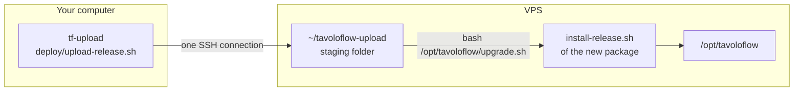

**English** · [Italiano](../it/releasing.md) · [中文](../zh-CN/releasing.md)

# Releasing with the scripts

This guide explains how to publish a new version on a server that is already installed, with two scripts: the first, on your computer, builds the package and uploads it to the VPS; the second, on the VPS, checks it and installs it. Everything else (first installation, `.env` configuration, backups, rollback and emergencies) is in the [self-hosting guide](self-hosting.md).

The scripts don't change how a release happens: they run the steps of the [manual procedure](self-hosting.md#manual-procedure) for you, with the same installer, and add a few checks. The manual procedure remains valid.

## In short

```text
Once                the setup below: ~/.ssh/config, the tf-upload alias, the first release
On your computer    git status                         everything committed?
                    tf-upload                          builds, uploads and checks the package
After closing time  ssh tavoloflow                     log in to the VPS
                    bash /opt/tavoloflow/upgrade.sh    checks, asks for confirmation (y) and installs
                    exit                               leave the VPS
Then                reload the app on every staff device
```



Uploading changes nothing in production: you can do it whenever you like, even during the day, and then close the terminal. Installing stops the API for a while, so do it when the restaurant is closed.

## Setup, once

All the setup happens **on your computer** (in my case, the WSL terminal), except the first release. You need:

- the **VPS's IPv4 address**: the one you use today in `ssh … deploy@VPS_IP`, also shown in the provider's panel;
- the **private key** created in [step 1.1](self-hosting.md#11-the-ssh-key) of the self-hosting guide, `~/.ssh/tavoloflow`;
- **`deploy`'s password**, chosen in [step 1.4](self-hosting.md#14-the-deploy-user): `sudo` on the VPS asks for it.

Two things to know about paths: `~` is your home folder (for example `/home/name`), and files and folders whose name starts with a dot, like `.ssh` and `.bashrc`, are hidden: `ls` doesn't show them, `ls -a` does.

### A name for the VPS in SSH

Today you log in to the VPS with `ssh -o IdentitiesOnly=yes -i ~/.ssh/tavoloflow deploy@VPS_IP`. The file `~/.ssh/config` gives a name to this combination of address, user and key, so `ssh tavoloflow` is enough. It is the configuration file of the `ssh` command (and of `scp`) on your computer; the upload script uses exactly this name.

**1. Check the key and open the file, on your computer:**

```bash
# Must list tavoloflow and tavoloflow.pub
ls ~/.ssh/
# Opens the file in nano; if it doesn't exist yet, nano creates it when you save
nano ~/.ssh/config
```

**2. Write the configuration.** In the open file, paste these lines (in a terminal you paste with `Ctrl+Shift+V`, in many terminals also with a right click):

```text
Host tavoloflow
  HostName VPS_IP
  User deploy
  IdentityFile ~/.ssh/tavoloflow
  IdentitiesOnly yes
```

Then replace `VPS_IP` with the real address, for example `HostName 203.0.113.10`: in nano you move with the arrow keys. The indented lines belong to the `Host` above them. If the file already had other `Host` blocks, add yours at the end, separated by an empty line.

| Line                             | Meaning                                                                 |
| -------------------------------- | ----------------------------------------------------------------------- |
| `Host tavoloflow`                | the short name you will use instead of `deploy@VPS_IP`                  |
| `HostName VPS_IP`                | the VPS's real address                                                  |
| `User deploy`                    | log in as `deploy`, never as root                                       |
| `IdentityFile ~/.ssh/tavoloflow` | the private key to use                                                  |
| `IdentitiesOnly yes`             | try only this key, like `-o IdentitiesOnly=yes` in the guide's commands |

**3. Save and leave nano:** `Ctrl+O`, then Enter to confirm the file name, then `Ctrl+X`.

**4. Protect the file and try the new name, on your computer:**

```bash
# Only you may write the file, otherwise ssh refuses to use it
chmod 600 ~/.ssh/config
# It must log in to the VPS as deploy, like the long command
ssh tavoloflow
```

If it works, the prompt becomes the VPS's, something like `deploy@vps-name:~$`. If the key has a passphrase, `ssh` asks for it first. Go back to your computer with `exit`.

| If you see                                     | It means                                     | What to do                                                                                               |
| ---------------------------------------------- | -------------------------------------------- | -------------------------------------------------------------------------------------------------------- |
| `Could not resolve hostname tavoloflow`        | ssh can't find the `Host tavoloflow` block   | check that the file is called `~/.ssh/config`, and the `Host` line                                       |
| `Bad owner or permissions on …/.ssh/config`    | other users can write the file               | run `chmod 600 ~/.ssh/config` again                                                                      |
| `Permission denied (publickey)`                | the VPS doesn't accept the key               | check `HostName`, `User deploy` and the `IdentityFile` path                                              |
| `Connection timed out`                         | the address is wrong or the VPS doesn't answer | check `HostName`                                                                                       |
| `Are you sure you want to continue connecting` | ssh doesn't know this address yet            | with your usual IP it doesn't appear; on a new VPS, compare the fingerprint as in [step 1.3](self-hosting.md#13-first-login-as-root) |

From now on `ssh tavoloflow` is the same as the long command, in the self-hosting guide's commands too; the same name works with `scp`, for example `scp file tavoloflow:`.

### One command on your computer

`tf-upload` is not a program to install: it is an **alias**, a short name that bash replaces with a longer command. Aliases go in `~/.bashrc`, a file bash reads every time you open a terminal.

**1. Prepare the three values:**

- `PUBLIC_ORIGIN`: the app's public address, the same as for the build ([step 3](self-hosting.md#3-building-the-release-package) of the self-hosting guide). My installation uses `https://app.qiaotavoloflow.it`;
- `DEPLOY_SSH`: the name just chosen in `~/.ssh/config`, that is `tavoloflow`;
- the **repository's path** on your computer. To find it:

  ```bash
  # In the repository folder: prints the full path, for example /home/name/TavoloFlow
  pwd
  ```

**2. Open bash's file, on your computer:**

```bash
nano ~/.bashrc
```

**3. Add the alias.** In nano go to the end of the file (with the arrow keys, or with `Alt+/`) and paste a new line, with your three values:

```bash
alias tf-upload='PUBLIC_ORIGIN=https://app.example.com DEPLOY_SSH=tavoloflow bash /home/name/TavoloFlow/deploy/upload-release.sh'
```

It must be all on one line, with a single quote `'` right after `=` and one at the end. Save with `Ctrl+O` and Enter, leave with `Ctrl+X`.

**4. Load the alias and check it, on your computer:**

```bash
# Reads ~/.bashrc again in this terminal; terminals opened later read it on their own
source ~/.bashrc
# Must answer that tf-upload is an alias and show the full command
type tf-upload
```

From then on you can run `tf-upload` from any folder: the script moves to the repository by itself.

These values live on your computer and not in the repository because the repository is public, and every TavoloFlow installation has its own domain and server.

### The first release with the scripts

`upgrade.sh` reaches `/opt/tavoloflow` with the packages that contain it, like the other operational files: the first time, it isn't there yet. So for this release only, you extract the package by hand on the VPS and run the copy of `upgrade.sh` it contains. First go through the [Before starting](#before-starting) list.

**1. On your computer, build and upload:**

```bash
tf-upload
```

It takes a few minutes. At the end, note the ID printed after `Uploaded and verified on the server:`, for example `20261026T094909Z-4c9535b` ([step 1](#1-on-your-computer-build-and-upload) below explains the whole output).

**2. After closing time, log in to the VPS from your computer:**

```bash
ssh tavoloflow
```

**3. On the VPS, extract the package and run the script it contains**, with the noted ID:

```bash
# The ID printed by tf-upload
RELEASE=20261026T094909Z-4c9535b
cd ~/tavoloflow-upload
# Archive checksum: must print OK
sha256sum -c "tavoloflow-$RELEASE.tar.gz.sha256"
mkdir "$RELEASE"
tar -xzf "tavoloflow-$RELEASE.tar.gz" -C "$RELEASE"
# This time only: the copy of upgrade.sh inside the package
bash "$RELEASE/ops/upgrade.sh" "$RELEASE"
```

The script finds the folder already extracted, checks all its files again and continues like every other release.

**4. Continue from the summary in [step 2](#2-on-the-vps-check-and-install)**: the `sudo` password, the summary, the answer `y`, the final check and `exit`.

When it installs the package, the installer also copies `upgrade.sh` to `/opt/tavoloflow`: from the next release, `bash /opt/tavoloflow/upgrade.sh` is enough.

## Every release

### Before starting

1. The code is tested and **committed**. Check it in the repository folder:

   ```bash
   # Must say "nothing to commit, working tree clean"
   git status
   ```

   Even if you forget, the script refuses to start with uncommitted changes, including new files not yet added to Git.

2. Docker is running on your computer (in my case, Docker Desktop is open). The script checks this too.
3. If the new version needs new configuration in the server's `.env`, add it first, as explained in the self-hosting guide, [Releasing a new version](self-hosting.md#releasing-a-new-version). The installer checks the configuration before stopping the API: if something is missing, the service is not interrupted.
4. Install when the restaurant is closed. The upload can happen earlier, even hours earlier.

### 1. On your computer: build and upload

**On your computer, from any folder:**

```bash
tf-upload
```

It takes a few minutes. The output, shortened:

```text
Commit: 4c9535b kitchen: group the dish view by station
Reminder: commit 4c9535b is not on any remote branch yet (as of your last fetch or push).
…  (build output and upload progress)
Release package: /home/you/TavoloFlow/artifacts/tavoloflow-20261026T094909Z-4c9535b.tar.gz
Checksum: /home/you/TavoloFlow/artifacts/tavoloflow-20261026T094909Z-4c9535b.tar.gz.sha256
tavoloflow-20261026T094909Z-4c9535b.tar.gz: OK

Uploaded and verified on the server: 20261026T094909Z-4c9535b
To install it, at a quiet time:
  ssh tavoloflow
  bash /opt/tavoloflow/upgrade.sh
```

- **The checks come before the build**, which takes a few minutes: uncommitted changes, Docker not running or an unreachable VPS show up at once, not after the wait.
- **The reminder** appears when the commit is not on GitHub yet. It is only a reminder; the script continues. The hosted service should run code that is also in the public repository. Git knows GitHub's state only from the last time it talked to it (`git fetch` or `git push`): that is why the message says "as of your last fetch or push".
- **A single SSH connection** serves all the work on the VPS: creating the staging folder, uploading, checking. If your key has a passphrase, it is asked once, at the start, before the build.
- **`OK` is the check run on the VPS**, on the file that arrived there: the upload is intact.
- The package also stays in `artifacts/` on your computer: keep at least the one in production and the previous one, you need them to roll back or rebuild the server.

If the output ends with an error, see [When something goes wrong](#when-something-goes-wrong). If it ends as above, the package waits on the VPS: you can close the terminal and install it later.

### 2. On the VPS: check and install

**After closing time, log in to the VPS from your computer:**

```bash
ssh tavoloflow
```

**On the VPS:**

```bash
bash /opt/tavoloflow/upgrade.sh
```

**Without `sudo`**: the script asks for it when needed. When `[sudo] password for deploy:` appears, type `deploy`'s password and press Enter: nothing shows while you type, that is normal. Without arguments the script takes the most recently uploaded package; to choose another, add its ID: `bash /opt/tavoloflow/upgrade.sh 20261026T094909Z-4c9535b`.

Before changing anything, the script shows a summary and asks for confirmation:

```text
Package: /home/deploy/tavoloflow-upload/tavoloflow-20261026T094909Z-4c9535b.tar.gz

The next steps need sudo.
[sudo] password for deploy:

Installed release: 20261020T181200Z-1a2b3c4
New release:       20261026T094909Z-4c9535b
Public address:    https://app.example.com
Migrations to apply:
  20261024153148_AddRestaurantSubscriptions

The installer stops the API, backs up, migrates and starts the new API.
Until it finishes, pages open but every /api request fails.
The backup before the migrations stays on this server. To keep a copy on your computer
first, answer n and download the latest backup (self-hosting guide, Backups).
Install 20261026T094909Z-4c9535b now? [y/N]
```

| Line                               | What it says                                                     | What to check                                                                 |
| ---------------------------------- | ---------------------------------------------------------------- | ----------------------------------------------------------------------------- |
| `Installed release`, `New release` | the version in production (`state/current`) and the one you are installing | that the new one is the package you just uploaded                   |
| `Public address`                   | the address written into the frontend during the build           | that it is your domain; the installer compares it with `DOMAIN` anyway        |
| `Migrations to apply`              | the package's migrations that the database doesn't have yet      | `none` is the most common case; if there are some, decide whether to download a backup first |

Answer `y` to install. Any other answer, even just Enter, ends with `Nothing changed.` without touching anything. If you answer `n` to download a backup first (self-hosting guide, [Downloading a backup to your computer](self-hosting.md#downloading-a-backup-to-your-computer)), run the same command again afterwards: it reuses the folder already extracted.

With `y` the new package's installer starts, with its usual output: backup, migrations, new API, Caddy. At the end the script checks the result and cleans up:

```text
NAME                      IMAGE                                     …   STATUS
tavoloflow-prod-api-1     tavoloflow-api:20261026T094909Z-4c9535b   …   Up 11 seconds (healthy)
tavoloflow-prod-caddy-1   caddy:2-alpine                            …   Up 5 seconds (healthy)
tavoloflow-prod-db-1      postgres:18-alpine                        …   Up 3 days (healthy)
HTTPS check passed: https://app.example.com/api/auth/csrf answers.
Removed from /home/deploy/tavoloflow-upload (older installed releases):
  tavoloflow-20261012T080000Z-9f8e7d6.tar.gz
  tavoloflow-20261012T080000Z-9f8e7d6.tar.gz.sha256
  20261012T080000Z-9f8e7d6

Done. Now reload the app on every staff device (releasing guide, after the release).
```

- **The containers**: `db`, `api` and `caddy` must all be `healthy`.
- **The HTTPS check** requests `/api/auth/csrf` from the VPS at the public address, so it really goes through DNS, certificate, Caddy and API.
- **The nightly backup**: if the timer is not enabled, or if the release changed the backup service or timer, a `WARNING` appears with the commands to run.
- **The cleanup** of the staging folder keeps the current and the previous version (the exact rules are [below](#upgradesh-on-the-vps)).

When you are done, go back to your computer with `exit`.

### 3. After the release

Reload the app on every staff device, so it uses the new frontend (see [Pages already open](#pages-already-open)). Check sign-in, a read (Kitchen or Bill) and PWA navigation; on devices with notifications enabled, wait for "on" and repeat a lock-screen test. If a write shows a result to verify, follow the interface: the app checks with a GET, and resending blindly could repeat the operation.

## When something goes wrong

The scripts stop at the first error, and the ones they recognize start with `ERROR:`. Errors before the `[y/N]` question have changed nothing in production. If the installer stops, its own message `Release stopped. Do not retry writes blindly…` also appears above `upgrade.sh`'s error: the `ERROR:` line that follows says whether the API is still in service.

| Message                                                                   | What it means                                                                   | What to do                                                                                                                               |
| ------------------------------------------------------------------------- | ------------------------------------------------------------------------------- | ---------------------------------------------------------------------------------------------------------------------------------------- |
| `Commit or remove local changes first`                                    | there are uncommitted changes or new files                                      | commit (or remove) them and run `tf-upload` again                                                                                        |
| `Docker is not running`                                                   | Docker is off on your computer                                                  | start Docker Desktop and run it again                                                                                                    |
| `Cannot reach tavoloflow over SSH`                                        | the SSH connection fails                                                        | try `ssh tavoloflow` on its own and check `~/.ssh/config`                                                                                |
| `FAILED` after the upload                                                 | the file that arrived on the VPS differs from the one built                     | run `tf-upload` again                                                                                                                    |
| `No package in /home/deploy/tavoloflow-upload`                            | nothing has been uploaded                                                       | run `tf-upload` on your computer first                                                                                                   |
| `The archive differs from its checksum`                                   | the package in the staging folder is damaged                                    | run `tf-upload` again                                                                                                                    |
| `Files in … differ from its SHA256SUMS`                                   | the extracted folder has been modified or is damaged                            | delete it with the `rm -rf` command shown and run `upgrade.sh` again                                                                     |
| `This package has no migrations.txt`                                      | the package was built before these scripts existed                              | build a new one with `tf-upload`, or install it with the [manual procedure](self-hosting.md#manual-procedure)                            |
| `No release is installed`                                                 | no version is installed on the server yet                                       | the first installation is manual: Part 1 of the self-hosting guide                                                                       |
| `… is already the installed release`                                      | you are installing the version already in production                            | nothing to do; reinstalling the same code needs a new package                                                                            |
| `An earlier attempt already used …`                                       | an earlier installation with this ID stopped halfway                            | follow [When a release goes wrong](self-hosting.md#when-a-release-goes-wrong); after the fix, upload a new package (new ID)              |
| `… was built before the installed …`                                      | the package is older than the version in production                            | going back is done with a [rollback](self-hosting.md#rolling-back-to-the-previous-version), not with this script                         |
| `The database already has migrations that this package does not contain`  | the package comes from older code than production                               | as above: to go back, roll back                                                                                                          |
| `Cannot read the applied migrations`                                      | the database container doesn't answer                                           | check `sudo bash /opt/tavoloflow/tf.sh ps` and the `db` logs                                                                             |
| `The installer stopped before stopping the API`                           | the installer found a problem during its checks, before stopping anything: it is the line above, for example `Set VAPID_PRIVATE_KEY…` or `DOMAIN differs…`. The version in production keeps running | fix it (for `.env`: `sudo nano /opt/tavoloflow/.env`) and run `bash /opt/tavoloflow/upgrade.sh` again: it reuses the extracted folder |
| `The installer stopped after stopping the API`                            | the API is stopped: the restaurant can't use the app                            | read the logs as shown and follow [When a release goes wrong](self-hosting.md#when-a-release-goes-wrong)                                 |
| `WARNING: The release is installed, but …/api/auth/csrf did not answer`   | the version is installed, but the HTTPS check from the VPS failed               | read the `caddy` and `api` logs as shown and try the address from your computer too                                                      |
| `WARNING: Nightly backups are not enabled`                                | the nightly backup timer is not enabled                                         | enable it: [Part 1, step 7](self-hosting.md#7-enabling-backups-before-real-data) of the self-hosting guide                                |
| `WARNING: This release changed tavoloflow-backup.…`                       | the release changed the backup service or timer                                 | run the commands printed below the warning                                                                                               |

## How the scripts work

### `upload-release.sh`, on your computer

[`deploy/upload-release.sh`](../../deploy/upload-release.sh), in order:

1. **checks the variables** `PUBLIC_ORIGIN` and `DEPLOY_SSH`;
2. **checks that the working tree is clean** (`git status --porcelain` empty). The version ID contains the commit hash, but the build uses the files in the working tree: with changes outside the commit, the ID would lie about the content;
3. **prints the commit** and, if it is not on any remote branch (`git branch -r --contains HEAD`), the reminder;
4. **checks Docker** (`docker info`);
5. **opens a shared SSH connection** (`ControlMaster`) and creates `~/tavoloflow-upload` on the VPS. The following `ssh` and `scp` go through the same connection, and the script closes it at the end;
6. **builds the package** by calling [`build-release.sh`](../../deploy/build-release.sh) with a new ID, UTC time plus commit hash, as in a manual build;
7. **uploads** the archive and `.sha256` with `scp` and **checks the checksum on the VPS**, without `sudo`;
8. **prints the commands** for the next step.

It never installs anything: everything that changes production happens on the VPS, after your confirmation.

### `upgrade.sh`, on the VPS

[`deploy/upgrade.sh`](../../deploy/upgrade.sh), in order:

1. **refuses to run as root.** You run it as `deploy`, and it asks for `sudo` only for what needs it: reading `state/`, querying the database, the installer and the final checks;
2. **chooses the package**: the one given, or the most recently uploaded `tavoloflow-*.tar.gz`;
3. **checks the archive's checksum**;
4. **extracts as `deploy`**, not as root: an archive extracted by root can create root-owned files with any permissions, while this way everything it contains belongs to `deploy`, in `deploy`'s folder. It extracts into `.ID.partial` first and renames it to `ID` only once `tar` has finished, so an `ID` folder is never half extracted. If one already exists (an earlier run, or the manual extraction of the first release), it reuses it. Either way it checks every file again with `SHA256SUMS`;
5. **compares the versions**: it refuses if no version is installed on the server yet, if the package is already the one in production, if an earlier attempt already used that ID, or if the package was built before the installed version. The ID starts with the UTC build time in the format `YYYYMMDDThhmmssZ`, so comparing the start of the two IDs as text is the same as comparing the dates; IDs chosen by hand in another format are not compared. Going back is what rollback is for: installing an old package by mistake must not be possible;
6. **works out the migrations to apply.** During the build, `build-release.sh` writes `migrations.txt` into the package, the list of migration IDs taken from the `[Migration("…")]` attributes: they are the same IDs that EF Core records in the `__EFMigrationsHistory` table when it applies a migration (see [Migrations](self-hosting.md#migrations)). The script reads that table and compares:
   - in the package but not in the database: **to apply**, and it shows them;
   - in the database but not in the package: the package comes from code **older** than production, and the script refuses.

   The smoke test checks that `migrations.txt` exactly matches the migrations EF applies to a new database;
7. **shows the summary and waits for `y`.** Up to here nothing has changed;
8. **runs the new package's installer**, `sudo bash ID/ops/install-release.sh`, exactly as in the manual procedure. The installer does all the work, with its own checks, in the sequence described in the self-hosting guide ([step 5](self-hosting.md#5-installing)):

   ```text
   checks → stop API → backup → migrations → new API → move web/current → recreate Caddy → save the version
   ```

   The Turnstile preflight check, which the manual procedure runs separately, is already among the checks the installer runs before stopping the API, so the script doesn't repeat it.

   If the installer stops, the script looks at which API is running: if it is still the installed version's, the error came during the checks and the service was never interrupted; otherwise the API is stopped, and the error says so;

9. **checks the result**: container status, an HTTPS request to the public address, the nightly backup timer (enabled? are the copies in `/etc/systemd/system/` the same as those in `/opt/tavoloflow`?);
10. **cleans the staging folder.** It deletes only the packages of versions installed in the past (those with a `/opt/tavoloflow/web/releases/ID` folder), except the current and previous ones in `state/`: the archive, its `.sha256`, the extracted folder (only if its `release.txt` holds exactly that ID) and any leftover `.ID.partial`. Packages never installed and any other file stay. The packages on your computer, the Docker images on the server and the backups are not touched (for old images, see [Maintenance](self-hosting.md#maintenance)).

**Which copy runs.** `bash /opt/tavoloflow/upgrade.sh` runs the copy installed by the **previous** release, which then runs the **new** package's installer. A change to `upgrade.sh` therefore takes effect from the following release. Like the other files in `/opt/tavoloflow`, it belongs to root with mode 644: `deploy` can read it and run it with `bash`, but not modify it (see [Why these permissions](self-hosting.md#why-these-permissions)).

**The script that replaces itself.** The installer replaces `/opt/tavoloflow/upgrade.sh` while this copy is still running, and bash reads a script a piece at a time, as it runs it. That is why all the work is in a function, `main`, called on the last line: when it starts, bash has already read the whole file.

## Pages already open

A Kitchen left open all day has the old frontend in memory, and when it changes page it loads pieces of code (the router splits the code by page) named as in the old version. That's why `web/assets/` keeps the files of **every** version: with the hash in their name they are never overwritten, and an old page always finds its own. New code only arrives when the page is reloaded or the app reopened. In the meantime, though, the old page talks to the new API: API changes must stay compatible with the previous version's clients, otherwise every device has to be reloaded.
