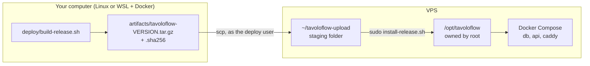
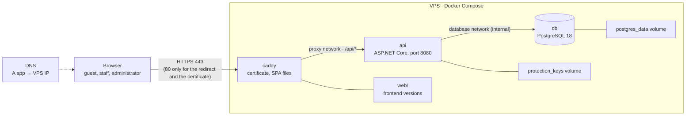

**English** · [Italiano](../it/self-hosting.md) · [中文](../zh-CN/self-hosting.md)

# Self-hosting TavoloFlow

This guide is for anyone who wants to install TavoloFlow on their own server: a Linux VPS, a domain and Docker. At the end you will have the app reachable over HTTPS on a subdomain of yours, for example `https://app.example.com`, with the administrator area, the staff area installable as a PWA, table QR codes pointing to your domain and an automatic backup every night.

It is also the story of how I put it online myself. To build the packages I used a Windows PC with WSL2 (Ubuntu) and Docker Desktop; the server was a netcup VPS; I had registered the domain with OVHcloud and the DNS was handled by Cloudflare. Where a choice depends on my case I say so, so you can adapt it to yours.

How to read it:

- the **Overview** explains the pieces and what you need: read it before touching anything;
- **Part 1** is the first installation, to do only once;
- **Part 2** contains the operations you will repeat: new releases, backups, maintenance;
- **Part 3** is for emergencies: verifying a backup and starting again on a new server;
- at the end there are the problems I ran into and a quick reference with the checklist.

All the scripts and configuration live in the [`deploy/`](../../deploy/) folder. How the app works inside (modules, identities, locks…) is in the [development notes](development-notes.md#architecture); here I only talk about how to put it online and keep it there.

## Overview

### How a release works

Nothing is compiled on the server: no .NET SDK, no Node, no source code. Everything is built on your computer, inside Docker containers, and packed into a single archive. The server receives the archive, checks its integrity and installs it with a script.



This way the server stays small and clean, and every installed version corresponds exactly to an archive you still have on your computer: you can reinstall it, or use it to roll back or to rebuild a server from scratch.

### Production architecture



Three containers run on the VPS, defined in [`deploy/compose.yaml`](../../deploy/compose.yaml):

| Service | Image                    | What it does                                                                                              |
| ------- | ------------------------ | --------------------------------------------------------------------------------------------------------- |
| `caddy` | `caddy:2-alpine`         | receives every request, obtains and renews the HTTPS certificate, serves the SPA files, forwards `/api/*` |
| `api`   | `tavoloflow-api:VERSION` | the ASP.NET Core backend, built by you and shipped in the package                                         |
| `db`    | `postgres:18-alpine`     | the database                                                                                              |

And four volumes, which survive every update or recreation of the containers:

| Volume                       | Contents                                                                                                                  |
| ---------------------------- | ------------------------------------------------------------------------------------------------------------------------- |
| `postgres_data`              | the database data                                                                                                         |
| `protection_keys`            | the Data Protection keys, which encrypt login cookies and table codes (see the [development notes](development-notes.md)) |
| `caddy_data`, `caddy_config` | the HTTPS certificate and Caddy's state                                                                                   |

Some choices that matter:

- **Only Caddy is exposed**, on ports 80 and 443. The API and the database publish no port on the host. It's not just a matter of tidiness: ports published by Docker can bypass the UFW firewall rules, so the only safe way not to expose the database is not to publish its port.
- **Two separate networks.** `proxy` connects Caddy and the API; `database` connects the API and PostgreSQL and is `internal`, that is without internet access. Caddy can't see the database.
- **Caddy has a fixed IP** (`172.30.80.2`). Behind a proxy, the API sees every request coming from Caddy, so Caddy adds the `X-Forwarded-For` (the visitor's real IP) and `X-Forwarded-Proto` (whether the request was HTTPS) headers. The API trusts these headers **only** if they come from that address (`ReverseProxy__KnownProxies__0` in `compose.yaml`, read in `Operations/DeploymentHosting.cs`): otherwise anyone could write them by hand and fake their IP, getting around the login and table-code rate limits.
- **It restarts by itself.** Every service has `restart: unless-stopped` and Docker starts at boot: you can close the SSH session, and after a VPS reboot the app comes back up by itself.
- **Logs don't fill the disk:** at most 3 files of 10 MB per container, then they rotate.
- **A single address.** Frontend and `/api` live on the same subdomain: no CORS, and the cookies belong only to that subdomain.

On the server, everything that isn't in the volumes lives in `/opt/tavoloflow`. After the first installation the folder looks like this:

```text
/opt/tavoloflow/                  root:root 755
├── compose.yaml, Caddyfile       configuration                          644
├── lib.sh, tf.sh                 shared functions and Compose shortcut  644
├── install-release.sh            installation and upgrade               644
├── rollback.sh                   back to a previous version             644
├── bootstrap-admin.sh            first administrator, password reset    644
├── backup.sh                     backup                                 644
├── tavoloflow-backup.service     systemd backup service                 644
├── tavoloflow-backup.timer       systemd backup timer                   644
├── .env.example                  configuration template                 644
├── .env                          real configuration, with passwords     600
├── .operation.lock               lock: one release, backup or rollback at a time
├── state/                        700: current and previous, the installed versions
├── backups/                      700: the backups
└── web/                          755: the only part Caddy reads
    ├── current -> releases/VERSION
    ├── releases/VERSION/         the complete frontend of each version
    └── assets/                   the JS and CSS files of every version, never deleted
```

### What you need

| What           | Requirements                                                                                     | In my case                                                           |
| -------------- | ------------------------------------------------------------------------------------------------ | -------------------------------------------------------------------- |
| VPS            | **AMD64 (x86-64)**, at least 2 vCPU, 4 GB of RAM, 40 GB of disk, a public IPv4; Ubuntu 24.04 LTS | netcup VPS Lite 1 G12.5s (2 vCPU, 4 GB, 80 GB), European data center |
| Domain         | a domain whose DNS you manage; you will use a subdomain                                          | `qiaotavoloflow.it` at OVHcloud                                      |
| DNS            | any provider that lets you create an `A` record                                                  | Cloudflare, free plan                                                |
| Build computer | Linux, or Windows with WSL2 + Docker Desktop; Git and Bash                                       | Windows 11, WSL2 Ubuntu, Docker Desktop                              |
| Email          | a real address, for the HTTPS certificate notices                                                |                                                                      |

The VPS must be AMD64 because the script builds the images only for `linux/amd64`: no ARM. The build computer, instead, can be whatever you like, as long as it has Docker; on a Mac with Apple Silicon the build would have to go through emulation and get slower, but I haven't tried it.

Before starting, know that some things are fixed in the code:

- **Euro and the Rome time zone.** Every restaurant is created with `EUR` and `Europe/Rome` (`Entities/Restaurant.cs`), and there is no interface to change them. The backup timer runs at 03:30 Rome time.
- **Three languages.** Staff area, administrator area and guest menu are in Chinese, Italian or English. The server's error messages are written in Chinese: in Italian and English the interface translates them starting from the error code.
- **A single instance.** The rate limiter keeps its counters in memory: the architecture is designed for a single API on a single server.

## Part 1: first installation

The commands always say where they must run: on **your computer** (in my case the WSL terminal) or on the **VPS**. In the commands, `VPS_IP` is the VPS's public IPv4 and `app.example.com` your subdomain: replace them with your values.

### 1. Preparing the server

#### 1.1 The SSH key

You connect to the server with SSH, and instead of a password you use a key pair:

- the **private key** stays on your computer and is never shared;
- the **public key** goes on the server, in the `~/.ssh/authorized_keys` file of the user you want to log in as: it is the list of who can log in as that user.

At login the client signs the connection data with the private key and the server checks the signature with the public key: the private key never travels over the network. The server doesn't trust a computer, but whoever holds the private key: guard it well.

**On your computer:**

```bash
# Create the key pair: tavoloflow (private) and tavoloflow.pub (public)
ssh-keygen -t ed25519 -C "tavoloflow" -f ~/.ssh/tavoloflow
# Show the public key: copy the whole line, from ssh-ed25519 to tavoloflow
cat ~/.ssh/tavoloflow.pub
```

If the key already exists, don't regenerate it: you would overwrite it.

#### 1.2 Installing Ubuntu

Install **Ubuntu 24.04 LTS** from your provider's panel, choosing the public key you just created: the installer writes it into `/root/.ssh/authorized_keys`, so you can log in as root with the key.

In my case, netcup delivered the VPS with Debian and I reinstalled it from its server control panel (SCP):

1. in **Options → SSH Keys** I saved the public key in my account;
2. in **Media → Images → Official Images** I chose Ubuntu 24.04 LTS Minimal, a single partition over the whole disk, UEFI as proposed, and selected the key;
3. at the end the panel shows the root password, and the web console (**Screen**) shows the booted system.

Reinstalling wipes the whole disk.

#### 1.3 First login as root

The first time you connect, SSH shows you the server's fingerprint and asks whether to trust it. To be sure you are talking to your VPS, compare it with the one seen from the provider's web console.

**On the VPS, from the provider's web console:**

```bash
ssh-keygen -lf /etc/ssh/ssh_host_ed25519_key.pub
```

**On your computer:**

```bash
# IdentitiesOnly=yes: use only the key given with -i
ssh -o IdentitiesOnly=yes -i ~/.ssh/tavoloflow root@VPS_IP
```

Answer `yes` only if the fingerprint matches. Then check the system and the architecture:

```bash
cat /etc/os-release   # must say Ubuntu 24.04
uname -m              # must say x86_64
```

#### 1.4 The deploy user

You don't work as root. You create a normal user, `deploy`, which logs in with the key and becomes root only when needed, with `sudo` and its password. That way an attacker would need both the private key and `deploy`'s password.

**On the VPS, as root** (keep this session open until you have verified the new login):

```bash
apt update
apt install -y sudo openssh-server nano
# Create the user with its home folder; the password is only for sudo
adduser deploy
# Add deploy to the sudo group; without -a it would lose its other groups
usermod -aG sudo deploy
# .ssh folder accessible only to deploy
install -d -m 700 -o deploy -g deploy /home/deploy/.ssh
# Paste the public key line; Ctrl+O, Enter to save, Ctrl+X to exit
nano /home/deploy/.ssh/authorized_keys
# nano, run by root, creates the file as root: give it back to deploy
chown deploy:deploy /home/deploy/.ssh/authorized_keys
chmod 600 /home/deploy/.ssh/authorized_keys
```

If you can't paste from the web console, copy the key root already has: `cp /root/.ssh/authorized_keys /home/deploy/.ssh/authorized_keys`, then the same `chown` and `chmod`. If owner or permissions are wrong, SSH ignores the key without saying why: the key is right but the login fails.

**On your computer, in a new terminal:**

```bash
ssh -o IdentitiesOnly=yes -i ~/.ssh/tavoloflow deploy@VPS_IP
whoami    # deploy
sudo -v   # asks for deploy's password and must succeed
```

From here on you always work as `deploy`.

#### 1.5 Updates, time zone and firewall

**On the VPS:**

```bash
sudo apt update
sudo apt upgrade -y
# The installer needs python3 to check .env; dnsutils provides dig
sudo apt install -y ca-certificates curl openssl python3 ufw dnsutils nano
sudo timedatectl set-timezone Europe/Rome
# Allow SSH first, then turn on the firewall: otherwise you lock yourself out
sudo ufw allow OpenSSH
sudo ufw allow 80/tcp
sudo ufw allow 443/tcp
sudo ufw enable
sudo ufw status
```

Only three ports must stay open: SSH, 80 and 443. Port 80 is needed too: Caddy uses it to obtain the certificate and to redirect HTTP to HTTPS. If the provider also has its own firewall (netcup has one in the panel), leave it at the default settings or keep the same inbound ports open and don't block outbound traffic. If the system asks for a reboot, `sudo reboot` and log in again as `deploy`.

#### 1.6 Disabling password and root login

Now that `deploy` logs in with the key, close the other ways in: no password login (whoever doesn't have the key can't get in, not even by guessing) and no direct login as root.

**On the VPS** (keep a session with working `sudo` open until you have verified):

```bash
# tee instead of "sudo echo ... > file": the > redirect is run by deploy's shell, without permissions
sudo tee /etc/ssh/sshd_config.d/00-tavoloflow.conf >/dev/null <<'EOF'
PasswordAuthentication no
KbdInteractiveAuthentication no
PermitRootLogin no
PubkeyAuthentication yes
EOF
# Syntax check: no output means no errors
sudo sshd -t
# Effective values: all three must be "no"
sudo sshd -T | grep -E 'passwordauthentication|kbdinteractiveauthentication|permitrootlogin'
sudo systemctl reload ssh
```

Why the name starts with `00-`: I was used to the idea that the last setting wins, but in sshd it's the opposite. sshd reads the files in `sshd_config.d/` in alphabetical order and, for each option, keeps **the first value** it finds. Cloud images often contain a file like `50-cloud-init.conf` with `PasswordAuthentication yes`; with `00-` our setting comes first. For the same reason you need both checks: `-t` only verifies the syntax, while `-T` shows the value that really applies.

Then, **from a new terminal on your computer**, check again that `deploy` logs in with the key and that `sudo -v` works. Only then close the old session. If you lock yourself out, fix it from the provider's web console, which doesn't go through SSH.

#### 1.7 Installing Docker

The server only needs Docker Engine and the Compose plugin, from Docker's official repository ([instructions for Ubuntu](https://docs.docker.com/engine/install/ubuntu/)).

**On the VPS:**

```bash
# Add Docker's repository with its signing key
sudo install -m 0755 -d /etc/apt/keyrings
sudo curl -fsSL https://download.docker.com/linux/ubuntu/gpg -o /etc/apt/keyrings/docker.asc
sudo chmod a+r /etc/apt/keyrings/docker.asc
sudo tee /etc/apt/sources.list.d/docker.sources >/dev/null <<EOF
Types: deb
URIs: https://download.docker.com/linux/ubuntu
Suites: $(. /etc/os-release && echo "$VERSION_CODENAME")
Components: stable
Architectures: $(dpkg --print-architecture)
Signed-By: /etc/apt/keyrings/docker.asc
EOF
# Install and start Docker, also at every boot
sudo apt update
sudo apt install -y docker-ce docker-ce-cli containerd.io docker-buildx-plugin docker-compose-plugin
sudo systemctl enable --now docker
# Check: Client and Server versions, then the hello-world message
sudo docker version
sudo docker compose version
sudo docker run --rm hello-world
```

**Don't add `deploy` to the `docker` group.** Whoever controls Docker can start a container that mounts any file of the system as root: being in the `docker` group is, in practice, being root without a password. All Docker commands are run with `sudo`.

### 2. Domain and DNS

Create a DNS record pointing the subdomain to the VPS's IPv4:

| Field | Value                                      |
| ----- | ------------------------------------------ |
| Type  | `A`                                        |
| Name  | `app` (becomes `app.example.com`)          |
| Value | the VPS's IPv4, without `https://` or port |
| TTL   | automatic                                  |

Don't create an `AAAA` (IPv6) record for the subdomain: the setup only uses IPv4.

**If you use Cloudflare, choose "DNS only" (the grey cloud).** The orange cloud looks like a gift (CDN, protection, HTTPS), but then requests would go through Cloudflare's servers: the API would see everything coming from Cloudflare's IPs instead of from visitors, the per-IP rate limit would stop working and the HTTPS certificate would have to be set up differently. With the grey cloud Cloudflare only resolves the name, and the browser talks directly to Caddy.

In my case I wanted to get everything from OVHcloud, but the European VPS model I needed was sold out, and Cloudflare doesn't sell `.it` domains: so the domain is registered with OVHcloud, the DNS is handled by Cloudflare and the VPS is from netcup. To move the DNS to Cloudflare:

1. I added the domain to Cloudflare, free plan, checking that the imported records were correct (if you have email on the domain, keep MX, SPF, DKIM and DMARC);
2. on OVHcloud I **first disabled DNSSEC**, then in **DNS servers** I replaced the nameservers with the two assigned by Cloudflare (replaced, not added as NS records);
3. once Cloudflare marked the domain as Active, I re-enabled DNSSEC from Cloudflare and copied the DS record to OVHcloud.

It was by chance, but it became an advantage: domain, DNS and server are with three different providers and not tied to each other, and to change VPS you only need to edit an `A` record, without reprinting the QR codes or touching the configuration.

The main domain and `www` must not point to the VPS: in my case they are reserved for a separate showcase site. Caddy answers only for the app's subdomain.

**Check, from your computer or from the VPS:**

```bash
dig +short NS example.com                    # your DNS provider's nameservers
dig @1.1.1.1 +short A app.example.com        # the VPS's IPv4
dig @1.1.1.1 +short AAAA app.example.com     # no output
```

Don't go on until the DNS is right: Caddy needs it to obtain the certificate.

### 3. Building the release package

First commit your changes: the version ID contains the commit hash, but the build uses the files in the working folder, and with changes left out of the commit the two would no longer match.

**On your computer, in the repository folder, with Docker running:**

```bash
PUBLIC_ORIGIN=https://app.example.com bash deploy/build-release.sh
```

`PUBLIC_ORIGIN` is the app's public address: all lowercase, without port, path or trailing slash. The script ([`deploy/build-release.sh`](../../deploy/build-release.sh)):

- **builds everything inside containers**, with Node 24 for the frontend and .NET 10 for the backend: the result doesn't depend on what you have installed on your computer. The first time it downloads the base images and takes a few minutes;
- **builds for `linux/amd64`**, the VPS's architecture;
- **writes the public address into the frontend.** Table QR codes are generated in the owner's browser and contain this address (`VITE_PUBLIC_BASE_URL`). The build doesn't read your `.env.local`, where there might be the home-network address used to try the app from a phone: a QR code printed with that address wouldn't work for any guest. The address also ends up in `public-origin.txt`, which the installer will compare with the domain configured on the server;
- **prepares the migrations program**, `efbundle`, inside the API image (see step 5);
- **puts only the files of an explicit list into the package**: no real `.env`, no keys, no development data, no `node_modules`;
- **computes the checksums** of each file (`SHA256SUMS`) and of the whole archive (`.sha256`).

The version ID is the UTC build time plus the short commit hash. At the end the script prints the two files it created, for example:

```text
artifacts/tavoloflow-20261026T094909Z-4c9535b.tar.gz
artifacts/tavoloflow-20261026T094909Z-4c9535b.tar.gz.sha256
```

Inside the archive (about 120 MB) there are:

```text
api-image.tar.gz     the API's Docker image, with efbundle
image.id             the image ID, checked during installation
frontend/            the SPA's static files
ops/                 scripts and configuration that will end up in /opt/tavoloflow
release.txt          the version ID
public-origin.txt    the public address written into the frontend
SHA256SUMS           the checksum of each file
```

Keep on your computer at least the package of the version in production and the previous one: you need them to roll back and to rebuild the server.

**Optional: test everything locally.** [`deploy/smoke-test.sh`](../../deploy/smoke-test.sh) installs the package inside a temporary, isolated Docker (Docker-in-Docker, with a local test certificate) and checks installation, migrations, HTTPS, cookies and CSRF of the three identities, two releases in a row, backup, restore and rollback, then removes everything it created. It uses the address written in the package, so it works with any `PUBLIC_ORIGIN`:

```bash
PUBLIC_ORIGIN=https://app.example.com bash deploy/build-release.sh
bash deploy/smoke-test.sh artifacts/tavoloflow-VERSION.tar.gz
```

**Uploading the package to the VPS, from your computer:**

```bash
# The version ID printed by the script
RELEASE=20261026T094909Z-4c9535b
# Single quotes: ~ must become deploy's home on the VPS, not yours
ssh -i ~/.ssh/tavoloflow deploy@VPS_IP 'mkdir -p ~/tavoloflow-upload'
scp -i ~/.ssh/tavoloflow \
  "artifacts/tavoloflow-$RELEASE.tar.gz" \
  "artifacts/tavoloflow-$RELEASE.tar.gz.sha256" \
  deploy@VPS_IP:~/tavoloflow-upload/
```

The package arrives in a **staging folder** owned by `deploy`, not directly in `/opt/tavoloflow`: that folder belongs to root and `scp`, which logs in as `deploy`, can't write there. It's also safer: a file arriving from outside stays in an unprivileged place until it has been checked. If the upload is interrupted, upload the same package again.

### 4. Preparing `/opt/tavoloflow`

**On the VPS** (your computer's variables don't reach here: set `RELEASE` again):

```bash
RELEASE=20261026T094909Z-4c9535b
cd ~/tavoloflow-upload
# Archive checksum: must print OK
sha256sum -c "tavoloflow-$RELEASE.tar.gz.sha256"
# Each version in its own folder: the archive's files have no top-level folder
mkdir "$RELEASE"
tar -xzf "tavoloflow-$RELEASE.tar.gz" -C "$RELEASE"
cd "$RELEASE"
# Checksum of each file: no output means all good
sha256sum --check --quiet SHA256SUMS
# The production folder and the operational files belong to root
sudo install -d -o root -g root -m 755 /opt/tavoloflow
sudo install -o root -g root -m 644 ops/* ops/.env.example /opt/tavoloflow/
# The real .env, readable only by root. ONLY on the first installation!
sudo install -o root -g root -m 600 ops/.env.example /opt/tavoloflow/.env
# Generate the database password (copy it) and open .env
openssl rand -hex 32
sudo nano /opt/tavoloflow/.env
```

Here `install` doesn't install packages: it copies a file and sets its owner and permissions at the same time. `ops/*` doesn't include hidden files, which is why `.env.example` is written separately. If a checksum fails, upload the package again: don't skip the check.

**Never run the line that creates `.env` again** in later releases: you would overwrite the configuration with the empty template.

#### The `.env` file

| Variable            | What to write                                                                                                      |
| ------------------- | ------------------------------------------------------------------------------------------------------------------ |
| `DOMAIN`            | the subdomain, for example `app.example.com`, without `https://`: `https://` + `DOMAIN` must equal `PUBLIC_ORIGIN` |
| `ACME_EMAIL`        | your real email, for the certificate notices                                                                       |
| `POSTGRES_PASSWORD` | the 64 hexadecimal characters generated by `openssl rand -hex 32`                                                  |

Leave the rest as it is. No quotes and no spaces around `=`.

- **The database password only counts the first time.** PostgreSQL creates the user with `POSTGRES_PASSWORD` only when the data volume is empty. If you later change it in `.env`, the database doesn't know, and the API can no longer connect. It is hexadecimal because it contains only `0-9` and `a-f`: no character to escape, neither in Compose nor in the connection string.
- **The installer checks three things** before doing anything: that the password is 64 hexadecimal characters, that the email isn't the template's, and that `https://` + `DOMAIN` equals the package's `public-origin.txt`. That way you can't install a frontend whose QR codes point to another domain.
- `PROXY_SUBNET`, `PROXY_DYNAMIC_RANGE` and `CADDY_IP` define the network between Caddy and the API and Caddy's fixed IP. Change them, all three together and before the first start, only if the VPS already has another Docker network using `172.30.80.0/24`.
- The installer already checks the configuration with `docker compose config --quiet`; after installation you can do it yourself with `sudo bash /opt/tavoloflow/tf.sh config --quiet`. Without `--quiet` it prints everything, passwords included.

#### Why these permissions

| Path                              | Permissions | What `deploy` can do                                    |
| --------------------------------- | ----------- | ------------------------------------------------------- |
| `/home/deploy/tavoloflow-upload/` | deploy's    | everything: it's the staging folder                     |
| `/opt/tavoloflow/`                | 755         | enter and read, but not create, delete or replace files |
| scripts and configuration         | 644         | read only                                               |
| `.env`                            | 600         | nothing, not even read                                  |

The reason: every night systemd runs `/opt/tavoloflow/backup.sh` **as root**, which in turn loads `lib.sh` and `compose.yaml`. If `deploy` could modify one of these files, it could write any command into it and have root run it at the next backup: root without knowing the `sudo` password. The folder must be protected too, because to delete or replace a file you only need write permission on the folder that contains it. That's why `install -o root` is used, never `cp -a`, which would keep the `deploy` owner of the uploaded files (see "Problems I ran into").

**Permissions check, on the VPS:**

```bash
# Owner and permissions of the main files
sudo stat -c '%U:%G %a %n' /opt/tavoloflow /opt/tavoloflow/backup.sh /opt/tavoloflow/lib.sh /opt/tavoloflow/compose.yaml /opt/tavoloflow/.env
# Files not owned by root, or writable by group and others: must print nothing
sudo find /opt/tavoloflow \( ! -user root -o ! -group root -o \( ! -type l -perm /022 \) \) -print
# From deploy's point of view: WITHOUT sudo
test ! -w /opt/tavoloflow && test ! -w /opt/tavoloflow/backup.sh && echo 'deploy cannot modify or replace the backup script'
```

You expect `root:root` everywhere, `755` for the folder, `644` for scripts and configuration, `600` for `.env`, no output from `find` and the final message. Repeat the check after every release and before enabling the automatic backup.

### 5. Installing

**On the VPS, still inside the extracted folder** (for example `~/tavoloflow-upload/20261026T094909Z-4c9535b/`):

```bash
sudo bash ops/install-release.sh "$PWD" /opt/tavoloflow
```

You run the script **of the new package**, so script and package are always the same version. The first argument is the package folder, the second the production one. The script ([`deploy/install-release.sh`](../../deploy/install-release.sh)), in order:

1. **checks**: that it runs as root, that `.env` exists, the package checksums;
2. **repairs the permissions** of `/opt/tavoloflow` before reading or running any file inside it;
3. **takes the lock** `.operation.lock`, so release, backup and rollback never overlap;
4. **checks `.env`** (the three rules seen above);
5. **loads the API image** with `docker load` and checks that its ID matches `image.id`;
6. **prepares the folders** `state/`, `backups/` (700) and `web/` (755);
7. if a version is already installed, **stops the API and takes a backup**; on the first installation it skips this step;
8. **copies the operational files** into `/opt/tavoloflow` (`.env` is not among them and is never touched);
9. **starts the database** and waits for it to be ready; on first start PostgreSQL creates the user with the password from `.env`;
10. **applies the migrations**;
11. **copies the frontend** into `web/releases/VERSION/` and its JS and CSS files into `web/assets/`;
12. **starts the new API** and waits for it to answer healthy on `/health/ready` (a check that the database is reachable);
13. **moves the `web/current` link** to the new version;
14. **recreates Caddy**, which requests the certificate the first time;
15. **writes the version** into `state/current` (and the previous one into `state/previous`).

The PostgreSQL and Caddy images are not in the package: Docker downloads them on first start, and it's normal to see them being downloaded.

Step 13 is **atomic**: the script creates a temporary link and then renames it over `current` with `mv -T`, a single file-system operation. A visitor sees either the old version or the new one, never something in between.

#### Migrations

In development, after changing the model, you create a migration with `dotnet ef migrations add` and apply it to the local database with `dotnet ef database update`. In production you can't: the server has neither the SDK nor the sources.

- **`efbundle`.** During the build, [`Dockerfile.api`](../../deploy/Dockerfile.api) runs `dotnet ef migrations bundle`, which packs all the migrations into a standalone program, `efbundle`, inside the API image. It does the same job as `database update`, but without the SDK. The installer runs it in a throwaway container: `compose run --rm --entrypoint /app/efbundle api`.
- **It can be repeated.** EF Core records the applied migrations in the `__EFMigrationsHistory` table: at every release `efbundle` runs anyway, and applies only the new ones.
- **Never at API startup.** A container restarts for many reasons (a crash, a VPS reboot): with migrations at startup, the database could change at any moment. This way, instead, it only changes during a release, after a backup, and if a migration fails the script stops instead of leaving an API that keeps crashing.
- **Forward only.** You don't undo a migration in production (for example with `dotnet ef database update 0`, which drops tables and data): if something is wrong, you write a new migration that fixes it. This also limits rollback (see Part 2).

#### HTTPS

Caddy handles the certificate by itself with the ACME protocol (Let's Encrypt or ZeroSSL): it obtains it at first start and renews it before it expires, with no cron or commands. For it to work you need three things: the `A` record must already point to the VPS, ports 80 and 443 must be reachable from the internet and `ACME_EMAIL` must be a real address.

The [`Caddyfile`](../../deploy/Caddyfile) serves only the `DOMAIN` host. HTTP requests for any other name, or straight to the IP, get a 404 instead of a redirect: the VPS doesn't pretend to be someone else's site. The same file also decides caching: `/api` never cached, files with a hash in their name cached for a year, `index.html`, `sw.js` and the manifest always revalidated (`no-cache`).

#### Checks

**On the VPS:**

```bash
# db, api and caddy must be running and healthy
sudo bash /opt/tavoloflow/tf.sh ps
# The certificate: look for errors in the last lines
sudo bash /opt/tavoloflow/tf.sh logs --tail 80 caddy
```

`tf.sh` is a shortcut for `docker compose` with the production folder, `.env` and `compose.yaml`, and with the version read from `state/current`. All Compose commands go through it; it needs `sudo` because `deploy` is not in the `docker` group and only root can read `.env`.

**From your computer:**

```bash
curl -I http://app.example.com                    # redirect to https
curl -I https://app.example.com/staff/login       # 200, no certificate error
curl -I https://app.example.com/sw.js             # JavaScript, Cache-Control: no-cache
curl -I https://app.example.com/staff.webmanifest # application/manifest+json, no-cache
curl -i https://app.example.com/api/auth/csrf     # JSON, Cache-Control: no-store
```

Don't use `curl -k` to hide a certificate problem: it has to be fixed. `https://app.example.com/` redirects to `/staff`.

### 6. First access

#### The platform administrator

The database is empty, and the platform administrator is the only one who can create restaurants. You create the first one from the VPS:

```bash
sudo bash /opt/tavoloflow/bootstrap-admin.sh
```

It asks for a username and password (6–128 characters; nothing shows while you type, that's normal). The script ([`bootstrap-admin.sh`](../../deploy/bootstrap-admin.sh)) starts a throwaway container from the API image with the `--seed-platform-admin` command, which creates the account and exits without serving requests (`Operations/MaintenanceCommands.cs`). The password reaches the container as an environment variable passed by name (`-e NAME`): it appears neither among the process arguments, nor in the shell history, nor in `.env`. The command creates the administrator only if none exists yet: run again with the same name it changes nothing, with a different name it refuses.

#### The three entrances

| Who                    | Address                                                |
| ---------------------- | ------------------------------------------------------ |
| Platform administrator | `https://app.example.com/platform/login`               |
| Owner and staff        | `https://app.example.com/staff/login`                  |
| Guest                  | `https://app.example.com/q/{token}`, from the table QR |

#### The first restaurant

1. Sign in at `/platform/login` (you can change the language at the top) and create the restaurant: name, default menu language, owner and staff usernames, first subscription period.
2. Save the two **temporary passwords** right away: they are shown only once.
3. The owner signs in at `/staff/login` and, at first sign-in, must set a new password ("Set a new password"). Then they prepare the menu (categories, dishes, prices, allergens) and the tables in "Tables & QR".
4. The staff does the same first sign-in with their temporary password.
5. A restaurant starts **suspended** and with ordering off: from the administrator area activate the service, then from Floor the owner or the staff turns on "QR ordering". Reactivating the service doesn't turn ordering back on by itself.
6. Download and print a table's QR code and check that, when scanned, it opens `https://app.example.com/q/...` and not `localhost` or a home address.
7. Do a full round: open the table from Floor, scan the QR code with a phone, enter the table code, order, mark the dishes ready in Kitchen, close the bill as the owner and find it in Bill history.

The administrator can't close bills in place of the owner. And test orders stay in the history: for tests use a clearly fake restaurant, not the real one, instead of deleting rows by hand with SQL.

#### The staff PWA

On every device in the restaurant open `https://app.example.com/staff` and install the app:

- **Android, computer (Chrome, Edge):** from the app's Home, section "Install on this device", button "Install app", or from the browser menu;
- **iPhone and iPad (Safari):** "Share" → "Add to Home Screen"; the first time you open it from the icon you have to sign in again.

Opened from the icon, check Home, Kitchen and Bill; in Kitchen turn on the sound and keep-screen-on. Without a network a page saying so must appear. Guests on `/q/...` and the administrator area must never offer installation. Details are in [`pwa.md`](../reference/pwa.md).

### 7. Enabling backups, before real data

Do it now, before the restaurant enters its real menu. I had postponed it too (see "Problems I ran into").

**On the VPS:**

```bash
# A manual backup, to see that the script works
sudo bash /opt/tavoloflow/backup.sh
# Copy service and timer where systemd reads them
sudo install -o root -g root -m 644 /opt/tavoloflow/tavoloflow-backup.service /etc/systemd/system/
sudo install -o root -g root -m 644 /opt/tavoloflow/tavoloflow-backup.timer /etc/systemd/system/
sudo systemctl daemon-reload
# Enable the timer, now and at every boot (it doesn't run a backup now)
sudo systemctl enable --now tavoloflow-backup.timer
# Next run and existing backups
sudo systemctl list-timers tavoloflow-backup.timer
sudo ls -lh /opt/tavoloflow/backups/
```

In systemd a scheduled task is made of two files: the **service** says what to do, the **timer** when to do it.

| File                        | Line                                    | Meaning                                                   |
| --------------------------- | --------------------------------------- | --------------------------------------------------------- |
| `tavoloflow-backup.service` | `Type=oneshot`                          | starts, does the work and ends; not an always-on service  |
|                             | `User=root`                             | runs as root (hence the permissions of step 4)            |
|                             | `Requires=` / `After=docker.service`    | needs Docker and starts after it                          |
|                             | `UMask=0077`                            | created files are readable only by root                   |
| `tavoloflow-backup.timer`   | `OnCalendar=*-*-* 03:30:00 Europe/Rome` | every day at 03:30, Rome time                             |
|                             | `RandomizedDelaySec=300`                | with a random delay of up to 5 minutes                    |
|                             | `Persistent=true`                       | if the server was off at that time, it catches up at boot |

The files in `/opt/tavoloflow` are only the copies that came with the package: systemd reads those in `/etc/systemd/system/`. That's why they have to be copied, and copied again if a release changes them.

Then download the first backup to your computer right away, as explained in Part 2, "Backups". And, as soon as you can, do a restore test (Part 3).

## Part 2: recurring operations

### Releasing a new version

It's the same path as the first installation, without touching `.env` and without creating the administrator.

**Before starting:**

1. The code is tested and **committed**.
2. Docker is running on your computer.
3. Check whether there are new migrations. The ID of the version in production (`sudo cat /opt/tavoloflow/state/current` on the VPS) ends with the hash of the commit it was built from:

   ```bash
   # On your computer: replace 4c9535b with the hash of the version in production.
   # No output = no new migrations
   git log --oneline 4c9535b..HEAD -- backend/TavoloFlow.Api/Data/Migrations
   ```

4. If there are migrations, or it's a major update, first download the latest backup to your computer.
5. Pick a time when the restaurant is closed: while the installer takes the backup, runs the migrations and restarts the API, pages open but every request to `/api` fails.

**On your computer:**

```bash
PUBLIC_ORIGIN=https://app.example.com bash deploy/build-release.sh
RELEASE=NEW_VERSION
scp -i ~/.ssh/tavoloflow \
  "artifacts/tavoloflow-$RELEASE.tar.gz" \
  "artifacts/tavoloflow-$RELEASE.tar.gz.sha256" \
  deploy@VPS_IP:~/tavoloflow-upload/
```

`scp` copies the files but does not open a shell on the VPS. **From your computer**, log in as `deploy` (or return to an SSH session already open):

```bash
ssh -o IdentitiesOnly=yes -i ~/.ssh/tavoloflow deploy@VPS_IP
```

**On the VPS** (set `RELEASE` again: your computer's variables are not transferred):

```bash
RELEASE=NEW_VERSION
cd ~/tavoloflow-upload
sha256sum -c "tavoloflow-$RELEASE.tar.gz.sha256"
mkdir "$RELEASE"
tar -xzf "tavoloflow-$RELEASE.tar.gz" -C "$RELEASE"
# You are in ~/tavoloflow-upload, so the path starts with $RELEASE/
sudo bash "$RELEASE/ops/install-release.sh" "$PWD/$RELEASE" /opt/tavoloflow
sudo bash /opt/tavoloflow/tf.sh ps
```

The installer redoes the per-file check (`SHA256SUMS`) at the start. When it finds a version already installed, the installer does this:

```text
stop the API → backup → migrations → new API → move web/current → recreate Caddy → save the version
└──────────────────── the API doesn't answer ────────────────────┘
```

- **There is always a backup**, even when there are no new migrations.
- **The API stops before the backup**, so nobody writes during the backup and the copy is consistent.
- **The backup comes before the migrations**: if a migration goes wrong, there is a copy of how things were before.

**Pages already open.** A Kitchen left open all day has the old frontend in memory, and when it changes page it loads pieces of code (the router splits the code by page) named as in the old version. That's why `web/assets/` keeps the files of **every** version: with the hash in their name they are never overwritten, and an old page always finds its own. New code only arrives when the page is reloaded or the app reopened. In the meantime, though, the old page talks to the new API: API changes must stay compatible with the previous version's clients, otherwise every device has to be reloaded.

**After the release** check the login, a read (for example Kitchen or Bill) and changing page in the PWA. If a write shows a result to verify, follow the interface: the app checks with a GET, and resending blindly could repeat the operation.

If the release changed `tavoloflow-backup.service` or `.timer`, the installer updates only the copies in `/opt/tavoloflow`: repeat the two `install` lines and `daemon-reload` from step 7 of Part 1.

### When a release goes wrong

The installer stops at the first error. Read the logs before doing anything else:

```bash
sudo bash /opt/tavoloflow/tf.sh logs --tail 100 api db caddy
```

- **Don't delete volumes and don't restore the database right away.** A script error doesn't delete data.
- If the API stayed stopped, keep the restaurant out of service until you understand.
- After the fix, release with a **new ID**: the same ID is refused both by the build (the archive already exists) and by the installer (the `web/releases/VERSION` folder already exists). Running the migrations again does no harm.

If the very first installation fails, `state/current` doesn't exist yet and `tf.sh` doesn't know which version to use. Pass it yourself, with `env` after `sudo`, because `sudo` clears environment variables written before it:

```bash
sudo env RELEASE_ID=FAILED_VERSION bash /opt/tavoloflow/tf.sh logs --tail 100 api db caddy
```

#### Rolling back to the previous version

```bash
sudo cat /opt/tavoloflow/state/current
sudo cat /opt/tavoloflow/state/previous
# Only after checking that the old code works with the current schema
sudo bash /opt/tavoloflow/rollback.sh --schema-compatible PREVIOUS_VERSION
```

[`rollback.sh`](../../deploy/rollback.sh) checks that the old version's frontend and image are still there, stops the API, takes a backup, starts the old API, points `web/current` back to the old frontend, recreates Caddy and updates `state/`. **It changes only the code, not the database**: the migrations stay applied and the orders placed in the meantime stay. So the old code must work on the new schema:

| What the new migration did                | Does the old code work?                       |
| ----------------------------------------- | --------------------------------------------- |
| added a table or a nullable column        | usually yes: it doesn't know them or use them |
| deleted or renamed a column               | no: it looks for a column that's gone         |
| added a required column without a default | no: its INSERTs don't fill it in              |

The `--schema-compatible` option is mandatory precisely to make you stop and think: without it, the script refuses. If the schema isn't compatible, the best way is to fix and release a new version; the alternative is to restore the backup with the restaurant closed, losing what happened afterwards.

### Backups

Every run of [`backup.sh`](../../deploy/backup.sh) creates an archive in `/opt/tavoloflow/backups/`:

```text
tavoloflow-20261027T023000Z-12345.tar.gz    UTC time and process number
├── database.dump      the database, with pg_dump
├── keys.tar.gz        the Data Protection keys
├── production.env     a copy of .env, passwords included
├── compose.yaml, Caddyfile
├── state/             the versions installed at that moment
└── SHA256SUMS
```

- **`pg_dump` reads everything from a single snapshot:** even if an order arrives while it works, the file is consistent, as if photographed in a single instant.
- **The keys always go with the database.** Login cookies and table codes are encrypted with those keys: with the database but without the keys, every device has to sign in again and the codes of open tables become unreadable.
- **Not included** are the Docker images and the frontend (they are in the packages on your computer), and the certificate (on a new server Caddy requests another one). Dish photos are included in `database.dump`, because they are stored in the database.
- **It contains passwords and keys:** never in a public folder, never in Git.
- The backup is first written to a `.part` file and renamed only at the end: a half-written backup never remains. It uses the same lock as release and rollback: if it finds a release in progress, it exits with an error.

A backup is created in four cases: every night with the timer, at every release (before the migrations), at every rollback and when you run it by hand. They all end up in the same folder, and those **older than 7 days are deleted**: if a release's problem shows up after eight days, the pre-release backup is no longer on the server. That's another reason to download them.

#### Downloading a backup to your computer

A backup that lives only on the server disappears together with the server (broken disk, deleted VPS, blocked account). How often you download it decides how many days of data you would lose in the worst case; I had chosen once a week, plus before every major release.

You can't download it with a single command: the backups belong to root and `deploy` can't read them, and `ssh deploy@VPS_IP sudo cat ...` doesn't work because `sudo` asks for the password and without an interactive terminal there's nowhere to type it. So you make a temporary copy owned by `deploy`.

**On the VPS, in an interactive terminal** (find the name with `sudo ls -lh /opt/tavoloflow/backups/`):

```bash
BACKUP=tavoloflow-DATE-NUMBER.tar.gz
install -d -m 700 /home/deploy/tavoloflow-download
sudo install -m 600 -o deploy -g deploy \
  "/opt/tavoloflow/backups/$BACKUP" "/home/deploy/tavoloflow-download/$BACKUP"
```

**On your computer:**

```bash
BACKUP=tavoloflow-DATE-NUMBER.tar.gz
# Files created from here on are readable only by you
umask 077
mkdir -p ~/tavoloflow-backups
scp -i ~/.ssh/tavoloflow \
  "deploy@VPS_IP:/home/deploy/tavoloflow-download/$BACKUP" \
  "$HOME/tavoloflow-backups/$BACKUP"
# If it lists the files, the archive is intact
tar -tzf "$HOME/tavoloflow-backups/$BACKUP"
```

**Back on the VPS**, delete the temporary copy (the original stays in `backups/`):

```bash
rm -- "/home/deploy/tavoloflow-download/$BACKUP"
```

On WSL, `~/tavoloflow-backups` disappears if you delete the distribution: copy the important backups elsewhere too, remembering that they contain passwords and keys. To stop downloading them by hand, the next step would be object storage with automatic copies.

### Maintenance

**System status, on the VPS:**

```bash
sudo bash /opt/tavoloflow/tf.sh ps                       # running and healthy containers
sudo bash /opt/tavoloflow/tf.sh logs --tail 100 api      # last lines of the API
sudo docker stats --no-stream                            # CPU and memory per container
free -h                                                  # memory: look at the available column
df -h                                                    # disk: look at Use% of the / row
sudo docker system df                                    # space used by images and volumes
sudo du -sh /opt/tavoloflow/web /opt/tavoloflow/backups
# Has memory ever run out (OOM)?
sudo journalctl -k --no-pager | grep -i -E 'out of memory|oom'
```

With the disk close to 80%, clean up. If memory stays at the limit, OOM errors appear or responses slow down at peak times, first look for the cause and only then think about a bigger VPS.

**Cleanup:**

```bash
# These two versions are not touched
sudo cat /opt/tavoloflow/state/current /opt/tavoloflow/state/previous
# An old version in the staging folder (write the full ID, no overly broad *)
rm -rf ~/tavoloflow-upload/tavoloflow-OLD_VERSION.tar.gz* ~/tavoloflow-upload/OLD_VERSION
# Old API images
sudo docker image ls tavoloflow-api
sudo docker image rm tavoloflow-api:OLD_VERSION
```

| What                           | Grows by, per release | Is it cleaned up?                                                   |
| ------------------------------ | --------------------- | ------------------------------------------------------------------- |
| staging folder                 | about 230 MB          | yes, once the version is installed and you have the package locally |
| `tavoloflow-api` images        | a few tens of MB      | yes, except the current and the previous version                    |
| `web/releases/`, `web/assets/` | about 1 MB            | no: they serve old pages and rollback                               |
| backups                        | —                     | no: after 7 days they disappear by themselves                       |

**Never `docker volume prune` or cleanup commands with `--volumes`:** they could delete the database volume.

**Updates**, with the restaurant closed:

```bash
# System security updates, about once a month
sudo apt update
sudo apt upgrade -y
test -f /var/run/reboot-required && echo 'a reboot is needed'
sudo reboot   # only if needed; the containers restart by themselves
```

- The PostgreSQL and Caddy images are not updated by releases. For a minor version: backup, restore test, then `sudo bash /opt/tavoloflow/tf.sh pull db caddy` and `sudo bash /opt/tavoloflow/tf.sh up -d --wait db caddy`.
- Don't go from PostgreSQL 18 to 19 by just changing the number: a major version change has to be planned separately.
- The API's .NET runtime is updated to the latest patch at every build. Even without code changes, it's worth rebuilding and releasing every now and then to get the security patches.

**Forgotten administrator password:**

```bash
sudo bash /opt/tavoloflow/bootstrap-admin.sh --reset-platform-password
```

It asks for the name of an existing administrator and the new password; all sessions of that account are closed. It doesn't reactivate a deactivated account. Owner and staff passwords are reset from the administrator area instead, or, for the staff, from the owner's "Staff account" page.

## Part 3: emergencies

### Restore test

A backup you have never restored is not yet a backup: it's a hope. This test restores a backup into a temporary PostgreSQL, isolated from the network and with its own volume, without touching the production database.

**On the VPS** (if a `tavoloflow-restore-check` container already exists, first check that it's from a previous test):

```bash
# In /root, with 700 permissions: the backup contains passwords and keys
sudo install -d -m 700 /root/tavoloflow-restore-check
sudo tar -xzf /opt/tavoloflow/backups/BACKUP_NAME.tar.gz -C /root/tavoloflow-restore-check
# deploy can't enter /root and sudo doesn't work with cd: go in with sudo bash -c
sudo bash -c 'cd /root/tavoloflow-restore-check && sha256sum --check --quiet SHA256SUMS'
sudo docker run -d --name tavoloflow-restore-check --network none \
  -e POSTGRES_PASSWORD=temporary-restore-check-only \
  -v /var/lib/postgresql postgres:18-alpine
# Wait for "accepting connections"; with -h 127.0.0.1 the temporary server can't fool you (see "Problems I ran into")
sudo docker exec tavoloflow-restore-check pg_isready -h 127.0.0.1 -U postgres
```

Then restore and check:

```bash
# root reads the file and passes it to the container through a pipe (-i)
sudo cat /root/tavoloflow-restore-check/database.dump | \
  sudo docker exec -i tavoloflow-restore-check pg_restore -U postgres -d postgres \
    --no-owner --no-privileges --exit-on-error
sudo docker exec tavoloflow-restore-check psql -U postgres -d postgres \
  -c 'SELECT count(*) FROM restaurants;' -c 'SELECT count(*) FROM orders;'
sudo tar -tzf /root/tavoloflow-restore-check/keys.tar.gz
```

The restore must finish without errors, the queries must return numbers and the key archive must be readable. At the end delete only what you created for the test:

```bash
# -f stops and removes the container, -v its anonymous volume too
sudo docker rm -fv tavoloflow-restore-check
sudo rm -rf /root/tavoloflow-restore-check
```

### Restoring on a new server

If the server is lost, rebuild everything on a new VPS starting from a downloaded backup and the package of the same version. This procedure **wipes the destination database**: use it only on a new server, not yet in service. The old server, if it still exists, must stay off, because two servers accepting orders at the same time create two different histories.

1. Prepare the new VPS as in step 1 of Part 1 (system, SSH, `deploy`, firewall, Docker). **Don't touch the DNS yet.**
2. Upload the backup to the VPS, extract it into `/root/tavoloflow-restore` (700 permissions) and check its `SHA256SUMS`.
3. In the backup's `state/current` you find the installed version: upload and prepare that package as in steps 3 and 4, but **without creating `.env` from the template**. Instead install the backup's `production.env` as `.env` (`root:root`, `600`): it contains the password the database was created with.
4. Run `install-release.sh` as in step 5. It creates an empty database and new keys, which you are about to replace. **Don't create the administrator and don't create restaurants.** The DNS still points to the old address, so it's normal that Caddy doesn't get the certificate.
5. Replace database and keys with those from the backup:

```bash
# No writes during the restore
sudo bash /opt/tavoloflow/tf.sh stop api caddy
# A clean database: the empty tables created by the migrations would conflict with the dump
sudo bash /opt/tavoloflow/tf.sh exec -T db sh -ec \
  'dropdb -U "$POSTGRES_USER" "$POSTGRES_DB"; createdb -U "$POSTGRES_USER" "$POSTGRES_DB"'
sudo cat /root/tavoloflow-restore/database.dump | \
  sudo bash /opt/tavoloflow/tf.sh exec -T db sh -ec \
    'exec pg_restore -U "$POSTGRES_USER" -d "$POSTGRES_DB" --no-owner --no-privileges --exit-on-error'
# The keys: out with the new ones, in with the backup's
sudo cat /root/tavoloflow-restore/keys.tar.gz | \
  sudo bash /opt/tavoloflow/tf.sh run --rm -T --no-deps --entrypoint sh api -ec \
    'find /var/tavoloflow/keys -maxdepth 1 -type f -delete; tar -xzf - -C /var/tavoloflow/keys --no-same-owner'
sudo bash /opt/tavoloflow/tf.sh up -d --wait api
```

6. Check that the API is healthy and that the data is there:

```bash
sudo bash /opt/tavoloflow/tf.sh ps
sudo bash /opt/tavoloflow/tf.sh exec -T db sh -c \
  'psql -U "$POSTGRES_USER" -d "$POSTGRES_DB" -c "SELECT count(*) FROM orders;"'
```

7. **Only now** move the `A` record to the new IP, check with `dig @1.1.1.1 +short A app.example.com` and start Caddy, which needs the DNS already updated to obtain the certificate:

```bash
sudo bash /opt/tavoloflow/tf.sh up -d caddy
sudo bash /opt/tavoloflow/tf.sh logs --tail 80 caddy
```

8. Check HTTPS, the login, Bill history and the codes of tables still open, then reopen the service and re-enable the automatic backup (step 7 of Part 1).

The database goes back to how it was at the time of the backup: whatever happened afterwards has to be rechecked by hand with the restaurant.

## Problems I ran into and lessons learned

**A `cp -a` that gave away root.** The first version of the guide, and of the installer, copied the operational files with `cp -a`, which keeps the files' owner. The uploaded files belonged to `deploy`, and so the production scripts and even the `/opt/tavoloflow` folder became `deploy`'s too: exactly the risk explained in step 4, "Why these permissions". I fixed it on 26 October 2026: now `install -o root -g root` with explicit permissions is always used, and the installer repairs the permissions of the whole folder before reading or running anything inside it, also fixing installations made with the old guide. The lesson: who runs a file matters as much as who can modify it, and the folder containing it is part of security too.

**Caddy's fixed IP taken by another container.** The smoke test found that, at first start, Docker could assign exactly the address I had reserved for Caddy to another container. Now the `proxy` network has an `ip_range`: Docker assigns automatically only addresses from the upper half (`.128`–`.255`), and Caddy's (`.2`) always stays free.

**SkiaSharp and its 475 MB.** When I added dish photos, the SkiaSharp image library brought along the native libraries for every operating system, and the API's published folder grew to about 475 MB. Publishing only for `linux-x64` (`-r linux-x64` in `Dockerfile.api`) brought it down to about 67 MB.

**The QR address is part of the build.** The public address is written into the frontend at build time, so a package is tied to a domain. I noticed when I moved the app from the main domain to the `app.` subdomain: the packages already built generated QR codes with the old address and had become unusable. Hence the build with the explicit address, which ignores local files, and the installer's check between `DOMAIN` and `public-origin.txt` (steps 3 and 4).

**Caddy answered for others too.** With automatic HTTPS, Caddy redirected any HTTP request to HTTPS, including those for the main domain and for `www`, which belong to another site. A `:80 { respond 404 }` block makes it answer only for the app's subdomain.

**A `pg_isready` that sometimes lied.** In the restore test I waited for PostgreSQL with `pg_isready` on the Unix socket. But the official image, at first start, starts a temporary server for initialization and then shuts it down, and every now and then the test caught it just as it was shutting down (`the database system is shutting down`). Now the check goes through `127.0.0.1`, like the production healthcheck: the temporary server doesn't listen on TCP.

**Local tests help, but they're not enough.** The smoke test found several problems before I touched the VPS. But it can't test the real certificate, the real DNS, the provider's network or installing the PWA on an iPhone: those things I had to check by hand, on the real server.

**Online without backups.** I'll say it honestly: TavoloFlow was already online, but the nightly backup wasn't enabled yet, no backup had ever been downloaded off the server and I had never tried a restore. The only backups were those taken automatically by releases, on the same server as the data. If the server had broken, I would have lost everything. The scripts were there, three commands were missing. The lesson: backups are part of going online, they don't come afterwards. That's why in this guide they are in Part 1, before real data.

## Quick reference

### Paths

| What                         | Where                                                             | Whose  |
| ---------------------------- | ----------------------------------------------------------------- | ------ |
| built packages               | `artifacts/` in the repository, on your computer                  | yours  |
| downloaded backups           | `~/tavoloflow-backups/`, on your computer                         | yours  |
| staging folder               | `/home/deploy/tavoloflow-upload/`                                 | deploy |
| production                   | `/opt/tavoloflow/`                                                | root   |
| current and previous version | `/opt/tavoloflow/state/current`, `/opt/tavoloflow/state/previous` | root   |
| backups on the server        | `/opt/tavoloflow/backups/`                                        | root   |

### Most used commands

```bash
# From your computer
ssh -i ~/.ssh/tavoloflow deploy@VPS_IP
PUBLIC_ORIGIN=https://app.example.com bash deploy/build-release.sh

# On the VPS
sudo bash /opt/tavoloflow/tf.sh ps                     # container status
sudo bash /opt/tavoloflow/tf.sh logs --tail 100 api    # API logs
sudo bash /opt/tavoloflow/backup.sh                    # immediate backup
sudo ls -lh /opt/tavoloflow/backups/                   # existing backups
sudo systemctl list-timers tavoloflow-backup.timer     # next automatic backup
sudo bash /opt/tavoloflow/rollback.sh --schema-compatible VERSION
df -h
```

### Final checklist

Before opening to the public, and after every server change:

- [ ] The subdomain's `A` record points to the VPS's IPv4 (on Cloudflare: grey cloud); no `AAAA`.
- [ ] HTTP redirects to HTTPS, the certificate is valid, reloading a deep page (for example `/staff/kitchen`) works.
- [ ] Only ports 22, 80 and 443 are open; SSH accepts only keys and doesn't accept root.
- [ ] `/opt/tavoloflow` belongs entirely to root, with the permissions of step 4.
- [ ] Administrator, owner and staff can sign in; the first sign-in asks for a password change; the three identities stay separate.
- [ ] The QR codes point to `https://app.example.com/q/...`; opening a table, the guest joining, ordering, Kitchen, Pass, closing the bill and Bill history work from start to finish.
- [ ] The PWA installs on Android and iOS; sound, keep-screen-on and the offline page work.
- [ ] After a VPS reboot the app comes back by itself, with data and logins intact.
- [ ] The nightly backup is enabled, a backup has been downloaded and successfully restored into a temporary database.
- [ ] On your computer there are the packages of the current and the previous version, and you know where to find logs, rollback and password reset.

And then, regularly:

- [ ] every week, and before every major release, download a backup;
- [ ] every now and then, repeat the restore test;
- [ ] every month, system updates and a check of disk and memory;
- [ ] every now and then, rebuild and release to get the .NET patches.
