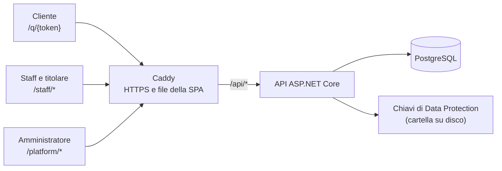
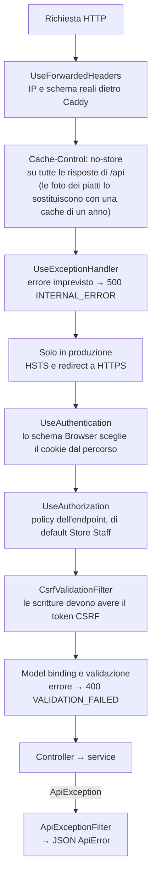
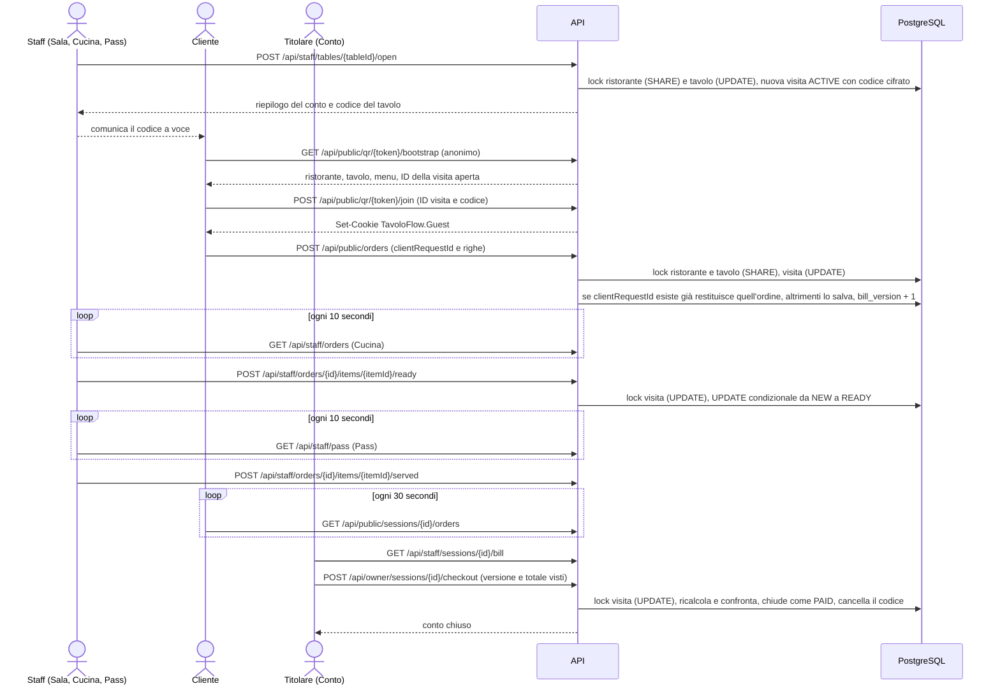
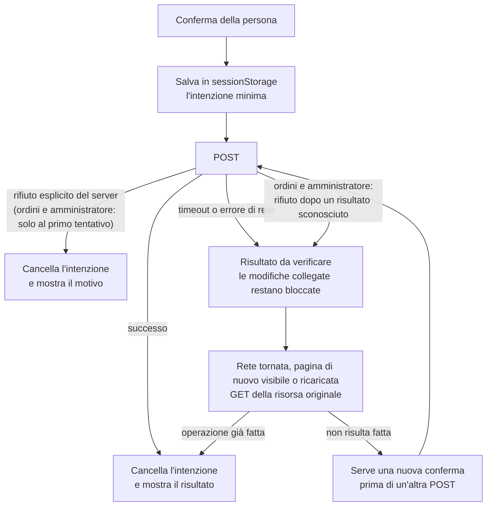

# Note di sviluppo

In queste note racconto come è nato TavoloFlow e com'è fatto: perché l'ho sviluppato, cosa fa e cosa non fa, quali tecnologie ho scelto, com'è organizzata l'architettura, quali decisioni di progettazione ho preso e quali limiti vedo oggi. L'ho sviluppato principalmente con agenti AI come Claude Code e Codex: ho partecipato più alla progettazione e alle decisioni sulla direzione del progetto che alla scrittura del codice e ai dettagli di implementazione.

È il mio primo progetto web full stack. L'ho iniziato dopo anni di studio dell'informatica, quando mi sono reso conto di non aver mai realizzato una vera web app, e ho deciso di farne una. Questa decisione, però, è arrivata in piena era dell'AI: da una parte vedevo l'AI generare codice apparentemente perfetto con un semplice prompt, dall'altra avevo davanti lo studio di vari framework, con libri dedicati enormi o con la documentazione ufficiale. Il finale era prevedibile: ho deciso di usare l'AI per sviluppare questo progetto.

A pensarci ora, non credo sia stato un problema. Le basi teoriche le avevo già grazie agli studi, e il modo migliore per imparare a sviluppare un progetto e a usare i framework è proprio realizzarne uno vero: scoprire da sé le difficoltà e chiedersi (o chiedere all'AI): "invece di fare questo a mano, perché non posso avere qualcosa che lo faccia al posto mio?". È così che nascono i framework: per soddisfare esigenze reali. Sono progettati e fatti in un certo modo perché risolvono un insieme di problemi che si incontravano spesso, e se capisci le esigenze e le difficoltà che eliminano, capisci molto più facilmente e velocemente il framework. Dopotutto sono anche loro prodotti fatti di codice: solo che, invece della business logic di un e-commerce o di un gestionale, la loro "business logic" risolve problemi che si incontrano spesso nello sviluppo di un certo tipo di software.

Avevo quindi davanti tre strade. La prima era guardare un tutorial e, insieme a una chat LLM, farmi una panoramica completa di quello che stavo per fare, per poi recuperare i pezzi che mi servivano subito leggendo le parti pertinenti della documentazione o di un libro dedicato. La seconda era buttarmi in un progetto open source già esistente, simile a quello che volevo fare, leggerne il codice facendo domande all'AI e studiare le parti interessate sulla documentazione o sui libri, come nella prima strada. Ma allora mi sono chiesto: perché non faccio direttamente un progetto mio insieme all'AI e poi studio il mio progetto? Un progetto sviluppato con l'aiuto dell'AI non ha mica un codice di qualità peggiore dei progetti che trovi a caso su GitHub. Perché non farlo così? È nata così la terza strada, quella che ho scelto.

A questo punto è chiaro perché comincio a scrivere questi appunti: non basta l'input, devo produrre anche un po' di output. Devo metterci le mani per consolidare la memoria e rafforzare le connessioni neurali, e quindi imparare meglio e più a fondo. E anche per lasciare in questo progetto qualcosa di più mio, che lo distingua da un progetto generato interamente dall'AI.

## Perché questo progetto

All'inizio volevo solo fare un progetto full stack: una web app da pubblicare online, su un server, con un proprio database e accessibile a tutti, cosa che non avevo mai fatto prima. Avevo esperienza solo con servizi serverless come Vercel e Cloudflare. Ma visto che dovevo comunque fare un progetto, perché non farne uno davvero utile, magari con cui guadagnare qualche soldino?

Mi è venuta così l'idea di un sistema di ordinazione tramite la scansione di un codice QR. Da una prima indagine, poco approfondita, mi è sembrata un'ottima idea, con un buon mercato almeno tra i ristoranti cinesi, dove pochi offrivano questo servizio ai clienti. All'inizio pensavo che quei pochi usassero un servizio fornito dalle aziende dei sistemi di cassa, già integrato nei loro prodotti.

Solo dopo il rilascio ho scoperto che i ristoranti che non offrono l'ordinazione tramite QR ai propri clienti o non ne hanno bisogno, o non conoscevano un possibile fornitore: ed è qui che entravo in gioco io. Però la web app che ho fatto non supporta la stampa delle comande: quando arriva un ordine, non può stamparlo su una stampante collegata. Non l'ho fatto sia per la complessità, perché sapevo che prima o poi sarei dovuto tornare a leggere il codice, sia perché le stampanti compatibili con il funzionamento dell'app sono costose. Sono stampanti cloud (per esempio quelle con Star CloudPRNT o Epson Server Direct Print) con un sistema integrato che interroga periodicamente il mio server per chiedere se ci sono nuovi ordini; quando ce ne sono, il server li restituisce in un formato che la stampante sa stampare. Senza una stampante a disposizione su cui provarla, non ero sicuro di riuscire a realizzare questa funzione, e così ho perso gran parte dei clienti che ho visitato.

Poi, come se non bastasse, dopo aver scoperto che praticamente tutti i potenziali clienti avevano bisogno di stampare gli ordini, ho fatto un'altra scoperta: i ristoranti che già offrivano l'ordinazione tramite QR non usavano, come avevo pensato all'inizio, una funzione integrata nel sistema di cassa, ma si affidavano a un'azienda SaaS cinese chiamata 二维火 (2Dfire). Con tutto questo, ho dato per spacciato il progetto come fonte di guadagno e ho deciso di renderlo open source, ahah.

## Cosa fa

TavoloFlow è un sistema di ordinazione al tavolo tramite codice QR. Ogni tavolo ha un QR fisso: il cliente lo scansiona con il telefono, ordina dal menu e l'ordine arriva in cucina. Il pagamento resta quello di sempre, alla cassa: l'app registra solo che il conto è stato incassato. Ci sono quattro tipi di utenti, e ognuno ha la sua parte dell'app.

**Cliente**, dal proprio telefono, senza installare nulla e senza registrarsi:

- scansiona il QR e consulta il menu in cinese, italiano o inglese, con foto, allergeni e piatti esauriti;
- entra nella visita del tavolo aperta dal personale, inserendo il codice del tavolo (quattro caratteri) se il ristorante lo richiede;
- compone il carrello, con una nota per ogni piatto, e invia l'ordine; può ordinare più volte durante il pasto;
- vede gli ordini di tutto il tavolo e lo stato di ogni piatto: ricevuto, pronto in cucina, annullato.

**Staff**, da telefono o tablet; l'area staff si può installare come app (PWA):

- **Sala**: vede i tavoli e i loro conti, apre un tavolo quando arrivano i clienti e comunica il codice; mette in pausa o riattiva i nuovi ordini; chiude senza incasso un tavolo senza ordini o con tutti i piatti annullati;
- **Cucina**: riceve i nuovi ordini con un avviso sonoro, aggiornati ogni 10 secondi; li vede nelle viste Piatti (raggruppati per piatto), Ordini ed Evasi; nella vista Piatti ogni schermo può mostrare solo alcune categorie del menu (per esempio uno schermo solo per le bevande); segna ogni piatto come pronto o lo annulla;
- **Pass**: su un tablet al bancone, mostra i piatti pronti da portare ai tavoli; quando un piatto arriva al tavolo si tocca «Servito»;
- **Menu**: segna un piatto come esaurito o di nuovo disponibile;
- l'interfaccia è in cinese, italiano o inglese, scelta per ogni dispositivo; finché nessuno la sceglie, segue la lingua del browser.

**Titolare**: tutto quello che fa lo staff, e in più:

- gestisce il menu: categorie, piatti in tre lingue, prezzi, allergeni, foto;
- gestisce i tavoli e ne scarica il QR e il segnatavolo da stampare;
- nella sezione Conto chiude la visita dopo l'incasso, e nello Storico conti consulta i conti chiusi;
- reimposta la password dell'account staff e vede lo stato del proprio abbonamento.

**Amministratore della piattaforma**, cioè chi offre il servizio ai ristoranti:

- crea un ristorante insieme ai suoi due account (titolare e staff), con password temporanee; in seguito può disattivare questi account o reimpostarne la password;
- sospende o riattiva un ristorante, ne sceglie il tema di colori, decide se serve il codice del tavolo, elimina definitivamente un ristorante sospeso;
- gestisce il contatto del titolare, la tariffa annuale e i periodi di abbonamento, e registra il pagamento di ogni periodo, ricevuto fuori dall'app;
- anche la sua interfaccia è in cinese, italiano o inglese, con la stessa scelta per dispositivo dello staff.

## Cosa non fa (e perché)

- **Pagamenti online.** Gestire pagamenti vuol dire commissioni, sicurezza dei dati di pagamento e rimborsi: troppo per una prima versione.
- **Scontrino fiscale.** TavoloFlow non sostituisce la cassa né il registratore telematico: lo scontrino continua a emetterlo il sistema di cassa del ristorante.
- **Stampa delle comande.** Per i motivi spiegati sopra: serve una stampante cloud compatibile, e non ne avevo una per provarla.
- **Notifiche push.** Cucina, pass e conti si aggiornano interrogando il server a intervalli regolari (polling). Per un ristorante piccolo basta, ed è molto più semplice.
- **Funzionamento offline.** L'app non salva pagine né dati sul dispositivo per usarli senza rete: ordini e conti devono essere sempre aggiornati. Se la connessione cade, la pagina già aperta mostra gli ultimi dati con un avviso, ma blocca le operazioni (per esempio chiudere un conto) finché un aggiornamento non riesce; se si apre una pagina senza rete, l'area staff mostra solo una pagina che lo segnala.
- **Account personali per ogni cameriere.** Ogni ristorante ha un solo account staff, condiviso, più quello del titolare. Per un ristorante piccolo è sufficiente e non serve sapere chi ha fatto cosa.
- **Asporto e consegna.** Solo ordini al tavolo. Una versione con ordini da ritirare è stata sviluppata e poi tolta, per tenere semplice la prima versione.
- **Divisione del conto e statistiche di vendita.** Ogni visita ha un solo conto, e oltre allo storico dei conti chiusi non ci sono report.
- **All you can eat.** Niente turni di ordinazione né limiti per persona: i ristoranti a cui pensavo (ramen, cucina cinese, bubble tea) ordinano alla carta.

## Scelta dello stack tecnologico

All'inizio, in realtà, ho fatto un prototipo di questa idea con TypeScript, Hono e una SPA React, tutto su Cloudflare, senza un database mio ma con quello offerto da Cloudflare (D1), con l'illusione di ridurre al minimo i costi di manutenzione. Con un prompt dettagliato ho fatto generare il progetto all'AI, ma il risultato era per me completamente incomprensibile. Non avendo mai fatto un progetto, non conoscevo i problemi e le difficoltà che si incontrano, e quindi non sapevo quali problemi risolvessero tutti gli strumenti, le librerie e i framework che l'AI aveva introdotto. Ho avuto subito un sovraccarico cognitivo e ho rinunciato; l'ho usato solo per avere una panoramica di quello che sarebbe dovuto diventare il mio progetto.

Sono passato quindi a qualcosa di più stabile. Pensando alla stabilità e alla spendibilità sul mercato del lavoro, mi sono venuti in mente Java e C#. Li conosco entrambi, ma C# ha un ecosistema più uniforme, una barriera d'ingresso più bassa, un linguaggio più espressivo e un framework più "batteries-included". Alla fine ho scelto C# con .NET, quindi ASP.NET Core come framework web per il backend ed EF Core come ORM, con Npgsql come provider per PostgreSQL. "Batteries-included" qui si vede davvero: autenticazione con cookie, autorizzazione con policy, protezione dei dati (Data Protection, usata, tra l'altro, per proteggere i cookie e cifrare il codice di ogni visita), rate limiting e dependency injection sono tutti integrati nel framework, e il backend non usa nessuna libreria esterna per queste cose. L'unica libreria di terze parti, oltre a Npgsql, è SkiaSharp, per ridimensionare e convertire le foto dei piatti. EF Core non offre un'API per i lock di riga (`SELECT ... FOR UPDATE`), quindi in quei punti uso SQL scritto a mano. Per i test uso xUnit con test di integrazione veri: Testcontainers avvia un PostgreSQL usa e getta in Docker per ogni classe di test, e `WebApplicationFactory` avvia l'API in memoria per mandarle richieste HTTP come farebbe un browser.

Per il database ho scelto PostgreSQL semplicemente perché è il database open source più utilizzato, e anche uno dei più potenti.

Per il frontend, avendo appena finito di studiare le basi di React, ho scelto React, che è anche ottimo per questa web app: è praticamente una SPA, e l'area staff funziona anche come PWA. Il resto dello stack:

- **TypeScript**, per avere i tipi anche sul frontend e trovare gli errori già in fase di build;
- **Vite**, per il server di sviluppo e la build;
- **TanStack Router**, per le route definite come file, con parametri e query string tipizzati: un link a una pagina che non esiste, o con un parametro sbagliato, non compila;
- **TanStack Query**, per i dati che arrivano dal server: tiene la cache, gestisce il polling della cucina e dei conti e ricarica i dati dopo ogni modifica;
- **Tailwind CSS** e **shadcn/ui** (su Base UI), per lo stile e i componenti: shadcn copia i componenti nel progetto invece di installarli come libreria, quindi si possono modificare liberamente;
- **qrcode**, per generare i QR dei tavoli direttamente nel browser;
- **Oxlint** e **Prettier**, per il lint e la formattazione, e il test runner integrato di Node per testare la logica pura senza installare un framework di test.

Per la distribuzione uso **Docker Compose** su una VPS, con **Caddy** come reverse proxy, che ottiene da solo il certificato HTTPS. Le migrazioni del database non partono all'avvio dell'API: a ogni rilascio le applico esplicitamente con un bundle di migrazioni di EF Core. Tutti i passaggi sono nella guida al [self-hosting](self-hosting.md).

## Architettura

In questa sezione descrivo com'è fatto TavoloFlow: quali sono i pezzi, dove si trova il codice di ognuno e come passano i dati da una parte all'altra. Il perché delle scelte più importanti (lock, versioni, idempotenza, polling…) lo spiego nella sezione successiva, «Decisioni di progettazione».

### Panoramica



Tutto passa da un solo indirizzo. Il browser parla solo con Caddy, che fa due cose:

- restituisce i file statici della SPA, cioè quelli prodotti da `vite build`: un `index.html` quasi vuoto più i file JavaScript e CSS in `assets/`. Il browser li scarica ed esegue React, che costruisce la pagina direttamente sul dispositivo: è il cosiddetto client-side rendering (CSR);
- inoltra all'API (il web server di ASP.NET Core, Kestrel) ogni richiesta che inizia con `/api`.

In sviluppo questo ruolo lo svolge il proxy di Vite, che manda `/api` a `http://localhost:5093`. Frontend e API stanno quindi sulla stessa origine (stesso schema, dominio e porta): i cookie non devono passare da un dominio all'altro e non serve configurare CORS.

Una spiegazione minima di CORS: è una regola del browser. Quando il JavaScript di una pagina fa una richiesta, il browser confronta l'origine della pagina (da dove ha caricato `index.html`, per esempio `https://app.esempio.it`) con l'origine dell'URL chiamato. Se sono uguali, come qui (`https://app.esempio.it/api/...`), la richiesta è "same-origin" e CORS non entra in gioco. Che poi Caddy inoltri la richiesta all'API dentro il server, il browser non lo sa nemmeno. Se invece l'API stesse su un altro dominio, per esempio `api.esempio.it`, il server dovrebbe rispondere con appositi header (`Access-Control-Allow-Origin` e altri), altrimenti il browser bloccherebbe la risposta, e anche i cookie sarebbero più complicati da gestire.

Alcuni punti da tenere a mente:

- **Un solo processo API, tre tipi di utenti.** La stessa applicazione ASP.NET Core serve clienti, staff e amministratori. Ognuno ha il suo cookie, e il backend capisce quale usare guardando il path dell'URL della richiesta, cioè la parte dopo il dominio, per esempio `/api/public/orders` (vedi «Tre identità» più sotto).
- **Tre container in produzione:** `db` (PostgreSQL), `api` e `caddy`. Solo Caddy espone porte verso l'esterno (80 e 443): il database e l'API sono raggiungibili solo dalla rete interna di Docker.
- **Le chiavi di Data Protection** stanno in una cartella persistente. Data Protection è il sistema di ASP.NET Core per cifrare e firmare dati, e queste sono le sue chiavi segrete. Il cookie di login, infatti, non punta a una sessione salvata sul server: contiene direttamente il "biglietto" dell'account (vedi «Tre identità»), cifrato e firmato con queste chiavi, così il browser non può né leggerlo né falsificarlo. Con le stesse chiavi vengono protetti anche i token CSRF (spiegati in «Cookie, CSRF e same-origin») e i codici del tavolo salvati nel database. Se le chiavi stessero solo dentro il container, si perderebbero a ogni nuovo rilascio: tutti dovrebbero rifare il login e i codici delle visite aperte non si potrebbero più leggere. Per questo la cartella è indicata in `DataProtection:KeyRingPath` e sta su un volume persistente.

### Modello dei dati

Il database ha undici tabelle. Lo schema completo è in [`er-diagram.dbml`](../er-diagram.dbml), e c'è anche un'[immagine](../er-diagram.png). Divise per argomento:

| Gruppo            | Tabelle                                                                                                                                                        |
| ----------------- | -------------------------------------------------------------------------------------------------------------------------------------------------------------- |
| Account           | `platform_users` (amministratori), `restaurant_users` (per ogni ristorante un account titolare e uno staff)                                                    |
| Ristorante e menu | `restaurants`, `menu_categories`, `menu_items`, `menu_item_images` (i byte delle foto, separati così le letture del menu non li caricano), `restaurant_tables` |
| Servizio          | `dining_sessions`, `orders`, `order_items`                                                                                                                     |
| Abbonamento       | `restaurant_subscription_periods`                                                                                                                              |

Il concetto centrale è la **visita** (`DiningSession`, tabella `dining_sessions`). Quando arrivano i clienti, lo staff apre il tavolo dalla Sala e nasce una visita `ACTIVE`, con il suo codice del tavolo (cifrato) e un numero di versione del conto, `bill_version`. I clienti non hanno account: per il sistema un cliente è solo "un browser che è entrato in questa visita".

Ogni ordine appartiene a una visita e ha una o più righe (`order_items`), una per piatto, con la quantità e una nota facoltativa. Ogni riga ha il suo stato: nasce `NEW`, poi la cucina la porta a `READY` (pronta) o a `CANCELLED` (annullata); quando il piatto arriva al tavolo, dal Pass si compila `served_at`. L'ordine ha anche uno stato riassuntivo: `NEW` finché almeno una riga è `NEW`, poi `PROCESSED` (è la differenza tra le viste Ordini ed Evasi della Cucina).

Quando la visita si chiude (dopo l'incasso, oppure senza incasso se non c'erano ordini o se erano tutti annullati), diventa `CLOSED` e salva il motivo (`PAID`, `EMPTY` o `VOIDED`), il totale e l'ora di chiusura. Una visita chiusa non si riapre mai: i clienti successivi avranno una visita nuova.

Il frontend rende l'uso più comodo, ma non garantisce niente. Alcune regole, poi, non le controlla solo il codice C#: le garantisce direttamente il database, così restano vere anche se un giorno il codice avesse un bug.

| Regola                                              | Come la garantisce PostgreSQL                                                                                                                                                                                                                                                                           |
| --------------------------------------------------- | ------------------------------------------------------------------------------------------------------------------------------------------------------------------------------------------------------------------------------------------------------------------------------------------------------- |
| Un tavolo ha al massimo una visita aperta           | indice unico parziale `uq_active_session_per_table` su `table_id`, solo per le righe con `status = 'ACTIVE'`                                                                                                                                                                                            |
| Una richiesta del cliente crea al massimo un ordine | indice unico `uq_order_one_per_request` su `(dining_session_id, client_request_id)`                                                                                                                                                                                                                     |
| I dati di ristoranti diversi non si mescolano       | ogni tabella di business ha `restaurant_id` (tranne `menu_item_images`, che arriva al ristorante attraverso il suo piatto) e le chiavi esterne sono composte, `(id, restaurant_id)`: un ordine può puntare solo a una visita dello stesso ristorante, una riga solo a un ordine dello stesso ristorante |
| Stato e campi sono sempre coerenti                  | check constraint come `ck_session_lifecycle`: una visita `ACTIVE` ha il codice cifrato e nessun dato di chiusura, una `CLOSED` ha ora, motivo e totale, e il codice è cancellato; `ck_order_item_lifecycle` fa lo stesso per le righe                                                                   |
| Solo valori ammessi                                 | gli enum sono salvati come testo maiuscolo (`ACTIVE`, `READY`…) e un check constraint elenca i valori validi                                                                                                                                                                                            |

La storia degli ordini, invece, non la protegge il database. Ogni riga salva una copia (snapshot) di nome, prezzo e allergeni del piatto: se poi il piatto cambia prezzo, la riga resta com'era. Ma PostgreSQL non impedisce un UPDATE diretto su queste copie o sui conti chiusi: che non cambino lo garantiscono i service, che non le modificano mai. Anche l'eliminazione di un piatto o di un tavolo passa da un service, `CatalogDeletionService`: prima azzera il riferimento (`menu_item_id` nelle righe, `table_id` nelle visite chiuse), poi elimina, e la copia resta. Qui il database fa solo da controllo: la chiave esterna non permette di eliminare un piatto o un tavolo ancora collegati.

Altre convenzioni:

- **Soldi in centesimi interi** (`long`, colonne `*_cents`), mai numeri decimali. Il massimo è il più grande intero che JavaScript rappresenta esattamente (2⁵³ − 1, `InputRules.MaxSafeCents`), così il browser non perde precisione.
- **Orari in UTC** (`timestamptz`), mostrati nel fuso orario del ristorante (Europe/Rome). Solo i periodi di abbonamento usano date semplici (`date`).
- **Nomi in snake_case**, mappati a mano in `Data/Configurations/`, una classe per entità.
- **Un solo database per tutti i ristoranti** (multi-tenant): stanno tutti nelle stesse tabelle, separati da `restaurant_id`. Eliminare un ristorante cancella tutte le sue righe con `ON DELETE CASCADE`.
- **Migrazioni** in `Data/Migrations/`, generate da EF Core e solo in avanti; non partono mai all'avvio (vedi «Scelta dello stack tecnologico»).

### Backend: moduli e percorso di una richiesta

Il backend è un solo progetto, `backend/TavoloFlow.Api/`, organizzato per argomento invece che per tipo di classe:

| Cartella             | Cosa contiene                                                                                                                                                                                                                              |
| -------------------- | ------------------------------------------------------------------------------------------------------------------------------------------------------------------------------------------------------------------------------------------ |
| `Program.cs`         | il punto di partenza: registra i servizi e la pipeline dei middleware. Con un'opzione come `--seed-dev-accounts` diventa invece un comando una tantum, che esegue e termina (`Operations/MaintenanceCommands.cs`)                          |
| `Controllers/`       | 14 controller, tutti molto sottili                                                                                                                                                                                                         |
| `Common/`            | codice trasversale: il formato degli errori (`ApiError`, `ApiException` e il filtro globale), la scelta dell'identità e il CSRF (`BrowserSecurity`), la paginazione con cursore, gli enum come testo, le regole di input e il rate limiter |
| `Accounts/`          | login, logout e cambio password di titolare e staff                                                                                                                                                                                        |
| `Menus/`             | gestione del menu, disponibilità, foto dei piatti, lettura del menu pubblico                                                                                                                                                               |
| `Tables/`            | tavoli e token dei QR                                                                                                                                                                                                                      |
| `Dining/`            | apertura del tavolo, la Sala, il codice del tavolo cifrato, il riepilogo del conto condiviso, la pausa dei nuovi ordini                                                                                                                    |
| `Guests/`            | ingresso del cliente nella visita e il suo cookie                                                                                                                                                                                          |
| `Ordering/`          | creazione idempotente degli ordini e ordini del tavolo                                                                                                                                                                                     |
| `Kitchen/`           | coda della Cucina, piatto pronto o annullato, il Pass                                                                                                                                                                                      |
| `Billing/`           | conto, le tre chiusure (`PAID`, `VOIDED`, `EMPTY`), Storico conti                                                                                                                                                                          |
| `Platform/`          | area amministratore: ristoranti, account, abbonamenti                                                                                                                                                                                      |
| `Data/`, `Entities/` | `ApplicationDbContext`, le mappature e le migrazioni di EF Core, i lock di riga (`RowLocks`), il servizio di eliminazione; le 11 entità                                                                                                    |

Ogni modulo ha un file `XxxContracts.cs` con i DTO (cosa entra e cosa esce dall'API) e le fabbriche degli errori, per esempio `DiningErrors.SessionClosed()`, più uno o più service con le regole e le transazioni.

Le dipendenze tra moduli vanno in una sola direzione e seguono il percorso di una visita: `Guests` usa `Dining`; `Ordering` usa `Guests` e `Dining`; `Kitchen` usa `Ordering` e `Dining`; `Billing` usa `Dining` e `Kitchen` (solo per riusare il formato degli ordini nella risposta del conto); `Platform` usa `Accounts`. `Common/` non dipende da nessun modulo di business.

**Controller sottili.** Un controller fa solo tre cose: dichiara chi può chiamare l'endpoint, prende l'identità affidabile e chiama il service. Per esempio, segnare un piatto come pronto:

```csharp
[ApiController]
[Authorize(Policy = StoreAuthentication.StaffPolicy)]
public sealed class KitchenController(KitchenService kitchen, CurrentAccount current) : ControllerBase
{
    [HttpPost("api/staff/orders/{id:guid}/items/{itemId:guid}/ready")]
    public async Task<IActionResult> Ready(Guid id, Guid itemId, CancellationToken ct) =>
        Ok(await kitchen.ReadyAsync(current.RequireUser().RestaurantId, id, itemId, ct));
}
```

L'ID del ristorante non arriva mai dal client: viene dal cookie, attraverso `CurrentAccount`. Così uno staff non può toccare i dati di un altro ristorante nemmeno cambiando gli ID nell'URL: il service cerca l'ordine filtrando anche per ristorante, non lo trova e risponde 404.

I service sono registrati come scoped: ogni richiesta ha la sua istanza, che condivide il `DbContext` della richiesta. Ogni service apre e chiude da solo le proprie transazioni, e legge l'ora da un `TimeProvider` iniettato invece che da `DateTime.UtcNow`, così nei test si può spostare il tempo in avanti.

**Il percorso di una richiesta.** Ecco cosa attraversa una richiesta, nell'ordine in cui `Program.cs` monta i pezzi:



- **Autenticazione.** Legge il cookie dell'identità a cui appartiene il percorso e costruisce `HttpContext.User`. Per staff e amministratori ricontrolla anche l'account nel database (`ValidatePrincipal`, vedi «Tre identità»).
- **Autorizzazione.** Ogni controller dichiara una policy: `StoreStaff`, `StoreOwner`, `StoreAccount` (valida anche prima del primo cambio password, solo per le operazioni sul proprio account), `GuestAccess` o `PlatformAdmin`. Un endpoint senza `[Authorize]` cade nella policy di fallback, che è Store Staff: un endpoint nuovo è protetto anche se ci si dimentica di dichiararla. Login, menu pubblico, ingresso nella visita e richiesta del token CSRF si aprono esplicitamente con `[AllowAnonymous]`. Le risposte 401 e 403 le scrivono gli eventi del cookie, prima dei filtri MVC, ma con lo stesso formato JSON.
- **CSRF.** `CsrfValidationFilter` è registrato su tutti i controller: ogni POST, PUT, PATCH e DELETE deve avere l'header `X-CSRF-TOKEN` ottenuto dalla stessa identità, altrimenti la risposta è 400 `CSRF_VALIDATION_FAILED` (vedi «Cookie, CSRF e same-origin»).
- **Errori.** Un service rifiuta una richiesta lanciando un'`ApiException` con stato HTTP, codice e messaggio. Il filtro globale `ApiExceptionFilter` la trasforma sempre nello stesso JSON:

  ```json
  {
    "code": "SESSION_CLOSED",
    "message": "本次用餐已结束。",
    "requestId": "0HN…:00000001",
    "errors": null
  }
  ```

  Alcuni codici aggiungono campi: per esempio `BILL_CHANGED` porta anche `currentBill`, il conto aggiornato. I messaggi del server sono in cinese; in italiano e in inglese il frontend non li mostra, ma sceglie il testo in base a `code` (`lib/api-messages.ts`).

### Frontend: organizzazione delle feature

Il frontend (`frontend/src/`) è una sola SPA con tre aree, una per tipo di utente: `/q/{token}` per il cliente, `/staff/*` per titolare e staff, `/platform/*` per l'amministratore.

**Route.** Con TanStack Router le route sono file in `routes/`, e il nome del file è l'URL: `staff.kitchen.tsx` diventa `/staff/kitchen`, `q.$token.tsx` diventa `/q/{token}` con il parametro `token`. Da questi file il plugin di Vite genera `routeTree.gen.ts`, che non si modifica a mano. `staff.tsx` e `platform.tsx` sono route di layout: avvolgono tutte le pagine della loro area (per lo staff, `StaffLayout` mostra la navigazione e rende l'area installabile come PWA). I file delle route restano sottilissimi e passano subito alla feature:

```tsx
export const Route = createFileRoute("/staff/kitchen")({
  component: KitchenPage,
});
```

**Feature.** Il codice vero sta in `features/`, una cartella per parte del prodotto:

| Feature         | Pagine                                                                                             |
| --------------- | -------------------------------------------------------------------------------------------------- |
| `public-menu`   | menu del cliente, `/q/{token}`                                                                     |
| `guests`        | ingresso del cliente nella visita, con il codice del tavolo                                        |
| `orders`        | carrello, invio dell'ordine, ordini del tavolo                                                     |
| `accounts`      | login, cambio password, Home, navigazione, installazione della PWA                                 |
| `dining`        | Sala, `/staff/floor`                                                                               |
| `kitchen`       | Cucina, `/staff/kitchen`                                                                           |
| `pass`          | Pass, `/staff/pass`                                                                                |
| `billing`       | Conto, `/staff/orders`, e Storico conti, `/staff/history`                                          |
| `menu`          | Menu, `/staff/menu`                                                                                |
| `tables`        | Tavoli e QR, `/staff/tables`                                                                       |
| `subscriptions` | Abbonamento del titolare, `/staff/subscription`, e periodi di abbonamento nell'area amministratore |
| `platform`      | area amministratore, `/platform/*`, e Account staff, `/staff/settings`                             |

Ogni feature ha più o meno la stessa forma:

- `api.ts`: tutte le chiamate al server della feature, le chiavi delle query e i tipi delle risposte. Componenti e hook non scrivono mai un URL;
- `state.ts`: logica pura, senza React né API del browser (validazione, regole del carrello, recupero dopo un errore di rete), testata con `node --test`;
- `use<Feature>.ts`: hook per il polling, per fermarsi quando la pagina è nascosta o offline e per scartare le risposte arrivate in ritardo;
- `*Page.tsx` e `*Views.tsx`: il rendering;
- `messages.ts`: i testi dell'interfaccia, un oggetto per lingua (cinese, italiano e inglese). Ogni lingua ha lo stesso tipo dell'oggetto cinese, quindi se manca una traduzione il progetto non compila.

Il codice condiviso sta in `lib/` (`api.ts` con le funzioni di richiesta, formato di prezzi e orari, lingue, temi…), in `components/` (i pezzi comuni delle pagine: `PageHeader`, `Notice`, `ConfirmDialog`, `MasterDetail`…) e in `components/ui/`, dove stanno i componenti di shadcn/ui.

**Dove stanno i dati.** Nel frontend ci sono tre tipi di stato, e ognuno ha il suo posto:

| Tipo                           | Dove                    | Esempi                                                           |
| ------------------------------ | ----------------------- | ---------------------------------------------------------------- |
| Dati del server                | cache di TanStack Query | menu, Sala, coda della Cucina, conti                             |
| Intenzioni locali della scheda | `sessionStorage`        | carrello, identificativi delle operazioni in attesa di conferma  |
| Preferenze del dispositivo     | `localStorage`          | lingua dell'interfaccia, suono e categorie nascoste della Cucina |

Il primo pezzo della chiave di ogni query dice a quale identità appartengono i dati: `public` (menu anonimo), `guest`, `platform`, `["auth", "me"]` (l'identità dello staff); tutto il resto conta come dato privato del ristorante. Quando lo staff fa login o logout, `lib/query-scope.ts` svuota solo la cache dello staff, e i dati del cliente o dell'amministratore aperti nella stessa scheda restano.

### Tre identità: staff, cliente, piattaforma

Uno stesso browser può avere fino a tre identità nello stesso momento, per esempio il titolare che prova il menu del cliente sul proprio telefono. Ognuna ha il suo cookie, e non si disturbano tra loro:

| Identità | Chi               | Percorsi API                    | Cookie                                      | Durata                                              | Nel backend              |
| -------- | ----------------- | ------------------------------- | ------------------------------------------- | --------------------------------------------------- | ------------------------ |
| Store    | titolare e staff  | tutto `/api` tranne i due sotto | `TavoloFlow.Store`, path `/`                | 30 giorni fissi, resta dopo la chiusura del browser | `CurrentAccount`         |
| Guest    | cliente al tavolo | `/api/public/*`                 | `TavoloFlow.Guest`, path `/api/public`      | 12 ore fisse, sparisce alla chiusura del browser    | `GuestIdentity`          |
| Platform | amministratore    | `/api/platform/*`               | `TavoloFlow.Platform`, path `/api/platform` | 30 giorni fissi, resta dopo la chiusura del browser | `CurrentPlatformAccount` |

Nessun cookie si rinnova da solo con l'uso: alla scadenza bisogna rifare il login (o, per il cliente, rientrare nella visita). Sono tutti `HttpOnly`, quindi JavaScript non può leggerli.

**Il percorso decide l'identità.** Tutto si basa su una sola funzione, `BrowserSecurity.SchemeFor(path)`:

```csharp
public static string SchemeFor(PathString path) =>
    path.StartsWithSegments("/api/platform") ? PlatformScheme :
    path.StartsWithSegments("/api/public") ? GuestScheme : StoreScheme;
```

La usano due pezzi:

1. Lo schema di autenticazione predefinito, `Browser`, non legge nessun cookie: guarda il percorso e passa la richiesta allo schema giusto (Store, Guest o Platform), che legge il proprio cookie e costruisce `HttpContext.User`.
2. Il CSRF: ogni token viene legato all'identità del percorso per cui è stato chiesto (`store`, `guest` o `platform`), quindi un token ottenuto come cliente non vale per una scrittura dello staff.

Anche il path dei cookie aiuta: il browser manda il cookie Guest solo alle richieste sotto `/api/public` e quello Platform solo sotto `/api/platform`.

**Cosa c'è nel cookie e cosa viene ricontrollato.**

- Store e Platform: il cookie contiene l'ID dell'account, il ruolo e la versione delle credenziali (`credential_version`), più l'ID del ristorante per lo staff. A ogni richiesta `ValidatePrincipal` rilegge l'account dal database: se è stato disattivato o se la versione è cambiata (cambio o reset della password), il cookie viene rifiutato. Così cambiare password fa uscire subito tutti gli altri dispositivi.
- Guest: il cookie contiene ristorante, tavolo e visita, più un identificativo casuale generato a ogni ingresso, a cui viene legato il token CSRF. Dimostra soltanto che "questo browser è entrato in questa visita"; che la visita sia ancora aperta lo controlla ogni service del cliente, a ogni richiesta. Dopo la chiusura il cookie resta nel browser, ma ogni richiesta risponde `SESSION_CLOSED`.

**Nel frontend** `lib/api.ts` ha una famiglia di funzioni per ogni identità: `request`/`write` per lo staff, `publicRequest` per le letture anonime (senza cookie, come il menu pubblico), `guestRequest`/`guestWrite` per il cliente e `platformRequest`/`platformWrite` per l'amministratore. Ogni scrittura chiede prima un token CSRF nuovo all'endpoint `csrf` della propria identità e lo manda nell'header `X-CSRF-TOKEN`.

Perché cookie e non token JWT, e come funziona la protezione CSRF, lo spiego in «Cookie, CSRF e same-origin».

### Il flusso completo di una visita

Per vedere come lavorano insieme tutte le parti, ecco una visita dall'apertura del tavolo alla chiusura del conto, nel caso in cui il ristorante chieda il codice del tavolo:



1. **Apertura.** Dalla Sala lo staff apre il tavolo. Il backend blocca la riga del ristorante in modalità condivisa e quella del tavolo in modo esclusivo, controlla che il tavolo non abbia già una visita aperta e crea la nuova visita con il codice cifrato. Se il ristorante non usa il codice, la risposta ha `joinCode: null`.
2. **Bootstrap.** Il cliente scansiona il QR. La pagina `/q/{token}` legge, senza nessun cookie, ristorante, tavolo, menu e l'ID della visita aperta, tutto in una sola transazione Repeatable Read. Il bootstrap non crea niente e non rivela mai il codice.
3. **Ingresso.** Il cliente inserisce il codice (oppure, se il ristorante non lo richiede, la pagina entra da sola). Se il codice è giusto, il backend risponde con il cookie Guest, legato a quella visita. Un rate limit per IP e per visita impedisce di indovinare il codice a forza di tentativi.
4. **Ordine.** Il frontend genera un `clientRequestId`, lo salva in `sessionStorage` insieme all'ordine e solo dopo manda la POST. Il backend, dopo i lock, cerca prima un ordine con lo stesso ID: se c'è, restituisce quello. Altrimenti controlla che il ristorante accetti ordini, che i piatti siano disponibili e che i prezzi non siano cambiati, poi salva l'ordine con le copie dei piatti e incrementa `bill_version`, tutto nella stessa transazione.
5. **Cucina e Pass.** La Cucina interroga il server ogni 10 secondi e suona quando arriva un ordine nuovo. Segnare un piatto come pronto è un UPDATE condizionale (`WHERE status = 'NEW'`) sotto il lock della visita; dal Pass si segna poi `served_at` allo stesso modo. Il cliente vede lo stato dei piatti aggiornarsi ogni 30 secondi.
6. **Chiusura.** Il titolare conferma il conto mandando la versione e il totale che ha visto. Il backend blocca la visita, ricalcola tutto e, se nel frattempo qualcosa è cambiato, risponde `409 BILL_CHANGED` con il conto aggiornato. Se tutto coincide, chiude la visita come `PAID`, salva il totale, cancella il codice e segna come serviti i piatti pronti rimasti al Pass. Da questo momento il cookie del cliente non serve più: ogni sua richiesta risponde `SESSION_CLOSED`.

I dettagli di ogni passaggio (perché proprio quei lock, perché `clientRequestId`, perché `bill_version`, perché il polling) li spiego in «Decisioni di progettazione».

## Decisioni di progettazione

In questa sezione spiego il perché delle scelte tecniche più importanti. Quasi tutte rispondono a due domande: cosa succede quando due persone fanno qualcosa nello stesso momento, e cosa succede quando la rete si interrompe a metà di un'operazione? In un ristorante capitano entrambe di continuo: più camerieri e più clienti usano l'app insieme, e il Wi-Fi non è sempre buono.

### Concorrenza: lock di riga e ordine dei lock

**Il problema.** Due camerieri toccano «Apri» sullo stesso tavolo nello stesso istante; un cliente invia un ordine proprio mentre il titolare chiude il conto; il titolare cambia un prezzo mentre un cliente sta ordinando quel piatto. Se ogni richiesta legge i dati, decide e poi scrive, due richieste parallele possono leggere entrambe lo stato vecchio e prendere decisioni incompatibili, per esempio aprire due visite sullo stesso tavolo.

**La scelta: lock di riga di PostgreSQL.** Dentro una transazione, prima di decidere, il service blocca le righe da cui dipende la decisione:

- `SELECT ... FOR SHARE` (lock condiviso): altre transazioni possono prendere lo stesso lock condiviso, ma nessuna può modificare la riga o bloccarla in modo esclusivo finché la transazione non finisce;
- `SELECT ... FOR UPDATE` (lock esclusivo): aspetta che gli altri lock sulla riga vengano rilasciati, poi blocca chiunque voglia modificarla o prendere un lock su di essa, anche solo condiviso.

Le letture normali, senza lock, non vengono bloccate: grazie a MVCC, PostgreSQL mostra loro l'ultima versione già confermata della riga.

EF Core non ha un'API LINQ per questi lock, quindi li scrivo in SQL con `FromSql`, che trasforma i valori interpolati in parametri e quindi è sicuro contro la SQL injection. Quelli su ristorante, tavolo, visita e piatto li ho raccolti in un solo file, `Data/RowLocks.cs`, con l'ordine dei lock scritto in cima al file, così sono facili da controllare (i pochi lock sugli account stanno direttamente nei service della piattaforma):

```csharp
db.DiningSessions.FromSql(
    $"SELECT * FROM dining_sessions WHERE restaurant_id = {restaurantId} AND id = {id} FOR UPDATE")
    .AsNoTracking().SingleOrDefaultAsync(ct);
```

Un lock resta attivo fino alla fine della transazione: per questo ogni service apre e chiude da solo la propria.

**L'ordine dei lock.** Se la transazione A blocca il tavolo e poi aspetta la visita, mentre la transazione B ha già bloccato la visita e aspetta il tavolo, nessuna delle due può andare avanti: è un deadlock. PostgreSQL se ne accorge e annulla una delle due, ma per l'utente è comunque un errore. Per evitarlo, tutte le operazioni prendono i lock nello stesso ordine:

```
ristorante → tavolo → visita          ristorante → piatto
```

Ogni operazione prende solo un tratto di questa catena, sempre in questa direzione: chi parte dalla visita non torna mai indietro al tavolo o al ristorante.

| Operazione                                                      | Lock, in ordine                                                      |
| --------------------------------------------------------------- | -------------------------------------------------------------------- |
| Aprire un tavolo                                                | ristorante SHARE → tavolo UPDATE                                     |
| Entrare nella visita (cliente)                                  | ristorante SHARE → tavolo SHARE → visita SHARE                       |
| Inviare un ordine                                               | ristorante SHARE → tavolo SHARE → visita UPDATE                      |
| Leggere gli ordini del tavolo o il conto                        | visita SHARE                                                         |
| Piatto pronto o annullato, «Servito», chiusura del conto        | solo visita UPDATE                                                   |
| Modificare il menu                                              | ristorante UPDATE (eliminando un piatto, poi anche il piatto UPDATE) |
| Pausa dei nuovi ordini, sospensione del ristorante, abbonamento | ristorante UPDATE                                                    |
| Rinominare, attivare o eliminare un tavolo                      | tavolo UPDATE                                                        |

Perché l'ordine prende il ristorante in SHARE? Chi modifica il menu prende il ristorante in UPDATE, quindi mentre un ordine è in corso nessuno può cambiare prezzi o disponibilità, e i prezzi copiati nell'ordine sono proprio quelli appena controllati. Due ordini da tavoli diversi, invece, prendono entrambi un lock SHARE: sono compatibili e vanno in parallelo.

Ordine, Cucina e chiusura del conto prendono tutti la stessa visita in UPDATE, quindi sulla stessa visita si mettono in fila. Se l'ordine arriva per primo, la chiusura trova il conto cambiato (`BILL_CHANGED`, vedi più sotto); se arriva prima la chiusura, l'ordine trova la visita chiusa (`SESSION_CLOSED`).

**L'UPDATE condizionale come seconda difesa.** Quando la Cucina segna un piatto come pronto, il service blocca la visita, rilegge la riga e poi non fa un semplice "salva": esegue un UPDATE che vale solo se la riga è ancora `NEW`, e controlla quante righe ha modificato (codice semplificato da `KitchenService`):

```csharp
var changed = await db.OrderItems
    .Where(i => i.RestaurantId == restaurantId && i.OrderId == id && i.Id == itemId &&
        i.Status == OrderItemStatus.New)
    .ExecuteUpdateAsync(u => u.SetProperty(i => i.Status, OrderItemStatus.Ready)
        .SetProperty(i => i.ReadyAt, now), ct);
if (changed != 1) throw Changed(); // 409 ORDER_ITEM_CHANGED
```

Con il lock della visita, una seconda richiesta sullo stesso piatto arriva comunque dopo e trova già `READY`. La condizione nell'UPDATE serve nel caso in cui un giorno un'altra strada di scrittura dimenticasse il lock: anche allora nessuno sovrascriverebbe il risultato di un altro. L'ultima parola ce l'ha il database, con gli indici unici e i check constraint visti in «Modello dei dati».

**Come si testa.** Una gara tra due richieste non si può riprodurre sperando nel caso. Nei test di integrazione (`KitchenTests.cs`) c'è `LockGate`, una sottoclasse di `DbCommandInterceptor` di EF Core che ferma una transazione in un punto preciso; intanto il test manda l'altra richiesta e verifica che aspetti o venga rifiutata come previsto.

Le alternative erano il livello di isolamento Serializable, con transazioni da ripetere quando PostgreSQL rileva un conflitto, oppure una versione ottimistica su ogni tabella. Con i lock espliciti, invece, l'ordine degli eventi si capisce leggendo il codice e non serve ripetere niente.

### Versione ottimistica del conto (BillVersion)

**Il problema.** Il titolare apre il Conto di un tavolo, vede 45 € e va alla cassa. Nel frattempo un cliente ordina un'altra bibita, oppure la Cucina annulla un piatto. Quando il titolare conferma, il conto chiuso deve essere esattamente quello che ha visto e incassato. Qui un lock non basta: non posso tenere bloccata una riga del database per tutto il tempo in cui una persona guarda lo schermo.

**La scelta: una versione ottimistica.** Ogni visita ha `bill_version`, che parte da 1 e aumenta di 1 per ogni cosa che cambia l'importo: un nuovo ordine o l'annullamento di un piatto. Non cambia quando un piatto diventa pronto o servito, quando lo stesso ordine viene ripetuto con lo stesso `clientRequestId`, né con la chiusura.

Il frontend congela la versione e il totale mostrati nella conferma (il polling aggiorna lo schermo, ma non sostituisce in silenzio i valori da confermare) e li manda con il checkout:

```json
{ "expectedBillVersion": 7, "confirmedTotalCents": 4500 }
```

Il backend blocca la visita in UPDATE, ricalcola il conto dalle righe nel database e confronta. Se la versione o il totale sono diversi, risponde `409 BILL_CHANGED` e allega `currentBill`, il conto aggiornato: il frontend lo mostra e il titolare deve confermare di nuovo. La versione basterebbe a riconoscere un cambiamento; il totale è il valore che il titolare ha davvero confermato, e confrontare anche quello è un controllo in più. Seguono altri controlli, per esempio nessun piatto ancora da preparare (`ORDERS_PENDING`) e un totale maggiore di zero per un conto incassato. Se tutto va bene, la visita si chiude.

Se la stessa chiusura arriva di nuovo (stesso motivo, stessa versione, stesso totale) su una visita già chiusa, il backend restituisce il risultato salvato invece di un errore; una chiusura diversa, invece, non può riscrivere quella salvata.

Le due tecniche si completano: il lock pessimistico protegge i millisecondi della transazione, la versione ottimistica protegge i secondi o i minuti in cui decide una persona.

### Ordini idempotenti

**Il problema.** Il cliente tocca «Conferma e ordina» con un Wi-Fi debole. La richiesta arriva al server e l'ordine viene salvato, ma la risposta si perde per strada. Il telefono mostra un errore, il cliente tocca di nuovo e la cucina riceve due volte lo stesso ordine.

**La scelta: rendere la creazione dell'ordine idempotente**, cioè fare in modo che ripetere la stessa richiesta abbia lo stesso effetto di farla una volta sola.

1. Il browser genera un `clientRequestId`, un UUID v4 creato con `crypto.getRandomValues` (`lib/ids.ts`). A differenza di `crypto.randomUUID`, funziona anche senza HTTPS, per esempio quando provo l'app sulla rete locale.
2. Salva in `sessionStorage` l'ordine completo insieme all'ID, e solo dopo manda la POST. Da questo momento il carrello è bloccato finché non si sa com'è andata.
3. Il backend, dopo i lock e dopo aver controllato che la visita sia aperta e corrisponda al cookie, cerca **prima di tutto** un ordine con lo stesso ID nella visita:

   ```csharp
   var original = await Orders(guest).SingleOrDefaultAsync(o => o.ClientRequestId == input.ClientRequestId, ct);
   if (original is not null)
   {
       await transaction.CommitAsync(ct);
       return new(OrderResponse.From(original), false); // 200: ordine già esistente
   }
   // solo alla prima richiesta: pausa degli ordini, disponibilità, prezzi, salvataggio (201)
   ```

   L'ordine dei controlli è importante. Se una ripetizione controllasse di nuovo prezzi e disponibilità, un cliente che riprova dopo che il piatto è finito riceverebbe un errore, anche se il suo ordine esiste già ed è in cucina.

4. L'indice unico `uq_order_one_per_request` su `(dining_session_id, client_request_id)` è l'ultima garanzia: anche con un bug nel codice, il database non accetterebbe un secondo ordine con lo stesso ID.

Il frontend non rimanda mai la POST da solo. Dopo un risultato sconosciuto cerca l'ordine con una GET (`/api/public/sessions/{id}/orders/by-request/{requestId}`); il cliente può ricontrollare con «Verifica esito ordine» oppure toccare «Riprova ordine originale», che rimanda lo stesso ID con lo stesso identico contenuto. È sempre il cliente a decidere.

### Scritture con risultato sconosciuto: recupero solo con GET

Il problema degli ordini vale per ogni scrittura: aprire un tavolo, segnare un piatto pronto, chiudere un conto, creare un ristorante. Quando la rete cade, o quando scade il timeout, il risultato è sconosciuto: la scrittura può essere andata a buon fine oppure no. Il timeout non è automatico: solo le operazioni che usano `withTimeout` (`lib/api.ts`) interrompono l'attesa dopo 15 secondi (`REQUEST_TIMEOUT_MS`), cioè quelle di Sala, Cucina, Pass, Conto, abbonamenti e del cliente (ordini e ingresso nella visita); le modifiche al menu e le operazioni dell'amministratore su ristoranti e account non lo usano.

Per le scritture più delicate uso lo stesso schema: apertura del tavolo e pausa dei nuovi ordini in Sala, piatto pronto o annullato in Cucina, chiusura del conto, ordini del cliente e operazioni dell'amministratore su ristoranti e account.



Ordini del cliente e operazioni dell'amministratore sono più prudenti. Se il risultato di una richiesta era già sconosciuto, il rifiuto di una riprova non dimostra che la prima richiesta sia fallita: l'intenzione resta, e per gli ordini il carrello resta bloccato. Al primo tentativo, poi, un ordine libera l'intenzione solo con i rifiuti che conosce, come `MENU_CHANGED` o `ORDERING_PAUSED` (`submissionFailure` in `orders/state.ts`). Anche una GET che risponde 404, per un ordine, vuol dire solo «non ancora trovato»: la prima POST potrebbe arrivare al server più tardi.

L'intenzione minima contiene solo identificativi e tipo di azione (per esempio l'ID dell'ordine, quello del piatto e "pronto"), salvati con una chiave che include ristorante e account, come `tavoloflow:kitchen:{restaurantId}:{userId}`. Solo il carrello salva l'ordine intero, perché una riprova deve mandare lo stesso contenuto.

**Perché solo GET.** Una GET non cambia niente, quindi si può ripetere quante volte serve. Una POST ripetuta in automatico, invece, potrebbe fare due volte la stessa cosa, per esempio riaprire un tavolo appena chiuso. Perciò, dopo un risultato sconosciuto, il frontend si limita a leggere lo stato della risorsa originale; se l'operazione non risulta fatta, deve confermarla di nuovo una persona.

**Perché `sessionStorage`.** Vale per una sola scheda e sparisce quando la scheda si chiude, così due schede non si confondono a vicenda. E ci finiscono solo identificativi, mai password o codici.

Le eccezioni allo schema sono tre:

- l'ordine del cliente, che si può riprovare a mano con lo stesso ID perché il backend è idempotente (vedi sopra);
- le scritture degli abbonamenti nell'area amministratore, che non salvano niente: ogni scrittura porta la versione dell'abbonamento letta prima, quindi per ogni versione può riuscire al massimo una scrittura. Dopo un risultato sconosciuto si rilegge e si conferma di nuovo;
- «Servito» sul Pass, che non salva niente: l'UPDATE vale solo per un piatto pronto e non ancora servito, quindi ripeterlo non fa danni, e la lista aggiornata mostra da sola se la scrittura è passata.

Le altre scritture (menu e foto, tavoli, login e password) non salvano nessuna intenzione. Nel menu e nei tavoli, per esempio, se la risposta si perde il form resta compilato e la pagina chiede di rileggere la lista e controllare prima di riprovare.

Infine, nei flussi che seguono lo schema le risposte in ritardo vengono scartate: quando la pagina viene nascosta, la rete cade o cambia l'utente, le richieste in corso vengono annullate con `AbortController` e i loro risultati non toccano più lo schermo.

### Polling invece di WebSocket

**La scelta.** Cucina, Pass, Sala e Conto non ricevono notifiche dal server: lo interrogano a intervalli regolari con il `refetchInterval` di TanStack Query.

| Pagina                                   | Intervallo |
| ---------------------------------------- | ---------- |
| Cucina, Pass                             | 10 secondi |
| Sala, Conto, ordini del tavolo (cliente) | 30 secondi |
| Promemoria dell'abbonamento              | 60 secondi |

Il polling si ferma quando la pagina è nascosta o il dispositivo è offline, e riparte quando torna visibile.

**Perché basta.** Un ristorante piccolo ha pochi dispositivi, e per la cucina 10 secondi di ritardo sono accettabili. In cambio il polling è molto più semplice di WebSocket o SignalR: nessuna connessione aperta da mantenere e da ricollegare dopo un'interruzione, nessuna configurazione particolare nel proxy, e ogni richiesta è una normale GET che passa dall'autenticazione e dalle regole di sempre. Dopo una caduta della rete, il polling successivo rimette tutto in pari.

**Letture leggere.** Visto che queste richieste si ripetono di continuo, leggono solo le visite aperte e non contano né scorrono mai lo storico di un ristorante. Per capire se è arrivato qualcosa di nuovo basta un "watermark": l'ora dell'ordine più recente (`latestCreatedAt`) o del piatto pronto più recente (`latestReadyAt`), letta dall'estremità di un indice. Quando il watermark avanza rispetto alla lettura precedente, la Cucina o il Pass suonano (`watermarkAdvanced` in `lib/live-view.ts`). Al primo caricamento e quando la pagina torna visibile, la lettura fa solo da riferimento, senza suonare.

**Dati freschi prima di scrivere.** Una pagina che non si aggiorna da un po' mostra dati vecchi, e decidere su dati vecchi è pericoloso, per esempio chiudere un conto che nel frattempo è cambiato. Per questo le scritture sono bloccate se l'ultimo aggiornamento riuscito ha più di 30 secondi o è precedente all'ultimo ritorno in primo piano della pagina (`syncIsFresh`). L'avviso però compare solo se il blocco dura più di 3 secondi, oppure subito se si è offline o l'ultima richiesta è fallita (`syncIsStalled`): così un aggiornamento normale non fa lampeggiare avvisi.

Il costo è un ritardo fino a 10 secondi, e il numero di richieste cresce con il numero di dispositivi accesi (vedi «Limiti attuali»).

### Cookie, CSRF e same-origin

**Perché cookie e non JWT.** Una scelta comune nelle SPA è un token JWT salvato in `localStorage` e mandato a mano in un header. Ho preferito i cookie di autenticazione di ASP.NET Core:

- sono `HttpOnly`: JavaScript non li può leggere, quindi nemmeno uno script malevolo iniettato nella pagina (XSS) può rubarli e usarli altrove;
- il browser li manda da solo, e con frontend e API sulla stessa origine non serve nessuna configurazione;
- si possono revocare: grazie al controllo di `credential_version` a ogni richiesta (vedi «Tre identità»), cambiare o reimpostare una password, o disattivare un account, invalida subito tutti i cookie vecchi. Un JWT di solito si verifica senza database, e per revocarlo prima della scadenza servirebbe comunque un controllo sul server: a quel punto il suo vantaggio principale sparisce.

La durata fissa, senza rinnovo automatico (vedi la tabella in «Tre identità»), è prevedibile: un tablet perso smette di funzionare al più tardi dopo 30 giorni, e subito se si cambia la password.

**Il prezzo dei cookie: il CSRF.** Proprio perché il browser allega i cookie da solo, un altro sito potrebbe approfittarne: una pagina malevola aperta dal titolare potrebbe contenere un form nascosto che fa una POST verso `https://app.esempio.it/api/...`, e il browser allegherebbe il cookie di login del titolare. Si chiama Cross-Site Request Forgery (CSRF). Le difese sono due:

1. `SameSite=Lax` sui cookie di login: il browser non li allega alle POST che partono da un altro sito.
2. Il token antiforgery di ASP.NET Core. Prima di ogni scrittura il frontend chiede un token nuovo all'endpoint `csrf` della propria identità e lo rimanda nell'header `X-CSRF-TOKEN`: costa una richiesta in più, ma evita di usare un token vecchio dopo un login, un logout o un cambio di identità. Il server lo confronta con il cookie antiforgery (`TavoloFlow.Csrf`, `HttpOnly` e `SameSite=Strict`) e con l'utente corrente. Un altro sito non può leggere la risposta che contiene il token, perché la same-origin policy del browser glielo impedisce, quindi non può costruire una richiesta valida. In più ogni token vale solo per l'identità per cui è stato chiesto (`BrowserCsrfScope`, vedi «Tre identità»).

Il controllo lo fa `CsrfValidationFilter`, registrato in modo globale perché `AddControllers` da solo non valida il token per le richieste JSON: così anche un endpoint nuovo è protetto senza fare niente.

### PWA per lo staff

**Perché una PWA e non un'app nativa.** Lo staff usa telefoni e tablet, spesso già presenti nel ristorante. Un'app nativa vorrebbe dire altro codice (Android e iOS), la pubblicazione negli store e aggiornamenti da far installare a ogni dispositivo. Con una PWA lo stesso codice React diventa un'app installabile: icona nella schermata Home, finestra a schermo intero, e gli aggiornamenti arrivano a tutti senza passare dagli store, alla successiva apertura o ricarica dell'app. Una pagina già aperta continua invece a usare la versione precedente: per questo il server conserva i file JavaScript e CSS di tutte le versioni (vedi [self-hosting](self-hosting.md#rilasciare-una-nuova-versione)).

**Solo `/staff`.** Il manifest (`/staff.webmanifest`) non è collegato in `index.html`: lo collega solo `StaffLayout`, che registra anche il service worker `/sw.js` con scope `/staff`. Così ai clienti su `/q/*`, che scansionano il QR una volta sola, il browser non propone mai di installare l'app. `id`, `start_url` e `scope` del manifest sono `/staff` senza barra finale, perché il router toglie la barra finale dagli URL e la pagina deve restare dentro lo scope.

**Un service worker che non mette niente in cache.** Il service worker gestisce solo il caricamento delle pagine: prova sempre prima la rete, e solo se il caricamento fallisce mostra una pagina offline scritta al suo interno. Non usa Cache Storage e lascia al browser tutte le altre richieste, comprese quelle a `/api`. Rinuncio al funzionamento offline, ma non devo mai preoccuparmi di dati vecchi o di una versione vecchia dell'app rimasta in cache, uno dei problemi più comuni delle PWA. Lo tengo per la pagina offline: senza service worker, chi apre l'app senza rete vedrebbe solo la pagina di errore del browser. Per l'installazione, invece, oggi non serve più: i [criteri attuali di Chrome](https://web.dev/articles/install-criteria) per proporla non chiedono un service worker.

**Cosa si guadagna installandola:**

- nell'app installata con Chrome (su Android o su computer), Cucina e Pass possono suonare appena aperti, senza che qualcuno tocchi lo schermo: le regole dell'autoplay dei browser lo permettono alle app installate;
- un interruttore tiene lo schermo acceso (Screen Wake Lock API), utile per il tablet in cucina;
- su iOS l'app installata non ha il pulsante Indietro del browser, quindi le pagine fuori dalle schede hanno un link per tornare indietro (`PageHeader`).

Le notifiche push (Web Push) le ho rimandate: richiederebbero chiavi VAPID e le iscrizioni dei dispositivi salvate sul backend, e per ora il polling basta.

### Altri compromessi

- **Aprire un tavolo non è idempotente.** A differenza dell'ordine, l'apertura non ha un ID di richiesta. Se la risposta si perde, il frontend rilegge la Sala e lo staff decide se riaprire; una seconda apertura sullo stesso tavolo riceve `SESSION_ALREADY_ACTIVE`, e l'indice unico garantisce comunque una sola visita aperta per tavolo. Resta un rischio, che ho accettato consapevolmente per la prima versione: una richiesta vecchia che arriva in grande ritardo, quando il tavolo è già stato chiuso, e apre una visita che nessuno voleva, da chiudere poi senza incasso. Se nell'uso reale succedesse spesso, aggiungerei un ID di richiesta anche all'apertura. Per un ordine o un conto un rischio del genere non sarebbe accettabile, ed è per questo che lì ci sono `clientRequestId` e `bill_version`.
- **Menu: l'ultima modifica vince.** Se il titolare modifica lo stesso piatto da due dispositivi, vale l'ultimo salvataggio, senza avvisi di conflitto. Non è grave, perché quello che conta lo controlla l'ordine: il backend ricontrolla sempre prezzi e disponibilità e, se qualcosa è cambiato, risponde `MENU_CHANGED` con l'elenco delle modifiche.
- **Un formato di errore mio invece di ProblemDetails.** ASP.NET Core supporta un formato standard per gli errori (ProblemDetails, RFC 9457), ma il frontend era già costruito attorno al campo `code`. Generare tutto da un solo filtro costava meno che passare al formato standard, che per un'API pubblica resterebbe comunque la scelta più corretta.
- **Abbonamenti senza storico.** Nel progetto iniziale c'era una tabella di eventi degli abbonamenti, con lo storico delle modifiche, gli avvisi al titolare e un ID per ogni operazione contro i duplicati. L'ho eliminata quando è stato chiaro che la sola `subscription_version` bastava a garantire che ogni scrittura venga applicata al massimo una volta. Ho perso lo storico, ma per una prima versione non serviva.

## Limiti e cosa farei diversamente

### Limiti attuali

- **Pensato per una sola istanza.** Il rate limiter (`FixedWindowLimiter`) tiene i contatori in memoria: si azzerano a ogni riavvio e, con più istanze dell'API, ognuna avrebbe i suoi. Per scalare servirebbe un archivio condiviso, per esempio Redis o lo stesso PostgreSQL.
- **Il codice del tavolo è corto.** Quattro caratteri da un alfabeto di 32 fanno circa un milione di combinazioni (2²⁰). Contro chi prova a indovinarlo lo protegge solo il rate limit, per IP e per visita: prima di un uso pubblico vero andrebbe rivalutato, magari con un codice più lungo.
- **Polling.** Il carico sul server cresce con il numero di dispositivi accesi: con molti ristoranti varrebbe la pena passare a WebSocket o a Server-Sent Events.
- **Test.** Il backend ha oltre 150 test di integrazione, che girano su un PostgreSQL vero in Docker; il frontend ha solo test della logica pura con `node --test`. Nel repository mancano test dei componenti e test end-to-end, e non c'è una CI: i test si lanciano a mano prima di ogni rilascio.
- **Messaggi di errore in cinese.** La tabella con cui il frontend traduce i codici di errore in italiano e in inglese (`lib/api-messages.ts`, vedi «Backend: moduli e percorso di una richiesta») va tenuta allineata a mano con il backend.
- **Rilascio artigianale.** Una sola VPS, script di rilascio lanciati a mano, backup affidati a un timer di systemd, nessun sistema di monitoraggio o di allarme: se il server si ferma, me ne accorgo solo quando qualcuno se ne lamenta.
- **Frontend complesso in alcuni punti.** La gestione dei risultati sconosciuti (per esempio in `useCart`) è molto robusta, ma anche pesante da leggere e da mantenere per una prima versione.

### Cosa farei diversamente

- **Parlare con i ristoranti prima di scrivere codice.** Ho valutato l'idea con un'indagine veloce, e solo dopo il rilascio ho scoperto che quasi tutti volevano stampare le comande e che chi offriva già l'ordinazione con QR usava 二维火 (vedi «Perché questo progetto»). Qualche visita prima di iniziare mi avrebbe fatto progettare la stampa fin dall'inizio, o magari cambiare idea.
- **Rilasciare prima, con meno funzioni.** Ho aggiunto cose che per una prima versione non servivano: l'asporto l'ho sviluppato e poi tolto, la tabella di eventi degli abbonamenti l'ho eliminata. Un prodotto più piccolo, messo prima davanti ai clienti, mi avrebbe dato prima le informazioni che contavano.
- **Configurare la CI dal primo giorno.** Una GitHub Action che a ogni push lancia i test del backend e build, lint e test del frontend costa poco, e mi avrebbe tolto il pensiero di ricordarmi di farlo.
