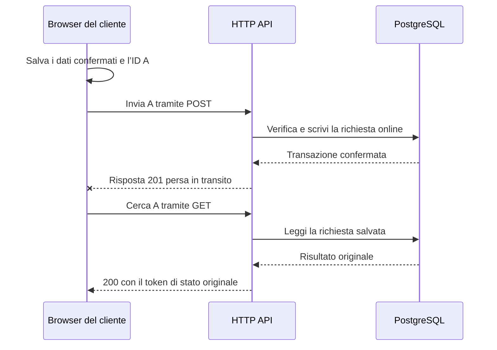

# 1. HTTP e l’invio di un ordine

Il cliente preme Invia, vede una rotella e perde la connessione. Il browser sa soltanto di non aver ricevuto una risposta utilizzabile. Per capire se la richiesta è arrivata al ristorante bisogna individuare il momento in cui i dati sono stati registrati in modo persistente. Seguiamoli lungo la rete.

## Dalla barra degli indirizzi al database

In produzione il DNS risolve il dominio del ristorante e TLS protegge la connessione. Caddy svolge due compiti sulla stessa origine (schema, host e porta). Una navigazione a `/r/…` può restituire l’HTML iniziale. Il browser carica JavaScript e React visualizza il menu. Le richieste a `/api/…` vengono inoltrate ad ASP.NET Core. In sviluppo il proxy Vite consente di usare gli stessi percorsi relativi. Prefissi simili possono quindi portare a gestori e tipi di risposta diversi. [Caddyfile](../../../deploy/Caddyfile) · [vite.config.ts](../../../frontend/vite.config.ts)

Una richiesta HTTP ha metodo, destinazione, intestazioni ed eventualmente un corpo. Una GET sul menu esprime una lettura. All’invio, il JSON riporta piatti, prezzi confermati, modalità di ritiro o consegna e `clientRequestId`. Il successo HTTP e lo stato dell’ordine rispondono a domande diverse. `201 Created` indica che esiste una richiesta online, ancora in attesa del personale. `200 OK` può restituire il risultato originario dello stesso invio. La classe di errore HTTP orienta i client generici, il codice applicativo guida l’interfaccia. [OnlineOrderController.cs](../../../backend/TavoloFlow.Api/Controllers/OnlineOrderController.cs) · [RFC 9110, semantica HTTP](https://www.rfc-editor.org/rfc/rfc9110.html)

I metodi orientano le decisioni di client e intermediari. Un metodo sicuro esprime una lettura. Un’operazione idempotente ha lo stesso effetto previsto se ripetuta. PUT può modificare lo stato ed essere idempotente. Per POST HTTP non garantisce in generale l’idempotenza, quindi l’applicazione stabilisce come gestire i duplicati. Il preventivo di consegna usa POST per tenere l’indirizzo nel corpo della richiesta, fuori dall’URL. Una POST può dunque chiedere un preventivo senza creare un ordine. [OnlineOrderController.cs](../../../backend/TavoloFlow.Api/Controllers/OnlineOrderController.cs)

## Tre percorsi visti dai due lati

Segui un commit riuscito con risposta persa. Il diagramma omette avvio, contesto di identità e richieste CSRF. In quale momento il database e il telefono conoscono rispettivamente l’esito?

| Momento | Primo invio riuscito | Stesso intento inviato di nuovo | Primo invio riuscito, risposta persa |
| --- | --- | --- | --- |
| Preparazione nel browser | Salva contenuto confermato e ID A nel `sessionStorage` della scheda | Riusa A | Conserva A |
| Esecuzione nell’API | Apre la transazione, verifica, inserisce, conferma e accoda la notifica | Trova A e restituisce l’esito originale | Potrebbe aver già eseguito il commit |
| Osservazione nel browser | 201, poi pagina di stato | 200 e identico token di stato | Esito incerto. Una GET per A recupera la pagina di stato appena trova la richiesta. |

Immagina un’altra sequenza. Il client va in timeout, la prima scrittura è ancora in corso e la GET di recupero arriva prima al database. In quell’istante A può risultare assente. La pagina conserva l’intento originale e il recupero automatico esegue solo letture. Un tentativo esplicito verifica prima l’esito e reinvia i dati originali quando previsto. Un nuovo ID rappresenterebbe per il server un secondo acquisto. Distingui il numero di richieste nel log dal numero di acquisti registrati. [useOnlineCart.ts](../../../frontend/src/features/online-order/useOnlineCart.ts) · [OnlineRequestService.cs](../../../backend/TavoloFlow.Api/Online/OnlineRequestService.cs)

È l’accettazione da parte del personale a creare sessione, ordine e righe. La cucina segna i piatti pronti, il personale al banco conferma che il piatto è stato servito e il titolare chiude il conto dopo aver confermato l’incasso sul posto. Il percorso attraversa più scambi HTTP e transazioni brevi. Durante i minuti di attesa del personale la continuità è affidata alla richiesta salvata. [OnlineStaffService.cs](../../../backend/TavoloFlow.Api/Online/OnlineStaffService.cs) · [OnlineStaffTests.cs](../../../backend/TavoloFlow.Api.Tests/OnlineStaffTests.cs)

## Esercizio e autoverifica

Apri il link cliente della demo locale nell’orario di apertura. Nel pannello Network attiva la conservazione del log, ricarica e annota URL e tipo della risposta del documento del menu. Filtra per `/api/`, aggiungi un piatto e invia un ordine da asporto. Annota gli URL di creazione e stato. Nella prima risposta cerca numero e `statusToken`, poi osserva l’indirizzo passare a `/o/…`. Distingui l’HTML dal JSON dell’API e verifica il 201 iniziale. Per l’esercizio su codice cerca `Submit_ConcurrentRepeats_StoreOneRequest` in `OnlineOrderingTests`. Sei chiamate concorrenti ricevono lo stesso risultato e lasciano una riga. [Guida allo sviluppo locale](../local-development.md) · [OnlineOrderingTests.cs](../../../backend/TavoloFlow.Api.Tests/OnlineOrderingTests.cs)

**Autoverifica** — Il telefono ha ricevuto 201 ma il dispositivo del personale non ha suonato. Il cliente deve inviare un altro ordine?

Mostra la risposta

La pagina di stato e l’elenco in attesa permettono di verificare la richiesta. La consegna della notifica avviene dopo il commit e può fallire indipendentemente dalla scrittura.

## Domande da colloquio in italiano

**«Che differenza c’è tra un metodo HTTP sicuro e uno idempotente?»** Spiega prima l’azione richiesta, poi l’effetto di una ripetizione.

*Un metodo sicuro esprime una lettura, come GET. L’idempotenza riguarda invece l’effetto di più richieste uguali: per esempio posso inviare due volte lo stesso PUT e ottenere lo stesso stato finale. Nel nostro progetto la creazione usa POST e abbiamo definito noi come riconoscere il secondo invio, tramite un identificativo della richiesta.*

**Approfondimento** — Perché 201 al primo tentativo e 200 al secondo sono compatibili con l’idempotenza? Considera l’effetto persistente.

**«Se il client va in timeout, come capisci se l’ordine è arrivato?»** Distingui ciò che osserva il client dal momento del commit.

*Il timeout mi dice solo che il client ha smesso di aspettare. Il server potrebbe aver già concluso la transazione. Prima dell’invio salvo un identificativo insieme ai dati confermati. Quando torno online cerco la richiesta con quell’identificativo. Se serve un nuovo tentativo esplicito, riutilizzo lo stesso identificativo, così il server può restituire il risultato originale.*

**Approfondimento** — Quali sequenze possono produrre un 404 immediato durante il recupero? Disegna una transazione ancora aperta.

[Indice del corso](../learning-notes.md) · [Capitolo successivo](02-aspnet-core.md)
