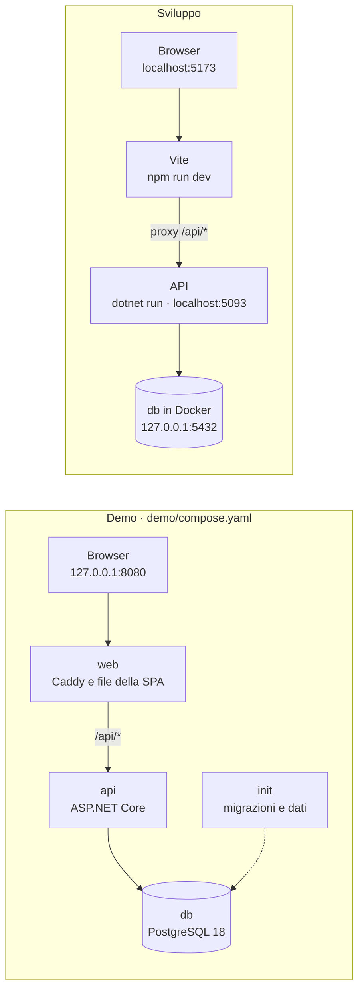
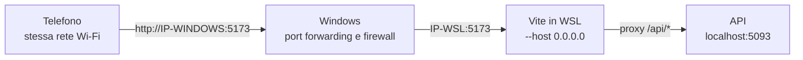

[English](../en/local-development.md) · **Italiano** · [中文](../zh-CN/local-development.md)

# Eseguire TavoloFlow in locale

Questa guida è per chi vuole far girare TavoloFlow sul proprio computer: per vederlo all'opera in pochi minuti, per modificarne il codice o per provarlo da un telefono vero. Come metterlo online su un server lo spiego nella guida al [self-hosting](self-hosting.md); com'è fatto all'interno, nelle [note di sviluppo](development-notes.md).

Ci sono tre modi, dal più semplice al più completo:

- la **demo** (Parte 1): un solo comando Docker e un ristorante di prova già pronto, senza installare né .NET né Node;
- l'**ambiente di sviluppo** (Parte 2): il database in Docker, l'API e il frontend avviati a mano, con il frontend che si aggiorna mentre lo modifichi; la Parte 3 spiega come lanciare i test;
- il **telefono** (Parte 4): l'ambiente di sviluppo raggiungibile da un telefono nella stessa rete Wi-Fi, per scansionare un QR vero.

Io ho sviluppato tutto su Windows 11 con WSL2 (Ubuntu) e Docker Desktop. I comandi della Parte 2 sono per Bash, quindi per Linux, macOS o WSL; la demo si avvia anche da PowerShell su Windows.

## Panoramica

|              | Demo                     | Sviluppo                                         | Dal telefono                                    |
| ------------ | ------------------------ | ------------------------------------------------ | ----------------------------------------------- |
| Cosa serve   | Git, Docker              | Git, Docker, .NET SDK 10, Node 24                | l'ambiente di sviluppo e la stessa rete Wi-Fi   |
| Indirizzo    | `http://127.0.0.1:8080`  | `http://localhost:5173`                          | `http://IP-DEL-COMPUTER:5173`                   |
| Dati         | il ristorante Demo Ramen | quelli che crei tu, oppure gli stessi della demo | quelli dell'ambiente di sviluppo                |
| Quando serve | vedere l'app, mostrarla  | modificare il codice, lanciare i test            | provare il QR e la pagina del cliente sul serio |



In tutti e due i casi il browser vede un solo indirizzo, come in produzione: nella demo l'ingresso è Caddy, in sviluppo il proxy di Vite (vedi la [panoramica dell'architettura](development-notes.md#panoramica)). Frontend e API stanno sulla stessa origine, quindi non serve configurare CORS.

**Demo su `127.0.0.1`, sviluppo su `localhost`.** Se le fai girare insieme, non aprirle tutte e due da `localhost`. Il browser lega i cookie al nome dell'host, non alla porta: per lui `localhost:8080` e `localhost:5173` sono lo stesso sito, e i cookie di login delle due app, che hanno gli stessi nomi (`TavoloFlow.Store`, `TavoloFlow.Csrf`…), si sovrascriverebbero a vicenda. Il risultato sono logout continui ed errori CSRF. `127.0.0.1` e `localhost` invece sono due host diversi, ognuno con i suoi cookie. In alternativa basta usare due profili del browser.

## Parte 1: la demo

### Avviarla

Servono solo Git e Docker con Compose v2. Su Windows basta Docker Desktop con i container Linux, e i comandi si lanciano direttamente da PowerShell: non servono .NET, Node, Bash né un file `.env`.

```bash
git clone https://github.com/lorenzoyang/TavoloFlow.git
cd TavoloFlow
docker compose -f demo/compose.yaml up -d --build
```

La prima volta Docker scarica le immagini di base e compila API e frontend: ci vuole qualche minuto. Quando il comando finisce, apri <http://127.0.0.1:8080>.

| Ruolo                            | Utente             | Password | Dove si entra                          |
| -------------------------------- | ------------------ | -------- | -------------------------------------- |
| Titolare                         | `demo.ramen.owner` | `123456` | <http://127.0.0.1:8080/staff/login>    |
| Staff                            | `demo.ramen.staff` | `123456` | <http://127.0.0.1:8080/staff/login>    |
| Amministratore della piattaforma | `demo.admin`       | `123456` | <http://127.0.0.1:8080/platform/login> |

A differenza di un ristorante vero, gli account della demo non devono cambiare la password al primo accesso. Sono password pubbliche: vanno bene solo sul tuo computer.

L'interfaccia segue la lingua del browser. Per averla in italiano scegli «Italiano» sotto il logo nella pagina di accesso, oppure più tardi nella Home, nella scheda dell'account.

### Cosa contiene

Il ristorante **Demo Ramen**: tema LACQUER, euro e fuso orario di Roma, menu predefinito in inglese con nomi e descrizioni in tre lingue. Servizio e ordini sono attivi, e i clienti devono inserire il codice del tavolo.

- 8 tavoli, da T01 a T08, tutti liberi; i token dei QR vengono generati a caso durante l'inizializzazione;
- 4 categorie e 12 piatti, con prezzi, descrizioni, allergeni di esempio e una foto ciascuno;
- un periodo di abbonamento di un anno da 199 €, già pagato (si vede nell'area amministratore e nella pagina Abbonamento del titolare);
- nessuna visita, nessun ordine, nessun conto: si comincia aprendo un tavolo.

Il ristorante e i piatti sono inventati, allergeni compresi, e le foto sono generate con l'AI (i dettagli sono in [`demo/images/README.md`](../../demo/images/README.md)).

### Un giro di cinque minuti

1. Entra come **titolare**. Dalla Home apri **Tavoli e QR**, tocca **«QR»** sul tavolo T01 e poi **«Copia link»**: è l'indirizzo che il cliente aprirebbe scansionando il QR.
2. Vai in **Sala**, scegli T01 e conferma con **«Apri tavolo»**. Compare il codice del tavolo, di quattro caratteri.
3. In un'altra scheda incolla il link: sei il cliente. Inserisci il codice e tocca **«Verifica codice»**, metti qualche piatto con **«Aggiungi al carrello»**, poi **«Controlla ordine»** e **«Conferma e ordina»**.
4. Torna all'area staff e apri **Cucina**: l'ordine è arrivato. Segna i piatti con **«Pronto»**. Per il suono il browser vuole prima un tocco sulla pagina.
5. Dalla Home apri **Pass** e segna i piatti con **«Servito»**.
6. Apri **Conto**, scegli T01 e tocca **«Incassa e libera il tavolo»**; spunta la conferma e chiudi con **«Incassato, libera tavolo»**. Il conto chiuso lo ritrovi in **Storico conti**, dalla Home.
7. Se vuoi, entra anche come amministratore da `/platform/login`, nello stesso browser: le identità di cliente, staff e amministratore hanno cookie separati e non si disturbano (vedi [«Tre identità»](development-notes.md#tre-identità-staff-cliente-piattaforma)).

Tutte le schede normali di un browser condividono lo stesso login dell'area staff: per usare insieme titolare e staff serve un altro profilo, un altro browser o una finestra anonima.

### Com'è fatta

La demo è un progetto Compose a parte, [`demo/compose.yaml`](../../demo/compose.yaml), con quattro container:

| Servizio | Cosa fa                                                                                                    |
| -------- | ---------------------------------------------------------------------------------------------------------- |
| `db`     | PostgreSQL 18, con i dati nel volume `postgres_data`                                                       |
| `init`   | applica le migrazioni con `efbundle`, poi importa i dati con `--seed-demo`; finito il lavoro, si chiude    |
| `api`    | l'API ASP.NET Core, con le chiavi di Data Protection nel volume `protection_keys`                          |
| `web`    | Caddy, senza HTTPS, con i file della SPA già compilati; è l'unico container con una porta sul tuo computer |

- **L'ordine di avvio lo decide Compose.** `init` parte quando `db` è pronto (`condition: service_healthy`), `api` solo quando `init` è finito senza errori (`service_completed_successfully`), `web` quando l'API risponde su `/health/ready`. Per questo `docker compose ps -a` mostra `init` come `Exited (0)`: è normale, ha finito il suo lavoro.
- **Le regole sono quelle della produzione.** Le migrazioni le applica un passo esplicito, non l'API all'avvio. La rete `database` è `internal`, e la porta di `web` è pubblicata solo su `127.0.0.1`: dalla rete locale la demo non si raggiunge. La differenza principale è che l'API gira in ambiente Development, l'unico in cui `--seed-demo` funziona.
- **I dati si importano una volta sola.** Se nel database c'è già un ristorante o un amministratore, `--seed-demo` non fa niente e lo scrive nel log: non sovrascrive mai le tue modifiche. Importa tutto in un'unica transazione, e le foto passano dalla stessa elaborazione degli upload veri (`MenuImages`).
- **I QR usano l'indirizzo che hai aperto.** Il frontend della demo è compilato con `VITE_PUBLIC_BASE_URL` vuoto, quindi i link dei QR prendono l'origine corrente del browser, porta compresa.

### Gestirla

Dalla cartella del repository:

```bash
# Stato dei container: -a mostra anche init, che ha già finito
docker compose -f demo/compose.yaml ps -a
# Gli ultimi log
docker compose -f demo/compose.yaml logs --tail 100 init api web
# Fermarla: dati, password cambiate e chiavi restano nei volumi
docker compose -f demo/compose.yaml down
# Riavviarla
docker compose -f demo/compose.yaml up -d
```

**Azzerarla.** Con `-v`, `down` cancella anche i volumi di questo progetto Compose (`tavoloflow-demo`): database e chiavi. Al riavvio `init` trova un database vuoto e reimporta i dati iniziali, con le password originali. Gli altri progetti, compreso il database di sviluppo della Parte 2, non vengono toccati.

```bash
docker compose -f demo/compose.yaml down -v
docker compose -f demo/compose.yaml up -d --build
```

Dopo un azzeramento i vecchi login e i vecchi link dei tavoli non valgono più: i token dei QR sono nuovi.

**Un'altra porta.** Se la 8080 è già occupata:

```bash
DEMO_PORT=8081 docker compose -f demo/compose.yaml up -d --build
```

Da PowerShell si imposta prima la variabile, con `$env:DEMO_PORT = "8081"`, e poi si lancia lo stesso comando.

### Modificare i dati della demo

I dati stanno in [`demo/data/`](../../demo/data/): `restaurant.json`, `accounts.json`, `tables.json` e `menu.json`. Le foto stanno in [`demo/images/`](../../demo/images/), in WebP 640×640, e i prompt con cui le ho generate in `demo/image-prompts.json`.

Questi file vengono copiati nell'immagine di `init` durante la build, quindi dopo una modifica serve `--build`. E valgono solo per un database vuoto: per vederli su una demo già avviata bisogna azzerarla. Il seeder è severo: un campo JSON che non conosce fa fallire l'importazione, e il motivo si legge nei log di `init`.

## Parte 2: l'ambiente di sviluppo

### Cosa serve

| Strumento  | Versione                               | A cosa serve                                                              |
| ---------- | -------------------------------------- | ------------------------------------------------------------------------- |
| .NET SDK   | 10, almeno la 10.0.112 (`global.json`) | backend e test                                                            |
| Node.js    | 24                                     | frontend; i test girano con il test runner di Node, che esegue TypeScript |
| Docker     | con Compose v2                         | il database di sviluppo e i test di integrazione                          |
| Git e Bash |                                        | su Linux, macOS o WSL                                                     |

Nel mio caso: WSL2 con Ubuntu e Docker Desktop, con l'integrazione WSL attiva.

### 1. Il database

```bash
# Dalla cartella del repository
cp .env.example .env
# Sostituisci POSTGRES_PASSWORD con una password tua
nano .env
docker compose up -d db
```

[`compose.yaml`](../../compose.yaml) avvia solo PostgreSQL 18, sulla porta 5432 ma solo su `127.0.0.1`: dalla rete locale non si vede. I dati stanno nel volume `postgres_data` del progetto Compose `tavoloflow`.

Il file `.env` lo legge solo Docker Compose, per creare il database: l'API non lo legge. E, come in produzione, la password vale solo alla prima creazione del volume: se la cambi dopo, PostgreSQL non lo sa.

### 2. Collegare l'API al database

```bash
# Installa gli strumenti .NET del repository: dotnet-ef, alla versione fissata
dotnet tool restore
# La stringa di connessione: nome del database, utente e password uguali a quelli del .env
dotnet user-secrets set 'ConnectionStrings:Default' \
  'Host=localhost;Port=5432;Database=tavoloflow_dev;Username=tavoloflow;Password=LA_TUA_PASSWORD' \
  --project backend/TavoloFlow.Api
```

Gli **user secrets** sono il modo di .NET per tenere i segreti di sviluppo fuori dal repository. Finiscono in un file JSON nella tua cartella utente (`~/.microsoft/usersecrets/<UserSecretsId>/secrets.json`, dove l'ID è quello scritto in `TavoloFlow.Api.csproj`), e ASP.NET Core li legge solo in ambiente Development. `dotnet user-secrets list --project backend/TavoloFlow.Api` mostra cosa hai impostato.

Nel repository non c'è nessuna stringa di connessione: se manca, l'API si ferma all'avvio con un messaggio che lo dice. Al posto degli user secrets puoi usare una variabile d'ambiente, `ConnectionStrings__Default`: nei nomi delle variabili d'ambiente, il doppio trattino basso sostituisce i due punti.

### 3. Le migrazioni

```bash
dotnet ef database update --project backend/TavoloFlow.Api
```

Crea le tabelle applicando le migrazioni di `backend/TavoloFlow.Api/Data/Migrations`. L'API non le applica mai da sola all'avvio, nemmeno in sviluppo: è la stessa regola della produzione (vedi [«Le migrazioni»](self-hosting.md#le-migrazioni) nella guida al self-hosting). Quando un `git pull` porta nuove migrazioni, il comando va rieseguito.

### 4. I dati iniziali

Un database appena migrato è vuoto: nessun ristorante, nessun account. Per riempirlo si usa il programma dell'API stesso, che funziona anche come strumento a riga di comando ([`Operations/MaintenanceCommands.cs`](../../backend/TavoloFlow.Api/Operations/MaintenanceCommands.cs)): con un'opzione come `--seed-demo` esegue quel comando e si chiude, senza avviare il server.

**Il modo più veloce: i dati della demo.** Lo stesso comando che usa il container `init` funziona anche sul database di sviluppo:

```bash
# Dalla cartella del repository, su un database vuoto
Demo__DataPath="$PWD/demo" dotnet run --project backend/TavoloFlow.Api --launch-profile http -- --seed-demo
```

Ottieni lo stesso Demo Ramen della Parte 1, con gli stessi account e le stesse password, il ristorante già attivo e gli ordini accesi: puoi fare subito il giro di cinque minuti. `Demo__DataPath` dice al comando dove trovare `data/` e `images/`, e il profilo `http` imposta l'ambiente Development, l'unico in cui il comando funziona. Se nel database c'è già un ristorante o un amministratore, non importa niente e lo scrive nel log.

**Da zero, come in produzione.** Se vuoi seguire il percorso vero di un nuovo ristorante, crea solo il primo amministratore della piattaforma:

```bash
dotnet user-secrets set 'PlatformBootstrap:Username' 'admin' --project backend/TavoloFlow.Api
# Da 6 a 128 caratteri
dotnet user-secrets set 'PlatformBootstrap:Password' 'UNA_PASSWORD' --project backend/TavoloFlow.Api
dotnet run --project backend/TavoloFlow.Api --launch-profile http -- --seed-platform-admin
```

Poi, con l'app avviata (passo 5):

1. entra in `/platform/login` e crea il ristorante con **«Crea ristorante e due account»**; annota le due password temporanee, che compaiono una volta sola;
2. il ristorante nasce sospeso: attivalo con **«Attiva servizio»**;
3. il titolare entra in `/staff/login`, cambia la password e prepara menu e tavoli;
4. in **Sala** accende **«Ordini dal QR»**: riattivare il servizio non riaccende gli ordini.

Esiste anche `--seed-dev-accounts`, che crea un ristorante con titolare e staff a partire dalle impostazioni `DevelopmentSeed:*`. Il ristorante però nasce sospeso, e va attivato da un amministratore della piattaforma, da creare comunque con `--seed-platform-admin` ([`accounts-platform.md`](../reference/accounts-platform.md), in inglese): i due modi sopra sono più comodi.

### 5. Avviare API e frontend

Servono due terminali, tutti e due aperti nella cartella del repository.

```bash
# Terminale 1: l'API su http://localhost:5093
dotnet run --project backend/TavoloFlow.Api --launch-profile http
```

```bash
# Terminale 2: il frontend su http://localhost:5173
cd frontend
# Solo la prima volta, o quando cambia package-lock.json
npm ci
npm run dev
```

Poi apri <http://localhost:5173/staff/login>, oppure `/platform/login`.

- **Il browser parla solo con Vite.** Vite serve il frontend e, grazie al proxy configurato in [`vite.config.ts`](../../frontend/vite.config.ts), inoltra all'API sulla porta 5093 tutto quello che comincia con `/api`.
- **Il frontend si aggiorna da solo, il backend no.** Le modifiche al codice React compaiono subito nel browser (hot module replacement). Dopo una modifica al backend, invece, ferma l'API con Ctrl+C e riavviala.
- **Le porte sono fisse.** `vite.config.ts` usa `strictPort`: se la 5173 è occupata, Vite si ferma con un errore invece di scegliere un'altra porta in silenzio. Così l'indirizzo resta sempre lo stesso, ed è importante per la Parte 4.

### Cose utili

- **La descrizione delle API.** In Development l'API pubblica il documento OpenAPI di tutti gli endpoint su <http://localhost:5093/openapi/v1.json>. Per provare le richieste a mano c'è [`TavoloFlow.Api.http`](../../backend/TavoloFlow.Api/TavoloFlow.Api.http), che si esegue da Visual Studio, Rider o VS Code con l'estensione REST Client. Ricorda che ogni scrittura vuole un token CSRF (vedi [«Cookie, CSRF e same-origin»](development-notes.md#cookie-csrf-e-same-origin)).
- **Le chiavi di Data Protection.** In sviluppo `DataProtection:KeyRingPath` non è impostato, quindi ASP.NET Core tiene le chiavi nella cartella dell'utente (su Linux e WSL in `~/.aspnet/DataProtection-Keys`). Se le cancelli, tutti i login e i codici dei tavoli aperti smettono di valere: è lo stesso motivo per cui in produzione stanno su un volume.
- **Una nuova migrazione.** Dopo aver cambiato un'entità o la sua configurazione:

  ```bash
  dotnet ef migrations add NomeDellaModifica --project backend/TavoloFlow.Api --output-dir Data/Migrations
  # Controlla che modello e migrazioni coincidano: non devono restare modifiche in sospeso
  dotnet ef migrations has-pending-model-changes --project backend/TavoloFlow.Api
  dotnet ef database update --project backend/TavoloFlow.Api
  ```

- **Ripartire da zero.** `docker compose down -v` cancella il volume del database di sviluppo, e solo quello: la demo ha un progetto Compose suo. Poi si ricomincia da `docker compose up -d db` e dal passo 3.
- **La PWA.** Con `npm run dev` il service worker non viene registrato, per non disturbare l'aggiornamento automatico. Per provare l'installazione e la pagina offline serve una build: `npm run build && npm run preview`, su <http://localhost:4173>, con l'API avviata (i dettagli sono in [`pwa.md`](../reference/pwa.md), in inglese).

## Parte 3: test e controlli

### Backend

```bash
# Tutti i test: Docker deve essere avviato
dotnet test TavoloFlow.slnx
# Una sola classe di test (aggiungi .NomeDelMetodo per un solo test)
dotnet test TavoloFlow.slnx --filter "FullyQualifiedName~KitchenTests"
```

La suite comprende test puri senza database, come `PasswordPolicyTests` e `SubscriptionSummaryTests`, e test di integrazione. Ogni classe con `PostgreSqlFixture` avvia con Testcontainers un suo PostgreSQL usa e getta (`postgres:18-alpine`) e ci applica le migrazioni vere. I test HTTP usano `WebApplicationFactory` per chiamare l’API; quelli del livello dati usano direttamente il `DbContext`. I test non toccano né il database di sviluppo né quello della demo. Il comando completo richiede Docker; alla prima esecuzione dei test di integrazione viene scaricata l’immagine di PostgreSQL.

### Frontend

```bash
cd frontend
# I test della logica pura
node --test --test-isolation=none tests/*.test.ts
# Build di produzione e controllo dei tipi
npm run build
# Lint e formattazione
npm run lint
npm run format:check
```

Per il frontend non c'è un framework di test per i componenti React. La logica che vale la pena testare (regole del carrello, recupero degli ordini, lingue, temi…) sta in moduli puri, come i `state.ts` delle feature e alcuni file di `lib/`, e il test runner integrato di Node 24 la esegue direttamente, togliendo al volo i tipi di TypeScript. Per questo quei moduli importano gli altri con percorsi relativi e l'estensione `.ts`, invece dell'alias `@/`.

`npm run build` esegue `vite build && tsc -b`: prima Vite rigenera `src/routeTree.gen.ts`, l'albero delle route di TanStack Router, e compila; poi TypeScript controlla i tipi, route comprese. Se aggiungi una route, anche `routeTree.gen.ts` va nel commit. `npm run format` corregge la formattazione con Prettier.

### Il pacchetto di rilascio

Anche l'installazione di produzione si può provare in locale, con lo smoke test descritto nella guida al self-hosting ([«Costruire il pacchetto di release»](self-hosting.md#3-costruire-il-pacchetto-di-release)).

## Parte 4: provare dal telefono

Il momento in cui il cliente scansiona il QR si prova davvero solo con un telefono. Ma nessuna delle configurazioni viste finora si raggiunge dal telefono:

- sul telefono, `localhost` è il telefono stesso, non il tuo computer;
- Vite ascolta solo su `localhost` (`host: "localhost"` in `vite.config.ts`), e la demo pubblica la sua porta solo su `127.0.0.1`;
- se usi WSL2 in modalità NAT, quella predefinita, Linux ha anche un suo indirizzo interno (`172.x.x.x`) che dal Wi-Fi non si vede: si vede solo quello di Windows.

Dal telefono quindi si usa l'ambiente di sviluppo. Su Linux e macOS bastano due accorgimenti: Vite deve ascoltare su tutte le interfacce di rete, e i QR devono contenere l'indirizzo del computer. Su WSL ne serve un terzo: Windows deve inoltrare la porta a Linux (passo 3, che su Linux e macOS si salta).

Con WSL il percorso di una richiesta del telefono è questo; su Linux e macOS il passaggio da Windows non c'è:



L'API resta su `localhost`: il telefono parla solo con Vite, che le inoltra `/api` come sempre.

### 1. L'indirizzo del computer

Telefono e computer devono stare sulla stessa rete Wi-Fi. Ti serve l'indirizzo del computer in quella rete, quello che userà il telefono:

- **su Linux:** `hostname -I`;
- **su macOS:** `ipconfig getifaddr en0`, se sei collegato in Wi-Fi;
- **su WSL:** l'indirizzo di **Windows**, non quello di Linux: in PowerShell `ipconfig`, alla voce «Indirizzo IPv4» della scheda Wi-Fi.

Nei comandi qui sotto è `192.168.1.36`.

### 2. Vite e l'indirizzo dei QR

In `frontend/.env.local`, un file ignorato da Git (il modello è `frontend/.env.example`):

```dotenv
VITE_PUBLIC_BASE_URL=http://192.168.1.36:5173
```

Poi avvia Vite su tutte le interfacce:

```bash
cd frontend
npm run dev -- --host 0.0.0.0
```

Senza `VITE_PUBLIC_BASE_URL`, i QR usano l'indirizzo della pagina in cui li generi, cioè `localhost`, e il telefono non saprebbe dove andare: l'interfaccia lo segnala con «Questo link usa un indirizzo locale che i telefoni non raggiungono». Vite legge la variabile all'avvio e la scrive nel codice del frontend. Quando salvi `.env.local` si riavvia da solo, ma la pagina aperta va ricaricata.

### 3. Solo su WSL: port forwarding e firewall

Su Linux e macOS salta questo passo: Vite gira direttamente sul computer, che ha già l'indirizzo della rete Wi-Fi. Se il telefono non riesce a collegarsi, al massimo va aperta la porta 5173 nel firewall del sistema: per esempio `sudo ufw allow 5173/tcp` su Ubuntu, se usi ufw; su macOS basta consentire le connessioni in entrata a `node` quando il sistema lo chiede.

Su WSL servono tre cose.

**Il profilo di rete.** Nelle impostazioni di Windows della tua rete Wi-Fi scegli il profilo **Privata**: la regola del firewall qui sotto vale solo per le reti private.

**L'IP di WSL.** Nel terminale WSL `hostname -I`, oppure la riga `Network` che Vite stampa all'avvio con `--host`. Nei comandi è `172.28.94.85`. Di solito cambia a ogni riavvio di Windows o di WSL.

**L'inoltro della porta.** In PowerShell **da amministratore**, con i tuoi indirizzi:

```powershell
$tavoloWindowsIp = "192.168.1.36"
$tavoloWslIp = "172.28.94.85"
# Solo se esiste già un inoltro per questo indirizzo, per esempio verso il vecchio IP di WSL
netsh interface portproxy delete v4tov4 listenaddress=$tavoloWindowsIp listenport=5173
# Le connessioni a Windows sulla porta 5173 vanno a WSL sulla porta 5173
netsh interface portproxy add v4tov4 listenaddress=$tavoloWindowsIp listenport=5173 connectaddress=$tavoloWslIp connectport=5173
```

Siccome l'IP di WSL cambia, dopo un riavvio l'inoltro va rifatto, con `delete` e poi `add` con il nuovo indirizzo. `netsh interface portproxy show v4tov4` mostra gli inoltri attivi.

**La regola del firewall.** Sempre da amministratore, una volta sola:

```powershell
New-NetFirewallRule -DisplayName "TavoloFlow Dev 5173" -Direction Inbound -Action Allow -Protocol TCP -LocalPort 5173 -Profile Private -RemoteAddress LocalSubnet
```

La regola apre la porta 5173 solo sulle reti private e solo ai dispositivi della stessa sottorete: al telefono sì, al resto di internet no.

### 4. La prova

1. Sul computer apri `http://localhost:5173/staff/login`, entra come titolare (con i dati della demo è già tutto pronto) e apri un tavolo in **Sala**.
2. In **Tavoli e QR** tocca **«QR»** sullo stesso tavolo: il link sotto il QR deve cominciare con `http://192.168.1.36:5173`.
3. Scansiona il QR con il telefono, inserisci il codice del tavolo e manda un ordine. Se vuoi ripartire senza cookie vecchi, apri il link in una finestra anonima.

### Cosa non si può provare così

Un indirizzo come `http://192.168.1.36:5173` non è HTTPS, quindi per il browser del telefono non è un contesto sicuro. Alcune funzioni del browser ne hanno bisogno:

- **l'installazione della PWA** e il service worker;
- **lo schermo sempre acceso** di Cucina e Pass (Screen Wake Lock);
- **la copia automatica** di link e codici: l'app se ne accorge e chiede di copiarli a mano.

Tutto il resto funziona. Per esempio, gli ID degli ordini sono generati con `crypto.getRandomValues` proprio perché, a differenza di `crypto.randomUUID`, funziona anche senza HTTPS ([`lib/ids.ts`](../../frontend/src/lib/ids.ts)).

Per provare la PWA su un telefono Android c'è un trucco: con il debug USB e il port forwarding di `chrome://inspect`, il telefono apre `localhost:4173` della build di preview, e `localhost` conta come contesto sicuro (vedi [`pwa.md`](../reference/pwa.md)). Per l'iPhone, e per la prova finale, serve l'HTTPS vero del [self-hosting](self-hosting.md).

### Pulizia

Quando non ti serve più, togli `VITE_PUBLIC_BASE_URL` da `frontend/.env.local`, così i QR generati in sviluppo tornano a usare l'indirizzo della pagina.

Su WSL, rimuovi anche l'inoltro e la regola del firewall, da PowerShell da amministratore:

```powershell
# In una nuova sessione la variabile non esiste più: reimpostala
$tavoloWindowsIp = "192.168.1.36"
netsh interface portproxy delete v4tov4 listenaddress=$tavoloWindowsIp listenport=5173
Remove-NetFirewallRule -DisplayName "TavoloFlow Dev 5173"
```

## Problemi comuni

| Cosa succede                                                                 | Cosa controllare                                                                                                                                                                                                                                      |
| ---------------------------------------------------------------------------- | ----------------------------------------------------------------------------------------------------------------------------------------------------------------------------------------------------------------------------------------------------- |
| In WSL, `docker` risponde «permission denied» o non trova il server          | Docker Desktop è avviato, e nelle sue impostazioni è attiva l'integrazione con la tua distribuzione WSL                                                                                                                                               |
| La demo non risponde, `init` non è `Exited (0)`                              | `docker compose -f demo/compose.yaml logs init`                                                                                                                                                                                                       |
| La porta 8080 è occupata                                                     | `DEMO_PORT`, vedi «Gestirla»                                                                                                                                                                                                                          |
| Vite si ferma: la porta 5173 è occupata                                      | un altro `npm run dev` ancora aperto; con `strictPort` Vite non sceglie un'altra porta                                                                                                                                                                |
| L'API non parte e chiede `ConnectionStrings:Default`                         | la stringa di connessione negli user secrets (passo 2) o nella variabile `ConnectionStrings__Default`                                                                                                                                                 |
| L'API non riesce a collegarsi a PostgreSQL per la password                   | la password negli user secrets deve essere quella del `.env` con cui è stato creato il volume; se poi hai cambiato il `.env`, rimetti quella vecchia o ricrea il volume con `docker compose down -v` (cancella i dati)                                |
| Errori su tabelle o colonne che non esistono                                 | `dotnet ef database update` dopo l'ultimo `git pull`                                                                                                                                                                                                  |
| `--seed-demo` dice che il database contiene già dati                         | importa solo in un database vuoto: usa i dati che hai o ricrea il volume                                                                                                                                                                              |
| Logout continui, errori CSRF                                                 | demo e sviluppo aperti tutti e due da `localhost`: apri la demo da `127.0.0.1`                                                                                                                                                                        |
| In Sala compare «Il servizio del ristorante non è ancora attivo o è sospeso» | il ristorante è sospeso: l'amministratore lo attiva con «Attiva servizio»                                                                                                                                                                             |
| Il cliente vede il menu ma non può ordinare                                  | gli ordini sono in pausa: in Sala, «Ordini dal QR»                                                                                                                                                                                                    |
| I QR contengono `localhost`                                                  | `VITE_PUBLIC_BASE_URL` in `frontend/.env.local`, poi ricarica la pagina (Vite si riavvia da solo)                                                                                                                                                     |
| Il telefono non apre la pagina                                               | stessa rete Wi-Fi e Vite avviato con `--host 0.0.0.0`; su Linux e macOS il firewall del sistema; su WSL profilo di rete privato, regola del firewall e IP di WSL ancora uguale a quello del port forwarding (`netsh interface portproxy show v4tov4`) |
