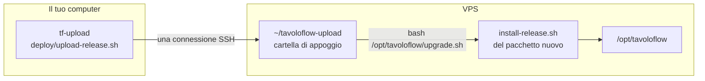

[English](../en/releasing.md) · **Italiano** · [中文](../zh-CN/releasing.md)

# Rilasciare con gli script

Questa guida spiega come pubblicare una nuova versione su un server già installato, con due script: il primo, sul tuo computer, costruisce il pacchetto e lo carica sulla VPS; il secondo, sulla VPS, lo controlla e lo installa. Tutto il resto (prima installazione, configurazione di `.env`, backup, rollback ed emergenze) sta nella [guida al self-hosting](self-hosting.md).

Gli script non cambiano il modo in cui avviene un rilascio: eseguono per te i passaggi della [procedura manuale](self-hosting.md#procedura-manuale), con lo stesso installer, e aggiungono qualche controllo. La procedura manuale resta valida.

## In breve

```text
Una volta sola      la preparazione qui sotto: ~/.ssh/config, l'alias tf-upload, il primo rilascio
Sul tuo computer    git status                         tutto committato?
                    tf-upload                          costruisce, carica e controlla il pacchetto
A ristorante chiuso ssh tavoloflow                     entra sulla VPS
                    bash /opt/tavoloflow/upgrade.sh    controlla, chiede conferma (y) e installa
                    exit                               esce dalla VPS
Poi                 ricarica l'app su ogni dispositivo dello staff
```



Caricare non cambia niente in produzione: puoi farlo quando vuoi, anche di giorno, e chiudere il terminale. L'installazione invece ferma l'API per un po', quindi va fatta a ristorante chiuso.

## Preparazione, una volta sola

Tutta la preparazione si fa **sul tuo computer** (nel mio caso il terminale di WSL), tranne il primo rilascio. Ti servono:

- l'**indirizzo IPv4 della VPS**: è quello che usi oggi in `ssh … deploy@VPS_IP`, e lo trovi anche nel pannello del fornitore;
- la **chiave privata** creata al [passo 1.1](self-hosting.md#11-la-chiave-ssh) della guida al self-hosting, `~/.ssh/tavoloflow`;
- la **password di `deploy`**, scelta al [passo 1.4](self-hosting.md#14-lutente-deploy): serve per `sudo` sulla VPS.

Due cose da sapere sui percorsi: `~` è la tua cartella home (per esempio `/home/nome`), e i file e le cartelle che cominciano con un punto, come `.ssh` e `.bashrc`, sono nascosti: `ls` non li mostra, `ls -a` sì.

### Un nome per la VPS in SSH

Oggi per entrare sulla VPS scrivi `ssh -o IdentitiesOnly=yes -i ~/.ssh/tavoloflow deploy@VPS_IP`. Il file `~/.ssh/config` dà un nome a questa combinazione di indirizzo, utente e chiave, così basta scrivere `ssh tavoloflow`. È il file di configurazione del comando `ssh` (e di `scp`) sul tuo computer; lo script di caricamento usa proprio questo nome.

**1. Controlla la chiave e apri il file, sul tuo computer:**

```bash
# Deve elencare tavoloflow e tavoloflow.pub
ls ~/.ssh/
# Apre il file con nano; se non esiste ancora, nano lo crea quando salvi
nano ~/.ssh/config
```

**2. Scrivi la configurazione.** Nel file aperto incolla queste righe (nel terminale si incolla con `Ctrl+Shift+V`, in molti terminali anche con il tasto destro del mouse):

```text
Host tavoloflow
  HostName VPS_IP
  User deploy
  IdentityFile ~/.ssh/tavoloflow
  IdentitiesOnly yes
```

Poi sostituisci `VPS_IP` con l'indirizzo vero, per esempio `HostName 203.0.113.10`: in nano ti sposti con le frecce. Le righe rientrate appartengono al `Host` sopra di loro. Se il file conteneva già altri blocchi `Host`, aggiungi il tuo in fondo, separato da una riga vuota.

| Riga                             | Significato                                                                    |
| -------------------------------- | ------------------------------------------------------------------------------ |
| `Host tavoloflow`                | il nome breve che userai al posto di `deploy@VPS_IP`                           |
| `HostName VPS_IP`                | l'indirizzo vero della VPS                                                     |
| `User deploy`                    | entra come `deploy`, mai come root                                             |
| `IdentityFile ~/.ssh/tavoloflow` | la chiave privata da usare                                                     |
| `IdentitiesOnly yes`             | prova solo questa chiave, come `-o IdentitiesOnly=yes` nei comandi della guida |

**3. Salva ed esci da nano:** `Ctrl+O`, poi Invio per confermare il nome del file, poi `Ctrl+X`.

**4. Proteggi il file e prova il nome nuovo, sul tuo computer:**

```bash
# Solo tu devi poter scrivere il file: altrimenti ssh si rifiuta di usarlo
chmod 600 ~/.ssh/config
# Deve entrare sulla VPS come deploy, come il comando lungo
ssh tavoloflow
```

Se funziona, il prompt diventa quello della VPS, qualcosa come `deploy@nome-della-vps:~$`. Se la chiave ha una passphrase, `ssh` te la chiede prima. Torna al tuo computer con `exit`.

| Se vedi                                      | Vuol dire                                   | Cosa fare                                                                                                         |
| -------------------------------------------- | ------------------------------------------- | ----------------------------------------------------------------------------------------------------------------- |
| `Could not resolve hostname tavoloflow`      | ssh non trova il blocco `Host tavoloflow`   | controlla che il file si chiami `~/.ssh/config` e la riga `Host`                                                  |
| `Bad owner or permissions on …/.ssh/config`  | altri utenti possono scrivere il file       | ripeti `chmod 600 ~/.ssh/config`                                                                                  |
| `Permission denied (publickey)`              | la VPS non accetta la chiave                | controlla `HostName`, `User deploy` e il percorso di `IdentityFile`                                               |
| `Connection timed out`                       | l'indirizzo è sbagliato o la VPS non risponde | controlla `HostName`                                                                                            |
| `Are you sure you want to continue connecting` | ssh non conosce ancora questo indirizzo   | con l'IP di sempre non compare; se la VPS è nuova, confronta l'impronta come al [passo 1.3](self-hosting.md#13-primo-accesso-come-root) |

Da qui in poi `ssh tavoloflow` vale quanto il comando lungo, anche nei comandi della guida al self-hosting; lo stesso nome funziona con `scp`, per esempio `scp file tavoloflow:`.

### Un comando sul tuo computer

`tf-upload` non è un programma da installare: è un **alias**, un nome breve che bash sostituisce con un comando più lungo. Gli alias si scrivono in `~/.bashrc`, un file che bash legge ogni volta che apri un terminale.

**1. Prepara i tre valori:**

- `PUBLIC_ORIGIN`: l'indirizzo pubblico dell'app, lo stesso della build ([passo 3](self-hosting.md#3-costruire-il-pacchetto-di-release) della guida al self-hosting). La mia installazione usa `https://app.qiaotavoloflow.it`;
- `DEPLOY_SSH`: il nome appena scelto in `~/.ssh/config`, cioè `tavoloflow`;
- il **percorso del repository** sul tuo computer. Per trovarlo:

  ```bash
  # Nella cartella del repository: stampa il percorso completo, per esempio /home/nome/TavoloFlow
  pwd
  ```

**2. Apri il file di bash, sul tuo computer:**

```bash
nano ~/.bashrc
```

**3. Aggiungi l'alias.** In nano vai in fondo al file (con le frecce, oppure con `Alt+/`) e incolla una riga nuova, con i tuoi tre valori:

```bash
alias tf-upload='PUBLIC_ORIGIN=https://app.esempio.it DEPLOY_SSH=tavoloflow bash /home/nome/TavoloFlow/deploy/upload-release.sh'
```

Deve stare tutta su una riga, con un apice singolo `'` subito dopo `=` e uno alla fine. Salva con `Ctrl+O` e Invio, esci con `Ctrl+X`.

**4. Carica l'alias e controllalo, sul tuo computer:**

```bash
# Rilegge ~/.bashrc in questo terminale; i terminali che aprirai dopo lo leggono da soli
source ~/.bashrc
# Deve rispondere che tf-upload è un alias e mostrare il comando completo
type tf-upload
```

Da questo momento puoi lanciare `tf-upload` da qualsiasi cartella: lo script si sposta da solo nel repository.

Questi valori stanno nel tuo computer e non nel repository perché il repository è pubblico, e ogni installazione di TavoloFlow ha il suo dominio e il suo server.

### Il primo rilascio con gli script

`upgrade.sh` arriva in `/opt/tavoloflow` insieme ai pacchetti che lo contengono, come gli altri file operativi: la prima volta non c'è ancora. Solo per questo rilascio, quindi, si estrae il pacchetto a mano sulla VPS e si lancia la copia di `upgrade.sh` che contiene. Controlla prima la lista di [Prima di iniziare](#prima-di-iniziare).

**1. Sul tuo computer, costruisci e carica:**

```bash
tf-upload
```

Ci mette qualche minuto. Alla fine annota l'ID stampato dopo `Uploaded and verified on the server:`, per esempio `20261026T094909Z-4c9535b` (il [passo 1](#1-sul-tuo-computer-costruire-e-caricare) qui sotto spiega tutto l'output).

**2. A ristorante chiuso, entra sulla VPS, dal tuo computer:**

```bash
ssh tavoloflow
```

**3. Sulla VPS, estrai il pacchetto e lancia lo script che contiene**, con l'ID annotato:

```bash
# L'ID stampato da tf-upload
RELEASE=20261026T094909Z-4c9535b
cd ~/tavoloflow-upload
# Checksum dell'archivio: deve stampare OK
sha256sum -c "tavoloflow-$RELEASE.tar.gz.sha256"
mkdir "$RELEASE"
tar -xzf "tavoloflow-$RELEASE.tar.gz" -C "$RELEASE"
# Solo questa volta: la copia di upgrade.sh dentro il pacchetto
bash "$RELEASE/ops/upgrade.sh" "$RELEASE"
```

Lo script trova la cartella già estratta, ricontrolla tutti i suoi file e prosegue come in ogni altro rilascio.

**4. Continua dal riepilogo del [passo 2](#2-sulla-vps-controllare-e-installare)**: la password di `sudo`, il riepilogo, la risposta `y`, il controllo finale e `exit`.

Installando il pacchetto, l'installer copia anche `upgrade.sh` in `/opt/tavoloflow`: dal rilascio successivo basta `bash /opt/tavoloflow/upgrade.sh`.

## Ogni rilascio

### Prima di iniziare

1. Il codice è testato e **committato**. Controllalo nella cartella del repository:

   ```bash
   # Deve dire "nothing to commit, working tree clean"
   git status
   ```

   Lo script comunque si rifiuta di partire con modifiche non committate, compresi i file nuovi non ancora aggiunti a Git.

2. Docker è in esecuzione sul tuo computer (nel mio caso, Docker Desktop aperto). Anche questo lo controlla lo script.
3. Se la nuova versione richiede una configurazione nuova nel `.env` del server, aggiungila prima, come spiegato nella guida al self-hosting, [Rilasciare una nuova versione](self-hosting.md#rilasciare-una-nuova-versione). L'installer controlla la configurazione prima di fermare l'API: se manca qualcosa, il servizio non si interrompe.
4. Per l'installazione scegli un orario di chiusura. Il caricamento può avvenire prima, anche ore prima.

### 1. Sul tuo computer: costruire e caricare

**Sul tuo computer, da qualsiasi cartella:**

```bash
tf-upload
```

Ci mette qualche minuto. L'output, accorciato:

```text
Commit: 4c9535b kitchen: group the dish view by station
Reminder: commit 4c9535b is not on any remote branch yet (as of your last fetch or push).
…  (output della build e avanzamento del caricamento)
Release package: /home/tu/TavoloFlow/artifacts/tavoloflow-20261026T094909Z-4c9535b.tar.gz
Checksum: /home/tu/TavoloFlow/artifacts/tavoloflow-20261026T094909Z-4c9535b.tar.gz.sha256
tavoloflow-20261026T094909Z-4c9535b.tar.gz: OK

Uploaded and verified on the server: 20261026T094909Z-4c9535b
To install it, at a quiet time:
  ssh tavoloflow
  bash /opt/tavoloflow/upgrade.sh
```

- **I controlli vengono prima della build**, che dura qualche minuto: modifiche non committate, Docker spento o una VPS irraggiungibile li scopri subito, non dopo l'attesa.
- **Il promemoria** compare quando il commit non è ancora su GitHub. È solo un promemoria, lo script prosegue. Il servizio ospitato dovrebbe eseguire codice che si trova anche nel repository pubblico, perché le pagine mostrano il link al codice sorgente (licenza AGPL). Git conosce lo stato di GitHub solo dall'ultima volta che ci ha parlato (`git fetch` o `git push`): per questo il messaggio dice «as of your last fetch or push».
- **Una sola connessione SSH** serve per tutto il lavoro sulla VPS: creare la cartella di appoggio, caricare, controllare. Se la tua chiave ha una passphrase, la chiede una volta sola, all'inizio, prima della build.
- **`OK` è il controllo fatto sulla VPS**, sul file arrivato: il caricamento è integro.
- Il pacchetto resta anche in `artifacts/` sul tuo computer: tieni almeno quello della versione in produzione e quello precedente, servono per tornare indietro o ricostruire il server.

Se l'output finisce con un errore, vedi [Se qualcosa va storto](#se-qualcosa-va-storto). Se invece finisce come sopra, il pacchetto aspetta sulla VPS: puoi chiudere il terminale e installarlo più tardi.

### 2. Sulla VPS: controllare e installare

**A ristorante chiuso, dal tuo computer entra sulla VPS:**

```bash
ssh tavoloflow
```

**Sulla VPS:**

```bash
bash /opt/tavoloflow/upgrade.sh
```

**Senza `sudo`**: lo chiede lo script quando serve. Quando compare `[sudo] password for deploy:`, scrivi la password di `deploy` e premi Invio: mentre scrivi non compare niente, è normale. Senza argomenti lo script prende il pacchetto caricato per ultimo; per sceglierne un altro, aggiungi il suo ID: `bash /opt/tavoloflow/upgrade.sh 20261026T094909Z-4c9535b`.

Prima di cambiare qualsiasi cosa, lo script mostra un riepilogo e chiede conferma:

```text
Package: /home/deploy/tavoloflow-upload/tavoloflow-20261026T094909Z-4c9535b.tar.gz

The next steps need sudo.
[sudo] password for deploy:

Installed release: 20261020T181200Z-1a2b3c4
New release:       20261026T094909Z-4c9535b
Public address:    https://app.esempio.it
Migrations to apply:
  20261024153148_AddRestaurantSubscriptions

The installer stops the API, backs up, migrates and starts the new API.
Until it finishes, pages open but every /api request fails.
The backup before the migrations stays on this server. To keep a copy on your computer
first, answer n and download the latest backup (self-hosting guide, Backups).
Install 20261026T094909Z-4c9535b now? [y/N]
```

| Riga                                      | Cosa dice                                                                 | Cosa controllare                                                                       |
| ----------------------------------------- | ------------------------------------------------------------------------- | -------------------------------------------------------------------------------------- |
| `Installed release`, `New release`        | la versione in produzione (`state/current`) e quella che stai installando | che la nuova sia quella appena caricata                                                |
| `Public address`                          | l'indirizzo scritto nel frontend durante la build                         | che sia il tuo dominio; l'installer lo confronta comunque con `DOMAIN`                 |
| `Migrations to apply`                     | le migrazioni del pacchetto che il database non ha ancora                 | `none` è il caso più comune; se ce ne sono, decidi se scaricare prima un backup        |

Rispondi `y` per installare. Qualsiasi altra risposta, anche solo Invio, termina con `Nothing changed.` senza aver toccato niente. Se rispondi `n` per scaricare prima un backup (guida al self-hosting, [Scaricare un backup sul tuo computer](self-hosting.md#scaricare-un-backup-sul-tuo-computer)), dopo rilancia lo stesso comando: riusa la cartella già estratta.

Con `y` parte l'installer del pacchetto nuovo, con il suo output abituale: backup, migrazioni, nuova API, Caddy. Alla fine lo script controlla il risultato e fa pulizia:

```text
NAME                      IMAGE                                     …   STATUS
tavoloflow-prod-api-1     tavoloflow-api:20261026T094909Z-4c9535b   …   Up 11 seconds (healthy)
tavoloflow-prod-caddy-1   caddy:2-alpine                            …   Up 5 seconds (healthy)
tavoloflow-prod-db-1      postgres:18-alpine                        …   Up 3 days (healthy)
HTTPS check passed: https://app.esempio.it/api/auth/csrf answers.
Removed from /home/deploy/tavoloflow-upload (older installed releases):
  tavoloflow-20261012T080000Z-9f8e7d6.tar.gz
  tavoloflow-20261012T080000Z-9f8e7d6.tar.gz.sha256
  20261012T080000Z-9f8e7d6

Done. Now reload the app on every staff device (releasing guide, after the release).
```

- **I container**: `db`, `api` e `caddy` devono essere tutti `healthy`.
- **Il controllo HTTPS** chiede `/api/auth/csrf` dalla VPS all'indirizzo pubblico, quindi passa davvero da DNS, certificato, Caddy e API.
- **Il backup notturno**: se il timer non è attivo, o se il rilascio ha cambiato il servizio o il timer del backup, compare un `WARNING` con i comandi da eseguire.
- **La pulizia** della cartella di appoggio tiene la versione attuale e la precedente (vedi [sotto](#upgradesh-sulla-vps) le regole esatte).

Quando hai finito, torna al tuo computer con `exit`.

### 3. Dopo il rilascio

Ricarica l'app su ogni dispositivo dello staff, così usa il frontend nuovo (vedi [Le pagine già aperte](#le-pagine-già-aperte)). Controlla login, una lettura (Cucina o Conto) e cambio di pagina nella PWA; sui dispositivi con notifiche attivate aspetta la conferma «attive» e ripeti una prova a schermo bloccato. Se una scrittura mostra un esito da verificare, segui l'interfaccia: l'app controlla con una GET, e reinviare alla cieca potrebbe ripetere l'operazione.

## Se qualcosa va storto

Gli script si fermano al primo errore, e quelli che riconoscono cominciano con `ERROR:`. Gli errori prima della domanda `[y/N]` non hanno cambiato niente in produzione. Se si ferma l'installer, sopra l'errore di `upgrade.sh` compare anche il suo messaggio `Release stopped. Do not retry writes blindly…`: la riga `ERROR:` che segue dice se l'API è ancora in servizio.

| Messaggio                                                                  | Cosa vuol dire                                                                  | Cosa fare                                                                                                                                                           |
| -------------------------------------------------------------------------- | ------------------------------------------------------------------------------- | ------------------------------------------------------------------------------------------------------------------------------------------------------------------- |
| `Commit or remove local changes first`                                     | ci sono modifiche non committate o file nuovi                                   | committa (o togli) e rilancia `tf-upload`                                                                                                                           |
| `Docker is not running`                                                    | Docker è spento sul tuo computer                                                | avvia Docker Desktop e rilancia                                                                                                                                     |
| `Cannot reach tavoloflow over SSH`                                         | la connessione SSH non riesce                                                   | prova `ssh tavoloflow` da solo e controlla `~/.ssh/config`                                                                                                          |
| `FAILED` dopo il caricamento                                               | il file arrivato sulla VPS è diverso da quello costruito                        | rilancia `tf-upload`                                                                                                                                                |
| `No package in /home/deploy/tavoloflow-upload`                             | non è stato caricato niente                                                     | lancia prima `tf-upload` sul tuo computer                                                                                                                           |
| `The archive differs from its checksum`                                    | il pacchetto nella cartella di appoggio è rovinato                              | rilancia `tf-upload`                                                                                                                                                |
| `Files in … differ from its SHA256SUMS`                                    | la cartella estratta è stata modificata o è rovinata                            | cancellala con il comando `rm -rf` indicato e rilancia `upgrade.sh`                                                                                                 |
| `This package has no migrations.txt`                                       | il pacchetto è stato costruito prima che esistessero questi script              | costruiscine uno nuovo con `tf-upload`, oppure installalo con la [procedura manuale](self-hosting.md#procedura-manuale)                                             |
| `No release is installed`                                                  | sul server non c'è ancora nessuna versione                                      | la prima installazione è manuale: Parte 1 della guida al self-hosting                                                                                               |
| `… is already the installed release`                                       | stai installando la versione già in produzione                                  | niente da fare; per reinstallare lo stesso codice serve un pacchetto nuovo                                                                                          |
| `An earlier attempt already used …`                                        | un'installazione precedente con questo ID si è fermata a metà                   | segui [Quando un rilascio va male](self-hosting.md#quando-un-rilascio-va-male); dopo la correzione, carica un pacchetto nuovo (nuovo ID)                            |
| `… was built before the installed …`                                       | il pacchetto è più vecchio della versione in produzione                         | per tornare indietro si usa il [rollback](self-hosting.md#tornare-alla-versione-precedente), non questo script                                                      |
| `The database already has migrations that this package does not contain`   | il pacchetto viene da codice più vecchio di quello in produzione                | come sopra: per tornare indietro, rollback                                                                                                                          |
| `Cannot read the applied migrations`                                       | il container del database non risponde                                          | controlla `sudo bash /opt/tavoloflow/tf.sh ps` e i log di `db`                                                                                                      |
| `The installer stopped before stopping the API`                            | l'installer ha trovato un problema nei suoi controlli, prima di fermare qualsiasi cosa: è la riga sopra, per esempio `Set VAPID_PRIVATE_KEY…` o `DOMAIN differs…`. La versione in produzione continua a girare | correggi (per `.env`: `sudo nano /opt/tavoloflow/.env`) e rilancia `bash /opt/tavoloflow/upgrade.sh`: riusa la cartella estratta |
| `The installer stopped after stopping the API`                             | l'API è ferma: il ristorante non può usare l'app                                | leggi i log come indicato e segui [Quando un rilascio va male](self-hosting.md#quando-un-rilascio-va-male)                                                          |
| `WARNING: The release is installed, but …/api/auth/csrf did not answer`    | la versione è installata, ma la prova HTTPS dalla VPS è fallita                 | leggi i log di `caddy` e `api` come indicato e prova l'indirizzo anche dal tuo computer                                                                             |
| `WARNING: Nightly backups are not enabled`                                 | il timer del backup notturno non è attivo                                       | attivalo: [Parte 1, passo 7](self-hosting.md#7-attivare-i-backup-prima-dei-dati-veri) della guida al self-hosting                                                    |
| `WARNING: This release changed tavoloflow-backup.…`                        | il rilascio ha cambiato il servizio o il timer del backup                       | esegui i comandi stampati sotto l'avviso                                                                                                                            |

## Come funzionano gli script

### `upload-release.sh`, sul tuo computer

[`deploy/upload-release.sh`](../../deploy/upload-release.sh), nell'ordine:

1. **controlla le variabili** `PUBLIC_ORIGIN` e `DEPLOY_SSH`;
2. **controlla che la cartella di lavoro sia pulita** (`git status --porcelain` vuoto). L'ID della versione contiene l'hash del commit, ma la build usa i file della cartella di lavoro: con modifiche fuori dal commit, l'ID mentirebbe sul contenuto;
3. **stampa il commit** e, se non è su nessun ramo remoto (`git branch -r --contains HEAD`), il promemoria;
4. **controlla Docker** (`docker info`);
5. **apre una connessione SSH condivisa** (`ControlMaster`) e crea `~/tavoloflow-upload` sulla VPS. Gli `ssh` e `scp` successivi passano dalla stessa connessione, e alla fine lo script la chiude;
6. **costruisce il pacchetto** chiamando [`build-release.sh`](../../deploy/build-release.sh) con un ID nuovo, ora UTC più hash del commit, come in una build manuale;
7. **carica** archivio e `.sha256` con `scp` e **controlla il checksum sulla VPS**, senza `sudo`;
8. **stampa i comandi** del passo successivo.

Non installa mai niente: tutto ciò che cambia la produzione avviene sulla VPS, dopo la tua conferma.

### `upgrade.sh`, sulla VPS

[`deploy/upgrade.sh`](../../deploy/upgrade.sh), nell'ordine:

1. **si rifiuta di girare come root.** Lo lanci come `deploy` e chiede `sudo` solo per quello che lo richiede: leggere `state/`, interrogare il database, l'installer e i controlli finali;
2. **sceglie il pacchetto**: quello indicato, oppure il `tavoloflow-*.tar.gz` caricato per ultimo;
3. **controlla il checksum dell'archivio**;
4. **estrae come `deploy`**, non come root: un archivio estratto da root può creare file di root con qualsiasi permesso, mentre così tutto ciò che contiene appartiene a `deploy`, nella cartella di `deploy`. Estrae prima in `.ID.partial` e rinomina in `ID` solo quando `tar` ha finito, quindi una cartella `ID` non è mai estratta a metà. Se esiste già (una prova precedente, o l'estrazione a mano del primo rilascio), la riusa. In entrambi i casi ricontrolla ogni file con `SHA256SUMS`;
5. **confronta le versioni**: si rifiuta se sul server non c'è ancora una versione installata, se il pacchetto è già quello in produzione, se un tentativo precedente ha già usato quell'ID o se il pacchetto è stato costruito prima della versione installata. L'ID comincia con l'ora UTC della build nel formato `AAAAMMGGThhmmssZ`, quindi confrontare l'inizio dei due ID come testo equivale a confrontare le date; gli ID scelti a mano in un altro formato non vengono confrontati. Per tornare indietro esiste il rollback: installare per sbaglio un pacchetto vecchio non deve essere possibile;
6. **calcola le migrazioni da applicare.** Durante la build, `build-release.sh` scrive nel pacchetto `migrations.txt`, l'elenco degli ID delle migrazioni presi dagli attributi `[Migration("…")]`: sono gli stessi ID che EF Core registra nella tabella `__EFMigrationsHistory` quando applica una migrazione (vedi [Le migrazioni](self-hosting.md#le-migrazioni)). Lo script legge quella tabella e confronta:
   - presenti nel pacchetto ma non nel database: **da applicare**, e le mostra;
   - presenti nel database ma non nel pacchetto: il pacchetto viene da codice **più vecchio** della produzione, e lo script si rifiuta.

   Il test di smoke controlla che `migrations.txt` coincida esattamente con le migrazioni che EF applica a un database nuovo;
7. **mostra il riepilogo e aspetta `y`.** Fino a qui non è cambiato niente;
8. **lancia l'installer del pacchetto nuovo**, `sudo bash ID/ops/install-release.sh`, esattamente come nella procedura manuale. È l'installer a fare tutto il lavoro, con i suoi controlli, nella sequenza descritta nella guida al self-hosting ([passo 5](self-hosting.md#5-installare)):

   ```text
   controlli → ferma l'API → backup → migrazioni → nuova API → sposta web/current → ricrea Caddy → salva la versione
   ```

   Il controllo preliminare di Turnstile, che la procedura manuale lancia a parte, è già tra i controlli che l'installer fa prima di fermare l'API, quindi lo script non lo ripete.

   Se l'installer si ferma, lo script guarda quale API è in esecuzione: se è ancora quella della versione installata, l'errore è arrivato durante i controlli e il servizio non si è mai interrotto; altrimenti l'API è ferma, e l'errore lo dice;

9. **controlla il risultato**: stato dei container, una richiesta HTTPS all'indirizzo pubblico, il timer del backup notturno (attivo? le copie in `/etc/systemd/system/` sono uguali a quelle in `/opt/tavoloflow`?);
10. **pulisce la cartella di appoggio.** Cancella solo i pacchetti di versioni già installate in passato (quelle con una cartella `/opt/tavoloflow/web/releases/ID`), tranne l'attuale e la precedente di `state/`: l'archivio, il suo `.sha256`, la cartella estratta (solo se il suo `release.txt` contiene proprio quell'ID) ed eventuali `.ID.partial` rimasti. I pacchetti mai installati e qualsiasi altro file restano. I pacchetti sul tuo computer, le immagini Docker sul server e i backup non vengono toccati (per le immagini vecchie vedi [Manutenzione](self-hosting.md#manutenzione)).

**Quale copia gira.** `bash /opt/tavoloflow/upgrade.sh` esegue la copia installata dal rilascio **precedente**, che poi lancia l'installer del pacchetto **nuovo**. Una modifica a `upgrade.sh` quindi vale dal rilascio successivo. Come gli altri file di `/opt/tavoloflow`, appartiene a root con permessi 644: `deploy` lo può leggere ed eseguire con `bash`, ma non modificare (vedi [Perché questi permessi](self-hosting.md#perché-questi-permessi)).

**Lo script che si sostituisce da solo.** L'installer sostituisce `/opt/tavoloflow/upgrade.sh` mentre questa copia sta ancora girando, e bash legge uno script un pezzo alla volta, mentre lo esegue. Per questo tutto il lavoro sta in una funzione, `main`, chiamata nell'ultima riga: quando parte, bash ha già letto il file intero.

## Le pagine già aperte

Una Cucina rimasta aperta tutto il giorno ha in memoria il frontend vecchio, e quando cambia pagina carica pezzi di codice (il router divide il codice per pagina) che si chiamano come nella versione vecchia. Per questo `web/assets/` conserva i file di **tutte** le versioni: con l'hash nel nome non si sovrascrivono mai, e una pagina vecchia trova sempre i suoi. Il codice nuovo arriva solo quando la pagina viene ricaricata o l'app riaperta. Nel frattempo, però, la pagina vecchia parla con l'API nuova: le modifiche all'API devono restare compatibili con i client della versione precedente, altrimenti bisogna far ricaricare tutti i dispositivi.
