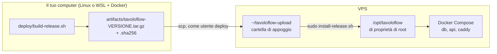
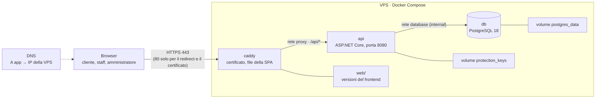

[English](../en/self-hosting.md) · **Italiano** · [中文](../zh-CN/self-hosting.md)

# Self-hosting di TavoloFlow

Questa guida è per chi vuole installare TavoloFlow su un proprio server: una VPS Linux, un dominio e Docker. Alla fine avrai l'app raggiungibile in HTTPS su un tuo sottodominio, per esempio `https://app.esempio.it`, con l'area amministratore, l'area staff installabile come PWA, i QR dei tavoli che puntano al tuo dominio e un backup automatico ogni notte.

È anche il racconto di come l'ho messa online io. Per costruire i pacchetti usavo un PC Windows con WSL2 (Ubuntu) e Docker Desktop; il server era una VPS di netcup; il dominio l'avevo registrato su OVHcloud e il DNS lo gestiva Cloudflare. Dove una scelta dipende dal mio caso lo scrivo, così puoi adattarla al tuo.

Come leggerla:

- la **Panoramica** spiega i pezzi e cosa ti serve: leggila prima di toccare qualsiasi cosa;
- la **Parte 1** è la prima installazione, da fare una volta sola;
- la **Parte 2** contiene le operazioni che ripeterai: nuovi rilasci, backup, manutenzione;
- la **Parte 3** è per le emergenze: verificare un backup e ripartire su un server nuovo;
- alla fine ci sono i problemi che ho incontrato e un riferimento rapido con la checklist.

Tutti gli script e le configurazioni stanno nella cartella [`deploy/`](../../deploy/). Com'è fatta l'app all'interno (moduli, identità, lock…) lo spiego nelle [note di sviluppo](development-notes.md#architettura); qui parlo solo di come la si mette e la si tiene online.

## Panoramica

### Come funziona un rilascio

Sul server non si compila niente: niente .NET SDK, niente Node, niente codice sorgente. Tutto viene costruito sul tuo computer, dentro container Docker, e impacchettato in un unico archivio. Il server riceve l'archivio, ne controlla l'integrità e lo installa con uno script.



Così il server resta piccolo e pulito, e ogni versione installata corrisponde esattamente a un archivio che hai ancora sul tuo computer: puoi reinstallarlo, oppure usarlo per tornare indietro o per ricostruire un server da zero.

### Architettura di produzione



Sulla VPS girano tre container, definiti in [`deploy/compose.yaml`](../../deploy/compose.yaml):

| Servizio | Immagine                  | Cosa fa                                                                                                     |
| -------- | ------------------------- | ----------------------------------------------------------------------------------------------------------- |
| `caddy`  | `caddy:2-alpine`          | riceve tutte le richieste, ottiene e rinnova il certificato HTTPS, serve i file della SPA, inoltra `/api/*` |
| `api`    | `tavoloflow-api:VERSIONE` | il backend ASP.NET Core, costruito da te e contenuto nel pacchetto                                          |
| `db`     | `postgres:18-alpine`      | il database                                                                                                 |

E quattro volumi, che sopravvivono a ogni aggiornamento o ricreazione dei container:

| Volume                       | Contenuto                                                                                                                            |
| ---------------------------- | ------------------------------------------------------------------------------------------------------------------------------------ |
| `postgres_data`              | i dati del database                                                                                                                  |
| `protection_keys`            | le chiavi di Data Protection, che cifrano i cookie di login e i codici dei tavoli (vedi le [note di sviluppo](development-notes.md)) |
| `caddy_data`, `caddy_config` | il certificato HTTPS e lo stato di Caddy                                                                                             |

Alcune scelte che contano:

- **Solo Caddy è esposto**, sulle porte 80 e 443. L'API e il database non pubblicano nessuna porta sull'host. Non è solo una questione di ordine: le porte pubblicate da Docker possono scavalcare le regole del firewall UFW, quindi l'unico modo sicuro per non esporre il database è non pubblicarne la porta.
- **Due reti separate.** `proxy` collega Caddy e l'API; `database` collega l'API e PostgreSQL ed è `internal`, cioè senza accesso a internet. Caddy non vede il database.
- **Caddy ha un IP fisso** (`172.30.80.2`). Dietro un proxy, l'API vede ogni richiesta arrivare da Caddy, quindi Caddy aggiunge gli header `X-Forwarded-For` (IP reale del visitatore) e `X-Forwarded-Proto` (se la richiesta era HTTPS). L'API si fida di questi header **solo** se arrivano da quell'indirizzo (`ReverseProxy__KnownProxies__0` in `compose.yaml`, letto in `Operations/DeploymentHosting.cs`): altrimenti chiunque potrebbe scriverli a mano e falsificare il proprio IP, aggirando il rate limit del login e del codice del tavolo.
- **Si riavvia da solo.** Ogni servizio ha `restart: unless-stopped` e Docker parte all'avvio del sistema: puoi chiudere la sessione SSH, e dopo un riavvio della VPS l'app torna su da sola.
- **I log non riempiono il disco:** al massimo 3 file da 10 MB per container, poi ruotano.
- **Un solo indirizzo.** Frontend e `/api` stanno sullo stesso sottodominio: niente CORS, e i cookie appartengono solo a quel sottodominio.

Sul server tutto quello che non sta nei volumi vive in `/opt/tavoloflow`. Dopo la prima installazione la cartella è così:

```text
/opt/tavoloflow/                  root:root 755
├── compose.yaml, Caddyfile       configurazione                         644
├── lib.sh, tf.sh                 funzioni comuni e scorciatoia Compose  644
├── install-release.sh            installazione e aggiornamento          644
├── rollback.sh                   ritorno a una versione precedente      644
├── bootstrap-admin.sh            primo amministratore, reset password   644
├── backup.sh                     backup                                 644
├── tavoloflow-backup.service     servizio systemd del backup            644
├── tavoloflow-backup.timer       timer systemd del backup               644
├── .env.example                  modello di configurazione              644
├── .env                          configurazione vera, con le password   600
├── .operation.lock               lucchetto: un rilascio, backup o rollback alla volta
├── state/                        700: current e previous, le versioni installate
├── backups/                      700: i backup
└── web/                          755: l'unica parte che Caddy legge
    ├── current -> releases/VERSIONE
    ├── releases/VERSIONE/        il frontend completo di ogni versione
    └── assets/                   i file JS e CSS di tutte le versioni, mai cancellati
```

### Cosa serve

| Cosa                  | Requisiti                                                                                          | Nel mio caso                                                        |
| --------------------- | -------------------------------------------------------------------------------------------------- | ------------------------------------------------------------------- |
| VPS                   | **AMD64 (x86-64)**, almeno 2 vCPU, 4 GB di RAM, 40 GB di disco, un IPv4 pubblico; Ubuntu 24.04 LTS | netcup VPS Lite 1 G12.5s (2 vCPU, 4 GB, 80 GB), data center europeo |
| Dominio               | un dominio di cui gestisci il DNS; userai un sottodominio                                          | `qiaotavoloflow.it` su OVHcloud                                     |
| DNS                   | qualsiasi gestore che ti faccia creare un record `A`                                               | Cloudflare, piano gratuito                                          |
| Computer per la build | Linux, oppure Windows con WSL2 + Docker Desktop; Git e Bash                                        | Windows 11, WSL2 Ubuntu, Docker Desktop                             |
| Email                 | un indirizzo vero, per gli avvisi sul certificato HTTPS                                            |                                                                     |

La VPS deve essere AMD64 perché lo script costruisce le immagini solo per `linux/amd64`: niente ARM. Il computer per la build, invece, può essere quello che vuoi, purché abbia Docker; su un Mac con Apple Silicon la build dovrebbe passare dall'emulazione e diventare più lenta, ma non l'ho provato.

Prima di cominciare, sappi che alcune cose sono fisse nel codice:

- **Euro e fuso orario di Roma.** Ogni ristorante nasce con `EUR` ed `Europe/Rome` (`Entities/Restaurant.cs`), e non c'è un'interfaccia per cambiarli. Il timer del backup gira alle 03:30 ora di Roma.
- **Tre lingue.** Area staff, area amministratore e menu del cliente sono in cinese, italiano o inglese. I messaggi di errore del server sono scritti in cinese: in italiano e in inglese l'interfaccia li traduce partendo dal codice dell'errore.
- **Una sola istanza.** Il rate limiter tiene i contatori in memoria: l'architettura è pensata per un'API sola su un server solo.

## Parte 1: prima installazione

I comandi indicano sempre dove vanno eseguiti: sul **tuo computer** (nel mio caso il terminale WSL) oppure sulla **VPS**. Nei comandi, `VPS_IP` è l'IPv4 pubblico della VPS e `app.esempio.it` il tuo sottodominio: sostituiscili con i tuoi valori.

### 1. Preparare il server

#### 1.1 La chiave SSH

Al server ci si collega con SSH, e invece di una password si usa una coppia di chiavi:

- la **chiave privata** resta sul tuo computer e non si condivide mai;
- la **chiave pubblica** va sul server, nel file `~/.ssh/authorized_keys` dell'utente con cui vuoi entrare: è la lista di chi può entrare come quell'utente.

Al login il client firma i dati della connessione con la chiave privata e il server verifica la firma con la chiave pubblica: la chiave privata non viaggia mai sulla rete. Il server non si fida di un computer, ma di chi possiede la chiave privata: custodiscila bene.

**Sul tuo computer:**

```bash
# Crea la coppia di chiavi: tavoloflow (privata) e tavoloflow.pub (pubblica)
ssh-keygen -t ed25519 -C "tavoloflow" -f ~/.ssh/tavoloflow
# Mostra la chiave pubblica: copia tutta la riga, da ssh-ed25519 a tavoloflow
cat ~/.ssh/tavoloflow.pub
```

Se la chiave esiste già, non rigenerarla: la sovrascriveresti.

#### 1.2 Installare Ubuntu

Installa **Ubuntu 24.04 LTS** dal pannello del tuo fornitore, scegliendo la chiave pubblica appena creata: l'installer la scrive in `/root/.ssh/authorized_keys`, così potrai entrare come root con la chiave.

Nel mio caso, netcup consegnava la VPS con Debian e l'ho reinstallata dal suo pannello del server (SCP):

1. in **Options → SSH Keys** ho salvato la chiave pubblica nel mio account;
2. in **Media → Images → Official Images** ho scelto Ubuntu 24.04 LTS Minimal, la partizione unica su tutto il disco, UEFI come proposto, e ho selezionato la chiave;
3. al termine il pannello mostra la password di root, e dalla console web (**Screen**) si vede il sistema avviato.

La reinstallazione cancella tutto il disco.

#### 1.3 Primo accesso come root

La prima volta che ti colleghi, SSH ti mostra l'impronta (fingerprint) del server e ti chiede se fidarti. Per essere sicuro di parlare proprio con la tua VPS, confrontala con quella vista dalla console web del fornitore.

**Sulla VPS, dalla console web del fornitore:**

```bash
ssh-keygen -lf /etc/ssh/ssh_host_ed25519_key.pub
```

**Sul tuo computer:**

```bash
# IdentitiesOnly=yes: usa solo la chiave indicata con -i
ssh -o IdentitiesOnly=yes -i ~/.ssh/tavoloflow root@VPS_IP
```

Rispondi `yes` solo se l'impronta coincide. Poi controlla sistema e architettura:

```bash
cat /etc/os-release   # deve dire Ubuntu 24.04
uname -m              # deve dire x86_64
```

#### 1.4 L'utente deploy

Non si lavora come root. Crei un utente normale, `deploy`, che entra con la chiave e diventa root solo quando serve, con `sudo` e la sua password. Così un attaccante dovrebbe avere sia la chiave privata sia la password di `deploy`.

**Sulla VPS, come root** (tieni aperta questa sessione finché non hai verificato il nuovo accesso):

```bash
apt update
apt install -y sudo openssh-server nano
# Crea l'utente con la sua cartella home; la password serve solo per sudo
adduser deploy
# Aggiunge deploy al gruppo sudo; senza -a perderebbe gli altri gruppi
usermod -aG sudo deploy
# Cartella .ssh accessibile solo a deploy
install -d -m 700 -o deploy -g deploy /home/deploy/.ssh
# Incolla la riga della chiave pubblica; Ctrl+O, Invio per salvare, Ctrl+X per uscire
nano /home/deploy/.ssh/authorized_keys
# nano, eseguito da root, crea il file come root: va restituito a deploy
chown deploy:deploy /home/deploy/.ssh/authorized_keys
chmod 600 /home/deploy/.ssh/authorized_keys
```

Se dalla console web non riesci a incollare, copia la chiave che root ha già: `cp /root/.ssh/authorized_keys /home/deploy/.ssh/authorized_keys`, poi gli stessi `chown` e `chmod`. Se proprietario o permessi sono sbagliati, SSH ignora la chiave senza dire perché: la chiave è giusta ma l'accesso fallisce.

**Sul tuo computer, in un nuovo terminale:**

```bash
ssh -o IdentitiesOnly=yes -i ~/.ssh/tavoloflow deploy@VPS_IP
whoami    # deploy
sudo -v   # chiede la password di deploy e deve riuscire
```

Da qui in avanti lavori sempre come `deploy`.

#### 1.5 Aggiornamenti, fuso orario e firewall

**Sulla VPS:**

```bash
sudo apt update
sudo apt upgrade -y
# python3 serve all'installer per controllare .env, dnsutils fornisce dig
sudo apt install -y ca-certificates curl openssl python3 ufw dnsutils nano
sudo timedatectl set-timezone Europe/Rome
# Prima permetti SSH, poi accendi il firewall: altrimenti ti chiudi fuori
sudo ufw allow OpenSSH
sudo ufw allow 80/tcp
sudo ufw allow 443/tcp
sudo ufw enable
sudo ufw status
```

Devono restare aperte solo tre porte: SSH, 80 e 443. Anche la 80 serve: Caddy la usa per ottenere il certificato e per reindirizzare HTTP su HTTPS. Se il fornitore ha anche un suo firewall (netcup lo ha nel pannello), lascialo con le impostazioni predefinite oppure tieni aperte le stesse porte in entrata e non bloccare l'uscita. Se il sistema chiede un riavvio, `sudo reboot` e poi rientra come `deploy`.

#### 1.6 Chiudere l'accesso con password e quello di root

Ora che `deploy` entra con la chiave, chiudi gli altri modi di entrare: niente login con password (chi non ha la chiave non può entrare, nemmeno indovinando) e niente login diretto come root.

**Sulla VPS** (tieni aperta una sessione con `sudo` funzionante finché non hai verificato):

```bash
# tee invece di "sudo echo ... > file": il redirect > lo esegue la shell di deploy, senza permessi
sudo tee /etc/ssh/sshd_config.d/00-tavoloflow.conf >/dev/null <<'EOF'
PasswordAuthentication no
KbdInteractiveAuthentication no
PermitRootLogin no
PubkeyAuthentication yes
EOF
# Controllo della sintassi: nessun output vuol dire nessun errore
sudo sshd -t
# Valori effettivi: tutti e tre devono essere "no"
sudo sshd -T | grep -E 'passwordauthentication|kbdinteractiveauthentication|permitrootlogin'
sudo systemctl reload ssh
```

Perché il nome inizia con `00-`: ero abituato all'idea che l'ultima impostazione vinca, ma in sshd è il contrario. sshd legge i file di `sshd_config.d/` in ordine alfabetico e, per ogni opzione, tiene **il primo valore** che trova. Le immagini cloud spesso contengono un file come `50-cloud-init.conf` con `PasswordAuthentication yes`; con `00-` la nostra impostazione arriva prima. Per lo stesso motivo servono entrambi i controlli: `-t` verifica solo la sintassi, mentre `-T` mostra il valore che vale davvero.

Poi, **da un nuovo terminale del tuo computer**, verifica di nuovo che `deploy` entri con la chiave e che `sudo -v` funzioni. Solo dopo chiudi la vecchia sessione. Se ti chiudi fuori, rimedi dalla console web del fornitore, che non passa da SSH.

#### 1.7 Installare Docker

Sul server servono solo Docker Engine e il plugin Compose, dal repository ufficiale di Docker ([istruzioni per Ubuntu](https://docs.docker.com/engine/install/ubuntu/)).

**Sulla VPS:**

```bash
# Aggiunge il repository di Docker con la sua chiave di firma
sudo install -m 0755 -d /etc/apt/keyrings
sudo curl -fsSL https://download.docker.com/linux/ubuntu/gpg -o /etc/apt/keyrings/docker.asc
sudo chmod a+r /etc/apt/keyrings/docker.asc
sudo tee /etc/apt/sources.list.d/docker.sources >/dev/null <<EOF
Types: deb
URIs: https://download.docker.com/linux/ubuntu
Suites: $(. /etc/os-release && echo "$VERSION_CODENAME")
Components: stable
Architectures: $(dpkg --print-architecture)
Signed-By: /etc/apt/keyrings/docker.asc
EOF
# Installa e avvia Docker, anche a ogni accensione
sudo apt update
sudo apt install -y docker-ce docker-ce-cli containerd.io docker-buildx-plugin docker-compose-plugin
sudo systemctl enable --now docker
# Verifica: versione di Client e Server, poi il messaggio di hello-world
sudo docker version
sudo docker compose version
sudo docker run --rm hello-world
```

**Non aggiungere `deploy` al gruppo `docker`.** Chi controlla Docker può avviare un container che monta qualsiasi file del sistema come root: far parte del gruppo `docker` equivale, in pratica, a essere root senza password. Tutti i comandi Docker si lanciano con `sudo`.

### 2. Dominio e DNS

Crea un record DNS che faccia puntare il sottodominio all'IPv4 della VPS:

| Campo  | Valore                                      |
| ------ | ------------------------------------------- |
| Tipo   | `A`                                         |
| Nome   | `app` (diventa `app.esempio.it`)            |
| Valore | l'IPv4 della VPS, senza `https://` né porta |
| TTL    | automatico                                  |

Non creare un record `AAAA` (IPv6) per il sottodominio: il setup usa solo IPv4.

**Se usi Cloudflare, scegli «DNS only» (la nuvola grigia).** La nuvola arancione sembra un regalo (CDN, protezione, HTTPS), ma così le richieste passerebbero dai server di Cloudflare: l'API vedrebbe arrivare tutto dagli IP di Cloudflare invece che dai visitatori, il rate limit per IP smetterebbe di funzionare e il certificato HTTPS andrebbe configurato in un altro modo. Con la nuvola grigia Cloudflare si limita a risolvere il nome, e il browser parla direttamente con Caddy.

Nel mio caso volevo prendere tutto da OVHcloud, ma il modello di VPS europea che mi serviva era esaurito, e Cloudflare non vende domini `.it`: così il dominio è registrato su OVHcloud, il DNS lo gestisce Cloudflare e la VPS è di netcup. Per passare il DNS a Cloudflare:

1. ho aggiunto il dominio a Cloudflare, piano gratuito, controllando che i record importati fossero corretti (se hai la posta sul dominio, tieni MX, SPF, DKIM e DMARC);
2. su OVHcloud ho **prima disattivato il DNSSEC**, poi in **DNS servers** ho sostituito i nameserver con i due assegnati da Cloudflare (sostituiti, non aggiunti come record NS);
3. quando Cloudflare ha segnato il dominio come Active, ho riattivato il DNSSEC da Cloudflare e copiato il record DS su OVHcloud.

È stato un caso, ma è diventato un vantaggio: dominio, DNS e server stanno da tre fornitori diversi e non sono legati tra loro, e per cambiare VPS basta modificare un record `A`, senza ristampare i QR né toccare la configurazione.

Il dominio principale e `www` non devono puntare alla VPS: nel mio caso sono riservati a un sito vetrina separato. Caddy risponde solo al sottodominio dell'app.

**Verifica, dal tuo computer o dalla VPS:**

```bash
dig +short NS esempio.it                    # i nameserver del tuo gestore DNS
dig @1.1.1.1 +short A app.esempio.it        # l'IPv4 della VPS
dig @1.1.1.1 +short AAAA app.esempio.it     # nessun output
```

Non andare avanti finché il DNS non è giusto: Caddy ne ha bisogno per ottenere il certificato.

### 3. Costruire il pacchetto di release

Prima fai il commit delle tue modifiche: l'ID della versione contiene l'hash del commit, ma la build usa i file della cartella di lavoro, e con modifiche rimaste fuori dal commit le due cose non corrisponderebbero più.

**Sul tuo computer, nella cartella del repository, con Docker in esecuzione:**

```bash
PUBLIC_ORIGIN=https://app.esempio.it bash deploy/build-release.sh
```

`PUBLIC_ORIGIN` è l'indirizzo pubblico dell'app: tutto minuscolo, senza porta, percorso o barra finale. Lo script ([`deploy/build-release.sh`](../../deploy/build-release.sh)):

- **costruisce tutto dentro container**, con Node 24 per il frontend e .NET 10 per il backend: il risultato non dipende da cosa hai installato sul tuo computer. La prima volta scarica le immagini di base e ci mette qualche minuto;
- **costruisce per `linux/amd64`**, l'architettura della VPS;
- **scrive l'indirizzo pubblico dentro il frontend.** I QR dei tavoli vengono generati nel browser del titolare e contengono questo indirizzo (`VITE_PUBLIC_BASE_URL`). La build non legge il tuo `.env.local`, dove magari c'è l'indirizzo della rete di casa usato per provare l'app dal telefono: un QR stampato con quell'indirizzo non funzionerebbe per nessun cliente. L'indirizzo finisce anche in `public-origin.txt`, che l'installer confronterà con il dominio configurato sul server;
- **prepara il programma delle migrazioni**, `efbundle`, dentro l'immagine dell'API (vedi il passo 5);
- **mette nel pacchetto solo i file di una lista esplicita**: nessun `.env` vero, nessuna chiave, nessun dato di sviluppo, nessun `node_modules`;
- **calcola i checksum** di ogni file (`SHA256SUMS`) e di tutto l'archivio (`.sha256`).

L'ID della versione è l'ora UTC della build più l'hash breve del commit. Alla fine lo script stampa i due file creati, per esempio:

```text
artifacts/tavoloflow-20261026T094909Z-4c9535b.tar.gz
artifacts/tavoloflow-20261026T094909Z-4c9535b.tar.gz.sha256
```

Dentro l'archivio (circa 120 MB) ci sono:

```text
api-image.tar.gz     l'immagine Docker dell'API, con efbundle
image.id             l'ID dell'immagine, controllato durante l'installazione
frontend/            i file statici della SPA
ops/                 script e configurazioni che finiranno in /opt/tavoloflow
release.txt          l'ID della versione
public-origin.txt    l'indirizzo pubblico scritto nel frontend
SHA256SUMS           il checksum di ogni file
```

Tieni sul tuo computer almeno il pacchetto della versione in produzione e quello precedente: servono per tornare indietro e per ricostruire il server.

**Facoltativo: provare tutto in locale.** [`deploy/smoke-test.sh`](../../deploy/smoke-test.sh) installa il pacchetto dentro un Docker temporaneo e isolato (Docker-in-Docker, con un certificato di prova locale) e controlla installazione, migrazioni, HTTPS, cookie e CSRF delle tre identità, due rilasci di fila, backup, ripristino e rollback, poi cancella tutto. Usa l'indirizzo scritto nel pacchetto, quindi funziona con qualsiasi `PUBLIC_ORIGIN`:

```bash
PUBLIC_ORIGIN=https://app.esempio.it bash deploy/build-release.sh
bash deploy/smoke-test.sh artifacts/tavoloflow-VERSIONE.tar.gz
```

**Caricare il pacchetto sulla VPS, dal tuo computer:**

```bash
# L'ID della versione stampato dallo script
RELEASE=20261026T094909Z-4c9535b
# Apici singoli: ~ deve diventare la home di deploy sulla VPS, non la tua
ssh -i ~/.ssh/tavoloflow deploy@VPS_IP 'mkdir -p ~/tavoloflow-upload'
scp -i ~/.ssh/tavoloflow \
  "artifacts/tavoloflow-$RELEASE.tar.gz" \
  "artifacts/tavoloflow-$RELEASE.tar.gz.sha256" \
  deploy@VPS_IP:~/tavoloflow-upload/
```

Il pacchetto arriva in una **cartella di appoggio** di `deploy`, non direttamente in `/opt/tavoloflow`: quella cartella è di root e `scp`, che entra come `deploy`, non ci può scrivere. Ed è anche più sicuro: un file arrivato da fuori resta in un posto senza privilegi finché non è stato controllato. Se il caricamento si interrompe, ricarica lo stesso pacchetto.

### 4. Preparare `/opt/tavoloflow`

**Sulla VPS** (le variabili del tuo computer non arrivano qui: imposta di nuovo `RELEASE`):

```bash
RELEASE=20261026T094909Z-4c9535b
cd ~/tavoloflow-upload
# Checksum dell'archivio: deve stampare OK
sha256sum -c "tavoloflow-$RELEASE.tar.gz.sha256"
# Ogni versione nella sua cartella: i file dell'archivio non hanno una cartella principale
mkdir "$RELEASE"
tar -xzf "tavoloflow-$RELEASE.tar.gz" -C "$RELEASE"
cd "$RELEASE"
# Checksum di ogni file: nessun output vuol dire tutto a posto
sha256sum --check --quiet SHA256SUMS
# La cartella di produzione e i file operativi appartengono a root
sudo install -d -o root -g root -m 755 /opt/tavoloflow
sudo install -o root -g root -m 644 ops/* ops/.env.example /opt/tavoloflow/
# Il vero .env, leggibile solo da root. SOLO alla prima installazione!
sudo install -o root -g root -m 600 ops/.env.example /opt/tavoloflow/.env
# Genera la password del database (copiala) e apri .env
openssl rand -hex 32
sudo nano /opt/tavoloflow/.env
```

Qui `install` non installa pacchetti: copia un file e ne imposta insieme proprietario e permessi. `ops/*` non comprende i file nascosti, per questo `.env.example` è scritto a parte. Se un checksum fallisce, ricarica il pacchetto: non saltare il controllo.

**Non rieseguire mai la riga che crea `.env`** nei rilasci successivi: sovrascriveresti la configurazione con il modello vuoto.

#### Il file `.env`

| Variabile           | Cosa scrivere                                                                             |
| ------------------- | ----------------------------------------------------------------------------------------- |
| `DOMAIN`            | il sottodominio, per esempio `app.esempio.it`, senza `https://`: `https://` + `DOMAIN` deve essere uguale a `PUBLIC_ORIGIN` |
| `ACME_EMAIL`        | la tua email vera, per gli avvisi sul certificato                                         |
| `POSTGRES_PASSWORD` | i 64 caratteri esadecimali generati da `openssl rand -hex 32`                             |

Il resto lascialo com'è. Niente virgolette e niente spazi attorno a `=`.

- **La password del database vale solo la prima volta.** PostgreSQL crea l'utente con `POSTGRES_PASSWORD` solo quando il volume dei dati è vuoto. Se poi la cambi in `.env`, il database non lo sa, e l'API non riesce più a collegarsi. È in esadecimale perché contiene solo `0-9` e `a-f`: nessun carattere da proteggere né in Compose né nella stringa di connessione.
- **L'installer controlla tre cose** prima di fare qualsiasi cosa: che la password sia di 64 caratteri esadecimali, che l'email non sia quella del modello, e che `https://` + `DOMAIN` sia uguale a `public-origin.txt` del pacchetto. Così non puoi installare un frontend i cui QR puntano a un altro dominio.
- `PROXY_SUBNET`, `PROXY_DYNAMIC_RANGE` e `CADDY_IP` definiscono la rete tra Caddy e API e l'IP fisso di Caddy. Cambiali, tutti e tre insieme e prima del primo avvio, solo se sulla VPS c'è già un'altra rete Docker che usa `172.30.80.0/24`.
- L'installer controlla già la configurazione con `docker compose config --quiet`; dopo l'installazione puoi farlo tu con `sudo bash /opt/tavoloflow/tf.sh config --quiet`. Senza `--quiet` stampa tutto, password comprese.

#### Perché questi permessi

| Percorso                          | Permessi  | Cosa può fare `deploy`                                         |
| --------------------------------- | --------- | -------------------------------------------------------------- |
| `/home/deploy/tavoloflow-upload/` | di deploy | tutto: è la cartella di appoggio                               |
| `/opt/tavoloflow/`                | 755       | entrare e leggere, ma non creare, cancellare o sostituire file |
| script e configurazioni           | 644       | solo leggere                                                   |
| `.env`                            | 600       | niente, nemmeno leggere                                        |

Il motivo: ogni notte systemd esegue **come root** `/opt/tavoloflow/backup.sh`, che a sua volta carica `lib.sh` e `compose.yaml`. Se `deploy` potesse modificare uno di questi file, potrebbe scriverci un comando qualsiasi e farlo eseguire a root al backup successivo: root senza conoscere la password di `sudo`. Anche la cartella va protetta, perché per cancellare o sostituire un file basta il permesso di scrittura sulla cartella che lo contiene. Per questo si usa `install -o root` e mai `cp -a`, che conserverebbe il proprietario `deploy` dei file caricati (vedi «Problemi incontrati»).

**Controllo dei permessi, sulla VPS:**

```bash
# Proprietario e permessi dei file principali
sudo stat -c '%U:%G %a %n' /opt/tavoloflow /opt/tavoloflow/backup.sh /opt/tavoloflow/lib.sh /opt/tavoloflow/compose.yaml /opt/tavoloflow/.env
# File non di root, o scrivibili da gruppo e altri: non deve stampare niente
sudo find /opt/tavoloflow \( ! -user root -o ! -group root -o \( ! -type l -perm /022 \) \) -print
# Dal punto di vista di deploy: SENZA sudo
test ! -w /opt/tavoloflow && test ! -w /opt/tavoloflow/backup.sh && echo 'deploy non può modificare né sostituire lo script di backup'
```

Ti aspetti `root:root` ovunque, `755` per la cartella, `644` per script e configurazioni, `600` per `.env`, nessun output dal `find` e il messaggio finale. Ripeti il controllo dopo ogni rilascio e prima di attivare il backup automatico.

### 5. Installare

**Sulla VPS, sempre dentro la cartella estratta** (per esempio `~/tavoloflow-upload/20261026T094909Z-4c9535b/`):

```bash
sudo bash ops/install-release.sh "$PWD" /opt/tavoloflow
```

Si lancia lo script **del pacchetto nuovo**, così script e pacchetto sono sempre della stessa versione. Il primo argomento è la cartella del pacchetto, il secondo quella di produzione. Lo script ([`deploy/install-release.sh`](../../deploy/install-release.sh)), nell'ordine:

1. **controlla**: che sia eseguito come root, che `.env` esista, i checksum del pacchetto;
2. **ripara i permessi** di `/opt/tavoloflow` prima di leggere o eseguire qualsiasi file al suo interno;
3. **prende il lucchetto** `.operation.lock`, così rilascio, backup e rollback non si sovrappongono mai;
4. **controlla `.env`** (le tre regole viste sopra);
5. **carica l'immagine dell'API** con `docker load` e verifica che il suo ID sia quello di `image.id`;
6. **prepara le cartelle** `state/`, `backups/` (700) e `web/` (755);
7. se c'è già una versione installata, **ferma l'API e fa un backup**; alla prima installazione salta questo passo;
8. **copia i file operativi** in `/opt/tavoloflow` (`.env` non è tra questi e non viene mai toccato);
9. **avvia il database** e aspetta che sia pronto; al primo avvio PostgreSQL crea l'utente con la password di `.env`;
10. **applica le migrazioni**;
11. **copia il frontend** in `web/releases/VERSIONE/` e i suoi file JS e CSS in `web/assets/`;
12. **avvia la nuova API** e aspetta che risponda sano su `/health/ready` (un controllo che il database sia raggiungibile);
13. **sposta il link `web/current`** sulla nuova versione;
14. **ricrea Caddy**, che alla prima volta chiede il certificato;
15. **scrive la versione** in `state/current` (e la precedente in `state/previous`).

Le immagini di PostgreSQL e Caddy non sono nel pacchetto: al primo avvio le scarica Docker, ed è normale vederle scaricare.

Il passo 13 è **atomico**: lo script crea un link temporaneo e poi lo rinomina sopra `current` con `mv -T`, un'unica operazione del file system. Un visitatore vede la versione vecchia o quella nuova, mai una via di mezzo.

#### Le migrazioni

In sviluppo, dopo aver cambiato il modello, crei una migrazione con `dotnet ef migrations add` e la applichi al database locale con `dotnet ef database update`. In produzione non si può: sul server non ci sono né SDK né sorgenti.

- **`efbundle`.** Durante la build, [`Dockerfile.api`](../../deploy/Dockerfile.api) esegue `dotnet ef migrations bundle`, che impacchetta tutte le migrazioni in un programma autonomo, `efbundle`, dentro l'immagine dell'API. Fa lo stesso lavoro di `database update`, ma senza SDK. L'installer lo esegue in un container usa e getta: `compose run --rm --entrypoint /app/efbundle api`.
- **Si può ripetere.** EF Core segna le migrazioni applicate nella tabella `__EFMigrationsHistory`: a ogni rilascio `efbundle` gira comunque, e applica solo quelle nuove.
- **Mai all'avvio dell'API.** Un container si riavvia per tanti motivi (un crash, un riavvio della VPS): con le migrazioni all'avvio, il database potrebbe cambiare in qualsiasi momento. Così, invece, cambia solo durante un rilascio, dopo un backup, e se una migrazione fallisce lo script si ferma invece di lasciare un'API che crolla in continuazione.
- **Solo in avanti.** Non si annulla una migrazione in produzione (per esempio con `dotnet ef database update 0`, che cancella tabelle e dati): se qualcosa è sbagliato, si scrive una nuova migrazione che lo corregge. Questo limita anche il rollback (vedi Parte 2).

#### HTTPS

Il certificato lo gestisce Caddy da solo con il protocollo ACME (Let's Encrypt o ZeroSSL): lo ottiene al primo avvio e lo rinnova prima della scadenza, senza cron né comandi. Perché funzioni servono tre cose: il record `A` deve già puntare alla VPS, le porte 80 e 443 devono essere raggiungibili da internet e `ACME_EMAIL` deve essere un indirizzo vero.

Il [`Caddyfile`](../../deploy/Caddyfile) serve solo il dominio di `DOMAIN`. Le richieste HTTP per qualsiasi altro nome, o direttamente all'IP, ricevono un 404 invece di un redirect: la VPS non finge di essere il sito di qualcun altro. Lo stesso file decide anche la cache: `/api` mai in cache, i file con l'hash nel nome in cache per un anno, `index.html`, `sw.js` e il manifest sempre da ricontrollare (`no-cache`).

#### Controlli

**Sulla VPS:**

```bash
# db, api e caddy devono essere running e healthy
sudo bash /opt/tavoloflow/tf.sh ps
# Il certificato: cerca errori nelle ultime righe
sudo bash /opt/tavoloflow/tf.sh logs --tail 80 caddy
```

`tf.sh` è una scorciatoia per `docker compose` con la cartella, il `.env` e il `compose.yaml` di produzione e con la versione letta da `state/current`. Tutti i comandi Compose passano da lì; vuole `sudo` perché `deploy` non è nel gruppo `docker` e `.env` lo legge solo root.

**Dal tuo computer:**

```bash
curl -I http://app.esempio.it                    # redirect a https
curl -I https://app.esempio.it/staff/login       # 200, nessun errore di certificato
curl -I https://app.esempio.it/sw.js             # JavaScript, Cache-Control: no-cache
curl -I https://app.esempio.it/staff.webmanifest # application/manifest+json, no-cache
curl -i https://app.esempio.it/api/auth/csrf     # JSON, Cache-Control: no-store
```

Non usare `curl -k` per nascondere un problema di certificato: va risolto. `https://app.esempio.it/` rimanda a `/staff`.

### 6. Primo accesso

#### L'amministratore della piattaforma

Il database è vuoto, e l'amministratore della piattaforma è l'unico che può creare ristoranti. Il primo lo crei dalla VPS:

```bash
sudo bash /opt/tavoloflow/bootstrap-admin.sh
```

Chiede nome utente e password (6–128 caratteri; mentre scrivi non si vede niente, è normale). Lo script ([`bootstrap-admin.sh`](../../deploy/bootstrap-admin.sh)) avvia un container usa e getta dall'immagine dell'API con il comando `--seed-platform-admin`, che crea l'account e termina senza servire richieste (`Operations/MaintenanceCommands.cs`). La password arriva al container come variabile d'ambiente passata per nome (`-e NOME`): non compare tra gli argomenti dei processi, né nella cronologia della shell, né in `.env`. Il comando crea l'amministratore solo se non ne esiste ancora nessuno: rilanciato con lo stesso nome non cambia niente, con un nome diverso si rifiuta.

#### I tre ingressi

| Chi                              | Indirizzo                                             |
| -------------------------------- | ----------------------------------------------------- |
| Amministratore della piattaforma | `https://app.esempio.it/platform/login`               |
| Titolare e staff                 | `https://app.esempio.it/staff/login`                  |
| Cliente                          | `https://app.esempio.it/q/{token}`, dal QR del tavolo |

#### Il primo ristorante

1. Entra in `/platform/login` (la lingua si cambia in alto) e crea il ristorante: nome, lingua predefinita del menu, nomi utente del titolare e dello staff, primo periodo di abbonamento.
2. Salva subito le due **password temporanee**: vengono mostrate una sola volta.
3. Il titolare entra in `/staff/login` e, al primo accesso, deve impostare una nuova password («Imposta la nuova password»). Poi prepara il menu (categorie, piatti, prezzi, allergeni) e i tavoli in «Tavoli e QR».
4. Lo staff fa lo stesso primo accesso con la sua password temporanea.
5. Un ristorante nasce **sospeso** e con gli ordini disattivati: dall'area amministratore attiva il servizio, poi dalla Sala il titolare o lo staff accende «Ordini dal QR». Riattivare il servizio non riaccende da solo gli ordini.
6. Scarica e stampa il QR di un tavolo e controlla che, scansionato, apra `https://app.esempio.it/q/...` e non `localhost` o un indirizzo di casa.
7. Fai un giro completo: apri il tavolo dalla Sala, scansiona il QR con un telefono, inserisci il codice del tavolo, ordina, segna i piatti pronti in Cucina, chiudi il conto da titolare e ritrovalo nello Storico conti.

L'amministratore non può chiudere i conti al posto del titolare. E gli ordini di prova restano nello storico: per le prove usa un ristorante chiaramente di prova, non quello vero, invece di cancellare righe a mano con SQL.

#### La PWA dello staff

Su ogni dispositivo del ristorante apri `https://app.esempio.it/staff` e installa l'app:

- **Android, computer (Chrome, Edge):** dalla Home dell'app, sezione «Installa su questo dispositivo», pulsante «Installa app», oppure dal menu del browser;
- **iPhone e iPad (Safari):** «Condividi» → «Aggiungi alla schermata Home»; alla prima apertura dall'icona bisogna accedere di nuovo.

Aperta dall'icona, controlla Home, Cucina e Conto; in Cucina attiva il suono e lo schermo sempre acceso. Senza rete deve comparire una pagina che lo segnala. I clienti su `/q/...` e l'area amministratore non devono mai proporre l'installazione. I dettagli sono in [`pwa.md`](../reference/pwa.md).

### 7. Attivare i backup, prima dei dati veri

Fallo adesso, prima che il ristorante inserisca il menu vero. Anch'io avevo rimandato (vedi «Problemi incontrati»).

**Sulla VPS:**

```bash
# Un backup a mano, per vedere che lo script funziona
sudo bash /opt/tavoloflow/backup.sh
# Copia servizio e timer dove systemd li legge
sudo install -o root -g root -m 644 /opt/tavoloflow/tavoloflow-backup.service /etc/systemd/system/
sudo install -o root -g root -m 644 /opt/tavoloflow/tavoloflow-backup.timer /etc/systemd/system/
sudo systemctl daemon-reload
# Attiva il timer, da subito e a ogni avvio (non lancia un backup adesso)
sudo systemctl enable --now tavoloflow-backup.timer
# Prossima esecuzione e backup esistenti
sudo systemctl list-timers tavoloflow-backup.timer
sudo ls -lh /opt/tavoloflow/backups/
```

In systemd un'attività programmata è fatta di due file: il **servizio** dice cosa fare, il **timer** quando farlo.

| File                        | Riga                                    | Significato                                                     |
| --------------------------- | --------------------------------------- | --------------------------------------------------------------- |
| `tavoloflow-backup.service` | `Type=oneshot`                          | parte, fa il lavoro e finisce; non è un servizio sempre attivo  |
|                             | `User=root`                             | gira come root (per questo i permessi del passo 4)              |
|                             | `Requires=` / `After=docker.service`    | ha bisogno di Docker e parte dopo                               |
|                             | `UMask=0077`                            | i file creati sono leggibili solo da root                       |
| `tavoloflow-backup.timer`   | `OnCalendar=*-*-* 03:30:00 Europe/Rome` | ogni giorno alle 03:30, ora di Roma                             |
|                             | `RandomizedDelaySec=300`                | con un ritardo casuale fino a 5 minuti                          |
|                             | `Persistent=true`                       | se a quell'ora il server era spento, lo recupera all'accensione |

I file in `/opt/tavoloflow` sono solo le copie arrivate con il pacchetto: systemd legge quelli in `/etc/systemd/system/`. Per questo vanno copiati, e ricopiati se un rilascio li cambia.

Poi scarica subito il primo backup sul tuo computer, come spiegato in Parte 2, «Backup». E, appena puoi, fai una prova di ripristino (Parte 3).

## Parte 2: operazioni ricorrenti

### Rilasciare una nuova versione

È lo stesso percorso della prima installazione, senza toccare `.env` e senza creare l'amministratore.

**Prima di iniziare:**

1. Il codice è testato e **committato**.
2. Docker è in esecuzione sul tuo computer.
3. Controlla se ci sono nuove migrazioni. L'ID della versione in produzione (`sudo cat /opt/tavoloflow/state/current` sulla VPS) finisce con l'hash del commit da cui è stata costruita:

   ```bash
   # Sul tuo computer: sostituisci 4c9535b con l'hash della versione in produzione.
   # Nessun output = nessuna nuova migrazione
   git log --oneline 4c9535b..HEAD -- backend/TavoloFlow.Api/Data/Migrations
   ```

4. Se ci sono migrazioni, o è un aggiornamento importante, scarica prima l'ultimo backup sul tuo computer.
5. Scegli un orario di chiusura: mentre l'installer fa backup e migrazioni e riavvia l'API, le pagine si aprono ma ogni richiesta a `/api` fallisce.

**Sul tuo computer:**

```bash
PUBLIC_ORIGIN=https://app.esempio.it bash deploy/build-release.sh
RELEASE=NUOVA_VERSIONE
scp -i ~/.ssh/tavoloflow \
  "artifacts/tavoloflow-$RELEASE.tar.gz" \
  "artifacts/tavoloflow-$RELEASE.tar.gz.sha256" \
  deploy@VPS_IP:~/tavoloflow-upload/
```

`scp` copia i file ma non apre una shell sulla VPS. **Dal tuo computer**, entra come `deploy` (oppure torna a una sessione SSH già aperta):

```bash
ssh -o IdentitiesOnly=yes -i ~/.ssh/tavoloflow deploy@VPS_IP
```

**Sulla VPS** (imposta di nuovo `RELEASE`: le variabili del tuo computer non vengono trasferite):

```bash
RELEASE=NUOVA_VERSIONE
cd ~/tavoloflow-upload
sha256sum -c "tavoloflow-$RELEASE.tar.gz.sha256"
mkdir "$RELEASE"
tar -xzf "tavoloflow-$RELEASE.tar.gz" -C "$RELEASE"
# Sei in ~/tavoloflow-upload, quindi il percorso comincia con $RELEASE/
sudo bash "$RELEASE/ops/install-release.sh" "$PWD/$RELEASE" /opt/tavoloflow
sudo bash /opt/tavoloflow/tf.sh ps
```

Il controllo dei singoli file (`SHA256SUMS`) lo rifà l'installer all'inizio. Quando trova una versione già installata, l'installer fa questo:

```text
ferma l'API → backup → migrazioni → nuova API → sposta web/current → ricrea Caddy → salva la versione
└──────────────────── l'API non risponde ────────────────────┘
```

- **Il backup c'è sempre**, anche quando non ci sono migrazioni nuove.
- **L'API si ferma prima del backup**, così durante il backup nessuno scrive e la copia è coerente.
- **Il backup viene prima delle migrazioni**: se una migrazione va male, c'è la copia di com'era prima.

**Le pagine già aperte.** Una Cucina rimasta aperta tutto il giorno ha in memoria il frontend vecchio, e quando cambia pagina carica pezzi di codice (il router divide il codice per pagina) che si chiamano come nella versione vecchia. Per questo `web/assets/` conserva i file di **tutte** le versioni: con l'hash nel nome non si sovrascrivono mai, e una pagina vecchia trova sempre i suoi. Il codice nuovo arriva solo quando la pagina viene ricaricata o l'app riaperta. Nel frattempo, però, la pagina vecchia parla con l'API nuova: le modifiche all'API devono restare compatibili con i client della versione precedente, altrimenti bisogna far ricaricare tutti i dispositivi.

**Dopo il rilascio** controlla il login, una lettura (per esempio la Cucina o il Conto) e il cambio di pagina nella PWA. Se una scrittura mostra un esito da verificare, segui l'interfaccia: l'app controlla con una GET, e reinviare alla cieca potrebbe ripetere l'operazione.

Se il rilascio ha cambiato `tavoloflow-backup.service` o `.timer`, l'installer aggiorna solo le copie in `/opt/tavoloflow`: ripeti le due righe `install` e `daemon-reload` del passo 7 della Parte 1.

### Quando un rilascio va male

L'installer si ferma al primo errore. Leggi i log prima di fare qualsiasi altra cosa:

```bash
sudo bash /opt/tavoloflow/tf.sh logs --tail 100 api db caddy
```

- **Non cancellare volumi e non ripristinare subito il database.** Un errore dello script non cancella dati.
- Se l'API è rimasta ferma, tieni il ristorante fuori servizio finché non hai capito.
- Dopo la correzione, rilascia con un **ID nuovo**: lo stesso ID viene rifiutato sia dalla build (l'archivio esiste già) sia dall'installer (la cartella `web/releases/VERSIONE` esiste già). Rieseguire le migrazioni non fa danni.

Se fallisce proprio la prima installazione, `state/current` non esiste ancora e `tf.sh` non sa quale versione usare. Passala tu, con `env` dopo `sudo`, perché `sudo` cancella le variabili d'ambiente scritte prima:

```bash
sudo env RELEASE_ID=VERSIONE_FALLITA bash /opt/tavoloflow/tf.sh logs --tail 100 api db caddy
```

#### Tornare alla versione precedente

```bash
sudo cat /opt/tavoloflow/state/current
sudo cat /opt/tavoloflow/state/previous
# Solo dopo aver verificato che il codice vecchio funziona con lo schema attuale
sudo bash /opt/tavoloflow/rollback.sh --schema-compatible VERSIONE_PRECEDENTE
```

[`rollback.sh`](../../deploy/rollback.sh) controlla che frontend e immagine della versione vecchia ci siano ancora, ferma l'API, fa un backup, avvia l'API vecchia, riporta `web/current` al frontend vecchio, ricrea Caddy e aggiorna `state/`. **Cambia solo il codice, non il database**: le migrazioni restano applicate e gli ordini nel frattempo restano. Il codice vecchio deve quindi funzionare sullo schema nuovo:

| Cosa ha fatto la migrazione nuova                  | Il codice vecchio funziona?               |
| -------------------------------------------------- | ----------------------------------------- |
| ha aggiunto una tabella o una colonna nullable     | di solito sì: non le conosce e non le usa |
| ha cancellato o rinominato una colonna             | no: cerca una colonna che non c'è più     |
| ha aggiunto una colonna obbligatoria senza default | no: i suoi INSERT non la riempiono        |

L'opzione `--schema-compatible` è obbligatoria proprio per farti fermare a pensarci: senza, lo script si rifiuta. Se lo schema non è compatibile, la strada migliore è correggere e rilasciare una versione nuova; l'alternativa è ripristinare il backup a ristorante chiuso, perdendo quello che è successo dopo.

### Backup

Ogni esecuzione di [`backup.sh`](../../deploy/backup.sh) crea un archivio in `/opt/tavoloflow/backups/`:

```text
tavoloflow-20261027T023000Z-12345.tar.gz    ora UTC e numero del processo
├── database.dump      il database, con pg_dump
├── keys.tar.gz        le chiavi di Data Protection
├── production.env     una copia di .env, password comprese
├── compose.yaml, Caddyfile
├── state/             le versioni installate in quel momento
└── SHA256SUMS
```

- **`pg_dump` legge tutto da un'unica istantanea:** anche se mentre lavora arriva un ordine, il file è coerente, come fotografato in un solo istante.
- **Le chiavi vanno sempre con il database.** Cookie di login e codici dei tavoli sono cifrati con quelle chiavi: con il database ma senza le chiavi, tutti i dispositivi devono rifare il login e i codici dei tavoli aperti diventano illeggibili.
- **Non ci sono** le immagini Docker né il frontend (sono nei pacchetti sul tuo computer), né il certificato (su un server nuovo Caddy ne chiede un altro). Le foto dei piatti sono invece incluse in `database.dump`, perché sono salvate nel database.
- **Contiene password e chiavi:** mai in una cartella pubblica, mai in Git.
- Il backup si scrive prima in un file `.part` e viene rinominato solo alla fine: non resta mai un backup scritto a metà. Usa lo stesso lucchetto di rilascio e rollback: se trova un rilascio in corso, esce con un errore.

Un backup nasce in quattro casi: ogni notte con il timer, a ogni rilascio (prima delle migrazioni), a ogni rollback e quando lo lanci a mano. Tutti finiscono nella stessa cartella, e quelli **più vecchi di 7 giorni vengono cancellati**: se il problema di un rilascio salta fuori dopo otto giorni, il backup di prima del rilascio non c'è più sul server. Anche per questo conviene scaricarli.

#### Scaricare un backup sul tuo computer

Un backup che sta solo sul server sparisce insieme al server (disco rotto, VPS cancellata, account bloccato). Quanto spesso lo scarichi decide quanti giorni di dati perderesti nel caso peggiore; io avevo scelto una volta a settimana, più prima di ogni rilascio importante.

Non si può scaricare con un solo comando: i backup sono di root e `deploy` non li può leggere, e `ssh deploy@VPS_IP sudo cat ...` non funziona perché `sudo` chiede la password e senza un terminale interattivo non c'è dove scriverla. Quindi si fa una copia temporanea che appartiene a `deploy`.

**Sulla VPS, in un terminale interattivo** (trova il nome con `sudo ls -lh /opt/tavoloflow/backups/`):

```bash
BACKUP=tavoloflow-DATA-NUMERO.tar.gz
install -d -m 700 /home/deploy/tavoloflow-download
sudo install -m 600 -o deploy -g deploy \
  "/opt/tavoloflow/backups/$BACKUP" "/home/deploy/tavoloflow-download/$BACKUP"
```

**Sul tuo computer:**

```bash
BACKUP=tavoloflow-DATA-NUMERO.tar.gz
# I file creati da qui in poi sono leggibili solo da te
umask 077
mkdir -p ~/tavoloflow-backups
scp -i ~/.ssh/tavoloflow \
  "deploy@VPS_IP:/home/deploy/tavoloflow-download/$BACKUP" \
  "$HOME/tavoloflow-backups/$BACKUP"
# Se elenca i file, l'archivio è integro
tar -tzf "$HOME/tavoloflow-backups/$BACKUP"
```

**Di nuovo sulla VPS**, cancella la copia temporanea (l'originale resta in `backups/`):

```bash
rm -- "/home/deploy/tavoloflow-download/$BACKUP"
```

Su WSL, `~/tavoloflow-backups` sparisce se cancelli la distribuzione: i backup importanti copiali anche altrove, ricordando che contengono password e chiavi. Per non doverli più scaricare a mano, il passo successivo sarebbe un object storage con copie automatiche.

### Manutenzione

**Stato del sistema, sulla VPS:**

```bash
sudo bash /opt/tavoloflow/tf.sh ps                       # container attivi e healthy
sudo bash /opt/tavoloflow/tf.sh logs --tail 100 api      # ultime righe dell'API
sudo docker stats --no-stream                            # CPU e memoria per container
free -h                                                  # memoria: guarda la colonna available
df -h                                                    # disco: guarda Use% della riga /
sudo docker system df                                    # spazio usato da immagini e volumi
sudo du -sh /opt/tavoloflow/web /opt/tavoloflow/backups
# È mai finita la memoria (OOM)?
sudo journalctl -k --no-pager | grep -i -E 'out of memory|oom'
```

Con il disco vicino all'80% fai pulizia. Se la memoria resta al limite, compaiono errori OOM o le risposte rallentano nelle ore di punta, prima cerca la causa e solo dopo pensa a una VPS più grande.

**Pulizia:**

```bash
# Queste due versioni non si toccano
sudo cat /opt/tavoloflow/state/current /opt/tavoloflow/state/previous
# Una versione vecchia nella cartella di appoggio (scrivi l'ID completo, niente * troppo larghi)
rm -rf ~/tavoloflow-upload/tavoloflow-VERSIONE_VECCHIA.tar.gz* ~/tavoloflow-upload/VERSIONE_VECCHIA
# Immagini vecchie dell'API
sudo docker image ls tavoloflow-api
sudo docker image rm tavoloflow-api:VERSIONE_VECCHIA
```

| Cosa                           | Cresce di, per rilascio | Si pulisce?                                                      |
| ------------------------------ | ----------------------- | ---------------------------------------------------------------- |
| cartella di appoggio           | circa 230 MB            | sì, quando la versione è installata e hai il pacchetto in locale |
| immagini `tavoloflow-api`      | qualche decina di MB    | sì, tranne la versione attuale e la precedente                   |
| `web/releases/`, `web/assets/` | circa 1 MB              | no: servono alle pagine vecchie e al rollback                    |
| backup                         | —                       | no: dopo 7 giorni spariscono da soli                             |

**Mai `docker volume prune` né comandi di pulizia con `--volumes`:** potrebbero cancellare il volume del database.

**Aggiornamenti**, a ristorante chiuso:

```bash
# Aggiornamenti di sicurezza del sistema, circa una volta al mese
sudo apt update
sudo apt upgrade -y
test -f /var/run/reboot-required && echo 'serve un riavvio'
sudo reboot   # solo se serve; i container ripartono da soli
```

- Le immagini di PostgreSQL e Caddy non si aggiornano con i rilasci. Per una versione minore: backup, prova di ripristino, poi `sudo bash /opt/tavoloflow/tf.sh pull db caddy` e `sudo bash /opt/tavoloflow/tf.sh up -d --wait db caddy`.
- Non passare da PostgreSQL 18 a 19 cambiando solo il numero: un cambio di versione maggiore va pianificato a parte.
- Il runtime .NET dell'API si aggiorna all'ultima patch a ogni build. Anche senza modifiche al codice, ogni tanto conviene ricostruire e rilasciare per avere le patch di sicurezza.

**Password dell'amministratore dimenticata:**

```bash
sudo bash /opt/tavoloflow/bootstrap-admin.sh --reset-platform-password
```

Chiede il nome di un amministratore esistente e la nuova password; tutte le sessioni di quell'account vengono chiuse. Non riattiva un account disattivato. Le password di titolare e staff si reimpostano invece dall'area amministratore, oppure, per lo staff, dalla pagina «Account staff» del titolare.

## Parte 3: emergenze

### Prova di ripristino

Un backup che non hai mai ripristinato non è ancora un backup: è una speranza. Questa prova ripristina un backup in un PostgreSQL temporaneo, isolato dalla rete e con un suo volume, senza toccare il database di produzione.

**Sulla VPS** (se un container `tavoloflow-restore-check` esiste già, controlla prima che sia di una prova precedente):

```bash
# In /root, con permessi 700: il backup contiene password e chiavi
sudo install -d -m 700 /root/tavoloflow-restore-check
sudo tar -xzf /opt/tavoloflow/backups/NOME_DEL_BACKUP.tar.gz -C /root/tavoloflow-restore-check
# deploy non può entrare in /root e sudo non funziona con cd: si entra con sudo bash -c
sudo bash -c 'cd /root/tavoloflow-restore-check && sha256sum --check --quiet SHA256SUMS'
sudo docker run -d --name tavoloflow-restore-check --network none \
  -e POSTGRES_PASSWORD=temporary-restore-check-only \
  -v /var/lib/postgresql postgres:18-alpine
# Aspetta "accepting connections"; con -h 127.0.0.1 non ti inganna il server temporaneo (vedi «Problemi incontrati»)
sudo docker exec tavoloflow-restore-check pg_isready -h 127.0.0.1 -U postgres
```

Poi ripristina e controlla:

```bash
# root legge il file e lo passa al container attraverso una pipe (-i)
sudo cat /root/tavoloflow-restore-check/database.dump | \
  sudo docker exec -i tavoloflow-restore-check pg_restore -U postgres -d postgres \
    --no-owner --no-privileges --exit-on-error
sudo docker exec tavoloflow-restore-check psql -U postgres -d postgres \
  -c 'SELECT count(*) FROM restaurants;' -c 'SELECT count(*) FROM orders;'
sudo tar -tzf /root/tavoloflow-restore-check/keys.tar.gz
```

Il ripristino deve finire senza errori, le query devono restituire dei numeri e l'archivio delle chiavi deve essere leggibile. Alla fine cancella solo quello che hai creato per la prova:

```bash
# -f ferma e rimuove il container, -v anche il suo volume anonimo
sudo docker rm -fv tavoloflow-restore-check
sudo rm -rf /root/tavoloflow-restore-check
```

### Ripristino su un nuovo server

Se il server è perso, ricostruisci tutto su una VPS nuova a partire da un backup scaricato e dal pacchetto della stessa versione. Questa procedura **cancella il database di destinazione**: usala solo su un server nuovo, non ancora in servizio. Il vecchio server, se esiste ancora, deve restare spento, perché due server che accettano ordini insieme creano due storie diverse.

1. Prepara la nuova VPS come nel passo 1 della Parte 1 (sistema, SSH, `deploy`, firewall, Docker). **Non toccare ancora il DNS.**
2. Carica il backup sulla VPS, estrailo in `/root/tavoloflow-restore` (permessi 700) e controlla il suo `SHA256SUMS`.
3. In `state/current` del backup trovi la versione installata: carica e prepara quel pacchetto come nei passi 3 e 4, ma **senza creare `.env` dal modello**. Installa invece come `.env` il `production.env` del backup (`root:root`, `600`): contiene la password con cui è stato creato il database.
4. Esegui `install-release.sh` come nel passo 5. Crea un database vuoto e chiavi nuove, che stai per sostituire. **Non creare l'amministratore e non creare ristoranti.** Il DNS punta ancora al vecchio indirizzo, quindi è normale che Caddy non ottenga il certificato.
5. Sostituisci database e chiavi con quelli del backup:

```bash
# Nessuna scrittura durante il ripristino
sudo bash /opt/tavoloflow/tf.sh stop api caddy
# Un database pulito: le tabelle vuote create dalle migrazioni andrebbero in conflitto con il dump
sudo bash /opt/tavoloflow/tf.sh exec -T db sh -ec \
  'dropdb -U "$POSTGRES_USER" "$POSTGRES_DB"; createdb -U "$POSTGRES_USER" "$POSTGRES_DB"'
sudo cat /root/tavoloflow-restore/database.dump | \
  sudo bash /opt/tavoloflow/tf.sh exec -T db sh -ec \
    'exec pg_restore -U "$POSTGRES_USER" -d "$POSTGRES_DB" --no-owner --no-privileges --exit-on-error'
# Le chiavi: via quelle nuove, dentro quelle del backup
sudo cat /root/tavoloflow-restore/keys.tar.gz | \
  sudo bash /opt/tavoloflow/tf.sh run --rm -T --no-deps --entrypoint sh api -ec \
    'find /var/tavoloflow/keys -maxdepth 1 -type f -delete; tar -xzf - -C /var/tavoloflow/keys --no-same-owner'
sudo bash /opt/tavoloflow/tf.sh up -d --wait api
```

6. Controlla che l'API sia healthy e che i dati ci siano:

```bash
sudo bash /opt/tavoloflow/tf.sh ps
sudo bash /opt/tavoloflow/tf.sh exec -T db sh -c \
  'psql -U "$POSTGRES_USER" -d "$POSTGRES_DB" -c "SELECT count(*) FROM orders;"'
```

7. **Solo ora** sposta il record `A` sul nuovo IP, verifica con `dig @1.1.1.1 +short A app.esempio.it` e avvia Caddy, che per ottenere il certificato ha bisogno del DNS già aggiornato:

```bash
sudo bash /opt/tavoloflow/tf.sh up -d caddy
sudo bash /opt/tavoloflow/tf.sh logs --tail 80 caddy
```

8. Controlla HTTPS, il login, lo Storico conti e il codice dei tavoli ancora aperti, poi riapri il servizio e riattiva il backup automatico (passo 7 della Parte 1).

Il database torna com'era al momento del backup: quello che è successo dopo va ricontrollato a mano con il ristorante.

## Problemi incontrati e lezioni imparate

**Un `cp -a` che regalava root.** La prima versione della guida, e dell'installer, copiava i file operativi con `cp -a`, che conserva il proprietario dei file. I file caricati appartenevano a `deploy`, e così diventavano di `deploy` anche gli script di produzione e perfino la cartella `/opt/tavoloflow`: esattamente il rischio spiegato al passo 4, «Perché questi permessi». L'ho corretto il 26 ottobre 2026: ora si usa sempre `install -o root -g root` con permessi espliciti, e l'installer ripara i permessi di tutta la cartella prima di leggere o eseguire qualsiasi cosa al suo interno, sistemando anche le installazioni fatte con la guida vecchia. La lezione: chi esegue un file conta quanto chi lo può modificare, e anche la cartella che lo contiene fa parte della sicurezza.

**L'IP fisso di Caddy rubato da un altro container.** Il test di smoke ha scoperto che, al primo avvio, Docker poteva assegnare a un altro container proprio l'indirizzo che avevo riservato a Caddy. Ora la rete `proxy` ha un `ip_range`: Docker assegna automaticamente solo indirizzi dalla metà alta (`.128`–`.255`), e quello di Caddy (`.2`) resta sempre libero.

**SkiaSharp e i suoi 475 MB.** Quando ho aggiunto le foto dei piatti, la libreria di immagini SkiaSharp ha portato con sé le librerie native per tutti i sistemi operativi, e la cartella pubblicata dell'API è arrivata a circa 475 MB. Pubblicando solo per `linux-x64` (`-r linux-x64` in `Dockerfile.api`) è scesa a circa 67 MB.

**L'indirizzo dei QR fa parte della build.** L'indirizzo pubblico viene scritto nel frontend durante la build, quindi un pacchetto è legato a un dominio. Me ne sono accorto quando ho spostato l'app dal dominio principale al sottodominio `app.`: i pacchetti già costruiti generavano QR con l'indirizzo vecchio ed erano diventati inutilizzabili. Da qui la build con l'indirizzo esplicito, che ignora i file locali, e il controllo dell'installer tra `DOMAIN` e `public-origin.txt` (passi 3 e 4).

**Caddy rispondeva anche per gli altri.** Con l'HTTPS automatico, Caddy reindirizzava su HTTPS qualsiasi richiesta HTTP, anche quelle per il dominio principale e per `www`, che appartengono a un altro sito. Un blocco `:80 { respond 404 }` fa sì che risponda solo per il sottodominio dell'app.

**Un `pg_isready` che a volte mentiva.** Nel test di ripristino aspettavo PostgreSQL con `pg_isready` sul socket Unix. Ma l'immagine ufficiale, al primo avvio, accende un server temporaneo per l'inizializzazione e poi lo spegne, e ogni tanto il test lo trovava proprio mentre si spegneva (`the database system is shutting down`). Ora il controllo passa da `127.0.0.1`, come l'healthcheck di produzione: il server temporaneo non ascolta su TCP.

**I test locali aiutano, ma non bastano.** Il test di smoke ha trovato diversi problemi prima che toccassi la VPS. Ma non può provare il certificato vero, il DNS vero, la rete del fornitore o l'installazione della PWA su un iPhone: quelle cose le ho dovute verificare a mano, sul server vero.

**Online senza backup.** Lo scrivo con sincerità: TavoloFlow era già online, ma il backup notturno non era ancora attivo, nessun backup era mai stato scaricato fuori dal server e non avevo mai provato un ripristino. Gli unici backup erano quelli fatti in automatico dai rilasci, sullo stesso server dei dati. Se il server si fosse rotto, avrei perso tutto. Gli script c'erano, mancavano tre comandi. La lezione: il backup fa parte della messa online, non viene dopo. Per questo in questa guida sta nella Parte 1, prima dei dati veri.

## Riferimento rapido

### Percorsi

| Cosa                          | Dove                                                              | Di chi |
| ----------------------------- | ----------------------------------------------------------------- | ------ |
| pacchetti costruiti           | `artifacts/` nel repository, sul tuo computer                     | tuoi   |
| backup scaricati              | `~/tavoloflow-backups/`, sul tuo computer                         | tuoi   |
| cartella di appoggio          | `/home/deploy/tavoloflow-upload/`                                 | deploy |
| produzione                    | `/opt/tavoloflow/`                                                | root   |
| versione attuale e precedente | `/opt/tavoloflow/state/current`, `/opt/tavoloflow/state/previous` | root   |
| backup sul server             | `/opt/tavoloflow/backups/`                                        | root   |

### Comandi più usati

```bash
# Dal tuo computer
ssh -i ~/.ssh/tavoloflow deploy@VPS_IP
PUBLIC_ORIGIN=https://app.esempio.it bash deploy/build-release.sh

# Sulla VPS
sudo bash /opt/tavoloflow/tf.sh ps                     # stato dei container
sudo bash /opt/tavoloflow/tf.sh logs --tail 100 api    # log dell'API
sudo bash /opt/tavoloflow/backup.sh                    # backup immediato
sudo ls -lh /opt/tavoloflow/backups/                   # backup esistenti
sudo systemctl list-timers tavoloflow-backup.timer     # prossimo backup automatico
sudo bash /opt/tavoloflow/rollback.sh --schema-compatible VERSIONE
df -h
```

### Checklist finale

Prima di aprire al pubblico, e dopo ogni cambio di server:

- [ ] Il record `A` del sottodominio punta all'IPv4 della VPS (su Cloudflare: nuvola grigia); niente `AAAA`.
- [ ] HTTP reindirizza a HTTPS, il certificato è valido, ricaricare una pagina profonda (per esempio `/staff/kitchen`) funziona.
- [ ] Solo le porte 22, 80 e 443 sono aperte; SSH accetta solo chiavi e non accetta root.
- [ ] `/opt/tavoloflow` è tutto di root, con i permessi del passo 4.
- [ ] Amministratore, titolare e staff entrano; il primo accesso chiede il cambio della password; le tre identità restano separate.
- [ ] I QR puntano a `https://app.esempio.it/q/...`; apertura del tavolo, ingresso del cliente, ordine, Cucina, Pass, chiusura del conto e Storico conti funzionano dall'inizio alla fine.
- [ ] La PWA si installa su Android e su iOS; suono, schermo acceso e pagina offline funzionano.
- [ ] Dopo un riavvio della VPS l'app torna su da sola, con dati e login intatti.
- [ ] Il backup notturno è attivo, un backup è stato scaricato e ripristinato con successo in un database temporaneo.
- [ ] Sul tuo computer ci sono il pacchetto della versione attuale e quello precedente, e sai dove trovare log, rollback e reset della password.

E poi, regolarmente:

- [ ] ogni settimana, e prima di ogni rilascio importante, scarica un backup;
- [ ] ogni tanto, ripeti la prova di ripristino;
- [ ] ogni mese, aggiornamenti di sistema e un controllo di disco e memoria;
- [ ] ogni tanto, ricostruisci e rilascia per avere le patch di .NET.
