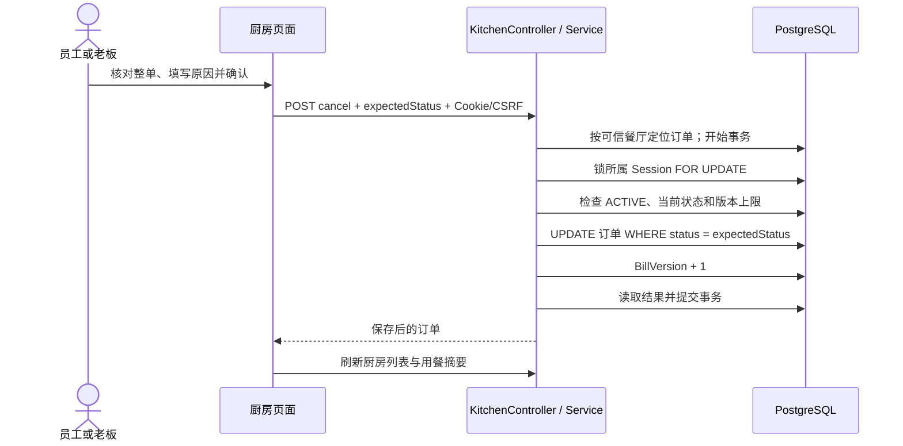

# 第六阶段：厨房与取消

本阶段完成“顾客下单 → 厨房查看 → 整单完成或取消 → 顾客看到状态与应收更新”。
员工和老板从账号页或开桌工作台进入 `/staff/kitchen`。保留九张表和全部已有迁移，没有增加运行时依赖。
厨房只展示正在用餐的订单；收款、VOIDED 关闭和已关闭账单历史已由[第七阶段](billing-history.md)接续实现。
即使所有订单已取消，也不能用 EMPTY 关闭，因为本轮曾经产生订单。

## 1. 按四个小步骤理解代码

| 步骤 | 入口 | 学习重点 |
|---|---|---|
| 查询接口与列表 | `Kitchen/KitchenContracts.cs`、`Kitchen/KitchenService.cs`、`Controllers/KitchenController.cs` | 为什么订单内容来自快照？为什么列表与总量使用同一读取快照？ |
| 完成、取消和权限 | `KitchenService.ChangeAsync`、`KitchenTests.cs` | Session 锁与条件 UPDATE 各自解决什么问题？取消和账单版本为什么必须一起提交？ |
| 前端操作与恢复 | `features/kitchen/useKitchen.ts`、`state.ts`、`KitchenPage.tsx` | 为什么超时不能直接说失败？为什么核对结果只 GET？ |
| 提醒、验收与回归 | `features/kitchen/audio.ts`、`tests/kitchen.test.ts`、本文 | 为什么新单提醒不能只比较当前第一页？恢复联网为什么重新建立声音基线？ |

Controller 解析协议、读取可信账号；Service 在事务里决定能否修改；纯状态函数处理恢复和新单判定；Hook 负责查询、存储和生命周期；页面展示并收集确认。

## 2. 接口契约

所有接口使用店铺 Cookie、首次改密策略与可信 `CurrentAccount.RestaurantId`；写操作还要求店铺 CSRF。
服务端响应均为 `Cache-Control: no-store`，不会接受客户端自报角色或餐厅归属。

| 方法与路径 | 输入 | 结果 |
|---|---|---|
| `GET /api/staff/orders` | `status=NEW/READY/CANCELLED`，默认 NEW；`cursor`；`limit` 默认 50、最大 100 | `{ items, nextCursor, totalCount, pendingCount, createdOrderCount }` |
| `GET /api/staff/orders/{id}` | 订单 ID | 单笔当前厨房订单，用于核对未知结果 |
| `POST /api/staff/orders/{id}/ready` | 空对象 | NEW → READY，返回修改后的订单 |
| `POST /api/staff/orders/{id}/cancel` | `{ expectedStatus: "NEW"或"READY", reason: "原因" }` | 合法取消，返回修改后的订单 |

厨房订单包含：`id`、`sessionId`、`tableLabel`、`status`、`createdAt`、`readyAt`、`cancelledAt`、`cancelReason`、`defaultLanguage`、`totalAmountCents`、`orderNote`、`items`。
`items` 复用已有订单明细快照 DTO。桌号来自用餐记录快照，菜名、编号、数量、备注、价格和过敏原来自下单快照；后续改菜单或删除菜品不改变这些内容。
不返回 `clientRequestId`、入桌码或账号信息。顾客接口继续使用原有 DTO，不额外公开取消原因。

- NEW 按 `(created_at, id)` 升序，优先处理等待最久的订单。
- READY 按 `(ready_at, id)` 倒序，CANCELLED 按 `(cancelled_at, id)` 倒序。
- 游标绑定餐厅、状态、时间和 ID，不得跨筛选或跨餐厅复用；分页是实时队列，不是冻结的历史导出。
- 三个列表都只含 ACTIVE 用餐。关闭后的单笔查询返回 `409 SESSION_CLOSED`，完整历史通过第七阶段的 OWNER 历史接口查询。
- `totalCount` 是当前筛选总量；`pendingCount` 是本店所有活动 NEW 数量；`createdOrderCount` 是本店全部现存订单数量，包括已完成、取消和关闭用餐的订单。
- 累计数仅用于发现新增提交，不返回历史内容。现阶段没有订单历史清理；将来引入删除或归档时，应重新评估这个提示计数方案。计数下降会重新建立基线。

取消原因先 trim，保存 1–500 字符。`expectedStatus` 必须是 NEW 或 READY。
STAFF/OWNER 均可完成 NEW 或取消 NEW；作废 READY 必须 OWNER。
重复完成/取消和状态不符统一返回 `409 ORDER_CHANGED`；不覆盖原处理时间和原因。
跨店或不存在的订单返回 `404 ORDER_NOT_FOUND`，角色不足返回 `403 FORBIDDEN`，无效输入返回 `400 VALIDATION_FAILED`。

## 3. 一次取消如何保证一致性



下单、取消、EMPTY 关闭使用同一 Session UPDATE 锁。厨房锁住 Session 后不会反向获取餐厅或桌位锁，避免颠倒已有锁顺序。
最终 SQL 仍带原状态条件并检查受影响行数；按钮禁用和内存判断都不能代替这一步。

- READY 只改状态和 `ready_at`，不改金额或 `BillVersion`。
- CANCELLED 保留原金额、明细和原有 `ready_at`；新增取消时间和原因，并将版本增加一次。
- 状态或版本写入失败时整个事务回滚。版本已到 `int.MaxValue` 时取消返回 `409 BILL_LIMIT_REACHED`。
- 重复操作及失败操作不增加版本，也不替换首次取消原因。
- 取消后应收查询排除该订单，订单自身原始金额仍保留。
- 暂停服务、接单或桌位不阻止处理既有活动订单；用餐 CLOSED 后禁止修改。
- 单笔核对持有 Session SHARE 锁；列表使用 Repeatable Read 保持该响应内卡片与数量的一致性。列表状态不作为写入授权依据，修改时始终重新检查。

例如老板确认取消 NEW 期间，厨房已经把它完成：原确认得到 `ORDER_CHANGED`，不会直接作废 READY。
前端保留已输入原因，展示最新状态，老板必须重新确认“作废已完成订单”。

## 4. 轮询、恢复与声音

在线且页面可见时每 10 秒轮询；回到前台、恢复联网、修改成功后立即刷新。
已加载的分页会从第一页开始重新读取并按 ID 去重；加载更多不会单独推进第一页的同步时间。
超过 30 秒没有成功同步、离线或查询失败时，保留旧卡片并提示，暂停状态修改。

请求超时、断网和 5xx 表示结果未知。每个订单独立保存最小待确认标识到标签页 `sessionStorage`，键包含餐厅和账号。
不保存订单响应、取消原因或 Cookie；存储不可用时保持内存核对并提示刷新前记录订单编号。
当前订单等待核对期间禁止再次写入，其他订单在同步正常时仍可处理。

恢复只 GET 原订单，不自动重发 POST：

| 核对结果 | 页面行为 |
|---|---|
| 已达到目标状态 | 展示实际状态，解除待确认提示；不声称一定由本次请求完成 |
| 已变成另一状态 | 展示最新结果，原确认失效 |
| 仍是原状态 | 提示重新核对，由用户明确发起新的操作 |
| 用餐已关闭或订单不可访问 | 停止操作，提示由老板核对 |
| 查询仍失败 | 保留待确认提示，继续只读核对 |

这是状态核对，不是操作级幂等追踪。旧 POST 可能延迟到达；单向状态转换和条件更新确保同一转换只发生一次。
恢复前台会中止旧请求并推进操作代次；迟到响应不会重新填充旧身份的界面。
退出或换账号会清除厨房私有查询，页面实例与本地操作状态按身份隔离。

声音默认关闭，必须点击“开启声音提醒”。连续成功同步时比较累计订单数，新增一批订单最多响一次，队列超过一页也能发现新提交。
首次加载、启用声音、切换状态视图、恢复前台或断网重连后都重新建立基线，不补播旧单；完成、取消或关桌不增加这个计数。
浏览器音频不可用时显示提示，卡片和文字提醒继续工作。锁屏和后台挂起时不保证轮询或声音。

## 5. 自己动手做的实验

1. 用 STAFF、OWNER 两个窗口打开厨房，再用顾客窗口点两单。核对待处理顺序、桌号、备注和快照。
2. 一台设备完成订单，观察另一台在约 10 秒内更新，顾客“本桌订单”在约 30 秒内更新；完成不改变应收。
3. OWNER 先打开取消确认并填写原因，另一台设备完成同一单。提交旧确认，观察冲突和原因保留；重新明确作废后金额减少。
4. 用浏览器拦截响应模拟“服务端成功但返回丢失”。刷新页面，观察只 GET 核对，Network 面板中没有自动第二次 POST。
5. 超过 50 笔订单后加载更多；另一设备处理第二页订单，观察完整轮询会更新已加载页面。
6. 开启声音后新增一单；断网超过 30 秒，期间继续从顾客设备下单，再恢复厨房连接。观察断网提示、修改按钮锁定，以及恢复不补响。
7. 取消全部订单后尝试关闭空桌，应仍被拒绝；再通过第七阶段账单面板按 VOIDED 关闭，并核对历史原因。

## 6. 验证命令

```bash
dotnet test TavoloFlow.slnx
```

前端目录：

```bash
node --test --test-isolation=none tests/*.test.ts
npm run build
npm run lint
```

后端使用真实临时 PostgreSQL；测试覆盖权限、分页、原始快照、状态竞争、取消与加单/关桌竞争、故障回滚、版本上限、暂停期间处理、顾客金额与同键恢复、禁止误用 EMPTY。
前端纯逻辑测试覆盖最小恢复记录、角色判断、声音基线和同步过期。浏览器验收使用独立测试数据库，不修改开发数据库。

本次验证（2026-10-23）：后端 174 项全部通过，其中厨房新增 12 项；前端纯逻辑 33 项全部通过，build 和 lint 通过。
真实 Chromium 多窗口验收通过：并发完成与取消冲突、OWNER 重新确认作废、顾客金额更新、响应丢失后刷新恢复、超过 50 笔分页及第二页自动更新、声音触发与音频失败回退、31 秒断网后的静默恢复、退出保护、手机表单焦点及页面隐藏后的迟到响应丢弃。浏览器音频测试验证触发与去重；实际设备音量可用本文实验核对。
