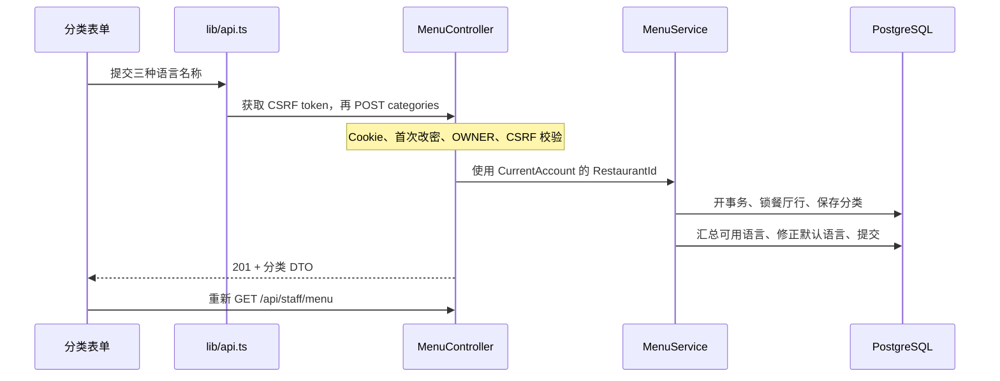

# 菜单管理模块

本阶段在已有店铺账号之上实现菜单维护。登录后从账号页点击“菜单管理”，进入
`/staff/menu`。OWNER 维护分类、菜品、过敏原与默认语言；STAFF 查看菜单并切换供应状态。
餐厅即使处于 `SUSPENDED` 也可以准备菜单；这不会启用顾客接单。

沿用九张表，没有新迁移。开发账号初始化命令继续保留，不随普通启动执行。
平台管理、顾客菜单/购物车、桌位和订单业务仍待后续开发。

## 1. 按四个小阶段学习

### 第一阶段：跟踪一次分类创建

打开 `frontend/src/routes/staff.menu.tsx`，它只负责连接 URL 和 `MenuPage`。
身份仍由 `AuthBoundary` 的共享 `/me` 查询提供，不在路由里重复请求。



建议先在界面创建一个只有意大利语名称的分类，再补中文名称。观察请求体、响应和
默认语言，理解“界面中文”和“菜单内容语言”是两件事。

### 第二阶段：菜品内容与审核

`backend/TavoloFlow.Api/Menus/` 中：

| 文件 | 作用 |
| --- | --- |
| `MenuContracts.cs` | 输入/输出 DTO，以及后端提供的 14 类过敏原选项 |
| `MenuValidation.cs` | 空白归一化、字段校验、业务错误及 Controller 错误转换 |
| `MenuService.cs` | 餐厅隔离、查询、内容写入、删除及语言事务 |

`MenuForms.tsx` 保存当前表单草稿；服务器刷新不会重新填充已打开的表单。
`features/menu/api.ts` 定义响应类型、查询键、名称回退与金额转换；`messages.ts`
集中存放菜单界面文案。关闭表单会放弃未保存输入，不持久化草稿。

练习：创建 `12,50` 欧元的菜品，查看网络请求中的 `priceCents: 1250`。
价格按十进制数字转换为整数欧分，不使用 `parseFloat(value) * 100`。
更改过敏原复选框后，原先的审核确认会清除；需要再次勾选才能保存。

### 第三阶段：员工供应状态与默认语言

老板编辑菜品的 DTO 不包含 `isAvailable`。员工和老板都使用专门的 PATCH 接口，
提交明确目标值。重复提交 `false` 仍然是售罄，不会反向切换。

菜单写事务先锁餐厅行，然后修改内容，最后维护默认语言。这样并发编辑不同条目时，
也不会各自用过期菜单计算默认语言。当前 MVP 将同一餐厅的菜单写入串行处理，
没有菜单版本列，也没有版本冲突弹窗。只改变供应状态的请求使用字段级 SQL 更新。

可用语言由现存分类及菜品名称汇总，包含空分类和售罄菜品，不从描述推导。
仍有效的默认值保留；失效时按中文、意大利语、英语选择；完全空菜单保留当前值。
读取菜单使用 Repeatable Read 事务，让分类、菜品和语言元数据来自同一快照。

使用两个浏览器会话学习：员工设为售罄，老板修改价格，刷新后确认新价格和售罄同时保留。

### 第四阶段：错误、删除和验收

菜单操作失败不会清空表单。请求不会离线排队或自动重试，也不提前修改本地列表。
成功后取消旧菜单读取并重新查询，避免保存前发出的读请求成为保存后的结果。
已收到成功响应但刷新失败时，明确显示“操作已成功，但菜单刷新失败”。

如果写入响应因断网丢失，不能推断服务器是否保存。点击“重新读取菜单并核对结果”，
比较列表和仍保留的表单后再操作。分类/菜品创建没有幂等键，盲目再次创建可能产生重复记录。

菜单查询键包含餐厅和账号；退出、账号切换及 401 会取消并清除私有查询。
已有有效身份时，后台身份查询网络失败会显示重试提示并保留表单；实际 401 仍返回登录页。

## 2. 接口契约

所有接口使用店铺 Cookie；写请求要求 `X-CSRF-TOKEN`。餐厅来自服务端身份，
不接受客户端提供的餐厅或角色。首次改密未完成时返回 `403 PASSWORD_CHANGE_REQUIRED`。

| 方法与路径 | 权限 | 成功结果 |
| --- | --- | --- |
| `GET /api/staff/menu` | OWNER / STAFF | 200：完整菜单，无分页 |
| `POST /api/owner/menu/categories` | OWNER | 201：创建的分类 |
| `PUT /api/owner/menu/categories/{id}` | OWNER | 200：编辑后的分类 |
| `DELETE /api/owner/menu/categories/{id}` | OWNER | 204 |
| `POST /api/owner/menu/items` | OWNER | 201：创建的菜品，默认可供应 |
| `PUT /api/owner/menu/items/{id}` | OWNER | 200：编辑后的菜品，保留供应状态 |
| `DELETE /api/owner/menu/items/{id}` | OWNER | 204 |
| `PATCH /api/staff/menu-items/{id}/availability` | OWNER / STAFF | 200：更新后的菜品 |
| `PATCH /api/owner/menu/default-language` | OWNER | 200：默认及可用语言 |

菜单响应包含 `restaurantId`、`defaultLanguage`、`availableLanguages`、`categories`、
`items`、`allergens`。分类按 ID、菜品按分类 ID 和自身 ID 稳定排序。
菜品/分类响应不暴露 EF 导航对象。所有接口响应继续使用 `Cache-Control: no-store`。

分类输入为 `nameZh`、`nameIt`、`nameEn`。菜品输入示例：

```json
{
  "categoryId": "本店已有分类 UUID",
  "itemCode": "M01",
  "nameZh": "宫保鸡丁",
  "nameIt": "Pollo Kung Pao",
  "nameEn": null,
  "descriptionZh": "鸡肉、花生与时蔬，微辣。",
  "descriptionIt": null,
  "descriptionEn": null,
  "priceCents": 1250,
  "allergenCodes": ["PEANUTS", "SOY"],
  "allergenReviewed": true
}
```

此示例仅说明请求结构，实际配料及过敏原必须由餐厅核对。
供应输入为 `{ "isAvailable": false }`；默认语言输入为 `{ "defaultLanguage": "it" }`。
菜单请求 DTO 拒绝未定义字段，不能通过供应接口夹带价格或名称。

## 3. 数据规则与失败行为

- 名称、描述、编号去首尾空白，空内容保存为 `null`；至少一种名称非空。
  分类名称最多 100 字符，菜品名称 150 字符，编号 40 字符。描述需有同语言名称。
- 编号可空，同店非空编号唯一且区分大小写。空编号可重复；释放或删除后可复用。
- `priceCents` 在 `1..9007199254740991` 内。界面接受点或逗号作为小数点、最多两位小数，
  不接受货币符号或千位分隔符；数据库继续使用 `bigint`。
- 每次菜品内容保存都必须 `allergenReviewed=true`，包括售罄菜品。未知代码被拒绝，
  重复代码归并为固定顺序；空数组表示审核后未识别出需声明的过敏原，不保证不存在交叉接触。
- 旧的未审核数据仍可查看或设为售罄；恢复供应前必须由 OWNER 编辑并完成审核。
- 名称显示按中文、餐厅默认语言、已有语言回退。描述只显示最终名称所用语言，不跨语言拼接。
- 分类只能为空时删除。菜品删除复用 `CatalogDeletionService`，先清空订单明细的可空菜品引用，
  保留名称、价格、编号、过敏原快照及餐厅归属。删除与默认语言调整在同一事务内提交。

错误统一为 `code`、`message`、`requestId`，字段校验附 `errors`：

| 状态/代码 | 含义 |
| --- | --- |
| `400 VALIDATION_FAILED` | 输入字段不合法或缺少审核确认 |
| `404 MENU_RESOURCE_NOT_FOUND` | 条目不存在或不属于本店 |
| `409 ITEM_CODE_CONFLICT` | 本店已有相同编号 |
| `409 CATEGORY_NOT_EMPTY` | 分类仍有菜品 |
| `409 ALLERGEN_REVIEW_REQUIRED` | 未审核菜品不能恢复供应 |

401、403、CSRF 等错误复用账号模块。数据库唯一索引是并发编号冲突的最终保障，
业务服务把对应异常转换为 409；没有新建冲突表或菜单版本字段。

过敏原类别参考[欧盟委员会说明](https://food.ec.europa.eu/food-safety/campaign-2026/allergies_en)。
本项目的内部代码不是官方编码，也不替代餐厅的配料审核与信息提供责任。

## 4. 运行与验收记录

先按 [店铺账号说明](store-accounts.md) 配置数据库、执行迁移及显式初始化开发账号。
启动后端 HTTP profile 和前端 Vite，访问 `http://localhost:5173`。本阶段无需新增配置或迁移。

2026-10-21 验证结果：

- `dotnet test TavoloFlow.slnx --no-restore --verbosity minimal`：88 项通过，其中 23 项菜单测试。
  使用一次性 PostgreSQL 容器，覆盖真实登录/CSRF、权限、两店隔离、校验、历史快照、事务回滚、
  默认语言以及并发编号/分类删除/供应状态操作。
- `npm run build`、`npm run lint`：通过；没有新增前端测试框架。
- Chromium 两个独立 Cookie 会话：老板和员工首次改密、分类/菜品维护、审核确认、默认语言设置、
  非空分类删除失败、跨分类移动、员工售罄/恢复、老板改价保留售罄、刷新恢复均通过。
- 断网写入未自动重发；模拟“服务器保存成功但响应丢失”时只提交一次，手动重读确认保存结果。
- 360px 手机页面和菜品表单无横向溢出；后台身份查询 503 后表单保留、重试恢复，
  退出后切换 STAFF 及另一标签页退出导致的菜单 401 均正确清理界面；浏览器没有未处理 JavaScript 异常。

截图：[老板桌面](screenshots/menu-owner-desktop.png)、[员工桌面](screenshots/menu-staff-desktop.png)、
[菜品编辑](screenshots/menu-item-editor.png)、[手机页面](screenshots/menu-owner-mobile.png)。
浏览器验收同样使用临时独立数据库，未写入本地开发数据库；截图不包含密码或凭据。
