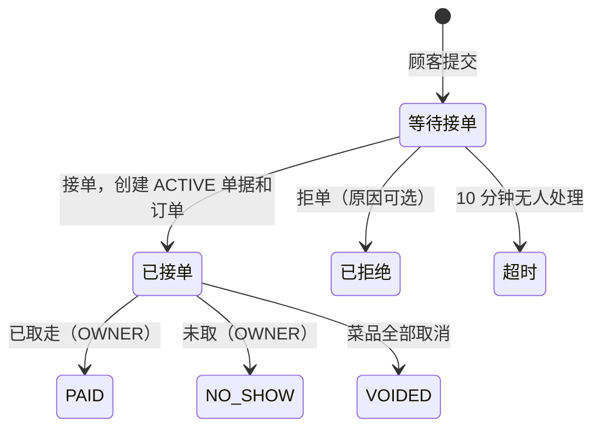

# 线上自取点单：设计方案

> 状态：2026-10-31 讨论定稿，尚未实现。实现每一步时，把其中的领域规则写进 `AGENTS.md`，更新
> `docs/er-diagram.dbml`，并在本文末尾补充验证记录。

顾客打开餐厅的线上菜单链接，自己选菜，填写姓名和电话后提交一个下单请求；员工接单后，它才成为订单进入厨房；
顾客到店取餐时付款。接单后的自取单复用现有的厨房、传菜和结账；接单前的请求单独存放，不进入这些核心表。

## 如何使用本文档

本文是讨论的结论，不是逐字照抄的规格。实现时这样对待它：

- **已经定了的**：第 1 节的范围和第 2 节的关键决定，都是反复讨论后的结论，实现时不要偏离。
  如果代码的实际情况让某个决定行不通，先停下来说明原因，由维护者决定。
- **只是建议的**：具体的列名、接口路径、错误码名称、文案，以及第 11 节怎样分步。按代码的实际情况调整即可，
  调整后回写本文。
- **遇到矛盾时**：发现文档和代码对不上、文档有遗漏，或者有明显更简单的做法，先停下来说明，
  不要悄悄改设计，也不要硬套文档。
- **和现有规则冲突时**：`AGENTS.md` 和 `CLAUDE.md` 里的现有规则优先，除非本文第 11 节“要同步修改的现有规则”明确列出要改它。
- **一次只做一步**：每次实现第 11 节的一步。完成后把实现中与本文不同的地方回写本文，并按开头的状态说明把规则写进 `AGENTS.md`。

## 术语

| 词 | 含义 |
|---|---|
| 下单请求 | `pickup_requests` 的一行，即顾客提交的一次自取请求。只有被接单后，才会创建单据和订单 |
| 等待接单、超时、已拒绝 | 请求没有被接单时的三种情况，见 4.5。请求没有状态列，这三种情况由时间字段和当前时间得出 |
| 单据 | `dining_sessions` 的一行。堂食单据是一桌客人从开台到结账的一次用餐，可以包含多张订单；自取单据在接单时创建，只有一张订单 |
| 自取单 | 已接单的请求，对应一张 `channel = PICKUP` 的单据 |
| 订单 | `orders` 的一行。堂食是顾客的一次提交；自取是接单时根据请求创建的那一张 |
| 菜品 | `order_items` 的一行，即订单里的一道菜 |
| 渠道 | 单据的 `channel`：`DINE_IN`（堂食扫码）或 `PICKUP`（线上自取） |

代码里的类名 `DiningSession` 和表名 `dining_sessions` 保留不改，见 4.4。

## 1. 范围

第一版包含：

- 平台按餐厅开通“堂食扫码”和“线上自取”两项服务，可以只开一项，也可以都开。
- 每家餐厅一个固定的线上菜单链接 `/r/{slug}`，餐厅把它放在官网、Google 商家资料或 Instagram 上。只给链接，不支持 iframe 嵌入。
- 只支持“尽快取餐”和到店付款。现金还是刷卡由店里决定，系统只记录“已收款”，与堂食相同。
- 老板设置每周营业时间（每天最多两段），营业时间内自动接单；员工可以随时手动暂停。
- 新请求在员工端所有页面持续响铃，直到有人整单接单或拒单。STAFF 与 OWNER 都可以处理；接单时选择预计取餐时间，拒单原因可选。
- 状态页始终显示餐厅电话，顾客等不及可以直接打电话；10 分钟内无人处理即超时。
- 取餐收款（“已取走”）和“未取”只能由 OWNER 操作，与堂食结账相同。

第一版不做（见第 12 节）：在线支付、锁屏推送、邮件、短信验证、预约取餐时间、外送、现金单金额上限、仅限堂食的菜品、
规格选项（甜度、冰量、加料）。

## 2. 关键决定

| 决定 | 理由 |
|---|---|
| 接单前只是下单请求（`pickup_requests`），接单时才创建单据（`dining_sessions`，`channel = PICKUP`）和订单 | 接单后的自取单和堂食共用同一行 Session UPDATE 锁、BillVersion、关闭快照和“结账即上菜”，厨房、传菜和结账不用分出第二条路径。没接的请求不进入单据、订单和菜品这些核心表：不需要后台任务处理超时，也不会留下永远停在等待状态的单据和永远是 NEW 的菜品；单据仍然只有 ACTIVE 和 CLOSED 两种状态。堂食查询都从桌台出发，`table_id` 为空的自取单据自然不会出现在大厅、开台、加入和删桌里。 |
| 订单在接单时创建 | `created_at` 既是真实的创建时间，也是进入厨房的时间。厨房的排序、按菜品汇总和提示音水位一行都不用改，接单时厨房自然会响。 |
| 两个独立的服务开关，而不是三选一的模式 | 代码只问“是否开通堂食”“是否开通自取”，不会出现 `mode == 1 \|\| mode == 3`。 |
| 只给链接，不用 iframe | 嵌在别的网站里时，顾客 Cookie（`SameSite=Lax`）和 CSRF Cookie（`Strict`）属于第三方 Cookie，浏览器不会发送。改成 `SameSite=None` 还要处理点击劫持，不值得。 |
| 第一版只支持到店付款 | 不需要 Stripe 账户、付款回调、预授权和后台任务，开通一家店当天就能用。 |
| 所有请求都要整单接单 | 顾客不在店里，接单是餐厅在开做前说“做不了”、核实可疑订单的唯一机会。顾客无法当场同意一张被改过的订单，所以不做部分接单。 |
| 拒单原因可选，只能从固定选项里选 | 固定选项可以提前翻译成中文、意大利文和英文给顾客看；员工自由输入的文字既没法翻译，也可能写出不该给顾客看的内容。 |
| 接单后沿用现有的取消规则 | NEW 菜品可以取消，READY 之后不能。结账要求没有 NEW 菜品，如果做不了的菜不能取消，订单就永远关不掉。取消后应付金额自动减少；第一版顾客取餐时才付款，所以没有退款。员工打电话告诉顾客，顾客想换菜就再下一单或到店再点。 |
| 能否下单由营业时间加手动暂停决定 | 比“检测有没有屏幕在线”简单，老板容易理解。代价：营业时间内如果没人开着员工端，请求会超时，顾客会看到餐厅电话。 |
| 不加“线上订单”标签页 | 接单在横幅打开的面板里，做菜在厨房，出餐在传菜屏，收款在账单页。标签栏保持最多 5 个。 |
| 只支持“尽快”，接单时选预计时间 | 厨房按“接单即开做”设计，排队、按菜品汇总和提示音都不用改。预约取餐留到以后（见第 12 节）。 |
| 没有现金单金额上限 | 没有在线支付时，上限只会挡掉真实的大单。大单由接单的人判断，必要时回电确认。 |
| 超时和被拒的请求不进入历史账单 | 历史记录的是交易，它们没接单、没做菜、没收钱。员工在“今日未接单”列表里查看（见 6.6）。 |

## 3. 餐厅设置

### 3.1 restaurants 新增列

| 列 | 说明 |
|---|---|
| `dine_in_enabled` | 默认 true；迁移后现有餐厅都是 true |
| `pickup_enabled` | 默认 false |
| `phone` | 餐厅公开电话，可以为空；校验和存储规则与顾客电话相同（见 5.2） |
| `slug` | 线上菜单链接名（`/r/{slug}`），可以为空；全局唯一，小写字母、数字和连字符，3–40 个字符，不以连字符开头或结尾。它只用于线上菜单，与桌台二维码里的随机 QR token 无关 |
| `pickup_paused` | 手动暂停线上接单，默认 false |

规则：

- 两项服务至少开一项。`phone` 和 `slug` 对所有餐厅都是选填，只有开通自取时两者都必须已填写；自取开通期间不能把它们清空。
- 关闭一项服务时，如果它还有未完成的工作，返回 `409 SERVICE_HAS_OPEN_WORK`。堂食指任何 ACTIVE 堂食单据；
  自取指等待接单的请求和 ACTIVE 自取单据。检查和更新都在餐厅 UPDATE 锁内完成。提交请求和接单都持有餐厅 SHARE 锁，
  所以不会有新的请求或单据趁机插入。
- 修改 slug 会让旧的线上菜单链接，以及餐厅为这个链接印的二维码（传单、外卖袋）失效；桌台二维码不受影响。所以平台修改它要经过 `管理操作确认`。修改电话和地图链接一样，是单列更新，不需要确认。
- 餐厅被暂停（SUSPENDED）时，线上同样不能下单；恢复 ACTIVE 不会改变 `pickup_paused`。

### 3.2 营业时间 pickup_hours

| 列 | 说明 |
|---|---|
| `restaurant_id`、`weekday`（1–7，周一为 1）、`slot`（1 或 2） | 主键 |
| `opens_minute`、`closes_minute` | 当地时间一天中的分钟数，0–1440。要求 `opens < closes`，所以时段不跨午夜，最晚到 24:00 |

- 某天没有记录就是休息日。第 2 段的开始时间不早于第 1 段的结束时间，两段可以首尾相接。
- 结束时间是最后可以下单的时间，不是打烊时间，老板应按厨房最后接单的时间设置。
- 按餐厅时区（`Europe/Rome`）的当地时间比较：`opens ≤ 当地现在 < closes` 时可以下单。时间来自注入的 `TimeProvider`。
- OWNER 一次保存整周：`PUT` 在餐厅 UPDATE 锁内替换全部行。开通了自取却没设任何营业时间时，设置页提示“线上不会接单”。
- 服务器计算 7 天内下一次开始接单的时间，换算为 UTC 返回。开始时间如果正好落在夏令时跳过的那一小时内，顺延到跳变之后。

## 4. 数据模型

### 4.1 一张自取单在数据库里的样子

```
提交后：  pickup_requests        1 行   姓名、电话、取餐号、expires_at 等
            └ pickup_request_items N 行   提交时的菜品快照，写入后不再改

接单后：  pickup_requests        accepted_at、estimated_ready_at、session_id 写入
            └ dining_sessions      1 行   channel = PICKUP，status = ACTIVE
                └ orders           1 行   created_at = 接单时间
                    └ order_items  N 行   由请求菜品逐列复制，状态 NEW
```

超时或被拒的请求只有上半部分，永远不会有单据、订单和订单菜品。

**外键与删除。** 删除餐厅时，所有相关数据都由数据库级联删除，不手动删子表，与现有规则相同：

- 所有新表（`pickup_hours`、`pickup_counters`、`pickup_requests`、`pickup_request_items`）都以 `ON DELETE CASCADE` 指向餐厅。
- 新表之间沿用项目的复合外键 `(id, restaurant_id)`，防止跨店引用：请求菜品指向请求的 `(id, restaurant_id)`，
  请求的 `session_id` 指向单据的 `(id, restaurant_id)`，两者都是级联删除。

### 4.2 pickup_requests（下单请求）

| 列 | 说明 |
|---|---|
| `id` | 主键，服务器生成 |
| `restaurant_id` | 租户，外键级联删除 |
| `client_request_id` | 浏览器生成的 UUID，防止重复提交；`(restaurant_id, client_request_id)` 唯一 |
| `status_token` | 服务器生成的 32 字节随机 Base64URL，唯一，用于 `/o/{token}` |
| `business_date`、`pickup_number` | 当地营业日和当天的取餐号（从 1 开始）；`(restaurant_id, business_date, pickup_number)` 唯一 |
| `customer_name`、`customer_phone` | 去掉首尾空格；姓名 1–20 个字符（要放进厨房卡片和传菜屏的标题），电话规则见 5.2 |
| `total_amount_cents`、`default_language_snapshot` | 提交时的合计金额和餐厅默认语言，接单时原样写进订单 |
| `submitted_at`、`expires_at` | `expires_at = submitted_at + 10 分钟` |
| `accepted_at`、`estimated_ready_at`、`session_id` | 接单时一起写入；`session_id` 唯一，指向创建的单据 |
| `rejected_at`、`reject_reason` | 拒单时写入；原因可为空，或者是 `SOLD_OUT`（售罄）、`BUSY`（太忙）、`CLOSING`（即将打烊） |

约束：接单和拒单最多发生一个；接单的三列要么都为空，要么都有值；接单和拒单时间都早于 `expires_at`。
索引：`(restaurant_id, expires_at)` 用于等待接单的查询，`(restaurant_id, business_date)` 用于今日未接单列表。

取餐号来自 `pickup_counters(restaurant_id, business_date, last_number)`：提交事务执行
`INSERT ... ON CONFLICT DO UPDATE SET last_number = last_number + 1 RETURNING`。这一步会锁住当天的计数行，
让同一餐厅的提交依次进行，因此之后的幂等查找是安全的（见 5.2）。

### 4.3 pickup_request_items（请求菜品）

列与 `order_items` 的快照列一一对应：`menu_item_id`（可为空）、菜品编号、中意英名称、过敏原、单价、数量、备注，
约束也相同（数量 1–20、单价为正、备注最多 200 个字符），外键随请求级联删除。

- 它是提交时的原始记录，写入后不再修改。接单时逐列复制成 `order_items`，厨房只处理后者。
- 删除菜单菜品时，`CatalogDeletionService` 在清空 `order_items.menu_item_id` 的同一步里，也清空这里的引用。
  快照名称保留，所以请求和之后的订单都照常显示。
- **已知代价：快照列存了两份，结构要一起维护。** 以后给订单菜品加快照列（例如奶茶店的规格选项），要同时改这张表的结构、
  约束和接单时的复制代码。漏改复制代码不会报错，接单后数据会悄悄丢失，比如顾客选的“少糖”到了厨房就没了。
  第一版先保持现状：两张表各自定义快照列，接单时逐列复制。等第一版实现后、最晚在加规格选项之前，再决定是否采用：
  1. 把快照列打包成一个共用类型（EF Core 复杂类型），列只定义一次，接单时的复制只需一行。
     要先验证过敏原数组列能否放进复杂类型；`MenuItemId` 是外键，不能放进去，留在两个实体上单独复制。
  2. 如果办法 1 行不通：复制代码集中在一个方法里，再写一个测试，读取请求菜品在 EF 模型里的每一列，
     确认订单菜品有同名列且值相同。以后有人加了列却忘了复制，这个测试会失败。

### 4.4 dining_sessions 与 orders 的扩展

- `dining_sessions` 新增 `channel`：`DINE_IN`（默认值，也是现有数据）或 `PICKUP`。`status` 不变，仍然只有 ACTIVE 和 CLOSED。
- `close_reason` 新增 `NO_SHOW`，只用于自取；`EMPTY` 只用于堂食；`PAID`、`VOIDED` 两者都用。
- `table_id`、`table_label_snapshot`、`join_code_ciphertext` 只属于堂食，自取单据都为空，因此 `table_label_snapshot` 改为可空。
- 约束按渠道重写：`ck_session_active_table` 和 `ck_session_lifecycle` 现在要求 ACTIVE 单据必须有桌台和入桌码密文，
  改为只对 `DINE_IN` 生效；`PICKUP` 要求桌台、桌号和密文都为空。数据库照样保证堂食单据一定有桌号。
- `uq_active_session_per_table` 不受影响：PostgreSQL 的唯一索引允许多个 NULL。
- 自取单据的 `opened_at`、订单的 `created_at` 都是接单时间；提交时间保存在请求的 `submitted_at`。
  订单的 `client_request_id` 沿用请求的值，满足现有的“同一单据内唯一”约束。
- 类名 `DiningSession`、表名 `dining_sessions` 和 `orders.dining_session_id` 保留不改。API 路径和 DTO 用的已经是中性的
  `sessions`、`SessionId`，员工和顾客都看不到 “Dining” 这个词；而改名要动约 35 个文件（实体、约束和索引名、`RowLocks`
  里的 SQL、测试、前端类型和文档），收益很小。实现第 1 阶段时，把“`DiningSession` 是单据，可以是堂食或自取”写进
  `AGENTS.md` 和 `docs/architecture.md`。

### 4.5 状态流程



等待接单、已拒绝和超时是请求的情况；PAID、NO_SHOW、VOIDED 是单据的 `status = CLOSED` 加对应的 `close_reason`。

- **请求没有状态列，用一个统一的判断得出：**
  - `accepted_at` 不为空：已接单，之后看单据；
  - `rejected_at` 不为空：已拒绝；
  - 两者都为空、当前时间早于 `expires_at`：等待接单；
  - 两者都为空、当前时间不早于 `expires_at`：超时。
- 超时不写数据库，所以不需要后台任务。代价是凡是读“等待接单”的地方都必须加上时间条件：待接单列表和横幅、
  待接单上限、平台关闭自取前的检查、状态页、“你有一个进行中的订单”提示。漏掉的后果很严重，
  例如累计 20 个超时请求后再也收不到新请求，或者永远关不掉自取服务。因此：
  - 这个判断只写一处，所有地方都调用它；
  - 当前时间一律来自注入的 `TimeProvider`，作为参数传进查询，不使用 SQL 的 `now()`，否则在超时那一刻前后不同查询可能给出相反的答案，`TestClock` 也控制不了；
  - 等待接单的查询走 `(restaurant_id, expires_at)` 的时间范围，只读最近 10 分钟，不随历史增长；
  - 第 13 节为最严重的两种后果各写一个测试。
- **拒单**：一条带条件的 UPDATE，写入 `rejected_at` 和可选的原因，不涉及任何单据或订单。
- **已取走**：就是现有的 PAID 结账。要求 OWNER、核对版本和金额、没有 NEW 菜品，并在结账时把还没标记上菜的 READY 菜品标为已上菜。
- **未取**：要求 OWNER、核对版本和金额、没有 NEW 菜品，并确认“顾客没有来取餐”。记录的金额是没收到的应收款，营业额统计不计入。
- **全部取消**：沿用现有的 VOIDED 关闭（`close-void` 的接口和字段都不变），页面上把“顾客已离桌”的确认文案改成“已通知顾客”。
  EMPTY 关闭对自取单据返回错误，因为它一定有一张订单。

顾客状态页根据数据显示：

| 数据 | 显示 |
|---|---|
| 等待接单 | 已提交，等待餐厅确认 |
| 超时 | 餐厅未能确认，订单未生效，请打电话 |
| 已拒绝，有原因 | 餐厅无法接单：部分菜品已售完 / 餐厅现在太忙 / 餐厅即将打烊，请打电话 |
| 已拒绝，没有原因 | 餐厅暂时无法接单，请打电话 |
| 单据 ACTIVE，还有 NEW 菜品 | 已接单，预计 HH:MM 可取 |
| 单据 ACTIVE，没有 NEW，至少一道 READY | 可以取餐了 |
| 单据 ACTIVE，菜品全部取消 | 订单菜品已全部取消，请联系餐厅 |
| 单据 CLOSED / PAID | 已取餐 |
| 单据 CLOSED / NO_SHOW 或 VOIDED | 订单已关闭 |

被取消的菜品显示为划掉，应付金额随之减少。餐厅电话在所有状态下都显示并可点击拨号，超时和拒单时放在最显眼的位置。

超时和被拒的请求都保留在数据库里，一行不删，只是各个页面不再显示：

| 位置 | 超时或被拒的请求 |
|---|---|
| 待接单面板、横幅 | 拒单后立刻消失；超时的到 `expires_at` 消失，响铃停止，之后接单返回 `PICKUP_CHANGED` |
| 今日未接单列表（6.6） | 当天一直显示，标明超时或已拒绝及原因；第二天不再显示，因为它只查当天 |
| 顾客状态页 | 超时或拒单后 24 小时内能打开，之后接口返回 404，数据库里的行还在 |
| 厨房、账单、历史账单 | 从不出现：它们没有单据和订单。这是有意的，历史记录的是交易 |
| 数据库 | 永久保存；姓名和电话受第 10 节的保存期限约束 |

## 5. 顾客端

### 5.1 线上菜单 `/r/{slug}`

- `GET /api/public/r/{slug}/bootstrap` 和扫码页的 bootstrap 一样，在一个 Repeatable Read 事务里读取，复用 `MenuReader`。
  返回餐厅名称、币种、默认语言、主题、电话、菜单，以及下单状态：
  - `OPEN`（可以下单）
  - `PAUSED`（员工暂停）
  - `CLOSED_HOURS`（营业时间外，附 `nextOpensAt`）
  - `NOT_OFFERED`（没开通自取，只显示菜单）
  - `SUSPENDED`（餐厅被平台暂停）
- slug 不存在时返回 `404 MENU_LINK_NOT_FOUND`。
- 菜品、照片和售罄状态与堂食完全相同，同一个售罄开关同时作用于两个渠道。
- 语言沿用顾客端的 zh/it/en，并按餐厅记住顾客的选择；主题沿用 `useDocumentTheme`。
- 不使用顾客 Cookie，也不请求 `/me`。查询键是 `["public", "pickup", slug]`；和扫码菜单一样每 30 秒刷新，
  所以营业状态和售罄会自动更新。

### 5.2 提交

- 购物车沿用现有的纯逻辑和限制：最多 30 行、每行 1–20 份、每单 100 份、行备注 200 个字符、金额在安全整数范围内。
  购物车仍按标签页隔离，存储键从“按桌台”改为“按入口”，自取是 `pickup:{restaurantId}`。
- 结账表单：姓名（1–20 个字符）；电话；隐私说明（用途和保存期限，见第 10 节）。
- 电话规则：去掉空格后，是可选的 `+` 加 6–15 位数字；存储时去掉空格，显示和拨号都用存储的值。
  顾客电话和餐厅电话用同一条规则，写在 `InputRules` 里，前后端各校验一次。
- 提交接口是 `POST /api/public/r/{slug}/pickup-requests`，输入
  `{ clientRequestId, customerName, customerPhone, items: [{ menuItemId, quantity, expectedUnitPriceCents, remark }] }`。
- 这是匿名请求，使用 `/api/public/csrf` 发的匿名 CSRF 令牌，和加入用餐一样。按 IP 限流（新的 `PickupRateLimits`，复用 `FixedWindowLimiter`）。
- 服务器按顺序处理：
  1. 校验输入格式。
  2. 按 slug 找到餐厅，锁餐厅 SHARE。
  3. 更新当天的取餐号计数（锁住计数行）。
  4. 如果已有相同 `(restaurant_id, client_request_id)` 的请求，直接返回原结果，不检查后面的条件。这和堂食下单一样。
     这时事务回滚，计数不变。
  5. 依次检查：餐厅为 ACTIVE（否则返回现有的 `SERVICE_SUSPENDED`）、已开通自取、没有暂停、在营业时间内、
     这家店等待接单的请求不超过 20 个（超时的不算）。
  6. 用共享的订单行构建器检查菜品是否存在、可售、价格是否变化，并生成快照；不一致时返回现有的 `MENU_CHANGED`。
  7. 在同一事务里写入 `pickup_requests` 和 `pickup_request_items`。不创建单据或订单。
- 第一次提交返回 `201`，重复提交返回 `200` 和原结果，与堂食下单相同（`OrderController`）。响应都是
  `{ statusToken, pickupNumber, expiresAt }`。
- 成功后，前端清空购物车和保存的下单内容，记住 token（见 5.4），然后跳转到 `/o/{token}`。
- 新的错误码：`PICKUP_NOT_OFFERED`、`PICKUP_PAUSED`、`PICKUP_CLOSED`（附 `nextOpensAt`）、`PICKUP_BUSY`，均为 409。
  顾客端按错误码显示三种语言的文案（下面是中文），旁边都附餐厅电话；购物车保留，顾客稍后可以直接再提交：

  | 错误码 | 顾客看到 |
  |---|---|
  | `PICKUP_NOT_OFFERED` | 这家餐厅暂不提供线上点单 |
  | `PICKUP_PAUSED` | 餐厅暂停了线上接单，请稍后再试 |
  | `PICKUP_CLOSED` | 现在不在接单时间，HH:MM 开始接单（取自 `nextOpensAt`） |
  | `PICKUP_BUSY` | 餐厅现在订单太多，请稍后再试 |

  被拒绝的提交什么都不保存：不占取餐号，也不会出现在待接单面板里。

### 5.3 结果未知时

沿用现有的下单规则：

- 提交前，把完整的下单内容（请求 ID、表单和购物车）写入 `sessionStorage`。浏览器存储不可用时，可以编辑但不能提交。
- 结果未知时只用 GET 恢复：`GET /api/public/r/{slug}/pickup-requests/by-client-id/{clientRequestId}` 返回 `statusToken`；
  404 只表示“暂时没查到”。请求 ID 是只有这台设备知道的随机 UUID，所以它本身就是查询凭据。
- 顾客可以手动重试，用原来的请求 ID 和内容，加一个新的 CSRF 令牌。永远不自动重发 POST。
- 恢复接口的路径带着 slug。如果提交后平台恰好改了 slug，恢复会返回 404；这种情况极少，可以接受。

### 5.4 状态页 `/o/{token}`

- `GET /api/public/pickup-requests/{token}` 返回：餐厅名称、主题、默认语言、餐厅电话、取餐号、顾客姓名、提交时间、
  预计时间、状态（见 4.5 的表）、拒单原因、菜品和应付金额。不返回顾客电话和任何请求 ID。
  - 接单前，菜品来自请求菜品；
  - 接单后，菜品来自订单菜品，带“是否已取消”，应付金额按没取消的菜品计算。
- 没结束时，页面在前台且在线就每 10 秒刷新一次，结束后停止刷新。
- 超时、拒单或单据关闭 24 小时后，返回 `404 PICKUP_NOT_FOUND`，避免顾客姓名一直可以被读取。
- 浏览器按餐厅在 `localStorage` 里记住最近一次请求的 token（`tavoloflow:pickup-order:{restaurantId}`）。
  顾客重新打开 `/r/{slug}` 时，如果它还没结束，顶部显示“你有一个进行中的订单”。
  这是有意的例外：token 只能读取这一个请求，作用等同于顾客自己存下的链接。
- 查询键是 `["public", "pickup-order", token]`。

## 6. 员工端

### 6.1 页面随开通的服务变化

`/api/auth/me` 新增 `services: { dineIn, pickup }`，`staffNavItems` 和 `staffManagementItems` 按角色和开通的服务生成。

| | 只开堂食 | 只开自取 | 两者都开 |
|---|---|---|---|
| 底部标签（OWNER） | 首页 · 大厅 · 厨房 · 账单 · 菜单 | 首页 · 厨房 · 账单 · 菜单 | 首页 · 大厅 · 厨房 · 账单 · 菜单 |
| 底部标签（STAFF） | 首页 · 大厅 · 厨房 · 传菜 · 菜单 | 首页 · 厨房 · 传菜 · 菜单 | 首页 · 大厅 · 厨房 · 传菜 · 菜单 |
| 首页管理入口 | 桌台；OWNER 还有传菜等（与现在相同） | 线上点单；OWNER 还有传菜等；没有桌台 | 全部 |
| 待接单横幅和响铃 | 无 | 所有页面 | 所有页面 |

- 直接访问没开通的服务页面，显示 `EmptyState`“本餐厅未开通此服务”。
- 服务器也会拦截。没开通堂食时，开台、加入和扫码下单都返回 `409 DINE_IN_NOT_OFFERED`；扫码页仍显示菜单，并附一段说明，
  和餐厅被暂停时一样。没开通自取时，提交请求和自取设置的写入同样被拒绝。
- 平台修改服务后，员工页面在下一次刷新身份信息时更新。

### 6.2 待接单横幅与持续响铃

- 开通自取后，`StaffLayout` 在页面可见且在线时，每 10 秒请求一次 `GET /api/staff/pickup/pending`，
  拿到全部等待接单的请求（最早的在前）和总数。受 5.2 的上限约束，最多 20 个，所以不分页。
- 只有员工已登录、并且改过初始密码后才轮询。`StaffLayout` 在此之前只显示品牌，所以登录页和首次改密页不会响铃。
- 数量大于 0 时，每个员工页面顶部都显示横幅“N 个线上订单待接单”，并循环播放提示音，直到数量回到 0。
  没有静音开关，这是有意的：只有接单或拒单才能让它停止。
- 数量达到上限 20 时，横幅改为“已有 20 个待接单，顾客暂时无法下单”，让员工知道有顾客正被挡在外面。
  每接一单、拒一单或有请求超时，就空出一个位置，上限自动恢复。
- 提示音复用 `lib/useAlertSound.ts` 的手势解锁，音型要和厨房（两声上行）、传菜（三声短促高音）区分开。
  每次打开或刷新页面后，浏览器要求先点一下页面才能出声，在那之前显示提示。
- 页面在后台或锁屏时不轮询，也不响铃。以后用锁屏推送来补上（见第 12 节）。
- 查询键是 `["pickup", restaurantId, accountId, "pending"]`，属于店铺私有数据。

### 6.3 接单与拒单

点横幅打开面板：手机上是底部面板，宽屏上是非模态的侧栏，遵循 `MasterDetail` 的规则。
每个请求显示取餐号、姓名、可以点击拨号的电话、已等待和剩余的时间、菜品和备注，以及合计。

- **接单**：`POST /api/staff/pickup/requests/{requestId}/accept { estimatedMinutes }`，取值为 15、20、30、45。
  面板上是一排时间按钮，点一下就同时完成接单和定时间，不再弹出确认。
  - 服务器先锁餐厅 SHARE，再锁请求行 UPDATE，在锁内检查它仍在等待接单，否则返回 `409 PICKUP_CHANGED`。
  - 然后在同一个事务里创建单据（PICKUP、ACTIVE、BillVersion 1、`opened_at` 为当前时间）、订单（`created_at` 为当前时间，
    合计、默认语言和 `client_request_id` 取自请求）和订单菜品（由请求菜品逐列复制，状态 NEW），
    并在请求上写入 `accepted_at`、`estimated_ready_at` 和 `session_id`。
  - 先锁餐厅，是因为删除菜单菜品时持有餐厅 UPDATE 锁并清空引用，两者不能交错。
    如果那道菜在提交之后已被删除，复制时引用为空，快照名称照样保留。
  - 接单时不再检查暂停和营业时间：请求是在允许下单时提交的，接不接由员工决定。
  - 菜品和价格都按提交时的快照。提交后老板改了价，顾客仍按提交时看到的价格付；提交后某道菜售罄了，
    接单时不再检查，由员工决定接单还是拒单（原因可选“售罄”）。
- **拒单**：`POST /api/staff/pickup/requests/{requestId}/reject { reason }`，`reason` 可以省略。
  拒单不能撤销，按 UI 规范要先确认：打开 `ConfirmDialog`，里面的原因是几个可选的选项，不选也能直接确认。
  服务器只锁请求行，在锁内检查它仍在等待接单，然后写入 `rejected_at` 和原因；否则返回 `409 PICKUP_CHANGED`。
- STAFF 和 OWNER 都可以接单和拒单。
- **不保存待确认标记**。这和传菜屏的“已送达”是同一种例外：写入带条件，重复提交只会得到 `PICKUP_CHANGED`，
  而待接单列表本身就能说明一次丢失的请求有没有成功。结果未知时刷新列表，请求还在就由员工再点一次。
- 写入成功后，让待接单、今日未接单、厨房和账单的查询失效。

### 6.4 厨房与传菜

- 厨房和传菜屏的接口新增 `channel`、`tableLabel`（自取为空）和 `pickup: { number, customerName, estimatedReadyAt }`，
  自取信息按 `session_id` 从请求读取。前端按员工的界面语言显示「桌 5」或「自取 #12 · Marco · 18:25」。
  取餐号是主要标识，姓名只是辅助，卡片上的姓名用 `truncate` 截断显示，避免宽字符撑破 360px 的布局。
- 接单后的自取单和堂食单一起出现在订单视图、菜品视图和分站屏里。订单在接单时创建，所以按 `created_at` 排序、
  等待时间从接单开始算、提示音在接单时响，这些都是现有行为，厨房代码不用改。出餐、取消和传菜的规则与接口也不变。
- 员工这样判断一张自取单的进度：在待接单面板里是还没接；在厨房是在做；在传菜屏是做好了；两处都有是做好了一部分；
  都不在是已取走，或者在今日未接单列表里（超时或被拒）。

### 6.5 取餐收款（账单页）

- 账单页的列表现在来自大厅接口，只包含桌台。改为新的 `GET /api/staff/sessions/active`：返回所有 ACTIVE 单据
  （两种渠道）及其汇总，用 `FilterChips` 切换全部、堂食、自取。大厅接口不变。
- 自取单详情显示取餐号、姓名、电话和预计时间。
  - “已取走”调用现有的 `POST /api/owner/sessions/{id}/checkout`。
  - “未取”调用新的 `POST /api/owner/sessions/{id}/close-no-show { expectedBillVersion, confirmedTotalCents, noShowConfirmed }`。
  - 两个操作都用 `ConfirmDialog`，并沿用现有规则：确认时冻结版本和金额，结果未知时用 GET 恢复。
- “待出餐”的标记照旧显示，老板一眼就能分清“还在做”和“等着收钱”。

### 6.6 线上点单设置页（首页管理入口）

这是管理页，和桌台页同一类，放在首页的管理入口里，不占底部标签。它不处理订单，处理订单的地方见 6.3–6.5。

- 所有人可见：线上菜单链接（可复制）、链接的二维码 PNG（复用 `qrcode` 和 `qr-url.ts` 的地址规则）、
  餐厅电话（只读，由平台设置）、当前接单状态。
- STAFF 和 OWNER：暂停或恢复线上接单（`PATCH /api/staff/pickup/paused`），和堂食的“接受点单”开关一样。
- 只有 OWNER：编辑每周营业时间。
- 所有人可见：**今日未接单**列表（`GET /api/staff/pickup/unaccepted`），只读，列出今天所有没变成订单的请求，按时间倒序：

  | 取餐号 | 姓名 | 电话 | 提交时间 | 合计 | 结局 |
  |---|---|---|---|---|---|
  | #12 | Marco | 333… | 18:05 | €30.00 | 超时 |
  | #15 | Anna | 347… | 19:20 | €12.50 | 已拒绝 · 售罄 |
  | #17 | Luca | 340… | 20:02 | €8.00 | 已拒绝 |

  老板能看到“今天漏了几单”，也能复盘拒单；员工可以回电，顾客事后来问也能查到。“今天”按请求的 `business_date`，
  只查当天，不随历史增长；还在等待接单的请求不在这里，在待接单面板里。这里的请求不能再接单。

### 6.7 历史

- 历史筛选新增“渠道”（`channel`），分页游标也绑定它；桌号筛选只匹配堂食单。
- 历史列表和详情里，自取单显示「自取 #12 · 姓名」，而不是桌号；这些信息按 `session_id` 从请求读取。
- 关闭原因新增“未取”。超时和被拒的请求从不进入历史（见 4.5）。

## 7. 平台端

- 创建餐厅的表单新增：两项服务（默认只开堂食）、电话和 slug（都是选填，按餐厅名给出 slug 建议值；勾选自取时两者必填）。
- 详情页可以查看和修改，每次写入都记录操作人：
  - 服务开关：`PATCH /api/platform/restaurants/{id}/services`，经过 `管理操作确认`，关闭规则见 3.1。
  - 电话：`.../phone`，单列更新；自取开通期间不能清空。
  - slug：`.../slug`，经过 `管理操作确认`，并提示旧链接会失效。
- `RestaurantSummary` 返回这些字段。

## 8. 接口清单

| 方法与路径 | 身份与权限 | 说明 |
|---|---|---|
| `GET /api/public/r/{slug}/bootstrap` | 匿名 | 线上菜单和下单状态 |
| `POST /api/public/r/{slug}/pickup-requests` | 匿名 + CSRF，限流 | 提交下单请求 |
| `GET /api/public/r/{slug}/pickup-requests/by-client-id/{clientRequestId}` | 匿名 | 结果未知时恢复 |
| `GET /api/public/pickup-requests/{token}` | 匿名（凭 token） | 顾客状态页 |
| `GET /api/staff/pickup/pending` | STAFF/OWNER | 等待接单的请求 |
| `POST /api/staff/pickup/requests/{requestId}/accept` | STAFF/OWNER | 接单 |
| `POST /api/staff/pickup/requests/{requestId}/reject` | STAFF/OWNER | 拒单，原因可选 |
| `GET /api/staff/pickup/unaccepted` | STAFF/OWNER | 今日未接单（只读） |
| `GET /api/staff/pickup/settings` | STAFF/OWNER | 链接、电话、暂停状态、营业时间、当前状态 |
| `PATCH /api/staff/pickup/paused` | STAFF/OWNER | 暂停或恢复线上接单 |
| `PUT /api/owner/pickup/hours` | OWNER | 保存整周营业时间 |
| `GET /api/staff/sessions/active` | STAFF/OWNER | 进行中的单据（账单页） |
| `POST /api/owner/sessions/{id}/checkout` | OWNER | 已取走（现有接口） |
| `POST /api/owner/sessions/{id}/close-no-show` | OWNER | 未取 |
| `POST /api/staff/sessions/{id}/close-void` | STAFF/OWNER | 菜品全部取消后关闭（现有接口） |
| `PATCH /api/platform/restaurants/{id}/services` | 平台 | 服务开关 |
| `PATCH /api/platform/restaurants/{id}/phone` | 平台 | 餐厅电话 |
| `PATCH /api/platform/restaurants/{id}/slug` | 平台 | 线上菜单链接名 |

厨房和传菜屏的接口不变，只是响应里多了 6.4 中的字段。

## 9. 锁顺序

- 提交请求：餐厅 SHARE → 当天的取餐号计数行 → 写入新行。改菜单的操作持有餐厅 UPDATE 锁，
  所以价格检查和快照不会和改菜单交错，这和堂食相同。
- 接单：餐厅 SHARE → 请求行 UPDATE → 写入新的单据、订单和订单菜品。
- 拒单：只锁请求行 UPDATE。
- 接单之后的出餐、取消、已上菜、已取走、未取：只锁 Session UPDATE，之后不再锁餐厅或桌台，和现有的厨房、结账相同。
- 删除菜单菜品：餐厅 UPDATE → 菜品行，然后清空订单菜品和请求菜品的引用（与现在相同，只多清一张表）。
- 营业时间、暂停开关，以及平台对服务、电话、slug 的修改：锁餐厅 UPDATE，会等进行中的提交和接单完成。
- 计数行只在提交时锁定；请求行只由接单和拒单锁定，拒单在请求行之后不再加锁。所以不会出现互相等待的环。

## 10. 安全与隐私

- 姓名和电话是 GDPR 下的个人数据。只有本店员工能看到；状态页、以后的推送和日志里都不包含电话。现有规则本来就不记录请求体。
- 下单页的隐私说明写明用途（联系取餐）和保存期限。**保存期限要在上线前定下来**：到期清除需要定时任务，
  如果第一版不做清除，说明里就要如实写明。超时、被拒和取走的请求都永久保存（见 4.5），都受这个期限约束。
- 防恶意下单靠这几项组合：电话必填、人工接单（可疑时回电）、按 IP 限流、每家店的待接单上限、现有的单笔限制、暂停开关。
  不做短信验证。
- status token 和请求 ID 都只能读取一个请求，不能写入。token 和 QR token 一样由服务器随机生成。
- 不开放 `frame-ancestors`，也不改 Cookie 的 SameSite 设置。

## 11. 实施步骤

**第 1 阶段：准备性重构。** 现有行为不变，每一步都能单独部署，测试保持通过。

1. 服务开关：`dine_in_enabled`（默认 true）和 `pickup_enabled`（默认 false），`/me` 返回这两个值，导航按开通的服务生成，堂食入口按开关拦截。
2. 抽出共享的订单行构建器：行校验、可售和价格检查、金额安全范围、快照生成；堂食下单改用它。它生成的快照行以后也用于请求菜品。
   以后打印方案的“在下单事务里写入打印任务”也接在这里。
3. 单据按渠道显示：`dining_sessions.channel`、可空的 `table_label_snapshot` 和按渠道重写的约束；厨房、传菜和账单的响应改为
   `channel` 加可空的 `tableLabel`。
4. 新增进行中单据的列表接口，账单页改用它。
5. 前端拆分 `public-menu`：菜单展示组件改为接收通用的购物车接口，购物车键改为“按入口”；堂食页面的行为不变。

**第 2 阶段：线上自取。** 平台开通前，餐厅看不到这些功能。

6. 餐厅电话、slug、营业时间、暂停开关，以及平台端和设置页。
7. 顾客端：`/r/{slug}`、提交请求、结果恢复、状态页。
8. 员工端：待接单横幅、持续响铃、接单（创建单据和订单）、拒单、今日未接单列表。
9. 厨房和传菜的标签、账单页的自取单、未取关闭、历史的渠道筛选。

前端模块：员工端新建 `features/pickup/`；顾客端的线上菜单和状态页是新建模块还是并入 `public-menu`，
等第 5 步拆分完 `public-menu` 后再定。

实现时要同步修改的现有规则：

- `CLAUDE.md` 的“Unknown-result writes”一节列了三个不保存待确认标记的例外，接单和拒单是第四个。
- `AGENTS.md` 的厨房规则写着只有新提交会推高 `latestCreatedAt`，改为“新提交或接单”。
- `AGENTS.md` 写明 `DiningSession` 是单据，可以是堂食或自取（见 4.4）；`docs/architecture.md` 同步一句。
- `AGENTS.md` 的永久删除餐厅规则补上新表，它们同样靠数据库级联删除。

## 12. 以后的扩展

- **在线支付**：
  - 用 Stripe Connect Standard：钱直接进餐厅自己的账户，退款和争议都在餐厅的 Stripe 后台处理。
  - 提交请求后先“待付款”，用预授权（`capture_method=manual`）只冻结金额：接单时扣款，拒单或超时时解除冻结。这样不需要退款接口。
  - 接单后取消了菜品的，系统显示“应退 €X”，由老板在 Stripe 后台退款。
  - 扣款和解除冻结必须可靠，超时后也要有人去解除冻结，所以需要任务记录表（outbox）加 `BackgroundService`。
  - 上线前要向会计确认，在线预付的收银小票（RT）怎么开。届时再考虑现金单金额上限。
- **锁屏推送（Web Push）**：
  - 需要 VAPID 密钥、订阅表、订阅接口，以及 `sw.js` 里的推送处理。
  - 提交请求后放进进程内队列，由 `BackgroundService` 发送。推送只是提醒，丢失可以接受。
  - 账号凭据变化时，删除该账号的全部订阅。
  - 通知共用同一个 `tag` 合并显示，和页面内响铃的短暂重叠可以接受。推送内容只写“有新的线上订单”。
- **顾客邮件**：订单确认和状态链接，和推送共用后台发送。
- **预约取餐时间**：新增可为空的“希望取餐时间”。厨房按“接单即开做”设计，所以要有办法让订单到时间才进入厨房，
  例如给订单加一个“进入厨房时间”，厨房只显示已经到时间的订单；还要考虑每个时段的接单上限。届时再设计。
  先问目标餐厅：顾客更常说“尽快”还是“几点来拿”。
- **规格选项**：甜度、冰量、加料，奶茶店需要。
- **其他**：按电话拉黑、“仅限堂食”的菜品标记。

## 13. 验证

后端集成测试（每个测试类有自己的 PostgreSQL 容器）：

- `RestaurantServicesTests`：至少开一项服务；有未完成的工作时不能关闭；**存在超时请求时仍能关闭自取服务**；
  关闭堂食后开台、加入和扫码下单被拒；与提交请求并发（`LockGate`）。
- `PickupRequestTests`：营业时间边界（`TestClock`，包括夏令时）、暂停、没开通、菜单变化、
  同一请求 ID 并发提交只生成一个请求、取餐号按营业日递增、限流、待接单上限，以及 **20 个超时请求不影响新提交**。
- `PickupAcceptanceTests`：接单和拒单竞争、接单和超时的边界、重复写入返回 `PICKUP_CHANGED`；
  接单创建 ACTIVE 单据和订单，`created_at` 为接单时间并推高厨房水位；等待接单的请求不出现在厨房、账单和历史里；
  提交后菜品被删除，接单时快照保留、引用为空；接单和删除菜单菜品并发（`LockGate`），两种先后顺序下快照都保留、
  不出现外键错误；拒单有原因和没原因两种；今日未接单列表只含当天的超时和被拒请求。
- 补充永久删除餐厅的测试：餐厅有营业时间、取餐号计数、请求（含已接单的）时，删除后这些行都被级联删除。
- 补充现有的结账测试：自取单的已取走、未取、全部取消；EMPTY 被拒；历史的渠道筛选。

前端 node 测试：营业时间表单的校验、电话和 slug 的规则、状态页的状态推导（包括拒单有无原因）、按入口的购物车键和恢复。

手动验证：

- 360px 宽度下检查员工端的中文和意大利文、顾客端的中英意三种语言。
- 横幅在每个员工页面都出现并响铃。
- 三种服务组合下的导航。
