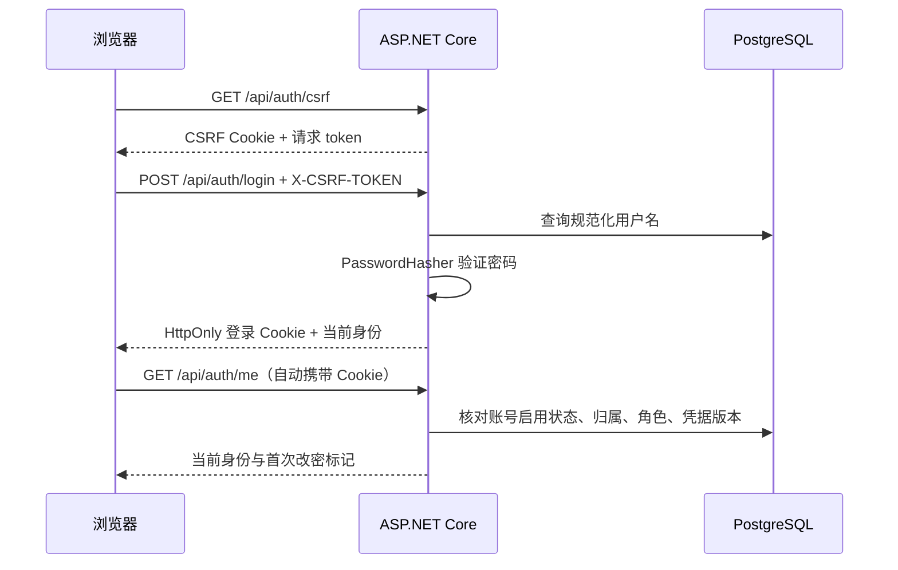

# 店铺账号模块

本阶段提供 OWNER / STAFF 的登录闭环，使用现有九张表，没有新增迁移。
页面先使用中文。平台建店、员工密码重置、顾客入桌授权将在后续阶段实现。

## 1. 先理解四个阶段

1. **初始化账号**：迁移创建表结构；初始化命令向表中写入开发餐厅和两个账号。两者分别执行。
2. **后端认证**：Controller 接收 DTO，账号服务校验密码；认证 Cookie 由框架签发，浏览器自动携带。
3. **页面联调**：React 调用 `/me` 恢复身份，按首次改密标记跳转；权限最终由后端执行。
4. **验证**：真实 PostgreSQL 测试约束和并发，浏览器验证 Cookie、表单、页面跳转及断网反馈。

建议按以下顺序阅读代码：

| 位置 | 学习重点 |
| --- | --- |
| `backend/TavoloFlow.Api/Accounts/DevelopmentAccountSeeder.cs` | 显式命令、配置、密码哈希、事务与重复执行 |
| `backend/TavoloFlow.Api/Controllers/AuthController.cs` | HTTP 输入输出、状态码、账号服务调用 |
| `backend/TavoloFlow.Api/Accounts/AccountService.cs` | 密码校验、带版本条件的原子更新 |
| `backend/TavoloFlow.Api/Accounts/StoreAuthentication.cs` | Cookie 内容、每次请求核对数据库、当前账号 |
| `backend/TavoloFlow.Api/Accounts/AccountSecurity.cs` | 首次改密权限策略和 CSRF 验证 |
| `frontend/src/features/accounts/` | 文案、请求、查询缓存、表单和状态反馈 |
| `frontend/src/router.tsx` | 三个页面的路由 |

## 2. 本地运行

先按 [数据层说明](data-layer.md) 启动 PostgreSQL，配置
`ConnectionStrings:Default`，并显式执行：

```bash
dotnet ef database update --project backend/TavoloFlow.Api
```

通过 user-secrets 提供初始化配置。下面密码仅为占位符，执行前替换为自己的值，
不要把实际密码写入源码、提交记录或共享终端输出。

```bash
dotnet user-secrets set 'DevelopmentSeed:RestaurantId' 'cd5328d4-883c-40ce-9f96-0cb3a5cf1b83' --project backend/TavoloFlow.Api
dotnet user-secrets set 'DevelopmentSeed:RestaurantName' 'TavoloFlow 开发餐厅' --project backend/TavoloFlow.Api
dotnet user-secrets set 'DevelopmentSeed:Owner:Username' 'dev.owner' --project backend/TavoloFlow.Api
dotnet user-secrets set 'DevelopmentSeed:Owner:Password' '<YOUR_OWNER_PASSWORD>' --project backend/TavoloFlow.Api
dotnet user-secrets set 'DevelopmentSeed:Staff:Username' 'dev.staff' --project backend/TavoloFlow.Api
dotnet user-secrets set 'DevelopmentSeed:Staff:Password' '<YOUR_STAFF_PASSWORD>' --project backend/TavoloFlow.Api
dotnet run --project backend/TavoloFlow.Api --launch-profile http -- --seed-dev-accounts
```

也可使用对应的环境变量，例如 `DevelopmentSeed__Owner__Password`。
密码需 12–128 个字符且不能全部为空白。用户名去首尾空白并转小写，最多 50 字符，
OWNER 和 STAFF 用户名必须不同。

初始化命令在 Development 之外拒绝执行，成功后退出，不启动 HTTP 服务。
它不自动迁移数据库，也不提供 HTTP 初始化入口。新餐厅默认停用、关闭接单；
账号仍可登录完成配置。

重复使用相同餐厅 ID、名称和两个账号归属执行时保持已有数据不变，包括改过的密码、
首次改密标记、凭据版本和餐厅服务状态。账号冲突、餐厅名称不一致或仅存在部分账号时
报错，不覆盖或补写未知数据。数据库写入失败会回滚整次初始化。

分别在两个终端启动：

```bash
# 仓库根目录
dotnet run --project backend/TavoloFlow.Api --launch-profile http
```

```bash
cd frontend
npm run dev
```

打开 `http://localhost:5173/staff/login`。Vite 将 `/api` 代理至
`http://localhost:5093`，浏览器始终使用同一站点。端口占用时 Vite 明确失败，
避免悄悄切换到不同端口。HTTP 开发模式只用于本机联调。

首次用初始化密码登录会进入改密页面，完成后进入账号页。再次运行初始化命令不会重置密码。

## 3. 一次登录请求如何工作



密码哈希用于验证输入是否正确，不用于还原原密码。登录 Cookie 包含受保护的账号、
角色、餐厅和凭据版本信息；每次请求都检查数据库，不能仅凭 Cookie 内的旧内容授权。
前端不读取认证 Cookie，也不把密码或身份凭据写入 localStorage/sessionStorage。

## 4. 接口和安全边界

| 接口 | 请求 / 成功响应 |
| --- | --- |
| `GET /api/auth/csrf` | `{ token }`；匿名也可调用 |
| `POST /api/auth/login` | `{ username, password }` → 当前身份 |
| `GET /api/auth/me` | 当前身份；未登录为 `401` |
| `POST /api/auth/change-password` | `{ currentPassword, newPassword }` → 当前身份及新 Cookie |
| `POST /api/auth/logout` | 无业务字段 → `204`；已失效凭据可返回 `401`，页面视为已退出 |

当前身份仅包含 `userId`、`username`、`role`（`OWNER` / `STAFF`）、
`restaurantId`、`restaurantName` 和 `mustChangePassword`。

所有 Controller 写请求都验证 `X-CSRF-TOKEN`，包括登录。前端每次写请求前获取新 token，
身份变化后再次获取；token 只在请求期间保留在内存。登录、改密和退出不自动重试。
认证响应均为 `Cache-Control: no-store`。

错误结构为 `{ code, message, requestId, errors? }`：

| 状态 / code | 行为 |
| --- | --- |
| `400 VALIDATION_FAILED` | 校验字段；不写数据库 |
| `400 CURRENT_PASSWORD_INCORRECT` / `PASSWORD_UNCHANGED` | 修正改密输入 |
| `400 CSRF_VALIDATION_FAILED` | 再次提交时获取新 token |
| `401 INVALID_CREDENTIALS` | 统一提示用户名或密码错误，不区分不存在、禁用或密码错误 |
| `401 UNAUTHENTICATED` | 清理私有缓存，进入登录页 |
| `403 PASSWORD_CHANGE_REQUIRED` | 进入首次改密页 |
| `403 FORBIDDEN` | 不允许该角色执行操作 |
| `409 CREDENTIALS_CHANGED` | 凭据已被另一请求改变，重新登录 |
| `429 RATE_LIMITED` | 根据 `Retry-After` 等待后重试 |
| 网络异常 / `5xx` | 结果可能未知，重新核对身份；不自动重发写操作 |

认证方案名为 `Store`，Cookie 名为 `TavoloFlow.Store`。使用 `HttpOnly`、`SameSite=Lax`，
不设置 Domain；生产固定 `Secure`，Development 随请求协议设置。
Cookie 是浏览器会话 Cookie；票据固定 16 小时到期，不滑动续期，不提供“记住我”。
浏览器的会话恢复功能可能恢复会话 Cookie，但仍受服务端 16 小时有效期约束。

改密在同一 SQL UPDATE 中修改哈希、清除 `must_change_password` 并递增
`credential_version`，WHERE 条件包含当前账号、餐厅、角色、启用状态和预期版本。
两个设备按同一版本改密至多一个成功。成功请求签发新的 16 小时票据，
其他旧票据下一次请求被拒绝。

退出只删除当前浏览器 Cookie，不改变凭据版本，也不强制退出其他浏览器。
没有独立设备会话表，不能承诺服务端撤销单台设备或使被复制的退出前票据立即失效。

后续业务使用 `StoreStaff` / `StoreOwner` 策略及 `CurrentAccount` 的可信餐厅归属。
默认及兜底策略要求完成首次改密，OWNER 满足 STAFF 权限。`StoreAccount` 只用于
`/me`、改密和退出等自助账号功能，不能用它放行普通业务。
未来平台和顾客使用各自认证方案，不能复用店铺身份策略。

登录默认限制每来源 IP 30 次/分钟、每规范化用户名 10 次/5 分钟；
改密默认每账号 5 次/分钟。计数包含成功和失败尝试，不永久锁定账号。
配置项位于 `AccountRateLimits`：
`LoginPerIpPerMinute`、`LoginPerUsernamePerFiveMinutes`、`PasswordChangesPerMinute`。
限制为单实例内存状态，重启后重置，部署多实例时需要共享或边缘限制。

Data Protection 应用名固定为 `TavoloFlow`。开发使用框架的用户密钥目录；
生产通过 `DataProtection:KeyRingPath` 指定持久目录并限制文件访问。
密钥不写入仓库，重启后保留，容器部署应挂载持久卷。
生产保留 HTTPS 跳转，并采用框架默认的回环代理信任范围处理
`X-Forwarded-For` / `X-Forwarded-Proto`；Caddy 不在本机回环地址时，
应显式配置可信代理地址，不能信任任意转发头。

## 5. 验证与学习实验

```bash
dotnet test TavoloFlow.slnx
```

```bash
cd frontend
npm run build
npm run lint
```

后端测试通过临时 PostgreSQL 和 `WebApplicationFactory` 验证，不访问开发数据库。
权限探测 Controller 只在测试宿主注册，生产 API 不包含测试接口。
时间测试推进可控制时钟，不实际等待 16 小时。

可在浏览器亲自做以下实验：

1. 未登录直接打开 `/staff`，观察跳转以及 Network 中 `/me` 的 `401`。
2. 用初始密码登录，直接输入 `/staff`，确认仍要求先改密。
3. 改密后刷新页面，确认账号继续有效。
4. 用普通窗口和无痕窗口同时登录，再在其中一个窗口改密；另一个窗口刷新后要求重新登录。
5. 同时登录两个窗口，仅退出其中一个，另一个仍可使用。
6. 在开发者工具模拟断网后退出或改密，观察“结果待确认”；恢复网络后点击“重新核对登录状态”。
7. 检查 Application 面板：认证 Cookie 为 HttpOnly，localStorage/sessionStorage 中没有账号密码或票据。

2026-10-20 验证记录：

- 后端 65 项测试全部通过，包括原有 43 项数据层测试及新增 22 项账号/初始化测试。
- 前端 build 通过；lint 无错误，保留现有按钮组件的一条 Fast Refresh 警告。
- Chromium 使用独立的临时 PostgreSQL 完成上述流程，并验证服务端已经保存改密但响应丢失时不自动重试。
- 验证过程中发现并关闭 TanStack Query 默认的离线 mutation 暂停/恢复行为；
  账号写操作使用 `networkMode: "always"` 和 `retry: false`，断网立即显示反馈，不在联网后自动重放。
- 临时数据库和开发服务器在验收后清理；用户开发数据库及账号未被初始化或修改。

页面截图：[桌面登录](screenshots/store-login-desktop.png)、
[手机登录](screenshots/store-login-mobile.png)、
[手机首次改密](screenshots/store-first-password-mobile.png)、
[桌面账号](screenshots/store-account-desktop.png)、
[手机账号](screenshots/store-account-mobile.png)。
