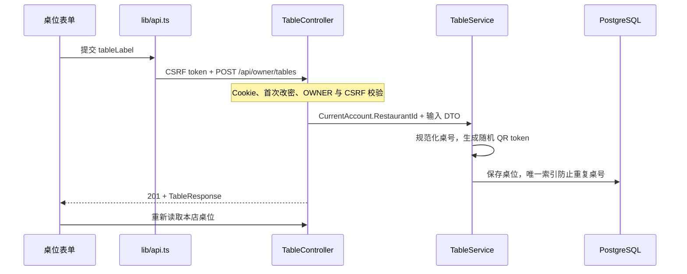

# 第三阶段：桌位与公开菜单

本阶段完成“OWNER 创建桌位 → 下载固定二维码 → 顾客扫码浏览菜单”。
后台入口为 `/staff/tables`，顾客入口为 `/q/{token}`。STAFF 可查看桌位，维护操作由 OWNER 执行。
顾客无需登录；页面提供中、意、英三语、分类浏览、价格、过敏原和供应状态。
第三阶段完成公开浏览；第四阶段已接入开桌、入桌码、顾客授权及空桌关闭，见
[第四阶段说明](dining-guest-access.md)。购物车与下单仍在后续阶段实现，当前点餐由顾客联系服务员。

沿用现有九张表，没有新增迁移，也没有增加新的账号初始化动作。

## 1. 按四步理解实现

### 第一步：创建一个桌位

从首页「管理」中的「桌位与二维码」进入，添加桌号 `8`。在浏览器 Network 面板观察请求：



重点：请求不带 `restaurantId`、角色或 `qrToken`。餐厅来自可信登录身份，Token 由服务器生成。
重复创建同名桌位得到 `409 TABLE_LABEL_CONFLICT`；输入两端空格会被去掉。
同店名称区分大小写，不同餐厅可以使用相同桌号。

### 第二步：改名、启停与删除

把 `8` 改成 `8 · 窗边`，再停用它，比较响应中的 `id` 和 `qrPath`：它们始终相同。
名称和启停分别使用 PATCH，避免旧名称表单覆盖别人刚修改的启停状态。
更新在事务内锁住对应桌位行；第四阶段的开桌已使用同一桌位行锁协调。

删除先进行页面确认，再由后端检查活动 Session。`CatalogDeletionService` 自己管理事务，
不能在调用方再包外层事务。关闭历史的 `table_id` 被清空，但桌号快照、餐厅归属和历史账单保留。
活动用餐禁止删除。删除后重建相同桌号会生成新 ID 和新 Token，需要重新打印二维码。

练习：用两个 OWNER 浏览器分别改名和停用，确认最终两项修改都保留。
使用 STAFF 页面查看同一桌位，再直接调用维护接口，观察服务端返回 403。

### 第三步：二维码编码的是公开入口

点击“二维码”，预览链接与图片。PNG 由浏览器本地 `qrcode` 库生成，不使用第三方二维码服务。
图片为 1024 × 1024、黑白、四模块留白、中等纠错；下载文件名包含桌位 ID。
预览处显示餐厅名与桌号，PNG 本身只包含二维码，方便自行排版制作桌牌。
多次下载同一桌位时，编码的入口相同。改名后仍然可以使用原图片。

`qr_token` 使用 32 字节安全随机数的 Base64URL 编码，不是入桌码，也不授予下单或订单读取权限。
本阶段没有二维码重置接口。复制链接受浏览器权限限制，失败时可以在输入框中手动选择复制。

### 第四步：跟踪一次匿名菜单读取

第三阶段仅发出公开菜单请求。第四阶段在有目标 Session 时额外查询顾客 access，
验证时请求 `/api/public/csrf` 和 join；公开菜单页面始终不请求 `/api/auth/me`。
公开入口独立于后台布局；`publicRequest` 使用 `credentials: omit`，不处理后台登出。

`PublicMenuService` 在一个 Repeatable Read 事务中定位桌位与餐厅、读取活动 Session ID、
取得分类和菜品。`MenuReader` 复用菜单读取和语言统计逻辑，但不开启自己的事务。
后台 `MenuService.ReadAsync` 也复用它，原后台接口保持不变。

练习：删除一个用于练习的空桌，再在原顾客页点击“重新读取菜单”。页面应变成二维码失效提示，
旧菜单被清除。模拟网络失败则会保留原菜单并显示更新失败，这两种结果不能混为一谈。

## 2. 接口契约

所有响应采用 `Cache-Control: no-store`。后台写请求需要 `X-CSRF-TOKEN`，使用现有权限策略；
首次改密限制同样生效。请求 DTO 拒绝未定义字段。

| 方法与路径 | 权限 | 成功响应 |
| --- | --- | --- |
| `GET /api/staff/tables` | OWNER / STAFF | 200：按 ID 排序的 `TableResponse[]` |
| `POST /api/owner/tables` | OWNER | 201：新桌位，默认启用 |
| `PATCH /api/owner/tables/{id}/label` | OWNER | 200：更新后的桌位 |
| `PATCH /api/owner/tables/{id}/enabled` | OWNER | 200：更新后的桌位 |
| `DELETE /api/owner/tables/{id}` | OWNER | 204 |
| `GET /api/public/qr/{token}/bootstrap` | 匿名 | 200：`PublicMenuResponse` |

创建和改名输入为 `{ "tableLabel": "8" }`，启停输入为 `{ "isEnabled": false }`。
桌号去除首尾空白后为 1–50 字符。

`TableResponse`：`id`、`tableLabel`、`isEnabled`、`qrPath`、`activeSessionId`（可空）。
`qrPath` 为 `/q/{token}`，由前端结合网站 origin 生成完整链接。

`PublicMenuResponse`：

- `restaurant`：`id`、`name`、`currencyCode`、`defaultLanguage`、`serviceStatus`、`orderingEnabled`。
- `table`：`id`、`tableLabel`、`isEnabled`。
- `activeSessionId`：本桌活动用餐 ID，无活动用餐时为 `null`，不是授权凭据。
- `menu`：`availableLanguages`、`categories`、`items`。分类和菜品 DTO 复用菜单字段，
  包括三语名称/描述、整数欧分、过敏原代码、审核状态和供应状态；不直接序列化 EF Entity。

不返回入桌码、密文、订单、账单、账号或密码信息。扫码及公开读取不创建 Session。

| 错误 | 含义 |
| --- | --- |
| `400 VALIDATION_FAILED` | 桌号非法、缺少启停值或请求夹带未定义字段 |
| `404 TABLE_NOT_FOUND` | 桌位不存在或不属于当前店铺 |
| `409 TABLE_LABEL_CONFLICT` | 同店已有相同桌号 |
| `409 TABLE_HAS_ACTIVE_SESSION` | 桌位存在活动用餐，不能删除 |
| `404 QR_NOT_FOUND` | 公开二维码未知、已删除或超出长度限制 |

401、403 和 CSRF 错误沿用账号模块。

## 3. 页面状态与语言

- 餐厅暂停服务、暂停接单及桌位停用均允许浏览。为避免重复提示占满手机屏幕，主要提示按
  “餐厅服务暂停 → 桌位停用 → 暂停接单 → 尚未开桌”优先展示，并引导联系服务员。
- 顾客始终可以选择中、意、英三种界面语言。首次使用老板设置的默认语言，
  顾客明确选择后存入按餐厅区分的 localStorage；访问被禁用时使用内存状态继续浏览。
  浏览器语言不覆盖餐厅设置，顾客选择不写回服务器。
- 菜名和分类按“顾客选择 → 默认语言 → it → zh → en”去重回退。
  描述使用最终名称的语言，没有该语言描述就省略。固定文案和过敏原标签随界面语言切换。
- 售罄菜品仍展示。旧数据未完成审核时显示“待餐厅确认”；审核后空数组说明
  未识别出需声明过敏原，并保留餐厅咨询提示，不宣称排除交叉接触风险。
- 公开查询键为 `["public", "qr", token]`；账号切换清理私有缓存时保留公开查询。
  查询在首次进入、恢复前台/联网和主动刷新时执行。本阶段没有定时轮询、离线菜单缓存或写请求。
- 确认 `QR_NOT_FOUND` 后查询返回空结果，替换旧缓存并隐藏旧菜单，保留顾客当前界面语言。
  网络错误保留上次内容并标记更新失败；首次读取失败显示重试入口。
- 后台写入不自动重试或离线排队。响应丢失时保持草稿，提示读取列表并核对结果；
  已确认写入成功但重新读取失败时显示独立的成功/刷新失败提示。

## 4. 启动及手机访问

先按 [店铺账号说明](store-accounts.md) 配置数据库、应用已有迁移并初始化开发账号。
运行后端及前端：

```bash
dotnet run --project backend/TavoloFlow.Api --launch-profile http
```

在 `frontend/`：

```bash
npm run dev
```

打开 `http://localhost:5173/staff/tables`。本阶段不需要新迁移；新生成的二维码默认使用当前页面 origin。

手机不能通过它自己的 `localhost` 访问你的电脑。局域网测试可在 `frontend/.env.local` 设置：

```dotenv
VITE_PUBLIC_BASE_URL=http://192.168.1.100:5173
```

这里应填写手机实际能够访问的电脑/转发地址，然后重启 Vite：

```bash
npm run dev -- --host 0.0.0.0
```

`VITE_PUBLIC_BASE_URL` 是编译时公开配置，只能是 HTTP(S) origin，不包含路径、账号、查询或片段。
配置错误时界面拒绝生成链接。留空时使用当前浏览器 origin；生产构建后改变该值需要重新构建。
如果域名/端口更换，已有纸质二维码仍指向旧地址，需自行维护跳转或重新打印。

WSL 场景先在 Windows 浏览器确认 Vite 可访问，再在同一局域网手机手动打开上述地址。
若 Windows 能访问而手机不能，检查 Windows 防火墙、WSL 网络模式以及是否需要端口转发；
具体取决于本机配置。只通过 Vite 暴露前端和 `/api` 代理即可，后端仍可绑定 localhost。
工具不会自动改防火墙或端口转发。正式部署使用 HTTPS，并让服务器为 `/q/{token}` 等前端深链接返回 SPA 入口。

## 5. 验证记录（2026-10-22）

- `dotnet test TavoloFlow.slnx --no-restore --verbosity minimal -m:1 /p:UseSharedCompilation=false`：
  103 项通过，其中新增桌位与公开菜单测试 12 项；全部使用临时 PostgreSQL。
  覆盖权限/CSRF、两店隔离、非法输入、并发同名创建、字段独立更新、历史保留、删除故障回滚，
  以及公开读取中途其他事务修改数据时仍使用一致快照。
- `npm run build`、`npm run lint` 均通过；`node --test --test-isolation=none tests/*.test.ts`：
  语言、二维码地址、存储异常和缓存范围共 11 项纯逻辑测试。
- Chromium 的独立 OWNER、STAFF 和匿名会话验证桌位操作、越权拒绝、三语和回退、
  空菜单、售罄、暂停状态、旧二维码失效、恢复读取及无后台身份请求。
  模拟服务器创建成功但响应丢失，确认只发出一次 POST，草稿保留，手动重读可以找到已创建桌位。
- 实际下载 PNG 并用独立二维码解码库解码，确认尺寸为 1024px 且 URL 与预览完全一致。
  360px 页面无横向溢出；浏览器没有未处理 JavaScript 异常。
- 浏览器验收也使用独立临时数据库，没有写入开发数据库。真实手机/用户局域网连通性未验证，
  可按上一节进行本机验收。
- 安装依赖时 `npm audit` 报告了 7 项 high，均来自原有 shadcn/fast-glob/braces 依赖链，
  锁文件中这些包的版本与本次修改前一致；本次新增 qrcode 依赖未被列入报告。未执行强制依赖升级。

截图：[老板桌位页](screenshots/tables-owner-desktop.png)、[员工只读页](screenshots/tables-staff-desktop.png)、
[二维码预览](screenshots/tables-qr-desktop.png)、[桌位手机页](screenshots/tables-owner-mobile.png)、
[意大利语手机菜单](screenshots/public-menu-mobile-it.png)、[中文手机菜单](screenshots/public-menu-mobile-zh.png)、
[桌面公开菜单](screenshots/public-menu-desktop-it.png)。
