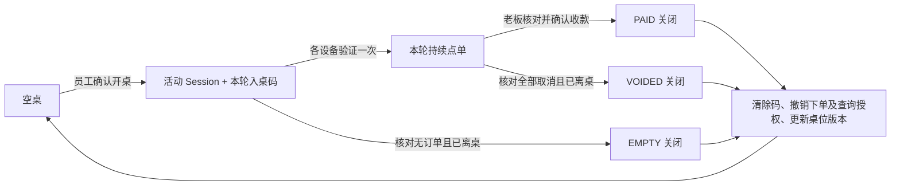
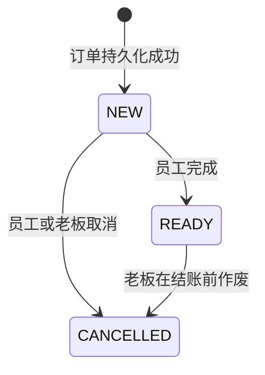

# TavoloFlow — 餐厅二维码点单系统项目需求文档

- 项目名称：TavoloFlow
- 修改日期：2026-10-16
- 作者：Lorenzo Yang
- 技术栈版本：V1.0（C# / .NET 10 / ASP.NET Core Controller-based Web API + PostgreSQL）

## 1. 项目概述

### 1.1 项目背景

面向尚未采购完整数字化餐饮系统，且仅需要扫码点单能力的中餐厅，提供独立、轻量的 Web 点单服务。产品覆盖顾客点单、厨房查看订单、柜台核对账单以及餐厅日常菜单管理，不要求餐厅更换现有收银设备或支付方式。

### 1.2 项目目标

1. 顾客使用手机扫描桌面二维码浏览菜单，输入本轮入桌码后提交订单和加单，无需注册账号或安装应用。
2. 服务员带位后扫码开桌并告知 4 位入桌码，提醒至少一名顾客尽早扫码并验证入桌；已验证顾客可查看并告知同桌顾客，每台设备分别验证一次即可在本轮持续点单，减少重复询码与员工录单工作。
3. 厨房及时获得完整订单，支持多设备协作处理。
4. 柜台能够准确汇总同桌当次用餐金额，在确认线下收款后结束本轮用餐。
5. 老板能够自行维护菜单、语言内容、供应状态、桌位和二维码。
6. 通过同一套应用服务多家餐厅，确保各餐厅数据与权限隔离。
7. 保证订单在重复请求、网络中断和多设备并发操作下的正确性与可追溯性。

### 1.3 适用经营场景

目标客户包括中餐快餐店、普通中餐馆、寿司店、华人餐厅及其他只需要基础扫码点单功能的餐厅。

V1.0 支持的经营流程为：顾客堂食就座、按菜品单价点餐、同桌多次提交订单、厨房制作、柜台线下整桌结账。系统默认先点餐后付款，不支持以付款成功作为厨房制作前提的流程。

### 1.4 术语定义

| 术语                        | 定义                                                   |
| --------------------------- | ------------------------------------------------------ |
| 餐厅 / Restaurant           | 独立的数据与权限隔离单位                               |
| 桌位 / Table                | 餐厅内可供顾客点单的实体桌位                           |
| 固定二维码 / QR             | 长期绑定某一桌位的点单入口                             |
| 用餐记录 / Dining Session | 员工开桌时创建的一次用餐及账单集合，关桌后保留历史；唯一 ID 标识该记录，不是授权秘密，也不是框架登录会话 |
| 入桌码 / Join Code | 员工开桌时生成的本轮 4 位易辨字母 / 数字码，用于取得本次顾客设备授权；已验证顾客可主动查看并告知同桌顾客 |
| 顾客设备授权 / Guest Grant | 入桌验证后发给当前浏览器的秘密凭据，用于本次下单、整桌已提交订单查询及查看入桌码；关桌 / 重置即撤销，与公开的用餐 ID 不同 |
| 订单 / Order                | 顾客一次正式提交的菜品集合；加单产生新订单             |
| 订单明细 / Order Item       | 订单中的一行菜品、数量、单价和备注                     |
| 厨房工作台 / KDS            | 供厨房查看和处理订单的页面                             |
| 登录会话 / Login Session    | 后台设备登录后持有的认证会话，与用餐记录相互独立       |
| 幂等键                      | 标识同一次提交意图的唯一值，用于避免重复生成订单       |
| 桌位版本 | 用于拒绝过时员工操作的递增版本值，开桌、关桌及桌位维护时更新 |
| 操作标识 | 程序为同一次业务意图生成的唯一标识，重试沿用以恢复原结果，避免重复执行 |
| 账单版本                    | 标识账单金额相关内容是否发生变化的版本值               |
| 清桌 | 核对后关闭本次用餐记录、清除入桌码并撤销全部顾客下单与读取权限，使桌位变为空桌；不自动开下一桌 |

术语示例：

- **幂等键**：避免同一次下单被重复创建。例如顾客提交“两份炒饭”，后端已保存订单，但手机断网没有收到成功响应；本次用餐仍活动且授权有效时，顾客使用原幂等键重试，服务端返回原订单，不再创建第二笔。
- **账单版本**：避免按过期金额结束用餐。例如柜台看到 20 欧元后，同桌另一位顾客加单使金额变为 30 欧元；老板按旧账单确认收款并清桌时，服务端拒绝关闭并返回最新账单，要求重新核对实际收款。

## 2. 项目范围

### 2.1 版本内范围

| 模块       | 交付内容                                                                               |
| ---------- | -------------------------------------------------------------------------------------- |
| 顾客点单 | 扫码主动提示入桌码、可跳过看菜单、独立本地购物车、提交前验证、下单 / 加单、本次整桌已提交订单共享、授权后查看 / 复制入桌码 |
| 用餐记录 | 员工开桌、入桌码验证、设备持续授权、同桌已提交订单共享、前后批次隔离、活动及遗留提醒、受限清桌 |
| 厨房工作台 | 订单列表、定时更新、新单声音提醒、整单完成、取消状态同步、连接状态提示                 |
| 柜台工作台 | 老板核对账单、确认收款并清桌、处理遗留提醒；服务员使用独立桌位页执行受限操作 |
| 菜单管理   | 分类、菜品添加与编辑、移除菜品、售罄与恢复供应、可选菜品编号、名称、描述、价格、过敏原 |
| 桌位管理   | 创建、改名、启停、删除、固定二维码下载与重置                                           |
| 账号管理   | 平台管理员、餐厅老板、共享员工账号、独立设备会话、改密与会话撤销                       |
| 平台管理   | 创建餐厅、初始化账号、维护服务状态                                                     |
| 数据与安全 | 多餐厅隔离、输入校验、幂等、并发控制、历史快照、关键操作审计                           |

功能说明：

- **活动时间提醒**：提醒员工检查长时间没有结束的用餐，不自动清桌。
- **用餐记录隔离**：避免上一批顾客的旧页面把订单加到下一批顾客的账单里。
- **取消状态同步**：员工取消订单后，厨房页面在同步后显示该订单已取消。
- **连接状态提示**：让厨房知道屏幕上的订单是否还在正常更新。
- **零账单清桌**：从未下单或所有订单已取消且应收为 0 时，仍须核对最新账单、确认顾客已离桌并填写原因；不记录为收款。
- **菜品编号**：可选；未填写不影响添加、展示和下单。
- **桌位创建、改名与启停**：添加桌位时生成固定二维码；改名修改显示桌号；启停控制是否允许提交新订单。
- **桌位删除**：仅允许删除没有进行中用餐记录的桌位。删除后不再显示，原二维码失效；已有订单保留，不受影响。
- **独立设备会话**：同一个员工账号可以在多台设备登录，每台设备分别保持登录状态。
- **会话撤销**：让指定或全部已登录设备失去访问权限，相当于强制退出登录。
- **维护服务状态**：平台管理员决定某家餐厅是否可以继续使用扫码点单服务。
- **幂等**：同一次提交重复发送，只处理一次。
- **历史快照**：订单保存下单当时的菜名、价格等信息，后续菜单修改不改变原订单。
- **关键操作审计**：记录重要操作由哪个账号、何时执行，例如取消订单的原因、时间和执行账号。

### 2.2 版本外范围（不开发、不包含的功能）

- 顾客在线支付、退款处理、税务票据生成及现有收银系统接口集成。
- 自动厨房打印、Android 专用客户端、本地打印代理。
- 顾客账号、会员、营销、库存、采购、排班等经营管理功能。
- 外卖、外带、预约、自助餐轮次管理、转桌、并桌、拆单、分账。
- 套餐组合、规格选项、加料计价、折扣、赠品、餐位费及服务费。
- 按菜品拆分制作状态、多厨房分单与配送管理。
- 同桌共享购物车、顾客查询其他批次或已关闭用餐的订单、每次加单重复输入验证码；本次已提交整桌订单仅向同桌已验证顾客共享。
- 独立员工账号自助开通、多店账号切换、自助商家入驻与订阅自动扣费。
- 菜品图片自助上传与 WebSocket 实时推送。
- 菜单草稿、独立发布流程和手动排序。

系统可在无菜品图片的情况下完整运行。菜品图片上传、浏览器手动打印等扩展须单独确定交付范围，不作为基础版本的上线条件。

### 2.3 业务边界

- 顾客通过餐厅既有方式在线下付款；本系统记录老板确认的收款结果，不执行支付交易。
- 餐厅继续使用原有收银设备与流程处理正式商业凭证和税务事项。
- 平台服务费由平台管理者与餐厅线下结算，系统仅维护服务状态。
- 一套代码、一套平台部署服务多家餐厅，不为每家餐厅单独复制应用。

## 3. 用户角色与权限

### 3.1 角色定义

| 角色                      | 账号配置                           | 主要职责                                               |
| ------------------------- | ---------------------------------- | ------------------------------------------------------ |
| 顾客 | 无账号，每个浏览器验证本次入桌码 | 浏览菜单并编辑独立本地购物车；凭有效授权下单、查看本次整桌已提交订单、查看 / 复制入桌码 |
| 员工 STAFF | 每店默认一个共享账号，可多设备登录 | 开桌、查看入桌码、厨房处理、允许范围内取消、供应状态、受限零账单清桌与通知老板；无收银权限 |
| 老板 OWNER | 每店默认一个账号 | 员工全部功能，以及柜台收款结账、入桌码重置、菜单、桌位、账号和历史管理 |
| 平台管理员 PLATFORM_ADMIN | 平台管理者一个账号                 | 创建和启停餐厅、初始化与重置店铺账号                   |

每个 OWNER / STAFF 账号仅属于一家餐厅。后台数据模型应允许后续增加店铺账号，V1.0 不提供多员工成员管理功能。

### 3.2 权限矩阵

| 功能 | 顾客 | STAFF | OWNER | PLATFORM_ADMIN |
| --- | :---: | :---: | :---: | :---: |
| 浏览公开菜单、验证入桌码后凭本轮授权下单 | ✓ | — | — | — |
| 凭本次有效顾客授权查看当前 ACTIVE 用餐的全部已提交订单 | ✓ | — | — | — |
| 查看本店活动桌位、订单及清桌所需账单 | — | ✓ | ✓ | — |
| 开桌、员工主动查看本轮入桌码 | — | ✓ | ✓ | — |
| 凭本轮有效顾客授权主动查看 / 复制入桌码并告知同桌顾客 | ✓ | — | — | — |
| 通知老板处理遗留 Session | — | ✓ | ✓ | — |
| 核对最新账单后关闭 EMPTY / VOIDED 零账单 | — | ✓ | ✓ | — |
| 进入收银工作台、确认收款并 PAID 清桌 | — | — | ✓ | — |
| 重置入桌码并撤销本轮顾客授权、处理遗留提醒 | — | — | ✓ | — |
| 将 NEW 订单标记 READY、取消未结账 NEW（须原因） | — | ✓ | ✓ | — |
| 作废未结账 READY 订单 | — | — | ✓ | — |
| 切换售罄、暂停或恢复接单 | — | ✓ | ✓ | — |
| 修改菜单、价格和过敏原，管理桌位及固定二维码 | — | — | ✓ | — |
| 查看本店已关闭账单与完整审计 | — | — | ✓ | — |
| 修改本人密码、退出当前设备 | — | ✓ | ✓ | ✓ |
| 重置本店员工密码、撤销员工会话 | — | — | ✓ | ✓ |
| 创建和启停餐厅、初始化或重置老板账号 | — | — | — | ✓ |

权限必须在实际业务执行与信息读取时验证，不能只隐藏按钮。STAFF 可读取受限清桌所需的活动账单，但不拥有收银能力；本版不新增独立收银员角色。平台管理员默认不具备跨餐厅业务订单、入桌码或顾客授权访问能力。

### 3.3 登录与设备会话

**FR-AUTH-01 统一登录**：OWNER 与 STAFF 使用统一登录入口，凭全局唯一登录名和密码登录。登录名按小写 ASCII 规范化，餐厅名称不参与账号唯一性判断。

**FR-AUTH-02 餐厅识别**：登录后，服务端根据账号和有效登录会话确定餐厅与角色。后台 API 不接受客户端自报餐厅或角色作为授权来源。

**FR-AUTH-03 多设备登录**：每次成功登录建立独立、可撤销的设备会话。同一共享账号允许多个有效会话；退出当前设备不影响其他设备。

**FR-AUTH-04 密码管理**：初始账号使用临时密码并要求首次修改。修改或重置密码后撤销相应旧会话。OWNER 可管理本店共享员工账号；平台管理员可恢复 OWNER 访问。

**FR-AUTH-05 平台认证**：平台登录使用独立入口、认证接口、Cookie 和服务端会话，不与店铺身份混用。

**FR-AUTH-06 会话管理**：OWNER 可查看员工设备会话及最后活动时间，撤销指定会话或全部会话。设备名称为辅助标签，不作为真实员工身份。

V1.0 不开放公共注册和自动邮件找回密码。共享账号操作记录关联账号与设备会话，不要求识别实际操作人员姓名。

## 4. 业务流程与状态

### 4.1 餐厅初始化

1. 平台管理员创建餐厅，默认停用服务并关闭接单开关，初始化 OWNER 和 STAFF 账号。
2. 老板维护菜单和过敏原，至少填写一种菜单语言，并确认餐厅默认语言。
3. 老板创建桌位，下载并张贴固定二维码。
4. 员工在桌位与厨房设备登录，老板在柜台设备登录，开启对应工作页面及声音提醒。
5. 配置完成后，平台管理员启用餐厅服务，员工或老板开启接单，顾客开始使用。

### 4.2 正常用餐流程

1. 服务员带位后，在员工设备扫码核对桌号并点击“开桌”；扫码本身不自动开桌。
2. 系统创建全新 ACTIVE 用餐记录和 4 位入桌码，向员工展示；服务员告知顾客，并提醒至少一人尽早扫码验证。
3. 顾客扫码后，未验证时先看到入桌码提示，可立即验证，也可选择“先看菜单”。未验证可浏览和编辑自己的本地购物车，不能提交或查看整桌已提交订单。
4. 顾客点击提交时，如未验证则复用入桌码输入框；成功后重新核对桌号、当前用餐、菜品及金额，再由顾客确认提交。系统把订单加入既有用餐记录，不通过首单开桌。
5. 厨房收到 NEW 订单，制作完成后标记 READY。同桌已验证顾客均可查看本次所有已提交订单及状态，购物车仍各自独立；只想看菜单的人可把菜品口头告诉一人，由该人统一下单。
6. 有效授权期间可持续加单、查看本桌订单、主动查看 / 复制入桌码并告知同桌人；正常刷新、语言切换和短暂断网不重复输码。无人持有效授权时服务员可再次查看告知。
7. 老板核对最新整桌账单及待处理订单，在线下收款后执行“确认已收款并清桌”。
8. 系统关闭记录、清除码、撤销全部顾客下单与查询权限、处理提醒并更新桌位版本。原顾客页面检测到结束后清空购物车和受保护数据、隐藏菜单，只显示结束提示；后台保留历史账单。
9. 下一批顾客由服务员重新开桌，创建新的唯一用餐记录和随机码。原页面不自动加入；顾客主动重新进入二维码入口可免码浏览菜单，但提交和整桌订单查询仍须验证当前用餐。

员工对活动桌再次扫码只进入详情，不重复开桌或自动换码。遗留记录按 §5.5 和 §7.8 处理，不能覆盖旧账。

### 4.3 状态定义

| 对象     | 状态      | 含义                                                   |
| -------- | --------- | ------------------------------------------------------ |
| 餐厅服务 | ACTIVE    | 已启用，是否接受新订单仍由接单开关及桌位状态控制       |
| 餐厅服务 | SUSPENDED | 已停用，停止新增订单，允许配置维护及处理既有订单与账单 |
| 用餐记录 | ACTIVE    | 本轮用餐进行中，可在满足接单条件时加单                 |
| 用餐记录 | CLOSED    | 本轮已结束，不可新增订单或修改金额                     |
| 订单     | NEW       | 系统已持久化，等待厨房处理                             |
| 订单     | READY     | 整笔订单已制作完成或可交付                             |
| 订单     | CANCELLED | 已取消，不参与应收金额计算                             |

餐厅服务状态作用于整家餐厅，由平台管理员维护；接单开关由 STAFF / OWNER 控制，用于日常营业。新餐厅在 SUSPENDED 状态下完成初始化；不再使用的餐厅保持停用。用餐记录状态只表示某一桌某一轮是否结束，关闭后下一次用餐创建新记录。

用餐记录关闭原因分为 `PAID`（OWNER 已确认收款）、`VOIDED`（已有订单全部取消后结束）和 `EMPTY`（从未下单即结束）。桌位是否正在用餐由 ACTIVE Session 推导，桌位启用状态与用餐状态独立。关闭后为空桌，下一轮只能由员工主动开桌。

桌位业务流程（“空桌”为无活动 Session 的派生状态）：





NEW 不代表已付款，也不代表员工已人工审核接单。READY 不区分“已上桌”。CANCELLED 不允许恢复为可制作状态。

### 4.4 两批顾客的完整示例

1. 服务员给 8 号桌开桌，创建用餐记录 `S1001` 和码 `7K3M`。顾客 A 验证后浏览器获得仅绑定 `S1001` 的授权；朋友可先看菜单，稍后独立验证。
2. A 与朋友各自编辑本地购物车；也可由 A 汇总大家口述的菜品统一提交。每次正式提交生成一个标识，断网重试沿用它；同桌已验证者均可查看提交成功的整桌订单。
3. 老板收款清桌，`S1001` 保留为已关闭历史，码和全部顾客授权失效。原页面检测到关闭后清空购物车和订单显示，菜单也隐藏；客户端未知结果由员工在后台核对。
4. 服务员接待 B 时创建新的 `S1002`，而不是修改或重新打开 `S1001`。B 使用新码验证；A 的旧页面与旧授权不能向 `S1002` 下单或读取其订单。
5. A 主动重新进入固定二维码仍可免码看公开菜单，但不能查看任何已关闭用餐的订单。即使两次码值偶然相同，旧授权不会复活；若 A 明确进入新验证流程并输入恰好正确的当前码，则仍可能取得新授权，短共享码不能证明人在现场。

`S1001` / `S1002` 仅为说明用的唯一记录编号，不要求实际递增，不是授权秘密。桌位版本用于识别过时员工操作，操作标识用于识别同一请求的重试；二者不作为新的用餐记录。

## 5. 功能需求

### 5.1 顾客扫码与菜单

**FR-CUS-01 扫码入口**：有效二维码识别餐厅和桌位，展示餐厅名称、醒目桌号、菜单及开桌 / 接单状态。已开桌且当前浏览器未验证时，首次进入主动弹出入桌码输入框，提供“验证并开始点餐”和“先看菜单”；选择跳过后保留“输入入桌码”入口，同次浏览不因刷新或切换语言反复弹框。空桌提示联系服务员开桌，仍可先浏览菜单。扫码和浏览不创建用餐记录或授予下单 / 订单查询权；已有本次有效授权时直接恢复正常页面。

**FR-CUS-02 菜单展示**：支持按分类浏览，展示已填写的菜品编号、当前语言名称、价格、可选描述、过敏原和供应状态。无图片时页面保持完整布局。

**FR-CUS-03 提交确认**：未验证顾客点击提交时，使用与入口相同的输入框完成入桌验证；取消验证保留本地草稿，不发送订单。验证成功后重新核对当前用餐、桌号、菜品、数量和最新金额，返回订单确认界面，由顾客确认后正式提交。已有有效授权时直接进入确认；浏览菜单和加入购物车不要求重复确认。

**FR-CUS-04 异常入口**：二维码无效、桌位停用、餐厅暂停服务或停止接单时，展示对应提示并阻止新订单提交。允许继续浏览时，不显示可提交状态。

**FR-CUS-05 入桌验证**：顾客输入当前活动用餐的入桌码，服务端核验指定 Session 后为当前浏览器发放独立设备授权；无需顾客账号，同桌多台设备分别验证。未验证可浏览并编辑本地草稿，不能提交订单或查看本桌已提交订单；验证成功后按 FR-CART-04 明确确认草稿所属用餐。验证响应不附带入桌码或整桌订单；随后分别通过 FR-CUS-08 和 FR-ORD-07 的受保护功能读取。

**FR-CUS-06 持续点餐与共享订单**：浏览器自动携带本次设备授权访问受保护功能，无需每次发送入桌码。同一浏览器在授权有效且本次用餐未结束时可持续下单、查看本次整桌已提交订单；刷新、切换语言或短暂断网不要求重复输码。新增浏览器、清理数据、授权到期 / 撤销或参加新一次用餐时须重新验证。设备授权是浏览器持有的秘密凭据，不要求识别手机硬件身份。

**FR-CUS-07 失效与用餐结束**：关桌后服务端立即拒绝本次顾客的新下单、订单查询、原请求结果读取和入桌码查看。原页面检测到关闭后清空本次购物车、待提交草稿及受保护缓存，隐藏菜单、订单和码值，仅显示“本次用餐已结束”，刷新原页面仍保留结束状态；不得自动进入下一次用餐或重发未确认订单，需核对的结果由员工在后台处理。授权仅过期 / 撤销但用餐仍活动时，隐藏订单和码值并要求重新验证，可保留本次草稿及原提交标识等待核对。正常在线前台页面应在关桌后 30 秒内发现结束；恢复前台 / 联网时先校验状态再恢复受保护内容，离线不展示缓存订单或码值。后台挂起或离线时不承诺即时清除，服务器拒绝访问不依赖客户端清理。顾客主动重新扫码或重新进入入口仍可免码浏览公开菜单，但旧授权和已关闭用餐的数据不能恢复。

**FR-CUS-08 顾客查看与同桌告知**：持有当前 ACTIVE Session 的未过期、未撤销且授权版本匹配的设备授权时，顾客可主动点击“查看本桌入桌码”，查看 / 复制并告知同桌顾客；未下单也可使用。每次读取核验二维码有效、餐厅服务 ACTIVE、桌位启用未删除，以及授权与餐厅 / 桌位 / Session / 授权版本一致；校验与取码依据一致的当前状态，旧授权不能取得重置后的新码。暂停接单本身不禁止有效授权查看。未验证、仅持二维码或业务 ID、跨桌 / 跨次、过期或撤销授权均不得读取。查看不换码、不延长授权；接收者仍须独立扫码验证，不分享设备授权凭据。界面显示桌号及“仅告知同桌顾客”，默认隐藏码值，可主动复制或口述，不自动发送消息。码值只在本次查看页面内临时保留，不进入本地持久存储或离线缓存。

### 5.2 购物车

**FR-CART-01 独立本地购物车**：每个浏览器标签页维护自己的购物车，同桌不能查看或修改他人的购物车。未验证也可添加、删除菜品和编辑备注，这些操作只修改本地草稿，不在服务端创建订单。草稿记录餐厅、桌位及页面所见的用餐 ID（空桌时为空）；该信息用于发现用餐变化，不授予权限。同次用餐内刷新应尽量保留草稿，验证后由顾客确认其所属用餐。

**FR-CART-02 数量与备注**：支持添加、移除、修改数量、填写单行和整单备注。相同菜品且备注相同可合并，备注不同应保留独立明细。

**FR-CART-03 本地操作**：购物车增减与备注编辑不触发订单写入接口。停止供应的菜品不可继续加入。

**FR-CART-04 草稿与用餐变化**：切桌或发现原用餐已结束时停止提交旧草稿；确认关闭后按 FR-CUS-07 清空本次购物车。未验证草稿所见用餐与验证目标不同时，必须提示变化，由顾客选择清空或明确重新核对菜品、数量和最新金额后作为新草稿使用，不能自动迁移或提交，已因确认关桌而清空的草稿不得借此恢复；空桌草稿在员工开桌后也须明确确认当前用餐。原请求结果未知且用餐仍活动时，先凭当前有效授权核对原提交，未核对前不得把相同内容作为新订单发送；已关闭则停止顾客查询并交由员工核对。

**FR-CART-05 价格变化**：提交时发现改价、移除、售罄或必要菜单信息变化，整笔订单停止提交，展示变化，由顾客重新确认。

备注以纯文本保存和展示，不参与价格计算，不自动翻译。涉及过敏或特殊制作的需求应提示顾客联系工作人员。

### 5.3 下单与订单查询

**FR-ORD-01 提交订单**：顾客确认后，一次提交生成一笔订单。再次加单生成新订单，不修改既有订单的数量、单价或名称。

**FR-ORD-02 归入已开桌记录**：首单和加单只加入服务员已创建且当前设备已获授权的 ACTIVE Session。未开桌、未验证或授权失效时拒绝提交，不能由顾客首单自动创建 Session。

**FR-ORD-03 服务端核价**：服务端校验菜品所属餐厅、菜品及分类未移除、供应状态、版本和数量，按数据库单价计算金额，不采用客户端自报价格结算。

**FR-ORD-04 完整提交**：订单、全部明细、既有 Session 归属及账单版本变更必须整体成功。任一失败不得留下部分订单；合法开桌但尚未下单的零订单 Session 应保留，不视为提交失败产生的错误数据。

**FR-ORD-05 防重复提交**：每次正式下单意图在发送前自动生成并保存唯一提交标识；同一次请求重试沿用原标识和原内容，只能产生一笔订单。顾客确认新的加单才生成新标识，不能以相同菜品或时间接近代替提交标识判断重复。

**FR-ORD-06 结果反馈**：持久化成功后返回订单编号、正式金额、提交时间和状态。超时或断网显示“结果待确认”；本次用餐仍活动且授权有效时，可按原提交标识核对或重试原请求。授权失效先重新验证本次用餐；已关闭只显示结束提示，不返回订单内容或自动重发，由员工核对后台。

**FR-ORD-07 本桌已提交订单**：同桌持有效本次设备授权的顾客可查看本次 ACTIVE 用餐记录内所有设备已提交的订单，按提交时间稳定排序并支持分页。显示订单编号、时间、菜品、数量、快照单价、金额、备注及 NEW / READY / CANCELLED 状态；取消项明确标识且不计入有效订单合计。界面称“本桌订单”，不包含尚未提交的购物车；用户可主动刷新，正常在线前台查看时更新目标为 30 秒内。

**FR-ORD-08 订单可见范围**：每次读取按有效设备授权核验餐厅、桌位、用餐 ID、授权版本及活动状态，只返回该次用餐的顾客可见订单字段，不返回后台账号、审计、内部操作说明或收银操作能力。未验证、跨桌、其他用餐、已关闭用餐和失效授权均不能查询；固定二维码、用餐 ID、订单号或提交标识本身不授予读取权。不提供关桌后的顾客历史订单查询；后台依保留规则继续保存账单。

顾客端不提供自行取消或修改正式订单功能，也不提供离线自动排队下单。

### 5.4 厨房工作台

**FR-KDS-01 待处理列表**：按提交时间顺序显示全部待处理订单，包含桌号、订单编号、等待时间、可选菜品编号、名称、数量和备注；未填写编号时不显示编号占位。

**FR-KDS-02 完成订单**：STAFF / OWNER 可将 NEW 整单标记为 READY。提交成功后更新列表，失败时保留卡片并提示。

**FR-KDS-03 定时同步**：厨房默认每 10 秒获取最新数据，页面恢复可见、网络恢复及状态操作完成后主动刷新。

**FR-KDS-04 新单提醒**：用户主动开启声音后，对新订单发出提醒。初次加载不对全部旧订单连续播放声音，重连时避免重复提醒。

**FR-KDS-05 连接状态**：持续显示最后成功同步时间，长时间未同步时明显提示订单可能未更新。

**FR-KDS-06 多设备协作**：其他设备完成或取消订单后，当前设备应在同步后显示一致状态。并发操作不得覆盖订单终态或重复产生业务事件。

**FR-KDS-07 积压订单**：列表支持分页并显示总量，不得因为只获取第一页而遗漏待处理订单。近期 READY / CANCELLED 可在有界范围内查看。

厨房页面应适配长时间前台显示。设备锁屏、浏览器后台挂起和休眠期间，不保证持续轮询或声音提醒。

### 5.5 柜台与结账

**FR-BILL-01 桌位总览**：老板柜台显示桌号、空桌 / 活动状态、开桌时间、订单数量、待处理数量、应收及遗留提醒；STAFF 在独立桌位页查看开桌与受限清桌所需信息，无收款操作入口。未下单 Session 显示为“已开桌 / 尚未下单”。

**FR-BILL-02 账单明细**：支持按订单查看、按菜品汇总查看，金额以当前用餐记录中未取消订单的快照计算。

**FR-BILL-03 最新账单确认**：进入结账时重新读取服务端账单，显示桌号、最新金额及待处理订单。仍有 NEW 订单时不允许关闭账单。

**FR-BILL-04 收款清桌**：仅 OWNER 可在核对最新账单并完成线下收款后，确认桌号、账单版本和金额，执行“确认已收款并清桌”。系统核对权限、状态及账单，记录 PAID 并按 BR-05 同步撤销权限；STAFF 不得调用收款接口，不能将“已付款”勾选作为绕过权限的方式。

**FR-BILL-05 账单冲突**：老板核对后发生加单或取消时，结账应返回冲突并展示最新账单，要求重新核对，不得按旧金额关闭变化后的账单。

**FR-BILL-06 全取消清桌**：STAFF / OWNER 核对最新账单、确认顾客已离桌并填写原因后，仅当已有订单全部 CANCELLED、应收为 0、不存在 NEW 且账单版本匹配时，可以 VOIDED 关闭并按 BR-05 撤销权限。不记录为已收款，不提供跳过账单核对的强制清桌。

**FR-BILL-07 历史只读**：关闭后的用餐记录不可继续加单、重新打开、改价、删除或通过普通取消操作改变金额。

**FR-BILL-08 遗留 Session 通知**：STAFF / OWNER 可选择离桌、疑似漏关桌、需核对账单等原因，向本店老板提交待处理提醒；支持最多 200 字补充说明。提醒持久保存并显示提交时间、桌号、本轮 Session、原因及状态，在正常前台联网的老板柜台 30 秒内可见，员工可查看处理结果；重复提醒合并并限频。OWNER 复核后正常结账 / 零账单关闭，或填写原因标记无需关桌；通知不等于关闭或收款。

**FR-BILL-09 无订单清桌**：从未产生订单的 Session，STAFF / OWNER 须读取最新零账单，确认顾客已离桌并填写原因，再以 EMPTY 关闭。不能删除 Session 或绕过版本核验；发生并发首单时，必须重新核对，不能按旧空账单关闭。

### 5.6 取消与作废

**FR-CANCEL-01 NEW 取消**：STAFF / OWNER 可取消未结账的 NEW 订单，必须填写原因并确认操作。

**FR-CANCEL-02 READY 作废**：只有 OWNER 可在结账前作废 READY 整单，操作必须明确确认。

**FR-CANCEL-03 账单联动**：取消后订单不再计入应收，账单版本更新，厨房与柜台同步显示取消状态。

**FR-CANCEL-04 追溯**：保留原始订单、取消原因、操作账号、设备会话和时间，不物理删除订单。

V1.0 只支持整笔取消。已结账后的退款或财务更正由餐厅既有流程处理，不通过直接修改原订单实现。

### 5.7 菜单管理

**FR-MENU-01 分类维护**：OWNER 可创建、编辑和移除分类，维护中文、意大利语、英语名称，至少填写其中一种。分类按创建时间升序展示，同一时间按内部 ID 稳定排序；V1.0 不提供手动排序。移除分类前必须先将其未移除菜品转移到其他分类或逐一移除，不隐式批量移除菜品。

**FR-MENU-02 菜品维护**：OWNER 可添加、编辑和移除菜品，维护分类、名称、描述、价格、过敏原及可选菜品编号。编号留空时保存为空值；填写时须在本店未移除菜品中唯一，不作为内部主键。分类内菜品按创建时间及内部 ID 稳定排序，不提供手动排序。

**FR-MENU-03 供应状态**：STAFF / OWNER 可设置菜品为售罄或可供应。请求携带明确目标状态和预期版本，重复请求不反向切换或重复记录业务事件。STAFF 不得借此修改名称、价格和其他受限字段。

**FR-MENU-04 保存与展示**：新菜品通过必要内容、价格、语言及过敏原审核校验后，保存成功即在顾客菜单展示，默认可供应，无需额外发布。校验失败时不创建菜品；编辑校验失败时保留已保存内容，并在表单提示缺失项。售罄菜品仍展示但不可下单；移除后不再在顾客菜单或日常管理列表中显示。

**FR-MENU-05 过敏原**：支持维护标准过敏原代码与展示说明，记录餐厅审核状态。未填写或未审核的数据不得显示为“不含过敏原”。首次保存展示及过敏原内容修改前，必须由餐厅完成必要审核。

**FR-MENU-06 并发编辑**：保存菜品、分类和关键设置时校验数据版本。版本已变化时提示重新读取，禁止无提示覆盖较新内容。

**FR-MENU-07 历史保护**：移除菜品采用逻辑删除，记录删除时间，禁止新订单引用；不级联删除订单或明细。修改菜名、价格、翻译或编号，不改变历史订单快照。V1.0 不提供菜品归档入口或移除恢复入口；再次添加视为新菜品。

已移除分类不可被新菜品引用；分类移除规则不得导致可售菜品无有效分类。菜单价格为顾客应付单价，V1.0 不在结账时额外计算税费或其他附加费用。

### 5.8 桌位与二维码管理

**FR-TABLE-01 桌位维护**：OWNER 可创建、修改桌位标签、启停和删除桌位。同店未删除桌位标签唯一，停用桌位仍占用其标签。

**FR-TABLE-02 固定二维码**：每桌生成一个长期有效、全局唯一的随机 Token，二维码绑定桌位，不绑定某次用餐记录。

**FR-TABLE-03 下载与重印**：支持下载 SVG 或 PNG 二维码及可打印桌牌，包含餐厅名称和桌号。再次下载应得到相同入口 URL。

**FR-TABLE-04 名称变更**：餐厅改名或桌位标签修改不改变二维码 URL；桌位标签修改后提示更新实体桌牌。

**FR-TABLE-05 二维码重置**：OWNER 确认后更换固定二维码入口并撤销当前全部顾客授权；旧入口和旧授权不能新下单、查询订单或查看入桌码。既有用餐记录、订单和账单保持有效；在座顾客扫描新二维码并验证当前入桌码后，恢复本次用餐的下单和整桌订单查询。重置使用唯一操作标识及预期桌位版本，重试不能再次换码。

**FR-TABLE-06 停用与删除**：停用桌位只阻止新增订单，不删除或关闭活动账单，恢复后仍使用原二维码。仅允许删除没有 ACTIVE 用餐记录的桌位，删除前要求确认；删除后桌位不再出现在日常列表，原二维码及已打开页面不能提交新订单，历史订单与账单保留。删除条件必须与员工开桌及订单创建互斥校验，不能只依据前端状态。

删除在数据层采用逻辑删除并记录时间，不提供归档或恢复已删除桌位的管理入口。重新创建同名桌位时生成新内部 ID 和二维码，不继承旧桌的订单；历史记录仍显示原桌号及用餐时间。

### 5.9 接单与营业控制

**FR-OPS-01 全店接单开关**：STAFF / OWNER 可暂停或恢复全店接单；该开关不代替逐桌开桌或入桌验证。只有餐厅服务为 ACTIVE 时才允许开启接单；恢复接单不自动创建 Session 或恢复已撤销授权。

**FR-OPS-02 单桌控制**：OWNER 可关闭特定桌位的新订单入口，不影响对现有订单的处理。

**FR-OPS-03 活动提醒**：默认自服务员开桌起持续 90 分钟后，在老板柜台和员工桌位页提示检查状态，包含无订单 Session。不得据此自动结账、清桌或认定已离桌；服务员可按 FR-BILL-08 通知老板。

**FR-OPS-04 营业中暂停**：全店停止接单、单桌停用或餐厅服务 SUSPENDED 时，既有有效账号仍能查看、完成、取消允许范围内的订单及处理结账。

### 5.10 历史记录与审计

**FR-HIS-01 历史账单**：OWNER 可在保留期内按日期、桌号快照和订单编号查询已关闭账单，支持分页。删除桌位后仍可查询其保留期内的历史；同名新旧桌位按内部 ID 区分，列表展示用餐时间，当前桌位详情只关联本桌内部 ID 对应记录。

**FR-HIS-02 关键审计**：记录开桌、入桌码查看 / 重置、顾客授权发放 / 撤销、遗留提醒及处理、取消、READY 作废、PAID / VOIDED / EMPTY 关闭、改价、接单状态变更、桌位删除、菜品移除、二维码重置、账号重置、登录会话撤销和餐厅服务状态变更。记录事件与归属，不记录秘密值。

**FR-HIS-03 审计内容**：包括所属餐厅、操作账号、设备会话、动作、目标、时间、请求标识和必要的前后变化。不得记录账号密码、入桌码、认证 Token、顾客设备授权凭据。

**FR-HIS-04 数据访问**：OWNER 只能访问本店历史与业务审计；STAFF 不提供完整历史后台。已关闭操作的即时结果可在其操作恢复流程中读取。

### 5.11 平台管理

**FR-PLAT-01 创建餐厅**：平台管理员维护餐厅名称、内部标识、默认语言、时区、货币及服务状态。新餐厅服务状态默认为 SUSPENDED，接单开关默认关闭；有效账号可登录完成菜单和桌位配置。

**FR-PLAT-02 初始化账号**：为每店创建 OWNER 和 STAFF，分配全局唯一登录名和临时密码。

**FR-PLAT-03 服务状态**：仅支持启用 ACTIVE 与停用 SUSPENDED。停用阻止新下单，不删除数据、不强制清桌、不撤销原有有效账号；既有订单仍可按权限处理和结清。恢复服务不自动开启接单，需 STAFF / OWNER 确认后开启；服务停用时同步关闭接单开关，停用期间禁止开启接单。

**FR-PLAT-04 账号恢复**：可查看指定店铺账号的登录名、角色和禁用状态，禁用、初始化或重置其账号，撤销原登录会话并写审计；也可单独撤销目标账号全部会话。密码重置使用临时密码并要求首次修改，不提供当前密码或密码哈希的查看接口。

**FR-PLAT-05 服务登记**：可记录服务起止日期及管理备注。到期日期不自动删除数据，不直接关闭正在使用的账单。

**FR-PLAT-06 多餐厅接入**：创建第二家及后续餐厅通过配置和数据维护完成，不要求新增应用实例或修改源码。

### 5.12 服务员开桌与入桌码

**FR-SESSION-01 员工扫码入口**：STAFF / OWNER 登录后可从员工桌位页扫码，或在顾客扫码页选择“员工操作”并登录后返回对应桌位；服务端按已验证身份授权。未登录员工账号的扫码者只能进入顾客流程，不能开桌；取得有效本轮顾客授权前不能读取入桌码，验证后仅可按 FR-CUS-08 主动查看本轮码。

**FR-SESSION-02 开桌**：员工核对桌号并确认空桌后，创建具有全新唯一 ID 的 ACTIVE 用餐记录，生成入桌码，记录开桌账号与设备，并更新桌位版本。餐厅服务须为 ACTIVE、桌位启用未删除且没有活动用餐；全店暂停接单时允许先开桌就座，但明确提示暂不能下单。成功后向授权员工展示码，提醒首次告知后请至少一名顾客尽早扫码验证；保留员工再次查看入口。

**FR-SESSION-03 重复与并发开桌**：开桌请求携带自动生成的唯一操作标识和预期桌位版本；重试沿用原标识，先恢复原操作所属记录，不能将重试解释成新开桌。全新请求须在同一原子操作中核验桌位版本、空桌条件并创建记录、递增版本；同桌并发最多创建一个活动记录与一份有效码。版本不匹配时重新核对；已有活动记录时不覆盖、重置或关闭它。原请求恢复只返回原用餐 ID 与当前状态；原记录已关闭不返回码，已换码不返回旧码，当前码经授权查看取得。

**FR-SESSION-04 查看入桌码**：有本店权限的 STAFF / OWNER 可在当前活动桌位详情中主动查看本轮入桌码，便于顾客遗忘时再次告知。重新扫码不改变入桌码；公开菜单、未授权顾客接口、普通列表和历史账单均不得返回入桌码；顾客仅可通过 FR-CUS-08 的受保护查看功能取得本轮码。记录查看动作，不记录码值。

**FR-SESSION-05 入桌码形式**：固定为 4 位易辨大写字母 / 数字，字符集为 `23456789ABCDEFGHJKLMNPQRSTUVWXYZ`（32 个字符，排除易混淆的 `0/O/1/I`），每位独立均匀安全随机生成，按字符串处理，例如 `7K3M`；不强制混合字母与数字。输入时去除首尾空白并将 ASCII 小写字母转为大写，再校验长度与字符集，不自动替换易混淆字符。入桌码不使用桌号、日期、固定密码或递增序号，不写入固定二维码；仅用于加入指定桌位的指定活动 Session，不作为后台登录密码或每次请求携带的授权凭据。

**FR-SESSION-06 泄露处置**：仅 OWNER 可重置活动用餐的入桌码。确认后携带唯一操作标识并核验当前 Session 与授权版本，新码须不同于重置前的码；换码、授权版本更新与全部旧顾客授权撤销整体生效，重试不重复换码。旧授权同时失去下单、整桌订单查询与查看码的权限，顾客输入新码后重新获得授权；订单和账单不改变。服务员发现异常通知老板，不能用关桌重开规避账单处理。

**FR-SESSION-07 关闭失效**：PAID、VOIDED、EMPTY 均关闭本次用餐记录，清除可验证 / 再展示的入桌码并立即撤销全部顾客下单和查询权限。指向旧用餐的验证请求、旧授权及原提交标识不能用于读取已关闭记录或取得新用餐权限；主动重新验证时码值偶然相同的限制见 §4.4。顾客原页面按 FR-CUS-07 结束，后台历史保留。通知、查看账单、页面退出和活动超时均不等于关桌。

**FR-SESSION-08 空桌与历史**：开桌后即使没有订单，也是一轮合法活动用餐，应记录起始时间并显示“已开桌 / 尚未下单”。无订单结束记录 EMPTY；存在订单且全部取消后结束记录 VOIDED；有应收金额由 OWNER 确认收款后以 PAID 关闭。三种关闭结果均保留审计，不删除用餐记录来隐藏历史。

## 6. 多语言需求

### 6.1 语言范围

| 内容                     | 中文 `zh` | 意大利语 `it` | 英语 `en` |
| ------------------------ | :-------: | :-----------: | :-------: |
| 顾客界面固定文案         |   支持    |     支持      |   支持    |
| 菜单分类及菜品内容       |  可填写   |    可填写     |  可填写   |
| 员工、老板、平台后台界面 |   支持    |     支持      |   支持    |
| 顾客自由备注             | 原文显示  |   原文显示    | 原文显示  |

菜单内容支持保存上述三种语言，至少填写其中一种，允许仅中文、仅意大利语、仅英语或任意两种及三种语言组合。后台界面语言与菜单内容语言独立；切换后台语言不要求餐厅补齐该语言菜单，也不自动翻译餐厅名称、菜品内容或顾客备注。

### 6.2 菜单内容与展示规则

**FR-I18N-01 最少语言内容**：每个分类和菜品至少具有一种语言的非空名称，其余语言名称可不填，空字符串按缺失处理。描述为可选内容，可按语言分别填写，不要求所有语言都有描述；描述应与同语言名称配套保存。中文、意大利语和英语均不单独作为必填语言。

**FR-I18N-02 可用语言**：服务端根据未移除且向顾客展示的分类、菜品名称，计算餐厅菜单的可用语言集合 `available_languages`，取这些内容实际已填写语言的并集。只有一种可用语言时直接显示该语言并隐藏切换控件；有两种或三种时显示对应语言选项，由顾客选择切换。未提供任何菜单名称的语言不显示为选项，无需英语专用开关或额外发布步骤。

**FR-I18N-03 默认语言**：OWNER 可从可用语言中设置餐厅默认语言 `default_language`。只有一种语言时该语言自动成为默认；多种语言时保留有效的既有默认值。尚无默认值或移除最后一份对应内容导致默认语言不再可用时，从剩余语言按中文、意大利语、英语的固定顺序选取，并在后台提示，OWNER 可再修改。空菜单允许可用语言为空、默认语言未设置，顾客端显示暂无菜品且不提供下单；平台创建餐厅时可预设默认语言，首次保存菜单后必须按实际内容校验并修正。

**FR-I18N-04 缺失翻译处理**：逐个分类及菜品按“顾客选择的语言 → 餐厅默认语言 → 该条目已有语言（中文、意大利语、英语顺序）”取得名称，跳过缺失值。回退显示时可标示实际语言，不隐藏该菜品、不显示空名称，也不伪造翻译。描述仅显示最终名称所用语言的描述；该描述不存在时省略。其他翻译可逐步补充，缺少第二或第三种语言不阻止保存及下单。

**FR-I18N-05 内容变更**：添加、编辑、移除分类或菜品后同步重新计算可用语言并校验默认语言。售罄但仍展示的菜品计入，已移除项目不计入。禁止删除条目的最后一种名称；允许移除某一种翻译，只要条目仍至少有一种名称。内容与默认语言更新须使用版本校验并保持一致，顾客再次取得菜单时使用最新语言选项。

**FR-I18N-06 内容审核**：餐厅录入内容不得由系统未经审核自动补全翻译。各语言指向同一菜品 ID、单价和供应状态。切换语言只改变展示，不复制菜品、不改变购物车数量或创建订单。

### 6.3 语言选择与回退

- 顾客首次访问时使用餐厅默认语言；已在本设备为该餐厅选择过语言且该语言仍可用时，优先恢复该选择。不根据浏览器语言覆盖餐厅默认值或顾客明确选择。
- 顾客端只有一种菜单语言时，菜单与固定界面文案使用该语言；多种语言时，两者随顾客选择切换。单个菜单条目的翻译回退不改变整个页面的语言。
- 空菜单尚无有效默认语言时，顾客空状态的固定文案按浏览器支持语言选择，无法匹配时使用中文；该行为不创建菜单语言选项。
- 顾客选择的语言不再可用时，切换为最新餐厅默认语言并提示；若菜单已为空，显示空状态。切换不清空购物车或更换用餐记录。
- 后台三语始终可选；按本设备当前账号偏好、浏览器支持语言、中文默认值的顺序初始化。
- 共享账号的语言偏好按设备保存，不同步覆盖其他设备；顾客菜单语言偏好按设备和餐厅保存。
- 后台及厨房的菜品名称按“后台所选语言 → 餐厅默认语言 → 条目已有语言”显示；有中文和意大利语时厨房可同时显示两者，仅有一种时正常显示该语言，不强制中意双语。菜品编号有值时一并展示。
- 历史订单只使用下单时保存的语言快照。快照包含当时实际填写的名称和默认语言；所选语言在快照中缺失时，按快照默认语言及已有语言回退，不能用当前菜单翻译覆盖历史。
- 固定界面文案使用统一三语字典，缺失翻译不得以裸资源键显示给用户；过敏原标准代码对应的固定说明随界面语言显示，自由备注保持原文。

### 6.4 展示示例

| 菜单实际内容         | 默认展示           | 顾客可切换语言 |
| -------------------- | ------------------ | -------------- |
| 仅中文               | 中文               | 不显示切换控件 |
| 仅意大利语           | 意大利语           | 不显示切换控件 |
| 仅英语               | 英语               | 不显示切换控件 |
| 中文、意大利语       | 餐厅设置的默认语言 | 中文、意大利语 |
| 意大利语、英语       | 餐厅设置的默认语言 | 意大利语、英语 |
| 中文、英语           | 餐厅设置的默认语言 | 中文、英语     |
| 中文、意大利语、英语 | 餐厅设置的默认语言 | 三种语言       |

部分菜品缺少所选语言时，按 FR-I18N-04 回退显示已有内容，全部可展示菜品仍在菜单中。

## 7. 核心业务规则

### 7.1 用餐记录与生命周期

**BR-01** 创建桌位只建立桌位、固定二维码及桌位版本；空桌没有活动用餐记录、入桌码或顾客授权。每次员工开桌创建全新且不复用的用餐 ID；关闭后原记录作为历史保留，不改 ID、不重新激活。

**BR-02** 扫码可读取公开菜单和桌位状态，不能创建用餐记录或取得入桌码、整桌订单。验证指定活动用餐的入桌码后，设备授权、正式提交和订单绑定该餐厅、桌位及用餐记录；未验证本地草稿按 FR-CART-04 处理。

**BR-03** 同一桌位同时最多存在一个 ACTIVE 用餐记录；不同批次使用不同的唯一用餐 ID。空桌由没有活动记录推导。

**BR-04** 只有 STAFF / OWNER 主动开桌可以创建 Session，允许合法的零订单 Session。首单与后续加单都只能加入已开桌且已获授权的同一 Session；顾客请求不得隐式开桌。

**BR-05** PAID、VOIDED、EMPTY 的关闭均须整体完成：关闭记录、保存金额与结果及审计、清除码、撤销全部顾客授权、处理相关提醒并递增桌位版本。完成后为空桌，不能自动创建下一次用餐或向下一批顾客授予权限。

**BR-06** 旧用餐 ID 或失效设备授权不能创建订单、查询订单或自动归入新用餐。下一批须员工重新开桌，顾客明确取得新用餐信息并验证；即使码值偶然相同，旧请求与旧授权仍然无效。

**BR-07** 刷新或恢复网络不得自动替换草稿 / 请求的用餐 ID 后继续提交。活动用餐内的未知结果须凭有效授权和原提交标识核对；授权失效先重新验证同次用餐，关闭后停止顾客查询和重试，不自动迁移，交员工在后台核对。

**BR-08** 暂停接单、桌位停用和二维码重置不自动结束活动用餐。暂停 / 停用阻止新单，不自行撤销仍有效的本次订单查询权；二维码重置则撤销全部旧顾客授权，须扫描新二维码并验证当前入桌码后恢复下单及查询。原订单和账单保留。

### 7.2 接单条件

新增订单必须同时满足：餐厅服务 ACTIVE、全店接单开启、桌位启用未删除、固定二维码有效、员工已创建 ACTIVE Session、设备持有未过期未撤销且授权版本匹配的本轮下单授权、请求餐厅 / 桌位 / Session与授权及当前状态一致、菜品及分类未移除、内容有效、未售罄且版本有效。入桌码只在加入时验证，每次新下单都验证设备授权。

上述条件必须在最终数据库写入时生效，不能仅在页面加载或事务外读取时校验。

### 7.3 金额与快照

**BR-09** 货币固定为 EUR。价格、明细小计、订单合计和账单合计均采用整数欧分，服务端验证计算范围。

**BR-10** 订单金额为各明细单价乘数量后累加。整桌应收为该用餐记录内全部非 CANCELLED 订单的金额之和。

**BR-11** 单价采用数据库中的有效价格。客户端传入的价格不具备结算效力。

**BR-12** 下单保存菜品 ID、可选编号、实际已填写的各语言名称、下单时餐厅默认语言、单价、数量、备注和桌位标签快照；菜单变化不得追溯修改这些数据。

**BR-13** 任意明细校验失败时拒绝整笔提交，不静默去掉失效菜品后保存其余内容。

**BR-14** 已取消记录保留，不参与应收。已关闭账单金额保持只读。

### 7.4 幂等与未知结果

**BR-15** 每次新的下单意图在发送前自动生成并持久保存唯一提交标识及请求内容、目标用餐 ID；重试复用原标识和原内容。标识不是授权秘密，查询和重试仍须具有目标用餐的有效顾客授权。

**BR-16** 当前有效授权与目标用餐匹配时，同一提交标识及相同规范化内容返回原订单；相同标识对应不同内容或用餐时返回冲突，不覆盖、不生成第二笔，也不泄露其他用餐的订单。数据库唯一约束或等效原子处理保证并发重试只产生一笔业务结果。

**BR-17** 每次顾客查询或重试先核验当前授权和用餐状态。活动且授权有效时，已存在的合法原请求返回原结果，不再按新单核价或受后来售罄 / 暂停接单影响；原请求尚不存在时才按完整新单条件处理。授权过期 / 重置后可重新验证同次用餐再核对；关闭后只返回结束或无权访问，不返回订单内容、不创建新单。后台保留原请求归属和防重复记录。

**BR-18** 结果未知时不得换新提交标识自动重发，也不能仅凭一次查询“暂未找到”断定原请求不会成功。用餐仍活动时允许以原标识查询或安全重试；关闭后终止顾客流程并提示由员工核对。

**BR-19** 顾客明确修改菜品、数量或确认菜单变化后形成新的提交意图，使用新标识；同次用餐内此前的未知结果须先核对，不能以新标识绕过待确认状态。关桌后不再从旧草稿生成请求。

防重复按操作语义设计，不要求每次请求都有独立业务操作标识。查询和本地购物车操作不需要；创建订单、开桌、三种清桌及入桌码 / 二维码重置使用自动生成的唯一标识；菜品 / 分类 / 桌位等新增记录也须防止响应丢失重试创建重复对象，可复用客户端预生成的对象 ID 或创建操作标识。设置供应状态、完成或取消订单等采用明确目标状态、预期版本和条件更新，重复执行不重复产生业务事件。来源请求诊断 ID 与同一意图的重试标识用途不同，不能混用。客户端先刷新、按钮禁用或实时推送可以改善体验，不能代替服务端原子校验、唯一约束和安全重试。

### 7.5 本次整桌订单查询

- 使用当前有效顾客设备授权读取其绑定 ACTIVE 用餐的全部已提交订单；顾客查询权随关桌终止，不另发单笔订单查询秘密。
- 服务端逐次核验餐厅、桌位、用餐 ID、授权版本、有效期和撤销状态；读取与关桌 / 重置使用一致的当前状态。未授权和跨次请求不返回订单数据。
- 顾客只能读取 FR-ORD-07 定义的公开给同桌的字段，不获得后台收银、修改、取消或审计权限。请求标识、授权秘密和内部账号信息不随整桌订单列表返回。
- 原请求结果查询使用原提交标识及本次有效授权，并验证请求确实属于该次用餐。查询到的单笔结果与整桌可见范围一致；同次用餐重新验证后仍可核对原请求。
- 暂停接单、停用桌位或服务暂停不自动撤销现有用餐的查询授权；授权过期 / 重置则先重新验证。关桌后所有顾客查询停止，后台记录和防重复能力仍保留。
- 授权失效或恢复前台 / 联网时不得使用缓存绕过校验；不得向公共缓存或离线缓存写入整桌订单响应。

### 7.6 订单状态转换

| 当前状态       | 操作                 | 执行角色      | 条件                       | 结果                    |
| -------------- | -------------------- | ------------- | -------------------------- | ----------------------- |
| NEW            | 完成                 | STAFF / OWNER | 订单状态与版本有效         | READY                   |
| NEW            | 取消                 | STAFF / OWNER | 会话未关闭、提供原因       | CANCELLED，更新账单版本 |
| READY          | 作废                 | OWNER         | 会话未关闭、提供原因并确认 | CANCELLED，更新账单版本 |
| CANCELLED      | 完成、恢复或重复取消 | —             | 不允许新的转换             | 返回原状态或冲突        |
| 任意已结账订单 | 修改金额或取消       | —             | 不允许                     | 拒绝操作                |

状态变更采用条件更新。重复完成只产生一次实际变更；完成与取消竞争时，失效操作不得覆盖新状态。

### 7.7 结账一致性

**BR-20** 新增订单或取消订单时，同步递增 `bill_version`。NEW 转为 READY 不改变金额版本，但结账必须检查不存在 NEW。

**BR-21** 所有关闭请求包含唯一操作标识、经确认的 Session、账单版本与金额。系统重新核验角色、餐厅、会话状态、版本、金额及待处理订单；PAID 仅 OWNER，EMPTY / VOIDED 另核验 BR-30 的零账单条件。

**BR-22** 新订单先成功时，旧账单版本结账失败并要求重新核对；结账先成功时，原用餐的新订单失败。关闭与顾客读取按一致状态判定，关闭生效后的读取不能返回旧订单内容。

**BR-23** 员工同一关闭请求重试返回原操作结果；多设备关闭同一用餐只产生一次关闭事件、一次桌位版本递增和一次有效授权撤销。原关闭操作不得影响后来创建的用餐记录。员工操作恢复权限不授予顾客读取已关闭订单的能力。

**BR-24** 从未下单或全部订单取消时，也只有经 STAFF / OWNER 核对最新零账单、离桌事实及原因后才能以 EMPTY / VOIDED 结束；不自动清桌，不能用来清除仍有应收金额的 Session。

**BR-25** 结账界面打开期间不自动锁桌。发生账单变化时，OWNER 负责核对已发生的外部收款并补收或调整差额；STAFF 发现漏关桌仅提交提醒，不确认收款。

### 7.8 桌位识别与清桌责任

固定二维码只定位桌位；每次开桌的入桌码用于本轮入桌验证。只有二维码照片而没有有效入桌码或设备授权的人不能下单；旧页面、旧 Session 的码验证请求和旧授权不能跨次用餐使用；下一轮随机生成入桌码，不沿用上一轮授权。该方案不证明扫码者实际在店内：知道当前入桌码的人仍可能远程加入，已验证顾客离店后在 Session 关闭前仍可能点单。服务员首次告知后应提醒至少一名顾客尽早验证入桌；已验证顾客仅向同桌顾客告知本轮码，避免公开传播。查看 / 复制只能降低重复询码次数，不能阻止持码者转发或远程加入。员工应收款即关闭；疑似泄露时由 OWNER 重置入桌码并撤销全部旧授权。

V1.0 采用“老板结账、服务员受限清桌”：STAFF 可以开桌、查看本轮入桌码、核对清桌所需账单、发起遗留提醒，以及在核对后关闭 EMPTY / VOIDED 零账单；STAFF 不能进入收银工作台、确认收款或强制清除有应收金额的 Session。保留原有 NEW 取消权限和逐单取消原因要求，但不能为清桌虚假取消实际已消费订单；READY 作废仍仅限 OWNER。

老板已在线下收款但忘记操作时，Session 在系统中仍属未结账；服务员选择“已离桌 / 疑似漏关桌”等原因通知老板，不能仅凭口头声称已付款绕过权限。老板核对外部收款与最新账单后，通过正常 PAID 流程关闭。提醒本身不关闭 Session、不清除入桌码、不撤销授权、不清空订单，也不改变账单版本。未处理前禁止将新顾客加入旧 Session，不能以重新开桌代替处理旧账。

90 分钟活动提醒仅提示检查，不自动关闭或认定逃单；不保证老板离线或页面休眠时即时收到提醒，紧急情况应线下沟通。未来需要独立收银员时应增加单独权限角色，不向所有 STAFF 开放收款能力。

### 7.9 入桌授权与提醒规则

**BR-26** 入桌验证核验固定二维码有效、桌位启用未删除、餐厅服务 ACTIVE、明确指定的用餐记录 ACTIVE 且入桌码授权版本匹配。请求携带页面所见的用餐 ID，不把旧页面输入的码自动用于新用餐；空桌页面须先取得最新活动记录并由顾客明确验证。暂停接单时允许验证，但不能提交新单。

**BR-27** 验证成功后创建独立浏览器设备授权，绑定餐厅、桌位、用餐 ID 与授权版本，支持本次下单、整桌已提交订单查询和主动查看码。用餐 ID 是业务记录标识，不是秘密授权；浏览器自动携带难以猜测的授权凭据，服务端核验其绑定和有效状态。多设备分别验证，同码不因首位顾客使用而失效；正常有效期内无需重复输码。

**BR-28** 新订单最终写入时核验授权未过期未撤销、用餐仍活动且授权版本一致。关桌、码重置、二维码重置与验证 / 下单须原子协调；读取订单和码也须以一致的当前状态完成鉴权和数据读取，避免关闭或重置后失效授权仍取得数据。

**BR-29** 关闭或重置在服务端立即撤销旧授权，不等待刷新、Cookie 到期或客户端删除。顾客下单、订单查询、原请求结果读取和码查看统一受有效授权约束；原请求去重不能绕过读取权限。已关闭记录只由有权限的餐厅后台查询。

**BR-30** 所有零账单关闭须验证最新 Session、账单版本、金额为 0、不存在 NEW，并填写关闭原因、确认顾客已离桌；EMPTY 另须从未产生订单，VOIDED 另须已有订单全部 CANCELLED。金额为 0 本身不足以关桌，STAFF 无 PAID 或无条件关闭权限；检查与关闭必须整体成立。

**BR-31** 遗留提醒绑定本店指定 Session；每 Session 最多一个待处理提醒，重复通知合并并更新最后提醒时间，同一请求重试不重复计数。提醒有 PENDING / RESOLVED / DISMISSED 状态；同一 Session 两次有效提醒至少间隔 60 秒，冷却期间返回已有提醒及等待时间，不更新状态或重复计数；关闭 Session 时自动 RESOLVED，OWNER 可填写原因后 DISMISSED（不结束用餐）。已关闭 Session 不接受新提醒，提醒和处理记录不得转移到下一轮。

## 8. 数据需求

### 8.1 核心实体

| 实体                          | 必须保存的信息                                                                                                                               |
| ----------------------------- | -------------------------------------------------------------------------------------------------------------------------------------------- |
| 餐厅 `restaurants`            | ID、名称、内部标识、服务状态、接单开关、默认菜单语言（空菜单时可未设置）、时区、货币、数据版本、创建和更新时间                               |
| 店铺账号 `staff_accounts`     | ID、所属餐厅、全局唯一登录名、角色、密码哈希、首次改密标志、禁用状态                                                                         |
| 店铺登录会话 `staff_sessions` | ID、账号、会话 Token 哈希、有效期、撤销状态、最后活动时间、可选设备标签                                                                      |
| 平台账号与会话                | 独立账号、密码哈希、禁用状态、Token 哈希、有效期与撤销状态                                                                                   |
| 桌位 `restaurant_tables` | ID、餐厅、标签、当前固定 Token、启用状态、删除及创建时间、单调递增版本；当前用餐从该桌 ACTIVE 记录确定 |
| 菜单分类 `menu_categories`    | ID、所属餐厅、语言名称映射（zh / it / en 至少一项非空）、创建时间、删除时间、版本                                                            |
| 菜品 `menu_items`             | ID、所属餐厅与分类、可空编号、语言名称映射（至少一项非空）、可选语言描述映射、单价、供应状态、过敏原与审核状态、创建时间、删除时间、版本     |
| 用餐记录 `dining_sessions` | 唯一且不复用的 ID、餐厅、桌位、状态、开桌账号 / 设备 / 请求 ID / 摘要、账单版本、加密入桌码与密钥版本、授权版本、起止时间、关闭原因、最终金额、确认收款金额、关闭账号 / 设备 / 请求 ID / 摘要 |
| 顾客授权 `guest_grants` | ID、Token 哈希、餐厅、桌位、Session、授权版本、创建与过期时间、撤销状态；不存原始 Token，授权同时约束下单与顾客读取 |
| 遗留提醒 `session_close_requests` | ID、餐厅、桌位、Session、通知请求 ID、原因与说明、首次 / 最后提醒时间、通知账号与设备、状态、处理账号 / 时间 / 说明 |
| 订单 `orders`                 | ID、餐厅、用餐记录、展示编号、状态、幂等键、请求摘要、提交设备授权 ID、金额、备注、桌号快照、默认菜单语言快照、版本、状态变更时间与原因 |
| 订单明细 `order_items`        | ID、餐厅、订单、原菜品 ID、可空菜品编号和多语言名称快照、单价、数量、备注、必要的过敏原快照                                                  |
| 审计 `audit_events`           | ID、餐厅、操作账号和设备会话、动作、目标、时间、请求 ID、必要变更信息                                                                        |

### 8.2 数据完整性

- 所有餐厅业务实体具有明确餐厅归属。关联关系必须保证餐厅一致，不允许 A 店订单引用 B 店菜品、桌位或用餐记录。
- 固定 Token 全局唯一，登录名全局唯一，订单幂等键全局唯一。
- 同一桌位最多一个 ACTIVE 用餐记录；用餐 ID 唯一且不可复用，关闭后保留历史。
- 开桌请求 ID 唯一并保存原结果归属；每个 Session 最多一个 PENDING 提醒。顾客授权与订单的餐厅、桌位及 Session 须一致。桌位版本在开桌、关闭、二维码重置、启停及其他桌位维护时原子递增，旧操作不能复活；该版本不作为用餐 ID 或授权。
- 关闭请求 ID 唯一，订单展示编号在约定业务范围内唯一；展示编号不代替内部主键。
- 主键不可变，不使用餐厅名称、菜名或桌号作为业务主键。
- 分类和菜品名称至少有一种非空语言；可用语言集合由公开菜单名称推导，不单独存储英语开关。非空菜单的默认语言必须属于该集合；菜单变更后的默认语言修正与内容写入保持一致。
- 同店未删除桌位标签唯一；同店未移除菜品的非空编号唯一，多个菜品可不填写编号。
- 分类、菜品和桌位逻辑删除后保留历史关联；重建同名对象使用新 ID。餐厅服务状态仅允许 ACTIVE / SUSPENDED，不保存派生的桌位用餐状态。
- 数据库约束覆盖必要的唯一性、外键、非空、状态枚举和数值范围。
- 订单与明细必须完整保存，不因账号停用、菜单移除或桌位停用及删除而级联删除。
- 所有时间采用统一 UTC 表示，前端按 Europe/Rome 展示并正确处理夏令时。

### 8.3 保留与清理

| 数据类别                   | 初始保留规则               |
| -------------------------- | -------------------------- |
| 活动用餐记录及其订单       | 不自动清理                 |
| 已关闭账单、明细和幂等记录 | 默认保留 90 天             |
| 关键业务审计               | 默认保留 180 天            |
| 脱敏安全与错误日志         | 默认保留 30 天             |
| 顾客订单查询权 | 仅限 ACTIVE 用餐且持有效设备授权；关桌立即终止，后台历史保留 |
| 本次入桌码与顾客设备授权 | 关闭原子清除码密文并撤销授权；已撤销授权可定期清理，不删除必要审计 |
| 失效认证会话               | 定期清理，保留必要安全审计 |

以上为初始产品配置，正式上线前依据经营用途、合同和适用规则确定。清理不得影响活动会话、破坏关联完整性或使仍可重试的请求重复生成订单。备份保留策略应单独登记。

## 9. 页面与接口需求

### 9.1 页面路由

| 路径                    | 页面                         | 访问角色       |
| ----------------------- | ---------------------------- | -------------- |
| `/q/{token}`             | 顾客菜单、购物车、本桌已提交订单及授权后主动查看 / 复制本轮入桌码   | 顾客           |
| `/staff/login`          | 店铺统一登录                 | OWNER / STAFF  |
| `/staff/orders` | 柜台收银、当前账单与遗留提醒处理 | OWNER |
| `/staff/floor` | 员工桌位、扫码开桌、主动查看入桌码、零账单清桌及通知 | OWNER / STAFF |
| `/staff/kitchen`        | 厨房工作台                   | OWNER / STAFF  |
| `/staff/menu`           | 完整菜单管理                 | OWNER          |
| `/staff/tables`         | 桌位和二维码管理             | OWNER          |
| `/staff/history`        | 已关闭账单和审计             | OWNER          |
| `/staff/settings`       | 餐厅设置、员工账号和设备会话 | OWNER          |
| `/platform/login`       | 平台登录                     | PLATFORM_ADMIN |
| `/platform/restaurants` | 餐厅及账号管理               | PLATFORM_ADMIN |
| `/privacy`              | 隐私与联系说明               | 公开           |

店铺后台路径不包含餐厅 ID 或餐厅名称，租户上下文来自服务端登录会话。顾客固定码使用 `/q/{token}`，由后端解析餐厅与桌位。语言切换不要求更换路径。

### 9.2 公共接口

| Method | Path | 要求 |
| --- | --- | --- |
| GET | `/api/public/qr/{token}/bootstrap` | 返回公开餐厅、桌位、当前用餐 ID（空桌为空）及状态、菜单和语言；不返回码、授权或整桌订单 |
| POST | `/api/public/qr/{token}/join` | 验证明确指定的活动用餐 ID 及入桌码，限流后发放独立设备授权；不附带码值或订单内容 |
| GET | `/api/public/sessions/{id}/access` | 核验设备凭据与目标用餐的绑定，返回最小授权 / 结束状态；失效响应不含订单、码或后续用餐信息 |
| GET | `/api/public/sessions/{id}/join-code` | 按 FR-CUS-08 逐次核验本次有效授权与桌位状态，只返回当前码及桌号；Cache-Control: no-store |
| GET | `/api/public/sessions/{id}/orders` | 凭当前有效顾客授权分页读取本次 ACTIVE 用餐全部已提交订单；限定顾客字段，关闭后拒绝；Cache-Control: no-store |
| POST | `/api/public/orders` | 校验当前授权及目标用餐后按提交标识去重；原结果按 BR-17 返回，新单再执行完整接单检查；关闭后不返回原内容或创建订单 |
| GET | `/api/public/sessions/{id}/orders/by-request/{requestId}` | 凭当前有效授权和原提交标识核对属于本次用餐的原结果；标识本身不授权，关闭后停止顾客读取 |

### 9.3 认证与员工接口

| Method | Path                                     | 要求                                       |
| ------ | ---------------------------------------- | ------------------------------------------ |
| POST   | `/api/auth/login`                        | 验证全局登录名与密码，建立店铺登录会话     |
| GET    | `/api/auth/me`                           | 返回可信身份、餐厅、角色和改密要求         |
| POST   | `/api/auth/logout`                       | 撤销当前设备会话                           |
| POST   | `/api/auth/change-password`              | 验证原密码并改密，撤销该账号全部旧会话     |
| GET    | `/api/staff/tables`                      | 返回本店桌位与活动账单概要                 |
| POST | `/api/staff/tables/{id}/open` | STAFF / OWNER 显式开桌；按操作 ID 恢复原结果，新操作核验预期桌位版本并原子递增，已有会话不覆盖 |
| GET | `/api/staff/sessions/{id}/join-code` | 本店 STAFF / OWNER 主动查看当前活动入桌码，记录查看审计并禁止缓存 |
| POST | `/api/staff/sessions/{id}/close-empty` | 核对最新零账单、从未有订单、原因及离桌确认后 EMPTY 关闭并撤销授权 |
| POST | `/api/staff/sessions/{id}/close-request` | 提交或合并本轮遗留提醒，不关闭 Session 或确认付款 |
| GET | `/api/staff/session-close-requests` | 本店活动提醒及对应处理状态，限范围、分页返回 |
| GET    | `/api/staff/orders`                      | 返回本店订单列表，明确状态范围、排序和分页 |
| POST   | `/api/staff/orders/{id}/ready`            | 按期待版本与状态完成订单                   |
| POST   | `/api/staff/orders/{id}/cancel`           | 按角色、订单状态、会话状态和版本执行取消   |
| GET | `/api/staff/sessions/{id}/bill` | STAFF / OWNER 读取当前一致账单以核对；该读取权限不授予收款或强制关闭能力 |
| POST | `/api/staff/sessions/{id}/close-void` | STAFF / OWNER 核对版本、0 金额、全取消且无 NEW，填写原因确认离桌，VOIDED 关闭并撤销授权 |
| PATCH  | `/api/staff/menu-items/{id}/availability` | 仅更新供应状态，校验版本                   |
| PATCH  | `/api/staff/accepting-orders`            | 更新全店接单开关，校验版本                 |

### 9.4 老板接口

| Method      | Path                               | 要求                                                 |
| ----------- | ---------------------------------- | ---------------------------------------------------- |
| GET / POST  | `/api/owner/menu/categories`       | 分类读取与创建                                       |
| POST | `/api/owner/sessions/{id}/checkout` | 仅 OWNER 按关闭请求 ID、最新版本和金额确认 PAID，原子撤销授权并清桌 |
| PATCH       | `/api/owner/menu/categories/{id}`   | 修改分类名称，校验至少一种非空名称及版本             |
| DELETE      | `/api/owner/menu/categories/{id}`   | 仅允许移除没有未移除菜品的分类                       |
| GET / POST  | `/api/owner/menu/items`            | 菜品读取与创建                                       |
| PATCH       | `/api/owner/menu/items/{id}`        | 修改菜品，验证内容完整性及版本；保存后生效           |
| DELETE      | `/api/owner/menu/items/{id}`        | 逻辑删除菜品，保留订单快照                           |
| GET / PATCH | `/api/owner/settings`              | 餐厅设置读取与修改，默认菜单语言必须属于可用语言集合 |
| POST | `/api/owner/tables` | 创建桌位、固定二维码及初始桌位版本；不创建用餐记录 |
| PATCH       | `/api/owner/tables/{id}`            | 修改桌位标签或启停，校验版本                         |
| DELETE      | `/api/owner/tables/{id}`            | 无活动用餐记录时逻辑删除并使旧码失效                 |
| GET         | `/api/owner/tables/{id}/qr`         | 读取当前固定码的下载内容                             |
| POST | `/api/owner/tables/{id}/rotate-qr` | 校验操作标识与桌位版本，换固定码并撤销顾客授权、递增版本及记录审计；重试不重复换码 |
| GET         | `/api/owner/history`               | 分页读取本店已关闭账单及其明细                       |
| POST | `/api/owner/sessions/{id}/rotate-join-code` | 校验操作 ID 和授权版本，换码并原子撤销全部旧顾客授权，返回新码给 OWNER |
| POST | `/api/owner/session-close-requests/{id}/dismiss` | OWNER 填写原因标记无需关桌；不能代替正常结账关闭 |
| GET         | `/api/owner/audit-events`          | 分页读取本店业务审计                                 |
| GET         | `/api/owner/staff/sessions`        | 读取本店员工设备会话                                 |
| POST        | `/api/owner/staff/reset-password`  | 重置本店员工密码并撤销旧会话                         |
| POST        | `/api/owner/staff/revoke-sessions` | 撤销指定或全部员工设备会话                           |

### 9.5 平台接口

| Method     | Path                                                                | 要求                                       |
| ---------- | ------------------------------------------------------------------- | ------------------------------------------ |
| POST       | `/api/platform/auth/login`                                          | 独立平台认证                               |
| GET        | `/api/platform/auth/me`                                             | 读取平台身份                               |
| POST       | `/api/platform/auth/logout`                                         | 撤销当前平台会话                           |
| POST       | `/api/platform/auth/change-password`                                | 验证原密码并修改，撤销平台账号全部旧会话   |
| GET / POST | `/api/platform/restaurants`                                         | 餐厅列表与创建                             |
| PATCH      | `/api/platform/restaurants/{id}`                                     | 服务状态及基础信息维护                     |
| GET        | `/api/platform/restaurants/{id}/accounts`                            | 读取目标店铺账号基本信息，不返回密码或哈希 |
| POST       | `/api/platform/restaurants/{id}/accounts/reset`                      | 初始化或重置目标店铺账号，撤销旧会话       |
| PATCH      | `/api/platform/restaurants/{id}/accounts/{accountId}`                 | 设置账号禁用状态；禁用时撤销其旧会话       |
| POST       | `/api/platform/restaurants/{id}/accounts/{accountId}/revoke-sessions` | 撤销目标店铺账号全部登录会话               |

### 9.6 接口公共规范

- 请求与响应采用 JSON，文件下载按对应媒体类型返回。
- 使用 ASP.NET Core 的请求 DTO、DataAnnotations / 自定义验证器和领域业务校验定义输入边界；按接口显式限制或拒绝未知业务字段、未授权字段及越界数值。C# 类型与生成的 TypeScript 类型均不替代运行时验证。
- Controller 使用 `[ApiController]` 和属性路由，继承 `ControllerBase`；通过 `[Route]` 与 `[HttpGet]` / `[HttpPost]` / `[HttpPatch]` / `[HttpDelete]` 等明确映射第 9.2–9.5 节的路径和 HTTP 方法。请求体、路由及查询参数分别绑定至明确的 DTO / 参数，禁止直接绑定或返回 EF Core 实体。
- 保留 `[ApiController]` 的自动模型校验；模型绑定失败、非法 JSON 和 DTO 校验失败返回 400，并通过 `InvalidModelStateResponseFactory` 等统一机制补齐业务错误码、兜底描述、诊断请求 ID 及必要字段错误。领域状态与并发冲突仍按第 13 节返回，不能全部折叠为模型校验错误。
- ASP.NET Core API 作为 OpenAPI 契约的唯一来源，前端通过生成的 TypeScript 类型消费接口；业务错误码及敏感字段可见性必须有明确契约。
- 成功响应返回必要业务数据；首次创建使用 201，正确幂等重试可使用 200。
- 错误响应至少包含稳定业务错误码、兜底描述和诊断请求 ID；界面根据错误码展示本地化文案。
- 认证失败使用 401，无权限使用 403，对无权获知存在性的跨店对象返回 404，业务状态冲突使用 409，限流使用 429。
- 普通查询不返回密码、凭据哈希、SQL、内部堆栈或其他租户信息。初始化或重置时生成的临时密码仅可在该次成功操作中交付给有权限的管理员，之后不能查询原文。
- 入桌码仅通过授权员工开桌成功、OWNER 重置、员工主动查看及 FR-CUS-08 顾客主动查看返回。恢复操作按当前状态取码，不能重放旧响应中的码；统一脱敏并设置 `Cache-Control: no-store`，禁止 CDN / Service Worker 缓存。密码仍不可查询。
- 首次改密标志未解除前，账号只允许读取必要身份、修改密码和退出，禁止调用业务接口；修改成功后重新登录。
- 所有列表明确排序、分页与总量语义，不支持无界读取全库历史。
- 写操作处理成功的响应必须在相关数据持久化之后返回。

## 10. 技术要求与约束

### 10.1 技术栈

本版本采用 **React + TypeScript 前端、C# / .NET 10 LTS / ASP.NET Core Controller-based Web API 后端、PostgreSQL 数据库**。业务接口统一采用 Controller-based API，不采用 Minimal APIs。保持原有产品和 API 业务契约，不继续采用 Hono、Hono RPC、Cloudflare D1、Drizzle ORM、Wrangler 数据库迁移或 Cloudflare Workers 作为业务 API 运行时。

| 层级 | 选定技术 | 说明 |
| --- | --- | --- |
| 应用形式 | React SPA + TypeScript `strict` | 顾客端、厨房、柜台、OWNER 与平台后台共用前端项目 |
| 前端开发与构建 | Vite、Node.js LTS、npm / pnpm（二选一） | 锁定依赖；静态构建不依赖 Cloudflare Worker 后端插件 |
| 前端路由 | TanStack Router | 保留现有页面路由 |
| 服务端数据状态 | TanStack Query | 保留本地购物车与厨房、柜台轮询策略 |
| 样式与组件 | Tailwind CSS v4、shadcn/ui、Base UI | 沿用项目现有类名工具与图标库 |
| 后端语言与运行时 | **C# / .NET 10 LTS** | 使用受支持的 .NET 10.x 安全补丁；ASP.NET Core 随 .NET 运行时部署 |
| Web API | **ASP.NET Core 10 Controller-based Web API** | Kestrel HTTP 服务；使用 `ControllerBase`、`[ApiController]` 和属性路由，按业务模块组织 Controllers、Application Services 和授权策略 |
| 数据校验 | **`[ApiController]` 自动模型校验 + DataAnnotations / 自定义验证器 + 领域校验** | DTO 校验统一返回结构化 400；服务层负责状态及跨实体校验；前端校验仅用于用户体验 |
| API 契约与前端类型 | **`Microsoft.AspNetCore.OpenApi` + `openapi-typescript`** | 由 Controller Action 元数据及 C# 请求/响应 DTO 生成 OpenAPI，再生成前端 TypeScript 类型；不使用 Hono RPC |
| 数据库 | **PostgreSQL** | 一个共享关系数据库，以 `restaurant_id` 为逻辑租户边界；明确约束、索引和事务 |
| 数据访问 | **Entity Framework Core 10 + Npgsql** | 常规 LINQ/CRUD；关键并发操作可使用 EF Core 事务、参数化原生 SQL / 行锁 |
| 数据库迁移 | **EF Core Migrations (`dotnet ef`)** | 单一迁移历史，按本地 → Staging → Production 应用 |
| 服务端身份与权限 | **ASP.NET Core Authentication / Authorization** | 店铺与平台分离的 Cookie 方案；PostgreSQL 保存可撤销设备会话；密码散列使用 ASP.NET Core Identity `PasswordHasher<T>` 等成熟组件 |
| 密钥与配置 | ASP.NET Core Options、环境变量、独立 Secret 管理 | 生产密钥不进入源码、前端构建或 Git；持久化 Data Protection 密钥 |
| QR Code | **QRCoder（C#）** | 生成桌位固定二维码 SVG/PNG，保留 `/q/{token}` 协议 |
| 前端国际化 | i18next、react-i18next | UI 三语字典；菜单翻译仍保存于数据库 |
| 后端单元与集成测试 | **xUnit + `Microsoft.AspNetCore.Mvc.Testing` + Testcontainers for .NET (PostgreSQL)** | 真实 PostgreSQL 环境验证开桌、授权、并发下单、权限撤销、幂等、结账、租户隔离与回滚 |
| 前端测试与端到端 | Vitest + Playwright | UI、顾客下单、厨房、柜台与平台主要流程 |
| 打包与部署 | **Docker、Docker Compose、Linux VPS、Caddy** | V1.0 单实例应用 + PostgreSQL + 反向代理；支持滚动演进，不引入 Kubernetes |
| Cloudflare 用途 | Cloudflare DNS / CDN / 防护（可选） | 静态文件可经 CDN 缓存；业务 API 在 VPS 的 ASP.NET Core 运行，不在 Workers 运行 |
| 可选静态部署 | Cloudflare Pages（仅静态 React） | 如选择前后端分域托管，需另外配置 API 域名、CORS、Cookie 和 CSRF；非 V1.0 默认架构 |

**依赖与版本原则**：前端以 `package.json` 和锁文件管理依赖；后端以 `.csproj` / NuGet 依赖及 `global.json`（按需）固定 SDK / 运行时基线。使用 `dotnet restore/build/test`、前端类型检查、测试、构建和 EF Core 迁移脚本保障可重现部署。更新补丁版本应通过 Staging 验证，不使用临近停止支持的运行时作为新项目基线。

**架构边界**：后端为长期运行的 ASP.NET Core 服务，不能将常规 ASP.NET Core Kestrel 应用直接部署到标准 Cloudflare Workers 的 JavaScript 运行时。所有需持久化的订单与业务数据由 PostgreSQL 负责；Cloudflare 不是业务数据库或 API 事务层。

### 10.2 前端状态管理

- 购物车、语言偏好和提交草稿采用本地状态；菜单、订单、桌位和身份采用 TanStack Query。
- Query 缓存按餐厅、用餐 ID 及授权身份区分；授权失效、换桌、退出或切换账号时清除对应受保护缓存。关桌清空本次购物车并隐藏菜单；迟到的旧响应不得重新填充已结束页面。
- 顾客页面记录目标用餐 ID；正常在线前台每 30 秒轻量检查用餐 / 授权状态，查看本桌订单时每 30 秒更新订单，可复用响应减少请求；未验证页面仅比较公开入口状态，不读取受保护数据。初始化、提交成功、主动刷新及恢复前台 / 网络时立即校验；菜单按需读取。原页面的结束状态在刷新后保留，主动重新进入入口才恢复公开浏览。
- 厨房默认 10 秒、柜台默认 30 秒轮询；进入结账必须单独读取最新账单。
- 网络重试采用有界退避，确定的权限和业务冲突不盲目重试；下单重试保持同一提交意图。
- 用餐状态、认证、本桌已提交订单和账单响应不得进入公共缓存；菜单缓存应有明确失效机制。
- 页面守卫仅控制用户体验，每次 API 请求仍须服务端鉴权。
- 顾客入桌成功后使用 HttpOnly、Secure、适当 SameSite 的高熵 Cookie 承载授权，服务端只存 Token 哈希；按 Session 区分凭据，避免切桌或不同标签页互相覆盖。授权不写入 URL、localStorage、sessionStorage 或 JS 可读缓存；入桌及下单写请求实施来源检查与 CSRF 防护。

### 10.3 事务与并发

- 开桌与码生成 / 审计、验证并创建顾客授权、三种关闭与码清除 / 授权撤销 / 提醒处理 / 桌位版本更新、码重置与授权撤销，各自须原子完成；用 Session 授权版本及活动状态参与最终写入校验，不能依赖短时缓存的“已授权”状态。验证和重置也须与下单 / 清桌保持一致并发控制。

- 员工开桌、入桌授权、下单、取消、结账、桌位版本更新、码重置及授权撤销及关键审计，必须使用 PostgreSQL **同一数据库事务**保存；提交成功后才返回成功结果，异常时回滚。
- 所有可能改变同一桌位活动用餐记录归属的操作（开桌、入桌授权、首单、加单、清桌、码重置、桌位删除或影响下单的维护）须使用一致的锁顺序及数据库并发控制。建议在事务内通过参数化 `SELECT ... FOR UPDATE` 锁定桌位行，读取并复核最新用餐状态与接单条件后再写入；不得用 C# 进程内 `lock` 代替跨请求正确性。
- 数据库以不可复用的用餐 ID 主键及 PostgreSQL 部分唯一索引确保**同桌最多一个 ACTIVE 用餐记录**。唯一 `client_request_id`、请求内容校验和当前有效授权共同保证安全重试。并发开桌只建一个活动记录，首单只加入已有获授权记录。
- 结账必须与新订单在同一桌位锁下竞争：提交结账请求时核对最新 `bill_version`、金额和不存在 NEW 订单；关闭用餐记录、码清除、授权撤销、提醒处理与桌位版本更新必须同事务写入，上次用餐订单不能落入新用餐。
- 菜单价格与售罄状态在下单事务中以数据库为准，并发编辑时必须验证菜品版本及必要前置条件；不得因读取与写入竞态而接受已失效商品或旧价格。
- 菜单/设置和订单状态更新使用乐观并发控制（`version` 条件更新、EF Core Concurrency Token 或明确 SQL）；影响行数为 0 必须识别为冲突而不是成功。
- 若使用多次 `SaveChangesAsync` 或 EF Core 与原生 SQL 混合操作，必须明确共享同一个事务，并在所有校验、审计、订单与明细均成功后提交。不能依赖多次独立保存自动构成同一事务。
- 为跨店引用、状态转换和唯一性设置主键、外键、唯一约束、检查约束及必要业务索引；数据库约束和后端授权必须同时成立。
- 不依赖读副本完成 V1.0 的账单关键读取；关键查询应在事务隔离或锁策略下读取一致的明细、金额与版本。
- 不通过内存队列、Fire-and-forget 异步任务或后台服务代替正式订单的持久化完成；未来的厨房推送/打印事件不能决定订单是否成功。
- 必须用真实 PostgreSQL 容器在集成测试中验证以上竞态、锁冲突、重复提交、部分失败后的回滚和超时恢复，而不是只依赖 EF Core InMemory 测试。

### 10.4 环境与迁移

- Local、Staging、Production 使用独立数据库、连接配置及 Secrets，Staging / 测试不得写入生产库。开发机可用 Docker Compose 启动 PostgreSQL；无需另行使用 D1 本地模拟。
- 采用 **EF Core Migrations** 作为唯一数据库 Schema 迁移来源，迁移文件纳入版本控制；不得同时维护另一套彼此独立的生产 SQL 迁移历史。
- 迁移须先在本地及 Staging 验证，再使用受控发布流程应用于 Production；禁止每次 API 启动自动执行未经审核的生产迁移。
- 数据库配置为 UTF-8，使用 `timestamptz` / UTC 保存时间；界面按餐厅配置时区（默认 Europe/Rome）显示并正确处理夏令时。
- SPA 深层路径可直接访问和刷新。Caddy 将 `/api/*` 转发至 ASP.NET Core；未知 API 返回结构化 JSON 404，其他前端深层路由回退到 `index.html`。`/api/*` 与登录、账单、用餐记录、订单等动态请求禁止 CDN 公共缓存。
- 全部环境使用环境变量或 Secret 管理 PostgreSQL 凭据、Cookie/Data Protection 密钥及其他敏感配置。生产数据库端口不直接对公网开放，使用最小权限的数据库用户。
- 生产部署需定义健康检查、自动重启、TLS 证书续期、容器镜像版本锁定、发布回滚和数据恢复操作；先确认数据库兼容性，再执行应用回滚。

### 10.5 V1.0 部署拓扑与成本控制

**默认部署（一台欧盟地区 Linux VPS，单体应用）：**

```text
顾客 / 厨房 / 柜台浏览器
          |
    HTTPS + Cloudflare DNS/CDN（可选）
          |
       Caddy（HTTPS 与反向代理）
          ├── React SPA 静态文件（/assets/* 及前端路由）
          └── /api/* → ASP.NET Core API → PostgreSQL（仅内网）
```

- 一台 VPS 使用 Docker Compose 部署 `caddy`、`api`、`postgres` 三类服务。多个餐厅共享同一 ASP.NET Core API 和 PostgreSQL 数据库；新增餐厅仅增加数据配置，不创建独立服务器。
- 初期建议从至少 **2 GB 内存**的 VPS 规格开始验证，真实资源需求以进程内存、连接数、I/O 与压测结果为准；服务器和域名是持续成本，不能继续按 Cloudflare Workers / D1 免费额度估算。
- Caddy 与 API 可以部署在同一台 VPS，优先保持**同源访问**，简化 Cookie、CORS 与 CSRF 配置。Cloudflare CDN 只缓存带版本号的 JS/CSS 等适合公开缓存的静态资源，不缓存任何用户身份、订单和账单响应。
- 前端也可选择放在 Cloudflare Pages：届时 API 部署在 `api.<domain>` 子域名，需精确允许前端来源、正确处理 `credentials: include`、Cookie 属性及 CSRF；该分离部署是可选演进方案，不是 MVP 必须项。
- V1.0 不默认采用微服务、Kubernetes、Redis、消息队列或付费托管数据库；若业务量或运维要求增加，可先将 PostgreSQL 迁往独立受管数据库，不改变多租户业务模型。

### 10.6 代码结构、契约与交付要求

推荐单仓库（Monorepo），后端内部按业务功能分层，不在 MVP 拆分多个独立服务：

```text
TavoloFlow/
├── frontend/                       # React + TypeScript + Vite
├── backend/
│   ├── TavoloFlow.Api/             # ASP.NET Core Controller-based Web API
│   │   ├── Features/               # Qr、Orders、Kitchen、Billing、Menu、Tables、Auth、Platform
│   │   ├── Data/                   # DbContext、实体映射、Migrations
│   │   ├── Security/               # 会话验证、权限与租户上下文
│   │   └── Shared/                 # 通用错误、配置、诊断
│   └── TavoloFlow.Api.Tests/       # xUnit 业务及集成测试
├── tests/e2e/                      # Playwright
├── deploy/                         # Docker Compose、Caddy 配置、运维脚本
└── README.md
```

- `Features/<业务模块>/` 包含对应的 `*Controller.cs`、请求 / 响应 DTO、Application Service 及必要验证器；Controller 保持轻量，负责 HTTP 绑定、调用服务及响应映射，事务、幂等、并发控制和业务规则由服务层负责。不要求为每个功能建立独立程序集或额外 Clean Architecture 项目。
- `Program.cs` 使用 `builder.Services.AddControllers()` 注册 Controller 服务，使用 `app.MapControllers()` 映射业务接口；不使用 Minimal API 的 `MapGet` / `MapPost` / `MapGroup` 等方式定义业务接口。健康检查和 OpenAPI 文档可使用框架专用映射方法。
- Controller / Action 通过 `[Authorize]` 和明确的授权策略区分店铺、平台及角色权限；公开入口显式标记 `[AllowAnonymous]`，受顾客设备授权保护的接口仍须逐次校验授权与用餐状态。租户上下文来自可信服务端身份，资源归属在服务层检查。
- C# 请求与响应 DTO / OpenAPI 为前后端接口唯一契约来源。使用 `AddOpenApi()` 注册文档生成服务，结合 `ActionResult<T>` / `[ProducesResponseType]` 等声明成功、校验失败及业务错误响应；文件下载明确媒体类型。生成的前端类型文件自动化更新，不手工维护两套不同的 API 类型定义。
- 业务错误码保持本需求文档第 13 节的语义，认证/授权、请求 ID、审计日志和租户过滤应在 API 中统一处理。
- 自动校验、业务错误、认证 / 授权失败及未处理异常须遵守第 9.6 节的统一错误契约；认证失败返回 JSON 401 / 403，不重定向至 HTML 登录页。通过统一异常处理与 MVC 配置 / 过滤器等集中处理，避免每个 Action 重复实现。
- API 增加仅供运维使用的 `/api/health`（存活）和适当的 `/api/health/ready`（数据库就绪）检查；Caddy 将其转发至 API，按需限制就绪检查访问；响应不可泄露连接字符串与敏感内部状态。
- 生产必须有**定期 PostgreSQL 备份、异地加密存储和恢复演练**，不应仅依靠同一 VPS 的本地磁盘快照；备份保留期和地区需与第 8.3 节及隐私政策协调。
- CI 至少执行 `dotnet restore/build/test`、前端 `typecheck/test/build`、OpenAPI 生成一致性校验及关键 PostgreSQL 集成测试；有测试与备份验证后再执行生产发布。

## 11. 非功能需求

### 11.1 安全性

**NFR-SEC-01 租户隔离**：所有业务查询与写入使用可信餐厅上下文，外键与关联校验保证跨实体同店归属。客户端对象 ID 不授予访问权限。

**NFR-SEC-02 密码保护**：使用 ASP.NET Core Identity `PasswordHasher<TUser>`（或经审查的等效成熟密码散列组件），按实施时的安全基线配置并维护版本升级；不得存明文或使用普通快速哈希代替密码散列。

**NFR-SEC-03 登录会话**：使用高熵随机 Token 和 PostgreSQL 中可撤销的设备会话，数据库保存 Token 哈希；使用 ASP.NET Core Authentication / Authorization 验证身份与权限，并在每次受保护请求中校验会话的有效性与撤销状态。店铺和平台认证使用独立方案与 Cookie，Cookie 设置 HttpOnly、Secure 和适当 SameSite；ASP.NET Core Data Protection 密钥必须持久化并限制访问。

**NFR-SEC-04 写请求防护**：ASP.NET Core Cookie 认证写接口实施 Antiforgery Token 或等效防 CSRF 机制，同时校验请求来源；V1.0 同源部署默认不开放跨域写入。若迁移至独立前端域名，CORS 只允许明确的可信来源并正确配置凭据。

**NFR-SEC-05 随机凭据**：QR Token 和顾客设备授权 Token 使用密码学安全随机数，至少提供 128 位随机性。QR 可供授权后台重印；设备授权及认证秘密只保存哈希。短入桌码按 NFR-SEC-12 加密保护；业务记录 ID 不作为授权秘密。

**NFR-SEC-06 限流**：使用 ASP.NET Core Rate Limiting Middleware 为登录和订单接口建立限制策略；登录结合账号、可信客户端来源，下单结合桌位、来源及行为。V1.0 在单 API 实例下可采用进程内限流作为第一道防护，重要业务约束仍由数据库保证；扩展至多实例前必须引入共享限流存储或边缘限流，不能假设各实例内存计数全局一致。反向代理后的真实来源 IP 只接受受信代理转发头。

入桌码验证必须另按 NFR-SEC-12 执行共享、可持久约束的失败计数与 Session 总量限制，不得因进程重启或切换实例清零；正常下单限流还应结合顾客授权，保持原幂等重试语义。

**NFR-SEC-07 输入与展示**：所有写接口验证类型、范围、长度和业务状态；SQL 参数化；菜名、备注等按普通文本输出，阻止脚本注入。

**NFR-SEC-08 日志保护**：日志脱敏，不包含密码、入桌码、顾客授权、Session Cookie 或完整敏感请求体；使用诊断请求 ID 关联故障。

**NFR-SEC-09 会话撤销**：账号禁用、密码修改或重置和管理员撤销后，旧会话不能继续使用；会话过期不删除订单或账单。

**NFR-SEC-10 浏览器防护**：配置适当的内容安全策略、来源信息策略和点击劫持防护，不引入会泄露 QR 或顾客授权凭据的第三方脚本。

**NFR-SEC-11 传输保护**：生产环境全部业务访问使用 HTTPS，密码和顾客授权仅通过受保护连接传输。

**NFR-SEC-12 入桌码保护**：4 位码必须从 FR-SESSION-05 的 32 字符集中独立均匀安全随机生成，共 `32^4 = 1,048,576` 种组合（约 20 位熵）；4 位纯数字仅有 10,000 种组合，不作为本版默认方案；其安全性依赖限定桌位 / Session、有限授权范围和验证限流，不能当作高熵长期认证秘密。按来源与桌位 / Session 组合限制，默认同一来源对同一 Session 10 分钟内失败 5 次后冷却 10 分钟，每个 Session 全来源合计最多 30 次验证尝试 / 10 分钟；成功与失败请求另设来源总量限制防止换桌攻击。超过阈值返回等待时间，不永久锁桌、不冻结已获授权设备；清除浏览器数据或变更来源不得绕过 Session 总量限制。阈值须验证同店 Wi-Fi 正常多人入桌与恶意耗尽额度场景。入桌码不进 URL、日志、公共缓存或分析系统，关闭后不可再取得原码。顾客主动查看仅按 FR-CUS-08 授权，查看响应禁止缓存，不进入离线缓存或客户端持久存储；查看接口另设合理限流，不消耗未验证入桌的尝试额度。

入桌码须可供授权员工及持有效本轮授权的顾客主动再次查看，因此不能只存不可逆哈希；采用经审查的认证加密保存，密钥在数据库外管理并带密钥版本。验证可解密后恒定时间比较；关闭时在同一事务清空密文及相关可校验值。不得明文持久化或使用普通快速哈希保护这类低熵码。恢复备份后须统一使恢复出的顾客授权与入桌码失效，必要的活动桌由 OWNER 换码后恢复，不能复活旧权限。

**NFR-SEC-13 顾客授权保护**：设备授权凭据必须难以猜测且可立即撤销，绑定唯一用餐 ID 与授权版本，同时约束下单、本次整桌订单查询和码查看。默认绝对有效期 12 小时，关桌或主动撤销立即提前结束；到期不自动结账或删除订单，活动用餐可重新验证。授权与后台登录独立；不另发关桌后仍可读取订单的顾客凭据。

安全设计参考：[OWASP 会话管理](https://cheatsheetseries.owasp.org/cheatsheets/Session_Management_Cheat_Sheet.html) 与 [OWASP 身份验证](https://cheatsheetseries.owasp.org/cheatsheets/Authentication_Cheat_Sheet.html)，用于高熵会话凭据、服务端撤销及防暴力尝试原则；本项目的 4 位字符码和限流阈值为产品默认值，不是 OWASP 规定值。

### 11.2 可靠性

**NFR-REL-01 持久化**：系统确认成功的订单在关闭页面、设备断网和服务重启后仍可按权限读取。

**NFR-REL-02 恢复**：网络恢复后先核验用餐与授权状态；活动且有效时核对原提交并补查最新状态，已结束时清空原页面并由员工核对未知结果。不得将缓存或离线草稿自动作为新订单发送。

**NFR-REL-03 失联提示**：厨房显示最后成功同步时间，超过配置阈值后明确提示数据可能过期。

**NFR-REL-04 故障回退**：服务不可用时阻止误导性的成功提示，餐厅可切换纸笔或既有系统；恢复后核对重复记录。

**NFR-REL-05 备份恢复**：具备数据库备份和恢复流程，并在 Staging 演练。恢复后检查多店数据、登录撤销状态、桌位版本及用餐归属，并使恢复的入桌码与顾客授权失效，确认后恢复接单。

**NFR-REL-06 操作审计**：关键业务状态变更与对应审计同步保存，不能出现账单已变更但关键操作记录缺失。

### 11.3 性能与容量

| 项目         | 验收条件或目标                                       |
| ------------ | ---------------------------------------------------- |
| 多租户样本   | 至少 2 家餐厅同时存在，验证隔离                      |
| 单店数据样本 | 100 个桌位、500 个菜品                               |
| 并发下单 | 同桌至少 3 台已授权设备同时首单 / 加单，覆盖多桌共 20 个并发提交，并验证并发开桌、授权与清桌竞争 |
| 后台设备     | 同店至少 2 台厨房设备和 1 台柜台设备                 |
| 下单接口     | 约定正常网络与负载下，服务端响应 p95 目标小于 2 秒   |
| 厨房新单可见 | 前台在线、10 秒轮询时，p95 目标不超过 15 秒          |
| 手机首屏     | 约定正常网络下可用时间目标约 3 秒                    |
| 数据访问     | 厨房和账单查询使用租户及业务索引，不无界扫描全库历史 |

性能测试应记录环境、网络条件、样本数据和负载。性能目标不得以提前返回订单成功、取消一致性校验或丢弃记录为代价。

### 11.4 可用性与兼容性

- 顾客端支持常见手机浏览器，最低验收宽度 360px；关键内容无横向溢出。
- 后台适配常见平板与桌面；厨房长时运行、屏幕休眠行为和声音在实际设备验证。
- 桌号、数量、金额和危险操作具有清晰视觉层级；状态不只依赖颜色表达。
- 表单错误可定位，主要控件可通过键盘操作，触摸区域适合手机与厨房场景。
- 中文、意大利语及英语内容正确显示；货币格式按语言展示，但计算始终使用欧分。
- 浏览器存储不可用时，页面应提示恢复能力受限，不得误报草稿或原提交标识已保存。

### 11.5 隐私与经营责任

- 不要求顾客提供姓名、手机号、邮箱、定位或其他与点单无关的信息。
- 餐厅负责审核菜品、价格与过敏原内容；系统不得根据菜名自动推断无过敏原或特殊食品安全属性。
- 提供隐私说明与联系渠道，说明必要数据、用途、保留期、权限和供应商处理安排。
- 本系统生成的订单和账单不得冒充法定税务票据；餐厅继续执行既有收银与税务流程。
- 数据保留、备份、访问和删除机制须与实际合同及适用规则一致。

### 11.6 可维护性与运维

- 保留稳定的业务错误码和接口输入输出定义，新增功能不无声改变既有订单含义。
- 日常故障可通过错误类别、诊断请求 ID、同步时间和审计定位。
- 监控下单耗时和失败、结账冲突、PostgreSQL 连接数与慢查询、限流、VPS CPU / 内存 / 磁盘、容器重启和数据库备份状态；不要再监控作为业务后端的 Workers / D1 用量。
- 生产部署具有明确目标环境、迁移步骤和故障恢复安排。
- 交付简明操作说明，覆盖员工开桌、首次提示入桌码及先看菜单、提交前验证、同桌订单共享、顾客查看 / 复制码、员工再次告知、声音开启、取消、老板结账、清桌后结束页面、零账单清桌、遗留提醒、码 / 二维码重置及断网核对。

## 12. 初始配置与输入限制

### 12.1 业务默认值

| 配置                      | 初始值                                                            |
| ------------------------- | ----------------------------------------------------------------- |
| 货币                      | EUR                                                               |
| 展示时区                  | Europe/Rome                                                       |
| 顾客默认语言              | 使用餐厅设置；单语言自动采用该语言，首次或失效时按 §6.2 选定      |
| 后台无偏好时默认语言      | 中文                                                              |
| 菜单语言                  | zh / it / en 至少提供一种；可用语言按实际内容推导，无英语专用开关 |
| 顾客语言切换              | 单语言隐藏；两种或三种时显示实际可用选项                          |
| 新餐厅服务状态            | SUSPENDED（已停用），由平台管理员启用                             |
| 全店接单开关              | 默认关闭；餐厅停用服务时关闭，恢复服务后手动开启                  |
| 菜单展示顺序              | 分类及分类内菜品按创建时间、内部 ID 升序                          |
| 厨房轮询周期              | 10 秒                                                             |
| 柜台轮询周期              | 30 秒                                                             |
| 厨房同步过期提示          | 超过 30 秒无成功同步                                              |
| 活动用餐提醒              | 90 分钟，仅提醒                                                   |
| 入桌码 | 每次开桌随机生成 4 位字符，使用 FR-SESSION-05 的 32 字符集；关闭即失效并清除 |
| 顾客设备授权 | 验证后最长 12 小时，统一用于下单、订单查询与查看码；关桌 / 重置即撤销 |
| 顾客状态与本桌订单更新 | 正常在线前台 30 秒内发现关桌 / 订单变化；恢复前台或网络先校验，菜单不持续轮询 |
| 入桌验证限流 | 来源 + Session 失败 5 次 / 10 分钟后冷却 10 分钟；Session 全来源最多 30 次尝试 / 10 分钟 |
| 遗留提醒更新目标 | 正常联网前台使用时，老板 30 秒内可见；重复提醒合并，同一 Session 最短提醒间隔 60 秒 |
| 顾客订单查询有效期 | 与本次设备授权一致；关桌立即终止，不提供关闭后的独立查询 |
| 店铺登录绝对有效期        | 16 小时                                                           |
| 店铺登录闲置有效期        | 2 小时，正常鉴权请求可刷新闲置计时                                |
| 平台登录绝对 / 闲置有效期 | 8 小时 / 30 分钟                                                  |
| 列表分页                  | 默认 50 条，每页最多 100 条                                       |

### 12.2 输入约束

| 字段                | 限制                                                           |
| ------------------- | -------------------------------------------------------------- |
| 每笔订单行数        | 1–30 行                                                        |
| 单行数量            | 1–20 的整数                                                    |
| 单笔总数量          | 最多 100 份                                                    |
| 单行备注 / 整单备注 | 最多 200 / 500 个字符                                          |
| 菜品名称            | 至少一种语言非空；已填写名称每语言 1–120 个字符，其他语言可空  |
| 菜品描述            | 每语言最多 1,000 个字符                                        |
| 菜品编号            | 可空；填写时 1–32 个字符，去除首尾空白后在本店未移除菜品中唯一 |
| 菜品单价            | 1–100,000 欧分                                                 |
| 单笔订单金额        | 最多 1,000,000 欧分                                            |
| 订单提交请求体      | 最多 64 KiB                                                    |
| 后台账号密码长度 | 12–128 个字符；与 4 位顾客入桌码独立 |
| 入桌码输入 | 去除首尾空白、ASCII 小写转大写后，须恰为 4 位且均属于 `23456789ABCDEFGHJKLMNPQRSTUVWXYZ`；内部空格、非 ASCII 和 `0/O/1/I` 均拒绝 |
| 清桌 / 取消 / 提醒原因 | 必须选择或填写有效原因；遗留提醒补充说明最多 200 字 |

前后端应使用一致的长度和规范化规则。超限或非法值必须拒绝，不得静默修改数量或价格。限流阈值采用部署配置，并在同店 Wi-Fi、多顾客并发及幂等重试场景下验证。

## 13. 异常与恢复要求

| 场景                               | 业务错误或状态                                        | 系统处理                                             |
| ---------------------------------- | ----------------------------------------------------- | ---------------------------------------------------- |
| 固定码无效、已重置或桌位已删除     | INVALID_QR                                            | 停止新下单，提示联系员工；不删除已存在订单           |
| 餐厅暂停、桌位停用或停止接单       | RESTAURANT_SUSPENDED / TABLE_DISABLED / ORDERS_PAUSED | 阻止新订单，保留既有业务处理能力                     |
| 用餐已结束 / 更换 | TABLE_SESSION_CHANGED / SESSION_ALREADY_CLOSED | 拒绝旧用餐的新单及顾客读取；确认关闭清空原页面，由员工核对未知结果，不自动迁移草稿 |
| 未开桌或未入桌验证 | TABLE_NOT_OPEN / GUEST_ACCESS_REQUIRED | 可浏览；联系服务员开桌或输入入桌码，不能自动建 Session |
| 入桌码错误或验证限流 | INVALID_JOIN_CODE / JOIN_RATE_LIMITED | 不授予下单权；按服务端等待时间重试或联系服务员 |
| 顾客授权过期 / 撤销 | GUEST_ACCESS_EXPIRED / GUEST_ACCESS_REVOKED | 停止下单与读取；活动用餐重新验证后可核对原请求，已关闭则结束页面 |
| 服务员请求收款或关闭非零账单 | FORBIDDEN / SESSION_NOT_ZERO | 拒绝清桌，提供通知老板入口，不伪记收款 |
| 重复开桌、旧版本开桌 | TABLE_ALREADY_OPEN / TABLE_STATE_CHANGED | 返回当前活动信息或要求重新核对，不能换码覆盖旧会话 |
| 提醒重复 / 对应会话已关闭 | CLOSE_REQUEST_PENDING / SESSION_ALREADY_CLOSED | 合并或返回处理状态，不能迁移到新 Session |
| 菜品变更、改价、移除或售罄         | MENU_CHANGED / PRICE_CHANGED / MENU_ITEM_UNAVAILABLE  | 整笔拒绝，展示变化并重新确认                         |
| 同幂等键提交不同内容               | ORDER_REQUEST_CONFLICT                                | 拒绝覆盖，保留原订单与意图                           |
| 网络超时、响应丢失 | 结果待确认 | 活动用餐凭有效授权与原提交标识核对或安全重试；关桌后停止顾客查询，交员工核对 |
| 订单已被其他设备处理               | ORDER_STATE_CONFLICT                                  | 返回最新可见状态，刷新卡片，不覆盖终态               |
| 删除桌位时仍有活动用餐             | TABLE_HAS_ACTIVE_SESSION                              | 拒绝删除，保留桌位、二维码和账单                     |
| 移除分类时仍有菜品                 | CATEGORY_HAS_ITEMS                                    | 拒绝移除，提示先转移或移除菜品                       |
| 可选菜品编号或桌位标签重复         | DUPLICATE_ITEM_CODE / DUPLICATE_TABLE_LABEL           | 拒绝保存，提示修改；空菜品编号不参与唯一性检查       |
| 菜单缺少所有语言名称或其他必要内容 | MENU_CONTENT_INCOMPLETE                               | 阻止保存并提示缺失项；仅缺少部分翻译不触发此错误     |
| 默认菜单语言不在可用集合中         | INVALID_DEFAULT_LANGUAGE                              | 拒绝设置并返回可用选项，要求重新选择                 |
| 菜单或设置存在更新冲突             | VERSION_CONFLICT                                      | 提示重新读取，保留未保存内容供核对                   |
| 账单核对后发生变化                 | BILL_CHANGED                                          | 阻止关闭，显示最新明细与金额，重新核对外部收款       |
| 仍有 NEW 订单                      | SESSION_HAS_NEW_ORDERS                                | 阻止清桌，提示先完成或取消相关订单                   |
| 员工关闭操作对应记录已关闭 | SESSION_ALREADY_CLOSED | 正确同操作重试返回原关闭结果；不能影响后续用餐，也不向顾客开放历史读取 |
| 登录失效或权限不足                 | UNAUTHORIZED / FORBIDDEN                              | 拒绝操作，提示登录或权限，清除不应保留的前端缓存     |
| 请求超限                           | RATE_LIMITED                                          | 提示稍后重试并提供等待信息，不生成新幂等键绕过       |
| 厨房长时间未同步                   | 数据可能过期                                          | 醒目提示最后同步时间，恢复后完整补查状态             |
| 数据库或服务不可用                 | SERVICE_UNAVAILABLE                                   | 不报告成功；已发请求先核对结果，餐厅进入人工回退流程 |

接口不得将服务器内部异常直接暴露给顾客。未知结果与明确未创建订单应使用不同文案，避免诱发重复下单。

## 14. 验收标准

### 14.1 功能与正确性验收

| 编号  | 对应需求                              | 验收场景与通过条件                                                                                                                   |
| ----- | ------------------------------------- | ------------------------------------------------------------------------------------------------------------------------------------ |
| AC-01 | FR-AUTH-01/02，NFR-SEC-01             | 两家餐厅通过统一入口登录，身份与数据正确归属；篡改跨店 ID 不能读取或修改其他店数据                                                   |
| AC-02 | FR-AUTH-03/06                         | 同一 STAFF 在两设备登录，单设备退出不影响另一台，撤销全部会话后均失效                                                                |
| AC-03 | §3.2，NFR-SEC-09 | STAFF 不能访问收银或调用 PAID / 码重置接口，不能改价、管理固定二维码、读取 OWNER 历史或调用平台权限；后台服务端拒绝越权 |
| AC-04 | FR-TABLE-02..05                       | 固定码可重复下载为相同 URL；改名不换码；重置后旧码不能新下单，历史订单不受影响                                                       |
| AC-05 | FR-CUS-01/03/05，BR-01/02/04 | 扫码主动提示验证且可跳过；未验证可看菜单和编辑本地购物车，但提交或查询整桌订单被服务端拒绝；验证后须确认才提交；刷新不重复打扰，不创建用餐记录 |
| AC-06 | FR-ORD-02，BR-03/04 | 员工开桌并验证后，已开桌的同桌三台设备各自合法首单并发只归入既有的一个 ACTIVE Session，三笔订单完整保存，不隐式开新 Session |
| AC-07 | FR-ORD-05，BR-15/16 | 同次提交重复点击、并发请求及响应丢失重试沿用同一标识，只产生一笔订单；相同菜品的两次明确加单使用不同标识，合法产生两笔订单 |
| AC-08 | FR-ORD-06，BR-15..19 | 订单已保存但响应丢失时，活动用餐内凭有效授权和原标识取得原订单；暂未查到不能用新标识自动重发；验证原意图后重试不重复写入 |
| AC-09 | FR-ORD-03/04，BR-09..13 | 跨店菜品、伪造金额、非法数量、售罄或并发改价被拒绝，不保存部分明细；失败下单不删除此前合法开桌的无订单 Session |
| AC-10 | FR-MENU-07，BR-12/14                  | 修改菜名、翻译、价格、编号或移除菜品后，历史订单快照与金额不变化                                                                     |
| AC-11 | FR-CART-04，BR-05..07 | 原用餐结束或更换后旧请求被拒绝；确认关闭清空旧购物车，刷新和联网恢复不自动把旧草稿提交给新用餐；未验证的空桌 / 切桌草稿使用必须明确重新确认，已因关桌清空的草稿不能恢复 |
| AC-12 | BR-01/06/26 | 顾客曾打开空桌页，之后一批用餐结束再开桌；页面须取得最新活动用餐并明确验证，不能自动重用旧验证请求或已保存码；缺失 / 旧用餐 ID 的提交被拒绝 |
| AC-13 | FR-KDS-02/06，§7.6                    | 两设备同时完成一单只产生一次实际变更；完成与取消竞争不覆盖终态                                                                       |
| AC-14 | FR-BILL-05，BR-20..22                 | 加单先成功则旧账单结账失败；结账先成功则上次用餐加单失败，不出现关闭账单漏记订单                                                         |
| AC-15 | FR-BILL-04/06/09，BR-23 | 并发合法关闭及响应丢失重试仅关闭一次、递增桌位版本一次并撤销全部本次授权；员工恢复原操作结果不影响下一次用餐 |
| AC-16 | FR-BILL-03，BR-20/21                  | 存在 NEW 时阻止结账，处理完后按最新金额和版本关闭                                                                                    |
| AC-17 | FR-BILL-06/09，BR-24/30 | 全取消账单可核对后 VOIDED；从未下单可核对后 EMPTY，均确认离桌、填写原因并撤销授权，不伪记 PAID |
| AC-18 | FR-CANCEL-01..04                      | STAFF 可取消未结账 NEW，READY 仅 OWNER 可作废；关闭后的订单不可改变原金额                                                            |
| AC-19 | §10.3，NFR-REL-06                     | PostgreSQL 真实事务中注入 SQL 失败、条件更新 0 行、唯一键竞争或锁冲突，均不留下半笔订单、错误账单版本或错误用餐归属                      |
| AC-20 | FR-ORD-07/08，§7.5 | 同桌两个有效授权均能分页查看本次所有设备的 NEW / READY / CANCELLED 订单，不能看到未提交购物车；仅 QR / 业务 ID、跨店 / 跨桌 / 跨次、失效授权及已关闭记录的顾客查询均被拒绝 |
| AC-21 | FR-I18N-01/06                         | 仅中文、仅意大利语或仅英语均可保存展示和下单；全部名称为空时拒绝；不同语言对应相同菜品、价格与状态                                   |
| AC-22 | FR-I18N-02..05                        | 单语言不显示切换；任意两种及三种组合显示对应选项；首访使用餐厅默认语言，手动选择可恢复；缺失条目翻译按规则回退且不漏菜               |
| AC-23 | §6.3                                  | 菜单仅一种语言时后台三语仍可切换；厨房有可读菜名；同账号不同设备偏好互不覆盖，备注保持原文                                           |
| AC-24 | FR-KDS-03..05，NFR-REL-02/03          | 断网明确提示，恢复后补齐状态；首次加载和重连不对旧订单重复连续报警                                                                   |
| AC-25 | FR-KDS-07                             | 待处理订单超过一页时仍可完整获取和处理，新订单不会因固定页截断而遗漏                                                                 |
| AC-26 | FR-OPS-01..04                         | 停止接单、停桌或服务 SUSPENDED 阻止新订单，既有订单仍可按权限处理和结清                                                              |
| AC-27 | FR-MENU-03/06                         | STAFF 只能更新供应状态；多人修改菜单或设置时旧版本写入被拒绝                                                                         |
| AC-28 | FR-MENU-05                            | 未审核过敏原不能显示为无过敏原，保存与展示校验生效，顾客可读取已审核信息                                                             |
| AC-29 | §10.2，NFR-SEC-03/04                  | 非法来源、失效会话写请求被拒绝；换账号后无前一账号敏感缓存；账单不进入公共缓存                                                       |
| AC-30 | §11.4                                 | 360px 手机及厨房平板、柜台桌面均可完成核心流程；主要信息清晰且无关键溢出                                                             |
| AC-31 | §10.4/10.5                            | Caddy 提供 React SPA 深层页面刷新；`/api/*` 代理 ASP.NET Core，未知 API 返回 JSON 404；动态数据不被公共 CDN 缓存                     |
| AC-32 | BR-09，§8.2                           | 欧分计算准确，语言对应货币格式正确，UTC 与 Europe/Rome 夏令时转换正确                                                                |
| AC-33 | FR-HIS-01..04                         | OWNER 可按条件读取本店历史和审计，无权角色与跨店读取被拒绝                                                                           |
| AC-34 | FR-PLAT-01..06                        | 平台及老板通过配置接入第二家餐厅，完成菜单、桌位、扫码、厨房和结账全流程，无须改源码                                                 |
| AC-35 | NFR-REL-05，§8.3                      | Staging 恢复演练通过；清理不删活动会话、不破坏关联；恢复后凭据与用餐归属经核对                                                           |
| AC-36 | §11.3/11.5/11.6                       | 完成约定负载及真实设备验证，关键操作可追溯，服务边界和人工故障回退说明可用                                                           |
| AC-37 | FR-MENU-01/02/04                      | 菜品编号留空可保存、展示、下单及厨房处理；非空重复编号被拒绝；保存有效菜品后直接可见，无独立发布步骤，展示顺序稳定                   |
| AC-38 | FR-TABLE-01/06，§8.2                  | 有活动用餐时删除失败；无活动用餐时删除成功，旧码和旧页面不能新下单，保留期内历史可查；同名新桌使用新 ID 和二维码，不继承旧桌订单     |
| AC-39 | FR-TABLE-06，FR-SESSION-02，§10.3 | 删除与开桌并发：开桌先成功则删除失败，删除先成功则开桌失败；活动 Session 已存在时不允许删除，顾客首单不自动创建会话 |
| AC-40 | FR-MENU-01/07，§6.2                   | 有未移除菜品的分类不可移除；移除菜品后不可新下单，原订单可查；必要内容校验失败不改变已展示内容；缺少可选翻译允许保存                 |
| AC-41 | FR-PLAT-01/03，FR-OPS-01/04           | 新餐厅默认停用，可登录配置但不可下单；平台启用后仍需开启接单；停用时关接单，旧账单可结清，恢复不自动接单                             |
| AC-42 | FR-AUTH-04，FR-PLAT-04，NFR-SEC-02/09 | 初次登录须改密；修改、重置或禁用后旧会话失效；平台可管理和重置账号但无法读取当前密码或其哈希                                         |
| AC-43 | FR-I18N-03/05，§8.2                   | 移除默认语言的最后一份内容后默认值按规则更新；禁止将条目全部名称清空；空菜单显示空状态；新菜单、部分翻译及售罄内容的可用语言推导正确 |
| AC-44 | FR-I18N-04/06，§6.3，BR-12            | 切换语言不影响购物车、用餐归属及订单金额；名称回退后描述语言一致；菜单后补翻译不修改历史订单快照，历史在缺少所选语言时仍有可读名称       |
| AC-45 | FR-CUS-05，BR-26..29，§7.8 | 只有固定二维码照片不能下单；当前有效码可用于指定活动 Session 入桌，系统不声称证明人在店内；关桌或重置后旧设备授权均被拒绝 |
| AC-46 | FR-SESSION-01..03，BR-01..04 | 员工显式开桌创建全新唯一用餐 ID；并发与原操作重试只创建一个活动记录及一份码；开桌 / 关闭递增桌位版本，旧页面版本和历史开桌操作不能在后续空桌重开 |
| AC-47 | FR-CUS-05/06，BR-26/27 | 空桌和错误码不发授权；同桌三台浏览器分别验证后持续加单并共享本次已提交订单，刷新和语言切换不重复输码；仅用餐 ID 不能代替秘密授权 |
| AC-48 | FR-SESSION-04，FR-CUS-08，NFR-SEC-12 | 授权员工可再次查看原码；已验证未下单顾客也可查看 / 复制且不换码；未验证、仅业务 ID、跨店 / 跨桌 / 跨次、失效授权、普通列表及历史查询取不到码；码值不进日志或缓存 |
| AC-49 | FR-CUS-07，FR-SESSION-07，BR-05/28/29 | PAID / VOIDED / EMPTY 关闭后，旧设备不能新下单、读订单、核对原请求内容或取码；关桌后的同标识重试不新建订单、不返回原内容；后台保留历史和去重记录 |
| AC-50 | FR-BILL-06/09，BR-30 | STAFF 核对最新零账单、离桌事实及原因后可 EMPTY / VOIDED 关闭；有应收、NEW、版本变化或伪造 PAID 请求均被拒绝，不能无条件清桌 |
| AC-51 | FR-BILL-08，BR-31 | STAFF 提醒持久保存并在正常前台联网的老板页面 30 秒内可见，重试与重复通知不重复堆积；处理、关闭或翻台后提醒正确归属，提醒本身不改变账单和权限 |
| AC-52 | FR-SESSION-06，BR-28/29 | 仅 OWNER 可换码，原操作重试不重复换码；旧码及旧授权失效，旧设备下单 / 订单读取 / 取码均拒绝；验证新码后恢复本次共享订单访问，订单金额不变，重置并发不发出可用旧授权 |
| AC-53 | FR-CUS-07，NFR-SEC-12/13 | 验证失败达到阈值后得到等待提示，换设备或网络不能绕过桌位总量限制；不永久锁桌，正常同店多顾客受保护；授权过期须重新验证但账单不自动关闭 |
| AC-54 | BR-05/28/30，§10.3 | 入桌验证、下单、顾客订单 / 码读取、关闭和重置按一致状态处理；失败不留下部分关闭、可用旧授权或错误用餐归属，关闭后发起的读取不返回订单内容 |
| AC-55 | FR-SESSION-05，BR-26/27，§4.4 | 生成恰为 4 位规定字符，ASCII 小写规范化，内部空格、非 ASCII、易混淆字符及错误长度被拒绝；码值偶然相同不使旧授权 / 请求跨次有效；不宣称阻止主动用正确当前码重新验证 |
| AC-56 | §10.1/10.5/10.6，NFR-REL-05           | .NET 10 / ASP.NET Core API、PostgreSQL、React SPA 能在 Docker Compose 目标环境部署；数据库不公网暴露，健康检查、备份与恢复演练通过   |
| AC-57 | FR-CUS-08，§4.2 | 服务员开桌获得码并提醒至少一人验证；A 验证后查看 / 复制，朋友可先看菜单或独立验证后参与下单和查看本桌订单；购物车互不可见，无人有有效授权时员工可再次告知 |
| AC-58 | FR-CUS-07/08，BR-27..29 | 过期、码 / 二维码重置后的旧授权不能读订单或新码；同次重新验证可恢复共享订单和原请求核对；恢复前台 / 联网先校验，不以离线缓存展示订单或码 |
| AC-59 | FR-CUS-01/03，FR-CART-01/04 | 同一输入框用于首次提醒和提交前强制验证；跳过 / 取消不会丢失同次本地草稿或发送订单，验证后再确认；只看菜单的人可口述给一人统一下单 |
| AC-60 | FR-CUS-07，FR-ORD-08，§7.5 | 正常在线前台在关闭后 30 秒内清空本次购物车及受保护显示、隐藏菜单并提示结束；刷新原结束页面不自动加入新用餐；主动重新进入固定入口可免码看菜单但不能恢复已关闭订单，离线 / 后台恢复先核验 |
| AC-61 | §7.4，FR-SESSION-03，FR-MENU-03 | 查询 / 本地编辑无额外业务操作标识要求；关键创建与重置重试仅产生原结果，明确目标状态更新重复执行不翻转或重复审计；刷新或实时同步不能绕过最终状态检查与去重 |
| AC-62 | §9.6，§10.1/10.6 | 第 9.2–9.5 节业务接口全部通过 Controller Action 提供，路径及方法与契约一致；非法 JSON / DTO 返回包含统一错误字段的 400，未认证 / 越权返回 JSON 401 / 403（需隐藏资源存在性的情况按第 9.6 节返回 404）；OpenAPI 覆盖请求、响应及错误契约并能生成通过前端类型检查的 TypeScript 类型 |

### 14.2 验证方式

- 入桌与权限专项覆盖码生成 / 展示 / 限流、持续加单、授权到期、三种关闭的即时撤销、重置与入桌 / 下单竞争、提醒归属、服务员受限权限及翻台后的旧请求恢复。
- 业务规则测试覆盖金额计算、输入限制、最少一种语言校验、可用语言推导、语言回退、状态转换和权限。
- Controller 集成测试使用 `WebApplicationFactory` 覆盖实际路由、参数绑定、自动 400、统一错误响应及授权策略；OpenAPI 一致性检查覆盖第 9.2–9.5 节全部业务接口、响应状态与 DTO，并验证生成的前端类型。
- 使用 xUnit、`WebApplicationFactory` 和 Testcontainers PostgreSQL 进行真实数据库集成测试，覆盖约束、已开桌后的首单并发、幂等、行锁与条件写入失败、回滚和并发结账；不得用 EF Core InMemory 替代关键并发验证。
- 浏览器端到端测试覆盖顾客下单、厨房处理、柜台关闭、老板管理和平台开店。
- 本地测试通过后，在独立 Staging 复验关键竞态、迁移、恢复与真实设备行为。
- 验收记录包含环境、步骤、输入和实际结果；使用 mock 的测试不替代真实数据库原子性验证。

## 15. 交付与上线条件

### 15.1 交付内容

1. 可构建和部署的顾客端、店铺后台、平台后台与 API。
2. 数据库 Schema、SQL 迁移、环境配置示例和非生产测试数据。
3. 类型化接口与错误码定义、关键业务自动化测试和验收记录。
4. 三语界面资源、菜单至少一种语言的校验、语言切换与回退及默认配置。
5. 桌位二维码生成和下载、员工扫码开桌、入桌码及设备授权、关桌即时撤销、受限零账单清桌和遗留提醒能力。
6. 部署、账号恢复、备份恢复与餐厅日常操作说明。

### 15.2 上线前置条件

| 事项              | 完成条件                                                                                               | 责任方           |
| ----------------- | ------------------------------------------------------------------------------------------------------ | ---------------- |
| 经营流程适配      | 餐厅使用堂食、按菜计价、线下整桌结账流程，版本外能力无阻断性刚需                                       | 餐厅与项目负责人 |
| 菜单准备          | 每个分类和菜品至少一种语言名称、价格和过敏原完成录入及审核；默认语言和切换选项正确，缺失翻译按规则回退 | 餐厅             |
| 设备与网络        | 真实手机、厨房、柜台设备的显示、联网、声音及长时运行验证完成                                           | 项目负责人及餐厅 |
| 账号与权限 | OWNER / STAFF 凭据交付、首次改密，验证 STAFF 无收款与强制清桌权限、仅可执行受限零账单关闭 | 项目负责人及餐厅 |
| 操作培训 | 服务员能开桌、告知码、核对零账单与通知；老板能收款即关闭、处理遗留及重置泄露码；完成断网回退演练 | 餐厅 |
| QR 风险与桌位管理 | 理解固定码可复制、当前入桌码泄露和漏关桌仍有风险；旧 Session 未核对关闭前不得接待下一批顾客 | 餐厅与项目负责人 |
| 隐私与服务边界    | 数据保留、责任分工、联系渠道和原收银流程明确                                                           | 项目负责人及餐厅 |
| 发布准备          | 生产目标、配置、迁移、监控、备份和恢复安排可执行                                                       | 项目负责人       |
| 质量验收          | 本文适用验收项通过，无订单正确性、越权或数据丢失类阻断问题                                             | 项目负责人       |

满足上述条件后进行单店试运营，核对实际点单、厨房处理与柜台账单。根据真实使用记录评估后续功能，不将版本外能力计入 V1.0 交付承诺。
