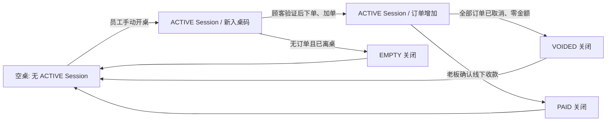
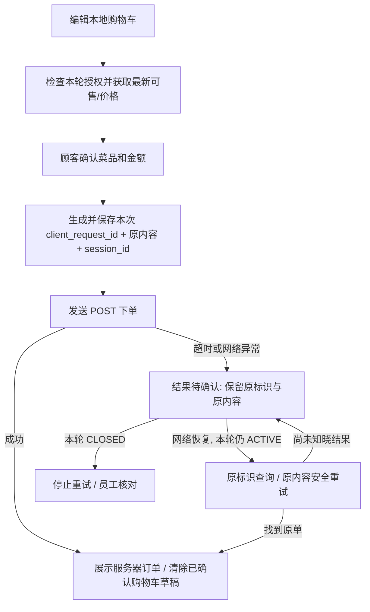

# TavoloFlow — MVP 产品需求文档（精简版 V1）

> **文档定位**：第一版可实际开发、测试并在单店试运营的产品与前后端协作约定。  
> **日期**：2026-10-19  
> **依据**：原《TavoloFlow — 餐厅二维码点单系统项目需求文档》、`TavoloFlow_ER_Simplified_V1.dbml`，以及本轮对数据库简化、断网、账单、Cookie 与并发控制的讨论。  
> **优先级**：本文件描述精简版 MVP 的目标。与旧 PRD 冲突时，以本文件和最终 DBML 为准；最终 DBML 定义数据字段，本文定义行为与前后端契约。具体 API 路径是**建议实现接口**，代码实施时可以做等价调整，但不能改变行为规则。

---

## 0. 一页摘要与已确认的设计决定

### 0.1 MVP 只解决什么问题

为中餐厅提供可独立使用的**堂食二维码点单系统**：员工开桌并告知本轮入桌码，顾客扫码点单和加单，厨房查看和处理整单，老板核对账单、确认已在线下收款后清桌，老板维护菜单与桌位；平台管理员创建餐厅并控制服务状态。**不处理在线支付，也不代替现有收银/税务系统。**

### 0.2 需要坚守的正确性边界

1. 一张桌子最多存在一个 `ACTIVE` 用餐记录（Session）；新的客人必须开启新的 Session。
2. 一次顾客正式下单意图最多写入一个订单；断网后的原请求使用**同一个 `client_request_id`** 核对或重试。
3. 新订单必须属于顾客当前有权访问、且仍然 `ACTIVE` 的 Session；旧顾客不能把订单投递到新一轮用餐。
4. 员工/老板只能按允许的订单状态转换；后端用**数据库原子条件更新**而不是 `orders.version` 控制竞争。
5. 老板确认付款关闭 Session 时，必须检查所见账单的 `bill_version` 和金额，且无 `NEW` 订单；**核对和关闭必须发生在受同一数据库事务保护的操作中**。
6. 餐厅/角色/授权检查均在后端执行；前端隐藏按钮、禁用按钮和重取数据仅改善交互，不能充当数据一致性或安全边界。

### 0.3 最终数据库取舍

| 对象 | V1 决定 | 原因 / 替代方式 |
|---|---|---|
| `restaurant_tables.table_version` | **删除** | 前端开桌结果未知时只查状态，不自动重发；数据库保证同桌最多一个活动 Session |
| `menu_categories.version` | **删除** | 并发菜单编辑采用最后写入覆盖；不实现版本冲突弹窗 |
| `menu_items.version` | **删除** | 同上；实际下单仍由后端核价、核售罄 |
| `menu_items.allergen_reviewed` | **新增** | 区分“未审核”与“审核后未识别出需要声明的过敏原” |
| `dining_sessions.authorization_version` | **删除** | V1 不支持本轮入桌码/二维码重置；关桌通过 `status=CLOSED` 撤销本轮顾客访问 |
| `dining_sessions.open_request_id` | **删除** | 开桌断网后先核对、由员工决定是否再次开桌；不承诺自动开桌操作幂等 |
| `dining_sessions.bill_version` | **保留** | 每个新 Session 从 `1` 开始，新增有效订单或取消订单时各 `+1` |
| `orders.client_request_id` | **保留** | 下单幂等的必要标识 |
| `orders.version` | **删除** | 按 `status` 条件更新，失败时提示已被其他操作改变 |
| 顾客单独授权表/设备会话表 | **本版不新增** | 使用受保护 Cookie + Session 当前状态；不提供逐设备撤销 UI |

**不再开发的重置接口**：`rotate-qr`、`rotate-join-code`。替换固定二维码的 V1 操作为：空桌时软删除原桌位 → 新建桌位 → 打印新码；正在用餐时不能采用此替代方法。

---

## 1. 产品边界

### 1.1 角色

| 角色 | MVP 职责 |
|---|---|
| **顾客 GUEST** | 无须账号；扫码看公开菜单、编辑本地购物车，输入本轮入桌码后下单/加单、查看本轮整桌已提交订单、主动查看入桌码 |
| **员工 STAFF** | 开桌、查看本轮入桌码、厨房 READY 操作、取消 `NEW`、切换售罄、停止/恢复接单、查看活动桌与账单；按条件关空账单 |
| **老板 OWNER** | 具有 STAFF 能力；编辑菜单和过敏原、管理桌位/二维码、`READY` 订单作废、确认线下收款并 `PAID` 清桌、查看历史、重置店铺员工密码 |
| **平台管理员 PLATFORM_ADMIN** | 创建/启停餐厅、初始化与重置店铺账号；默认不读取店铺具体顾客订单或入桌码 |

每家餐厅 V1 最多一个共享 OWNER 账号和一个共享 STAFF 账号（允许在多台设备登录），数据库保留 `platform_users`、`restaurant_users` 和 `credential_version`。

### 1.2 MVP 必须有的模块

- 公开扫码菜单 + 语言切换 + 独立本地购物车。
- 员工开桌、四位入桌码、顾客一次验证并持续获得本轮访问权限。
- 顾客订单提交/断网核对/同桌订单共享；订单历史快照。
- 厨房订单列表、`NEW → READY`、合法取消、10 秒轮询和连接状态。
- 老板核账、账单版本校验、线下收款后 `PAID` 关闭；受限的 `EMPTY` / `VOIDED` 零账单关闭。
- 分类、菜品、供应状态、过敏原审核、桌位固定二维码的基本维护。
- 多餐厅隔离、后台认证、基本账号重置、已关闭账单查询。

### 1.3 明确暂不开发

- 在线支付/退款、发票或税务凭证、打印、库存、外卖、预约、会员、套餐、折扣、分账。
- 菜品图片自助上传、共享购物车、菜品逐项制作状态、WebSocket 推送、离线排队下单。
- **二维码旋转/重置、活动 Session 入桌码重置**。
- **按设备列举和撤销 STAFF 登录会话**；账号密码重置/禁用通过 `credential_version` 实现账号级统一失效。
- **持久化遗留提醒工作流、`session_close_requests`、完整 `audit_events` 列表**；MVP 只做活动超时的页面提示、数据库已有的开桌/关闭/取消操作者字段及必要应用日志。
- 菜单多用户编辑冲突保护、菜单发布/草稿、人工排序、独立 `guest_grants` 表。

这些是**本版主动收缩的范围**，不是遗漏。若后续要提供“哪台设备登录/谁撤销了哪个设备”“持久化提醒和完整操作审计”，应先扩展数据模型和功能范围，而不能仅修改前端页面。

---

## 2. 基本业务模型与状态

### 2.1 九张数据表（与精简版 ER Diagram 对齐）

| 表 | 职责 |
|---|---|
| `platform_users` | 平台账号 |
| `restaurants` | 餐厅、服务状态、全店接单开关、默认语言 |
| `restaurant_users` | 店铺 OWNER/STAFF 账号、角色、凭证版本 |
| `restaurant_tables` | 物理桌位、固定二维码 `qr_token`、启停、软删除 |
| `menu_categories` | 分类及 zh/it/en 名称 |
| `menu_items` | 菜品、多语言、价格、供应状态、过敏原和审核标记 |
| `dining_sessions` | 每次入桌、加密入桌码、当前状态、`bill_version` 和关桌结果 |
| `orders` | 每次正式提交的订单、`client_request_id`、状态、总金额及取消信息 |
| `order_items` | 菜品名称/编号/单价/过敏原快照、数量和备注 |

主键使用 UUID；金额统一存**欧分整数**；数据库时间用 UTC `timestamptz`，界面按 `Europe/Rome` 展示；一套 PostgreSQL 支持多家餐厅。订单必须保存快照，菜单以后改价、改名或软删除不追溯改变历史订单。

### 2.2 状态枚举

- 餐厅：`ACTIVE` / `SUSPENDED`；`ordering_enabled` 是另一独立开关。
- 用餐：`ACTIVE` / `CLOSED`；`CLOSED` 的 `close_reason` 为 `PAID`、`EMPTY`、`VOIDED`。
- 订单：`NEW` / `READY` / `CANCELLED`。
- 桌位是否空闲**由是否存在 ACTIVE Session 推导**，不另存 `table_status`。



---

## 3. 端到端业务需求（前端 + 后端协作）

### 3.1 店铺初始化

1. 平台管理员创建餐厅，默认 `SUSPENDED`、`ordering_enabled=false`，生成 OWNER/STAFF 初始账号。
2. OWNER 首次登录修改临时密码，建立菜单与过敏原审核状态，创建桌位并下载固定二维码。
3. 平台管理员将服务设为 `ACTIVE`；STAFF/OWNER 手动打开全店接单开关。
4. 在厨房设备打开订单工作台；员工可从桌位列表选择需要开桌的桌位。

**前端**：业务操作按钮按角色和服务状态显示；首次改密前只允许改密/退出。  
**后端**：始终从已验证后台身份解析 `restaurant_id` 和角色，禁止仅信任客户端自报身份。

### 3.2 员工开桌与断网恢复（重点简化）

**正常流程**

1. 员工打开 `/staff/floor`，读取本店桌位和当前 Session 状态。
2. 员工在明确核对桌号后点击“开桌”（**扫描二维码本身不自动开桌**）。
3. 服务器在事务中确认桌位有效、无 ACTIVE Session，创建新的 `dining_sessions.id`，生成本轮 4 位入桌码，初始 `bill_version=1`。
4. 开桌成功后返回 Session ID、桌号与当前入桌码；员工告知顾客。重复点击已开桌的桌位只打开现有详情，不新开桌、不换码。

**网络中断/超时/返回结果未知**

- 前端立即禁止自动重发这次开桌 POST；界面写明 **“开桌结果待确认”**，而不是“开桌失败”。
- 前端可以显示等待网络恢复的状态；网络恢复后 **GET 该桌最新状态**：
  - 如果仍有 ACTIVE Session，显示现有桌位详情；入桌码由员工主动调用受保护接口获取。
  - 如果桌位为空，提示 **“当前为空桌，是否重新开桌？”**，必须员工再次明确点击才发送新的 POST。
- 页面刷新或网络恢复都**不自动发起新的开桌操作**。
- 后端仍必须保留“同桌最多一个 ACTIVE Session”的唯一约束，以及最终开桌时的原子检查。

**明确接受的 MVP 取舍**：由于删除 `open_request_id` 和 `table_version`，旧请求可能延迟到达，也不保证开桌响应丢失后的操作级精确去重。员工通过查看当前桌位、重新确认来处理；**不能把这种前端流程当作严格防止所有延迟旧请求的证明**。若试运营频繁出现误开桌，再考虑使用客户端预生成 Session ID 或真正的幂等键。

### 3.3 顾客二维码、入桌码与 Cookie（不存入桌码在 Cookie）

1. 固定二维码 URL 形如 `/q/{qr_token}`；此 Token 识别桌位和餐厅，**本身不是下单授权**。
2. 顾客扫码可浏览公开菜单；ACTIVE 用餐且浏览器无当前授权时，可提示输入本轮入桌码，也可先浏览菜单。
3. 员工开桌时生成的本轮入桌码是 4 位随机字符：`23456789ABCDEFGHJKLMNPQRSTUVWXYZ`；它用于**首次加入当前 Session**，不能代表后台账号登录。
4. 顾客填写入桌码时，前端同时提交**明确的目标 `dining_session_id`**；后端验证二维码、桌位、Session、码值和限流。
5. 成功后，后端签发**受 ASP.NET Core Data Protection 保护的 HttpOnly Cookie**，逻辑上绑定餐厅 ID、桌位 ID、Session ID、过期时间；Cookie **不存入桌码**，JavaScript 不需要读取它。
6. 后续请求自动携带 Cookie；后端每次检查它的真实性、过期时间、绑定归属、餐厅/桌位条件与 Session `ACTIVE` 状态。顾客不需要每次下单重新输入入桌码。
7. 顾客有本轮有效授权时，可以按需查看**本轮整桌已提交订单**，以及点击“查看入桌码”主动查看/复制并告知同桌其他顾客；新浏览器仍须自行输入码取得自己的 Cookie。
8. 关闭 Session 会把 `join_code_ciphertext` 置空，并使绑定旧 Session 的 Cookie 不能再下单、读取订单或读入桌码。旧 Cookie 可能还在浏览器中，但**服务端按 CLOSED 状态拒绝访问**；不需要 `authorization_version` 或独立撤销表。

**多标签页限制**：单浏览器共享同一用途的 Cookie。若同一浏览器先后验证不同桌/不同 Session，新的顾客授权可能替换旧的授权；MVP 不保证一台浏览器同时维持多桌的独立顾客授权。前端遇到目标 Session 与当前授权不一致时要求重新验证，不能自动切换目标 Session 后提交旧购物车。

**安全**：Cookie 使用 `Secure`、`HttpOnly`、适当的 `SameSite`、绝对过期时间（建议不超过 12 小时）；对带 Cookie 的写接口实施 CSRF 防护；保护/加密密钥由服务端持久且安全管理。短码须限流，不能依赖四位字符本身的强度。

### 3.4 菜单、过敏原、多语言和购物车

**菜单展示**

- 菜单为“分类 → 菜品”，按创建时间、ID 稳定排序；zh/it/en 三种语言至少填写一种名称，缺少当前语言时逐项回退到默认语言或已有名称。
- `restaurants.default_language` 在当前 DBML 中为 **NOT NULL**；空菜单时也使用预设默认语言。店铺可见语言根据公开菜单实际提供的名称推导；菜单移除造成默认语言失效时，后端应调整到尚可用语言（空菜单则保留预设语言）。
- `item_code` 可空；价格以欧分保存；售罄仍可展示但不能加入可提交订单。
- OWNER 可以编辑分类/菜品，**后写入覆盖先写入**；不校验菜单 `version`。STAFF 只允许切换 `is_available`，后端必须执行**字段级更新**，不能用旧 DTO 覆盖菜名、价格、过敏原。

**过敏原**

- `allergen_codes=[]` 且 `allergen_reviewed=false` = **未完成审核**；不能显示“无过敏原”。
- `allergen_codes=[]` 且 `allergen_reviewed=true` = **已审核，没有识别出需声明的过敏原**；不代表不存在交叉接触风险。
- 审核后有过敏原则 `allergen_reviewed=true` 且数组列出标准代码（限定使用约定的 EU 14 类代码）。
- 添加或变更过敏原时，编辑 UI 必须让 OWNER **重新明确确认已审核**；后端校验输入代码和审核确认。V1 **不提供独立菜单草稿/发布**，未确认审核的菜品不得通过可售的保存/更新流程；失败时保留旧记录，不做半成品更新。

**本地购物车**

- 每个浏览器标签页各自维护草稿，可用 `sessionStorage` 等本地存储实现刷新保留；没有顾客账号、没有服务端共享购物车。
- 草稿绑定 `restaurant_id`、`table_id`、所见 `session_id`（未开桌可为 null）；购物车中增减数量、备注无需发送后端订单写请求。
- 从空桌变成开桌、切桌、发现旧 Session 被关闭时，禁止直接沿用旧确认状态。允许重新核对菜品、数量和最新金额后再对新的 Session 建立新的提交意图；已明确结束而清空的旧订单草稿不自动恢复。
- 订单总额、单价最终以服务端数据库为准；前端价格仅作为展示/预览。

### 3.5 顾客正式下单、断网与未知结果（重点）

**前端提交状态机**



**必须实现的规则**

1. 顾客明确确认后，每次**新的**正式下单意图生成一个 UUID `client_request_id`。必须在发送前与原请求内容、目标 Session 一并持久保存；网络故障时继续沿用它，不创建新 ID。
2. 正式请求发送期间，锁定**再次正式提交**和修改当前待提交意图的功能。用户仍可以查看菜单与连接状态；不需要将整个站点永久锁死。
3. 若响应丢失，显示“**结果待确认**”，不能假设失败，也不能自动以新 ID 创建同内容订单；网络恢复先校验原 Session 和 Cookie，再按原标识查询或重发原内容。
4. 数据库唯一约束 `(dining_session_id, client_request_id)` 保证相同提交意图最多一个订单。若原单已成功创建，重复请求**只返回原订单结果**，不再受之后的售罄、暂停接单影响，也不把它创建第二次。重试内容不应被前端擅自改变；即使重复请求携带了不同内容，同一键也绝不能产生第二单。
5. 若原请求不存在，服务器把它当作首次正式提交，验证：Cookie、Session ACTIVE、餐厅服务 ACTIVE、全店接单启用、桌位启用、菜品/分类存在且可售、数量以及**数据库当前价格**。
6. 若数据库价格/售罄/项目状态发生变化，返回业务冲突并提供必要的最新信息，由顾客重新确认；一旦用户实际更改后开始新的提交意图，应使用**新的** `client_request_id`，但不能利用新 ID 绕过尚待确认的旧订单结果。
7. 若 Session 已 `CLOSED`，拒绝下单和顾客端原结果读取，也**不自动重发旧内容到下一轮 Session**；未知结果转交员工从后台核对。
8. 顾客提交一次新订单或加单成功，服务端事务内写入订单和全部明细快照，`bill_version += 1`（只增加一次）。

**前端恢复时机**：连接恢复、页面从后台回到前台、刷新待确认页面时，都先校验 Session / 授权，再处理待确认意图。不要把“请求超时”映射成“订单未创建”。

### 3.6 厨房工作台与取消

- 厨房列表展示 `NEW`，并可查看近期 `READY` / `CANCELLED`；默认每 **10 秒**轮询一次，显示最后成功同步时间；超过约 30 秒无成功同步要明显警示。
- 声音提醒须由用户在设备上主动开启；初次进入或恢复网络时不对所有旧单反复报警。
- STAFF/OWNER：`NEW → READY` 或 `NEW → CANCELLED`（取消填写原因）；OWNER 额外允许 `READY → CANCELLED`。
- 不允许 `CANCELLED` 恢复、`READY → NEW`、已关闭 Session 修改订单。状态更新执行原子条件操作（如 `UPDATE orders ... WHERE status='NEW' ...`）；不能先在 C# 读取再无条件覆盖。
- `NEW → READY` 不改变 `bill_version`；**实际成功取消**才递增 `bill_version`。重复取消、不合法状态操作不递增。
- 状态冲突时前端刷新订单、显示已由别的设备处理；不提示为服务器异常。

### 3.7 结账、`bill_version` 与关桌（核心事务）

**老板端交互**

1. 老板选择桌位进入账单页面时，前端 `GET` 最新账单：逐笔订单、总金额、未完成数量、`bill_version`、Session ID。
2. 老板完成线下收款准备，页面要求确认桌号、金额；若仍有 `NEW` 订单不能确认关桌。
3. 点击“**已线下收款并清桌**”时，前端携带先前显示且老板确认过的 `sessionId`、`expectedBillVersion` 和 `confirmedTotalCents`，提交 **一次** checkout POST；不要求前端再 GET 一次账单后才 POST。
4. 服务器在**数据库同一事务**内锁住该 Session，重新计算最新账单并比较版本、金额、状态和 `NEW` 数量：
   - 一致：写入 `CLOSED`、`PAID`、`closed_total_cents`、关闭人/时间，清空入桌码，提交事务；旧顾客访问随之失效。
   - 不一致：不关闭，返回 `409 BILL_CHANGED` + 当前账单摘要/版本，让前端刷新并提示老板重新核对（不能静默替老板接受新金额）。
5. 收到成功响应后清理页面当前操作状态；**结账响应丢失**时，前端先 GET 当前 Session 状态核对，不能自动发送可能不再适用的第二次收款确认。

**`bill_version` 规则（每个 Session 独立）**

| 行为 | 版本变化 |
|---|---|
| 新建 Session | `1` |
| 成功创建一笔新订单 / 加单 | `+1` |
| 实际成功取消一笔未结账订单 | `+1` |
| `NEW → READY` | 不变 |
| 用旧 `client_request_id` 恢复原订单 | 不变 |
| 重复状态操作但没有真正改变数据 | 不变 |
| 最终 `CLOSED` | 不需要再加；关闭后不再写账单 |
| 重新开桌得到全新 Session | 新 Session 从 `1` 开始 |

`bill_version int NOT NULL DEFAULT 1` 是独立于 Session 的计数器；单次用餐一般只有少量订单操作，不存在实际可预见的 32 位溢出问题。

**并发底线**：新建订单、取消订单与结账都使用**同一 Session 行锁**进行协调。若新单先提交则关桌发现版本变化而拒绝；若结账先关闭则新单发现 Session 已关闭而拒绝。不得只让前端比对两个 GET 的结果代替服务器事务。

**零账单关闭**

- `EMPTY`：本轮**从未**产生订单，老板或员工读取最新账单确认顾客已离桌；在相同锁和版本检查下关闭。
- `VOIDED`：本轮存在过订单，但全部已取消、总金额 0、无 `NEW`，老板或员工核对并确认离桌后关闭。
- `PAID`：存在有效应收且由 OWNER 确认线下收款才可关闭；STAFF 不能调用。
- 当前 9 表 DBML 只有 `close_reason` 枚举、`closed_by_user_id`、`closed_at`，**没有自由文本清桌备注列**；所以 MVP 不承诺持久保存 EMPTY/VOIDED 的文字原因。如果以后强制要求文字理由，应先增设相应字段或审计表。

### 3.8 桌位与二维码

- 新建桌位生成永久随机 `qr_token`（全局唯一），下载/再次打印得到同一 `/q/{token}` 入口。
- 修改桌位标签不修改二维码 URL；停用桌位阻止新订单，不自动关闭活动账单。
- 删除桌位采用软删除，**必须无 ACTIVE Session**；老二维码立即失效，历史订单保留。
- 若空桌二维码需要换码：**软删除旧桌 → 新建同名桌（新 ID、新 Token）→ 重新打印张贴**；不提供重置按钮，不允许活动桌直接删除换码。
- 删除桌位与开桌也必须由后端通过事务/锁和唯一约束排除竞态，而不只依据管理界面是否显示“空桌”。

### 3.9 后台登录与账号重置

- 店铺和平台使用独立身份认证方案与 Cookie；后台身份包含账号、角色和餐厅归属；平台管理员的默认权限不包括店铺顾客账单内容。
- `credential_version` 仅用于**账号凭据统一失效**：改密、后台重置密码或禁用账号后，旧认证票据下一次请求必须失效；验证依赖后端最新账号状态/版本。
- 同一共享 STAFF 账号可以多设备登录。各设备退出只删除**当前浏览器 Cookie**，没有服务器持久化的设备会话列表，也不提供“只踢掉另一台设备”操作；重置密码可让全部旧票据失效。
- 密码按成熟的 PasswordHasher 存储，生产账号不写入源码；首次登录强制修改临时密码。

---

## 4. 页面清单与前端功能边界

| 页面 | 核心内容 | 请求/刷新重点 |
|---|---|---|
| `/q/{token}` | 公开菜单、多语言、购物车、入桌验证、当前本桌订单、主动查看入桌码 | 初次 bootstrap；已授权页约 30 秒校验状态/订单；恢复联网立即校验 |
| `/staff/login` | OWNER/STAFF 登录与首次改密 | 使用后台 Cookie，失败提示准确 |
| `/staff/floor` | 桌位列表、开桌/开桌未知结果核对、查看入桌码、有限零账单清桌 | 开桌失败不得自动 POST 重试 |
| `/staff/kitchen` | `NEW` 订单、标记 READY、合法取消、同步状态 | 10 秒轮询，增量提醒与分页 |
| `/staff/orders` | OWNER 账单、确认收款/关桌 | 读最新账单，POST 带版本和金额，409 再确认 |
| `/staff/menu` | OWNER 菜单分类/菜品/过敏原；STAFF 售罄可另在厨房页操作 | 最后写入覆盖，字段级 PATCH |
| `/staff/tables` | OWNER 桌位、二维码下载、软删除后重建 | 不展示码重置功能 |
| `/staff/history` | OWNER 已关闭账单只读查询 | 按本店、时间/桌号分页 |
| `/staff/settings` | 店铺基础设置、OWNER 重置 STAFF 密码 | 无逐设备撤销会话页 |
| `/platform/login`、`/platform/restaurants` | 平台登录、建店、状态与账号维护 | 业务和店铺认证分离 |

前端业务状态按“**远端数据（TanStack Query）/ 本地购物车及待确认意图 / 授权与用餐终态**”分开管理。敏感 Cookie 不放 localStorage；顾客当前订单或入桌码不写进 Service Worker 离线缓存。

### 4.1 顾客页面必须明确区分的状态

| 状态 | 用户能做什么 |
|---|---|
| `NO_ACTIVE_SESSION` | 看公开菜单、编辑尚未绑定活动用餐的本地草稿；提示联系员工开桌 |
| `ACTIVE_UNVERIFIED` | 看菜单、改草稿；不能正式下单/看整桌订单；提示输入码，也可跳过 |
| `ACTIVE_VERIFIED` | 正式提交/加单、查看本桌订单、主动查看码 |
| `SUBMITTING` | 当前提交意图不可修改或重复确认；显示进行中 |
| `SUBMISSION_UNKNOWN` | 结果待确认，保持同一 requestId；网络恢复先核对，不创建新订单 |
| `SESSION_CLOSED` | 隐藏受保护数据并清除本轮草稿，显示结束提示；主动重新扫码/点击公开入口可重新看公开菜单 |
| `AUTH_EXPIRED` | 当前 Session 仍 ACTIVE，提示重新输入本轮码；草稿/待确认请求保持原 Session 绑定 |

若希望“原页面在刷新后仍显示本轮已结束”，可以在标签页存储已关闭 Session 的标识；用户主动重新进入二维码入口或点击“重新浏览公开菜单”才进入新的公开浏览流程。**这只负责用户体验，不承担后端权限。**

---

## 5. 建议 API 契约（供 Controller、DTO 和前端联调）

> 本节是**建议的最小接口集**，路径可按实际分模块调整；接口必须使用 DTO，不直接向前端返回 EF Core Entity。响应中禁止泄露密码哈希、Cookie 票据和非授权用户的入桌码。

| 方法 | 建议路径 | 核心输入/输出 |
|---|---|---|
| GET | `/api/public/qr/{token}/bootstrap` | 公开餐厅、桌位、当前 Session ID/状态、菜单和语言；**不返回 join code** |
| POST | `/api/public/qr/{token}/join` | 输入 `sessionId + joinCode`；验证并写入顾客授权 Cookie |
| GET | `/api/public/sessions/{id}/access` | 验证当前 Cookie、Session ACTIVE，返回最小访问状态 |
| GET | `/api/public/sessions/{id}/join-code` | 当前有效顾客授权才允许读取码，`no-store` |
| GET | `/api/public/sessions/{id}/orders` | 当前有效顾客看本轮整桌订单；分页、`no-store` |
| POST | `/api/public/orders` | `sessionId + clientRequestId + items + note + 客户端已确认价格信息`；服务端核价和幂等 |
| GET | `/api/public/sessions/{id}/orders/by-request/{requestId}` | 本轮活动且授权有效时核对原提交结果 |
| POST | `/api/auth/login` / `/api/auth/logout` | 店铺后台登录/本设备退出 |
| POST | `/api/auth/change-password` | 修改密码、更新 `credential_version` |
| GET | `/api/staff/tables` | 本店桌位与当前 ACTIVE Session 概要 |
| POST | `/api/staff/tables/{tableId}/open` | 明确开桌；**不要求 openRequestId / tableVersion** |
| GET | `/api/staff/sessions/{id}/join-code` | 员工主动查看本轮码 |
| GET | `/api/staff/sessions/{id}/bill` | 返回金额、明细、`billVersion`、`newOrderCount` |
| POST | `/api/staff/sessions/{id}/close-empty` | `expectedBillVersion + confirmedTotalCents=0 + 确认离桌` |
| POST | `/api/staff/sessions/{id}/close-void` | 同上，另判断存在订单但全部取消 |
| GET | `/api/staff/orders` | 厨房列表、状态筛选与分页 |
| POST | `/api/staff/orders/{id}/ready` | 条件 `NEW → READY` |
| POST | `/api/staff/orders/{id}/cancel` | 取消原因；按角色与当前状态判断 |
| PATCH | `/api/staff/menu-items/{id}/availability` | `isAvailable` **明确目标值**，仅改这个字段 |
| PATCH | `/api/staff/accepting-orders` | `enabled` 明确目标值 |
| POST | `/api/owner/sessions/{id}/checkout` | `expectedBillVersion + confirmedTotalCents`，核账并原子 `PAID` 清桌 |
| CRUD | `/api/owner/menu/categories`、`/api/owner/menu/items` | 三语、审核、价格、软删除；无菜单版本字段 |
| CRUD | `/api/owner/tables` | 创建、编辑、软删除、二维码下载；**无 rotate** |
| GET | `/api/owner/history` | 已关闭账单只读分页 |
| GET/PATCH | `/api/owner/settings` | 店铺基础设置 |
| POST | `/api/owner/staff/reset-password` | 重置 STAFF 密码、统一失效旧票据 |
| 登录/管理 | `/api/platform/*` | 平台登录、建店、启停、账号初始化/重置 |

**部分请求 / 响应样例（仅核心字段）**

读取账单：

```json
{
  "sessionId": "00000000-0000-0000-0000-000000000101",
  "tableLabel": "8",
  "status": "ACTIVE",
  "billVersion": 3,
  "totalAmountCents": 3000,
  "newOrderCount": 0,
  "orders": ["...这里只表示逐笔订单 DTO ..."]
}
```

老板确认清桌：

```http
POST /api/owner/sessions/{sessionId}/checkout
Content-Type: application/json
```

```json
{
  "expectedBillVersion": 3,
  "confirmedTotalCents": 3000
}
```

冲突：

```http
409 Conflict
```

```json
{
  "code": "BILL_CHANGED",
  "message": "账单已变化，请重新核对",
  "requestId": "诊断请求ID",
  "currentBill": {
    "billVersion": 4,
    "totalAmountCents": 4000,
    "newOrderCount": 1
  }
}
```

> 示例中的 URL 和 DTO 名称并非数据库字段名称的强制映射。生产实现中所有金额仍以服务器数据库校验为准。

### 5.1 统一错误语义

| HTTP / Code | 前端行为 |
|---|---|
| `400 VALIDATION_FAILED` | 定位输入字段，不重试同一个非法请求 |
| `401 UNAUTHENTICATED` | 后台要求重新登录；顾客根据是否仍 ACTIVE 决定重新输码 |
| `403 FORBIDDEN` / `404 NOT_FOUND` | 显示无权操作或资源不存在，不泄露跨餐厅数据 |
| `409 SESSION_ALREADY_ACTIVE` | 员工刷新桌位，查看现有 Session，不重开 |
| `409 SESSION_CLOSED` | 停止顾客旧请求，进入结束流程 |
| `409 ORDER_CHANGED` | 厨房/员工刷新订单当前状态，不强制覆盖 |
| `409 MENU_CHANGED` | 顾客重新查看变动菜品和金额并明确确认 |
| `409 BILL_CHANGED` | 老板显示新账单，重新核对后再单击确认 |
| `429 RATE_LIMITED` | 显示等待时间，不通过换 requestId 绕过 |
| 网络错误、超时、`5xx` | **状态未知，不直接假设失败**；开桌查状态、下单按原 requestId 核对、结账查 Session |

所有受保护订单、账单、入桌码接口设置 `Cache-Control: no-store`；建议与 React 使用同源 `/api`，避免不必要的跨域 Cookie 问题。通过 OpenAPI 生成 TypeScript API 类型，保持前后端 DTO 一致。

---

## 6. 后端事务、约束与真正需要的并发控制

### 6.1 必须放在 PostgreSQL 的数据约束

1. `restaurant_tables.qr_token` 全局唯一。
2. `restaurant_users.username` 和 `platform_users.username` 按各自账号范围唯一；`restaurant_users(restaurant_id, role)` 唯一（每店一个 OWNER/STAFF）。
3. **同一桌最多一个 ACTIVE Session**：

```sql
CREATE UNIQUE INDEX uq_active_session_per_table
ON dining_sessions(table_id)
WHERE status = 'ACTIVE';
```

4. 订单幂等：`UNIQUE(dining_session_id, client_request_id)`。
5. 软删除桌位标签 `(restaurant_id, table_label)`、非空菜品编号 `(restaurant_id, item_code)` 的**部分唯一索引**。
6. 现有 DBML 中的同租户复合外键、非空、数量与金额范围、状态枚举约束。

DBML 注释本身不会生成所有 PostgreSQL 部分索引；使用 **EF Core Migrations** 明确创建，并用真实 PostgreSQL 测试验证。

### 6.2 一个统一锁顺序，避免引入复杂并发框架

- **写入订单**：开启事务 → 锁目标 Session 行 → 检查授权/状态/必要接单条件 → 检查该 `client_request_id` 是否已经存在 → 若是首次提交，读取并锁定/协调涉及的菜品可售和价格状态 → 写订单与明细 → `bill_version+1` → 提交。
- **取消订单**：开启事务 → 锁订单所属 Session 行 → 确认仍 ACTIVE → 按角色与订单状态执行条件更新 → 实际成功时 `bill_version+1` → 提交。
- **READY 操作**：在事务内确认订单仍属于 ACTIVE Session，并条件更新 `NEW → READY`；无需改账单版本。
- **结账/零账单关闭**：开启事务 → 锁 Session 行 → 重新计算金额、NEW 数及当前 `bill_version` → 核对用户确认值和权限 → 写 CLOSED/close_reason/金额/操作者并清除加密码 → 提交。
- **开桌与删除桌位**：使用同一桌位行级锁/事务协调，结合 ACTIVE Session 部分唯一索引排除并发重复和删桌竞争。

使用 EF Core 事务配合参数化 SQL、`SELECT ... FOR UPDATE` / `ExecuteUpdateAsync`。本 MVP 不需要 Redis 分布式锁、消息队列、表上的大量 `version` 字段或复杂通用幂等中间件。

**特别注意：**“后端 `if (status == NEW)`”若只是读入内存再无条件 `SaveChanges`，不是安全的并发条件更新。必须把**状态条件写进最终数据库 UPDATE** 并检查实际更新行数。

### 6.3 菜单最后写入覆盖，不等于下单不核价

- OWNER 对菜单的最后保存可以覆盖此前保存内容；UI 可展示“其他设备可能修改”的非阻断提示，但不做自动冲突合并。
- STAFF 修改售罄只 PATCH 供应状态，不覆盖别的字段。
- 下单事务以数据库当前单价与可售状态决定是否允许创建订单；顾客先看到的价格不是结算依据。若菜单维护同时发生，应通过相同菜品行锁/一致校验或适当事务策略，避免读取与写入竞争导致按失效价格成功下单。

### 6.4 关于没有 `open_request_id` 的真实取舍

- 前端主动不重试能减少误开桌，但**不能保证网络层旧请求不再到达**。
- V1 明确接受极小概率的非预期开桌，由员工核对和受限零账单关闭纠正；数据库仍不允许同桌同时有两个活动 Session。
- 下单不能接受这种取舍，所以保留 `client_request_id`；结账也不能接受账单不一致，所以保留 `bill_version` + 数据库事务。

---

## 7. 前端与后端协作责任矩阵

| 场景 | 前端职责 | 后端职责 | 数据库保证 |
|---|---|---|---|
| 开桌按钮/断网 | 禁止自动 POST 重试；恢复网络先 GET；空桌时要求员工再次确认 | 确认桌位状态和员工权限、创建 Session | 活动 Session 唯一索引、桌位行锁 |
| 输入入桌码 | 收集 `joinCode` 和指定 Session；成功后不反复询问 | 校验码、限流、签发受保护 Cookie | 加密入桌码和 Session 归属 |
| 顾客持续访问 | 使用 Cookie，恢复网络先检查当前轮次 | 每次检查授权、Session ACTIVE、租户归属 | Session 状态、复合外键 |
| 本地购物车 | 绑定桌位/Session，更新草稿，显示价格 | 不需要保存草稿；正式提交时核价 | — |
| 正式下单 | 发送前保存同一 requestId 和原内容，未知结果安全恢复 | 去重、核价、写订单及全部明细 | 幂等唯一约束、事务、版本递增 |
| 菜单并发编辑 | 接受后写覆盖；售罄只发目标字段 | 按权限、字段级更新；下单再核价 | 常规外键和行一致性 |
| 过敏原审核 | 修改内容时要求重新主动勾选确认 | 核验审核标记与合法过敏原代码 | `allergen_reviewed` 和数组字段 |
| 厨房状态 | 刷新和显示冲突，不覆盖别人的操作 | `WHERE status=...` 条件更新、角色校验 | 原子 UPDATE |
| 老板结账 | 展示账单，提交确认的版本和金额，409 重新核对 | 事务内重新计算并关桌，禁止 `NEW` | Session 行锁、账单版本 |
| 清桌之后 | 清理旧草稿、敏感查询缓存，隐藏本轮订单/码 | 所有旧授权 API 拒绝 | Session CLOSED、码密文清空 |
| 账号改密/禁用 | 清除当前 UI 身份和私有缓存 | 更新 `credential_version`、拒绝旧 Cookie | 账号凭证版本 |

---

## 8. 可靠性、安全与非功能最低要求

- **单体栈**：React + TypeScript + Vite；C# / .NET 10、ASP.NET Core Controller-based Web API；EF Core + Npgsql + PostgreSQL；初期 Docker Compose + Caddy，同源部署优先。
- **身份与隔离**：服务端 `restaurant_id` 从可信后台身份或验证过的顾客 Cookie 解析；跨租户 ID 操作无权访问。平台认证与店铺认证分离。
- **传输与存储**：生产全站 HTTPS；后台密码用成熟慢哈希；四位入桌码必须使用经认证的可逆加密并将密钥保存在数据库外；顾客 Cookie 由 ASP.NET Core Data Protection 保护；密钥须持久化、不能写入 Git。
- **Cookie 写操作安全**：采用合适 SameSite 与 CSRF 防护；API 不默认允许任意跨域携带凭据。
- **限制猜码**：入桌码只有约 20 位熵，必须实施来源 + Session 两层验证限流，并监控异常尝试；V1 单实例可使用应用层限流，正式公网运营前应验证重启/多实例绕过风险并根据需要增加边缘或持久共享限制机制。
- **隐私**：顾客无需姓名、手机号或账号；订单、码、认证和账单响应禁止公共缓存，日志不记录明文密码、入桌码和 Cookie；提供基础隐私说明。
- **可用性**：顾客端至少适配 360px 手机；厨房工作台适合平板常亮。中文、意大利语、英文固定 UI 文案和菜单回退正常。
- **轮询**：厨房建议 10 秒；顾客已授权订单/状态 30 秒；老板页面约 30 秒或按操作主动刷新。断网显示最后同步时间，网络恢复后补查。
- **备份**：定期备份 PostgreSQL，独立环境完成一次恢复演练；不依赖同机磁盘快照作为唯一备份。
- **历史与保存**：关闭后 Session、订单、订单明细不可被日常业务修改；保留期按试运营协议和隐私要求另行确认。由于没有 `audit_events` 表，不得对外承诺完整不可抵赖的操作审计能力。

---

## 9. MVP 验收用例（作为开发 Done 的判定）

| ID | 验收步骤 | 通过条件 |
|---|---|---|
| AC-01 | 平台创建两家餐厅，分别配置菜单和桌位 | 通过可信租户身份隔离，无法跨店读取/修改 |
| AC-02 | 员工正常开桌 | 新建全新 ACTIVE Session、随机码、`bill_version=1` |
| AC-03 | 两台员工设备同时开同一桌 | 最多一个 ACTIVE Session；另一请求得到冲突/当前状态 |
| AC-04 | 开桌响应丢失、恢复网络 | 前端**不自动 POST 重发**，先读取状态并明确提示 |
| AC-05 | 扫码但不输入码 | 可浏览菜单/编辑购物车，不可提交或看本桌已提交订单 |
| AC-06 | 输入正确码，然后刷新页面 | Cookie 仍有效则无需再输入；不存在顾客入桌码明文 Cookie |
| AC-07 | 使用旧 Session Cookie 对新一轮下单 | 后端拒绝；不因同一桌号或偶然相同短码而复活 |
| AC-08 | 三台顾客设备同时向同一 Session 下单 | 三笔不同意图均完整保存，金额和快照正确 |
| AC-09 | 同一 `client_request_id` 并发重试十次 | 数据库最多一单，`bill_version` 只实际递增一次 |
| AC-10 | 下单已保存但响应丢失 | 原请求标识可在仍 ACTIVE 时核对出原单，不产生第二单 |
| AC-11 | 下单失败后后台关桌，旧前端随后恢复 | 不自动将旧购物车投递到新 Session；旧结果转员工核查 |
| AC-12 | 在顾客确认后变更价格/售罄 | 不能按过期信息静默保存订单，前端要求重新确认 |
| AC-13 | 两个 OWNER 设备先后保存菜单 | 后保存可覆盖先保存；无菜单版本字段要求 |
| AC-14 | STAFF 切换售罄同时 OWNER 改价 | 供应状态 PATCH 不覆盖名称/价格等无关字段 |
| AC-15 | 保存 `allergen_reviewed=false` 且 codes 为空 | 不能对顾客显示“无过敏原”；需要审核确认才能保存可售编辑 |
| AC-16 | 两厨房设备同时 `NEW → READY` | 只有一次实际状态转换，重复操作不会产生新状态 |
| AC-17 | 员工取消与 READY 操作竞争 | 只有满足当时状态/角色的操作成功；终态不会被无条件覆盖 |
| AC-18 | 创建订单成功/取消订单成功 | 对应 Session 版本每次 +1；READY、重复请求不增加 |
| AC-19 | 老板看到 €30 后另一顾客加单 | 旧 `billVersion` checkout 返回 409；不能按旧账单关闭 |
| AC-20 | 结账先锁定并关闭 Session，顾客随后下单 | 后续下单失败；不会落入 CLOSED Session |
| AC-21 | 老板试图关闭仍含 NEW 的账单 | 拒绝，提示未处理订单数量 |
| AC-22 | STAFF 请求 PAID 结账 | 权限失败，不得绕过前端菜单隐藏调用 |
| AC-23 | 从未有订单的 Session 执行 EMPTY | 版本/金额/状态核对后可关闭；仍保留历史 |
| AC-24 | 所有订单已取消的 Session 执行 VOIDED | 校验零账单、无 NEW、确认离桌后可关闭 |
| AC-25 | ACTIVE 桌位申请软删除或换码 | 失败；不能直接重置二维码 |
| AC-26 | 空桌软删除并新建同名桌 | 新 ID/二维码，旧入口失效，历史关联保留 |
| AC-27 | 修改/重置 STAFF 密码后重用旧 Cookie | 旧 Cookie 被拒绝，`credential_version` 校验生效 |
| AC-28 | 关桌后旧顾客刷新或恢复联网 | 受保护订单/码不可读，页面清理旧数据并展示结束状态 |
| AC-29 | 厨房断网超过 30 秒，之后恢复 | 显示同步过期，恢复后重新拉取，不把旧单连续当新单报警 |
| AC-30 | 使用真实 PostgreSQL 注入订单/结账事务失败 | 无半笔订单、无虚增 billVersion、无错误关桌 |

测试应覆盖：xUnit 单元测试、`WebApplicationFactory` Controller 集成测试、**真实 PostgreSQL/Testcontainers** 的行锁/唯一索引测试，以及 Playwright 关键前端流程。不要以 EF Core InMemory 测试代替数据库并发测试。

---

## 10. 开发顺序与交付范围

推荐按以下顺序实施，减少第一次项目开发时同时解决太多问题：

1. **基础工程与数据库**：项目结构、EF Core Migrations、9 表实体映射、必要索引与复合外键、简单种子数据、测试环境。
2. **账户与多租户**：平台/店铺登录、角色授权、首次改密、`credential_version`、创建餐厅。
3. **菜单与桌位**：三语菜单、价格/审核验证、供应状态、固定二维码、软删除。
4. **开桌与顾客授权**：Session、加密码、Cookie、开桌未知结果恢复。
5. **购物车和下单**：最新价确认、`client_request_id`、历史快照、原请求恢复。
6. **厨房与取消**：轮询、READY/取消条件更新、版本递增。
7. **结账与历史**：GET bill、`expectedBillVersion` checkout、EMPTY/VOIDED、关闭后保护、历史只读。
8. **联调/试运营准备**：移动端、异常网路、同桌并发、多餐厅隔离、备份恢复和操作说明。

**MVP 完成标准**：单店能执行“建店 → 设置菜单 → 建桌并打印码 → 开桌 → 多人扫码验证/多次下单 → 厨房处理 → 老板按准确账单线下收款清桌 → 查询历史”的完整闭环；关键的网络中断、重复下单、并发取消、结账竞争和权限检查都通过集成测试。

---

## 11. 与原始 PRD 的差异 / 后续再议事项

### 11.1 本轮已明确决定，开发时不要悄悄加回来

- 不恢复 `table_version`、菜单 `version`、订单 `version`、`authorization_version`、`open_request_id`。
- 保留 `bill_version` 与 `client_request_id`；它们解决两个不能简单接受的业务风险。
- 开桌恢复只做“**网络恢复后查状态 + 员工人工确认**”，不做后台自动重试。
- 菜单多人编辑**允许覆盖**；售罄必须字段级更新；下单必须服务端重新核价。
- V1 不做二维码和入桌码重置；空桌可以删旧桌重建。
- 入桌码只用于第一次取得授权；后续用**受保护 Cookie**访问，服务器每次检查 Session 是否仍活动。

### 11.2 相比原始 PRD，主动推迟的功能

- “登录设备列表与指定设备撤销” → **推迟**；现阶段提供账号级全量失效，不假装 `credential_version` 可以识别单台设备。
- “持久遗留提醒及处理” → **推迟**；可显示“开桌已超过 90 分钟”这一由 `opened_at` 计算的提醒，但不保存提醒处理流程。
- “完整审计事件表及历史操作日志” → **推迟**；仅保留现有表里的操作者/时间字段和脱敏应用日志。
- “入桌码泄露时立即重置且旧授权立即失效” → **推迟**；V1 **没有运行中重置手段**，必须在试运营前与餐厅确认风险和应急措施（例如人工停止接单、核对并结束当前用餐），不能宣称可一键撤销单台设备。
- “所有开桌/关桌操作请求均具有独立幂等标识” → **缩减**；开桌靠结果未知后的人工核对；结账按固定 Session ID/状态做安全核查，不会打开新 Session。

### 11.3 DBML 对需求的具体限制（本版不隐瞒）

- `dining_sessions` 没有自由文本清桌理由字段，因此不能承诺 EMPTY/VOIDED 的文字备注历史。
- `restaurant_users` 没有独立设备会话表，因此不能承诺“后台删除某台设备的登录会话”。
- 没有 `audit_events`，因此不能承诺面向老板的完整审计搜索页。
- `restaurants.default_language` 是不可空，空菜单只能保留预设值，不能像原 PRD 那样保存 NULL 默认语言。
- 本文件将最终 DBML 中的订单重试语义定为“**同一幂等键绝不创建第二单，优先返回已存在的原订单**”；客户端必须持久保存原意图，避免修改载荷后误把恢复结果当成新订单。

---

## 附：开发中随手检查的七句话

1. **开桌结果不明：查状态，不自动重开。**
2. **顾客第一次输码：后端签发 Cookie，不在 Cookie 保存入桌码。**
3. **下单结果不明：同一个 `client_request_id`，绝不换 ID 盲发。**
4. **菜单编辑可覆盖，但订单价格必须重新由服务器验证。**
5. **订单状态按数据库当前状态条件更新，不需要 `orders.version`。**
6. **`bill_version` 属于一轮 Session，从 1 开始；创建订单/成功取消才 +1。**
7. **前端可以帮助重新确认，但结账正确性最终由数据库事务保证。**
