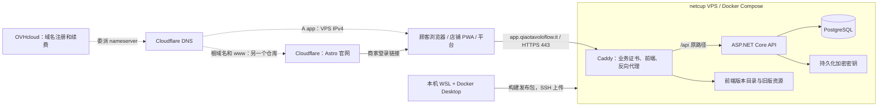

# Qiao TavoloFlow 部署笔记

写给以后的自己：记录首次部署时做了什么、为什么这么做，以及以后需要反复做的事。

- 按步骤执行的官方教程：[deployment-guide.md](deployment-guide.md)。
- 所有部署脚本和配置都在仓库的 `deploy/` 目录。
- 笔记分三部分：**第一部分**是只做过一次的首次部署记录；**第二部分**是以后要反复做的事；**第三部分**是出事时的应急操作。

## 速查卡

### 我的服务器与服务商

| 项目 | 内容 |
|---|---|
| 业务网址 | `https://app.qiaotavoloflow.it` |
| VPS | netcup VPS Lite 1 G12.5s：AMD64、2 CPU、4 GB 内存、80 GB 磁盘 |
| 系统 | Ubuntu 24.04 LTS |
| 公网 IPv4 | `62.83.71.248`（下文命令里统一写作 `VPS_IP`） |
| 域名注册与续费 | OVHcloud |
| DNS | Cloudflare 免费计划 |
| 官网 | 根域名 `qiaotavoloflow.it` 和 `www` 留给另一个仓库的 Astro 官网，与本项目无关 |

### 账号与密码，不要混淆

| 名称 | 用在哪里 |
|---|---|
| CCP（Customer Control Panel） | netcup 客户账号：订单、账单 |
| SCP（Server Control Panel） | netcup 管理这台服务器的网页：重装系统、开关机、Screen 远程控制台。和 `scp` 命令只是重名 |
| SSH 私钥 `~/.ssh/tavoloflow` | 在本机 WSL 里，用来登录 VPS；私钥口令只用来解锁这个文件 |
| deploy 的 Linux 密码 | 只用于在 VPS 上执行 `sudo` |
| 平台管理员账号 | 登录 `/platform`，创建和管理餐厅 |

root 不能远程登录，SSH 密码登录也已关闭，登录 VPS 只能用私钥以 deploy 身份登录。

### 关键位置

| 位置 | 路径 | 所有者 |
|---|---|---|
| 本机发布包 | `~/personal-projects/TavoloFlow/artifacts/` | 我 |
| 本机备份 | `~/tavoloflow-backups/` | 我 |
| VPS 上传暂存区 | `/home/deploy/tavoloflow-upload/` | deploy |
| VPS 正式目录 | `/opt/tavoloflow/` | root |
| VPS 备份 | `/opt/tavoloflow/backups/` | root |
| 当前 / 上一个版本号 | `/opt/tavoloflow/state/current`、`/opt/tavoloflow/state/previous` | root |

### 最常用的命令

```bash
# 在本机 WSL 登录 VPS
ssh -i ~/.ssh/tavoloflow deploy@VPS_IP
# 以下在 VPS 上执行
sudo bash /opt/tavoloflow/tf.sh ps                    # 三个容器的状态
sudo bash /opt/tavoloflow/tf.sh logs --tail 100 api   # API 最近的日志
sudo bash /opt/tavoloflow/backup.sh                   # 立即备份一次
sudo ls -lh /opt/tavoloflow/backups/                  # 查看已有备份
df -h                                                 # 硬盘空间
```

## ⚠ 待办

项目已经营业，但下面三件事还没做：

- [ ] **启用每日自动备份**（第二部分 › 3. 备份 › 启用每日备份）。现在只有发布和回退时才会自动备份。
- [ ] **把一份备份下载到本机**（第二部分 › 3. 备份 › 下载备份到本机）。现在所有备份都只在服务器上，服务器出事就一起没了。
- [ ] **做一次恢复演练**（第三部分 › 恢复演练）。没有恢复过的备份，不能算可靠的备份。

## 整体架构



- **VPS**：一直开着的远程 Linux 电脑。关掉自己的电脑，网站也不会下线。
- **DNS**：把域名翻译成 IP。
- **Caddy**：Web 服务器和反向代理。对外接收请求、自动管理 HTTPS 证书、发送前端文件，并把 `/api` 请求转给后端。
- **镜像 / 容器 / 卷**：镜像是打包好的程序，容器是正在运行的程序，卷保存长期数据（数据库、密钥、证书）。更新或重建容器不会清空卷。
- 前端和后端 `/api` 在同一个子域名下，所以没有跨域请求，也不需要共享 Cookie。

VPS 上运行三个容器，定义在 `deploy/compose.yaml`：

```text
                80/443（唯一对外开放的端口）
浏览器 ───────────────> caddy ──proxy 网络──> api ──database 网络──> db
                          │                   │                      │
                       读取 web/        protection_keys 卷      postgres_data 卷
```

| 服务 | 镜像 | 作用 |
|---|---|---|
| `db` | `postgres:18-alpine` | PostgreSQL 数据库 |
| `api` | `tavoloflow-api:<版本>` | 后端，来自我构建的发布包 |
| `caddy` | `caddy:2-alpine` | 接收请求、HTTPS 证书、发送前端文件、转发 `/api` |

- 只有 Caddy 对外开放端口。API 和数据库没有对外端口，外面连不上。
- `database` 网络是 `internal: true`，完全不通外网，而且只有 API 在里面，Caddy 也访问不到数据库。
- 四个卷保存长期数据：`postgres_data`（数据库）、`protection_keys`（Data Protection 密钥）、`caddy_data` 和 `caddy_config`（证书和 Caddy 配置）。
- 每个服务都设置了 `restart: unless-stopped`，Docker 也开机自启：关掉 SSH 窗口网站照常运行，VPS 重启后容器自动恢复，容器崩溃会自动重启。服务器上不需要 `npm run dev` 或 `dotnet run`。

---

# 第一部分：我做了什么（一次性）

这些步骤在首次部署时做过一次，之后不会重复。只有换服务器（第三部分 › 灾难恢复）时才需要再做一遍。

## 1. 域名与 DNS

- 我在 OVHcloud 购买了 `qiaotavoloflow.it`，因为 Cloudflare 不销售 `.it` 域名。原本也打算在 OVHcloud 买 VPS，但需要的欧洲区型号 VPS-1 当时售罄，所以 VPS 改在 netcup 购买。
- 域名、DNS、服务器可以分别由三家公司提供，互不绑定。以后换 VPS，不用改域名、二维码或任何配置，只要改一条 DNS 记录。

**把 DNS 交给 Cloudflare**（域名仍在 OVHcloud 续费，只是改由 Cloudflare 负责解析）：

1. 在 Cloudflare 添加域名 `qiaotavoloflow.it`，选免费计划，记下它分配的两个 nameserver。
2. 在 OVHcloud 的域名页面打开 **DNS servers**，换成 Cloudflare 的两个 nameserver。如果启用了 DNSSEC，要先关闭。
3. 等 Cloudflare 显示 Active。之后解析记录只在 Cloudflare 修改，改 OVHcloud 的旧 DNS zone 不再生效。

**添加业务子域名**：在 Cloudflare → DNS → Records 添加一条记录。

| 字段 | 填写 |
|---|---|
| Type | `A`（域名指向一个 IPv4 地址） |
| Name | `app`，生成 `app.qiaotavoloflow.it` |
| IPv4 address | VPS 的公网 IP |
| Proxy status | **DNS only（灰云）** |
| TTL | Auto |

为什么用灰云，不用橙云（Cloudflare 代理）：

- 灰云：Cloudflare 只负责解析，浏览器直接连到 VPS，由 Caddy 接收请求、申请证书。
- 橙云：请求先经过 Cloudflare 再转到 VPS。API 看到的来源会变成 Cloudflare 的 IP，而 API 只信任 Caddy 转来的访客 IP，按 IP 计数的登录、加入限流就会失效；HTTPS 也要另外配置。

验证解析：

```bash
# 整个域名的 nameserver，应该是 Cloudflare 分配的那两个
dig +short NS qiaotavoloflow.it
# app 子域名，应该返回 VPS 的 IP
dig @1.1.1.1 +short A app.qiaotavoloflow.it
```

## 2. 购买 VPS 并重装 Ubuntu

VPS 必须是 AMD64（x86-64）架构，因为构建脚本只构建 `linux/amd64` 的镜像。

**1. 在本机 WSL 生成 SSH 密钥**

```bash
ssh-keygen -t ed25519 -C "tavoloflow" -f ~/.ssh/tavoloflow
```

- `-t ed25519`：密钥算法 Ed25519。
- `-C "tavoloflow"`：注释，方便识别这把密钥，不参与认证。
- `-f ~/.ssh/tavoloflow`：保存位置。生成两个文件：`tavoloflow` 是**私钥**，永远留在本机；`tavoloflow.pub` 是**公钥**，可以公开，要交给服务器。

**2. 把公钥保存到 SCP**

```bash
# 打印公钥，复制完整的一整行（ssh-ed25519 ... tavoloflow）
cat ~/.ssh/tavoloflow.pub
```

在 SCP 顶部 **Options → SSH Keys** 粘贴保存。这只是保存在 netcup 账号里，供下一步安装系统时选择。

**3. 重装系统**

netcup 默认装的是 Debian，我改成和本机 WSL 一样的 Ubuntu。在 SCP 选中服务器，进入 **Media → Images → Official Images**：

- 选择 Ubuntu 24.04 LTS。
- 选择占用整块磁盘的大分区布局，充分利用存储。
- 保持 UEFI 设置（官方镜像的要求）。
- 选中刚保存的公钥。安装器会把它写入新系统的 `/root/.ssh/authorized_keys`，root 因此能用这把密钥登录。
- 安装会清空磁盘。完成后页面会给出新的 root 密码。

## 3. SSH 登录与账号安全

### SSH 公钥认证是怎么回事

- 服务器上运行着 **sshd**（SSH 守护进程），它一直在 22 端口等待连接。本机的 `ssh`、`scp` 是客户端。
- 每个 Linux 用户都有自己的 `~/.ssh/authorized_keys`，里面每行一把**允许登录这个用户**的公钥。root 的在 `/root/.ssh/authorized_keys`，deploy 的在 `/home/deploy/.ssh/authorized_keys`。
- 登录时，客户端用私钥对**绑定本次连接的数据**签名，服务器用 `authorized_keys` 里的公钥验证。私钥不会被传输，传的只是签名。
- 服务器信任的是"持有对应私钥的人"，不是某台电脑。谁拿到私钥文件谁就能登录，所以私钥要保管好。
- 同一把公钥可以放在多个用户的 `authorized_keys` 里。

两边的 `.ssh` 作用相反：

| 位置 | 文件 | 作用 |
|---|---|---|
| 本机 `~/.ssh/` | `tavoloflow` | 私钥，证明"我是谁" |
| 本机 `~/.ssh/` | `known_hosts` | 记录连过的服务器指纹，防止连到冒充的服务器 |
| VPS `~/.ssh/` | `authorized_keys` | 公钥白名单，决定"允许谁进来" |

### 首次以 root 登录

```bash
# 在 SCP 的 Screen（网页上的远程控制台）里，查看服务器自己的指纹
ssh-keygen -lf /etc/ssh/ssh_host_ed25519_key.pub
# 在本机 WSL 登录；-o IdentitiesOnly=yes 表示只使用 -i 指定的这把密钥
ssh -o IdentitiesOnly=yes -i ~/.ssh/tavoloflow root@VPS_IP
```

第一次连接时，终端会显示服务器指纹并询问是否信任。它和 Screen 里看到的一致，才说明连的是自己的服务器，再输入 `yes`。

登录后确认系统和架构：

```bash
cat /etc/os-release   # 应为 Ubuntu 24.04
uname -m              # 应为 x86_64
```

### 创建 deploy 用户

以 root 登录后，每条命令都直接拥有最高权限，没有第二道确认。所以我创建了日常使用的 `deploy` 用户，之后再禁止 root 远程登录。

为什么不一直用 root：

- **最小权限**：日常操作用普通用户，需要时才用 `sudo`，误操作的影响范围更小。
- **两道门槛**：登录 deploy 需要私钥，提权还需要 deploy 的密码。只泄露私钥，拿不到 root 权限。
- **可以禁止 root 远程登录**：`root` 是所有服务器都有的用户名，是扫描器必试的目标。
- **后面的权限设计依赖它**：正式目录 `/opt/tavoloflow` 归 root，备份任务以 root 运行。如果 deploy 能修改备份脚本，就等于能让 root 执行任意命令。这套保护只有在 deploy 不是 root 时才成立。

```bash
# 刷新软件包索引（只更新"有哪些包、什么版本"的列表，不安装任何东西）
apt update
# sudo：让普通用户临时以 root 身份执行命令；openssh-server：sshd；nano：编辑器
apt install -y sudo openssh-server nano
# 创建用户：同时建立同名用户组和家目录 /home/deploy，并要求设置密码（姓名等可留空）
adduser deploy
# 把 deploy 追加到 sudo 组；-a 表示追加，漏掉 -a 会替换掉用户原有的全部附加组
usermod -aG sudo deploy
```

- `adduser` 是 Ubuntu 提供的封装；底层的 `useradd` 默认不建家目录、不设密码。
- Ubuntu 的 `/etc/sudoers` 规定 `sudo` 组成员可以用**自己的密码**执行任意命令，加入这个组就有了 sudo 权限。
- deploy 的密码**只用于 sudo**：后面会禁用 SSH 密码登录。它和私钥口令是两个不同的密码。

然后给 deploy 安装公钥，做法和安装器给 root 做的一样，只是这次要手动完成：

```bash
# 创建 .ssh 目录：700 表示只有所有者能读写和进入；-o/-g 指定所有者为 deploy（否则会归执行命令的 root）
install -d -m 700 -o deploy -g deploy /home/deploy/.ssh
# 创建公钥白名单，粘贴 tavoloflow.pub 的完整一行
nano /home/deploy/.ssh/authorized_keys
# nano 以 root 身份创建的文件归 root，要改回 deploy，并设为只有所有者可读写
chown deploy:deploy /home/deploy/.ssh/authorized_keys
chmod 600 /home/deploy/.ssh/authorized_keys
```

为什么权限这么讲究：sshd 默认开启 `StrictModes`，如果 `.ssh` 或 `authorized_keys` 的所有者不对，或者别人可写，sshd 会直接忽略这把公钥，表现为密钥正确却登录失败。`authorized_keys` 决定谁能登录，必须防止别人往里加自己的公钥。

权限数字的读法：三位依次是所有者、所属组、其他人，r=4、w=2、x=1 相加。`600` 是所有者读写、其他人无权限；`700` 多一个 x，因为进入目录需要执行权限。

最后**新开一个 WSL 终端**验证（保留原来的 root 会话）：

```bash
ssh -o IdentitiesOnly=yes -i ~/.ssh/tavoloflow deploy@VPS_IP
whoami    # 应输出 deploy
sudo -v   # 输入 deploy 的密码，不报错即 sudo 可用
```

之后所有服务器操作都以 deploy 登录，需要管理员权限时加 `sudo`。

### 更新系统、设置时区、配置防火墙

```bash
sudo apt update
# 把已安装的软件升级到最新，主要是为了安全补丁
sudo apt upgrade -y
sudo apt install -y ca-certificates curl openssl python3 ufw dnsutils nano
# 时区设为意大利时间
sudo timedatectl set-timezone Europe/Rome
# 防火墙放行 SSH（22）、HTTP（80）、HTTPS（443）
sudo ufw allow OpenSSH
sudo ufw allow 80/tcp
sudo ufw allow 443/tcp
# 启用防火墙；一定要先放行 SSH 再启用，否则会把自己锁在外面
sudo ufw enable
# 预期看到 SSH、80、443 三条规则
sudo ufw status
```

| 包 | 用途 |
|---|---|
| `ca-certificates` | 根证书，`curl` 下载 HTTPS 内容时用来验证对方身份 |
| `curl` | 下载文件，安装 Docker 时要用 |
| `openssl` | 生成随机的数据库密码 |
| `python3` | 部署脚本用它检查 `.env` |
| `ufw` | 防火墙管理工具 |
| `dnsutils` | 提供 `dig`，验证 DNS 解析 |

- **时区**：餐厅在意大利，日志和备份时间按当地时间更直观。每日备份定在罗马时间 03:30。
- **防火墙**：默认拒绝所有入站连接，只开三个端口。HTTP 80 也要开，因为 Caddy 申请证书和把 HTTP 跳转到 HTTPS 都要用它。数据库和 API 的端口一律不开。
- netcup 的 SCP 里还有一层防火墙，我保持了它的默认设置。

### 关闭 SSH 密码登录和 root 登录

确认 deploy 能用密钥登录后，我收紧了 SSH：只允许公钥登录，并且不允许 root 登录。

- 关闭密码登录：没有私钥的人，再怎么猜密码也进不来。
- 关闭 root 登录：即使有人拿到了私钥，也得先登录成 deploy，再知道 deploy 的密码才能 `sudo`。

```bash
# 用 tee 写文件而不是 sudo echo ... > 文件：
# 重定向 > 由当前 shell（deploy，没有权限）执行，sudo 只提升了 echo，所以会提示权限不足
sudo tee /etc/ssh/sshd_config.d/00-tavoloflow.conf >/dev/null <<'EOF'
PasswordAuthentication no
KbdInteractiveAuthentication no
PermitRootLogin no
PubkeyAuthentication yes
EOF
# 只检查语法，没有输出就是通过
sudo sshd -t
# 打印实际生效的配置，三项都应为 no
sudo sshd -T | grep -E 'passwordauthentication|kbdinteractiveauthentication|permitrootlogin'
# 让 sshd 重新读取配置；已经登录的会话不受影响
sudo systemctl reload ssh
```

| 配置 | 含义 |
|---|---|
| `PasswordAuthentication no` | 禁用密码登录 |
| `KbdInteractiveAuthentication no` | 禁用键盘交互认证。它在 Ubuntu 上也能用来输入密码，不关等于给密码登录留了后门 |
| `PermitRootLogin no` | root 不能通过 SSH 登录，密钥也不行 |
| `PubkeyAuthentication yes` | 允许公钥登录（本来就是默认值，写出来意图更清楚） |

**为什么写在 `sshd_config.d/00-tavoloflow.conf`**：主配置 `/etc/ssh/sshd_config` 会引入 `sshd_config.d/*.conf`，这样不用改主文件。目录里的文件按文件名顺序读取，而 sshd 对同一个配置项**采用第一个读到的值**，后面的会被忽略。云服务器镜像里常有 `50-cloud-init.conf` 之类的文件，可能写着 `PasswordAuthentication yes`。用 `00-` 开头，我们的设置就会最先被读到。

**为什么 `-t` 和 `-T` 都要看**：如果别的文件抢先设置了同一项，语法照样正确，`-t` 不会报错，只有 `-T` 才能看出实际值不是 `no`。

**安全的操作顺序**：远程修改登录配置有把自己锁在外面的风险。

1. 保留一个已登录且 sudo 可用的会话，在里面修改、检查、reload。
2. **新开终端**验证 deploy 仍能用密钥登录，`sudo -v` 正常。
3. 验证通过后，才关闭旧的 root 会话。

万一被锁在外面，可以在 SCP 的 **Screen** 或 **Rescue System** 里修复，它们不经过 SSH。

## 4. 安装 Docker

服务器只安装 Docker Engine 和 Compose 插件，不需要 Node、.NET SDK 或源码。前端和后端都在本机构建好，打包成镜像和静态文件上传。

```bash
# 添加 Docker 官方软件源：先下载它的签名密钥，apt 用它验证下载的软件包确实来自 Docker
sudo install -m 0755 -d /etc/apt/keyrings
sudo curl -fsSL https://download.docker.com/linux/ubuntu/gpg -o /etc/apt/keyrings/docker.asc
sudo chmod a+r /etc/apt/keyrings/docker.asc
sudo tee /etc/apt/sources.list.d/docker.sources >/dev/null <<EOF
Types: deb
URIs: https://download.docker.com/linux/ubuntu
Suites: $(. /etc/os-release && echo "$VERSION_CODENAME")
Components: stable
Architectures: $(dpkg --print-architecture)
Signed-By: /etc/apt/keyrings/docker.asc
EOF
# 安装 Docker
sudo apt update
sudo apt install -y docker-ce docker-ce-cli containerd.io docker-buildx-plugin docker-compose-plugin
# 开机自启，并立即启动
sudo systemctl enable --now docker
# 验证：能看到 Client 和 Server 两组版本，hello-world 能正常运行
sudo docker version
sudo docker compose version
sudo docker run --rm hello-world
```

**deploy 不加入 docker 组**：docker 组的成员可以直接控制 Docker，而 Docker 能以 root 身份挂载任意文件，所以加入 docker 组几乎等于拥有 root 权限。我每次都用 `sudo` 执行 Docker 命令。

**Docker 可能绕过 UFW**：Docker 对外发布的端口不一定受 UFW 约束。所以本项目的 API 和数据库根本没有配置对外端口，防火墙只是第二层保护。

## 5. 首次构建、上传和准备正式目录

### 5.1 在本机构建发布包

```bash
# 在项目根目录执行
cd /home/yangr/personal-projects/TavoloFlow
bash deploy/build-release.sh
```

脚本做的事：

- **固定平台**：构建 Linux AMD64 镜像，与 VPS 的 CPU 架构一致。
- **在容器里构建**：前端用 Node 24，后端用 .NET 10。结果不依赖本机装了什么版本。首次要下载基础镜像和依赖，可能要几分钟，之后有缓存会快很多。
- **写死生产地址**：前端的 `VITE_PUBLIC_BASE_URL` 在构建时写进 JS，用于生成桌位二维码的网址。脚本固定传入 `https://app.qiaotavoloflow.it`，不读取本地 `.env.local` 里的局域网地址，否则打印的二维码顾客扫了打不开。
- **只打包需要的文件**：`.dockerignore` 和打包清单都是白名单，真实 `.env`、密钥、开发数据和 `node_modules` 不会进入镜像或发布包。
- **生成迁移程序**：后端构建时把所有数据库迁移打包成独立程序 `efbundle`，放进 API 镜像（见 6.3）。

成功后输出两个文件，版本号由"UTC 构建时间 + 当前提交编号"组成，例如：

```text
artifacts/tavoloflow-20261026T094909Z-4c9535b.tar.gz
artifacts/tavoloflow-20261026T094909Z-4c9535b.tar.gz.sha256
```

### 5.2 上传到 VPS

```bash
# 版本号是文件名里 tavoloflow- 和 .tar.gz 之间的部分
RELEASE=20261026T094909Z-4c9535b
# 先在 VPS 上创建上传目录
ssh -i ~/.ssh/tavoloflow deploy@VPS_IP 'mkdir -p ~/tavoloflow-upload'
# 上传发布包和它的校验文件
scp -i ~/.ssh/tavoloflow \
  "artifacts/tavoloflow-$RELEASE.tar.gz" \
  "artifacts/tavoloflow-$RELEASE.tar.gz.sha256" \
  deploy@VPS_IP:~/tavoloflow-upload/
```

- `RELEASE=...`：shell 变量，`=` 两边不能有空格。它只在当前终端有效，到 VPS 上要重新设置。
- `ssh ... '命令'`：登录后只执行这一条命令就退出。命令用**单引号**，`~` 才会在 VPS 上展开成 `/home/deploy`；用双引号会先被本机展开成 `/home/yangr`。
- `mkdir -p`：目录已存在也不报错。`scp` 不会自动创建目标目录，所以要先建。
- `scp`：通过 SSH 复制文件。路径用**双引号**，`$RELEASE` 才会被展开。目标以 `/` 结尾，表示放进这个目录。
- `.sha256` 是校验文件，上传后在 VPS 上用来确认文件完整，能发现上传中断或损坏。它和压缩包一起上传，所以防不了篡改；传输过程的安全由 SSH 负责。
- 上传失败可以直接重传，不需要重新构建。

上传后文件在两个地方：

```text
本机 WSL
└── ~/personal-projects/TavoloFlow/artifacts/
    ├── tavoloflow-20261026T094909Z-4c9535b.tar.gz          ← 原件保留，用于重传、回退和灾难恢复
    └── tavoloflow-20261026T094909Z-4c9535b.tar.gz.sha256

VPS
└── /home/deploy/tavoloflow-upload/                          ← 暂存区，归 deploy
    ├── tavoloflow-20261026T094909Z-4c9535b.tar.gz
    └── tavoloflow-20261026T094909Z-4c9535b.tar.gz.sha256
```

**为什么先传到暂存区**：正式目录 `/opt/tavoloflow` 归 root，`scp` 以 deploy 身份连接，没有写权限。所以先传到 deploy 自己的家目录，校验通过后再用 `sudo install` 以 root 身份复制进去。从外部传来的文件先落在低权限的地方，这也更安全。

### 5.3 校验、解压，准备正式目录

以下在 VPS 上执行：

```bash
RELEASE=20261026T094909Z-4c9535b
cd ~/tavoloflow-upload
# 外层校验：核对压缩包的哈希，显示 OK 说明上传没有损坏
sha256sum -c "tavoloflow-$RELEASE.tar.gz.sha256"
# 每个版本解压到独立目录；包内文件直接在最上层，不指定目录会散落一地
mkdir "$RELEASE"
tar -xzf "tavoloflow-$RELEASE.tar.gz" -C "$RELEASE"
cd "$RELEASE"
# 内层校验：逐个核对包内文件，没有输出就是成功
sha256sum --check --quiet SHA256SUMS
# 创建正式目录：root 所有，755
sudo install -d -o root -g root -m 755 /opt/tavoloflow
# 复制运维文件：root 所有，644；ops/* 不匹配以点开头的隐藏文件，所以 .env.example 要单独写
sudo install -o root -g root -m 644 ops/* ops/.env.example /opt/tavoloflow/
# 用模板创建真正的 .env：600，只有 root 可读写。只在首次安装时执行！
sudo install -o root -g root -m 600 ops/.env.example /opt/tavoloflow/.env
# 生成 64 位十六进制随机密码（只打印到屏幕，需要自己复制）
openssl rand -hex 32
sudo nano /opt/tavoloflow/.env
```

- 这里的 `install` 是"复制文件并同时设置所有者和权限"，不是安装软件包。
- 校验失败就重新上传，不要跳过。
- **以后更新绝不能再执行创建 `.env` 的那一行**，否则会用模板覆盖已经填好的配置。

执行后 VPS 上的文件分布：

```text
/home/deploy/tavoloflow-upload/                      ← 暂存区，归 deploy
├── tavoloflow-20261026T094909Z-4c9535b.tar.gz
├── tavoloflow-20261026T094909Z-4c9535b.tar.gz.sha256
└── 20261026T094909Z-4c9535b/                         ← 解压出的发布包
    ├── api-image.tar.gz      后端镜像（安装脚本才载入 Docker）
    ├── frontend/             前端静态文件（安装脚本才复制到正式目录）
    ├── ops/                  运维文件（已复制到 /opt/tavoloflow）
    ├── docs/                 部署文档
    ├── release.txt           版本号
    ├── public-origin.txt     前端构建时写死的网址
    ├── image.id              镜像 ID，安装时核对
    └── SHA256SUMS            包内每个文件的校验值

/opt/tavoloflow/                                     ← 正式目录，root:root 755
├── compose.yaml              Docker Compose 配置       644
├── Caddyfile                 Caddy 配置                644
├── lib.sh                    脚本共用函数              644
├── tf.sh                     生产 Compose 包装器       644
├── install-release.sh        安装/更新脚本             644
├── bootstrap-admin.sh        创建或重置平台管理员      644
├── backup.sh                 备份脚本                  644
├── rollback.sh               回退脚本                  644
├── tavoloflow-backup.service 备份的 systemd 服务       644
├── tavoloflow-backup.timer   备份的定时器              644
├── .env.example              配置模板                  644
└── .env                      生产配置（含数据库密码）  600
```

### 5.4 权限设计

两个目录归不同的用户：

| 路径 | 所有者 | deploy 能做什么 |
|---|---|---|
| `/home/deploy/tavoloflow-upload/` | deploy | 随意读写，是上传用的暂存区 |
| `/opt/tavoloflow/` | root | 只能查看，修改必须用 `sudo` |

`/opt/tavoloflow/` 里的具体权限：

| 路径 | 权限 | root | deploy |
|---|---|---|---|
| `/opt/tavoloflow/` 目录本身 | 755 | 读、写、进入 | 能进入、查看，不能增加、删除或替换里面的文件 |
| `/opt/tavoloflow/` 下的脚本和配置 | 644 | 读、写 | 只能读 |
| `/opt/tavoloflow/.env` | 600 | 读、写 | 读都不行 |

**为什么这么严**：每日备份任务会以 root 身份自动运行 `/opt/tavoloflow/backup.sh`，脚本还会加载同目录的 `lib.sh` 和 `compose.yaml`。如果 deploy 能改其中任何一个，就能往里写任意命令，让 root 在下次备份时替它执行，等于不需要 sudo 密码就拿到了 root 权限。

- **目录也要保护**：删除或替换一个文件，需要的是**它所在目录**的写权限。如果目录对 deploy 可写，即使 `backup.sh` 只读，deploy 也能删掉它再放一个新的。
- 脚本用 `bash 脚本路径` 运行，由 bash 读取内容，所以不需要执行权限。
- **不能用 `sudo cp -a ops/. /opt/tavoloflow/`**：`-a` 会保留源文件的所有者（deploy），而源写成 `ops/.` 还会把 `ops` 目录的所有者套到 `/opt/tavoloflow/` 上，正好造成上面的漏洞。项目早期的教程就是这样写的，后来改成了 `install`。
- 每次发布，安装脚本都会把 `/opt/tavoloflow` 重新设回这组权限。
- root 本身不受权限位限制，这些权限约束的是 deploy 和其他非 root 用户。

### 5.5 填写 `.env`

`/opt/tavoloflow/.env` 是生产配置，Compose 和各个运维脚本都从这里读取。需要修改三项：

| 配置 | 怎么填 | 说明 |
|---|---|---|
| `POSTGRES_PASSWORD` | 粘贴 `openssl rand -hex 32` 生成的 64 个字符 | API 连接数据库用的密码，不是网站登录密码。十六进制只有 0–9 和 a–f，不会遇到特殊字符的转义问题 |
| `ACME_EMAIL` | 自己的真实邮箱 | Caddy 申请 HTTPS 证书时登记的邮箱，用于接收证书通知 |
| `DOMAIN` | 确认是 `app.qiaotavoloflow.it` | 不带 `https://` 和路径，也不能填官网的根域名 |

其余的 `POSTGRES_DB`、`POSTGRES_USER` 和网段设置保留默认。

- 写法：值不加引号，`=` 两边不加空格。nano 里 `Ctrl+O`、回车保存，`Ctrl+X` 退出。
- 安装脚本会检查这三项：密码必须是 64 位十六进制；邮箱不能还是模板里的 `replace-me`；`https://` 加上 `DOMAIN` 必须等于发布包里的 `public-origin.txt`，不一致就停止，避免二维码指向错误的网站。
- **数据库密码只在第一次生效**：PostgreSQL 只在数据卷还是空的时候，用 `POSTGRES_PASSWORD` 创建账号。之后再改 `.env`，数据库里的密码不会跟着变，API 反而会因为密码不一致而连不上。
- 不要运行 `docker compose config`，它会把完整配置连同密码打印到屏幕上。只想检查配置时用 `config --quiet`。

### 5.6 网段（保持默认）

Caddy 和 API 之间的 `proxy` 网络使用固定网段，Caddy 有固定地址：

```text
浏览器 ──HTTPS──> Caddy（固定地址 172.30.80.2）──proxy 网络──> API
```

对 API 来说，所有请求都是 Caddy 转来的。所以 Caddy 会在请求里附加访客的真实 IP（`X-Forwarded-For`）和原始请求是否为 HTTPS（`X-Forwarded-Proto`）。API 只相信**来自 Caddy 固定地址**的这两个信息，否则任何人都能自己写这些请求头，伪造 IP 或冒充 HTTPS。Compose 把 `CADDY_IP` 同时交给 Caddy（作为地址）和 API（作为唯一信任的代理），两边自动一致。

| 变量 | 默认值 | 含义 |
|---|---|---|
| `PROXY_SUBNET` | `172.30.80.0/24` | `proxy` 网络的地址范围：`.0`–`.255` |
| `PROXY_DYNAMIC_RANGE` | `172.30.80.128/25` | Docker 自动给其他容器（比如 API）分配地址的范围：`.128`–`.255` |
| `CADDY_IP` | `172.30.80.2` | Caddy 的固定地址，在自动分配范围之外，不会被占用 |

只有 VPS 上已有别的网络占用了这个网段时才需要改，而且三个值要一起改。这台 VPS 只运行本项目，保持默认。

### 5.7 检查权限

```bash
# 1. 列出关键文件的所有者和权限：应为 root:root，目录 755、脚本 644、.env 600
sudo stat -c '%U:%G %a %n' /opt/tavoloflow /opt/tavoloflow/backup.sh /opt/tavoloflow/lib.sh /opt/tavoloflow/compose.yaml /opt/tavoloflow/.env
# 2. 扫描整个目录，找出所有者不是 root，或组/其他人可写的文件；没有输出才对
sudo find /opt/tavoloflow \( ! -user root -o ! -group root -o \( ! -type l -perm /022 \) \) -print
# 3. 站在 deploy 的角度确认改不了；这条不能加 sudo，否则就是以 root 身份检查了
test ! -w /opt/tavoloflow && test ! -w /opt/tavoloflow/backup.sh && echo 'deploy 无法直接修改或替换备份脚本'
```

- 第 2 条：`-perm /022` 表示组可写（020）或其他人可写（002）任意一个成立；排除符号链接（`! -type l`），因为符号链接的权限固定显示为 777。要用 `sudo`，否则进不了 700 的 `state/`、`backups/`。
- 什么时候检查：首次准备后、每次更新后，以及**启用每日备份之前**。

## 6. 首次安装与上线

### 6.1 运行安装脚本

仍在解压后的发布目录（例如 `/home/deploy/tavoloflow-upload/20261026T094909Z-4c9535b/`）里执行：

```bash
sudo bash ops/install-release.sh "$PWD" /opt/tavoloflow
```

- `ops/install-release.sh` 是相对路径，`"$PWD"` 是当前目录的完整路径，所以必须站在发布目录里。
- 第一个参数告诉脚本发布包在哪里，第二个参数是正式目录。
- 运行的是**新版本自带的**安装脚本，保证脚本和发布包配套。
- 必须用 `sudo`，脚本开头会检查自己是不是 root。

### 6.2 安装脚本按顺序做了什么

**1. 检查**
- `/opt/tavoloflow/.env` 存在且是普通文件。
- 再做一次内层校验（`SHA256SUMS`）。
- 先把 `/opt/tavoloflow` 的权限修复成 `root:root`、去掉组和其他人的写权限，然后才读取或执行里面的东西。
- 加锁（`.operation.lock`），保证发布、备份、回退不会同时运行。
- 检查 `.env` 的三项（见 5.5）。
- `docker load` 载入后端镜像，并核对镜像 ID 与包里的 `image.id` 一致。
- 用 `config --quiet` 校验 Compose 配置，不打印密码。

**2. 准备目录**
- 创建 `state/`、`backups/`（700，只有 root 能进），以及 `web/`、`web/releases/`、`web/assets/`（755，Caddy 只读这里）。
- 如果是更新（已有 `state/current`）：先停止 API，再做一次备份。首次安装没有旧版本，跳过。
- 把新版运维文件复制到 `/opt/tavoloflow/`（644）。`.env` 不在其中，永远不会被覆盖。

**3. 数据库**
- 启动数据库，等健康检查通过。首次启动时卷是空的，PostgreSQL 用 `.env` 里的密码创建账号。
- 执行数据库迁移：用 API 镜像起一个一次性容器，不运行 API，而是运行迁移程序 `efbundle`，完成后删除容器。

**4. 后端和前端**
- 前端完整复制到 `web/releases/<版本>/`；带哈希名的 `assets/` 文件额外复制到共享的 `web/assets/`，旧文件从不删除。
- 启动 API，等健康检查 `/health/ready` 通过。
- 把符号链接 `web/current` 切换到 `releases/<版本>`。先建临时链接再用 `mv` 一步替换，是**原子操作**，访问者只会看到旧版或新版，不会看到一半。

**5. Caddy 和记录**
- 启动 Caddy。首次启动会自动申请 HTTPS 证书，前提是 DNS 已指向这台 VPS，且 80/443 端口能访问。
- 版本号写入 `state/current`，更新时旧版本写入 `state/previous`，供以后回退。

`postgres` 和 `caddy` 镜像不在发布包里，第一次启动时从网上下载，所以首次安装看到下载是正常的。

### 6.3 数据库迁移

开发时，改了 model 用 `dotnet ef migrations add` 生成迁移，再用 `dotnet ef database update` 应用到本地数据库。生产服务器上没有 .NET SDK 和源码，不能这样做。

- **efbundle**：构建发布包时，`deploy/Dockerfile.api` 用 `dotnet ef migrations bundle` 把所有迁移打包成一个独立程序 `efbundle`，放进 API 镜像。它的作用等同于 `database update`，但运行时不需要 SDK。
- **可重复运行**：EF 在数据库的 `__EFMigrationsHistory` 表里记录已应用的迁移，再次运行只执行还没应用的，不会重复建表。
- **显式执行，不在 API 启动时自动迁移**：容器重启、VPS 重启都会触发启动，自动迁移等于随时可能改动生产数据库；而且更新时要先备份再迁移，迁移失败时脚本会停下而不是让 API 反复崩溃。
- **只往前走**：生产环境不要用 `dotnet ef database update 0` 之类的方式撤销迁移，那会删除表和数据。有问题就写一个新的迁移来修复。

### 6.4 安装后的目录

对照 5.3 执行后的图，安装脚本新增了：

```text
/opt/tavoloflow/                       root:root 755
├── （运维文件和 .env，不变）
├── .operation.lock                    操作锁
├── state/                             700
│   └── current                        当前版本号（更新后还会有 previous）
├── backups/                           700，备份放在这里
└── web/                               755，Caddy 只读
    ├── current -> releases/<版本>      符号链接，指向当前前端版本
    ├── releases/
    │   └── <版本>/                     每个版本的完整前端文件
    └── assets/                        共享历史资源池，旧文件保留

Docker（不在 /opt/tavoloflow 里）
├── 镜像：tavoloflow-api:<版本>、postgres:18-alpine、caddy:2-alpine
└── 卷：postgres_data、protection_keys、caddy_data、caddy_config
```

### 6.5 检查容器并创建平台管理员

```bash
# 三个容器应在运行且 healthy
sudo bash /opt/tavoloflow/tf.sh ps
# Caddy 日志，确认证书申请成功
sudo bash /opt/tavoloflow/tf.sh logs --tail 80 caddy
# 创建第一个平台管理员
sudo bash /opt/tavoloflow/bootstrap-admin.sh
```

**`tf.sh`** 是生产 Compose 的封装，实际执行的是：

```bash
docker compose --project-directory /opt/tavoloflow \
  --env-file /opt/tavoloflow/.env \
  -f /opt/tavoloflow/compose.yaml \
  你传入的参数
```

- 它还会从 `state/current` 读取当前版本号，因为 API 的镜像名 `tavoloflow-api:<版本>` 需要它。
- 有了它就不用每次手写这一长串，也不会漏掉 `.env` 或误用本机的开发 Compose。
- 需要 `sudo`：deploy 不在 docker 组里，而且 `.env` 只有 root 能读。

**`bootstrap-admin.sh`**：数据库一开始是空的，平台管理员是创建餐厅的入口。

- 交互式输入用户名和两次密码。密码不回显，看不到输入是正常的。
- 密码 6–128 个字符，不能全是空白。
- 它用 API 镜像起一个一次性容器，运行后端自带的 `--seed-platform-admin` 命令，完成后删除容器。
- 密码按环境变量名称传入容器，不会出现在命令行参数和 shell 历史里，也不会写进 `.env`。
- 同名管理员已存在时不会覆盖密码。

### 6.6 上线验收

在本机检查 HTTPS 和几个关键地址：

```bash
curl -I http://app.qiaotavoloflow.it                      # 应跳转到 https
curl -I https://app.qiaotavoloflow.it/staff/login          # 应返回 200
curl -I https://app.qiaotavoloflow.it/sw.js                # JavaScript，Cache-Control: no-cache
curl -I https://app.qiaotavoloflow.it/staff.webmanifest    # application/manifest+json，no-cache
curl -i https://app.qiaotavoloflow.it/api/auth/csrf        # JSON，no-store
```

三个入口：

| 身份 | 地址 |
|---|---|
| 平台管理员 | `https://app.qiaotavoloflow.it/platform/login` |
| 餐厅 OWNER / STAFF | `https://app.qiaotavoloflow.it/staff/login` |
| 顾客 | 扫桌位二维码，进入 `https://app.qiaotavoloflow.it/q/{token}` |

然后按教程走完一遍业务流程：平台创建餐厅（临时密码只显示一次）→ OWNER、STAFF 首次登录改密 → 录入菜单和桌位 → 平台设为 ACTIVE、店铺开启接单 → 打印二维码并确认网址正确 → 开桌、扫码下单、厨房出餐、结账、查看历史。

店铺设备上已经从 `/staff` 安装了 PWA。

---

# 第二部分：以后要重复做的事

## 1. 发布新版本

流程和首次部署一样：本机构建 → 上传 → 校验解压 → 运行安装脚本。区别是**不再创建或编辑 `.env`**，也不再初始化管理员。

### 发布前检查清单

1. 代码已验证并**提交**。版本号里的提交编号来自 Git，但构建用的是工作区里的文件；有未提交的修改时，版本号对应不上实际代码。
2. Docker Desktop 正在运行。
3. 查看这次有没有新的数据库迁移：

   ```bash
   # 在 VPS 上查看线上版本号，末尾就是上次部署的提交编号，例如 ...-4c9535b
   sudo cat /opt/tavoloflow/state/current
   # 在本机项目根目录，查看从那之后迁移目录有没有变化；没有输出就是没有新迁移
   git log --oneline 4c9535b..HEAD -- backend/TavoloFlow.Api/Data/Migrations
   ```

4. 有新迁移或是重要更新：先把最近的备份下载到本机（3. 备份 › 下载备份到本机）。
5. 安排在**非营业时间**。

大多数更新只是改界面或修 bug，没有迁移，几乎没有风险，出问题也可以直接回退。有迁移、尤其是删除或重命名列的更新，才需要格外小心，因为它不能简单回退。

### 本机 WSL：构建并上传

```bash
cd /home/yangr/personal-projects/TavoloFlow
bash deploy/build-release.sh
# 改成脚本最后输出的新版本号
RELEASE=新版本号
# 上传目录首次部署时已经建好，所以这里不再 mkdir
scp -i ~/.ssh/tavoloflow \
  "artifacts/tavoloflow-$RELEASE.tar.gz" \
  "artifacts/tavoloflow-$RELEASE.tar.gz.sha256" \
  deploy@VPS_IP:~/tavoloflow-upload/
```

### VPS：校验、解压、安装

```bash
ssh -i ~/.ssh/tavoloflow deploy@VPS_IP
# 以下在 VPS 上执行
RELEASE=新版本号
cd ~/tavoloflow-upload
sha256sum -c "tavoloflow-$RELEASE.tar.gz.sha256"
mkdir "$RELEASE"
tar -xzf "tavoloflow-$RELEASE.tar.gz" -C "$RELEASE"
# 当前在 ~/tavoloflow-upload，没有进入发布目录，所以路径前要加 $RELEASE/
sudo bash "$RELEASE/ops/install-release.sh" "$PWD/$RELEASE" /opt/tavoloflow
sudo bash /opt/tavoloflow/tf.sh ps
```

- 这里没有单独做内层校验，安装脚本开头会自己再核对一次。
- 也可以先 `cd "$RELEASE"`，再用和首次安装一样的 `sudo bash ops/install-release.sh "$PWD" /opt/tavoloflow`，两种写法效果相同。
- **绝不再执行**创建 `.env` 的那条命令。

### 更新时安装脚本多做的事

安装脚本发现 `state/current` 已存在，就知道这是更新：

```text
停止 API → 备份 → 迁移数据库 → 启动新 API → 切换前端 → 重建 Caddy → 记录版本
└─────────────── 这段时间 API 不可用 ───────────────┘
```

- **每次更新都会备份，也都会执行迁移**，和这次有没有新迁移无关。没有新迁移时，迁移程序检查一遍就结束。
- 先停 API，备份时就没有新的写入，备份前后一致。
- 先备份再迁移，迁移出问题时还有迁移前的数据。
- 停 API 期间页面还能打开，但所有 `/api` 请求都会失败，所以要在非营业时间做。

### 发布后检查

- 检查登录、一次业务读取（比如打开账单或厨房页面）、PWA 页面切换。
- 如果某个写操作（下单、结账等）显示"结果未知"，按界面提示查询结果，不要盲目重新提交。应用只通过查询来确认结果，重发可能导致重复操作。

### 已经打开的旧版页面

- 共享的 `web/assets/` 保留所有历史版本的 JS 文件。前端按路由拆分代码，长时间开着的厨房 PWA 切换页面时仍会加载**旧版**文件，这些文件还在，所以不会出错。
- 新代码要在页面刷新或重新打开后才生效。
- 旧版页面调用的是新版 API，所以 **API 的修改要兼容旧客户端**，否则要安排店员刷新页面。

### 如果新版本改了备份的 systemd 文件

安装脚本只会把 `tavoloflow-backup.service`、`tavoloflow-backup.timer` 复制到 `/opt/tavoloflow/`，不会更新系统正在使用的 `/etc/systemd/system/` 里那份。改了这两个文件时，发布后要重新安装：

```bash
sudo install -o root -g root -m 644 /opt/tavoloflow/tavoloflow-backup.service /etc/systemd/system/
sudo install -o root -g root -m 644 /opt/tavoloflow/tavoloflow-backup.timer /etc/systemd/system/
sudo systemctl daemon-reload
```

## 2. 发布失败与应用回退

### 发布失败

脚本出错会立即停止，并打印提示。

```bash
# 查看三个服务最后 100 行日志
sudo bash /opt/tavoloflow/tf.sh logs --tail 100 api db caddy
```

- **不要删除卷，也不要急着恢复数据库**。脚本失败不会删除数据，先看日志找原因。
- 如果 API 已经被停止，先保持非营业状态。
- 修好代码后，用**新的版本号**重新构建和发布。同一个版本号不能重装：构建脚本拒绝覆盖已有的发布包，安装脚本也拒绝已存在的 `web/releases/<版本>`。

如果是**首次安装就失败**，`state/current` 还不存在，`tf.sh` 不知道版本号，要手动传入：

```bash
sudo env RELEASE_ID=失败的版本号 bash /opt/tavoloflow/tf.sh logs --tail 100 api db caddy
```

要写成 `sudo env RELEASE_ID=...`，因为 `sudo` 默认会清空调用者的环境变量，写在 `sudo` 前面的变量传不进去。

### 应用回退

```bash
# 查看当前版本和上一个版本
sudo cat /opt/tavoloflow/state/current
sudo cat /opt/tavoloflow/state/previous
# 确认旧代码兼容当前数据库结构后，才执行回退
sudo bash /opt/tavoloflow/rollback.sh --schema-compatible 上一版本号
```

`rollback.sh` 做的事：检查旧版前端和旧版镜像都还在 → 停止 API 并备份 → 用旧版镜像启动 API → 把 `web/current` 切回旧版前端、重建 Caddy → 更新 `state/current` 和 `state/previous`。

它**只切换代码，不动数据库**：不回滚表结构，也不撤回已经发生的订单。所以回退后，旧代码要在**新的表结构**上运行：

| 新版本的迁移做了什么 | 旧代码能否正常运行 |
|---|---|
| 新增一张表，或新增可为空的列 | 通常可以，旧代码不知道它们，也不会用到 |
| 删除或重命名了列 | 不行，旧代码读写的列已经不存在 |
| 新增不可为空且没有默认值的列 | 不行，旧代码插入数据时不会填这一列 |

`--schema-compatible` 参数就是要我**明确确认**过这一点，不带它脚本会拒绝执行。

不兼容时：

- **修复后向前发布**（推荐）：修好代码，用新版本号重新发布。
- **恢复数据库**：停止营业后按备份恢复。备份之后产生的数据会丢失，需要人工核对。

## 3. 备份

### 备份里有什么

`backup.sh` 每次生成一个压缩包，放在 `/opt/tavoloflow/backups/`：

```text
tavoloflow-20261027T023000Z-12345.tar.gz     ← 时间是 UTC（不是罗马时间），最后的数字是进程号
├── database.dump      PostgreSQL 数据库转储
├── keys.tar.gz        Data Protection 密钥
├── production.env     生产配置 .env 的副本（含数据库密码）
├── compose.yaml       Compose 配置
├── Caddyfile          Caddy 配置
├── state/             当时的版本记录
└── SHA256SUMS         以上文件的校验值
```

- **数据库转储**：用 `pg_dump` 在一个快照里读取所有数据，即使备份过程中有新订单写入，导出的内容也是同一时刻、前后一致的。
- **密钥必须和数据库一起备份**：登录 Cookie 和开桌加入码都靠这些密钥加密。只恢复数据库而丢了密钥，所有设备要重新登录，正在营业的桌位加入码也会失效。
- **不包含**：镜像和前端（由本机保留的发布包提供）、Caddy 证书（换服务器时会重新申请）。
- 备份里有真实密码和密钥，**不能放进公开目录或 Git**。

`backup.sh` 的几个细节：

- 和发布、回退共用一把锁，三者不会同时运行。遇到正在发布，备份会直接失败退出。
- 先写成 `.part` 临时文件，完成后再改名，不会留下写了一半的备份。
- 自动删除**超过 7 天**的备份。按时间删，不是按数量删，所以某天又有每日备份又有发布时，总数会超过 7 个。

### 什么时候会产生备份

| 触发方式 | 何时 |
|---|---|
| 每日定时器 | 启用后，每天罗马时间 03:30 左右 |
| 安装脚本 | 每次发布新版本，在迁移之前 |
| `rollback.sh` | 每次回退 |
| 手动 | `sudo bash /opt/tavoloflow/backup.sh` |

所有备份都在同一个目录，7 天后同样会被删除。所以如果某次发布的问题 7 天后才发现，发布前的那份备份已经没了，这也是重要更新前要下载一份到本机的原因。

不启用定时器，不影响发布和回退时的备份，它们由脚本直接调用 `backup.sh`。

### 启用每日备份（⚠ 待办）

先按 5.7 确认 `/opt/tavoloflow` 仅 root 可修改。服务文件里的 `User=root` 只规定用 root 运行，不能代替文件权限保护。

```bash
# 先手动备份一次，确认脚本能正常工作
sudo bash /opt/tavoloflow/backup.sh
# 把服务和定时器文件安装到 systemd 读取的目录
sudo install -o root -g root -m 644 /opt/tavoloflow/tavoloflow-backup.service /etc/systemd/system/
sudo install -o root -g root -m 644 /opt/tavoloflow/tavoloflow-backup.timer /etc/systemd/system/
# 让 systemd 重新读取配置文件
sudo systemctl daemon-reload
# 启用定时器：开机自动生效（enable），并且现在就开始计时（--now）；这不会立即运行一次备份
sudo systemctl enable --now tavoloflow-backup.timer
# 查看下一次运行时间
sudo systemctl list-timers tavoloflow-backup.timer
sudo ls -lh /opt/tavoloflow/backups/
```

`/opt/tavoloflow/` 里的 `.service` 和 `.timer` 只是发布包带来的源文件，systemd 只读取 `/etc/systemd/system/` 里的那份，所以要复制过去。

systemd 用两个文件配合完成定时任务：**服务**定义做什么，**定时器**定义什么时候做。

| `tavoloflow-backup.service` | 含义 |
|---|---|
| `Type=oneshot` | 运行一次就结束，不是常驻服务 |
| `User=root` | 以 root 运行 |
| `Requires=docker.service`、`After=docker.service` | 依赖 Docker，在 Docker 启动之后运行 |
| `ExecStart=/bin/bash /opt/tavoloflow/backup.sh` | 实际执行的命令 |
| `UMask=0077` | 新建的文件只有所有者可读写 |

| `tavoloflow-backup.timer` | 含义 |
|---|---|
| `OnCalendar=*-*-* 03:30:00 Europe/Rome` | 每天意大利时间 03:30 |
| `RandomizedDelaySec=300` | 随机延迟最多 5 分钟 |
| `Persistent=true` | 那个时间点服务器关机的话，开机后补做一次 |
| `WantedBy=timers.target` | `enable` 后开机自动启用 |

查看备份日志：

```bash
sudo journalctl -u tavoloflow-backup.service --since yesterday --no-pager
```

### 下载备份到本机

服务器上的备份防的是误删数据、迁移出错；服务器本身出事（硬盘损坏、VPS 被删、账号出问题）时，它们会一起丢失。下载到本机才能防这种情况。下载频率决定了"服务器彻底丢失时，最多丢几天的数据"。我的频率：**每周一次，外加每次重要更新之前**。

**为什么不能直接下载**：备份归 root、权限 600，deploy 读不了。也不能用 `ssh deploy@VPS_IP sudo cat 文件 > 本地文件` 一步完成，因为 `sudo` 要在终端里输入密码，不进入交互终端的 `ssh` 没地方输入。所以先在 VPS 上复制一份归 deploy 的临时副本，再用 `scp` 下载。

**1. VPS**（交互式登录的 deploy 终端）：先用 `sudo ls -lh /opt/tavoloflow/backups/` 找到实际的文件名。

```bash
BACKUP=tavoloflow-实际时间和编号.tar.gz
# 创建临时下载目录，只有 deploy 能访问
install -d -m 700 /home/deploy/tavoloflow-download
# 以 root 身份复制一份，并把副本的所有者设为 deploy，scp 才能读取
sudo install -m 600 -o deploy -g deploy \
  "/opt/tavoloflow/backups/$BACKUP" "/home/deploy/tavoloflow-download/$BACKUP"
```

**2. 本机 WSL**：

```bash
BACKUP=tavoloflow-实际时间和编号.tar.gz
# 让这个终端里新建的文件只有自己能读写
umask 077
mkdir -p ~/tavoloflow-backups
# 方向和上传相反：远程在前，本地在后
scp -i ~/.ssh/tavoloflow \
  "deploy@VPS_IP:/home/deploy/tavoloflow-download/$BACKUP" \
  "$HOME/tavoloflow-backups/$BACKUP"
# 能正常列出内容，说明文件完整可读
tar -tzf "$HOME/tavoloflow-backups/$BACKUP"
```

**3. 回到 VPS**：确认 scp 成功、文件不为空、`tar` 能列出内容后，删除临时副本。`/opt/tavoloflow/backups/` 里的原件仍然保留。

```bash
# -- 表示后面不再是选项，防止文件名以 - 开头时被当作选项
rm -- "/home/deploy/tavoloflow-download/$BACKUP"
```

- 本机的 `~/tavoloflow-backups` 在 WSL 里，删除 WSL 发行版时会一起被删。重要的备份可以再复制一份到别处，但要注意里面有密码和密钥。
- 以后想完全不用手动下载，再接入对象存储做自动异地备份。

## 4. 日常维护

### 查看运行状态

```bash
sudo bash /opt/tavoloflow/tf.sh ps                      # 三个容器是否在运行、是否 healthy
sudo bash /opt/tavoloflow/tf.sh logs --tail 100 api     # API 最近 100 行日志
sudo docker stats --no-stream                           # 每个容器的 CPU、内存（只看一次）
free -h                                                 # 服务器内存
df -h                                                   # 硬盘
sudo docker system df                                   # Docker 的镜像、容器、卷占用
sudo du -sh /opt/tavoloflow/web /opt/tavoloflow/backups # 前端版本和备份的占用
```

- `free -h`：看 `available` 列，不要看 `free` 列。Linux 会把空闲内存拿去做缓存，`free` 小是正常的。
- `df -h`：看 `/` 那一行的 `Use%`。
- `docker system df`：`RECLAIMABLE` 只是理论上可回收的空间，卷里是数据库和密钥，不能随便清理。

| 情况 | 怎么办 |
|---|---|
| 硬盘接近 80% | 清理空间（见下） |
| 内存持续紧张、发生 OOM、高峰时响应持续变慢 | 先分析原因，再考虑升级 VPS |

OOM（Out Of Memory）指内存耗尽，内核会强制杀掉占用内存的进程。查看是否发生过：

```bash
sudo journalctl -k --no-pager | grep -i -E 'out of memory|oom'
```

日志不会占满硬盘：`compose.yaml` 给每个容器的日志设了上限，每个文件 10 MB、最多 3 个，旧日志自动轮换。

### 清理空间

| 内容 | 每次发布增加 | 能否清理 |
|---|---|---|
| 暂存区 `~/tavoloflow-upload/` 的旧版本 | 约 230 MB（压缩包加解压目录） | 可以，安装成功且本机 `artifacts/` 里有原件的就能删 |
| 旧镜像 `tavoloflow-api:<版本>` | 几十 MB（各版本共享基础层） | 可以，但**保留当前版和上一版**，回退要用 |
| `web/releases/`、`web/assets/` | 约 1 MB | 不需要；旧资源要给还开着的旧页面用 |
| 备份 | — | 不需要，自动只保留 7 天 |
| Docker 卷 | — | **绝对不能**，里面是数据库、密钥和证书 |

`web/assets/` 不会膨胀：文件名里的哈希由内容决定，没改动的文件新旧同名，直接覆盖；只有改动过的文件才会多出一份。

```bash
# 先查看当前版和上一版，这两个要保留
sudo cat /opt/tavoloflow/state/current /opt/tavoloflow/state/previous
# 删除暂存区里某个旧版本：写完整的版本号，不要用会匹配到当前版的短通配符
rm -rf ~/tavoloflow-upload/tavoloflow-完整旧版本号.tar.gz* ~/tavoloflow-upload/完整旧版本号
# 列出所有 API 镜像，删除过期的
sudo docker image ls tavoloflow-api
sudo docker image rm tavoloflow-api:完整旧版本号
```

**不要使用** `docker system prune --volumes` 或 `docker volume prune` 这类全局清理命令，它们可能删除数据库的卷。

### 系统和软件更新

**系统安全更新**：每月一次，在非营业时间做。

```bash
sudo apt update
sudo apt upgrade -y
# 文件存在说明需要重启才能生效
test -f /var/run/reboot-required && echo '需要重启'
# 需要时再手动重启；重启后容器会自动恢复
sudo reboot
```

Docker 本身也通过 apt 升级，升级时容器会重启，网站短暂不可用。

**PostgreSQL 和 Caddy 镜像不会自动更新**：镜像第一次下载后就一直用本地那份。小版本更新（比如 PostgreSQL 18.1 → 18.2）前，先备份并做一次恢复演练，再在非营业时间执行：

```bash
sudo bash /opt/tavoloflow/tf.sh pull db caddy
sudo bash /opt/tavoloflow/tf.sh up -d --wait db caddy
```

**不要把 `postgres:18` 直接改成 `19`**：大版本之间数据文件格式不兼容，需要专门规划升级。

**API 里的 .NET 运行时**：Dockerfile 用的是主版本标签（`node:24`、`dotnet/aspnet:10.0`），构建脚本带 `--pull`，每次构建都会拿到这个主版本的最新补丁。已经构建好的发布包保留当时的版本，所以即使代码没变，隔一段时间重新构建、发布一次，也能拿到安全补丁。

### 忘记平台管理员密码

```bash
sudo bash /opt/tavoloflow/bootstrap-admin.sh --reset-platform-password
```

- 按提示输入**已有的**管理员用户名和新密码。
- 重置后，这个管理员之前的所有登录都会失效。
- 它不会重新启用已被禁用的账号。
- 餐厅 OWNER/STAFF 的密码在平台或店铺设置页面重置，不用这个命令。

## 5. 定期检查清单

| 频率 | 做什么 |
|---|---|
| 每周 | `tf.sh ps`、`df -h`；查看备份日志；下载一份备份到本机 |
| 每月 | 系统安全更新；清理暂存区和旧镜像 |
| 每次发布前 | 提交代码；检查有没有新迁移；有的话先下载备份；安排在非营业时间 |
| 每次发布后 | 检查登录、业务读取、PWA；需要时用 5.7 检查权限 |
| 不定期 | 做一次恢复演练；重新构建发布以获取运行时补丁 |

---

# 第三部分：应急

## 恢复演练：验证备份真的能用

把备份恢复到一个**临时、完全隔离**的数据库里，查一下有没有数据，然后删掉。全程不碰生产数据库。在 VPS 上执行。

**1. 解压并校验备份**

```bash
# 演练目录放在 /root 下，权限 700，因为备份里有密码和密钥
sudo install -d -m 700 /root/tavoloflow-restore-check
sudo tar -xzf /opt/tavoloflow/backups/替换为备份文件名.tar.gz -C /root/tavoloflow-restore-check
# deploy 进不了 /root，sudo 也不能用在 cd 上，所以用 sudo bash -c 以 root 身份进入目录再校验
sudo bash -c 'cd /root/tavoloflow-restore-check && sha256sum --check --quiet SHA256SUMS'
```

**2. 启动临时 PostgreSQL**

```bash
sudo docker run -d --name tavoloflow-restore-check --network none \
  -e POSTGRES_PASSWORD=temporary-restore-check-only \
  -v /var/lib/postgresql postgres:18-alpine
# 等到显示 accepting connections 再继续
sudo docker exec tavoloflow-restore-check pg_isready -U postgres
```

| 参数 | 含义 |
|---|---|
| `-d` | 在后台运行 |
| `--name tavoloflow-restore-check` | 容器名。如果已有同名容器，先确认是不是上次演练留下的，不要覆盖未知容器 |
| `--network none` | 完全没有网络，外面连不进来，它也连不到生产数据库 |
| `-e POSTGRES_PASSWORD=...` | 只用于这次演练的临时密码 |
| `-v /var/lib/postgresql` | 只写容器内路径，Docker 会创建一个匿名卷，与生产的 `postgres_data` 无关 |
| `postgres:18-alpine` | 与生产相同的版本 |

**3. 恢复并检查**

```bash
# 以 root 读取备份文件，通过管道送进容器；-i 让容器接收这份输入
sudo cat /root/tavoloflow-restore-check/database.dump | \
  sudo docker exec -i tavoloflow-restore-check pg_restore -U postgres -d postgres \
    --no-owner --no-privileges --exit-on-error
# 能查出数量，说明数据已恢复
sudo docker exec tavoloflow-restore-check psql -U postgres -d postgres \
  -c 'SELECT count(*) FROM restaurants;' -c 'SELECT count(*) FROM orders;'
# 能列出文件，说明密钥归档可读
sudo tar -tzf /root/tavoloflow-restore-check/keys.tar.gz
```

- `--no-owner --no-privileges`：不恢复原来的所有者和授权。生产库的用户是 `tavoloflow`，临时库里只有 `postgres`。
- `--exit-on-error`：遇到第一个错误就停止。恢复命令之后可以用 `echo $?` 查看退出码，应为 0。

**4. 清理**

```bash
# -f 强制停止并删除容器，-v 同时删除它的匿名卷
sudo docker rm -fv tavoloflow-restore-check
# 删除解压出来的备份，里面有密码和密钥
sudo rm -rf /root/tavoloflow-restore-check
```

只删这次演练创建的容器和目录，不要动其他容器和卷。

## 灾难恢复：服务器丢失后恢复到新服务器

下面的操作会**清空目标数据库**，只能用于一台新的、还没对外营业的服务器。旧服务器必须保持停机，否则两台服务器可能同时接单，数据会分裂。

整体思路：在新服务器上**先装好同一个版本**，再用备份**替换数据库和密钥**，确认无误后**切换 DNS**。

**1. 准备新 VPS**

按第一部分的 2–4 完成重装系统、SSH、deploy 用户、防火墙和 Docker。**暂时不要改 DNS**。

**2. 上传并解压备份**

从本机把备份上传到新 VPS，解压到权限 700 的 `/root/tavoloflow-restore`，并校验里面的 `SHA256SUMS`（做法同恢复演练）。

**3. 准备正式目录**

- 查看备份里的 `state/current`，找到当时运行的版本号，在本机 `artifacts/` 里找到对应的发布包。必须用同一版本，代码才和备份里的表结构一致。
- 按 5.2、5.3 上传、解压并准备 `/opt/tavoloflow`，但**不用模板创建 `.env`**，而是把备份里的 `production.env` 安装成权限 600 的 `/opt/tavoloflow/.env`，这样数据库密码等配置与原服务器完全相同。

**4. 安装这个版本**

运行 `install-release.sh`。它会创建一个空数据库、生成一套新的临时密钥，并启动所有服务。

- **不要初始化管理员，也不要创建餐厅**，下一步会用备份整个替换掉。
- 这时 DNS 还指向旧地址，Caddy 申请证书会失败，这是正常的，下一步会先停掉它。

**5. 用备份替换数据库和密钥**

```bash
# 停止 API 和 Caddy，恢复期间不能有任何写入
sudo bash /opt/tavoloflow/tf.sh stop api caddy
# 删除并重建数据库，得到干净的空库（安装时迁移建好的空表会和备份冲突）
sudo bash /opt/tavoloflow/tf.sh exec -T db sh -ec \
  'dropdb -U "$POSTGRES_USER" "$POSTGRES_DB"; createdb -U "$POSTGRES_USER" "$POSTGRES_DB"'
# 恢复数据库
sudo cat /root/tavoloflow-restore/database.dump | \
  sudo bash /opt/tavoloflow/tf.sh exec -T db sh -ec \
    'exec pg_restore -U "$POSTGRES_USER" -d "$POSTGRES_DB" --no-owner --no-privileges --exit-on-error'
# 恢复密钥：删除安装时生成的临时密钥，换成备份里的原密钥
sudo cat /root/tavoloflow-restore/keys.tar.gz | \
  sudo bash /opt/tavoloflow/tf.sh run --rm -T --no-deps --entrypoint sh api -ec \
    'find /var/tavoloflow/keys -maxdepth 1 -type f -delete; tar -xzf - -C /var/tavoloflow/keys --no-same-owner'
# 用恢复后的数据库和密钥启动 API
sudo bash /opt/tavoloflow/tf.sh up -d --wait api
```

- `sh -ec '...'`：`-c` 执行引号里的命令，`-e` 表示任何一步出错就停止。
- 命令用**单引号**，`$POSTGRES_USER`、`$POSTGRES_DB` 在**容器内部**展开，取的是从 `production.env` 恢复的值，不用在宿主机上手写用户名和密码。
- 恢复密钥要用 API 镜像的一次性容器，因为只有它挂载了密钥卷。它以非 root 用户运行；`--no-same-owner` 让解压出的文件归这个用户，API 才能读取。

**6. 检查，然后切换 DNS**

```bash
# API 应为 healthy
sudo bash /opt/tavoloflow/tf.sh ps
# 能查出订单数量，说明数据已恢复
sudo bash /opt/tavoloflow/tf.sh exec -T db sh -c \
  'psql -U "$POSTGRES_USER" -d "$POSTGRES_DB" -c "SELECT count(*) FROM orders;"'
```

确认无误后，在 Cloudflare 把 `app` 的 A 记录改成新服务器的 IP（保持灰云），用 `dig @1.1.1.1 +short A app.qiaotavoloflow.it` 确认解析已切换，再启动 Caddy：

```bash
sudo bash /opt/tavoloflow/tf.sh up -d caddy
# 确认证书申请成功
sudo bash /opt/tavoloflow/tf.sh logs --tail 80 caddy
```

必须**先切 DNS 再启动 Caddy**：证书机构会通过域名访问这台服务器来验证所有权，DNS 还指向旧地址时验证无法通过。

**7. 验证后恢复营业**

- 检查 HTTPS、登录、历史账单，以及仍在营业的桌位的加入码。登录和加入码都依赖密钥，它们正常说明密钥恢复成功。
- 恢复营业，并重新启用每日备份：新服务器的 systemd 里还没有定时器。

注意：

- 数据库只能恢复到备份那一刻，之后的订单需要人工核对。
- **不要只恢复数据库而漏掉密钥**，否则所有人要重新登录，正在营业的桌位加入码也会失效。
