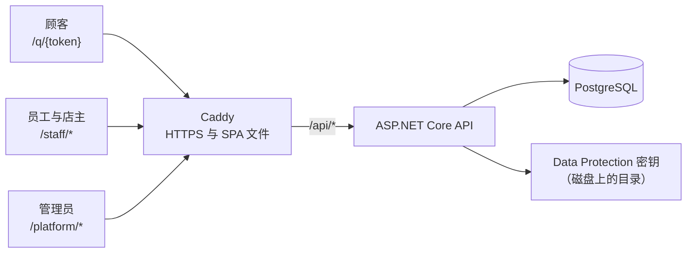
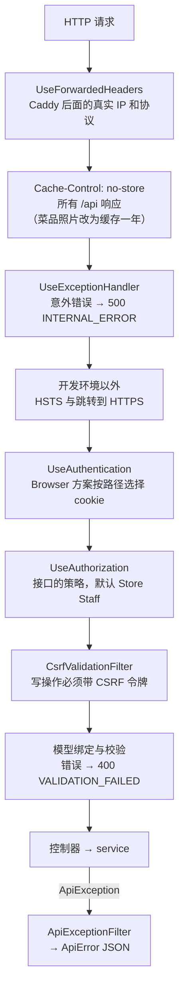
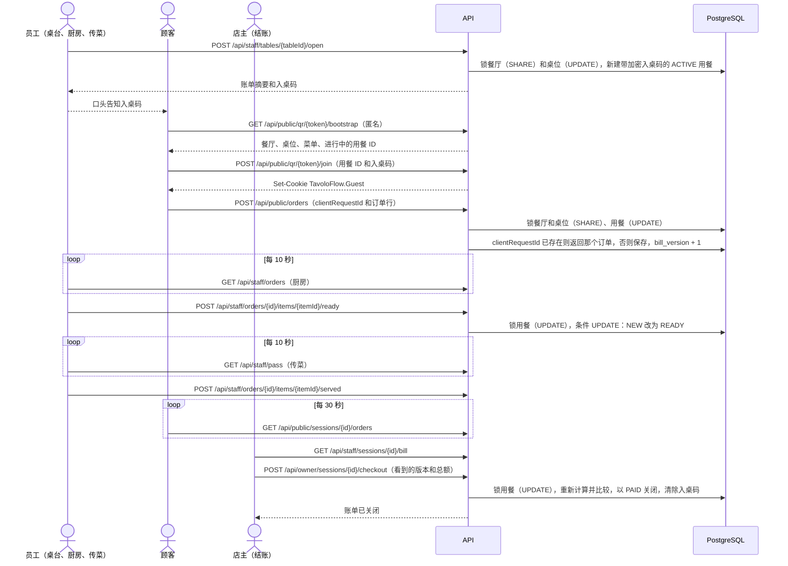
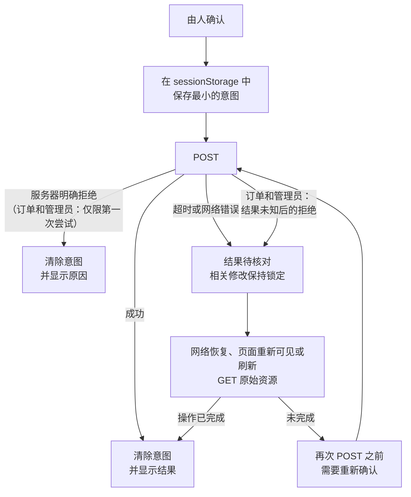

[English](../en/development-notes.md) · [Italiano](../it/development-notes.md) · **中文**

# 开发笔记

在这份笔记里，我讲讲 TavoloFlow 是怎么诞生的、是怎么做出来的：我为什么开发它，它能做什么、不做什么，我选了哪些技术，架构是怎么组织的，做了哪些设计决策，以及我今天看到的局限。它主要是我和 Claude Code、Codex 这样的 AI 智能体一起开发的：我更多参与的是设计和项目方向上的决策，而不是写代码和实现细节。

这是我的第一个全栈 Web 项目。学了几年计算机之后，我意识到自己从来没有真正做过一个 Web 应用，于是决定做一个。但这个决定恰好出现在 AI 时代：一边，我看到 AI 只凭一个简单的提示词就能生成看起来完美的代码；另一边，摆在我面前的是要去学好几个框架，读厚厚的专门书籍或者官方文档。结局可想而知：我决定用 AI 来开发这个项目。

现在回头看，我不觉得这是个问题。之前的学习已经让我打下了理论基础，而学习如何开发项目、如何使用框架，最好的办法恰恰是做一个真实的项目：自己去发现困难，然后问自己（或者问 AI）：「与其手动做这件事，为什么不能有个东西替我做？」框架就是这样诞生的：为了满足真实的需求。它们之所以被设计成某种样子，是因为它们解决了一组以前经常遇到的问题；如果你理解了它们满足的需求和解决的困难，就能更容易、更快地理解这个框架。说到底，框架本身也是由代码构成的产品：只不过它们的「业务逻辑」不是电商网站或管理系统的业务逻辑，而是解决开发某类软件时经常遇到的问题。

所以我面前有三条路。第一条是看一个教程，同时借助 LLM 聊天，对我要做的事情有一个完整的概览，然后通过阅读文档或专门书籍的相关部分，去补上马上用得到的知识。第二条是钻进一个和我想做的东西类似的现成开源项目，边读代码边问 AI，再像第一条路那样，去文档或书里学习对应的部分。但我又问自己：为什么不直接和 AI 一起做一个自己的项目，然后学习我自己的项目呢？在 AI 帮助下开发的项目，代码质量并不会比 GitHub 上随便找到的项目差。为什么不这样做？第三条路就这样诞生了，也就是我选择的那条。

说到这里，我为什么开始写这些笔记也就清楚了：光有输入不够，还得有一些输出。我必须亲自动手，才能巩固记忆、强化神经连接，从而学得更好、更深入。同时也是为了在这个项目里留下一些更属于我自己的东西，让它和一个完全由 AI 生成的项目有所区别。

## 为什么做这个项目

一开始我只是想做一个全栈项目：一个发布到网上、运行在服务器上、有自己数据库、所有人都能访问的 Web 应用，这是我以前从来没做过的。我之前只用过 Vercel、Cloudflare 这类 serverless 服务。不过既然反正要做一个项目，为什么不做一个真正有用的，说不定还能赚点小钱？

于是我想到了扫码点餐系统。经过一次初步的、不太深入的调查，我觉得这是个很好的主意，至少在中餐馆里市场不错，因为很少有餐厅为顾客提供这项服务。一开始我以为，那少数提供扫码点餐的餐厅，用的是收银系统厂商提供的、已经集成在产品里的服务。

直到发布之后我才发现，不提供扫码点餐的餐厅，要么不需要，要么不知道去哪里找供应商：这正是我可以切入的地方。但是我做的这个 Web 应用不支持打印厨房单：订单来了，没法在连接的打印机上打出来。我没做这个功能，一是因为复杂，我知道迟早还得回头去读代码；二是因为和这个应用的工作方式兼容的打印机很贵。它们是云打印机（比如支持 Star CloudPRNT 或 Epson Server Direct Print 的打印机），内置一个系统，定时询问我的服务器有没有新订单；有的话，服务器把订单以打印机能打印的格式返回。手上没有打印机可以测试，我不确定自己能不能把这个功能做出来，结果就失去了我拜访过的大部分客户。

然后，好像这还不够似的，在发现几乎所有潜在客户都需要打印订单之后，我又有了另一个发现：已经提供扫码点餐的餐厅，并不像我一开始以为的那样使用收银系统内置的功能，而是依靠一家叫二维火（2Dfire）的中国 SaaS 公司。综合这一切，我认定这个项目没法再当作收入来源，于是决定把它开源，哈哈。

## 它能做什么

TavoloFlow 是一个堂食扫码点餐系统。每张桌子有一个固定的二维码：顾客用手机扫码，从菜单点餐，订单就送到厨房。付款方式和以前一样，在收银台：应用只记录账单已经收款。一共有四类用户，每类都有自己的那部分应用。

**顾客**，用自己的手机，不用安装任何东西，也不用注册：

- 扫码浏览菜单，可选中文、意大利语或英语，能看到照片、过敏原，以及哪些菜已售罄；
- 加入员工为这张桌开的那一轮用餐，如果餐厅要求，就输入四位入桌码；
- 选菜加入购物车，每道菜都可以写备注，然后下单；用餐过程中可以多次下单；
- 查看整桌的订单和每道菜的状态：已收到、已出餐、已取消。

**员工**，用手机或平板；员工端可以作为应用（PWA）安装：

- **桌台**：查看各桌和账单，顾客到店时开桌并告知入桌码；暂停或恢复新订单；没有订单或所有菜都已取消的桌，可以不收款直接关闭；
- **厨房**：新订单到达时有提示音，每 10 秒刷新一次；可以在「按菜品」（同一道菜合并显示）、「按订单」和「已处理」三个视图里查看；在「按菜品」视图里，每块屏幕可以只显示菜单的部分分类（比如一块屏幕只显示饮品）；把每道菜标为出餐完成，或者取消；
- **传菜**：放在出餐台的平板上，显示要送到各桌的已出餐菜品；菜送到桌上后，点「已送达」；
- **菜单**：把菜品标为售罄，或者恢复供应；
- 界面可以是中文、意大利语或英语，每台设备单独选择；没有人选择之前，跟随浏览器语言。

**店主**：员工能做的都能做，另外还可以：

- 管理菜单：分类、三种语言的菜品、价格、过敏原、照片；
- 管理桌位，下载二维码和可打印的桌卡；
- 在「结账」里收款后关闭这一轮用餐，在「历史账单」里查看已关闭的账单；
- 重置员工账号的密码，查看自己的年费状态。

**平台管理员**，也就是向餐厅提供这项服务的人：

- 创建餐厅以及它的两个账号（店主和员工），附带临时密码；之后可以停用这些账号，或重置它们的密码；
- 暂停或恢复一家餐厅，选择它的配色主题，决定是否需要入桌码，永久删除已暂停的餐厅；
- 管理店主的联系方式、年费和服务期，并登记每个服务期在应用之外收到的付款；
- 管理员界面同样可以是中文、意大利语或英语，和员工一样按设备选择。

## 它不做什么（以及为什么）

- **在线支付。** 处理支付意味着手续费、支付数据安全和退款：对第一个版本来说太多了。
- **税务小票。** TavoloFlow 不替代收银机，也不替代税务收银设备：小票仍然由餐厅的收银系统开具。
- **打印厨房单。** 原因上面已经说了：需要一台兼容的云打印机，而我没有可以测试的打印机。
- **推送通知。** 厨房、传菜和结账页面通过定时询问服务器来更新（轮询）。对小餐厅来说够用，而且简单得多。
- **离线使用。** 应用不在设备上保存页面或数据以便断网时使用：订单和账单必须始终是最新的。如果网络断了，已经打开的页面会显示最后的数据并给出提示，但会阻止操作（比如关闭账单），直到刷新成功；如果在没有网络时打开页面，员工端只会显示一个提示断网的页面。
- **每个服务员的个人账号。** 每家餐厅只有一个共享的员工账号，加上店主账号。对小餐厅来说足够了，也不需要知道是谁做了什么。
- **外带和配送。** 只有堂食订单。支持到店自取订单的版本曾经开发过，后来为了让第一个版本保持简单又去掉了。
- **拆分账单和销售统计。** 每一轮用餐只有一张账单，除了已关闭账单的历史记录，没有其他报表。
- **吃到饱（All you can eat）。** 没有点餐轮次，也没有每人限量：我设想的餐厅（拉面、中餐、奶茶）都是按单点餐。

## 技术栈的选择

其实一开始，我用 TypeScript、Hono 和一个 React SPA 做过这个想法的原型，全部放在 Cloudflare 上，没有自己的数据库，而是用 Cloudflare 提供的（D1），幻想着能把维护成本降到最低。我写了一个很详细的提示词，让 AI 生成了整个项目，但结果对我来说完全看不懂。因为从来没做过项目，我不知道会遇到哪些问题和困难，所以也不知道 AI 引入的那些工具、库和框架分别在解决什么问题。我很快就陷入了认知过载，放弃了；那个原型只用来让我大致了解自己的项目应该变成什么样子。

于是我转向了更稳定的东西。考虑到稳定性和在求职市场上的价值，我想到了 Java 和 C#。两个我都会，但 C# 表达力更强，生态更统一，入门门槛更低，框架也更「开箱即用」（batteries-included）。最后我选择了 C# 和 .NET，也就是后端用 ASP.NET Core 作为 Web 框架，EF Core 作为 ORM，Npgsql 作为 PostgreSQL 的驱动。「开箱即用」在这里体现得很明显：cookie 认证、基于策略的授权、数据保护（Data Protection，用来保护 cookie、加密每一轮用餐的入桌码等）和依赖注入，全部是框架自带的，后端在这些方面没有用任何外部库。限流则用项目自己的内存实现 `Common/FixedWindowLimiter`，没有使用 ASP.NET Core 的限流中间件。除了 Npgsql，唯一的第三方库是 SkiaSharp，用来缩放和转换菜品照片。EF Core 没有提供行锁（`SELECT ... FOR UPDATE`）的 API，所以这些地方我用手写的 SQL。测试方面，我用 xUnit：使用 `PostgreSqlFixture` 的集成测试类会通过 Testcontainers 在 Docker 里启动一个临时 PostgreSQL 实例。HTTP 测试用 `WebApplicationFactory` 在内存中启动 API，像浏览器一样发送请求；数据层测试直接使用 `DbContext`。此外还有不使用数据库的纯逻辑测试。

数据库选 PostgreSQL，只是因为它是使用最广泛的开源数据库，也是最强大的数据库之一。

前端方面，我刚学完 React 的基础，就选了 React，它也很适合这个应用：这基本上是一个 SPA，而且员工端还要作为 PWA 使用。其余的技术栈：

- **TypeScript**，让前端也有类型，在构建阶段就发现错误；
- **Vite**，用于开发服务器和构建；
- **TanStack Router**，用文件定义路由，参数和查询字符串都有类型：指向不存在页面的链接，或者参数写错的链接，都无法编译；
- **TanStack Query**，处理来自服务器的数据：管理缓存，负责厨房和账单的轮询，并在每次修改后重新加载数据；
- **Tailwind CSS** 和 **shadcn/ui**（基于 Base UI），负责样式和组件：shadcn 把组件代码复制到项目里，而不是作为库安装，所以可以随意修改；
- **qrcode**，直接在浏览器里生成桌位二维码；
- **Oxlint** 和 **Prettier**，负责代码检查和格式化；再加上 Node 自带的测试运行器，不用安装测试框架就能测试纯逻辑。

部署方面，我在 VPS 上用 **Docker Compose**，用 **Caddy** 做反向代理，它会自己申请 HTTPS 证书。数据库迁移不在 API 启动时执行：每次发布时，我用 EF Core 的迁移包显式执行。所有步骤都在[自托管](self-hosting.md)指南里。

## 架构

这一节介绍 TavoloFlow 是怎么构成的：有哪些部分，每部分的代码在哪里，数据怎样从一处流到另一处。最重要的那些选择（锁、版本、幂等、轮询……）背后的原因，在下一节「设计决策」里解释。

### 总览



所有请求都经过同一个地址。浏览器只和 Caddy 通信，Caddy 做两件事：

- 返回 SPA 的静态文件，也就是 `vite build` 生成的文件：一个几乎为空的 `index.html`，加上 `assets/` 里的 JavaScript 和 CSS 文件。浏览器下载它们并运行 React，由 React 直接在设备上构建页面：这就是所谓的客户端渲染（CSR）；
- 把所有以 `/api` 开头的请求转发给 API（ASP.NET Core 的 Web 服务器 Kestrel）。

开发时，这个角色由 Vite 的代理承担，它把 `/api` 转发到 `http://localhost:5093`。所以前端和 API 是同源的（协议、域名和端口都相同）：cookie 不需要在不同域名之间传递，也不需要配置 CORS。

简单解释一下 CORS：它是浏览器的一条规则。页面里的 JavaScript 发起请求时，浏览器会比较页面的源（加载 `index.html` 的地方，比如 `https://app.example.com`）和被调用 URL 的源。如果两者相同，就像这里（`https://app.example.com/api/...`），请求就是「同源」的，不涉及 CORS。至于 Caddy 在服务器内部把请求转发给 API，浏览器根本不知道。反过来，如果 API 在另一个域名上，比如 `api.example.com`，服务器就必须返回特定的响应头（`Access-Control-Allow-Origin` 等），否则浏览器会拦截响应，cookie 的处理也会更复杂。

有几点需要记住：

- **一个 API 进程，三类用户。** 同一个 ASP.NET Core 应用同时服务顾客、员工和管理员。每类用户有自己的 cookie，后端通过请求 URL 的路径（域名后面的部分，比如 `/api/public/orders`）判断该用哪一个（见下文「三种身份」）。
- **生产环境有三个容器：** `db`（PostgreSQL）、`api` 和 `caddy`。只有 Caddy 对外开放端口（80 和 443）：数据库和 API 只能从 Docker 的内部网络访问。
- **Data Protection 密钥**保存在一个持久化目录里。Data Protection 是 ASP.NET Core 用来加密和签名数据的系统，这些就是它的密钥。登录 cookie 其实并不指向服务器上保存的会话：它直接包含账号的「票据」（见「三种身份」），用这些密钥加密并签名，所以浏览器既不能读取，也不能伪造。CSRF 令牌（见「Cookie、CSRF 与同源」）和数据库里保存的入桌码，也都用同一套密钥保护。如果密钥只存在容器里，每次发布新版本都会丢失：所有人都得重新登录，正在进行的用餐的入桌码也无法再读取。所以这个目录通过 `DataProtection:KeyRingPath` 指定，放在持久化卷上。

### 数据模型

数据库有十一张表。完整的结构在 [`er-diagram.dbml`](../reference/er-diagram.dbml) 里，也有一张[图片](../reference/er-diagram.png)。按主题分组：

| 分组       | 表                                                                                                                                  |
| ---------- | ----------------------------------------------------------------------------------------------------------------------------------- |
| 账号       | `platform_users`（管理员），`restaurant_users`（每家餐厅一个店主账号和一个员工账号）                                                |
| 餐厅与菜单 | `restaurants`、`menu_categories`、`menu_items`、`menu_item_images`（照片的字节，单独存放，读取菜单时不会加载）、`restaurant_tables` |
| 营业       | `dining_sessions`、`orders`、`order_items`                                                                                          |
| 年费       | `restaurant_subscription_periods`                                                                                                   |

核心概念是**一轮用餐**（`DiningSession`，表 `dining_sessions`）。顾客到店时，员工在桌台页面开桌，就产生一轮 `ACTIVE` 的用餐，带有它自己的（加密的）入桌码和一个账单版本号 `bill_version`。顾客没有账号：对系统来说，顾客只是「一个加入了这轮用餐的浏览器」。

每个订单属于一轮用餐，包含一行或多行（`order_items`），每道菜一行，带数量和可选备注。每一行有自己的状态：创建时是 `NEW`，然后厨房把它改为 `READY`（已出餐）或 `CANCELLED`（已取消）；菜送到桌上时，传菜页面填写 `served_at`。订单还有一个汇总状态：只要还有一行是 `NEW`，订单就是 `NEW`，之后变为 `PROCESSED`（这就是厨房「按订单」和「已处理」两个视图的区别）。

这一轮用餐结束时（收款后，或者没有订单、订单全部取消时不收款直接关闭），状态变为 `CLOSED`，并保存关闭原因（`PAID`、`EMPTY` 或 `VOIDED`）、总金额和关闭时间。已关闭的用餐永远不会重新打开：之后的顾客会有新的一轮用餐。

前端让使用更方便，但不保证任何东西。而且有些规则不只是由 C# 代码检查：数据库直接保证它们，所以即使有一天代码出了 bug，这些规则依然成立。

| 规则                           | PostgreSQL 如何保证                                                                                                                                                                        |
| ------------------------------ | ------------------------------------------------------------------------------------------------------------------------------------------------------------------------------------------ |
| 一张桌最多只有一轮进行中的用餐 | `table_id` 上的部分唯一索引 `uq_active_session_per_table`，只针对 `status = 'ACTIVE'` 的行                                                                                                 |
| 顾客的一次请求最多创建一个订单 | `(dining_session_id, client_request_id)` 上的唯一索引 `uq_order_one_per_request`                                                                                                           |
| 不同餐厅的数据不会混在一起     | 每张业务表都有 `restaurant_id`（`menu_item_images` 除外，它通过所属菜品关联到餐厅），外键是复合的 `(id, restaurant_id)`：订单只能指向同一家餐厅的用餐，订单行只能指向同一家餐厅的订单      |
| 状态和字段始终一致             | 像 `ck_session_lifecycle` 这样的检查约束：`ACTIVE` 的用餐有加密的入桌码、没有关闭数据；`CLOSED` 的用餐有关闭时间、原因和总金额，入桌码已清除；`ck_order_item_lifecycle` 对订单行做同样的事 |
| 只允许合法的值                 | 枚举以大写文本保存（`ACTIVE`、`READY`……），由检查约束列出合法值                                                                                                                            |

不过，订单的历史并不由数据库保护。每一行都保存了菜品名称、价格和过敏原的副本（快照）：之后菜品改价，这一行保持原样。但 PostgreSQL 并不阻止直接对这些副本或已关闭的账单执行 UPDATE：保证它们不被修改的是 service，它们从不修改这些数据。删除菜品或桌位也要经过一个 service，`CatalogDeletionService`：先清空引用（订单行里的 `menu_item_id`，已关闭用餐里的 `table_id`），再删除，副本保留下来。这里数据库只起检查作用：外键不允许删除仍被引用的菜品或桌位。

其他约定：

- **金额用整数欧分表示**（`long`，列名为 `*_cents`），从不用小数。最大值是 JavaScript 能精确表示的最大整数（2⁵³ − 1，`InputRules.MaxSafeCents`），这样浏览器不会丢失精度。
- **时间用 UTC**（`timestamptz`），按餐厅所在时区（Europe/Rome）显示。只有服务期使用普通日期（`date`）。
- **命名用 snake_case**，在 `Data/Configurations/` 里手动映射，每个实体一个类。
- **所有餐厅共用一个数据库**（多租户）：都在同一组表里，用 `restaurant_id` 区分。删除一家餐厅时，用 `ON DELETE CASCADE` 删除它的所有行。
- **迁移**在 `Data/Migrations/` 里，由 EF Core 生成，只能向前；从不在启动时执行（见「技术栈的选择」）。

### 后端：模块与一次请求的路径

后端是一个单独的项目 `backend/TavoloFlow.Api/`，按业务主题组织，而不是按控制器、服务等类型分目录：

| 目录                 | 内容                                                                                                                                              |
| -------------------- | ------------------------------------------------------------------------------------------------------------------------------------------------- |
| `Program.cs`         | 入口：注册服务和中间件管道。带上 `--seed-dev-accounts` 这样的选项时，它会变成一个一次性命令，执行完就退出（`Operations/MaintenanceCommands.cs`）  |
| `Controllers/`       | 14 个文件里的 15 个控制器类，都非常薄                                                                                                             |
| `Common/`            | 跨模块代码：错误格式（`ApiError`、`ApiException` 和全局过滤器）、身份选择与 CSRF（`BrowserSecurity`）、游标分页、枚举的文本表示、输入规则和限流器 |
| `Accounts/`          | 店主和员工的登录、登出与修改密码                                                                                                                  |
| `Menus/`             | 菜单管理、供应状态、菜品照片、公开菜单的读取                                                                                                      |
| `Tables/`            | 桌位与二维码令牌                                                                                                                                  |
| `Dining/`            | 开桌、桌台、加密的入桌码、共享的账单摘要、暂停新订单                                                                                              |
| `Guests/`            | 顾客加入用餐，以及顾客的 cookie                                                                                                                   |
| `Ordering/`          | 幂等的订单创建和整桌订单                                                                                                                          |
| `Kitchen/`           | 厨房队列、出餐或取消、传菜                                                                                                                        |
| `Billing/`           | 账单、三种关闭方式（`PAID`、`VOIDED`、`EMPTY`）、历史账单                                                                                         |
| `Platform/`          | 管理员后台：餐厅、账号、年费                                                                                                                      |
| `Data/`、`Entities/` | `ApplicationDbContext`、EF Core 的映射和迁移、行锁（`RowLocks`）、删除服务；11 个实体                                                             |

每个模块都有一个 `XxxContracts.cs` 文件，里面是 DTO（进出 API 的数据）和错误工厂，比如 `DiningErrors.SessionClosed()`；另外还有一个或多个包含规则和事务的 service。

模块之间的依赖只有一个方向，并且沿着一轮用餐的流程：`Guests` 使用 `Dining`；`Ordering` 使用 `Guests` 和 `Dining`；`Kitchen` 使用 `Ordering` 和 `Dining`；`Billing` 使用 `Dining` 和 `Kitchen`（只是为了在账单响应里复用订单格式）；`Platform` 使用 `Accounts`。`Common/` 不依赖任何业务模块。

**薄控制器。** 控制器只做三件事：声明谁可以调用这个接口，取得可信的身份，然后调用 service。比如把一道菜标为出餐完成：

```csharp
[ApiController]
[Authorize(Policy = StoreAuthentication.StaffPolicy)]
public sealed class KitchenController(KitchenService kitchen, CurrentAccount current) : ControllerBase
{
    [HttpPost("api/staff/orders/{id:guid}/items/{itemId:guid}/ready")]
    public async Task<IActionResult> Ready(Guid id, Guid itemId, CancellationToken ct) =>
        Ok(await kitchen.ReadyAsync(current.RequireUser().RestaurantId, id, itemId, ct));
}
```

餐厅 ID 从不来自客户端：它来自 cookie，通过 `CurrentAccount` 取得。所以员工即使改了 URL 里的 ID，也碰不到别家餐厅的数据：service 查找订单时也会按餐厅过滤，找不到就返回 404。

service 注册为 scoped：每个请求有自己的实例，共享这个请求的 `DbContext`。每个 service 自己打开和关闭自己的事务，并且从注入的 `TimeProvider` 读取时间，而不是用 `DateTime.UtcNow`，这样就可以在测试中推进时间。

**一次请求的路径。** 下面是一次请求依次经过的环节，顺序就是 `Program.cs` 组装它们的顺序：



- **认证。** 读取路径所属身份的 cookie，构建 `HttpContext.User`。对员工和管理员，还会到数据库里重新检查账号（`ValidatePrincipal`，见「三种身份」）。
- **授权。** 每个控制器都声明一个策略：`StoreStaff`、`StoreOwner`、`StoreAccount`（首次修改密码之前也有效，只用于操作自己账号的接口）、`GuestAccess` 或 `PlatformAdmin`。没有 `[Authorize]` 的接口会落到后备策略，也就是 Store Staff：即使忘了声明，新接口也受到保护。登录、公开菜单、加入用餐和获取 CSRF 令牌，都显式地用 `[AllowAnonymous]` 开放。401 和 403 响应由 cookie 事件写出，发生在 MVC 过滤器之前，但格式是同样的 JSON。
- **CSRF。** `CsrfValidationFilter` 注册在所有控制器上：每个 POST、PUT、PATCH 和 DELETE 请求都必须带上由同一身份获取的 `X-CSRF-TOKEN` 请求头，否则返回 400 `CSRF_VALIDATION_FAILED`（见「Cookie、CSRF 与同源」）。
- **错误。** service 通过抛出带有 HTTP 状态码、错误码和消息的 `ApiException` 来拒绝请求。全局的 `ApiExceptionFilter` 总是把它转换成同样的 JSON：

  ```json
  {
    "code": "SESSION_CLOSED",
    "message": "本次用餐已结束。",
    "requestId": "0HN…:00000001",
    "errors": null
  }
  ```

  有些错误码会附加字段：比如 `BILL_CHANGED` 还带有 `currentBill`，即更新后的账单。服务器的消息是中文的；在意大利语和英语界面里，前端不显示它们，而是根据 `code` 选择文本（`lib/api-messages.ts`）。

### 前端：功能的组织方式

前端（`frontend/src/`）是一个 SPA，分为三个区域，每类用户一个：`/q/{token}` 给顾客，`/staff/*` 给店主和员工，`/platform/*` 给管理员。

**路由。** 使用 TanStack Router 时，路由就是 `routes/` 里的文件，文件名就是 URL：`staff.kitchen.tsx` 对应 `/staff/kitchen`，`q.$token.tsx` 对应带 `token` 参数的 `/q/{token}`。Vite 插件根据这些文件生成 `routeTree.gen.ts`，这个文件不手动修改。`staff.tsx` 和 `platform.tsx` 是布局路由：它们包裹各自区域的所有页面（员工端的 `StaffLayout` 显示导航，并让这个区域可以作为 PWA 安装）。路由文件保持得非常薄，马上交给对应的功能模块：

```tsx
export const Route = createFileRoute("/staff/kitchen")({
  component: KitchenPage,
});
```

**功能模块。** 真正的代码在 `features/` 里，产品的每个部分一个目录：

| 功能            | 页面                                                         |
| --------------- | ------------------------------------------------------------ |
| `public-menu`   | 顾客菜单，`/q/{token}`                                       |
| `guests`        | 顾客用入桌码加入用餐                                         |
| `orders`        | 购物车、下单、整桌订单                                       |
| `accounts`      | 登录、修改密码、首页、导航、PWA 安装                         |
| `dining`        | 桌台，`/staff/floor`                                         |
| `kitchen`       | 厨房，`/staff/kitchen`                                       |
| `pass`          | 传菜，`/staff/pass`                                          |
| `billing`       | 结账，`/staff/orders`；历史账单，`/staff/history`            |
| `menu`          | 菜单，`/staff/menu`                                          |
| `tables`        | 桌位与二维码，`/staff/tables`                                |
| `subscriptions` | 店主的年费页面 `/staff/subscription`，以及管理员后台的服务期 |
| `platform`      | 管理员后台 `/platform/*`，以及员工账号 `/staff/settings`     |

每个功能模块的结构大致相同：

- `api.ts`：这个功能所有的服务器调用、查询键和响应类型。组件和 hook 从不自己写 URL；
- `state.ts`：纯逻辑，不依赖 React 和浏览器 API（校验、购物车规则、网络错误后的恢复），用 `node --test` 测试；
- `use<Feature>.ts`：负责轮询、在页面隐藏或离线时暂停、丢弃迟到响应的 hook；
- `*Page.tsx` 和 `*Views.tsx`：渲染；
- `messages.ts`：界面文本，每种语言（中文、意大利语和英语）一个对象。每种语言的类型都和中文对象相同，所以缺少翻译时项目无法编译。

共享代码在 `lib/`（包含请求函数的 `api.ts`、价格和时间格式、语言、主题……）、`components/`（页面的通用部件：`PageHeader`、`Notice`、`ConfirmDialog`、`MasterDetail`……）和 `components/ui/`（shadcn/ui 组件）里。

**数据放在哪里。** 前端有三种状态，各有各的位置：

| 类型           | 位置                | 例子                             |
| -------------- | ------------------- | -------------------------------- |
| 服务器数据     | TanStack Query 缓存 | 菜单、桌台、厨房队列、账单       |
| 标签页内的意图 | `sessionStorage`    | 购物车、等待确认的操作的标识符   |
| 设备偏好       | `localStorage`      | 界面语言、厨房提示音和隐藏的分类 |

每个查询键的第一段说明数据属于哪个身份：`public`（匿名菜单）、`guest`、`platform`、`["auth", "me"]`（员工身份）；其他一律算作餐厅的私有数据。员工登录或登出时，`lib/query-scope.ts` 只清空员工的缓存，同一标签页里打开的顾客或管理员数据保留不动。

### 三种身份：员工、顾客、平台

同一个浏览器可以同时拥有最多三种身份，比如店主在自己的手机上试用顾客菜单。每种身份有自己的 cookie，互不干扰：

| 身份     | 是谁       | API 路径                  | Cookie                                      | 有效期                         | 后端中                   |
| -------- | ---------- | ------------------------- | ------------------------------------------- | ------------------------------ | ------------------------ |
| Store    | 店主和员工 | 除下面两项外的所有 `/api` | `TavoloFlow.Store`，路径 `/`                | 固定 30 天，关闭浏览器后仍保留 | `CurrentAccount`         |
| Guest    | 桌边的顾客 | `/api/public/*`           | `TavoloFlow.Guest`，路径 `/api/public`      | 固定 12 小时，关闭浏览器即消失 | `GuestIdentity`          |
| Platform | 管理员     | `/api/platform/*`         | `TavoloFlow.Platform`，路径 `/api/platform` | 固定 30 天，关闭浏览器后仍保留 | `CurrentPlatformAccount` |

没有任何 cookie 会因为使用而自动续期：过期后必须重新登录（顾客则是重新加入用餐）。它们都是 `HttpOnly` 的，JavaScript 读不到。

**路径决定身份。** 这一切都基于一个函数 `BrowserSecurity.SchemeFor(path)`：

```csharp
public static string SchemeFor(PathString path) =>
    path.StartsWithSegments("/api/platform") ? PlatformScheme :
    path.StartsWithSegments("/api/public") ? GuestScheme : StoreScheme;
```

有两处用到它：

1. 默认的认证方案 `Browser` 不读取任何 cookie：它看路径，把请求交给对应的方案（Store、Guest 或 Platform），由那个方案读取自己的 cookie 并构建 `HttpContext.User`。
2. CSRF：每个令牌都绑定到申请时所用路径对应的身份（`store`、`guest` 或 `platform`），所以以顾客身份拿到的令牌，不能用于员工的写操作。

cookie 的路径也有帮助：浏览器只在 `/api/public` 下的请求里发送 Guest cookie，只在 `/api/platform` 下发送 Platform cookie。

**cookie 里有什么，哪些会被重新检查。**

- Store 和 Platform：cookie 里有账号 ID、角色和凭据版本（`credential_version`），员工还有餐厅 ID。每次请求时，`ValidatePrincipal` 都会从数据库重新读取账号：如果账号被停用，或者版本变了（修改或重置了密码），cookie 就被拒绝。所以修改密码会让其他所有设备立刻退出登录。
- Guest：cookie 里有餐厅、桌位和这一轮用餐，加上每次加入时生成的一个随机标识符，CSRF 令牌就绑定在它上面。它只证明「这个浏览器加入过这轮用餐」；这轮用餐是否仍在进行，由顾客的每个 service 在每次请求时检查。用餐关闭后，cookie 还留在浏览器里，但每个请求都会返回 `SESSION_CLOSED`。

**在前端**，`lib/api.ts` 为每种身份准备了一组函数：员工用 `request`/`write`，匿名读取（不带 cookie，比如公开菜单）用 `publicRequest`，顾客用 `guestRequest`/`guestWrite`，管理员用 `platformRequest`/`platformWrite`。每次写操作之前，都会先向自己身份的 `csrf` 接口申请一个新的 CSRF 令牌，并放在 `X-CSRF-TOKEN` 请求头里发送。

为什么用 cookie 而不是 JWT，以及 CSRF 保护怎么工作，我在「Cookie、CSRF 与同源」里解释。

### 一次用餐的完整流程

为了看清各部分如何协作，下面是一轮用餐从开桌到结账的全过程，以需要入桌码的餐厅为例：



1. **开桌。** 员工在桌台页面开桌。后端以共享模式锁住餐厅那一行，以排他模式锁住桌位那一行，检查这张桌没有进行中的用餐，然后创建带加密入桌码的新一轮用餐。如果餐厅不使用入桌码，响应里是 `joinCode: null`。
2. **引导（bootstrap）。** 顾客扫码。`/q/{token}` 页面不带任何 cookie，在一个 Repeatable Read 事务里读取餐厅、桌位、菜单和进行中的用餐 ID。bootstrap 不创建任何东西，也从不泄露入桌码。
3. **加入。** 顾客输入入桌码（如果餐厅不要求，页面会自动加入）。入桌码正确时，后端返回绑定到这轮用餐的 Guest cookie。按 IP 和按用餐的限流可以防止暴力猜测入桌码。
4. **下单。** 前端生成一个 `clientRequestId`，把它和订单一起存进 `sessionStorage`，然后才发送 POST。后端加锁之后，先查找有没有相同 ID 的订单：有就直接返回。否则检查餐厅是否接单、菜品是否有货、价格是否变了，然后在同一个事务里保存订单和菜品副本，并把 `bill_version` 加一。
5. **厨房与传菜。** 厨房每 10 秒询问一次服务器，有新订单时播放提示音。把菜标为出餐完成，是在用餐锁之下执行的条件 UPDATE（`WHERE status = 'NEW'`）；之后在传菜页面用同样的方式设置 `served_at`。顾客每 30 秒看到一次菜品状态的更新。
6. **结账。** 店主确认账单时，发送自己看到的版本和总额。后端锁住这轮用餐，重新计算一切；如果期间有变化，就返回 `409 BILL_CHANGED` 并附上更新后的账单。如果全部一致，就以 `PAID` 关闭这轮用餐，保存总额，清除入桌码，并把仍在传菜页面等待的已出餐菜品标为已送达。从这一刻起，顾客的 cookie 就没用了：它的每个请求都会返回 `SESSION_CLOSED`。

每一步的细节（为什么是这些锁、为什么要 `clientRequestId`、为什么要 `bill_version`、为什么用轮询），我在「设计决策」里解释。

## 设计决策

这一节解释最重要的技术选择背后的原因。几乎所有选择都在回答两个问题：两个人在同一时刻做某件事会怎样？操作进行到一半网络断了会怎样？在餐厅里这两种情况一直在发生：好几个服务员和好几位顾客同时使用应用，而 Wi-Fi 并不总是好的。

### 并发：行锁与加锁顺序

**问题。** 两个服务员在同一瞬间对同一张桌点「确认开桌」；店主结账时，顾客正好下了一单；店主修改某道菜的价格时，顾客正在点这道菜。如果每个请求都是先读数据、再做决定、最后写入，两个并行的请求可能都读到旧状态，做出互相冲突的决定，比如在同一张桌上开出两轮用餐。

**选择：PostgreSQL 的行锁。** 在事务里做决定之前，service 先锁住决定所依赖的那些行：

- `SELECT ... FOR SHARE`（共享锁）：其他事务也可以拿同样的共享锁，但在本事务结束前，谁都不能修改这一行，也不能对它加排他锁；
- `SELECT ... FOR UPDATE`（排他锁）：先等这一行上的其他锁释放，然后阻止任何人修改它或对它加锁，哪怕只是共享锁。

普通的读取（不加锁）不会被阻塞：借助 MVCC，PostgreSQL 会给它们看这一行最新的已提交版本。

EF Core 没有用于这些锁的 LINQ API，所以我用 `FromSql` 写 SQL，它会把插值的值转换成参数，因此不会有 SQL 注入。餐厅、桌位、用餐和菜品上的锁集中在一个文件 `Data/RowLocks.cs` 里，加锁顺序写在文件开头，方便检查（账号上的少数几个锁直接写在平台的 service 里）：

```csharp
db.DiningSessions.FromSql(
    $"SELECT * FROM dining_sessions WHERE restaurant_id = {restaurantId} AND id = {id} FOR UPDATE")
    .AsNoTracking().SingleOrDefaultAsync(ct);
```

锁一直持有到事务结束：这就是为什么每个 service 都自己打开和关闭自己的事务。

**加锁顺序。** 如果事务 A 锁住了桌位，然后等待用餐；而事务 B 已经锁住了用餐，在等待桌位，两者都无法继续：这就是死锁。PostgreSQL 会发现并中止其中一个，但对用户来说仍然是一个错误。为了避免这种情况，所有操作都按同样的顺序加锁：

```
餐厅 → 桌位 → 用餐          餐厅 → 菜品
```

每个操作只取这条链上的一段，而且总是沿着这个方向：从用餐开始加锁的操作，绝不会回头再去锁桌位或餐厅。

| 操作                         | 加锁顺序                                   |
| ---------------------------- | ------------------------------------------ |
| 开桌                         | 餐厅 SHARE → 桌位 UPDATE                   |
| 加入用餐（顾客）             | 餐厅 SHARE → 桌位 SHARE → 用餐 SHARE       |
| 下单                         | 餐厅 SHARE → 桌位 SHARE → 用餐 UPDATE      |
| 读取整桌订单或账单           | 用餐 SHARE                                 |
| 出餐或取消、「已送达」、结账 | 只有用餐 UPDATE                            |
| 修改菜单                     | 餐厅 UPDATE（删除菜品时，再加菜品 UPDATE） |
| 暂停新订单、暂停餐厅、年费   | 餐厅 UPDATE                                |
| 重命名、启用或删除桌位       | 桌位 UPDATE                                |

为什么下单时要以 SHARE 锁住餐厅？修改菜单的操作会以 UPDATE 锁住餐厅，所以在下单过程中，谁都不能改价格或供应状态，复制进订单的价格正是刚刚检查过的价格。而来自不同桌的两个订单都只拿 SHARE 锁：它们互相兼容，可以并行。

下单、厨房操作和结账都以 UPDATE 锁住同一轮用餐，所以在同一轮用餐上它们会排队。如果订单先到，结账会发现账单变了（`BILL_CHANGED`，见下文）；如果结账先到，订单会发现用餐已关闭（`SESSION_CLOSED`）。

**条件 UPDATE 作为第二道防线。** 厨房把一道菜标为出餐完成时，service 先锁住用餐，重新读取这一行，然后不是简单地「保存」：它执行一个只在这一行仍为 `NEW` 时才生效的 UPDATE，并检查改动了几行（简化自 `KitchenService` 的代码）：

```csharp
var changed = await db.OrderItems
    .Where(i => i.RestaurantId == restaurantId && i.OrderId == id && i.Id == itemId &&
        i.Status == OrderItemStatus.New)
    .ExecuteUpdateAsync(u => u.SetProperty(i => i.Status, OrderItemStatus.Ready)
        .SetProperty(i => i.ReadyAt, now), ct);
if (changed != 1) throw Changed(); // 409 ORDER_ITEM_CHANGED
```

有了用餐锁，对同一道菜的第二个请求总会排在后面，并发现它已经是 `READY`。UPDATE 里的条件是为了防止将来某条写入路径忘了加锁：即使那样，也不会有人覆盖别人的结果。最终的决定权在数据库手里，靠的是「数据模型」里提到的唯一索引和检查约束。

**怎么测试。** 两个请求之间的竞争，不能靠碰运气来复现。在集成测试（`KitchenTests.cs`）里有一个 `LockGate`，它是 EF Core 的 `DbCommandInterceptor` 的子类，可以让一个事务停在某个精确的位置；同时测试发出另一个请求，检查它是否按预期等待或被拒绝。

其他可选方案是 Serializable 隔离级别（PostgreSQL 检测到冲突时需要重试事务），或者在每张表上加乐观版本号。而用显式的锁，读代码就能看懂事件的先后顺序，也不需要重试任何东西。

### 账单的乐观版本（BillVersion）

**问题。** 店主打开某张桌的账单，看到 45 欧元，走向收银台。与此同时，一位顾客又点了一杯饮料，或者厨房取消了一道菜。店主确认时，关闭的账单必须正好是店主看到并收款的那一份。这里光靠锁不够：我不能在一个人盯着屏幕的整段时间里，一直锁着数据库的某一行。

**选择：乐观版本。** 每轮用餐都有一个 `bill_version`，从 1 开始，每当金额发生变化就加 1：新订单，或者取消一道菜。菜品变为出餐完成或已送达时不变，用同一个 `clientRequestId` 重复提交同一订单时不变，结账时也不变。

前端会冻结确认框里显示的版本和总额（轮询会更新屏幕，但不会悄悄替换要确认的值），并在结账时把它们发出去：

```json
{ "expectedBillVersion": 7, "confirmedTotalCents": 4500 }
```

后端以 UPDATE 锁住这轮用餐，根据数据库里的订单行重新计算账单并比较。如果版本或总额不同，就返回 `409 BILL_CHANGED` 并附上更新后的账单 `currentBill`：前端显示它，店主必须重新确认。其实只靠版本就足以发现变化；总额是店主真正确认过的值，再比较一次是额外的检查。之后还有其他检查，比如没有还在等待制作的菜（`ORDERS_PENDING`），以及收款结账时总额必须大于零。全部通过后，这轮用餐关闭。

如果同一个结账请求再次到达一轮已关闭的用餐（同样的原因、同样的版本、同样的总额），后端会返回保存的结果，而不是报错；而一个不同的结账请求，则不能改写已保存的结果。

两种技术互相补充：悲观锁保护事务的那几毫秒，乐观版本保护一个人做决定的那几秒或几分钟。

### 幂等的订单

**问题。** 顾客在信号很弱的 Wi-Fi 下点「确认并下单」。请求到达了服务器，订单也保存了，但响应在路上丢了。手机显示错误，顾客再点一次，厨房就收到了两份同样的订单。

**选择：让创建订单变成幂等的**，也就是让重复同一个请求的效果和只发一次相同。

1. 浏览器生成一个 `clientRequestId`，这是用 `crypto.getRandomValues` 生成的 UUID v4（`lib/ids.ts`）。和 `crypto.randomUUID` 不同，它在没有 HTTPS 时也能用，比如我在局域网里测试应用时。
2. 浏览器先把完整的订单和 ID 一起存进 `sessionStorage`，然后才发送 POST。从这一刻起，购物车被锁定，直到知道结果为止。
3. 后端加锁、并确认这轮用餐仍在进行且与 cookie 一致之后，**首先**在这轮用餐里查找相同 ID 的订单：

   ```csharp
   var original = await Orders(guest).SingleOrDefaultAsync(o => o.ClientRequestId == input.ClientRequestId, ct);
   if (original is not null)
   {
       await transaction.CommitAsync(ct);
       return new(OrderResponse.From(original), false); // 200：订单已存在
   }
   // 只在第一次请求时：暂停接单、供应状态、价格、保存（201）
   ```

   检查的顺序很重要。如果重复的请求也重新检查价格和供应，那么一位在菜品售罄之后重试的顾客就会收到错误，尽管这位顾客的订单早已存在、已经在厨房里了。

4. `(dining_session_id, client_request_id)` 上的唯一索引 `uq_order_one_per_request` 是最后的保障：即使代码有 bug，数据库也不会接受同一个 ID 的第二个订单。

前端从不自动重发 POST。结果未知时，它用一个 GET 查找订单（`/api/public/sessions/{id}/orders/by-request/{requestId}`）；顾客可以用「核对下单结果」再查一次，或者点「重试原订单」，用同一个 ID、完全相同的内容重新发送。始终由顾客来决定。

### 结果未知的写操作：只用 GET 恢复

订单的问题适用于每一个写操作：开桌、标记出餐、结账、创建餐厅。网络断了，或者超时了，结果就是未知的：写操作可能成功了，也可能没有。超时并不是自动的：只有使用 `withTimeout`（`lib/api.ts`）的操作才会在 15 秒后停止等待（`REQUEST_TIMEOUT_MS`），也就是桌台、厨房、传菜、结账、年费和顾客端（下单和加入用餐）的操作；修改菜单，以及管理员对餐厅和账号的操作，不使用它。

对最敏感的写操作，我都用同一种模式：桌台的开桌和暂停新订单、厨房的出餐或取消、结账、顾客下单，以及管理员对餐厅和账号的操作。



顾客订单和管理员操作更加谨慎。如果某个请求的结果已经是未知的，那么重试被拒绝并不能证明第一个请求失败了：意图保留，对订单来说购物车也保持锁定。另外，在第一次尝试时，订单只在遇到它认识的拒绝时才释放意图，比如 `MENU_CHANGED` 或 `ORDERING_PAUSED`（`orders/state.ts` 里的 `submissionFailure`）。即使 GET 返回 404，对订单来说也只意味着「还没找到」：第一个 POST 可能晚些时候才到达服务器。

最小的意图包含标识符、操作类型，以及必要时已确认的目标值，保存在一个包含餐厅和账号的键下，比如 `tavoloflow:kitchen:{restaurantId}:{userId}`。例如，厨房保存订单 ID、订单行 ID 和「出餐」；桌台页面保存开桌用的 `tableId`，或接单开关的 `enabled`。只有购物车保存完整的订单，因为重试必须发送相同的内容。

**为什么只用 GET。** GET 不改变任何东西，所以想重复多少次都可以。而自动重复的 POST 可能把同一件事做两遍，比如把刚关闭的桌又开一次。所以结果未知时，前端只读取原始资源的状态；如果操作看起来没有完成，必须由人重新确认。

**为什么用 `sessionStorage`。** 它只在一个标签页内有效，标签页关闭就消失，所以两个标签页不会互相干扰。标记只保存操作所需的最少数据；购物车的完整订单是例外。绝不保存密码或入桌码。

这个模式有三个例外：

- 顾客的订单，可以用同一个 ID 手动重试，因为后端是幂等的（见上文）；
- 管理员后台里的年费写操作，什么都不保存：每次写操作都带着之前读到的年费版本，所以每个版本最多只能被一次实际改变状态的写操作消耗。不改变任何值的保存可以成功多次，而且不会递增版本。结果未知时，重新读取，再重新确认；
- 传菜页面的「已送达」，什么都不保存：UPDATE 只对已出餐且尚未送达的菜生效，所以重复执行没有害处，刷新后的列表自然会显示写操作是否成功。

其他写操作（菜单和照片、桌位、登录和密码）不保存任何意图。比如在菜单和桌位页面，响应丢失时表单内容会保留，页面会提示你先重新读取列表、检查之后再重试。

在厨房和账单关闭流程里，当页面被隐藏、网络断开或用户变化时，进行中的请求会用 `AbortController` 中止，迟到的响应会被丢弃。桌台页面有所不同：失去可见性或连接时会隐藏入桌码，但不会因此中止写操作；只要组件仍然挂载，就仍可能接收其结果。组件卸载时会中止请求；开桌和接单开关的等待还会在 15 秒后超时。

### 用轮询而不是 WebSocket

**选择。** 厨房、传菜、桌台和结账页面不接收服务器的通知：它们用 TanStack Query 的 `refetchInterval` 定时询问服务器。

| 页面                         | 间隔  |
| ---------------------------- | ----- |
| 厨房、传菜                   | 10 秒 |
| 桌台、结账、整桌订单（顾客） | 30 秒 |
| 年费提醒                     | 60 秒 |

页面隐藏或设备离线时轮询停止，页面重新可见时恢复。

**为什么够用。** 小餐厅的设备不多，对厨房来说 10 秒的延迟可以接受。作为交换，轮询比 WebSocket 或 SignalR 简单得多：不用维护一直打开的连接，断开后也不用重连，代理不需要特殊配置，而且每个请求都是普通的 GET，照常经过认证和各种规则。网络中断后，下一次轮询就能把一切同步回来。

**轻量的读取。** 因为这些请求不断重复，它们只读取进行中的用餐，从不统计或扫描一家餐厅的历史。要知道是否有新东西到达，一个「水位线」（watermark）就够了：最新订单的时间（`latestCreatedAt`）或最新出餐菜品的时间（`latestReadyAt`），从索引的一端读取。当水位线比上一次读取时前进了，厨房或传菜页面就播放提示音（`lib/live-view.ts` 里的 `watermarkAdvanced`）。第一次加载和页面重新可见时，读取只作为基准，不播放提示音。

**写之前先拿到新鲜数据。** 一个好一阵没刷新的页面显示的是旧数据，基于旧数据做决定是危险的，比如关闭一张期间已经变化的账单。在厨房、传菜和账单确认中，如果最后一次成功刷新已经达到 30 秒，或者发生在页面最近一次回到前台之前（`syncIsFresh`），写操作就会被阻止。但提示只在阻止持续达到 3 秒后才出现，离线或最近一次请求失败时则立即出现（`syncIsStalled`）：这样正常的刷新不会让提示一闪一闪。年费页面每 60 秒刷新一次，使用的是 90 秒的新鲜度阈值。这些检查是各功能自己的规则：桌台页面不会用 `syncIsFresh` 来决定是否允许开桌或切换接单。

对厨房和传菜页面来说，代价是最多 10 秒的延迟，以及请求数量随开着的设备数量增长（见「当前的局限」）。

### Cookie、CSRF 与同源

**为什么用 cookie 而不是 JWT。** SPA 里常见的做法是把 JWT 令牌存进 `localStorage`，再手动放进请求头。我更喜欢 ASP.NET Core 的认证 cookie：

- 它们是 `HttpOnly` 的：JavaScript 读不到，所以即使有恶意脚本注入页面（XSS），也偷不走它们拿去别处用；
- 浏览器会自动发送它们，前端和 API 同源时，不需要任何配置；
- 它们可以被撤销：多亏每次请求都检查 `credential_version`（见「三种身份」），修改或重置密码、停用账号，都会让所有旧 cookie 立刻失效。JWT 通常不查数据库就能验证，要在过期前撤销它，本来就需要在服务器上检查：那样它最大的优势也就没了。

固定的有效期、不自动续期（见「三种身份」里的表格），是可以预期的：丢失的平板最晚 30 天后失效，修改密码则立即失效。

**cookie 的代价：CSRF。** 正因为浏览器会自动附带 cookie，别的网站就可能钻这个空子：店主打开的某个恶意页面里，可能藏着一个表单，向 `https://app.example.com/api/...` 发送 POST，而浏览器会附带上店主的登录 cookie。这就叫跨站请求伪造（CSRF）。防御有两道：

1. 登录 cookie 设置了 `SameSite=Lax`：浏览器不会在来自其他网站的 POST 请求里附带它们。
2. ASP.NET Core 的防伪令牌（antiforgery token）。每次写操作之前，前端都会向自己身份的 `csrf` 接口申请一个新令牌，并通过 `X-CSRF-TOKEN` 请求头发回去：这会多一次请求，但可以避免在登录、登出或切换身份之后用到旧令牌。服务器会把它和防伪 cookie（`TavoloFlow.Csrf`，`HttpOnly` 且 `SameSite=Strict`）以及当前用户进行比对。别的网站读不到包含令牌的响应，因为浏览器的同源策略不允许，所以它无法构造一个有效的请求。此外，每个令牌只对申请它的那个身份有效（`BrowserCsrfScope`，见「三种身份」）。

检查由 `CsrfValidationFilter` 完成，它是全局注册的，因为 `AddControllers` 本身不会对 JSON 请求验证令牌：这样即使是新接口，不做任何事也会受到保护。

### 员工端 PWA

**为什么用 PWA 而不是原生应用。** 员工用的是手机和平板，往往是餐厅里已有的设备。原生应用意味着更多代码（Android 和 iOS）、要发布到应用商店，以及每台设备都要安装更新。用 PWA，同一套 React 代码就成了可安装的应用：主屏幕上有图标，全屏窗口，而且更新不用经过应用商店，下次打开或刷新应用时就送到每个人手上。不过，已经打开的页面会继续使用之前的版本：所以服务器会保留所有版本的 JavaScript 和 CSS 文件（见[自托管](self-hosting.md#发布新版本)）。

**只有 `/staff`。** manifest（`/staff.webmanifest`）没有在 `index.html` 里引用：只有 `StaffLayout` 引用它，同时注册作用域为 `/staff` 的 service worker `/sw.js`。这样，在 `/q/*` 上只扫一次码的顾客，浏览器永远不会提示他们安装应用。manifest 的 `id`、`start_url` 和 `scope` 都是不带结尾斜杠的 `/staff`，因为路由会去掉 URL 末尾的斜杠，而页面必须留在作用域之内。

**一个什么都不缓存的 service worker。** service worker 只处理页面加载：总是先尝试网络，只有加载失败时才显示内置的离线页面。它不使用 Cache Storage，其他所有请求（包括 `/api`）都交给浏览器处理。我放弃了离线使用，但永远不用担心缓存里留着旧数据或旧版本的应用，而这是 PWA 最常见的问题之一。我保留 service worker 是为了离线页面：没有它，断网时打开应用只会看到浏览器的错误页。至于安装，如今已经不再需要它：[Chrome 当前的标准](https://web.dev/articles/install-criteria)在提示安装时不要求 service worker。

**安装之后能得到什么：**

- 在用 Chrome 安装的应用里（Android 或电脑上），厨房和传菜页面可以直接播放提示音，无需先点击屏幕：浏览器的自动播放规则允许已安装的应用这样做；
- 有一个开关可以保持屏幕常亮（Screen Wake Lock API），对厨房的平板很有用；
- 在 iOS 上，已安装的应用没有浏览器的返回按钮，所以标签栏以外的页面都有一个返回链接（`PageHeader`）。

推送通知（Web Push）我推迟了：它需要 VAPID 密钥，以及在后端保存设备订阅，而目前轮询就够了。

### 其他取舍

- **开桌不是幂等的。** 和下单不同，开桌没有请求 ID。如果响应丢失，前端会重新读取桌台，由员工决定是否再开一次；对同一张桌的第二次开桌会收到 `SESSION_ALREADY_ACTIVE`，而唯一索引无论如何都保证每张桌只有一轮进行中的用餐。剩下的风险，是我在第一个版本里有意接受的：一个很旧的请求在很久之后才到达，那时这张桌已经结账，于是开出了一轮没人想要的用餐，之后得不收款把它关掉。如果实际使用中经常发生，我会给开桌也加一个请求 ID。对订单或账单来说，这样的风险是不可接受的，这正是那里有 `clientRequestId` 和 `bill_version` 的原因。
- **菜单：最后一次修改为准。** 如果店主在两台设备上编辑同一道菜，以最后一次保存为准，没有冲突提示。这不严重，因为重要的部分由下单来把关：后端总会重新检查价格和供应状态，有变化时返回 `MENU_CHANGED`，并附上变化的列表。
- **用自己的错误格式，而不是 ProblemDetails。** ASP.NET Core 支持一种标准的错误格式（ProblemDetails，RFC 9457），但前端已经围绕 `code` 字段构建好了。用一个过滤器生成所有错误，比改用标准格式成本更低；不过对公开 API 来说，标准格式仍然是更正确的选择。
- **年费没有历史记录。** 最初的设计里有一张年费事件表，记录修改历史、给店主的通知，以及每个操作的防重复 ID。后来发现，仅靠 `subscription_version` 就足以防止两次修改消耗同一个版本，我就把它删掉了。我失去了历史记录，但第一个版本并不需要它。

## 局限，以及如果重来我会怎么做

### 当前的局限

- **为单实例设计。** 限流器（`FixedWindowLimiter`）把计数器放在内存里：每次重启都会清零，如果有多个 API 实例，每个实例各算各的。要扩展，就需要一个共享的存储，比如 Redis 或者 PostgreSQL 本身。
- **入桌码很短。** 从 32 个字符的字母表里取四个字符，大约有一百万种组合（2²⁰）。防止有人猜中它，靠的只有按 IP 和按用餐的限流：真正面向公众使用之前，应该重新评估，也许改用更长的码。
- **轮询。** 服务器的负载随开着的设备数量增长：如果餐厅很多，就值得改用 WebSocket 或 Server-Sent Events。
- **测试。** 后端有 150 多个集成测试，运行在 Docker 里真实的 PostgreSQL 上；前端只有用 `node --test` 运行的纯逻辑测试。仓库里缺少组件测试和端到端测试，也没有 CI：每次发布前手动运行测试。
- **错误消息是中文的。** 前端把错误码翻译成意大利语和英语的那张表（`lib/api-messages.ts`，见「后端：模块与一次请求的路径」），需要手动和后端保持同步。
- **手工的发布流程。** 只有一台 VPS，手动运行发布脚本，备份交给一个 systemd 定时器，没有任何监控或告警系统：服务器停了，只有在有人抱怨时我才会发现。
- **前端有些地方很复杂。** 对结果未知情况的处理（比如 `useCart` 里）非常稳健，但对第一个版本来说，读起来和维护起来都很沉重。

### 如果重来我会怎么做

- **写代码之前先和餐厅聊。** 我只做了一次快速调查就评估了这个想法，直到发布之后才发现，几乎所有人都想打印厨房单，而已经提供扫码点餐的餐厅都在用二维火（见「为什么做这个项目」）。开始之前多拜访几家店，我就会从一开始设计打印功能，或者干脆改变主意。
- **更早发布，功能更少。** 我加了一些第一个版本并不需要的东西：到店自取功能开发了又删掉，年费事件表也删掉了。一个更小、更早摆到客户面前的产品，能更早给我那些真正重要的信息。
- **从第一天就配置 CI。** 一个在每次 push 时运行后端测试、前端构建、代码检查和测试的 GitHub Action 成本很低，也能让我不用再记着手动去做这些。
