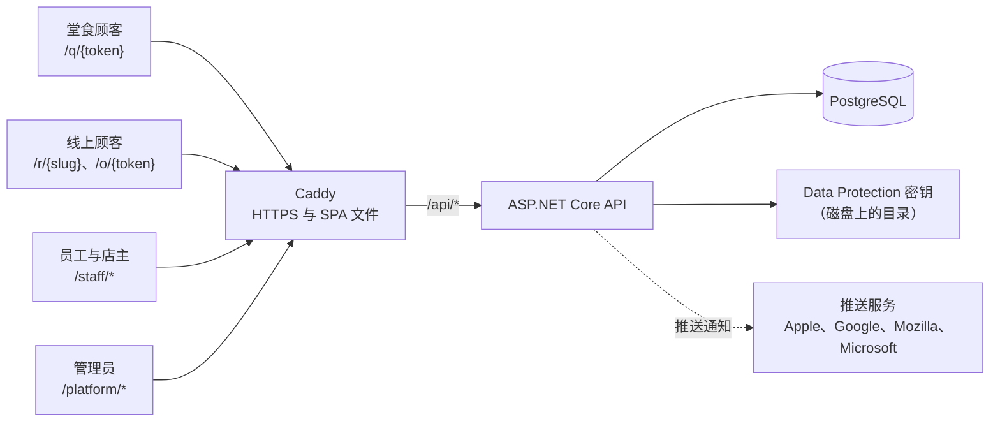
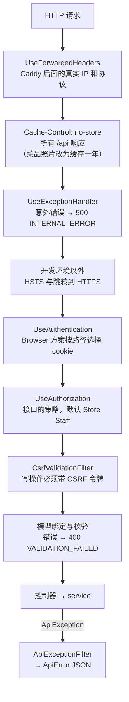
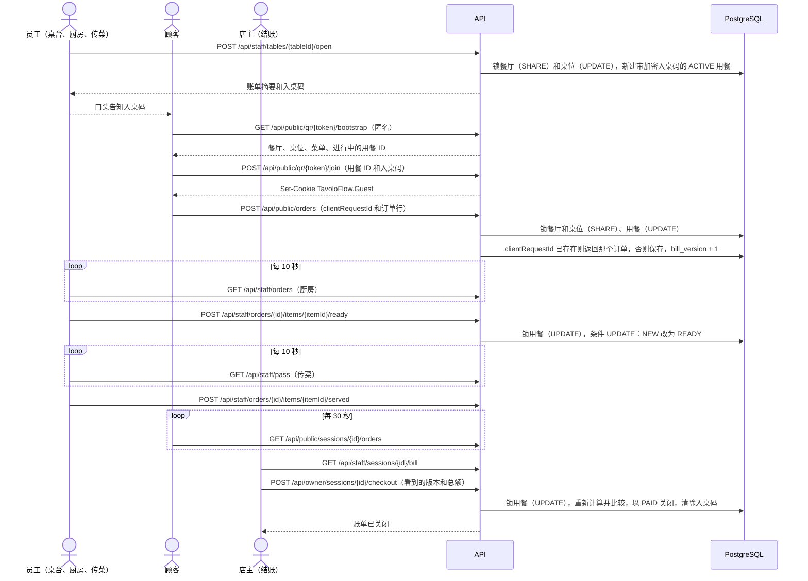
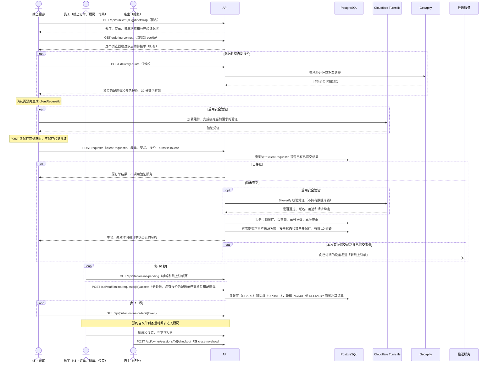
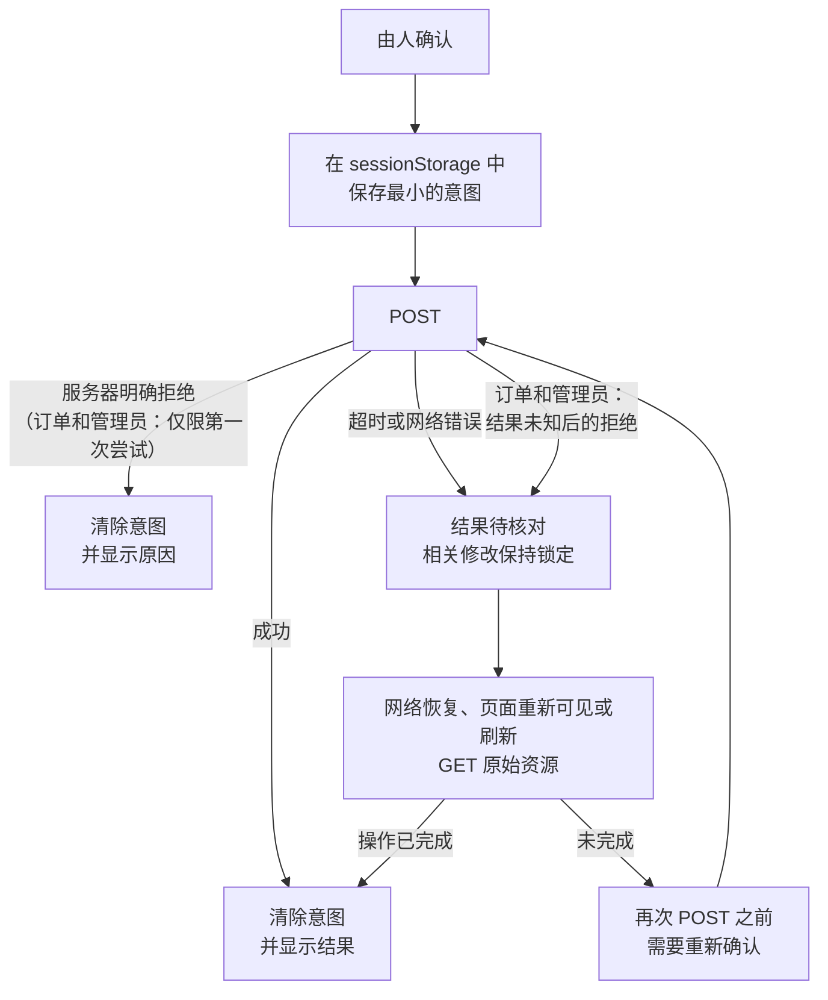

[English](../en/development-notes.md) · [Italiano](../it/development-notes.md) · **中文**

# 开发笔记

在这份笔记里，我讲讲 TavoloFlow 是怎么诞生的、是怎么做出来的：我为什么开发它，它能做什么、不做什么，我选了哪些技术，架构是怎么组织的，做了哪些设计决策，以及我今天看到的局限。它主要是我和 Claude Code、Codex 这样的 AI 智能体一起开发的：我更多参与的是设计和项目方向上的决策，而不是写代码和实现细节。

这是我的第一个全栈 Web 项目。学了几年计算机之后，我意识到自己从来没有真正做过一个 Web 应用，于是决定做一个。但这个决定恰好出现在 AI 时代：一边，我看到 AI 只凭一个简单的提示词就能生成看起来完美的代码；另一边，摆在我面前的是要去学好几个框架，读厚厚的专门书籍或者官方文档。结局可想而知：我决定用 AI 来开发这个项目。

现在回头看，我不觉得这是个问题。之前的学习已经让我打下了理论基础，而学习如何开发项目、如何使用框架，最好的办法恰恰是做一个真实的项目：自己去发现困难，然后问自己（或者问 AI）：「与其手动做这件事，为什么不能有个东西替我做？」框架就是这样诞生的：为了满足真实的需求。它们之所以被设计成某种样子，是因为它们解决了一组以前经常遇到的问题；如果你理解了它们满足的需求和解决的困难，就能更容易、更快地理解这个框架。说到底，框架本身也是由代码构成的产品：只不过它们的「业务逻辑」不是电商网站或管理系统的业务逻辑，而是解决开发某类软件时经常遇到的问题。

所以我面前有三条路。第一条是看一个教程，同时借助 LLM 聊天，对我要做的事情有一个完整的概览，然后通过阅读文档或专门书籍的相关部分，去补上马上用得到的知识。第二条是钻进一个和我想做的东西类似的现成开源项目，边读代码边问 AI，再像第一条路那样，去文档或书里学习对应的部分。但我又问自己：为什么不直接和 AI 一起做一个自己的项目，然后学习我自己的项目呢？在 AI 帮助下开发的项目，代码质量并不会比 GitHub 上随便找到的项目差。为什么不这样做？第三条路就这样诞生了，也就是我选择的那条。

说到这里，我为什么开始写这些笔记也就清楚了：光有输入不够，还得有一些输出。我必须亲自动手，才能巩固记忆、强化神经连接，从而学得更好、更深入。同时也是为了在这个项目里留下一些更属于我自己的东西，让它和一个完全由 AI 生成的项目有所区别。

## 为什么做这个项目

一开始我只是想做一个全栈项目：一个发布到网上、运行在服务器上、有自己数据库、所有人都能访问的 Web 应用，这是我以前从来没做过的。我之前只用过 Vercel、Cloudflare 这类 serverless 服务。不过既然反正要做一个项目，为什么不做一个真正有用的，说不定还能赚点小钱？

于是我想到了扫码点餐系统。经过一次初步的、不太深入的调查，我觉得这是个很好的主意，至少在中餐馆里市场不错，因为很少有餐厅为顾客提供这项服务。一开始我以为，那少数提供扫码点餐的餐厅，用的是收银系统厂商提供的、已经集成在产品里的服务。

直到发布之后我才发现，不提供扫码点餐的餐厅，要么不需要，要么不知道去哪里找供应商：这正是我可以切入的地方。但是我做的这个 Web 应用不支持打印厨房单：订单来了，没法在连接的打印机上打出来。我没做这个功能，一是因为复杂，我知道迟早还得回头去读代码；二是因为和这个应用的工作方式兼容的打印机很贵。它们是云打印机（比如支持 Star CloudPRNT 或 Epson Server Direct Print 的打印机），内置一个系统，定时询问我的服务器有没有新订单；有的话，服务器把订单以打印机能打印的格式返回。手上没有打印机可以测试，我不确定自己能不能把这个功能做出来，所以应用目前还没有这个功能，尽管我拜访过的几乎每家餐厅都需要它。

然后，好像这还不够似的，在发现几乎所有潜在客户都需要打印订单之后，我又有了另一个发现：已经提供扫码点餐的餐厅，并不像我一开始以为的那样使用收银系统内置的功能，而是依靠一家中国的 SaaS 公司。综合这一切，我决定把它开源，让它也能对别人有用，但并没有把它下线：我仍在 [qiaotavoloflow.it](https://qiaotavoloflow.it) 为不想自己管服务器的餐厅提供托管服务。

## 它能做什么

TavoloFlow 是一个堂食扫码点餐系统，也可以接收线上订单。每张桌子有一个固定的二维码：顾客用手机扫码，从菜单点餐，订单就送到厨房。不在店里的顾客则通过餐厅的线上链接下单，到店自取，或者在餐厅提供配送时送到家。员工必须先接线上单，预约自取单会在选定的备餐时间进入厨房。这是两项独立的服务：平台管理员按餐厅开通，也可以只开其中一项。付款方式和以前一样，在收银台、取餐或送达时付款：应用只记录账单已经收款。一共有四类用户，每类都有自己的那部分应用。

**顾客**，用自己的手机，不用安装任何东西，也不用注册：

- 扫码浏览菜单，可选中文、意大利语或英语，能看到照片、过敏原，以及哪些菜已售罄；减价的菜会在折后价上方显示划掉的原价；
- 加入员工为这张桌开的那一轮用餐，如果餐厅要求，就输入四位入桌码；
- 有选项的菜品（杯型、甜度、小料、辣度……）先在面板里选好：必选项从不预选，加价自动计入价格；
- 选菜加入购物车，每道菜都可以写备注，然后下单；用餐过程中可以多次下单；
- 查看整桌的订单和每道菜的状态：已收到、已出餐、已取消；
- 如果餐厅开通了线上点单，也可以在家通过餐厅的链接（`/r/{链接}`）下单：菜单和选项都一样，然后点「去结账」，选择到店自取或配送，配送时先填地址，再填姓名、电话。选配送时能看到按距离分档的配送费和起送金额；如果餐厅用自动报价，填好地址后点「计算配送费」就能看到准确的配送费。这里还可以输入餐厅的优惠码：有效的话，马上能看到菜品的优惠和新的合计。如果店主开启了预约自取，顾客可以在结账时按店主设定的范围选择可用日期和取餐时间。配送单接单后尽快制作；
- 在订单状态页（`/o/{token}`）查看线上订单：等待餐厅确认、已接单并显示预计或约定的时间、可以取餐，最后订单已完成。如果餐厅 10 分钟内没有回应，订单就会失效，页面会把餐厅电话放在最显眼的位置。

**员工**，用手机或平板；员工端可以作为应用（PWA）安装：

- **桌台**（和桌位一样，只在开通扫码堂食时才有）：查看各桌和账单，顾客到店时开桌并告知入桌码。可以暂停全店的顾客扫码点餐，员工仍可为已开桌的桌位代客点餐。账单明细标明哪些订单由员工代点。没有订单或所有菜都已取消的桌，可以不收款直接关闭；
- **厨房**：新订单到达时有提示音，每 10 秒刷新一次；可以在「按菜品」（同一道菜合并显示）、「按订单」和「已处理」三个视图里查看；每块屏幕会重新打开上次在「按菜品」和「按订单」之间的选择，在「按菜品」视图里还可以只显示菜单的部分分类（比如一块屏幕只显示饮品）；每道菜下方显示顾客选的选项；把每道菜标为出餐完成，或者取消；已进入备餐环节的线上订单和堂食订单显示在一起，名称是「自取 #12」或「配送 #12」；
- **传菜**：放在出餐台的平板上，显示要送到各桌的已出餐菜品；菜送到桌上后，点「已送达」；
- **菜单**：把菜品或单个选项（比如卖完的小料）标为售罄，或者恢复供应；
- **线上订单**：即时订单接单时选择预计多久做好，预约自取则选择提前多久开始备餐。没有报价的配送单，先用「路线」按钮查看路程并选档位。员工也可以拒单（原因可选），或在开始备餐前取消已接单的预约。只要还有订单等待接单，每个员工页面顶部都会显示一条会响铃的横幅。这里也能看到已经接单、还没关闭的订单，以及顾客的电话和地址；
- 在**线上点单设置**页暂停线上接单，可以暂停到本时段结束，或者今天不再接单；
- 在首页为每台设备开启新线上订单的**锁屏通知**；
- 界面可以是中文、意大利语或英语，每台设备单独选择；没有人选择之前，跟随浏览器语言。

**店主**：员工能做的都能做，另外还可以：

- 管理菜单：分类、三种语言的菜品、价格、过敏原、照片，以及多道菜共用的选项组（杯型、甜度、小料、辣度……），可设加价和选项自己的过敏原，有已译成三种语言的模板；新建选项组也可以从复制一个现有的组开始。套餐就是带必选选项组的一道菜（比如「选一款饮料」），这些组的选项可以直接从菜品添加，一次可以勾选好几道：名称和过敏原只复制一次，所以之后菜品再改，选项也保持原样。可以给菜品设折后价，堂食和线上都有效，清空就恢复原价；
- 管理桌位，下载二维码和可打印的桌卡；
- 在「结账」里收款后关闭这一轮用餐，在「历史账单」里查看已关闭的账单；
- 在「结账」里也关闭线上订单：收款后点「已取餐，核对收款」或「已送达，核对收款」，或者选「顾客未取餐」「未送达」；订单关闭之前可以修改配送费；
- 在**线上点单设置**页填写公开电话、每周营业时间（每天最多两个时段）、预约自取的提前量、最远可约日期和配送规则。配送可以设置餐厅坐标、最多五个路程档位、各档位免配送费门槛、全店起送金额及三语配送说明；创建和删除线上点单的**优惠券**：菜品按百分比减价（1% 到 50%），可设最后有效日，券码可以发到 Instagram、传单或外卖袋里；
- 重置员工账号的密码，查看自己的年费状态。

**平台管理员**，也就是向餐厅提供这项服务的人：

- 创建餐厅以及它的两个账号（店主和员工），附带临时密码；之后可以停用这些账号，或重置它们的密码；
- 暂停或恢复一家餐厅，选择它的配色主题，决定是否需要入桌码，永久删除已暂停的餐厅；
- 为每家餐厅开通扫码堂食、线上点单或两者都开，并设置线上链接（`/r/…`）；
- 管理店主的联系方式、年费和服务期，并登记每个服务期在应用之外收到的付款；
- 管理员界面同样可以是中文、意大利语或英语，和员工一样按设备选择。

## 它不做什么（以及为什么）

- **在线支付。** 处理支付意味着手续费、支付数据安全和退款：对第一个版本来说太多了。
- **税务小票。** TavoloFlow 不替代收银机，也不替代税务收银设备：小票仍然由餐厅的收银系统开具。
- **打印厨房单。** 原因上面已经说了：需要一台兼容的云打印机，而我没有可以测试的打印机。
- **厨房、传菜和结账的推送通知。** 这些页面通过定时询问服务器来更新（轮询）。对小餐厅来说够用，而且简单得多。唯一的推送通知是新线上订单的提醒，因为它在手机锁屏时也要送到（见「员工端 PWA」）。
- **离线使用。** 应用不在设备上保存页面或数据以便断网时使用：订单和账单必须始终是最新的。如果网络断了，已经打开的页面会显示最后的数据并给出提示，但会阻止操作（比如关闭账单），直到刷新成功；如果在没有网络时打开页面，员工端只会显示一个提示断网的页面。
- **每个服务员的个人账号。** 每家餐厅只有一个共享的员工账号，加上店主账号。对小餐厅来说足够了，也不需要知道是谁做了什么。
- **通过外部平台配送。** 线上订单已经支持到店自取和餐厅自己配送，但不接入 Glovo、Deliveroo 这类平台，不支持在线支付。顾客在取餐或送达时付款。自取可预约，配送费按店主定的路程档位收取（见「按路程计算配送费」）。外带的第一个版本曾经开发过，后来为了让第一个版本保持简单又去掉了；现在的版本是从头重新设计的。
- **会员积分和按顾客发放的优惠。** 优惠码是公开分享的：知道券码的人都能用，次数不限。没有顾客账号，就没办法做到“每人一次”或“仅限首单”（电话没有验证，30 天后还会被清除）。堂食没有优惠码：堂食的折扣和以前一样，在收银时给。
- **拆分账单和销售统计。** 每一轮用餐只有一张账单，除了已关闭账单的历史记录，没有其他报表。
- **吃到饱（All you can eat）。** 没有点餐轮次，也没有每人限量：我设想的餐厅（拉面、中餐、奶茶）都是按单点餐。

## 技术栈的选择

其实一开始，我用 TypeScript、Hono 和一个 React SPA 做过这个想法的原型，全部放在 Cloudflare 上，没有自己的数据库，而是用 Cloudflare 提供的（D1），幻想着能把维护成本降到最低。我写了一个很详细的提示词，让 AI 生成了整个项目，但结果对我来说完全看不懂。因为从来没做过项目，我不知道会遇到哪些问题和困难，所以也不知道 AI 引入的那些工具、库和框架分别在解决什么问题。我很快就陷入了认知过载，放弃了；那个原型只用来让我大致了解自己的项目应该变成什么样子。

于是我转向了更稳定的东西。考虑到稳定性和在求职市场上的价值，我想到了 Java 和 C#。两个我都会，但 C# 表达力更强，生态更统一，入门门槛更低，框架也更「开箱即用」（batteries-included）。最后我选择了 C# 和 .NET，也就是后端用 ASP.NET Core 作为 Web 框架，EF Core 作为 ORM，Npgsql 作为 PostgreSQL 的驱动。「开箱即用」在这里体现得很明显：cookie 认证、基于策略的授权、数据保护（Data Protection，用来保护 cookie、加密每一轮用餐的入桌码等）和依赖注入，全部是框架自带的，后端在这些方面没有用任何外部库。限流则用项目自己的内存实现 `Common/FixedWindowLimiter`，没有使用 ASP.NET Core 的限流中间件。除了 Npgsql，第三方库只有两个：SkiaSharp，用来缩放和转换菜品照片；Lib.Net.Http.WebPush，用来签名和加密推送通知（见「员工端 PWA」）。EF Core 没有提供行锁（`SELECT ... FOR UPDATE`）的 API，所以这些地方我用手写的 SQL。测试方面，我用 xUnit：使用 `PostgreSqlFixture` 的集成测试类会通过 Testcontainers 在 Docker 里启动一个临时 PostgreSQL 实例。HTTP 测试用 `WebApplicationFactory` 在内存中启动 API，像浏览器一样发送请求；数据层测试直接使用 `DbContext`。此外还有不使用数据库的纯逻辑测试。C# 代码用 CSharpier 格式化，它相当于 C# 的 Prettier。

数据库选 PostgreSQL，只是因为它是使用最广泛的开源数据库，也是最强大的数据库之一。

前端方面，我刚学完 React 的基础，就选了 React，它也很适合这个应用：这基本上是一个 SPA，而且员工端还要作为 PWA 使用。其余的技术栈：

- **TypeScript**，让前端也有类型，在构建阶段就发现错误；
- **Vite**，用于开发服务器和构建；
- **TanStack Router**，用文件定义路由，参数和查询字符串都有类型：指向不存在页面的链接，或者参数写错的链接，都无法编译；
- **TanStack Query**，处理来自服务器的数据：管理缓存，负责厨房和账单的轮询，并在每次修改后重新加载数据；
- **Tailwind CSS** 和 **shadcn/ui**（基于 Base UI），负责样式和组件：shadcn 把组件代码复制到项目里，而不是作为库安装，所以可以随意修改；
- **qrcode**，直接在浏览器里生成桌位二维码；
- **Oxlint** 和 **Prettier**，负责代码检查和格式化；再加上 Node 自带的测试运行器，不用安装测试框架就能测试纯逻辑。

部署方面，我在 VPS 上用 **Docker Compose**，用 **Caddy** 做反向代理，它会自己申请 HTTPS 证书。数据库迁移不在 API 启动时执行：每次发布时，我用 EF Core 的迁移包显式执行。所有步骤都在[自托管](self-hosting.md)指南里。

## 架构

这一节介绍 TavoloFlow 是怎么构成的：有哪些部分，每部分的代码在哪里，数据怎样从一处流到另一处。最重要的那些选择（锁、版本、幂等、轮询……）背后的原因，在下一节「设计决策」里解释。

### 总览



所有请求都经过同一个地址。浏览器只和 Caddy 通信，Caddy 做两件事：

- 返回 SPA 的静态文件，也就是 `vite build` 生成的文件：一个几乎为空的 `index.html`，加上 `assets/` 里的 JavaScript 和 CSS 文件。浏览器下载它们并运行 React，由 React 直接在设备上构建页面：这就是所谓的客户端渲染（CSR）；
- 把所有以 `/api` 开头的请求转发给 API（ASP.NET Core 的 Web 服务器 Kestrel）。

开发时，这个角色由 Vite 的代理承担，它把 `/api` 转发到 `http://localhost:5093`。所以前端和 API 是同源的（协议、域名和端口都相同）：cookie 不需要在不同域名之间传递，也不需要配置 CORS。

简单解释一下 CORS：它是浏览器的一条规则。页面里的 JavaScript 发起请求时，浏览器会比较页面的源（加载 `index.html` 的地方，比如 `https://app.example.com`）和被调用 URL 的源。如果两者相同，就像这里（`https://app.example.com/api/...`），请求就是「同源」的，不涉及 CORS。至于 Caddy 在服务器内部把请求转发给 API，浏览器根本不知道。反过来，如果 API 在另一个域名上，比如 `api.example.com`，服务器就必须返回特定的响应头（`Access-Control-Allow-Origin` 等），否则浏览器会拦截响应，cookie 的处理也会更复杂。

有几点需要记住：

- **一个 API 进程，三类用户。** 同一个 ASP.NET Core 应用同时服务顾客（堂食和线上）、员工和管理员。每类用户有自己的 cookie，后端通过请求 URL 的路径（域名后面的部分，比如 `/api/public/orders`）判断该用哪一个（见下文「三种身份」）。
- **生产环境有三个容器：** `db`（PostgreSQL）、`api` 和 `caddy`。只有 Caddy 对外开放端口（80 和 443）：数据库和 API 只能从 Docker 的内部网络访问。
- **唯一的对外调用。** API 不依赖外部服务，只有一个例外：新线上订单的推送通知，由 API 发给 Apple、Google、Mozilla 或 Microsoft 的推送服务。即使通知没有送到，应用也照常工作。
- **Data Protection 密钥**保存在一个持久化目录里。Data Protection 是 ASP.NET Core 用来加密和签名数据的系统，这些就是它的密钥。登录 cookie 其实并不指向服务器上保存的会话：它直接包含账号的「票据」（见「三种身份」），用这些密钥加密并签名，所以浏览器既不能读取，也不能伪造。CSRF 令牌（见「Cookie、CSRF 与同源」）和数据库里保存的入桌码，也都用同一套密钥保护。如果密钥只存在容器里，每次发布新版本都会丢失：所有人都得重新登录，正在进行的用餐的入桌码也无法再读取。所以这个目录通过 `DataProtection:KeyRingPath` 指定，放在持久化卷上。

### 数据模型

数据库有二十张表。完整的结构在 [`er-diagram.dbml`](../reference/er-diagram.dbml) 里，也有一张[图片](../reference/er-diagram.png)。按主题分组：

| 分组       | 表                                                                                                                                                                                                                                               |
| ---------- | ------------------------------------------------------------------------------------------------------------------------------------------------------------------------------------------------------------------------------------------------ |
| 账号       | `platform_users`（管理员），`restaurant_users`（每家餐厅一个店主账号和一个员工账号）                                                                                                                                                             |
| 餐厅与菜单 | `restaurants`、`menu_categories`、`menu_items`、`menu_item_images`（照片的字节，单独存放，读取菜单时不会加载）、`menu_option_groups` 和 `menu_options`（多道菜共用的选项）、`menu_item_option_groups`（哪道菜用哪个选项组）、`restaurant_tables` |
| 营业       | `dining_sessions`、`orders`、`order_items`                                                                                                                                                                                                       |
| 线上点单   | `online_hours`（每周营业时间）、`online_counters`（每天最后一个单号）、`online_requests`（顾客提交、等待接单的订单）、`online_coupons`（优惠券）、`delivery_tiers`（配送档位）                                                                                                                             |
| 通知       | `push_subscriptions`（接收锁屏通知的设备）                                                                                                                                                                                                       |
| 年费       | `restaurant_subscription_periods`                                                                                                                                                                                                                |

核心概念是**一轮用餐**（`DiningSession`，表 `dining_sessions`）。顾客到店时，员工在桌台页面开桌，就产生一轮 `ACTIVE` 的用餐，带有它自己的（加密的）入桌码和一个账单版本号 `bill_version`。顾客没有账号：对系统来说，顾客只是「一个加入了这轮用餐的浏览器」。

有了线上点单之后，一轮用餐还有一个**渠道**（`channel`）：`DINE_IN` 是堂食，`PICKUP` 和 `DELIVERY` 是到店自取和配送的线上订单。线上的一轮用餐在员工接单时才产生，没有桌位也没有入桌码，只有一张订单；配送单还有配送费（`delivery_fee_cents`）。接单之前，顾客的订单只是 `online_requests` 里的一行（见「线上订单：先接单，再进厨房」）；如果顾客接受了自动报价，这一行还保存配送费和路程（`delivery_fee_cents`、`delivery_distance_meters`），接单时这笔配送费会带进这轮用餐。

每个订单属于一轮用餐，包含一行或多行（`order_items`），每道菜一行，带数量和可选备注。每一行有自己的状态：创建时是 `NEW`，然后厨房把它改为 `READY`（已出餐）或 `CANCELLED`（已取消）；菜送到桌上时，传菜页面填写 `served_at`。订单还有一个汇总状态：只要还有一行是 `NEW`，订单就是 `NEW`，之后变为 `PROCESSED`（这就是厨房「按订单」和「已处理」两个视图的区别）。

这一轮用餐结束时（收款后，或者没有订单、订单全部取消时不收款直接关闭），状态变为 `CLOSED`，并保存关闭原因（`PAID`、`EMPTY` 或 `VOIDED`；线上订单还有 `NO_SHOW`，即顾客没来取餐或没能送达）、总金额和关闭时间。已关闭的用餐永远不会重新打开：之后的顾客会有新的一轮用餐。

前端让使用更方便，但不保证任何东西。而且有些规则不只是由 C# 代码检查：数据库直接保证它们，所以即使有一天代码出了 bug，这些规则依然成立。

| 规则                           | PostgreSQL 如何保证                                                                                                                                                                        |
| ------------------------------ | ------------------------------------------------------------------------------------------------------------------------------------------------------------------------------------------ |
| 一张桌最多只有一轮进行中的用餐 | `table_id` 上的部分唯一索引 `uq_active_session_per_table`，只针对 `status = 'ACTIVE'` 的行                                                                                                 |
| 顾客的一次请求最多创建一个订单 | `(dining_session_id, client_request_id)` 上的唯一索引 `uq_order_one_per_request`；线上订单是 `(restaurant_id, client_request_id)` 上的 `uq_online_request_client_request`                  |
| 不同餐厅的数据不会混在一起     | 每张业务表都有 `restaurant_id`（`menu_item_images` 除外，它通过所属菜品关联到餐厅），外键是复合的 `(id, restaurant_id)`：订单只能指向同一家餐厅的用餐，订单行只能指向同一家餐厅的订单      |
| 状态和字段始终一致             | 像 `ck_session_lifecycle` 这样的检查约束：`ACTIVE` 的用餐有加密的入桌码、没有关闭数据；`CLOSED` 的用餐有关闭时间、原因和总金额，入桌码已清除；`ck_order_item_lifecycle` 对订单行做同样的事 |
| 渠道决定哪些字段必须有         | `ck_session_dine_in` 和 `ck_session_online`：堂食用餐一定有桌名（进行中时还有桌位和入桌码），线上用餐永远没有桌位和入桌码；`ck_session_delivery_fee`：配送单一定有配送费，其他渠道一定没有 |
| 配送一定有出发点               | `ck_restaurant_delivery_ready`：开启配送时餐厅一定有坐标；至少有一个档位由保存设置时检查，因为档位在另一张表里 |
| 只允许合法的值                 | 枚举以大写文本保存（`ACTIVE`、`READY`……），由检查约束列出合法值                                                                                                                            |

不过，订单的历史并不由数据库保护。每一行都保存了菜品名称、价格和过敏原的副本（快照）：之后菜品改价，这一行保持原样。顾客选的选项也一样：这一行把它们存进 `options_snapshot`（一个 jsonb 列），包括选项组名、选项名和加价。这一行的单价已经包含加价（菜品减价时从折后价算起），所以账单始终是单价 × 数量；保存的过敏原是菜品的加上所选选项的。线上请求也把菜品保存成副本，放在 jsonb 列 `lines` 里；员工接单时，由唯一的一个函数（`OrderLineSnapshot.ToOrderItem`）把它转换成订单的行。但 PostgreSQL 并不阻止直接对这些副本或已关闭的账单执行 UPDATE：保证它们不被修改的是 service，它们从不修改这些数据。删除菜品或桌位也要经过一个 service，`CatalogDeletionService`：先清空引用（订单行里的 `menu_item_id`，已关闭用餐里的 `table_id`），再删除，副本保留下来。这里数据库只起检查作用：外键不允许删除仍被引用的菜品或桌位。

其他约定：

- **金额用整数欧分表示**（`long`，列名为 `*_cents`），从不用小数。最大值是 JavaScript 能精确表示的最大整数（2⁵³ − 1，`InputRules.MaxSafeCents`），这样浏览器不会丢失精度。
- **时间用 UTC**（`timestamptz`），按餐厅所在时区（Europe/Rome）显示。只有服务期和线上订单所属的营业日（`business_date`）使用普通日期（`date`）。
- **命名用 snake_case**，在 `Data/Configurations/` 里手动映射，每个实体一个类。
- **所有餐厅共用一个数据库**（多租户）：都在同一组表里，用 `restaurant_id` 区分。删除一家餐厅时，用 `ON DELETE CASCADE` 删除它的所有行。
- **迁移**在 `Data/Migrations/` 里，由 EF Core 生成，只能向前；从不在启动时执行（见「技术栈的选择」）。

### 后端：模块与一次请求的路径

后端是一个单独的项目 `backend/TavoloFlow.Api/`，按业务主题组织，而不是按控制器、服务等类型分目录：

| 目录                 | 内容                                                                                                                                                                                               |
| -------------------- | -------------------------------------------------------------------------------------------------------------------------------------------------------------------------------------------------- |
| `Program.cs`         | 入口：注册服务和中间件管道。带上 `--seed-dev-accounts` 这样的选项时，它会变成一个一次性命令，执行完就退出（`Operations/MaintenanceCommands.cs`）                                                   |
| `Controllers/`       | 19 个文件里的 20 个控制器类，都非常薄                                                                                                                                                              |
| `Common/`            | 跨模块代码：错误格式（`ApiError`、`ApiException` 和全局过滤器）、身份选择与 CSRF（`BrowserSecurity`）、游标分页、枚举的文本表示、输入规则和限流器                                                  |
| `Accounts/`          | 店主和员工的登录、登出（同时删除这台设备的通知订阅）与修改密码                                                                                                                                     |
| `Menus/`             | 菜单管理、供应状态、菜品照片、选项组（`MenuOptionService`）、公开菜单的读取；所有菜单写入都经过同一个锁（`MenuWrites`）                                                                            |
| `Tables/`            | 桌位与二维码令牌                                                                                                                                                                                   |
| `Dining/`            | 开桌、桌台、加密的入桌码、共享的账单摘要、暂停新订单                                                                                                                                               |
| `Guests/`            | 顾客加入用餐，以及顾客的 cookie                                                                                                                                                                    |
| `Ordering/`          | 幂等的订单创建、所选选项的校验和计价（`OrderOptions`）、与线上订单共用的订单行校验（`OrderLines`）、整桌订单                                                                                       |
| `Kitchen/`           | 厨房队列、出餐或取消、传菜，以及线上订单的名称                                                                                                                                                     |
| `Billing/`           | 账单、四种关闭方式（`PAID`、`VOIDED`、`EMPTY`，以及只用于线上的 `NO_SHOW`）、修改配送费、历史账单                                                                                                  |
| `Platform/`          | 管理员后台：餐厅、开通的服务和线上链接、账号、年费                                                                                                                                                 |
| `Online/`            | 线上点单：设置、菜单、提交与恢复、接单和拒单；`OnlineAvailability` 判断能否下单，`OnlineRequestState` 判断等待与失效；浏览器/IP 来源限制和 `OnlineVerification` 的 Turnstile 验证；配送费：档位、起送金额和用 Geoapify 的自动报价（`OnlineDelivery`、`DeliveryQuotes`） |
| `Push/`              | 锁屏通知：VAPID 密钥、设备订阅、内存队列和发送（`PushSender`，唯一的 `BackgroundService`）                                                                                                         |
| `Data/`、`Entities/` | `ApplicationDbContext`、EF Core 的映射和迁移、行锁（`RowLocks`）、删除服务；18 个实体                                                                                                              |

每个模块都有一个 `XxxContracts.cs` 文件，里面是 DTO（进出 API 的数据）和错误工厂，比如 `DiningErrors.SessionClosed()`；另外还有一个或多个包含规则和事务的 service。

模块之间的依赖几乎都沿着一轮用餐的流程：`Guests` 使用 `Dining`；`Ordering` 使用 `Guests` 和 `Dining`；`Kitchen` 使用 `Ordering` 和 `Dining`；`Billing` 使用 `Dining` 和 `Kitchen`（只是为了在账单响应里复用订单格式）；`Platform` 使用 `Accounts`。线上点单增加了两处双向的依赖。`Online` 使用 `Ordering`（同一套菜品和价格校验）、`Menus` 和 `Dining`（账单汇总），而 `Dining` 和 `Kitchen` 使用 `Online` 的响应类型来显示单号、姓名和预计时间。`Online` 把通知放进 `Push` 的队列，`Push` 在餐厅没有开通线上点单时使用 `Online` 的错误。此外，`Accounts` 使用 `Push`（登出时删除设备订阅），`Platform` 使用 `Online`（还有未完成的线上订单时不能关闭线上点单）。`Common/` 不依赖任何业务模块。

**薄控制器。** 控制器只做三件事：声明谁可以调用这个接口，取得可信的身份，然后调用 service。比如把一道菜标为出餐完成：

```csharp
[ApiController]
[Authorize(Policy = StoreAuthentication.StaffPolicy)]
public sealed class KitchenController(KitchenService kitchen, CurrentAccount current) : ControllerBase
{
    [HttpPost("api/staff/orders/{id:guid}/items/{itemId:guid}/ready")]
    public async Task<IActionResult> Ready(Guid id, Guid itemId, CancellationToken ct) =>
        Ok(await kitchen.ReadyAsync(current.RequireUser().RestaurantId, id, itemId, ct));
}
```

餐厅 ID 从不来自客户端：它来自 cookie，通过 `CurrentAccount` 取得。所以员工即使改了 URL 里的 ID，也碰不到别家餐厅的数据：service 查找订单时也会按餐厅过滤，找不到就返回 404。

service 注册为 scoped：每个请求有自己的实例，共享这个请求的 `DbContext`。每个 service 自己打开和关闭自己的事务，并且从注入的 `TimeProvider` 读取时间，而不是用 `DateTime.UtcNow`，这样就可以在测试中推进时间。

**一次请求的路径。** 下面是一次请求依次经过的环节，顺序就是 `Program.cs` 组装它们的顺序：



- **认证。** 读取路径所属身份的 cookie，构建 `HttpContext.User`。对员工和管理员，还会到数据库里重新检查账号（`ValidatePrincipal`，见「三种身份」）。
- **授权。** 每个控制器都声明一个策略：`StoreStaff`、`StoreOwner`、`StoreAccount`（首次修改密码之前也有效，只用于操作自己账号的接口）、`GuestAccess` 或 `PlatformAdmin`。没有 `[Authorize]` 的接口会落到后备策略，也就是 Store Staff：即使忘了声明，新接口也受到保护。登录、公开菜单、加入用餐、线上点单的页面和提交，以及获取 CSRF 令牌，都显式地用 `[AllowAnonymous]` 开放。不过，`/api/public` 下的匿名控制器还必须声明自己身份的策略 `GuestAccess`：只写 `[AllowAnonymous]` 时，授权会使用后备策略，用 Store 方案认证；如果浏览器里同时登录着员工账号，顾客的 CSRF 令牌就对不上身份了。`OnlineOrderingTests` 里有一个测试，在同一个浏览器里同时使用所有身份来验证这一点。401 和 403 响应由 cookie 事件写出，发生在 MVC 过滤器之前，但格式是同样的 JSON。
- **CSRF。** `CsrfValidationFilter` 注册在所有控制器上：每个 POST、PUT、PATCH 和 DELETE 请求都必须带上由同一身份获取的 `X-CSRF-TOKEN` 请求头，否则返回 400 `CSRF_VALIDATION_FAILED`（见「Cookie、CSRF 与同源」）。
- **错误。** service 通过抛出带有 HTTP 状态码、错误码和消息的 `ApiException` 来拒绝请求。全局的 `ApiExceptionFilter` 总是把它转换成同样的 JSON：

  ```json
  {
    "code": "SESSION_CLOSED",
    "message": "本次用餐已结束。",
    "requestId": "0HN…:00000001",
    "errors": null
  }
  ```

  有些错误码会附加字段：比如 `BILL_CHANGED` 还带有 `currentBill`，即更新后的账单。服务器的消息是英文的，面向开发者；前端不显示它们，而是在三种语言下都根据 `code` 选择文本（`lib/api-messages.ts`）。

### 前端：功能的组织方式

前端（`frontend/src/`）是一个 SPA，每类用户一个区域：`/q/{token}` 给堂食顾客，`/r/{slug}`（菜单和下单）和 `/o/{token}`（订单状态）给线上顾客，`/staff/*` 给店主和员工，`/platform/*` 给管理员。

**路由。** 使用 TanStack Router 时，路由就是 `routes/` 里的文件，文件名就是 URL：`staff.kitchen.tsx` 对应 `/staff/kitchen`，`q.$token.tsx` 对应带 `token` 参数的 `/q/{token}`。Vite 插件根据这些文件生成 `routeTree.gen.ts`，这个文件不手动修改。`staff.tsx` 和 `platform.tsx` 是布局路由：它们包裹各自区域的所有页面（员工端的 `StaffLayout` 显示导航，让这个区域可以作为 PWA 安装，并持有推送通知的控制器）。路由文件保持得非常薄，马上交给对应的功能模块：

```tsx
export const Route = createFileRoute("/staff/kitchen")({
  component: KitchenPage,
});
```

**功能模块。** 真正的代码在 `features/` 里，产品的每个部分一个目录：

| 功能            | 页面                                                                                              |
| --------------- | ------------------------------------------------------------------------------------------------- |
| `public-menu`   | 顾客菜单，`/q/{token}`                                                                            |
| `guests`        | 顾客用入桌码加入用餐                                                                              |
| `orders`        | 选项面板、购物车、下单、整桌订单                                                                  |
| `online-order`  | 线上顾客的页面：菜单和结账 `/r/{slug}`、隐私说明和订单状态 `/o/{token}`                           |
| `accounts`      | 登录、修改密码、首页、导航、PWA 安装                                                              |
| `dining`        | 桌台，`/staff/floor`                                                                              |
| `kitchen`       | 厨房，`/staff/kitchen`                                                                            |
| `pass`          | 传菜，`/staff/pass`                                                                               |
| `online`        | 线上订单 `/staff/online`、每个员工页面上会响铃的横幅，以及线上点单设置页 `/staff/online-settings` |
| `push`          | 首页的「锁屏通知」区域，以及让浏览器和服务器保持一致的控制器                                      |
| `billing`       | 结账，`/staff/orders`；历史账单，`/staff/history`                                                 |
| `menu`          | 菜单，`/staff/menu`，分「菜品」和「选项」两个标签页                                               |
| `tables`        | 桌位与二维码，`/staff/tables`                                                                     |
| `subscriptions` | 店主的年费页面 `/staff/subscription`，以及管理员后台的服务期                                      |
| `platform`      | 管理员后台 `/platform/*`，以及员工账号 `/staff/settings`                                          |

每个功能模块的结构大致相同：

- `api.ts`：这个功能所有的服务器调用、查询键和响应类型。组件和 hook 从不自己写 URL；
- `state.ts`：纯逻辑，不依赖 React 和浏览器 API（校验、购物车规则、网络错误后的恢复），用 `node --test` 测试；
- `use<Feature>.ts`：负责轮询、在页面隐藏或离线时暂停、丢弃迟到响应的 hook；
- `*Page.tsx` 和 `*Views.tsx`：渲染；
- `messages.ts`：界面文本，每种语言（中文、意大利语和英语）一个对象。每种语言的类型都和中文对象相同，所以缺少翻译时项目无法编译。

共享代码在 `lib/`（包含请求函数的 `api.ts`、价格和时间格式、语言、主题……）、`components/`（页面的通用部件：`PageHeader`、`Notice`、`ConfirmDialog`、`MasterDetail`……）和 `components/ui/`（shadcn/ui 组件）里。

**数据放在哪里。** 前端有三种状态，各有各的位置：

| 类型           | 位置                | 例子                                                                 |
| -------------- | ------------------- | -------------------------------------------------------------------- |
| 服务器数据     | TanStack Query 缓存 | 菜单、桌台、厨房队列、账单                                           |
| 标签页内的意图 | `sessionStorage`    | 购物车（包括线上的）、等待确认的操作的标识符                         |
| 设备上的数据   | `localStorage`      | 界面语言、厨房的提示音、视图和隐藏的分类、顾客最近一张线上订单的令牌 |

每个查询键的第一段说明数据属于哪个身份：`public`（匿名菜单）、`guest`、`platform`、`["auth", "me"]`（员工身份）；其他一律算作餐厅的私有数据。员工登录或登出时，`lib/query-scope.ts` 只清空员工的缓存，同一标签页里打开的顾客或管理员数据保留不动。

### 三种身份：员工、顾客、平台

同一个浏览器可以同时拥有最多三种身份，比如店主在自己的手机上试用顾客菜单。每种身份有自己的 cookie，互不干扰：

| 身份     | 是谁       | API 路径                  | Cookie                                      | 有效期                         | 后端中                   |
| -------- | ---------- | ------------------------- | ------------------------------------------- | ------------------------------ | ------------------------ |
| Store    | 店主和员工 | 除下面两项外的所有 `/api` | `TavoloFlow.Store`，路径 `/`                | 固定 30 天，关闭浏览器后仍保留 | `CurrentAccount`         |
| Guest    | 桌边的顾客 | `/api/public/*`           | `TavoloFlow.Guest`，路径 `/api/public`      | 固定 12 小时，关闭浏览器即消失 | `GuestIdentity`          |
| Platform | 管理员     | `/api/platform/*`         | `TavoloFlow.Platform`，路径 `/api/platform` | 固定 30 天，关闭浏览器后仍保留 | `CurrentPlatformAccount` |

没有任何 cookie 会因为使用而自动续期：过期后必须重新登录（顾客则是重新加入用餐）。它们都是 `HttpOnly` 的，JavaScript 读不到。

**路径决定身份。** 这一切都基于一个函数 `BrowserSecurity.SchemeFor(path)`：

```csharp
public static string SchemeFor(PathString path) =>
    path.StartsWithSegments("/api/platform") ? PlatformScheme :
    path.StartsWithSegments("/api/public") ? GuestScheme : StoreScheme;
```

有两处用到它：

1. 默认的认证方案 `Browser` 不读取任何 cookie：它看路径，把请求交给对应的方案（Store、Guest 或 Platform），由那个方案读取自己的 cookie 并构建 `HttpContext.User`。
2. CSRF：每个令牌都绑定到申请时所用路径对应的身份（`store`、`guest` 或 `platform`），所以以顾客身份拿到的令牌，不能用于员工的写操作。

cookie 的路径也有帮助：浏览器只在 `/api/public` 下的请求里发送 Guest cookie，只在 `/api/platform` 下发送 Platform cookie。

**cookie 里有什么，哪些会被重新检查。**

- Store 和 Platform：cookie 里有账号 ID、角色和凭据版本（`credential_version`），员工还有餐厅 ID。每次请求时，`ValidatePrincipal` 都会从数据库重新读取账号：如果账号被停用，或者版本变了（修改或重置了密码），cookie 就被拒绝。所以修改密码会让其他所有设备立刻退出登录。
- Guest：cookie 里有餐厅、桌位和这一轮用餐，加上每次加入时生成的一个随机标识符，CSRF 令牌就绑定在它上面。它只证明「这个浏览器加入过这轮用餐」；这轮用餐是否仍在进行，由顾客的每个 service 在每次请求时检查。用餐关闭后，cookie 还留在浏览器里，但每个请求都会返回 `SESSION_CLOSED`。

**线上顾客没有登录身份。** `/r/{slug}` 和 `/o/{token}` 页面不用登录 cookie：找回自己的订单，依靠网络出错后用来恢复的随机 `clientRequestId`，以及订单状态页的令牌。提交需要向 `/api/public/csrf` 申请属于 Guest 范围的 CSRF 令牌，还要带上 `TavoloFlow.OnlineBrowser` cookie。后者只是服务器签名的随机浏览器标记，用来限制同一家店的待接单数量，不代表顾客已登录或手机号已验证。启用 Turnstile 时，新提交还需要安全验证凭证。

**在前端**，`lib/api.ts` 为每种身份准备了一组函数：员工用 `request`/`write`，匿名读取（不带 cookie，比如公开菜单、订单恢复和状态查询）用 `publicRequest`，匿名提交线上订单用 `publicWrite`（同源请求带 CSRF 和浏览器标记 cookie），堂食顾客用 `guestRequest`/`guestWrite`，管理员用 `platformRequest`/`platformWrite`。线上点单的 `ordering-context` 查询也带同源 cookie，用来找回这个浏览器在这家店的待接单。每次写操作之前，都会先向自己身份的 `csrf` 接口申请一个新的 CSRF 令牌，并放在 `X-CSRF-TOKEN` 请求头里发送。

为什么用 cookie 而不是 JWT，以及 CSRF 保护怎么工作，我在「Cookie、CSRF 与同源」里解释。

### 一次用餐的完整流程

为了看清各部分如何协作，下面是一轮用餐从开桌到结账的全过程，以需要入桌码的餐厅为例：



1. **开桌。** 员工在桌台页面开桌。后端以共享模式锁住餐厅那一行，以排他模式锁住桌位那一行，检查这张桌没有进行中的用餐，然后创建带加密入桌码的新一轮用餐。如果餐厅不使用入桌码，响应里是 `joinCode: null`。
2. **引导（bootstrap）。** 顾客扫码。`/q/{token}` 页面不带任何 cookie，在一个 Repeatable Read 事务里读取餐厅、桌位、菜单和进行中的用餐 ID。bootstrap 不创建任何东西，也从不泄露入桌码。
3. **加入。** 顾客输入入桌码（如果餐厅不要求，页面会自动加入）。入桌码正确时，后端返回绑定到这轮用餐的 Guest cookie。按 IP 和按用餐的限流可以防止暴力猜测入桌码。
4. **下单。** 前端生成一个 `clientRequestId`，把它和订单一起存进 `sessionStorage`，然后才发送 POST。后端加锁之后，先查找有没有相同 ID 的订单：有就直接返回。否则检查餐厅是否接单、菜品是否有货、所选选项是否仍属于这道菜、没有售罄并符合每个选项组的最少和最多数量，以及价格（含加价）是否变了，然后在同一个事务里保存订单和菜品副本，并把 `bill_version` 加一。
5. **厨房与传菜。** 厨房每 10 秒询问一次服务器，有新订单时播放提示音。把菜标为出餐完成，是在用餐锁之下执行的条件 UPDATE（`WHERE status = 'NEW'`）；之后在传菜页面用同样的方式设置 `served_at`。顾客每 30 秒看到一次菜品状态的更新。
6. **结账。** 店主确认账单时，发送自己看到的版本和总额。后端锁住这轮用餐，重新计算一切；如果期间有变化，就返回 `409 BILL_CHANGED` 并附上更新后的账单。如果全部一致，就以 `PAID` 关闭这轮用餐，保存总额，清除入桌码，并把仍在传菜页面等待的已出餐菜品标为已送达。从这一刻起，顾客的 cookie 就没用了：它的每个请求都会返回 `SESSION_CLOSED`。

每一步的细节（为什么是这些锁、为什么要 `clientRequestId`、为什么要 `bill_version`、为什么用轮询），我在「设计决策」里解释。

### 一张线上订单的完整流程

线上订单在接单之前走另一条路；接单之后，它就和其他用餐一样，只是只有一张订单：



1. **菜单。** `/r/{slug}` 页面不带 cookie 读取餐厅、菜单和线上接单状态。这个状态由唯一的一条规则（`OnlineAvailability`）算出：服务已暂停、没开通线上点单或没填电话、已暂停接单、营业时间外、等待接单的订单太多，或者正在接单。不在接单时，顾客可以浏览菜单，但不能去结账。
2. **自取或配送。** 预约自取开启后，顾客先选可用日期，再选具体时间。以餐厅当地日期为准，店主可以选择最远约到明天（默认）或 7 天后。选配送时能看到配送档位、免配送费门槛和起送金额。有自动报价时，顾客点「计算配送费」，前端才向 API 要配送费；API 在任何事务之外查询 Geoapify，返回档位的配送费和一份签名报价。地址一改，报价就作废。地址查不准，或者 Geoapify 没有回应，就退回价目表，配送费由接单的人确认（见「按路程计算配送费」）。
3. **提交。** 进入确认页时，前端先生成 `clientRequestId`，供 Turnstile 将验证绑定到这次请求；完整的下单意图仍在 POST 前才存进 `sessionStorage`，验证凭证只随请求发送，不保存。后端先查已提交的原请求，找到就直接返回；尚未找到时，先在事务外验证，再进入事务锁餐厅、拿提交锁和当天的单号计数，再次查重。重复请求返回原结果并回滚计数，所以不会占用新单号。首次提交还要检查浏览器/IP 待接单名额、接单状态、配送、报价、优惠码、菜品、价格和所选取餐时间，然后保存请求（含券码和折扣百分比副本），等待接单 10 分钟。顾客进入订单状态页。
4. **提醒。** 提交成功之后，单号才进入内存队列，由后台服务发送推送通知。开着应用的员工反正也会从横幅看到：横幅每 10 秒询问一次服务器，只要有订单等待接单就会响铃。
5. **接单。** 员工选择预计多久做好（没有报价的配送单先选档位；有报价的，配送费已经定了，不能改）。后端锁住这条请求，确认它还在等待接单，然后在同一个事务里新建一轮用餐（`PICKUP` 或 `DELIVERY`）、它唯一的订单和从请求复制过来的菜品。订单是在这一刻产生的。预约单保留顾客选的取餐时间，员工决定提前多久备餐。到备餐时间后，厨房第一次刷新才会看到订单，并可响铃。在此之前，员工可取消预约并把账单以零元作废。如果员工拒单，或者没人及时处理，就什么都不会产生：这条请求保持「已拒绝」或「已失效」。
6. **厨房、传菜和结账。** 从这里开始，一切都和堂食一样：出餐或取消、在传菜页面标为「已送达」（配送单表示交给了送餐的人），店主在顾客取餐或送达时结账；如果顾客没来，就按 `NO_SHOW` 关闭。顾客的订单状态页每 10 秒刷新一次，直到订单结束。

## 设计决策

这一节解释最重要的技术选择背后的原因。几乎所有选择都在回答两个问题：两个人在同一时刻做某件事会怎样？操作进行到一半网络断了会怎样？在餐厅里这两种情况一直在发生：好几个服务员和好几位顾客同时使用应用，而 Wi-Fi 并不总是好的。

### 并发：行锁与加锁顺序

**问题。** 两个服务员在同一瞬间对同一张桌点「确认开桌」；店主结账时，顾客正好下了一单；店主修改某道菜的价格时，顾客正在点这道菜。如果每个请求都是先读数据、再做决定、最后写入，两个并行的请求可能都读到旧状态，做出互相冲突的决定，比如在同一张桌上开出两轮用餐。

**选择：PostgreSQL 的行锁。** 在事务里做决定之前，service 先锁住决定所依赖的那些行：

- `SELECT ... FOR SHARE`（共享锁）：其他事务也可以拿同样的共享锁，但在本事务结束前，谁都不能修改这一行，也不能对它加排他锁；
- `SELECT ... FOR UPDATE`（排他锁）：先等这一行上的其他锁释放，然后阻止任何人修改它或对它加锁，哪怕只是共享锁。

普通的读取（不加锁）不会被阻塞：借助 MVCC，PostgreSQL 会给它们看这一行最新的已提交版本。

EF Core 没有用于这些锁的 LINQ API，所以我用 `FromSql` 写 SQL，它会把插值的值转换成参数，因此不会有 SQL 注入。餐厅、桌位、用餐、菜品和线上请求上的锁集中在一个文件 `Data/RowLocks.cs` 里，加锁顺序写在文件开头，方便检查（账号上的少数几个锁直接写在平台的 service 里）：

```csharp
db.DiningSessions.FromSql(
    $"SELECT * FROM dining_sessions WHERE restaurant_id = {restaurantId} AND id = {id} FOR UPDATE")
    .AsNoTracking().SingleOrDefaultAsync(ct);
```

锁一直持有到事务结束：这就是为什么每个 service 都自己打开和关闭自己的事务。

**加锁顺序。** 如果事务 A 锁住了桌位，然后等待用餐；而事务 B 已经锁住了用餐，在等待桌位，两者都无法继续：这就是死锁。PostgreSQL 会发现并中止其中一个，但对用户来说仍然是一个错误。为了避免这种情况，所有操作都按同样的顺序加锁：

```
餐厅 → 桌位 → 用餐          餐厅 → 菜品
餐厅 → 线上请求             餐厅 → 提交锁 → 当天的单号计数
```

每个操作只取这条链上的一段，而且总是沿着这个方向：从用餐开始加锁的操作，绝不会回头再去锁桌位或餐厅。提交锁锁的不是某一行：它是 PostgreSQL 的 advisory lock（`pg_advisory_xact_lock`），也就是一把有名字的锁，名字由餐厅 ID 推出，事务结束时自动释放。

| 操作                                                 | 加锁顺序                                   |
| ---------------------------------------------------- | ------------------------------------------ |
| 开桌                                                 | 餐厅 SHARE → 桌位 UPDATE                   |
| 加入用餐（顾客）                                     | 餐厅 SHARE → 桌位 SHARE → 用餐 SHARE       |
| 下单                                                 | 餐厅 SHARE → 桌位 SHARE → 用餐 UPDATE      |
| 提交线上订单                                         | 餐厅 SHARE → 提交锁 → 当天的单号计数       |
| 线上订单接单                                         | 餐厅 SHARE → 线上请求 UPDATE               |
| 线上订单拒单                                         | 只有线上请求 UPDATE                        |
| 读取整桌订单或账单                                   | 用餐 SHARE                                 |
| 出餐或取消、「已送达」、结账、修改配送费             | 只有用餐 UPDATE                            |
| 修改菜单（包括选项和选项的售罄）                     | 餐厅 UPDATE（删除菜品时，再加菜品 UPDATE） |
| 暂停新订单、暂停餐厅、年费、线上点单设置、开通的服务 | 餐厅 UPDATE                                |
| 重命名、启用或删除桌位                               | 桌位 UPDATE                                |

为什么下单时要以 SHARE 锁住餐厅？修改菜单的操作会以 UPDATE 锁住餐厅，所以在下单过程中，谁都不能改价格、供应状态或选项，复制进订单的价格和选项正是刚刚检查过的。而来自不同桌的两个订单都只拿 SHARE 锁：它们互相兼容，可以并行。

线上订单也一样：提交和接单都以 SHARE 锁住餐厅，所以菜单和价格不会中途改变。在管理员后台关闭线上点单的操作则以 UPDATE 锁住餐厅，因此要等正在进行的提交结束：在「还有没有未完成的线上订单？」这个检查和关闭之间，不可能再进来新的请求。

下单、厨房操作和结账都以 UPDATE 锁住同一轮用餐，所以在同一轮用餐上它们会排队。如果订单先到，结账会发现账单变了（`BILL_CHANGED`，见下文）；如果结账先到，订单会发现用餐已关闭（`SESSION_CLOSED`）。

**条件 UPDATE 作为第二道防线。** 厨房把一道菜标为出餐完成时，service 先锁住用餐，重新读取这一行，然后不是简单地「保存」：它执行一个只在这一行仍为 `NEW` 时才生效的 UPDATE，并检查改动了几行（简化自 `KitchenService` 的代码）：

```csharp
var changed = await db.OrderItems
    .Where(i => i.RestaurantId == restaurantId && i.OrderId == id && i.Id == itemId &&
        i.Status == OrderItemStatus.New)
    .ExecuteUpdateAsync(u => u.SetProperty(i => i.Status, OrderItemStatus.Ready)
        .SetProperty(i => i.ReadyAt, now), ct);
if (changed != 1) throw Changed(); // 409 ORDER_ITEM_CHANGED
```

有了用餐锁，对同一道菜的第二个请求总会排在后面，并发现它已经是 `READY`。UPDATE 里的条件是为了防止将来某条写入路径忘了加锁：即使那样，也不会有人覆盖别人的结果。最终的决定权在数据库手里，靠的是「数据模型」里提到的唯一索引和检查约束。

**怎么测试。** 两个请求之间的竞争，不能靠碰运气来复现。在集成测试（`KitchenTests.cs`）里有一个 `LockGate`，它是 EF Core 的 `DbCommandInterceptor` 的子类，可以让一个事务停在某个精确的位置；同时测试发出另一个请求，检查它是否按预期等待或被拒绝。

其他可选方案是 Serializable 隔离级别（PostgreSQL 检测到冲突时需要重试事务），或者在每张表上加乐观版本号。而用显式的锁，读代码就能看懂事件的先后顺序，也不需要重试任何东西。

### 账单的乐观版本（BillVersion）

**问题。** 店主打开某张桌的账单，看到 45 欧元，走向收银台。与此同时，一位顾客又点了一杯饮料，或者厨房取消了一道菜。店主确认时，关闭的账单必须正好是店主看到并收款的那一份。这里光靠锁不够：我不能在一个人盯着屏幕的整段时间里，一直锁着数据库的某一行。

**选择：乐观版本。** 每轮用餐都有一个 `bill_version`，从 1 开始，每当金额发生变化就加 1：新订单、取消一道菜，或者配送单修改配送费。线上的一轮用餐在产生时就已经有了订单，版本是 1。菜品变为出餐完成或已送达时不变，用同一个 `clientRequestId` 重复提交同一订单时不变，结账时也不变。

前端会冻结确认框里显示的版本和总额（轮询会更新屏幕，但不会悄悄替换要确认的值），并在结账时把它们发出去：

```json
{ "expectedBillVersion": 7, "confirmedTotalCents": 4500 }
```

后端以 UPDATE 锁住这轮用餐，根据数据库里的订单行重新计算账单并比较。如果版本或总额不同，就返回 `409 BILL_CHANGED` 并附上更新后的账单 `currentBill`：前端显示它，店主必须重新确认。其实只靠版本就足以发现变化；总额是店主真正确认过的值，再比较一次是额外的检查。之后还有其他检查，比如没有还在等待制作的菜（`ORDERS_PENDING`），以及收款结账时总额必须大于零。全部通过后，这轮用餐关闭。

如果同一个结账请求再次到达一轮已关闭的用餐（同样的原因、同样的版本、同样的总额），后端会返回保存的结果，而不是报错；而一个不同的结账请求，则不能改写已保存的结果。

两种技术互相补充：悲观锁保护事务的那几毫秒，乐观版本保护一个人做决定的那几秒或几分钟。

### 幂等的订单

**问题。** 顾客在信号很弱的 Wi-Fi 下点「确认并下单」。请求到达了服务器，订单也保存了，但响应在路上丢了。手机显示错误，顾客再点一次，厨房就收到了两份同样的订单。

**选择：让创建订单变成幂等的**，也就是让重复同一个请求的效果和只发一次相同。

1. 浏览器生成一个 `clientRequestId`，这是用 `crypto.getRandomValues` 生成的 UUID v4（`lib/ids.ts`）。和 `crypto.randomUUID` 不同，它在没有 HTTPS 时也能用，比如我在局域网里测试应用时。
2. 浏览器先把完整的订单和 ID 一起存进 `sessionStorage`，然后才发送 POST。从这一刻起，购物车被锁定，直到知道结果为止。
3. 后端加锁、并确认这轮用餐仍在进行且与 cookie 一致之后，**首先**在这轮用餐里查找相同 ID 的订单：

   ```csharp
   var original = await Orders(guest).SingleOrDefaultAsync(o => o.ClientRequestId == input.ClientRequestId, ct);
   if (original is not null)
   {
       await transaction.CommitAsync(ct);
       return new(OrderResponse.From(original), false); // 200：订单已存在
   }
   // 只在第一次请求时：暂停接单、供应状态、价格、保存（201）
   ```

   检查的顺序很重要。如果重复的请求也重新检查价格和供应，那么一位在菜品售罄之后重试的顾客就会收到错误，尽管这位顾客的订单早已存在、已经在厨房里了。

4. `(dining_session_id, client_request_id)` 上的唯一索引 `uq_order_one_per_request` 是最后的保障：即使代码有 bug，数据库也不会接受同一个 ID 的第二个订单。

前端从不自动重发 POST。结果未知时，它用一个 GET 查找订单（`/api/public/sessions/{id}/orders/by-request/{requestId}`）；顾客可以用「核对下单结果」再查一次，或者点「重试原订单」，用同一个 ID、完全相同的内容重新发送。始终由顾客来决定。

线上订单用的是同一个思路，只是有几点不同。`clientRequestId` 在同一家餐厅内唯一（`uq_online_request_client_request`）。后端在外部验证之前先查一次已提交结果；若未找到，完成验证后，在锁内拿到当天单号后再次查重。后一次查到的重复请求会回滚计数，因此也不会留下单号空缺。第一次查询未找到，不代表另一个还在进行的提交一定失败。

恢复时按 ID 用 GET 查询（`/api/public/r/{slug}/requests/by-client-id/{id}`）：这个随机 ID 本身就是凭据，所以不能把它原样发给验证服务。手动“重试原订单”也会先 GET：找到就进入原订单；只有返回尚未找到的 404，才允许用新的验证凭证重发相同 ID、相同内容。404 仍不证明原请求失败，锁内查重才保证并发时不重复创建。

另一个有意的不同：结果未知之后的重试，如果因为后端在锁内查重之后才检查的原因被拒绝（比如已暂停接单、营业时间外、浏览器或 IP 待接单名额已满、没开配送或菜单变了），这个拒绝就证明同一 ID 的原请求不存在，购物车会解锁。验证失败、CSRF、频率限制和浏览器标记缺失都发生在这道证明之前，不能据此丢掉未知意图。`ONLINE_VERIFICATION_FAILED`（400）只在第一次明确失败的提交时允许解锁；验证服务不可用的 503、超时或丢失响应都保留意图。堂食订单仍然遵守上面那条谨慎的规则。

### 线上订单：先接单，再进厨房

**问题。** 线上订单来自不在店里的人：可能是恶作剧，餐厅也可能做不了，而顾客又不在现场，没法当面告诉他。可是一旦接单，这张订单又必须像其他订单一样经过厨房、传菜和结账，而不能把这些部分再做一遍。

**选择：单独保存的请求，只有接单后才变成一轮用餐。**

- **单独一张表。** 提交只保存 `online_requests` 里的一行，菜品复制在一个 jsonb 列里。厨房、传菜、结账和历史账单都看不到它，因为它们和以前一样只读 `dining_sessions` 和 `orders`：可疑的订单不可能误进厨房。只有接单才会在同一个事务里新建一轮用餐（`PICKUP` 或 `DELIVERY`）、它的订单和菜品。被拒或失效的订单只剩这一行：不会有永远进行中的用餐，也不会有永远 `NEW` 的菜。
- **没有状态列。** 有 `accepted_at` 就是已接单，有 `rejected_at` 就是已拒绝，否则在 `expires_at`（提交后 10 分钟）之前都在等待接单，从那一刻起失效。失效不需要谁去写：它由时间推出，所以不需要后台任务，测试里用 `TestClock` 把时间往前拨就行。这条规则只写在一处，`OnlineRequestState`，读取等待中请求的地方都用它，而且时间一律来自 `TimeProvider`，从不用 SQL 的 `now()`。如果有一处漏掉了，二十个失效的请求就足以让新订单永远进不来。
- **接单时才产生订单。** 即时订单创建时进入厨房。预约自取单的 `kitchen_starts_at` 等于取餐时间减去员工选的备餐分钟数，由生成列 `kitchen_queue_at` 统一两种情况的排序、等待时长和提示音。服务端按时间放行，无需后台任务。
- **每天的单号。** 每家餐厅每天的线上订单从 1 开始编号（`online_counters`）：电话里好报，也好写在袋子上。提交时用 `INSERT ... ON CONFLICT DO UPDATE` 锁住当天的计数行，但在午夜这还不够：两次相隔很近的提交，或者同一张订单的重试，可能锁的是两天的计数行，互相不等待。所以提交会先拿餐厅的提交锁，这样查重和等待接单数量的上限永远不会交错。不同的餐厅互不等待。
- **一个上限，一条「能不能下单」的规则。** 等待接单的请求达到 20 个时，餐厅显示为 `BUSY`，不再接受新的提交。这个状态（`OnlineAvailability`）只在一处计算，顾客的菜单、提交和设置页都用它。
- **配送费计入账单。** 起初配送费由接单的人按店主的说明手填，顾客接单后才知道。现在按店主定的路程档位收取，能自动报价时，顾客下单前就能看到（见「按路程计算配送费」）。填错了，店主可以在结账前带着账单版本修改。

代价是：员工必须在 10 分钟内处理，高峰期也一样；失效的订单就没了，顾客只能打电话或者重新下单。所以才有在每个页面响铃的横幅，以及手机锁屏时的推送通知（见「员工端 PWA」）。

### 线上下单的来源限制与安全验证

**问题。** 先接单再进厨房能让员工拒绝可疑订单，但挡不住有人反复提交、占满等待名额，或者让横幅和锁屏通知不断提醒。CSRF 防的是别的网站借用浏览器发请求，不是防止一个人直接打开点单页恶意下单。

**做法：先限制来源，再为新提交增加 Turnstile 验证。**

- **一个浏览器在一家店同时只有一单待接单。** 服务器签名的随机浏览器标记存在 HttpOnly、SameSite=Strict、30 天到期的 cookie 里；`ordering-context` 找回它在当前店的待接单，页面提供原订单入口。这不是设备指纹，也不是真实身份认证；清 cookie 可以换标记，所以还需要 IP 限制。
- **频率和占位分别限制。** 默认一个 IP 每分钟最多尝试提交 3 次、每 10 分钟最多 10 次，失败的 JSON、CSRF 和重复请求也计数。另有每家店同一 IP 最多 5 单待接单；全店 20 单的总上限仍然保留。接单、拒单或到期会释放名额。正常状态查询、恢复查询和新提交各有自己的频率额度，不互相争用。
- **Turnstile 只在需要提交时加载。** 生产默认开启，Development 和 Demo 默认关闭；它是整个部署的配置，不是某家餐厅的开关。组件在确认页或未知结果的恢复区域加载，跟随顾客语言；过期、提交尝试结束或请求上下文变化后，旧凭证失效，不能自动再次下单。仅浏览菜单、隐私页和订单状态页不会加载它。
- **后端才决定验证是否有效。** `OnlineVerification` 向固定的 Siteverify HTTPS 地址发送凭证，最多等待 5 秒，不自动重试或跟随重定向。真实密钥必须同时通过主机名、`action=online_order` 和请求绑定检查。绑定是 `restaurantIdN:clientRequestIdN`（小写、无连字符 GUID）的 SHA-256 摘要，放在 `cdata` 中，避免暴露可用于恢复订单的原始 ID，也防止一份验证用于不同请求或餐厅。验证不持有数据库锁，Cloudflare 慢时不会一直锁住餐厅。
- **失败不产生订单或提醒。** 验证未通过返回 `ONLINE_VERIFICATION_FAILED`，验证服务故障返回 `ONLINE_VERIFICATION_UNAVAILABLE`。没有成功保存请求，就不占单号、不占等待名额、不发通知。购物车与未知结果继续按上面的恢复规则保留；已提交订单的 GET 查询不依赖 Cloudflare。凭证和 Secret key 不写进购物车、订单快照或日志，我们也不向验证服务发送姓名、电话、地址和菜品。

代价是新增了一项外部服务依赖：启用时，顾客浏览器和 API 都需要能访问 Cloudflare；无法验证时会阻止新提交，不会静默放行。部署前要申请真实密钥并补齐服务器配置，详见[已有 VPS 的升级步骤](self-hosting.md#首次升级到带-turnstile-的版本)。只有 Development 中已识别的官方测试密钥对，才允许接受官方返回的 `example.com` 和缺少 action/cdata 的响应。

这些措施增加自动刷单和重复占位的成本，但不验证手机号是否属于顾客，也不保证顾客取餐或付款。真人仍可能恶意下单，共享同一个公网 IP 的正常顾客也共用额度。餐厅仍需判断可疑订单、必要时打电话确认，再决定是否接单；已接单但未取餐仍按 `NO_SHOW` 记录，应用不会替餐厅追回损失。通知与响铃方式保持原样。

### 优惠：菜品减价和优惠券

**问题。** 餐厅想做优惠：某道菜几周内便宜一点，或者给直接从自己链接下单（而不是从抽成很高的 Glovo、Just Eat 下单）的顾客打折。但优惠涉及钱：下单时检查的价格、账单总额和关闭时记下的金额必须始终一致，哪怕中途取消了一道菜，或者券被删掉了。

**做法：两个简单的工具，各自只在代码的一个地方计算。**

- **折后价就是价格。** `menu_items.sale_price_cents` 可以不填，填了必须低于原价（数据库的 check constraint 也会检查）。服务端只在一个地方用它，`OrderOptions.Resolve`：菜品价格变成折后价，选项加价照常全额加上。前端在 `unitPriceCents` 里做同样的计算。其他地方都不用改：提交时的价格检查（`MENU_CHANGED`）同样覆盖减价开始和结束的情况，订单行只保存实际成交的价格。没有按日期的排期：减价结束时，店主把这一栏清空即可。
- **优惠券只做百分比，不做固定金额。** 按百分比，取消菜品后优惠自动跟着变，账单不会变成负数，也不需要“满多少才能用”的规则。最多 50%，所以只要还有一道菜，账单就是正数，仍然可以按 `PAID` 关闭。
- **在请求里存副本，不用外键。** 提交时，服务端在重复检查之后才检查券码（这样同一张订单重试时，总能拿到原来的结果），然后把券码和百分比复制进 `online_requests`。顾客还会一起提交自己看到的百分比，就像每一行都提交确认过的价格一样：如果券在这期间被删掉、又用同一个码以别的百分比重建，订单会被拒绝，而不是悄悄改变合计。删除券或券过期，都不会影响已经用过它的请求和账单。
- **优惠只存在于账单里。** 订单本身的金额不变：优惠由 `SessionSummaries.Project` 计算，这是唯一计算账单金额的地方；它按未取消的菜品计算，向下取整到分，不包括配送费。关闭账单时存下的总额已经包含优惠，所以历史账单不用再写额外的代码。
- **过期是一个日期，不是后台任务。** 最后有效日只在提交时和餐厅当地的日期比较。最后一天 23:58 提交、过了午夜才接单的订单仍然享受优惠：顾客已经看到过这个价格了。

代价：知道券码的人都能用，次数不限；而且小票仍由餐厅的税务收银设备开具，员工必须在收银时给出同样的折扣。所以账单上会显示优惠券这一行，关闭确认框里也会提醒。

### 按路程计算配送费

**问题。** 配送费由接单的人手填时，顾客要到接单后才知道，那时厨房已经开做，顾客也不能取消了；接单的人每次还得自己算。一位餐厅老板给我指出了两点：直线距离没用（河、桥、单行道），顾客也不知道店主自己起的「区域」名。而且 Prato 整个是一个 comune，没有地名能区分远近。

**选择：按驾车路程分档，签名报价；地图服务没有回应时，由人来定。**

- **档位由店主定。** 最多五个档位（`delivery_tiers`），比如「3 km 内 2 €，6 km 内 4 €」，最后一档就是最远配送距离。另外可以设一个起送金额，全店一个，比较的是扣掉优惠后的菜品金额，不含配送费，因为它是看这一趟值不值得跑。各档位也可设免配送费门槛，折后菜品金额达到门槛时费用为零。餐厅坐标由店主从 Google 地图粘贴：室内的 GPS 和电脑的定位可能偏几百米。
- **顾客下单前就能看到费用。** 没有自动报价时，结账页显示价目表，接单的人选档位，点「路线」按钮可以打开从餐厅出发的路线来看路程。接单时服务器核对当前档位和费用。档位消失或费用变化会返回 `DELIVERY_FEE_CHANGED`，员工重新查看更新后的选择。
- **用 Geoapify 自动报价。** 顾客点「计算配送费」时（只有这时），API 才在以餐厅为中心的圆里查这个位置（`/v1/geocode/search`），再算驾车路线（`/v1/routing`），不用实时路况，这样算出的路程更稳定。每次报价调用两次，不预先生成区域：改档位或坐标都不用调用外部服务。我选 Geoapify，是因为免费版不用绑卡，公司在欧盟，欧盟入口（`api-eu.geoapify.com`）只在欧盟处理请求，请求记录通常最多保留 24 小时。Google 要绑卡，还限制保存结果；Nominatim 和 OSRM 的公共服务器不允许商用；自己部署地图服务的维护量比整个功能还大。
- **只用精确的结果。** 写代码之前，我用 Prato 的 27 个真实地址做了测试：21 个精确到门牌号，1 个只到街道，2 个查错（把「Marini」打成「Marni」，结果落到了另一条街上）。所以只有结果是建筑或地点（`building`、`amenity`）、并且街道的置信度至少 0.9 时才报价（`OnlineDelivery.QuotableMatches`、`MinStreetConfidence`）：没有门牌号时，像 Via Pistoiese 这样的长街，街道的点可能离顾客家好几公里。其他情况都算「查不到」：退回价目表，由人来定。
- **签名报价。** 报价用 Data Protection 签名，和入桌码一样，绑定餐厅、地址、餐厅坐标和 30 分钟的有效期（`DeliveryQuotes`）。提交时服务器不再调用 Geoapify：检查签名、坐标和当前档位是否仍覆盖该路程，失效时返回 `DELIVERY_QUOTE_INVALID`。服务器按折后菜品金额重新计算配送费，与顾客确认的费用不同时返回 `DELIVERY_FEE_CHANGED`，顾客重新核对合计。顾客没法自己编配送费，看到的就是要付的：接单的人也不能改。电话里谈好的其他价格，走结账里的修改配送费。
- **外部服务不决定能不能下单。** 免费版没有可用性保证，额度也是「软」的：超过后照样返回结果，但长期超额可能被限制账户，那样所有餐厅的报价都会停。所以有按 IP 的限流和两个每日上限，一个按餐厅、一个按整个部署，都低于免费额度。到了上限或者 Geoapify 没有回应，就退回价目表：订单照样能下。没有 key 时这个功能是关闭的，自托管也一样。

代价：顾客的地址会发出服务器（隐私说明里写了），报价的准确度取决于 OpenStreetMap 对门牌号了解多少，而 Geoapify 很有把握的错误仍然会通过，比如把「Piazza de' Medici」查成「Via Cancellieri」。所以结账页会显示查到的城市，顾客可以在地址里加上城市名或邮编再算一次。

### 结果未知的写操作：只用 GET 恢复

订单的问题适用于每一个写操作：开桌、标记出餐、结账、创建餐厅。网络断了，或者超时了，结果就是未知的：写操作可能成功了，也可能没有。超时并不是自动的：只有使用 `withTimeout`（`lib/api.ts`）的操作才会在 15 秒后停止等待（`REQUEST_TIMEOUT_MS`），也就是桌台、厨房、传菜、结账、线上订单、推送通知、年费和顾客端（堂食和线上下单、加入用餐）的操作；修改菜单，以及管理员对餐厅和账号的操作，不使用它。

对最敏感的写操作，我都用同一种模式：桌台的开桌和暂停新订单、厨房的出餐或取消、结账、顾客下单（堂食和线上），以及管理员对餐厅和账号的操作。



顾客订单和管理员操作更加谨慎。如果某个请求的结果已经是未知的，那么重试被拒绝并不能证明第一个请求失败了：意图保留，对订单来说购物车也保持锁定。另外，在第一次尝试时，订单只在遇到它认识的拒绝时才释放意图，比如 `MENU_CHANGED` 或 `ORDERING_PAUSED`（`orders/state.ts` 里的 `submissionFailure`）。即使 GET 返回 404，对订单来说也只意味着「还没找到」：第一个 POST 可能晚些时候才到达服务器。

最小的意图包含标识符、操作类型，以及必要时已确认的目标值，保存在一个包含餐厅和账号的键下，比如 `tavoloflow:kitchen:{restaurantId}:{userId}`。例如，厨房保存订单 ID、订单行 ID 和「出餐」；桌台页面保存开桌用的 `tableId`，或接单开关的 `enabled`。只有购物车保存完整的订单，因为重试必须发送相同的内容。

**为什么只用 GET。** GET 不改变任何东西，所以想重复多少次都可以。而自动重复的 POST 可能把同一件事做两遍，比如把刚关闭的桌又开一次。所以结果未知时，前端只读取原始资源的状态；如果操作看起来没有完成，必须由人重新确认。

**为什么用 `sessionStorage`。** 它只在一个标签页内有效，标签页关闭就消失，所以两个标签页不会互相干扰。标记只保存操作所需的最少数据；购物车的完整订单是例外。绝不保存密码或入桌码。

这个模式有七个例外：

- 顾客的订单，可以用同一个 ID 手动重试，因为后端是幂等的（见上文）；
- 管理员后台里的年费写操作，什么都不保存：每次写操作都带着之前读到的年费版本，所以每个版本最多只能被一次实际改变状态的写操作消耗。不改变任何值的保存可以成功多次，而且不会递增版本。结果未知时，重新读取，再重新确认；
- 传菜页面的「已送达」，什么都不保存：UPDATE 只对已出餐且尚未送达的菜生效，所以重复执行没有害处，刷新后的列表自然会显示写操作是否成功；
- 线上订单的接单和拒单，出于同样的原因也什么都不保存：它们只对仍在等待接单的请求生效，重复执行会收到 `ONLINE_REQUEST_CHANGED`，刷新后的列表会显示发生了什么；
- 线上点单设置，发送的是最终值：保存期间表单被锁住，结果未知时，页面本来就每 60 秒重读一次，这就够了；
- 修改配送费，带着账单版本，所以最多生效一次；无论结果如何都会重读账单；
- 推送通知的订阅和取消，重复执行没有害处：首页只在服务器确认之后才显示「已开启」，下一次核对或下一次登录会重新登记这台设备。

其他写操作（菜单和照片、桌位、登录和密码）不保存任何意图。比如在菜单和桌位页面，响应丢失时表单内容会保留，页面会提示你先重新读取列表、检查之后再重试。

在厨房和账单关闭流程里，当页面被隐藏、网络断开或用户变化时，进行中的请求会用 `AbortController` 中止，迟到的响应会被丢弃。桌台页面有所不同：失去可见性或连接时会隐藏入桌码，但不会因此中止写操作；只要组件仍然挂载，就仍可能接收其结果。组件卸载时会中止请求；开桌和接单开关的等待还会在 15 秒后超时。

### 用轮询而不是 WebSocket

**选择。** 厨房、传菜、桌台和结账页面不接收服务器的通知：它们用 TanStack Query 的 `refetchInterval` 定时询问服务器。服务器唯一会主动发出的，是新线上订单的推送通知，这是给锁屏手机的额外提醒（见「员工端 PWA」）：页面本身仍然靠轮询。

| 页面                                   | 间隔  |
| -------------------------------------- | ----- |
| 厨房、传菜、线上订单的横幅和页面       | 10 秒 |
| 线上订单状态页（顾客），直到订单结束   | 10 秒 |
| 桌台、结账、整桌订单和线上菜单（顾客） | 30 秒 |
| 年费提醒、线上点单设置                 | 60 秒 |

页面隐藏或设备离线时轮询停止，页面重新可见时恢复。

**为什么够用。** 小餐厅的设备不多，对厨房来说 10 秒的延迟可以接受。作为交换，轮询比 WebSocket 或 SignalR 简单得多：不用维护一直打开的连接，断开后也不用重连，代理不需要特殊配置，而且每个请求都是普通的 GET，照常经过认证和各种规则。网络中断后，下一次轮询就能把一切同步回来。

**轻量的读取。** 因为这些请求不断重复，它们只读取进行中的用餐，从不统计或扫描一家餐厅的历史。要知道是否有新东西到达，一个「水位线」（watermark）就够了：最新进入厨房的时间（`latestQueuedAt`）或最新出餐菜品的时间（`latestReadyAt`），从索引的一端读取。当水位线比上一次读取时前进了，厨房或传菜页面就播放提示音（`lib/live-view.ts` 里的 `watermarkAdvanced`）。第一次加载和页面重新可见时，读取只作为基准，不播放提示音。

**写之前先拿到新鲜数据。** 一个好一阵没刷新的页面显示的是旧数据，基于旧数据做决定是危险的，比如关闭一张期间已经变化的账单。在厨房、传菜、线上订单和账单确认中，如果最后一次成功刷新已经达到 30 秒，或者发生在页面最近一次回到前台之前（`syncIsFresh`），写操作就会被阻止。但提示只在阻止持续达到 3 秒后才出现，离线或最近一次请求失败时则立即出现（`syncIsStalled`）：这样正常的刷新不会让提示一闪一闪。年费页面每 60 秒刷新一次，使用的是 90 秒的新鲜度阈值。这些检查是各功能自己的规则：桌台页面不会用 `syncIsFresh` 来决定是否允许开桌或切换接单。线上订单的横幅用同一条规则决定是否响铃：数据过旧或读取失败时停止响铃，但仍然显示数量。

对厨房、传菜和线上订单来说，代价是最多 10 秒的延迟（手机锁屏时，线上订单还有推送通知），以及请求数量随开着的设备数量增长（见「当前的局限」）。

### Cookie、CSRF 与同源

**为什么用 cookie 而不是 JWT。** SPA 里常见的做法是把 JWT 令牌存进 `localStorage`，再手动放进请求头。我更喜欢 ASP.NET Core 的认证 cookie：

- 它们是 `HttpOnly` 的：JavaScript 读不到，所以即使有恶意脚本注入页面（XSS），也偷不走它们拿去别处用；
- 浏览器会自动发送它们，前端和 API 同源时，不需要任何配置；
- 它们可以被撤销：多亏每次请求都检查 `credential_version`（见「三种身份」），修改或重置密码、停用账号，都会让所有旧 cookie 立刻失效。JWT 通常不查数据库就能验证，要在过期前撤销它，本来就需要在服务器上检查：那样它最大的优势也就没了。

固定的有效期、不自动续期（见「三种身份」里的表格），是可以预期的：丢失的平板最晚 30 天后失效，修改密码则立即失效。

**cookie 的代价：CSRF。** 正因为浏览器会自动附带 cookie，别的网站就可能钻这个空子：店主打开的某个恶意页面里，可能藏着一个表单，向 `https://app.example.com/api/...` 发送 POST，而浏览器会附带上店主的登录 cookie。这就叫跨站请求伪造（CSRF）。防御有两道：

1. 登录 cookie 设置了 `SameSite=Lax`：浏览器不会在来自其他网站的 POST 请求里附带它们。
2. ASP.NET Core 的防伪令牌（antiforgery token）。每次写操作之前，前端都会向自己身份的 `csrf` 接口申请一个新令牌，并通过 `X-CSRF-TOKEN` 请求头发回去：这会多一次请求，但可以避免在登录、登出或切换身份之后用到旧令牌。服务器会把它和防伪 cookie（`TavoloFlow.Csrf`，`HttpOnly` 且 `SameSite=Strict`）以及当前用户进行比对。别的网站读不到包含令牌的响应，因为浏览器的同源策略不允许，所以它无法构造一个有效的请求。此外，每个令牌只对申请它的那个身份有效（`BrowserCsrfScope`，见「三种身份」）。匿名提交线上订单也是如此：令牌向 `/api/public/csrf` 申请，属于 Guest 范围，所以线上订单的控制器除了 `[AllowAnonymous]`，还声明了 `GuestAccess` 策略（见「后端：模块与一次请求的路径」）。

检查由 `CsrfValidationFilter` 完成，它是全局注册的，因为 `AddControllers` 本身不会对 JSON 请求验证令牌：这样即使是新接口，不做任何事也会受到保护。

### 员工端 PWA

**为什么用 PWA 而不是原生应用。** 员工用的是手机和平板，往往是餐厅里已有的设备。原生应用意味着更多代码（Android 和 iOS）、要发布到应用商店，以及每台设备都要安装更新。用 PWA，同一套 React 代码就成了可安装的应用：主屏幕上有图标，全屏窗口，而且更新不用经过应用商店，下次打开或刷新应用时就送到每个人手上。不过，已经打开的页面会继续使用之前的版本：所以服务器会保留所有版本的 JavaScript 和 CSS 文件（见[自托管](self-hosting.md#发布新版本)）。

**只有 `/staff`。** manifest（`/staff.webmanifest`）没有在 `index.html` 里引用：只有 `StaffLayout` 引用它，同时注册作用域为 `/staff` 的 service worker `/sw.js`。这样，`/q/*`、`/r/*` 和 `/o/*` 上的顾客不需要安装任何东西，浏览器也永远不会提示他们安装。manifest 的 `id`、`start_url` 和 `scope` 都是不带结尾斜杠的 `/staff`，因为路由会去掉 URL 末尾的斜杠，而页面必须留在作用域之内。

**一个什么都不缓存的 service worker。** service worker 只处理页面加载：总是先尝试网络，只有加载失败时才显示内置的离线页面。它不使用 Cache Storage，其他所有请求（包括 `/api`）都交给浏览器处理。我放弃了离线使用，但永远不用担心缓存里留着旧数据或旧版本的应用，而这是 PWA 最常见的问题之一。我保留 service worker 是为了离线页面：没有它，断网时打开应用只会看到浏览器的错误页。至于安装，如今已经不再需要它：[Chrome 当前的标准](https://web.dev/articles/install-criteria)在提示安装时不要求 service worker。

**安装之后能得到什么：**

- 在用 Chrome 安装的应用里（Android 或电脑上），厨房和传菜页面可以直接播放提示音，无需先点击屏幕：浏览器的自动播放规则允许已安装的应用这样做；
- 有一个开关可以保持屏幕常亮（Screen Wake Lock API），对厨房的平板很有用；
- 在 iOS 上，已安装的应用没有浏览器的返回按钮，所以标签栏以外的页面都有一个返回链接（`PageHeader`）。

**锁屏通知，只用于新线上订单。** 手机锁屏或应用在后台时，轮询会停止。对厨房来说没关系，因为干活的人开着页面；线上订单却要等人接单，而且 10 分钟后就会失效。因为这一点，也只因为这一点，应用使用了 Web Push：有新线上订单时，开启了通知的设备会收到一条带提示音的系统通知，锁屏时也一样。

- **通知里有什么。** 只有单号和设备的语言：「新线上订单 #12」。不包含顾客的姓名、电话和地址，因为通知要经过 Apple、Google 或 Mozilla 的服务器：内容虽然按设备加密，但出去的数据越少越好。通知文字由 service worker 用三种语言生成，和离线页面一样。
- **只有一个密钥。** 服务器用 VAPID 密钥为每次发送签名。`.env` 里只需要一个，也就是私钥（`VAPID_PRIVATE_KEY`，和数据库密码一样是 64 个十六进制字符）：浏览器订阅时用的公钥，由 API 从私钥推出。
- **每台设备一份订阅。** 每台设备在首页点一下开启，这一下会请求通知权限。订阅（`push_subscriptions`）记住账号、它的 `credential_version` 和这次登录的到期时间：密码改了、账号被停用或登录过期，这台设备就不再收到任何通知。判断只有一条规则（`PushTargets`），每次发送和每次新订阅之前都会用到：这样，改密码以及其他涉及凭据的地方都不需要知道通知的存在。
- **退出与重新登录。** 设备的地址随退出请求一起发送：服务器先删除订阅，再清除 cookie。如果没有员工端的 service worker 或 Push API，就不带设备地址直接退出。浏览器读取或删除真的出错时，你会保持登录，可以重试；响应丢失时，用一次 GET 核对身份。浏览器保留订阅，留给下次登录。已经发出的通知仍可能送到。只有「在本设备关闭」才会同时取消浏览器的订阅。
- **确认与恢复。** `StaffLayout` 里的一个控制器协调首页、退出和自动登记。服务器确认之后才显示「已开启」；出错时保留浏览器的订阅，并提供「重试同步」。登录时、切换语言或修改密码时、回到应用时、窗口获得焦点时和恢复联网时，都会重新核对。浏览器换了地址，下次核对时会登记新的。操作不会重叠，旧身份的迟到结果会被丢弃；没有重试定时器，service worker 也不会在后台订阅。
- **只是提醒。** 后端在订单保存之后，才把单号放进内存队列，由一个 `BackgroundService` 发送，不重试。通知丢了，或者服务器在它还在队列里时重启，都不会有严重后果：页面上的横幅和提示音仍然是主要的提醒方式。
- **日志里没有机密。** 通知用的 HTTP 客户端关闭了默认的日志：它们会写出地址的路径，而路径里就是设备的令牌。日志里只留下响应码或错误类型。
- **只接受已知的服务。** 发送地址由浏览器决定，所以服务器只接受已知推送服务（Apple、Google、Mozilla、Microsoft）的地址，也不跟随重定向：否则一个账号就可以让服务器去请求内网地址。
- **iPhone。** 在 iOS 上，只有添加到主屏幕的应用才能收到通知（iOS 16.4 及以上），Safari 里不行。锁屏时只来一条通知、响一次提示音，不会持续响铃。

### 其他取舍

- **开桌不是幂等的。** 和下单不同，开桌没有请求 ID。如果响应丢失，前端会重新读取桌台，由员工决定是否再开一次；对同一张桌的第二次开桌会收到 `SESSION_ALREADY_ACTIVE`，而唯一索引无论如何都保证每张桌只有一轮进行中的用餐。剩下的风险，是我在第一个版本里有意接受的：一个很旧的请求在很久之后才到达，那时这张桌已经结账，于是开出了一轮没人想要的用餐，之后得不收款把它关掉。如果实际使用中经常发生，我会给开桌也加一个请求 ID。对订单或账单来说，这样的风险是不可接受的，这正是那里有 `clientRequestId` 和 `bill_version` 的原因。
- **菜单：最后一次修改为准。** 如果店主在两台设备上编辑同一道菜，以最后一次保存为准，没有冲突提示。这不严重，因为重要的部分由下单来把关：后端总会重新检查价格、供应状态和选项，有变化时返回 `MENU_CHANGED`，并附上变化的列表（选项售罄或失效时，原因是 `OPTIONS_CHANGED`）。
- **用自己的错误格式，而不是 ProblemDetails。** ASP.NET Core 支持一种标准的错误格式（ProblemDetails，RFC 9457），但前端已经围绕 `code` 字段构建好了。用一个过滤器生成所有错误，比改用标准格式成本更低；不过对公开 API 来说，标准格式仍然是更正确的选择。
- **联系信息只随新订单清理。** 线上顾客的姓名、电话、地址，以及按餐厅区分的浏览器和 IP 来源摘要，由同一家餐厅下一张成功提交的线上订单清除超过 30 天的旧数据，没有后台定时删除任务。如果一家餐厅不再收到线上订单，这些数据就会一直留着。浏览器和 IP 来源摘要在餐厅接单或拒单时就会清除，只有过期的请求才会保留到 30 天清理。隐私页已如实说明这一机制，包括备份最多再保留 7 天；是否增加定时清理留到上线前决定。现有实现不保证到第 30 天就自动删除。
- **年费没有历史记录。** 最初的设计里有一张年费事件表，记录修改历史、给店主的通知，以及每个操作的防重复 ID。后来发现，仅靠 `subscription_version` 就足以防止两次修改消耗同一个版本，我就把它删掉了。我失去了历史记录，但第一个版本并不需要它。

## 局限，以及如果重来我会怎么做

### 当前的局限

- **为单实例设计。** 限流器（`FixedWindowLimiter`）把计数器放在内存里，配送报价的每日计数也一样：每次重启都会清零，如果有多个 API 实例，每个实例各算各的。要扩展，就需要一个共享的存储，比如 Redis 或者 PostgreSQL 本身。推送通知的队列也在内存里，同样如此。
- **入桌码很短。** 从 32 个字符的字母表里取四个字符，大约有一百万种组合（2²⁰）。防止有人猜中它，靠的只有按 IP 和按用餐的限流：真正面向公众使用之前，应该重新评估，也许改用更长的码。
- **轮询。** 服务器的负载随开着的设备数量增长：如果餐厅很多，就值得改用 WebSocket 或 Server-Sent Events。
- **测试。** 后端有 500 多个测试，大部分是集成测试，运行在 Docker 里真实的 PostgreSQL 上；前端只有用 `node --test` 运行的纯逻辑测试。仓库里缺少组件测试和端到端测试。现有的测试会在每次 push 时由 CI（`.github/workflows/ci.yml`）自动运行。
- **错误码要手动同步。** 前端把错误码翻译成三种语言的那张表（`lib/api-messages.ts`，见「后端：模块与一次请求的路径」），需要手动和后端保持同步：TypeScript 能发现缺少的翻译，但发现不了后端新增的错误码。
- **手工的发布流程。** 只有一台 VPS，手动运行发布脚本，备份交给一个 systemd 定时器，没有任何监控或告警系统：服务器停了，只有在有人抱怨时我才会发现。
- **前端有些地方很复杂。** 对结果未知情况的处理（比如 `useCart` 里）非常稳健，但对第一个版本来说，读起来和维护起来都很沉重。

### 如果重来我会怎么做

- **写代码之前先和餐厅聊。** 我只做了一次快速调查就评估了这个想法，直到发布之后才发现，几乎所有人都想打印厨房单，而已经提供扫码点餐的餐厅都在用一家中国 SaaS 公司的服务（见「为什么做这个项目」）。开始之前多拜访几家店，我就会从一开始设计打印功能，或者干脆改变主意。
- **更早发布，功能更少。** 我加了一些第一个版本并不需要的东西：到店自取功能开发了又删掉，年费事件表也删掉了。一个更小、更早摆到客户面前的产品，能更早给我那些真正重要的信息。
- **从第一天就配置 CI。** 我直到最后公开代码时才加上它。一个在每次 push 时运行后端测试、前端构建、代码检查和测试的 GitHub Action 成本很低，如果一开始就有，我就不用一直记着手动去做这些。
