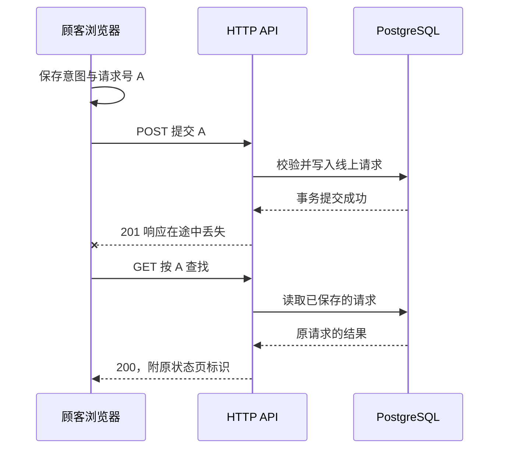

# 1. HTTP 与一次下单

顾客按下「提交」，屏幕转了一会儿，手机断网了。此时你可以确定的是浏览器没有拿到可用的响应。要判断餐厅有没有收到请求，得知道数据在哪里变成了持久记录。这一章先沿网络边界走一遍。

## 从地址栏走到数据库

生产环境中，浏览器访问餐厅域名时，先通过 DNS 找地址，通过 TLS 建立受保护的连接。Caddy 在同一个源（协议、主机、端口）上提供两种服务。对 `/r/…` 的页面导航可以返回前端入口 HTML，浏览器加载 JS 后由 React 绘制菜单。对 `/api/…` 的请求转发给 ASP.NET Core。开发时 Vite 的代理也让浏览器使用相对路径 `/api`。URL 前缀相似，处理程序和响应类型却可能完全不同。[生产路由](../../../deploy/Caddyfile) · [开发代理](../../../frontend/vite.config.ts)

HTTP 请求包含方法、目标、标头和可选的正文。读取菜单时，客户端用 GET 表达读取意图。提交时，JSON 正文包含菜品、确认价格、取餐方式和 `clientRequestId`。在这个接口中，接收结果的状态码与业务状态是两个维度。`201 Created` 表示服务器创建了线上请求，此时它仍可能在等店员决定。`200 OK` 也可能是同一次提交的已有结果。错误的 HTTP 类别帮助通用客户端判断结果，应用自己的错误码则帮助界面选择下一步。[提交和查询接口](../../../backend/TavoloFlow.Api/Controllers/OnlineOrderController.cs) · [HTTP 语义标准](https://www.rfc-editor.org/rfc/rfc9110.html)

方法还影响客户端和中间设施可以做出的假设。「安全方法」表示客户端请求的语义是读取。「幂等」表示重复相同操作的预期效果与一次相同。PUT 可以幂等且改变状态。POST 的通用语义不保证幂等，应用可以给具体操作设计重复处理规则。本项目的配送估价使用 POST 携带地址，避免让地址出现在 URL 中。收到 POST 也不等于一定创建了订单。[配送估价与下单接口](../../../backend/TavoloFlow.Api/Controllers/OnlineOrderController.cs)

## 三条路径，两个观察者

下面画的是「数据库成功、响应丢失」的时序，省略了启动、身份上下文和 CSRF 请求。注意手机和数据库分别在什么时刻知道结果。

| 时刻 | 首次成功 | 同一意图被再次提交 | 首次成功但响应丢失 |
| --- | --- | --- | --- |
| 浏览器准备 | 先在当前标签页的 `sessionStorage` 保存请求号 A 和已确认的内容 | 沿用 A | 仍保有 A |
| API 执行 | 开事务、校验、插入线上请求、提交，再安排推送 | 找到 A 对应的原记录，返回原结果 | 执行过程可能已越过提交点 |
| 浏览器观察 | 收到 201，转到订单状态页 | 收到 200，拿到相同的状态页标识 | 结果未知，页面用 GET 按 A 查询。找到后恢复状态页 |

考虑另一种时序：客户端超时，第一次写入还在运行，恢复 GET 先到数据库。它在当时可能查不到 A。页面保留原意图，自动恢复只做读取。用户主动重试时先查，符合重发条件才带原意图再发。若每次重试都另造一个请求号，服务器会合理地把它看成第二笔购买。区分「访问日志里出现几次请求」与「业务表里创建几笔」就能解释这个设计。[浏览器的 send 和 recover](../../../frontend/src/features/online-order/useOnlineCart.ts) · [服务端的 SubmitAsync](../../../backend/TavoloFlow.Api/Online/OnlineRequestService.cs)

店员接单时才创建用餐会话、正式订单和订单行。随后厨房把单品标记为就绪，出餐屏确认上菜，店主确认线下收款后关账。同一个顾客流程跨越多次 HTTP 交互，也跨越多次短事务。等待员工的几分钟靠数据库记录衔接。[接单服务](../../../backend/TavoloFlow.Api/Online/OnlineStaffService.cs) · [工作流测试](../../../backend/TavoloFlow.Api.Tests/OnlineStaffTests.cs)

## 动手与自测

在本地 Demo 的营业时段内打开顾客链接，浏览器开发者工具切到 Network，勾选保留日志并刷新页面。先记录菜单页面的 URL 和响应类型，再筛选 `/api/`。加入一道菜，自取并提交一次。记录创建线上请求和读取状态的 URL，在创建响应里找订单号和 `statusToken`，观察随后地址栏变成 `/o/…`。预期能区分页面 HTML 和 API 返回的 JSON，且首次创建得到 201。只读代码时，在 `OnlineOrderingTests` 搜索 `Submit_ConcurrentRepeats_StoreOneRequest`，看六个并发请求如何得到同一个结果，数据库只留下一条记录。[本地 Demo 设置](../local-development.md) · [线上下单测试](../../../backend/TavoloFlow.Api.Tests/OnlineOrderingTests.cs)

**自测**　201 已到达顾客手机，但店员手机没响，顾客是否应该再下一单？

展开参考答案

状态页和店员待接列表可以核实线上请求。通知是提交后的尽力投递，其送达与数据库成功写入是两件事。

## 意大利语面试

**«Che differenza c’è tra un metodo HTTP sicuro e uno idempotente?»** 先讲客户端所请求的动作，再讲重复一次的效果。

*Un metodo sicuro esprime una lettura, come GET. L’idempotenza riguarda invece l’effetto di più richieste uguali: per esempio posso inviare due volte lo stesso PUT e ottenere lo stesso stato finale. Nel nostro progetto la creazione usa POST e abbiamo definito noi come riconoscere il secondo invio, tramite un identificativo della richiesta.*

**追问**　为什么同一操作第一次返回 201、第二次返回 200 仍然可以幂等？判断依据是持久业务效果。

**«Se il client va in timeout, come capisci se l’ordine è arrivato?»** 把客户端观察到的现象与数据库提交点分开讲。

*Il timeout mi dice solo che il client ha smesso di aspettare. Il server potrebbe aver già concluso la transazione. Prima dell’invio salvo un identificativo insieme ai dati confermati. Quando torno online cerco la richiesta con quell’identificativo. Se serve un nuovo tentativo esplicito, riutilizzo lo stesso identificativo, così il server può restituire il risultato originale.*

**追问**　恢复 GET 立刻返回 404 时有哪些可能的时序？回到上表画出尚未提交的事务。

[路线首页](../learning-notes.md) · [下一章：ASP.NET Core](02-aspnet-core.md)
