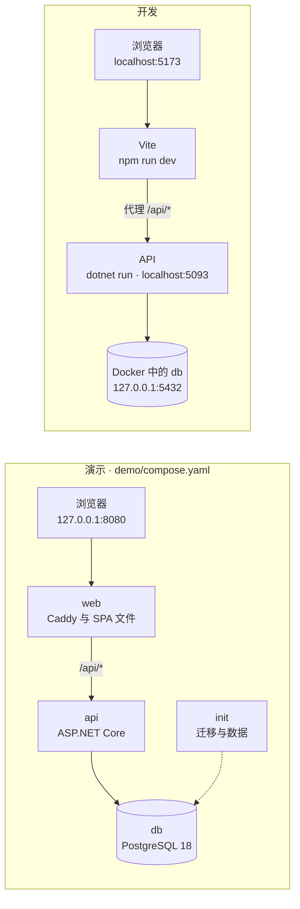
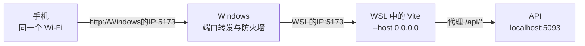

[English](../en/local-development.md) · [Italiano](../it/local-development.md) · **中文**

# 在本地运行 TavoloFlow

这份指南写给想在自己电脑上运行 TavoloFlow 的人：几分钟内看到它跑起来，修改它的代码，或者用一部真实的手机试用。怎么部署到服务器上，见[自托管](self-hosting.md)指南；它内部是怎么做的，见[开发笔记](development-notes.md)。

有三种方式，从最简单到最完整：

- **演示**（第 1 部分）：一条 Docker 命令，一家现成的示例餐厅，不需要安装 .NET 和 Node；
- **开发环境**（第 2 部分）：数据库在 Docker 里，API 和前端手动启动，前端随着修改自动更新；第 3 部分讲怎么运行测试；
- **手机**（第 4 部分）：让同一 Wi-Fi 下的手机访问开发环境，扫一个真实的二维码。

我所有的开发都在 Windows 11 + WSL2（Ubuntu）+ Docker Desktop 上完成。第 2 部分的命令是 Bash 命令，适用于 Linux、macOS 或 WSL；演示在 Windows 的 PowerShell 里也能启动。

## 总览

|      | 演示                    | 开发                              | 手机访问                   |
| ---- | ----------------------- | --------------------------------- | -------------------------- |
| 需要 | Git、Docker             | Git、Docker、.NET SDK 10、Node 24 | 开发环境，以及同一个 Wi-Fi |
| 地址 | `http://127.0.0.1:8080` | `http://localhost:5173`           | `http://电脑IP:5173`       |
| 数据 | Demo Ramen 示例餐厅     | 你自己创建的，或与演示相同的数据  | 开发环境的数据             |
| 适合 | 看看应用、给别人演示    | 修改代码、运行测试                | 真正试一下二维码和顾客页面 |



两种情况下浏览器都只看到一个地址，和生产环境一样：演示里入口是 Caddy，开发时是 Vite 的代理（见[架构总览](development-notes.md#总览)）。前端和 API 同源，所以不需要配置 CORS。

**演示用 `127.0.0.1`，开发用 `localhost`。** 如果两者同时运行，不要都从 `localhost` 打开。浏览器按主机名而不是端口来区分 cookie：对它来说 `localhost:8080` 和 `localhost:5173` 是同一个站点，两个应用的登录 cookie 名字相同（`TavoloFlow.Store`、`TavoloFlow.Csrf`……），会互相覆盖，结果就是不停被登出、CSRF 报错。而 `127.0.0.1` 和 `localhost` 是两个不同的主机，各有各的 cookie。另一个办法是用两个浏览器配置文件。

## 第 1 部分：演示

### 启动

只需要 Git 和带 Compose v2 的 Docker。在 Windows 上，装好使用 Linux 容器的 Docker Desktop 即可，命令直接在 PowerShell 里运行：不需要 .NET、Node、Bash，也不需要 `.env` 文件。

```bash
git clone https://github.com/lorenzoyang/TavoloFlow.git
cd TavoloFlow
docker compose -f demo/compose.yaml up -d --build
```

第一次运行时，Docker 要下载基础镜像并编译 API 和前端，需要几分钟。命令结束后，打开 <http://127.0.0.1:8080>。

| 角色       | 用户名             | 密码     | 登录地址                               |
| ---------- | ------------------ | -------- | -------------------------------------- |
| 店主       | `demo.ramen.owner` | `123456` | <http://127.0.0.1:8080/staff/login>    |
| 员工       | `demo.ramen.staff` | `123456` | <http://127.0.0.1:8080/staff/login>    |
| 平台管理员 | `demo.admin`       | `123456` | <http://127.0.0.1:8080/platform/login> |

和真实餐厅不同，演示账号首次登录时不需要修改密码。这些密码是公开的，只适合在你自己的电脑上使用。

界面语言跟随浏览器语言。要切换语言，可以在登录页标志下方选择（中文 · Italiano · English），或者之后在「首页」的账号卡片里选择。

### 演示内容

示例餐厅 **Demo Ramen**：LACQUER（朱漆）主题，欧元，罗马时区，菜单默认语言为英语，菜名和描述有三种语言。餐厅服务和扫码接单都已开启，顾客需要输入入桌码。

- 8 张桌子，T01 到 T08，全部空闲；二维码令牌在初始化时随机生成；
- 4 个分类、12 道菜，带价格、描述、示例过敏原，每道菜一张照片；
- 2 个选项组：**辣度**（必选，所有拉面都有）和**加料**（最多三项，有加价，素食拉面没有）；
- 一个为期一年、199 欧元的服务期，已付款（在管理员后台和店主的「年费与收费周期」页面可以看到）；
- 没有用餐、没有订单、没有账单：从开桌开始。

餐厅和菜品都是虚构的，过敏原也是；照片由 AI 生成（详情见 [`demo/images/README.md`](../../demo/images/README.md)）。

### 五分钟体验

1. 以**店主**身份登录。在「首页」打开**桌位与二维码**，在 T01 桌上点**「二维码」**，再点**「复制链接」**：这就是顾客扫码后会打开的地址。
2. 进入**桌台**，选择 T01，点**「确认开桌」**。页面会显示四位入桌码。
3. 在另一个标签页粘贴链接：现在你是顾客。输入入桌码，点**「验证入桌码」**，用**「加入购物车」**选几道菜（点拉面时会先弹出面板：选好必选的**辣度**，还可以加最多三项**加料**，再点**「加入购物车 · € …」**），然后点**「核对订单」**和**「确认并下单」**。
4. 回到员工端，打开**厨房**：订单已经到了，每道菜下方显示所选的辣度和加料。把菜品标为**「出餐完成」**。要播放提示音，浏览器需要你先点一下页面。
5. 在「首页」打开**传菜**，把菜品标为**「已送达」**。
6. 打开**结账**，选择 T01，点**「核对收款并清桌」**；勾选确认，再点**「已线下收款并清桌」**。关闭的账单可以在「首页」的**历史账单**里找到。
7. 以店主身份打开**菜单**里的**选项**标签页：这里有演示的两个选项组。试试用**「添加选项组」**从模板新建一个，比如给饮品用的杯型；或者用开关把某个加料设为售罄，顾客就不能再选它了。
8. 如果愿意，也可以在同一个浏览器里从 `/platform/login` 以管理员身份登录：顾客、员工和管理员三种身份的 cookie 互相独立，不会冲突（见[「三种身份」](development-notes.md#三种身份员工顾客平台)）。

同一个浏览器的所有普通标签页共享员工端的登录：要同时使用店主和员工账号，需要另一个浏览器配置文件、另一个浏览器或无痕窗口。

### 结构

演示是一个独立的 Compose 项目 [`demo/compose.yaml`](../../demo/compose.yaml)，包含四个容器：

| 服务   | 作用                                                                     |
| ------ | ------------------------------------------------------------------------ |
| `db`   | PostgreSQL 18，数据在 `postgres_data` 卷里                               |
| `init` | 用 `efbundle` 执行迁移，再用 `--seed-demo` 导入数据；完成后退出          |
| `api`  | ASP.NET Core API，Data Protection 密钥在 `protection_keys` 卷里          |
| `web`  | Caddy，不启用 HTTPS，提供编译好的 SPA 文件；唯一在你电脑上开放端口的容器 |

- **启动顺序由 Compose 决定。** `db` 就绪后才启动 `init`（`condition: service_healthy`），`init` 成功结束后才启动 `api`（`service_completed_successfully`），API 在 `/health/ready` 上响应后才启动 `web`。所以 `docker compose ps -a` 里 `init` 显示为 `Exited (0)` 是正常的：它的工作已经完成。
- **规则和生产环境一致。** 迁移由一个明确的步骤执行，而不是 API 启动时自动执行。`database` 网络是 `internal` 的，`web` 的端口只发布在 `127.0.0.1` 上：局域网里访问不到演示。主要区别是 API 运行在 Development 环境，`--seed-demo` 只能在这个环境下运行。
- **数据只导入一次。** 如果数据库里已经有餐厅或管理员，`--seed-demo` 什么都不做，并在日志里说明：它绝不会覆盖你的修改。所有数据在一个事务里导入，照片走的是和真实上传相同的处理流程（`MenuImages`）。
- **二维码使用你打开的地址。** 演示前端编译时 `VITE_PUBLIC_BASE_URL` 为空，所以二维码链接取浏览器当前的源，包括端口。

### 管理

在仓库目录下：

```bash
# 容器状态：-a 也会显示已经结束的 init
docker compose -f demo/compose.yaml ps -a
# 最近的日志
docker compose -f demo/compose.yaml logs --tail 100 init api web
# 停止：数据、改过的密码和密钥都保留在卷里
docker compose -f demo/compose.yaml down
# 重新启动
docker compose -f demo/compose.yaml up -d
```

**重置。** 加上 `-v`，`down` 会同时删除这个 Compose 项目（`tavoloflow-demo`）的卷：数据库和密钥。再次启动时 `init` 发现数据库是空的，会重新导入初始数据，密码也恢复为原始密码。其他项目，包括第 2 部分的开发数据库，都不受影响。

```bash
docker compose -f demo/compose.yaml down -v
docker compose -f demo/compose.yaml up -d --build
```

重置之后，旧的登录和旧的桌位链接都失效了：二维码令牌是新的。

**换一个端口。** 如果 8080 已被占用：

```bash
DEMO_PORT=8081 docker compose -f demo/compose.yaml up -d --build
```

在 PowerShell 里先用 `$env:DEMO_PORT = "8081"` 设置变量，再运行同样的命令。

### 修改演示数据

数据在 [`demo/data/`](../../demo/data/) 里：`restaurant.json`、`accounts.json`、`tables.json` 和 `menu.json`。照片在 [`demo/images/`](../../demo/images/)，格式是 640×640 的 WebP；生成照片用的提示词在 `demo/image-prompts.json`。`menu.json` 里的 `optionGroups` 列出选项组，每个组在 `items` 里列出使用它的菜品的 key。

这些文件在构建时被复制进 `init` 镜像，所以修改后需要加 `--build`。而且它们只对空数据库生效：要在已经运行过的演示上看到修改，需要先重置。导入程序很严格：遇到不认识的 JSON 字段会导致导入失败，原因可以在 `init` 的日志里看到。

## 第 2 部分：开发环境

### 需要什么

| 工具        | 版本                               | 用途                                                            |
| ----------- | ---------------------------------- | --------------------------------------------------------------- |
| .NET SDK    | 10，至少 10.0.112（`global.json`） | 后端和测试                                                      |
| Node.js     | 24                                 | 前端；测试用 Node 自带的测试运行器执行，它能直接运行 TypeScript |
| Docker      | 带 Compose v2                      | 开发数据库和集成测试                                            |
| Git 和 Bash |                                    | Linux、macOS 或 WSL 上                                          |

我的环境：WSL2 + Ubuntu + Docker Desktop，并开启了 WSL 集成。

### 1. 数据库

```bash
# 在仓库目录下
cp .env.example .env
# 把 POSTGRES_PASSWORD 换成你自己的密码
nano .env
docker compose up -d db
```

[`compose.yaml`](../../compose.yaml) 只启动 PostgreSQL 18，端口 5432，但只绑定在 `127.0.0.1` 上：局域网里看不到它。数据在 Compose 项目 `tavoloflow` 的 `postgres_data` 卷里。

`.env` 文件只由 Docker Compose 读取，用来创建数据库：API 不读它。而且和生产环境一样，密码只在卷第一次创建时生效：之后再改，PostgreSQL 并不知道。

### 2. 把 API 连接到数据库

```bash
# 安装仓库指定的 .NET 工具：固定版本的 dotnet-ef 和 CSharpier
dotnet tool restore
# 连接字符串：数据库名、用户名和密码与 .env 中一致
dotnet user-secrets set 'ConnectionStrings:Default' \
  'Host=localhost;Port=5432;Database=tavoloflow_dev;Username=tavoloflow;Password=你的密码' \
  --project backend/TavoloFlow.Api
```

**User secrets** 是 .NET 把开发用的机密信息放在仓库之外的方式。它们保存在你用户目录下的一个 JSON 文件里（`~/.microsoft/usersecrets/<UserSecretsId>/secrets.json`，其中 ID 写在 `TavoloFlow.Api.csproj` 里），ASP.NET Core 只在 Development 环境下读取它们。`dotnet user-secrets list --project backend/TavoloFlow.Api` 可以查看你设置了什么。

仓库里没有任何连接字符串：如果没配置，API 启动时会报错退出，并提示原因。除了 user secrets，也可以用环境变量 `ConnectionStrings__Default`：在环境变量名里，双下划线代替冒号。

### 3. 迁移

```bash
dotnet ef database update --project backend/TavoloFlow.Api
```

这条命令执行 `backend/TavoloFlow.Api/Data/Migrations` 里的迁移，创建所有表。API 启动时从不自己执行迁移，开发环境也一样：这是和生产环境相同的规则（见自托管指南中的[「迁移」](self-hosting.md#迁移)）。如果 `git pull` 带来了新的迁移，需要重新执行这条命令。

### 4. 初始数据

刚迁移完的数据库是空的：没有餐厅，也没有账号。要填充数据，就用 API 程序本身，它也可以当作命令行工具使用（[`Operations/MaintenanceCommands.cs`](../../backend/TavoloFlow.Api/Operations/MaintenanceCommands.cs)）：带上 `--seed-demo` 这样的选项，它会执行对应的命令然后退出，不会启动服务器。

**最快的方式：导入演示数据。** `init` 容器用的命令同样适用于开发数据库：

```bash
# 在仓库目录下，数据库必须为空
Demo__DataPath="$PWD/demo" dotnet run --project backend/TavoloFlow.Api --launch-profile http -- --seed-demo
```

你会得到和第 1 部分相同的 Demo Ramen，账号和密码相同，餐厅已启用，扫码接单已开启：可以马上进行五分钟体验。`Demo__DataPath` 告诉命令去哪里找 `data/` 和 `images/`；`http` 配置会设置 Development 环境，这个命令只能在该环境下运行。如果数据库里已经有餐厅或管理员，它什么都不导入，并在日志里说明。

**从零开始，和生产环境一样。** 如果想走一遍新餐厅的真实流程，只需要创建第一个平台管理员：

```bash
dotnet user-secrets set 'PlatformBootstrap:Username' 'admin' --project backend/TavoloFlow.Api
# 请把示例值替换为自己的密码，长度为 6–128 个字符
dotnet user-secrets set 'PlatformBootstrap:Password' '替换为你的管理员密码' --project backend/TavoloFlow.Api
dotnet run --project backend/TavoloFlow.Api --launch-profile http -- --seed-platform-admin
```

然后在应用运行时（第 5 步）：

1. 进入 `/platform/login`，用**「创建餐厅与两个账号」**创建餐厅；记下两个临时密码，它们只显示一次；
2. 新餐厅默认是暂停状态：用**「启用餐厅服务」**启用它；
3. 店主在 `/staff/login` 登录，修改密码，准备菜单和桌位；
4. 店主在**桌台**页面打开**「扫码接单」**：重新启用服务并不会自动重新开启接单。

还有一个 `--seed-dev-accounts`，它根据 `DevelopmentSeed:*` 设置创建一家带店主和员工账号的餐厅。但这家餐厅也是暂停状态，需要平台管理员来启用，所以无论如何都要用 `--seed-platform-admin` 创建管理员（[`accounts-platform.md`](../reference/accounts-platform.md)，英文）：上面两种方式更方便。

### 5. 启动 API 和前端

需要两个终端，都在仓库目录下打开。

```bash
# 终端 1：API，地址 http://localhost:5093
dotnet run --project backend/TavoloFlow.Api --launch-profile http
```

```bash
# 终端 2：前端，地址 http://localhost:5173
cd frontend
# 只在第一次，或 package-lock.json 变化时运行
npm ci
npm run dev
```

然后打开 <http://localhost:5173/staff/login>，或者 `/platform/login`。

- **浏览器只和 Vite 通信。** Vite 提供前端页面，并通过 [`vite.config.ts`](../../frontend/vite.config.ts) 里配置的代理，把所有以 `/api` 开头的请求转发给 5093 端口上的 API。
- **前端自动更新，后端不会。** 修改 React 代码后，浏览器里立刻能看到效果（热模块替换）。修改后端后，需要用 Ctrl+C 停止 API 再重新启动。
- **端口是固定的。** `vite.config.ts` 使用了 `strictPort`：如果 5173 被占用，Vite 会报错退出，而不是悄悄换一个端口。这样地址始终不变，这对第 4 部分很重要。

### 实用信息

- **API 文档。** 在 Development 环境下，API 会在 <http://localhost:5093/openapi/v1.json> 发布所有接口的 OpenAPI 文档。想手动试请求，可以用 [`TavoloFlow.Api.http`](../../backend/TavoloFlow.Api/TavoloFlow.Api.http)，在 Visual Studio、Rider 或装了 REST Client 扩展的 VS Code 里运行。注意每个写操作都需要 CSRF 令牌（见[「Cookie、CSRF 与同源」](development-notes.md#cookiecsrf-与同源)）。
- **Data Protection 密钥。** 开发时没有设置 `DataProtection:KeyRingPath`，所以 ASP.NET Core 把密钥放在用户目录里（Linux 和 WSL 上是 `~/.aspnet/DataProtection-Keys`）。如果删除它们，所有登录和已开桌的入桌码都会失效：这也是生产环境要把它们放在卷里的原因。
- **新建迁移。** 修改实体或它的配置之后：

  ```bash
  dotnet ef migrations add 修改的名称 --project backend/TavoloFlow.Api --output-dir Data/Migrations
  # 检查模型和迁移是否一致：不能还有待生成的修改
  dotnet ef migrations has-pending-model-changes --project backend/TavoloFlow.Api
  dotnet ef database update --project backend/TavoloFlow.Api
  ```

- **从头开始。** `docker compose down -v` 会删除开发数据库的卷，而且只删除它：演示有自己的 Compose 项目。然后从 `docker compose up -d db` 和第 3 步重新开始。
- **PWA。** 使用 `npm run dev` 时不会注册 service worker，以免干扰热更新。要试安装和离线页面，需要先构建：`npm run build && npm run preview`，地址 <http://localhost:4173>，同时 API 要在运行（详情见 [`pwa.md`](../reference/pwa.md)，英文）。

## 第 3 部分：测试与检查

### 后端

```bash
# 所有测试：Docker 必须在运行
dotnet test TavoloFlow.slnx
# 只运行一个测试类（加上 .方法名 可以只运行一个测试）
dotnet test TavoloFlow.slnx --filter "FullyQualifiedName~KitchenTests"
# 检查 C# 代码格式
dotnet csharpier check .
```

测试集包括不使用数据库的纯逻辑测试，比如 `PasswordPolicyTests` 和 `SubscriptionSummaryTests`，以及集成测试。每个使用 `PostgreSqlFixture` 的类都会通过 Testcontainers 启动一个专供该测试类使用的临时 PostgreSQL 实例（`postgres:18-alpine`），并执行真实的迁移。HTTP 测试用 `WebApplicationFactory` 调用 API，数据层测试直接使用 `DbContext`。测试不会碰开发数据库，也不会碰演示数据库。运行完整命令需要 Docker；第一次运行集成测试会下载 PostgreSQL 镜像。

`dotnet csharpier format .` 用 CSharpier 修正格式。CSharpier 相当于 C# 的 Prettier，行宽也一样（100 个字符，写在 `.csharpierrc.json` 里）。EF Core 的迁移是生成的代码，所以在 `.csharpierignore` 中排除。在 VS Code 里装上 CSharpier 扩展后，C# 文件每次保存都会自动格式化（`.vscode/settings.json`）。

### 前端

```bash
cd frontend
# 纯逻辑测试
node --test --test-isolation=none tests/*.test.ts
# 生产构建和类型检查
npm run build
# Lint 和格式检查
npm run lint
npm run format:check
```

前端没有 React 组件的测试框架。值得测试的逻辑（购物车规则、订单恢复、语言、主题……）都放在纯模块里，比如各个功能的 `state.ts` 和 `lib/` 里的部分文件，由 Node 24 自带的测试运行器直接执行，运行时直接去掉 TypeScript 类型。所以这些模块之间用相对路径加 `.ts` 扩展名导入，而不是 `@/` 别名。

`npm run build` 执行的是 `vite build && tsc -b`：先由 Vite 重新生成 TanStack Router 的路由树 `src/routeTree.gen.ts` 并编译；再由 TypeScript 检查类型，包括路由。新增路由时，`routeTree.gen.ts` 也要一起提交。`npm run format` 用 Prettier 修正格式。

### 发布包

生产环境的安装也可以在本地试，用自托管指南里介绍的冒烟测试（[「构建发布包」](self-hosting.md#3-构建发布包)）。

## 第 4 部分：用手机测试

顾客扫码这一步，只有用手机才能真正测试。但到目前为止的配置，手机都访问不到：

- 在手机上，`localhost` 指的是手机自己，而不是你的电脑；
- Vite 只监听 `localhost`（`vite.config.ts` 里的 `host: "localhost"`），演示也只在 `127.0.0.1` 上发布端口；
- 如果你用 WSL2 的默认 NAT 模式，Linux 还有一个内部地址（`172.x.x.x`），Wi-Fi 上看不到它，只能看到 Windows 的地址。

所以手机访问用的是开发环境。在 Linux 和 macOS 上改两处就够了：Vite 要监听所有网络接口，二维码里要写电脑的地址。WSL 还需要第三步：Windows 要把端口转发给 Linux（第 3 步，Linux 和 macOS 跳过）。

在 WSL 上，手机发出的请求走的路线是这样的；Linux 和 macOS 没有经过 Windows 这一步：



API 仍然在 `localhost` 上：手机只和 Vite 通信，由 Vite 像平时一样把 `/api` 转发给 API。

### 1. 电脑的地址

手机和电脑必须连同一个 Wi-Fi。你需要电脑在这个网络里的地址，也就是手机要访问的地址：

- **Linux：** `hostname -I`；
- **macOS：** 连着 Wi-Fi 时用 `ipconfig getifaddr en0`；
- **WSL：** 要用 **Windows** 的地址，而不是 Linux 的：在 PowerShell 里运行 `ipconfig`，看 Wi-Fi 网卡下的「IPv4 地址」。

下面的命令里这个地址是 `192.168.1.36`。

### 2. Vite 与二维码地址

在 `frontend/.env.local` 里写入（这个文件被 Git 忽略，模板是 `frontend/.env.example`）：

```dotenv
VITE_PUBLIC_BASE_URL=http://192.168.1.36:5173
```

然后让 Vite 监听所有接口：

```bash
cd frontend
npm run dev -- --host 0.0.0.0
```

如果没有 `VITE_PUBLIC_BASE_URL`，二维码会使用生成它的页面地址，也就是 `localhost`，手机就不知道该去哪里：界面会提示「此链接使用本机地址，手机无法直接访问」。Vite 在启动时读取这个变量并写进前端代码。保存 `.env.local` 时它会自动重启，但已经打开的页面需要刷新。

### 3. 仅限 WSL：端口转发与防火墙

Linux 和 macOS 跳过这一步：Vite 直接运行在电脑上，电脑本身就有 Wi-Fi 网络的地址。如果手机连不上，最多需要在系统防火墙里开放 5173 端口：比如 Ubuntu 上用 ufw 的话执行 `sudo ufw allow 5173/tcp`；macOS 上在系统询问时允许 `node` 接受传入连接即可。

在 WSL 上需要三样东西。

**网络配置文件。** 在 Windows 设置里，把你的 Wi-Fi 网络设为**专用**网络：下面的防火墙规则只对专用网络生效。

**WSL 的 IP。** 在 WSL 终端里运行 `hostname -I`，或者看 Vite 加 `--host` 启动时打印的 `Network` 那一行。下面的命令里是 `172.28.94.85`。它通常在每次重启 Windows 或 WSL 后都会变。

**端口转发。** 在**以管理员身份运行**的 PowerShell 里，换成你的地址：

```powershell
$tavoloWindowsIp = "192.168.1.36"
$tavoloWslIp = "172.28.94.85"
# 只有当这个地址已经有转发规则时才需要，比如指向旧的 WSL IP
netsh interface portproxy delete v4tov4 listenaddress=$tavoloWindowsIp listenport=5173
# 发往 Windows 5173 端口的连接转发到 WSL 的 5173 端口
netsh interface portproxy add v4tov4 listenaddress=$tavoloWindowsIp listenport=5173 connectaddress=$tavoloWslIp connectport=5173
```

因为 WSL 的 IP 会变，重启后需要重新设置转发：先 `delete`，再用新地址 `add`。`netsh interface portproxy show v4tov4` 可以查看当前的转发规则。

**防火墙规则。** 同样以管理员身份运行，只需一次：

```powershell
New-NetFirewallRule -DisplayName "TavoloFlow Dev 5173" -Direction Inbound -Action Allow -Protocol TCP -LocalPort 5173 -Profile Private -RemoteAddress LocalSubnet
```

这条规则只在专用网络上、只对同一子网的设备开放 5173 端口：手机可以访问，互联网上的其他人不行。

### 4. 测试

1. 在电脑上打开 `http://localhost:5173/staff/login`，以店主身份登录（用演示数据的话一切都已准备好），在**桌台**开一张桌。
2. 在**桌位与二维码**里点同一张桌的**「二维码」**：二维码下方的链接必须以 `http://192.168.1.36:5173` 开头。
3. 用手机扫码，输入入桌码，下一单。如果想不带旧 cookie 重新开始，可以在无痕窗口里打开链接。

### 这种方式测不了什么

像 `http://192.168.1.36:5173` 这样的地址不是 HTTPS，所以对手机浏览器来说不是安全上下文。有些浏览器功能必须在安全上下文中才能用：

- **安装 PWA** 和 service worker；
- 厨房和传菜页面的**屏幕常亮**（Screen Wake Lock）；
- 链接和入桌码的**自动复制**：应用会发现这一点，并提示你手动复制。

其他功能都正常。比如订单 ID 用 `crypto.getRandomValues` 生成，正是因为它和 `crypto.randomUUID` 不同，没有 HTTPS 也能用（[`lib/ids.ts`](../../frontend/src/lib/ids.ts)）。

要在 Android 手机上试 PWA，有个小技巧：开启 USB 调试，用 `chrome://inspect` 的端口转发，让手机打开预览构建的 `localhost:4173`，而 `localhost` 算作安全上下文（见 [`pwa.md`](../reference/pwa.md)）。iPhone 和最终测试则需要[自托管](self-hosting.md)提供的真正 HTTPS。

### 清理

不再需要时，把 `VITE_PUBLIC_BASE_URL` 从 `frontend/.env.local` 中删掉，这样开发时生成的二维码又会使用页面地址。

在 WSL 上，还要在以管理员身份运行的 PowerShell 里删除转发和防火墙规则：

```powershell
# 新开的会话里没有这个变量：重新设置
$tavoloWindowsIp = "192.168.1.36"
netsh interface portproxy delete v4tov4 listenaddress=$tavoloWindowsIp listenport=5173
Remove-NetFirewallRule -DisplayName "TavoloFlow Dev 5173"
```

## 常见问题

| 现象                                                        | 检查什么                                                                                                                                                                                       |
| ----------------------------------------------------------- | ---------------------------------------------------------------------------------------------------------------------------------------------------------------------------------------------- |
| 在 WSL 里，`docker` 提示 「permission denied」 或找不到服务 | Docker Desktop 是否在运行，并且在它的设置里开启了与你的 WSL 发行版的集成                                                                                                                       |
| 演示没有响应，`init` 不是 `Exited (0)`                      | `docker compose -f demo/compose.yaml logs init`                                                                                                                                                |
| 8080 端口被占用                                             | 用 `DEMO_PORT`，见「管理」                                                                                                                                                                     |
| Vite 退出：5173 端口被占用                                  | 还有另一个 `npm run dev` 开着；有 `strictPort` 时 Vite 不会换端口                                                                                                                              |
| API 启动失败，要求 `ConnectionStrings:Default`              | user secrets 里的连接字符串（第 2 步）或 `ConnectionStrings__Default` 变量                                                                                                                     |
| API 因密码问题连不上 PostgreSQL                             | user secrets 里的密码必须是创建卷时 `.env` 里的那个；如果之后改了 `.env`，改回旧密码，或者用 `docker compose down -v` 重建卷（会删除数据）                                                     |
| 报错说表或列不存在                                          | 最近一次 `git pull` 之后运行 `dotnet ef database update`                                                                                                                                       |
| `--seed-demo` 说数据库里已经有数据                          | 它只往空数据库导入：使用现有数据，或者重建卷                                                                                                                                                   |
| 不停被登出、CSRF 报错                                       | 演示和开发都从 `localhost` 打开了：演示改用 `127.0.0.1`                                                                                                                                        |
| 桌台页面显示「餐厅服务尚未由平台启用或已被暂停」            | 餐厅处于暂停状态：由管理员用「启用餐厅服务」启用                                                                                                                                               |
| 顾客能看菜单但不能下单                                      | 接单已暂停：在桌台页面打开「扫码接单」                                                                                                                                                         |
| 二维码里是 `localhost`                                      | 在 `frontend/.env.local` 里设置 `VITE_PUBLIC_BASE_URL`，然后刷新页面（Vite 会自动重启）                                                                                                        |
| 手机打不开页面                                              | 同一个 Wi-Fi，Vite 用 `--host 0.0.0.0` 启动；Linux 和 macOS 检查系统防火墙；WSL 检查网络是否为专用、防火墙规则，以及 WSL 的 IP 是否仍与端口转发一致（`netsh interface portproxy show v4tov4`） |
