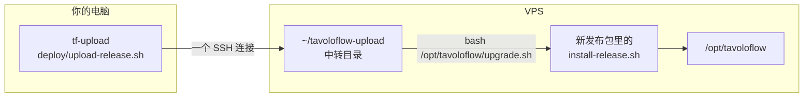

[English](../en/releasing.md) · [Italiano](../it/releasing.md) · **中文**

# 用脚本发布新版本

这份指南讲的是如何在已经安装好的服务器上发布新版本，用的是两个脚本：第一个在你的电脑上运行，构建发布包并上传到 VPS；第二个在 VPS 上运行，检查发布包并安装它。其他内容（首次安装、`.env` 配置、备份、回滚和应急）都在[自托管指南](self-hosting.md)里。

脚本不改变发布的方式：它们替你执行[手动流程](self-hosting.md#手动流程)里的步骤，使用同一个安装程序，并多做几项检查。手动流程仍然有效。

## 简要流程

```text
只做一次      下面的准备工作：~/.ssh/config、tf-upload 别名、第一次发布
在你的电脑上  git status                         都提交了吗？
              tf-upload                          构建、上传并检查发布包
餐厅打烊后    ssh tavoloflow                     登录 VPS
              bash /opt/tavoloflow/upgrade.sh    检查、请你确认（y），然后安装
              exit                               退出 VPS
然后          在每台员工设备上重新加载应用
```



上传不会改变生产环境的任何东西：随时都可以做，白天也行，做完可以直接关掉终端。安装则会让 API 停一段时间，所以要在餐厅打烊时进行。

## 准备工作（只做一次）

除了第一次发布，所有准备工作都**在你的电脑上**进行（我的情况是 WSL 终端）。你需要：

- **VPS 的 IPv4 地址**：就是你现在 `ssh … deploy@VPS_IP` 里用的那个，也可以在服务商的控制面板里找到；
- 自托管指南[第 1.1 步](self-hosting.md#11-ssh-密钥)创建的**私钥** `~/.ssh/tavoloflow`；
- [第 1.4 步](self-hosting.md#14-deploy-用户)设置的 **`deploy` 的密码**：在 VPS 上用 `sudo` 时需要。

关于路径，有两点要知道：`~` 是你的主目录（例如 `/home/名字`）；以点开头的文件和目录（如 `.ssh`、`.bashrc`）是隐藏的：`ls` 看不到，`ls -a` 才能看到。

### 给 VPS 起一个 SSH 名字

你现在登录 VPS 时输入的是 `ssh -o IdentitiesOnly=yes -i ~/.ssh/tavoloflow deploy@VPS_IP`。`~/.ssh/config` 可以给「地址、用户、私钥」这个组合起一个名字，之后只要输入 `ssh tavoloflow`。它是你电脑上 `ssh`（以及 `scp`）命令的配置文件；上传脚本用的正是这个名字。

**1. 检查私钥并打开文件，在你的电脑上：**

```bash
# 应该列出 tavoloflow 和 tavoloflow.pub
ls ~/.ssh/
# 用 nano 打开这个文件；文件还不存在时，nano 会在保存时创建它
nano ~/.ssh/config
```

**2. 写入配置。** 在打开的文件里粘贴下面几行（终端里用 `Ctrl+Shift+V` 粘贴，很多终端也可以点鼠标右键）：

```text
Host tavoloflow
  HostName VPS_IP
  User deploy
  IdentityFile ~/.ssh/tavoloflow
  IdentitiesOnly yes
```

然后把 `VPS_IP` 换成真实地址，例如 `HostName 203.0.113.10`：在 nano 里用方向键移动光标。缩进的行属于它们上面的那个 `Host`。如果文件里原来已经有别的 `Host` 段，把你的这一段加在末尾，中间空一行。

| 配置行                           | 含义                                                       |
| -------------------------------- | ---------------------------------------------------------- |
| `Host tavoloflow`                | 简短的名字，用来代替 `deploy@VPS_IP`                       |
| `HostName VPS_IP`                | VPS 的真实地址                                             |
| `User deploy`                    | 以 `deploy` 登录，永远不用 root                            |
| `IdentityFile ~/.ssh/tavoloflow` | 要使用的私钥                                               |
| `IdentitiesOnly yes`             | 只尝试这一把密钥，相当于指南命令里的 `-o IdentitiesOnly=yes` |

**3. 保存并退出 nano：** 按 `Ctrl+O`，再按回车确认文件名，然后按 `Ctrl+X`。

**4. 保护文件并测试新名字，在你的电脑上：**

```bash
# 只有你自己能写这个文件，否则 ssh 会拒绝使用它
chmod 600 ~/.ssh/config
# 应该像原来的长命令一样，以 deploy 登录 VPS
ssh tavoloflow
```

成功的话，命令提示符会变成 VPS 的，类似 `deploy@VPS名字:~$`。如果私钥有密码短语，`ssh` 会先问它。用 `exit` 回到你的电脑。

| 如果看到                                       | 含义                                 | 怎么做                                                                                              |
| ---------------------------------------------- | ------------------------------------ | --------------------------------------------------------------------------------------------------- |
| `Could not resolve hostname tavoloflow`        | ssh 找不到 `Host tavoloflow` 这一段  | 检查文件名是不是 `~/.ssh/config`，以及 `Host` 那一行                                                 |
| `Bad owner or permissions on …/.ssh/config`    | 其他用户可以写这个文件               | 再执行一次 `chmod 600 ~/.ssh/config`                                                                 |
| `Permission denied (publickey)`                | VPS 不接受这把密钥                   | 检查 `HostName`、`User deploy` 和 `IdentityFile` 的路径                                              |
| `Connection timed out`                         | 地址错了，或者 VPS 没有响应          | 检查 `HostName`                                                                                     |
| `Are you sure you want to continue connecting` | ssh 还不认识这个地址                 | 用的还是原来的 IP 时不会出现；如果是新的 VPS，按[第 1.3 步](self-hosting.md#13-第一次以-root-登录)核对指纹 |

从现在开始，`ssh tavoloflow` 就等于那条长命令，自托管指南里的命令也可以这样用；同一个名字也适用于 `scp`，例如 `scp 文件 tavoloflow:`。

### 在你的电脑上设置一个命令

`tf-upload` 不是要安装的程序，而是一个**别名**（alias）：bash 会把这个短名字替换成一条更长的命令。别名写在 `~/.bashrc` 里，bash 每次打开终端都会读取这个文件。

**1. 准备三个值：**

- `PUBLIC_ORIGIN`：应用的公开地址，和构建时用的一样（自托管指南[第 3 步](self-hosting.md#3-构建发布包)）。我的部署用的是 `https://app.qiaotavoloflow.it`；
- `DEPLOY_SSH`：刚才在 `~/.ssh/config` 里起的名字，也就是 `tavoloflow`；
- 仓库在你电脑上的**路径**。查看方法：

  ```bash
  # 在仓库目录里执行：打印完整路径，例如 /home/名字/TavoloFlow
  pwd
  ```

**2. 打开 bash 的配置文件，在你的电脑上：**

```bash
nano ~/.bashrc
```

**3. 添加别名。** 在 nano 里移到文件末尾（用方向键，或者按 `Alt+/`），粘贴新的一行，换成你自己的三个值：

```bash
alias tf-upload='PUBLIC_ORIGIN=https://app.example.com DEPLOY_SSH=tavoloflow bash /home/名字/TavoloFlow/deploy/upload-release.sh'
```

整条必须在同一行，`=` 后面紧跟一个单引号 `'`，行尾也有一个。按 `Ctrl+O` 和回车保存，按 `Ctrl+X` 退出。

**4. 加载并检查别名，在你的电脑上：**

```bash
# 在当前终端里重新读取 ~/.bashrc；以后新开的终端会自动读取
source ~/.bashrc
# 应该显示 tf-upload 是一个别名，以及完整的命令
type tf-upload
```

之后在任何目录都能运行 `tf-upload`：脚本会自己切换到仓库目录。

这些值放在你的电脑上而不是仓库里，是因为仓库是公开的，而每个 TavoloFlow 安装都有自己的域名和服务器。

### 第一次用脚本发布

`upgrade.sh` 和其他运维文件一样，是随着包含它的发布包进入 `/opt/tavoloflow` 的：第一次时它还不在那里。所以只有这一次，要在 VPS 上手动解压发布包，再运行包里的那份 `upgrade.sh`。开始前先核对[开始之前](#开始之前)的清单。

**1. 在你的电脑上构建并上传：**

```bash
tf-upload
```

需要几分钟。结束时记下 `Uploaded and verified on the server:` 后面打印的 ID，例如 `20261026T094909Z-4c9535b`（下面的[第 1 步](#1-在你的电脑上构建并上传)解释了全部输出）。

**2. 餐厅打烊后，从你的电脑登录 VPS：**

```bash
ssh tavoloflow
```

**3. 在 VPS 上解压发布包，运行包里的脚本**，用刚才记下的 ID：

```bash
# tf-upload 打印出的版本 ID
RELEASE=20261026T094909Z-4c9535b
cd ~/tavoloflow-upload
# 压缩包的校验和：必须输出 OK
sha256sum -c "tavoloflow-$RELEASE.tar.gz.sha256"
mkdir "$RELEASE"
tar -xzf "tavoloflow-$RELEASE.tar.gz" -C "$RELEASE"
# 只有这一次：运行发布包里的那份 upgrade.sh
bash "$RELEASE/ops/upgrade.sh" "$RELEASE"
```

脚本会找到已经解压的目录，重新校验其中每个文件，然后和以后每次发布一样继续。

**4. 从[第 2 步](#2-在-vps-上检查并安装)的摘要开始继续**：输入 `sudo` 密码、查看摘要、回答 `y`、检查结果，最后 `exit`。

安装这个发布包时，安装程序也会把 `upgrade.sh` 复制到 `/opt/tavoloflow`：从下一次发布开始，只需要 `bash /opt/tavoloflow/upgrade.sh`。

## 每次发布

### 开始之前

1. 代码已经测试并且**已提交**。在仓库目录里检查：

   ```bash
   # 应该显示 "nothing to commit, working tree clean"
   git status
   ```

   即使忘了检查，有未提交的修改时脚本也会拒绝开始，还没加入 Git 的新文件也算。

2. 你的电脑上 Docker 正在运行（我的情况是打开 Docker Desktop）。这一点脚本也会检查。
3. 查看自托管指南的[发布新版本](self-hosting.md#发布新版本)一节，确认有没有本次发布的「首次升级……」说明。按说明准备需要改动的 `.env`，并安排如何处理迁移带来的变化，例如升级后需要重新开启配送。如果预检失败，安装器会退出，旧 API 仍在运行。
4. 安装要选在餐厅打烊的时间。上传可以提前，提前几个小时也行。

### 1. 在你的电脑上构建并上传

**在你的电脑上，任意目录：**

```bash
tf-upload
```

需要几分钟。输出（有删节）：

```text
Commit: 4c9535b kitchen: group the dish view by station
Reminder: commit 4c9535b is not on any remote branch yet (as of your last fetch or push).
…  （构建输出和上传进度）
Release package: /home/你/TavoloFlow/artifacts/tavoloflow-20261026T094909Z-4c9535b.tar.gz
Checksum: /home/你/TavoloFlow/artifacts/tavoloflow-20261026T094909Z-4c9535b.tar.gz.sha256
tavoloflow-20261026T094909Z-4c9535b.tar.gz: OK

Uploaded and verified on the server: 20261026T094909Z-4c9535b
To install it, at a quiet time:
  ssh tavoloflow
  bash /opt/tavoloflow/upgrade.sh
```

- **检查在构建之前进行。** 构建要花几分钟：有未提交的修改、Docker 没启动或者连不上 VPS，你会马上知道，而不是等完才发现。
- **提醒**出现在这个 commit 还没推送到 GitHub 的时候。它只是提醒，脚本会继续执行。托管服务运行的代码应该也能在公开仓库里找到。Git 只知道它上一次和 GitHub 通信（`git fetch` 或 `git push`）时的状态，所以消息里写的是「as of your last fetch or push」。
- **只用一个 SSH 连接**完成 VPS 上的所有工作：创建中转目录、上传、校验。如果你的私钥有密码短语，只会在开头、构建之前问一次。
- **`OK` 是在 VPS 上做的校验**，针对传到那里的文件：上传是完整的。
- 发布包也保留在你电脑的 `artifacts/` 里：至少保留生产环境当前版本和上一个版本的发布包，回滚和重建服务器都要用到。

如果输出以错误结束，见[出错时](#出错时)。如果像上面这样结束，发布包就在 VPS 上等着了：可以关掉终端，晚些再安装。

### 2. 在 VPS 上检查并安装

**餐厅打烊后，从你的电脑登录 VPS：**

```bash
ssh tavoloflow
```

**在 VPS 上：**

```bash
bash /opt/tavoloflow/upgrade.sh
```

**不要加 `sudo`**：脚本需要时会自己请求。出现 `[sudo] password for deploy:` 时，输入 `deploy` 的密码并按回车：输入时屏幕上什么都不显示，这是正常的。不带参数时，脚本取最后上传的发布包；要选别的，就在后面加上它的 ID：`bash /opt/tavoloflow/upgrade.sh 20261026T094909Z-4c9535b`。

在改动任何东西之前，脚本会显示摘要并请你确认：

```text
Package: /home/deploy/tavoloflow-upload/tavoloflow-20261026T094909Z-4c9535b.tar.gz

The next steps need sudo.
[sudo] password for deploy:

Installed release: 20261020T181200Z-1a2b3c4
New release:       20261026T094909Z-4c9535b
Public address:    https://app.example.com
Migrations to apply:
  20261024153148_AddRestaurantSubscriptions

The installer stops the API, backs up, migrates and starts the new API.
Until it finishes, pages open but every /api request fails.
The backup before the migrations stays on this server. To keep a copy on your computer
first, answer n and download the latest backup (self-hosting guide, Backups).
Install 20261026T094909Z-4c9535b now? [y/N]
```

| 行                                 | 含义                                                     | 要检查什么                                                     |
| ---------------------------------- | -------------------------------------------------------- | -------------------------------------------------------------- |
| `Installed release`、`New release` | 生产环境当前的版本（`state/current`）和你要安装的版本    | 新版本是不是你刚上传的那个                                     |
| `Public address`                   | 构建时写进前端的地址                                     | 是不是你的域名；安装程序也会把它和 `DOMAIN` 比较               |
| `Migrations to apply`              | 发布包里有、数据库还没有执行的迁移                       | 最常见的是 `none`；如果有迁移，决定是否先下载一份备份         |

回答 `y` 开始安装。其他任何回答，包括直接按回车，都会以 `Nothing changed.` 结束，不改动任何东西。如果你回答 `n` 是为了先下载备份（自托管指南[把备份下载到你的电脑](self-hosting.md#把备份下载到你的电脑)），下载完再运行同一条命令即可：它会复用已经解压的目录。

回答 `y` 后，新发布包里的安装程序开始运行，输出和平时一样：备份、迁移、新的 API、Caddy。最后脚本检查结果并清理：

```text
NAME                      IMAGE                                     …   STATUS
tavoloflow-prod-api-1     tavoloflow-api:20261026T094909Z-4c9535b   …   Up 11 seconds (healthy)
tavoloflow-prod-caddy-1   caddy:2-alpine                            …   Up 5 seconds (healthy)
tavoloflow-prod-db-1      postgres:18-alpine                        …   Up 3 days (healthy)
HTTPS check passed: https://app.example.com/api/auth/csrf answers.
Removed from /home/deploy/tavoloflow-upload (older installed releases):
  tavoloflow-20261012T080000Z-9f8e7d6.tar.gz
  tavoloflow-20261012T080000Z-9f8e7d6.tar.gz.sha256
  20261012T080000Z-9f8e7d6

Done. Now reload the app on every staff device (releasing guide, after the release).
```

- **容器**：`db`、`api` 和 `caddy` 都必须是 `healthy`。
- **HTTPS 检查**从 VPS 请求公开地址上的 `/api/auth/csrf`，所以真正经过了 DNS、证书、Caddy 和 API。
- **每晚备份**：如果定时器没有启用，或者这次发布修改了备份的 service 或 timer，会出现一条 `WARNING`，并给出要执行的命令。
- **清理**中转目录时，保留当前版本和上一个版本（具体规则见[下文](#服务器上的-upgradesh)）。

完成后，用 `exit` 回到你的电脑。

### 3. 发布之后

重新开启配送前，在每台员工设备上刷新应用（见[已经打开的页面](#已经打开的页面)）。验收配送时新开顾客页面。检查登录、一次读取（如厨房或结账）和 PWA 页面切换。已开启通知的设备等到显示已开启后，再做一次锁屏测试。如果某个写操作显示结果待核对，请按界面提示操作。如果订单结果未知，先查询原单，再决定是否重新下单。

## 出错时

脚本遇到第一个错误就会停止，它能识别的错误以 `ERROR:` 开头。在 `[y/N]` 提问之前出现的错误，都没有改动生产环境。如果是安装程序停了下来，在 `upgrade.sh` 的错误上方还会看到安装程序自己的消息 `Release stopped. Do not retry writes blindly…`：紧接着的那行 `ERROR:` 会说明 API 是否还在运行。

| 消息                                                                      | 含义                                                                                                                   | 怎么做                                                                                                         |
| ------------------------------------------------------------------------- | ---------------------------------------------------------------------------------------------------------------------- | -------------------------------------------------------------------------------------------------------------- |
| `Commit or remove local changes first`                                    | 有未提交的修改或新文件                                                                                                 | 提交（或删除）后重新运行 `tf-upload`                                                                           |
| `Docker is not running`                                                   | 你的电脑上 Docker 没有运行                                                                                             | 启动 Docker Desktop 后重新运行                                                                                 |
| `Cannot reach tavoloflow over SSH`                                        | SSH 连接失败                                                                                                           | 单独试一下 `ssh tavoloflow`，检查 `~/.ssh/config`                                                              |
| 上传后出现 `FAILED`                                                       | 传到 VPS 的文件和构建出的不一样                                                                                        | 重新运行 `tf-upload`                                                                                           |
| `No package in /home/deploy/tavoloflow-upload`                            | 还没有上传任何发布包                                                                                                   | 先在你的电脑上运行 `tf-upload`                                                                                 |
| `The archive differs from its checksum`                                   | 中转目录里的发布包损坏了                                                                                               | 重新运行 `tf-upload`                                                                                           |
| `Files in … differ from its SHA256SUMS`                                   | 解压出的目录被改动过或损坏了                                                                                           | 用提示里的 `rm -rf` 命令删除它，再运行 `upgrade.sh`                                                            |
| `This package has no migrations.txt`                                      | 这个发布包是在有这些脚本之前构建的                                                                                     | 用 `tf-upload` 构建一个新的，或者用[手动流程](self-hosting.md#手动流程)安装它                                  |
| `No release is installed`                                                 | 服务器上还没有安装任何版本                                                                                             | 首次安装要手动进行：见自托管指南第 1 部分                                                                      |
| `… is already the installed release`                                      | 你要安装的就是生产环境当前的版本                                                                                       | 不需要做什么；要重新安装同样的代码，需要一个新的发布包                                                         |
| `An earlier attempt already used …`                                       | 之前用这个 ID 的一次安装中途停止了                                                                                     | 按[发布出问题时](self-hosting.md#发布出问题时)处理；修复后上传一个新的发布包（新的 ID）                        |
| `… was built before the installed …`                                      | 这个发布包比生产环境的版本旧                                                                                           | 要回到旧版本，用[回滚](self-hosting.md#回滚到上一个版本)，而不是这个脚本                                       |
| `The database already has migrations that this package does not contain`  | 这个发布包来自比生产环境更旧的代码                                                                                     | 同上：要回到旧版本，用回滚                                                                                     |
| `Cannot read the applied migrations`                                      | 数据库容器没有响应                                                                                                     | 检查 `sudo bash /opt/tavoloflow/tf.sh ps` 和 `db` 的日志                                                       |
| `The installer stopped before stopping the API`                           | 安装程序在检查阶段发现了问题，还没有停止任何东西：问题就在上面那行，例如 `Set VAPID_PRIVATE_KEY…` 或 `DOMAIN differs…`。生产环境的版本仍在运行 | 修正问题（`.env` 用 `sudo nano /opt/tavoloflow/.env`），再运行 `bash /opt/tavoloflow/upgrade.sh`：它会复用已解压的目录 |
| `The installer stopped after stopping the API`                            | API 已经停止：餐厅无法使用应用                                                                                         | 按提示查看日志，并按[发布出问题时](self-hosting.md#发布出问题时)处理                                           |
| `WARNING: The release is installed, but …/api/auth/csrf did not answer`   | 新版本已经安装，但从 VPS 做的 HTTPS 检查失败                                                                           | 按提示查看 `caddy` 和 `api` 的日志，并从你的电脑上也访问一下这个地址                                           |
| `WARNING: Nightly backups are not enabled`                                | 每晚备份的定时器没有启用                                                                                               | 启用它：自托管指南[第 1 部分第 7 步](self-hosting.md#7-在录入真实数据之前启用备份)                             |
| `WARNING: This release changed tavoloflow-backup.…`                       | 这次发布修改了备份的 service 或 timer                                                                                  | 执行警告下面打印出的命令                                                                                       |

## 脚本是怎么工作的

### 电脑上的 upload-release.sh

[`deploy/upload-release.sh`](../../deploy/upload-release.sh) 依次：

1. **检查变量** `PUBLIC_ORIGIN` 和 `DEPLOY_SSH`；
2. **检查工作目录是干净的**（`git status --porcelain` 没有输出）。版本 ID 里包含 commit 的哈希，但构建使用的是工作目录里的文件：如果有修改不在 commit 里，ID 就和内容对不上了；
3. **打印 commit**，如果它不在任何远程分支上（`git branch -r --contains HEAD`），再打印提醒；
4. **检查 Docker**（`docker info`）；
5. **打开一个共享的 SSH 连接**（`ControlMaster`），并在 VPS 上创建 `~/tavoloflow-upload`。之后的 `ssh` 和 `scp` 都通过这同一个连接，脚本结束时会关闭它；
6. **构建发布包**：用一个新的 ID（UTC 时间加 commit 哈希，和手动构建一样）调用 [`build-release.sh`](../../deploy/build-release.sh)；
7. 用 `scp` **上传**压缩包和 `.sha256`，然后**在 VPS 上校验**，不需要 `sudo`；
8. **打印**下一步的命令。

它从不安装任何东西：所有改变生产环境的操作都在 VPS 上、在你确认之后进行。

### 服务器上的 upgrade.sh

[`deploy/upgrade.sh`](../../deploy/upgrade.sh) 依次：

1. **拒绝以 root 运行**。你以 `deploy` 身份运行它，只有确实需要时才用 `sudo`：读取 `state/`、查询数据库、运行安装程序和最后的检查；
2. **选择发布包**：参数指定的那个，或者最后上传的 `tavoloflow-*.tar.gz`；
3. **校验压缩包**的校验和；
4. **以 `deploy` 身份解压**，而不是 root：root 解压的压缩包可以创建属于 root、带任意权限的文件；而这样解压，包里的所有东西都属于 `deploy`，放在 `deploy` 的目录里。它先解压到 `.ID.partial`，`tar` 完成后才重命名为 `ID`，所以 `ID` 目录永远不会是解压了一半的。如果目录已经存在（之前运行过，或者第一次发布时手动解压的），就复用它。两种情况下都会用 `SHA256SUMS` 重新校验每个文件；
5. **比较版本**：以下情况会拒绝——服务器上还没有安装任何版本；发布包就是生产环境当前的版本；之前的一次尝试已经用过这个 ID；或者发布包的构建时间早于已安装的版本。ID 以构建时的 UTC 时间开头，格式是 `YYYYMMDDThhmmssZ`，所以把两个 ID 的开头当作文本比较，就等于比较日期；手动起的、格式不同的 ID 不做这个比较。要回到旧版本有回滚：不能因为一时疏忽装上一个旧的发布包；
6. **计算要执行的迁移**。构建时，`build-release.sh` 会在发布包里写入 `migrations.txt`，列出从 `[Migration("…")]` 属性里取出的迁移 ID：EF Core 执行一个迁移时，记录在 `__EFMigrationsHistory` 表里的正是这些 ID（见[迁移](self-hosting.md#迁移)）。脚本读取这张表并比较：
   - 发布包里有、数据库里没有的：**要执行的迁移**，并把它们列出来；
   - 数据库里有、发布包里没有的：发布包来自比生产环境**更旧**的代码，脚本拒绝继续。

   冒烟测试会检查 `migrations.txt` 和 EF 在新数据库上实际执行的迁移完全一致；
7. **显示摘要，等待 `y`**。到这里为止，什么都没有改变；
8. **运行新发布包里的安装程序** `sudo bash ID/ops/install-release.sh`，和手动流程完全一样。所有实际工作都由安装程序完成，包括它自己的检查，顺序见自托管指南[第 5 步](self-hosting.md#5-安装)：

   ```text
   检查 → 停止 API → 备份 → 迁移 → 新 API → 切换 web/current → 重新创建 Caddy 容器 → 保存版本
   ```

   手动流程里单独运行的 Turnstile 预检，本来就包含在安装程序停止 API 之前的检查里，所以脚本不再重复。

   如果安装程序停了下来，脚本会查看正在运行的是哪个 API：如果还是已安装版本的 API，说明错误发生在检查阶段，服务从未中断；否则 API 已经停止，错误消息会说明这一点；

9. **检查结果**：容器状态、对公开地址的一次 HTTPS 请求、每晚备份的定时器（是否启用？`/etc/systemd/system/` 里的副本和 `/opt/tavoloflow` 里的是否相同？）；
10. **清理中转目录**。只删除以前安装过的版本（即存在 `/opt/tavoloflow/web/releases/ID` 目录的版本）的发布包，`state/` 里的当前版本和上一个版本除外：压缩包、它的 `.sha256`、解压出的目录（仅当其中的 `release.txt` 正好是这个 ID）以及残留的 `.ID.partial`。从没安装过的发布包和其他任何文件都保留。你电脑上的发布包、服务器上的 Docker 镜像和备份都不受影响（旧镜像的清理见[维护](self-hosting.md#维护)）。

**运行的是哪一份**。`bash /opt/tavoloflow/upgrade.sh` 运行的是**上一次**发布安装的那一份，它再去运行**新**发布包里的安装程序。所以对 `upgrade.sh` 的修改，要到再下一次发布才生效。和 `/opt/tavoloflow` 里的其他文件一样，它属于 root、权限 644：`deploy` 可以读取并用 `bash` 运行它，但不能修改（见[为什么是这些权限](self-hosting.md#为什么是这些权限)）。

**脚本替换掉自己**。安装程序会在这份脚本还在运行时替换 `/opt/tavoloflow/upgrade.sh`，而 bash 是边读边执行脚本的。所以全部工作都放在一个函数 `main` 里，在最后一行调用：开始执行时，bash 已经读完了整个文件。

## 已经打开的页面

已打开的页面会从 `web/assets/` 加载带原版本哈希的文件，并与正在运行的 API 通信。例如升级到配送档位后，旧设置页不会发送必填的档位，旧接单页仍提供手填费用，若该订单已经向顾客报价，新 API 会拒绝这种接单操作。旧顾客页面也可能提交没有报价的配送单。刷新页面或重新打开应用才能使用新前端。回滚后也要刷新，因为新前端可能会读取旧 API 没有返回的字段。
