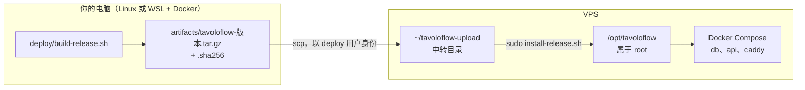
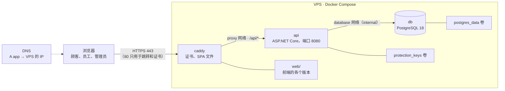

[English](../en/self-hosting.md) · [Italiano](../it/self-hosting.md) · **中文**

# 自托管 TavoloFlow

这份指南写给想把 TavoloFlow 安装到自己服务器上的人：一台 Linux VPS、一个域名和 Docker。完成之后，你的应用可以通过 HTTPS 在你自己的子域名上访问，比如 `https://app.example.com`，有管理员后台、可以作为 PWA 安装的员工端、指向你域名的桌位二维码，以及每晚自动备份。

这也是我自己把它部署上线的经历。构建发布包时，我用的是一台装了 WSL2（Ubuntu）和 Docker Desktop 的 Windows 电脑；服务器是 netcup 的 VPS；域名在 OVHcloud 注册，DNS 由 Cloudflare 管理。凡是取决于我个人情况的选择，我都会写明，方便你按自己的情况调整。

怎么读：

- **总览**介绍各个部分和你需要准备什么：动手之前先读它；
- **第 1 部分**是首次安装，只需做一次；
- **第 2 部分**是会反复进行的操作：发布新版本、备份、维护；
- **第 3 部分**用于应急：验证备份，在新服务器上重新开始；
- 最后是我遇到的问题，以及带检查清单的速查。

所有脚本和配置都在 [`deploy/`](../../deploy/) 目录里。应用内部是怎么做的（模块、身份、锁……），见[开发笔记](development-notes.md#架构)；这里只讲怎么把它部署上线并保持运行。

## 总览

### 一次发布是怎么进行的

服务器上不编译任何东西：没有 .NET SDK，没有 Node，也没有源代码。所有东西都在你的电脑上、在 Docker 容器里构建，然后打成一个压缩包。服务器接收压缩包，检查完整性，再用一个脚本安装。



这样服务器保持精简、干净，而且每个安装的版本都对应你电脑上仍然保存着的一个压缩包：你可以重新安装它，也可以用它回滚，或者从零重建一台服务器。

### 生产环境架构



VPS 上运行三个容器，定义在 [`deploy/compose.yaml`](../../deploy/compose.yaml) 里：

| 服务    | 镜像                  | 作用                                                              |
| ------- | --------------------- | ----------------------------------------------------------------- |
| `caddy` | `caddy:2-alpine`      | 接收所有请求，申请并续期 HTTPS 证书，提供 SPA 文件，转发 `/api/*` |
| `api`   | `tavoloflow-api:版本` | ASP.NET Core 后端，由你构建，包含在发布包里                       |
| `db`    | `postgres:18-alpine`  | 数据库                                                            |

还有四个卷，每次更新或重建容器后都会保留：

| 卷                           | 内容                                                                                     |
| ---------------------------- | ---------------------------------------------------------------------------------------- |
| `postgres_data`              | 数据库的数据                                                                             |
| `protection_keys`            | Data Protection 密钥，用来加密登录 cookie 和入桌码（见[开发笔记](development-notes.md)） |
| `caddy_data`、`caddy_config` | HTTPS 证书和 Caddy 的状态                                                                |

几个重要的选择：

- **只有 Caddy 对外暴露**，端口 80 和 443。API 和数据库不在主机上发布任何端口。这不只是为了整洁：Docker 发布的端口可能绕过 UFW 防火墙的规则，所以不暴露数据库的唯一安全方式，就是不发布它的端口。
- **两个独立的网络。** `proxy` 连接 Caddy 和 API；`database` 连接 API 和 PostgreSQL，并且是 `internal` 的，也就是不能访问互联网。Caddy 看不到数据库。
- **Caddy 有固定 IP**（`172.30.80.2`）。在代理后面，API 看到的每个请求都来自 Caddy，所以 Caddy 会加上 `X-Forwarded-For`（访客的真实 IP）和 `X-Forwarded-Proto`（请求是否是 HTTPS）请求头。API **只**信任来自这个地址的这些请求头（`compose.yaml` 里的 `ReverseProxy__KnownProxies__0`，在 `Operations/DeploymentHosting.cs` 中读取）：否则任何人都可以手动写这些请求头、伪造自己的 IP，绕过登录和入桌码的限流。
- **自动重启。** 每个服务都设置了 `restart: unless-stopped`，Docker 也会随系统启动：你可以关掉 SSH 会话，VPS 重启后应用会自己恢复运行。
- **日志不会塞满磁盘：** 每个容器最多 3 个 10 MB 的文件，之后轮转。
- **只有一个地址。** 前端和 `/api` 在同一个子域名下：没有 CORS，cookie 也只属于这个子域名。

在服务器上，所有不在卷里的东西都放在 `/opt/tavoloflow`。首次安装之后，这个目录是这样的：

```text
/opt/tavoloflow/                  root:root 755
├── compose.yaml, Caddyfile       配置                                  644
├── lib.sh, tf.sh                 公共函数和 Compose 快捷脚本            644
├── install-release.sh            安装与升级                            644
├── rollback.sh                   回到之前的版本                        644
├── bootstrap-admin.sh            第一个管理员、重置密码                 644
├── backup.sh                     备份                                  644
├── tavoloflow-backup.service     备份的 systemd 服务                    644
├── tavoloflow-backup.timer       备份的 systemd 定时器                  644
├── .env.example                  配置模板                              644
├── .env                          真正的配置，包含密码                   600
├── .operation.lock               锁：同一时间只能有一个发布、备份或回滚
├── state/                        700：current 和 previous，已安装的版本
├── backups/                      700：备份
└── web/                          755：Caddy 唯一读取的部分
    ├── current -> releases/版本
    ├── releases/版本/            每个版本的完整前端
    └── assets/                   所有版本的 JS 和 CSS 文件，从不删除
```

### 需要准备什么

| 项目         | 要求                                                                                        | 我的情况                                                  |
| ------------ | ------------------------------------------------------------------------------------------- | --------------------------------------------------------- |
| VPS          | **AMD64（x86-64）**，至少 2 个 vCPU、4 GB 内存、40 GB 磁盘、一个公网 IPv4；Ubuntu 24.04 LTS | netcup VPS Lite 1 G12.5s（2 vCPU、4 GB、80 GB），欧洲机房 |
| 域名         | 一个你能管理 DNS 的域名；会用到一个子域名                                                   | OVHcloud 上的 `qiaotavoloflow.it`                         |
| DNS          | 任何能创建 `A` 记录的服务商                                                                 | Cloudflare，免费套餐                                      |
| 构建用的电脑 | Linux，或者 Windows + WSL2 + Docker Desktop；Git 和 Bash                                    | Windows 11、WSL2 Ubuntu、Docker Desktop                   |
| 邮箱         | 一个真实的地址，用于接收 HTTPS 证书的通知                                                   |                                                           |

VPS 必须是 AMD64，因为脚本只为 `linux/amd64` 构建镜像：不支持 ARM。构建用的电脑则随意，只要有 Docker 就行；在 Apple Silicon 的 Mac 上，构建大概要经过模拟，会变慢，但我没有试过。

开始之前要知道，有些东西是写死在代码里的：

- **欧元和罗马时区。** 每家餐厅创建时都是 `EUR` 和 `Europe/Rome`（`Entities/Restaurant.cs`），没有修改它们的界面。备份定时器在罗马时间 03:30 运行。
- **三种语言。** 员工端、管理员后台和顾客菜单都有中文、意大利语和英语。服务器的错误消息是中文写的：在意大利语和英语界面里，前端根据错误码翻译它们。
- **单实例。** 限流器把计数器放在内存里：架构是为一台服务器上的一个 API 设计的。

## 第 1 部分：首次安装

每条命令都会注明在哪里执行：在**你的电脑**上（我的情况是 WSL 终端），还是在 **VPS** 上。命令里的 `VPS_IP` 是 VPS 的公网 IPv4，`app.example.com` 是你的子域名：请换成你自己的值。

### 1. 准备服务器

#### 1.1 SSH 密钥

连接服务器用 SSH，不用密码，而是用一对密钥：

- **私钥**留在你的电脑上，永远不要分享；
- **公钥**放到服务器上，写在你要登录的用户的 `~/.ssh/authorized_keys` 文件里：它就是允许以这个用户登录的名单。

登录时，客户端用私钥对连接数据签名，服务器用公钥验证签名：私钥从不在网络上传输。服务器信任的不是某台电脑，而是持有私钥的人：好好保管它。

**在你的电脑上：**

```bash
# 生成密钥对：tavoloflow（私钥）和 tavoloflow.pub（公钥）
ssh-keygen -t ed25519 -C "tavoloflow" -f ~/.ssh/tavoloflow
# 显示公钥：复制整行，从 ssh-ed25519 到 tavoloflow
cat ~/.ssh/tavoloflow.pub
```

如果密钥已经存在，不要重新生成：那样会覆盖它。

#### 1.2 安装 Ubuntu

在服务商的控制面板里安装 **Ubuntu 24.04 LTS**，并选择刚创建的公钥：安装程序会把它写进 `/root/.ssh/authorized_keys`，这样你就能用密钥以 root 登录。

我的情况是，netcup 交付的 VPS 装的是 Debian，我在它的服务器控制面板（SCP）里重装了系统：

1. 在 **Options → SSH Keys** 里把公钥保存到我的账号；
2. 在 **Media → Images → Official Images** 里选择 Ubuntu 24.04 LTS Minimal，整个磁盘一个分区，按默认使用 UEFI，并选择那把密钥；
3. 完成后面板会显示 root 密码，在网页控制台（**Screen**）里可以看到系统已经启动。

重装会清空整个磁盘。

#### 1.3 第一次以 root 登录

第一次连接时，SSH 会显示服务器的指纹（fingerprint），问你是否信任它。为了确认连接的确实是你的 VPS，把它和服务商网页控制台里看到的指纹对比一下。

**在 VPS 上，通过服务商的网页控制台：**

```bash
ssh-keygen -lf /etc/ssh/ssh_host_ed25519_key.pub
```

**在你的电脑上：**

```bash
# IdentitiesOnly=yes：只使用 -i 指定的密钥
ssh -o IdentitiesOnly=yes -i ~/.ssh/tavoloflow root@VPS_IP
```

只有指纹一致时才回答 `yes`。然后检查系统和架构：

```bash
cat /etc/os-release   # 应该是 Ubuntu 24.04
uname -m              # 应该是 x86_64
```

#### 1.4 deploy 用户

不要以 root 身份工作。创建一个普通用户 `deploy`，它用密钥登录，只在需要时用 `sudo` 和自己的密码成为 root。这样攻击者必须同时拿到私钥和 `deploy` 的密码。

**在 VPS 上，以 root 身份**（在确认新的登录方式可用之前，保持这个会话不要关）：

```bash
apt update
apt install -y sudo openssh-server nano
# 创建用户及其主目录；密码只用于 sudo
adduser deploy
# 把 deploy 加入 sudo 组；不加 -a 会丢掉其他组
usermod -aG sudo deploy
# 只有 deploy 能访问的 .ssh 目录
install -d -m 700 -o deploy -g deploy /home/deploy/.ssh
# 粘贴公钥那一行；Ctrl+O、回车保存，Ctrl+X 退出
nano /home/deploy/.ssh/authorized_keys
# 由 root 运行的 nano 会以 root 身份创建文件：要把它还给 deploy
chown deploy:deploy /home/deploy/.ssh/authorized_keys
chmod 600 /home/deploy/.ssh/authorized_keys
```

如果在网页控制台里无法粘贴，就复制 root 已有的密钥：`cp /root/.ssh/authorized_keys /home/deploy/.ssh/authorized_keys`，然后执行同样的 `chown` 和 `chmod`。如果所有者或权限不对，SSH 会忽略这把密钥而不说明原因：密钥是对的，登录却失败。

**在你的电脑上，打开一个新终端：**

```bash
ssh -o IdentitiesOnly=yes -i ~/.ssh/tavoloflow deploy@VPS_IP
whoami    # deploy
sudo -v   # 会要求输入 deploy 的密码，并且必须成功
```

从现在开始，你始终以 `deploy` 身份工作。

#### 1.5 更新、时区与防火墙

**在 VPS 上：**

```bash
sudo apt update
sudo apt upgrade -y
# 安装程序需要 python3 来检查 .env，dnsutils 提供 dig
sudo apt install -y ca-certificates curl openssl python3 ufw dnsutils nano
sudo timedatectl set-timezone Europe/Rome
# 先允许 SSH，再打开防火墙：否则会把自己锁在外面
sudo ufw allow OpenSSH
sudo ufw allow 80/tcp
sudo ufw allow 443/tcp
sudo ufw enable
sudo ufw status
```

只能开放三个端口：SSH、80 和 443。80 端口也是必需的：Caddy 用它申请证书，并把 HTTP 跳转到 HTTPS。如果服务商还有自己的防火墙（netcup 的面板里就有），保持默认设置，或者开放同样的入站端口，并且不要阻止出站流量。如果系统要求重启，执行 `sudo reboot`，然后重新以 `deploy` 登录。

#### 1.6 关闭密码登录和 root 登录

现在 `deploy` 已经能用密钥登录，就把其他的登录方式关掉：不允许密码登录（没有密钥的人无法进入，猜密码也不行），也不允许直接以 root 登录。

**在 VPS 上**（在确认之前，保持一个 `sudo` 可用的会话不要关）：

```bash
# 用 tee 而不是 "sudo echo ... > file"：> 重定向由 deploy 的 shell 执行，没有权限
sudo tee /etc/ssh/sshd_config.d/00-tavoloflow.conf >/dev/null <<'EOF'
PasswordAuthentication no
KbdInteractiveAuthentication no
PermitRootLogin no
PubkeyAuthentication yes
EOF
# 语法检查：没有输出表示没有错误
sudo sshd -t
# 实际生效的值：三个都必须是 "no"
sudo sshd -T | grep -E 'passwordauthentication|kbdinteractiveauthentication|permitrootlogin'
sudo systemctl reload ssh
```

为什么文件名以 `00-` 开头：我原本习惯「最后一个设置生效」，但在 sshd 里正好相反。sshd 按字母顺序读取 `sshd_config.d/` 里的文件，对每个选项保留**它找到的第一个值**。云镜像里常常有一个类似 `50-cloud-init.conf` 的文件，写着 `PasswordAuthentication yes`；用 `00-` 开头，我们的设置就排在它前面。也正因为如此，两个检查都需要：`-t` 只检查语法，`-T` 才显示真正生效的值。

然后，**在你电脑上打开一个新终端**，再次确认 `deploy` 能用密钥登录，并且 `sudo -v` 可用。确认之后才关闭旧会话。如果把自己锁在外面了，可以通过服务商的网页控制台补救，它不经过 SSH。

#### 1.7 安装 Docker

服务器上只需要 Docker Engine 和 Compose 插件，从 Docker 的官方仓库安装（[Ubuntu 安装说明](https://docs.docker.com/engine/install/ubuntu/)）。

**在 VPS 上：**

```bash
# 添加 Docker 的仓库及其签名密钥
sudo install -m 0755 -d /etc/apt/keyrings
sudo curl -fsSL https://download.docker.com/linux/ubuntu/gpg -o /etc/apt/keyrings/docker.asc
sudo chmod a+r /etc/apt/keyrings/docker.asc
sudo tee /etc/apt/sources.list.d/docker.sources >/dev/null <<EOF
Types: deb
URIs: https://download.docker.com/linux/ubuntu
Suites: $(. /etc/os-release && echo "$VERSION_CODENAME")
Components: stable
Architectures: $(dpkg --print-architecture)
Signed-By: /etc/apt/keyrings/docker.asc
EOF
# 安装并启动 Docker，每次开机也会启动
sudo apt update
sudo apt install -y docker-ce docker-ce-cli containerd.io docker-buildx-plugin docker-compose-plugin
sudo systemctl enable --now docker
# 验证：Client 和 Server 的版本，然后是 hello-world 的消息
sudo docker version
sudo docker compose version
sudo docker run --rm hello-world
```

**不要把 `deploy` 加入 `docker` 组。** 能控制 Docker 的人，可以启动一个以 root 身份挂载系统任意文件的容器：加入 `docker` 组，实际上就等于不用密码的 root。所有 Docker 命令都用 `sudo` 执行。

### 2. 域名与 DNS

创建一条 DNS 记录，让子域名指向 VPS 的 IPv4：

| 字段 | 值                                  |
| ---- | ----------------------------------- |
| 类型 | `A`                                 |
| 名称 | `app`（即 `app.example.com`）       |
| 值   | VPS 的 IPv4，不带 `https://` 和端口 |
| TTL  | 自动                                |

不要为这个子域名创建 `AAAA`（IPv6）记录：这套部署只使用 IPv4。

**如果用 Cloudflare，选择「仅 DNS」（灰色云朵）。** 橙色云朵看起来像免费的礼物（CDN、防护、HTTPS），但那样请求会经过 Cloudflare 的服务器：API 看到的所有请求都来自 Cloudflare 的 IP，而不是访客的 IP，按 IP 的限流就失效了，HTTPS 证书也得用另一种方式配置。用灰色云朵时，Cloudflare 只负责解析域名，浏览器直接和 Caddy 通信。

我的情况是，本来想全部在 OVHcloud 买，但我需要的那款欧洲 VPS 缺货了，而 Cloudflare 又不卖 `.it` 域名：所以域名在 OVHcloud 注册，DNS 由 Cloudflare 管理，VPS 是 netcup 的。把 DNS 转到 Cloudflare 的步骤：

1. 在 Cloudflare 免费套餐里添加域名，检查导入的记录是否正确（如果域名有邮箱，保留 MX、SPF、DKIM 和 DMARC）；
2. 在 OVHcloud 上**先关闭 DNSSEC**，然后在 **DNS servers** 里把域名服务器替换为 Cloudflare 分配的两个（是替换，不是添加为 NS 记录）；
3. Cloudflare 把域名标记为 Active 之后，在 Cloudflare 上重新开启 DNSSEC，并把 DS 记录复制到 OVHcloud。

这本来是个偶然，后来却成了优点：域名、DNS 和服务器在三家不同的服务商那里，互不绑定；换 VPS 时只需要修改一条 `A` 记录，不用重印二维码，也不用改配置。

主域名和 `www` 不能指向这台 VPS：在我的情况里，它们留给一个独立的展示网站。Caddy 只响应应用的子域名。

**验证，在你的电脑或 VPS 上：**

```bash
dig +short NS example.com                    # 你的 DNS 服务商的域名服务器
dig @1.1.1.1 +short A app.example.com        # VPS 的 IPv4
dig @1.1.1.1 +short AAAA app.example.com     # 没有输出
```

DNS 没有设置正确之前不要继续：Caddy 申请证书需要它。

### 3. 构建发布包

先提交你的修改：版本 ID 里包含 commit 的哈希，但构建使用的是工作目录里的文件，如果有修改没有提交，两者就对不上了。

**在你的电脑上，在仓库目录下，Docker 处于运行状态：**

```bash
PUBLIC_ORIGIN=https://app.example.com bash deploy/build-release.sh
```

`PUBLIC_ORIGIN` 是应用的公开地址：全部小写，不带端口、路径和结尾斜杠。这个脚本（[`deploy/build-release.sh`](../../deploy/build-release.sh)）：

- **在容器里构建一切**，前端用 Node 24，后端用 .NET 10：结果不取决于你电脑上装了什么。第一次运行会下载基础镜像，需要几分钟；
- **为 `linux/amd64` 构建**，也就是 VPS 的架构；
- **把公开地址写进前端。** 桌位二维码在店主的浏览器里生成，包含的就是这个地址（`VITE_PUBLIC_BASE_URL`）。构建不会读取你的 `.env.local`，那里可能写着你用手机测试时的家庭网络地址：用那个地址打印出来的二维码，对任何顾客都没用。这个地址还会写进 `public-origin.txt`，安装程序会把它和服务器上配置的域名进行比较；
- **准备迁移程序** `efbundle`，放在 API 镜像里（见第 5 步）；
- **只把一份明确清单里的文件放进发布包**：没有真正的 `.env`，没有密钥，没有开发数据，没有 `node_modules`；
- **计算校验和**：每个文件的（`SHA256SUMS`）和整个压缩包的（`.sha256`）。

版本 ID 由构建时的 UTC 时间加上 commit 的短哈希组成。脚本最后会打印生成的两个文件，例如：

```text
artifacts/tavoloflow-20261026T094909Z-4c9535b.tar.gz
artifacts/tavoloflow-20261026T094909Z-4c9535b.tar.gz.sha256
```

压缩包里（大约 120 MB）有：

```text
api-image.tar.gz     API 的 Docker 镜像，包含 efbundle
image.id             镜像 ID，安装时会检查
frontend/            SPA 的静态文件
ops/                 将放进 /opt/tavoloflow 的脚本和配置
release.txt          版本 ID
public-origin.txt    写进前端的公开地址
SHA256SUMS           每个文件的校验和
```

在你的电脑上至少保留生产环境当前版本和上一个版本的发布包：回滚和重建服务器都要用到它们。

**可选：在本地完整测试。** [`deploy/smoke-test.sh`](../../deploy/smoke-test.sh) 会把发布包安装到一个临时的、隔离的 Docker 里（Docker-in-Docker，使用本地测试证书），检查安装、迁移、HTTPS、三种身份的 cookie 和 CSRF、连续两次发布、备份、恢复和回滚，然后清理本次测试创建的资源。它使用发布包里写的地址，所以任何 `PUBLIC_ORIGIN` 都可以：

```bash
PUBLIC_ORIGIN=https://app.example.com bash deploy/build-release.sh
bash deploy/smoke-test.sh artifacts/tavoloflow-版本.tar.gz
```

**把发布包上传到 VPS，在你的电脑上：**

```bash
# 脚本打印出的版本 ID
RELEASE=20261026T094909Z-4c9535b
# 单引号：~ 要展开成 VPS 上 deploy 的主目录，而不是你的
ssh -i ~/.ssh/tavoloflow deploy@VPS_IP 'mkdir -p ~/tavoloflow-upload'
scp -i ~/.ssh/tavoloflow \
  "artifacts/tavoloflow-$RELEASE.tar.gz" \
  "artifacts/tavoloflow-$RELEASE.tar.gz.sha256" \
  deploy@VPS_IP:~/tavoloflow-upload/
```

发布包先到 `deploy` 的一个**中转目录**，而不是直接放进 `/opt/tavoloflow`：那个目录属于 root，以 `deploy` 登录的 `scp` 写不进去。这样也更安全：从外部来的文件，在检查之前一直放在一个没有特权的地方。如果上传中断，重新上传同一个发布包即可。

### 4. 准备 `/opt/tavoloflow`

**在 VPS 上**（你电脑上的变量不会带到这里：重新设置 `RELEASE`）：

```bash
RELEASE=20261026T094909Z-4c9535b
cd ~/tavoloflow-upload
# 压缩包的校验和：必须输出 OK
sha256sum -c "tavoloflow-$RELEASE.tar.gz.sha256"
# 每个版本放在自己的目录里：压缩包里的文件没有顶层目录
mkdir "$RELEASE"
tar -xzf "tavoloflow-$RELEASE.tar.gz" -C "$RELEASE"
cd "$RELEASE"
# 每个文件的校验和：没有输出表示一切正常
sha256sum --check --quiet SHA256SUMS
# 生产目录和运维文件属于 root
sudo install -d -o root -g root -m 755 /opt/tavoloflow
sudo install -o root -g root -m 644 ops/* ops/.env.example /opt/tavoloflow/
# 真正的 .env，只有 root 能读。只在首次安装时执行！
sudo install -o root -g root -m 600 ops/.env.example /opt/tavoloflow/.env
# 生成数据库密码（复制下来），然后打开 .env
openssl rand -hex 32
sudo nano /opt/tavoloflow/.env
```

这里的 `install` 不是安装软件包：它复制文件，同时设置所有者和权限。`ops/*` 不包含隐藏文件，所以 `.env.example` 要单独写出来。如果校验和检查不通过，重新上传发布包：不要跳过检查。

**之后的发布中，永远不要再执行创建 `.env` 的那一行**：那样会用空模板覆盖你的配置。

#### `.env` 文件

| 变量                | 填什么                                                                   |
| ------------------- | ------------------------------------------------------------------------ |
| `DOMAIN`            | 子域名，比如 `app.example.com`，不带 `https://`：`https://` + `DOMAIN` 必须等于 `PUBLIC_ORIGIN` |
| `ACME_EMAIL`        | 你真实的邮箱，用于接收证书通知                                           |
| `POSTGRES_PASSWORD` | `openssl rand -hex 32` 生成的 64 个十六进制字符                          |

其他保持不变。不要加引号，`=` 两边不要有空格。

- **数据库密码只在第一次生效。** PostgreSQL 只在数据卷为空时，用 `POSTGRES_PASSWORD` 创建用户。之后在 `.env` 里改密码，数据库并不知道，API 就再也连不上了。用十六进制，是因为它只包含 `0-9` 和 `a-f`：无论在 Compose 里还是在连接字符串里，都没有需要转义的字符。
- **安装程序在做任何事之前会检查三件事：** 密码是 64 个十六进制字符，邮箱不是模板里的那个，以及 `https://` + `DOMAIN` 与发布包里的 `public-origin.txt` 一致。这样你就不可能装上一个二维码指向别的域名的前端。
- `PROXY_SUBNET`、`PROXY_DYNAMIC_RANGE` 和 `CADDY_IP` 定义 Caddy 与 API 之间的网络，以及 Caddy 的固定 IP。只有当 VPS 上已经有另一个 Docker 网络在用 `172.30.80.0/24` 时才需要修改，而且三个要一起改，并在第一次启动之前改。
- 安装程序已经会用 `docker compose config --quiet` 检查配置；安装之后，你可以自己用 `sudo bash /opt/tavoloflow/tf.sh config --quiet` 检查。不加 `--quiet` 会打印全部内容，包括密码。

#### 为什么是这些权限

| 路径                              | 权限        | `deploy` 能做什么                      |
| --------------------------------- | ----------- | -------------------------------------- |
| `/home/deploy/tavoloflow-upload/` | 属于 deploy | 什么都能做：这是中转目录               |
| `/opt/tavoloflow/`                | 755         | 进入和读取，但不能创建、删除或替换文件 |
| 脚本和配置                        | 644         | 只能读                                 |
| `.env`                            | 600         | 什么都不能做，连读都不行               |

原因是：每天晚上，systemd 会**以 root 身份**运行 `/opt/tavoloflow/backup.sh`，而它又会加载 `lib.sh` 和 `compose.yaml`。如果 `deploy` 能修改其中任何一个文件，它就能在里面写入任意命令，让 root 在下一次备份时执行：不知道 `sudo` 密码也能获得 root。目录本身也要保护，因为删除或替换一个文件，只需要对它所在的目录有写权限。所以要用 `install -o root`，而不是 `cp -a`，后者会保留上传文件的所有者 `deploy`（见「遇到的问题」）。

**检查权限，在 VPS 上：**

```bash
# 主要文件的所有者和权限
sudo stat -c '%U:%G %a %n' /opt/tavoloflow /opt/tavoloflow/backup.sh /opt/tavoloflow/lib.sh /opt/tavoloflow/compose.yaml /opt/tavoloflow/.env
# 不属于 root，或者组和其他人可写的文件：不能有任何输出
sudo find /opt/tavoloflow \( ! -user root -o ! -group root -o \( ! -type l -perm /022 \) \) -print
# 从 deploy 的角度：不加 sudo
test ! -w /opt/tavoloflow && test ! -w /opt/tavoloflow/backup.sh && echo 'deploy 不能修改或替换备份脚本'
```

你应该看到：所有地方都是 `root:root`，目录是 `755`，脚本和配置是 `644`，`.env` 是 `600`，`find` 没有输出，最后打印出那条消息。每次发布之后、以及启用自动备份之前，都重复这个检查。

### 5. 安装

**在 VPS 上，仍然在解压出的目录里**（比如 `~/tavoloflow-upload/20261026T094909Z-4c9535b/`）：

```bash
sudo bash ops/install-release.sh "$PWD" /opt/tavoloflow
```

运行的是**新发布包里的**脚本，这样脚本和发布包永远是同一个版本。第一个参数是发布包目录，第二个是生产目录。这个脚本（[`deploy/install-release.sh`](../../deploy/install-release.sh)）依次：

1. **检查**：以 root 运行、`.env` 存在、发布包的校验和；
2. **修复** `/opt/tavoloflow` 的**权限**，然后才读取或执行其中的任何文件；
3. **获取锁** `.operation.lock`，保证发布、备份和回滚永远不会同时进行；
4. **检查 `.env`**（上面说的三条规则）；
5. 用 `docker load` **加载 API 镜像**，并确认它的 ID 与 `image.id` 一致；
6. **准备目录** `state/`、`backups/`（700）和 `web/`（755）；
7. 如果已经装过某个版本，**停止 API 并做一次备份**；首次安装时跳过这一步；
8. 把**运维文件复制**到 `/opt/tavoloflow`（`.env` 不在其中，永远不会被改动）；
9. **启动数据库**并等待它就绪；第一次启动时，PostgreSQL 用 `.env` 里的密码创建用户；
10. **执行迁移**；
11. 把**前端复制**到 `web/releases/版本/`，并把它的 JS 和 CSS 文件复制到 `web/assets/`；
12. **启动新的 API**，等待它在 `/health/ready` 上返回健康状态（检查数据库是否可以访问）；
13. 把 **`web/current` 链接**指向新版本；
14. **重新创建 Caddy 容器**，第一次时它会申请证书；
15. 把版本**写入** `state/current`（上一个版本写入 `state/previous`）。

PostgreSQL 和 Caddy 的镜像不在发布包里：第一次启动时由 Docker 下载，看到它们在下载是正常的。

第 13 步是**原子操作**：脚本先创建一个临时链接，再用 `mv -T` 把它重命名覆盖到 `current` 上，这是一次文件系统操作。访客看到的要么是旧版本，要么是新版本，绝不会是中间状态。

#### 迁移

开发时，修改模型后用 `dotnet ef migrations add` 创建迁移，再用 `dotnet ef database update` 应用到本地数据库。生产环境不能这样做：服务器上既没有 SDK，也没有源代码。

- **`efbundle`。** 构建时，[`Dockerfile.api`](../../deploy/Dockerfile.api) 执行 `dotnet ef migrations bundle`，把所有迁移打包成一个独立的程序 `efbundle`，放进 API 镜像里。它做的事情和 `database update` 一样，但不需要 SDK。安装程序在一个一次性容器里运行它：`compose run --rm --entrypoint /app/efbundle api`。
- **可以重复执行。** EF Core 把已经执行的迁移记录在 `__EFMigrationsHistory` 表里：每次发布时 `efbundle` 都会运行，但只执行新的迁移。
- **从不在 API 启动时执行。** 容器重启的原因有很多（崩溃、VPS 重启）：如果启动时执行迁移，数据库可能在任何时候发生变化。现在的做法是，数据库只在发布时、并且在备份之后才会变化；如果某个迁移失败，脚本会停下来，而不是留下一个不断崩溃的 API。
- **只能向前。** 生产环境不撤销迁移（比如用 `dotnet ef database update 0`，它会删除表和数据）：如果有问题，就写一个新的迁移来修正。这也限制了回滚（见第 2 部分）。

#### HTTPS

证书由 Caddy 通过 ACME 协议（Let's Encrypt 或 ZeroSSL）自动管理：第一次启动时申请，到期前自动续期，不需要 cron，也不需要任何命令。要让它工作，需要三个条件：`A` 记录已经指向 VPS，80 和 443 端口可以从互联网访问，`ACME_EMAIL` 是一个真实的地址。

[`Caddyfile`](../../deploy/Caddyfile) 只服务 `DOMAIN` 指定的域名。对其他任何域名、或者直接访问 IP 的 HTTP 请求，返回 404 而不是跳转：这台 VPS 不会冒充别人的网站。缓存也由这个文件决定：`/api` 从不缓存，文件名带哈希的文件缓存一年，`index.html`、`sw.js` 和 manifest 每次都要重新验证（`no-cache`）。

#### 检查

**在 VPS 上：**

```bash
# db、api 和 caddy 必须是 running 且 healthy
sudo bash /opt/tavoloflow/tf.sh ps
# 证书：在最后几行里找错误
sudo bash /opt/tavoloflow/tf.sh logs --tail 80 caddy
```

`tf.sh` 是 `docker compose` 的快捷方式，自动使用生产环境的目录、`.env` 和 `compose.yaml`，并从 `state/current` 读取版本。所有 Compose 命令都通过它执行；它需要 `sudo`，因为 `deploy` 不在 `docker` 组里，而且 `.env` 只有 root 能读。

**在你的电脑上：**

```bash
curl -I http://app.example.com                    # 跳转到 https
curl -I https://app.example.com/staff/login       # 200，没有证书错误
curl -I https://app.example.com/sw.js             # JavaScript，Cache-Control: no-cache
curl -I https://app.example.com/staff.webmanifest # application/manifest+json，no-cache
curl -i https://app.example.com/api/auth/csrf     # JSON，Cache-Control: no-store
```

不要用 `curl -k` 掩盖证书问题：问题必须解决。`https://app.example.com/` 会跳转到 `/staff`。

### 6. 首次使用

#### 平台管理员

数据库是空的，而只有平台管理员能创建餐厅。第一个管理员在 VPS 上创建：

```bash
sudo bash /opt/tavoloflow/bootstrap-admin.sh
```

它会询问用户名和密码（6–128 个字符；输入时屏幕上什么都不显示，这是正常的）。这个脚本（[`bootstrap-admin.sh`](../../deploy/bootstrap-admin.sh)）用 API 镜像启动一个一次性容器，执行 `--seed-platform-admin` 命令，创建账号后退出，不处理任何请求（`Operations/MaintenanceCommands.cs`）。密码通过按名称传递的环境变量（`-e NAME`）进入容器：它不会出现在进程参数里，不会出现在 shell 历史里，也不会出现在 `.env` 里。只有当还没有任何管理员时，这个命令才会创建管理员：用同一个用户名再次运行不会改变任何东西，用不同的用户名则会拒绝。

#### 三个入口

| 谁         | 地址                                                |
| ---------- | --------------------------------------------------- |
| 平台管理员 | `https://app.example.com/platform/login`            |
| 店主和员工 | `https://app.example.com/staff/login`               |
| 顾客       | `https://app.example.com/q/{token}`，来自桌位二维码 |

#### 第一家餐厅

1. 进入 `/platform/login`（语言可以在顶部切换），创建餐厅：名称、菜单默认语言、店主和员工的用户名、第一个服务期。
2. 立即保存两个**临时密码**：它们只显示一次。
3. 店主进入 `/staff/login`，首次登录时必须设置新密码（「设置你的新密码」）。然后准备菜单（分类、菜品、价格、过敏原），并在「桌位与二维码」里配置桌位。
4. 员工也用自己的临时密码完成同样的首次登录。
5. 新餐厅默认处于**暂停**状态，接单也是关闭的：在管理员后台启用服务，然后由店主或员工在桌台页面打开「扫码接单」。重新启用服务不会自动重新开启接单。
6. 下载并打印一张桌的二维码，检查扫码后打开的是 `https://app.example.com/q/...`，而不是 `localhost` 或家庭网络地址。
7. 完整走一遍：在桌台开桌，用手机扫码，输入入桌码，下单，在厨房把菜标为出餐完成，以店主身份结账，并在历史账单里找到这张账单。

管理员不能代替店主结账。而且测试订单会留在历史记录里：测试时请用一家明显是测试用的餐厅，而不是真实的那家，不要用 SQL 手动删除数据。

#### 员工端 PWA

在餐厅的每台设备上打开 `https://app.example.com/staff` 并安装应用：

- **Android、电脑（Chrome、Edge）：** 在应用的首页，「安装到本设备」一栏里点「安装应用」，或者通过浏览器菜单安装；
- **iPhone 和 iPad（Safari）：** 「分享」→「添加到主屏幕」；第一次从图标打开时需要重新登录。

从图标打开后，检查首页、厨房和结账；在厨房里打开提示音和屏幕常亮。断网时应该出现一个提示断网的页面。`/q/...` 上的顾客和管理员后台都不应该提示安装。详情见 [`pwa.md`](../reference/pwa.md)（英文）。

### 7. 在录入真实数据之前启用备份

现在就做，在餐厅录入真实菜单之前。我自己也曾经拖延过（见「遇到的问题」）。

**在 VPS 上：**

```bash
# 手动备份一次，确认脚本可用
sudo bash /opt/tavoloflow/backup.sh
# 把服务和定时器复制到 systemd 读取的位置
sudo install -o root -g root -m 644 /opt/tavoloflow/tavoloflow-backup.service /etc/systemd/system/
sudo install -o root -g root -m 644 /opt/tavoloflow/tavoloflow-backup.timer /etc/systemd/system/
sudo systemctl daemon-reload
# 启用定时器，立即生效并且每次开机生效（不会马上执行备份）
sudo systemctl enable --now tavoloflow-backup.timer
# 下次执行时间和已有的备份
sudo systemctl list-timers tavoloflow-backup.timer
sudo ls -lh /opt/tavoloflow/backups/
```

在 systemd 里，一个定时任务由两个文件组成：**服务**说明做什么，**定时器**说明什么时候做。

| 文件                        | 配置行                                  | 含义                                    |
| --------------------------- | --------------------------------------- | --------------------------------------- |
| `tavoloflow-backup.service` | `Type=oneshot`                          | 启动、完成工作、结束；不是常驻服务      |
|                             | `User=root`                             | 以 root 运行（所以才需要第 4 步的权限） |
|                             | `Requires=` / `After=docker.service`    | 依赖 Docker，并在它之后启动             |
|                             | `UMask=0077`                            | 创建的文件只有 root 能读                |
| `tavoloflow-backup.timer`   | `OnCalendar=*-*-* 03:30:00 Europe/Rome` | 每天罗马时间 03:30                      |
|                             | `RandomizedDelaySec=300`                | 随机延迟最多 5 分钟                     |
|                             | `Persistent=true`                       | 如果那个时间服务器关机，开机后补做      |

`/opt/tavoloflow` 里的文件只是随发布包来的副本：systemd 读取的是 `/etc/systemd/system/` 里的文件。所以要复制过去，而且如果某次发布修改了它们，要重新复制。

然后马上把第一个备份下载到你的电脑上，方法见第 2 部分「备份」。并且尽快做一次恢复演练（第 3 部分）。

## 第 2 部分：日常操作

### 发布新版本

和首次安装的流程一样，只是不改动 `.env`，也不创建管理员。

**开始之前：**

1. 代码已经测试并且**已提交**。
2. 你的电脑上 Docker 正在运行。
3. 检查有没有新的迁移。生产环境当前版本的 ID（在 VPS 上执行 `sudo cat /opt/tavoloflow/state/current`）以构建它的 commit 哈希结尾：

   ```bash
   # 在你的电脑上：把 4c9535b 换成生产环境版本的哈希。
   # 没有输出 = 没有新的迁移
   git log --oneline 4c9535b..HEAD -- backend/TavoloFlow.Api/Data/Migrations
   ```

4. 如果有迁移，或者是一次重要的更新，先把最新的备份下载到你的电脑上。
5. 选一个餐厅打烊的时间：安装程序做备份、执行迁移、重启 API 的过程中，页面能打开，但每个 `/api` 请求都会失败。

**在你的电脑上：**

```bash
PUBLIC_ORIGIN=https://app.example.com bash deploy/build-release.sh
RELEASE=新版本
scp -i ~/.ssh/tavoloflow \
  "artifacts/tavoloflow-$RELEASE.tar.gz" \
  "artifacts/tavoloflow-$RELEASE.tar.gz.sha256" \
  deploy@VPS_IP:~/tavoloflow-upload/
```

`scp` 只复制文件，不会在 VPS 上打开 shell。**在你的电脑上**，以 `deploy` 身份登录（或者回到已经打开的 SSH 会话）：

```bash
ssh -o IdentitiesOnly=yes -i ~/.ssh/tavoloflow deploy@VPS_IP
```

**在 VPS 上**（重新设置 `RELEASE`：你电脑上的变量不会传到这里）：

```bash
RELEASE=新版本
cd ~/tavoloflow-upload
sha256sum -c "tavoloflow-$RELEASE.tar.gz.sha256"
mkdir "$RELEASE"
tar -xzf "tavoloflow-$RELEASE.tar.gz" -C "$RELEASE"
# 你在 ~/tavoloflow-upload 里，所以路径以 $RELEASE/ 开头
sudo bash "$RELEASE/ops/install-release.sh" "$PWD/$RELEASE" /opt/tavoloflow
sudo bash /opt/tavoloflow/tf.sh ps
```

安装程序一开始会重新检查每个文件（`SHA256SUMS`）。发现已经装有某个版本时，安装程序会这样做：

```text
停止 API → 备份 → 迁移 → 新 API → 切换 web/current → 重新创建 Caddy 容器 → 保存版本
└─────────────────────── API 无响应 ───────────────────────┘
```

- **每次都会备份**，即使没有新的迁移。
- **备份之前先停止 API**，这样备份期间没有人写入，备份是一致的。
- **备份在迁移之前**：如果某个迁移出了问题，还有一份之前的副本。

**已经打开的页面。** 一个开了一整天的厨房页面，内存里是旧版本的前端；切换页面时，它会加载按旧版本命名的代码块（路由按页面拆分代码）。所以 `web/assets/` 保留了**所有**版本的文件：文件名里带哈希，永远不会被覆盖，旧页面总能找到自己的文件。新代码只有在页面刷新或应用重新打开时才会生效。但在此期间，旧页面是和新 API 通信的：API 的修改必须兼容上一个版本的客户端，否则就要让所有设备刷新页面。

**发布之后**，检查登录、一个读取操作（比如厨房或结账）以及在 PWA 里切换页面。如果某个写操作显示结果待核对，按照界面的提示操作：应用会用 GET 检查，盲目重发可能会把操作执行两次。

如果这次发布修改了 `tavoloflow-backup.service` 或 `.timer`，安装程序只会更新 `/opt/tavoloflow` 里的副本：请重复第 1 部分第 7 步里的两行 `install` 和 `daemon-reload`。

### 发布出问题时

安装程序遇到第一个错误就会停止。在做任何其他事情之前，先看日志：

```bash
sudo bash /opt/tavoloflow/tf.sh logs --tail 100 api db caddy
```

- **不要删除卷，也不要马上恢复数据库。** 脚本出错不会删除数据。
- 如果 API 处于停止状态，在查明原因之前，不要恢复餐厅的系统服务。
- 修复之后，用一个**新的 ID** 发布：同一个 ID 会被构建（压缩包已存在）和安装程序（`web/releases/版本` 目录已存在）拒绝。重新执行迁移没有害处。

如果失败的正是首次安装，`state/current` 还不存在，`tf.sh` 不知道该用哪个版本。你需要自己传给它，在 `sudo` 后面用 `env`，因为 `sudo` 会清除写在它前面的环境变量：

```bash
sudo env RELEASE_ID=失败的版本 bash /opt/tavoloflow/tf.sh logs --tail 100 api db caddy
```

#### 回滚到上一个版本

```bash
sudo cat /opt/tavoloflow/state/current
sudo cat /opt/tavoloflow/state/previous
# 只有在确认旧代码能在当前数据库结构上运行之后才执行
sudo bash /opt/tavoloflow/rollback.sh --schema-compatible 上一个版本
```

[`rollback.sh`](../../deploy/rollback.sh) 会检查旧版本的前端和镜像还在，停止 API，做一次备份，启动旧的 API，把 `web/current` 指回旧的前端，重新创建 Caddy 容器，并更新 `state/`。**它只改变代码，不改变数据库**：迁移保持已执行的状态，这段时间里的订单也保留。所以旧代码必须能在新的数据库结构上运行：

| 新迁移做了什么               | 旧代码能运行吗？                 |
| ---------------------------- | -------------------------------- |
| 新增了一张表或一个可为空的列 | 通常可以：它不知道也不使用它们   |
| 删除或重命名了一列           | 不行：它会去找一个已经不存在的列 |
| 新增了一个没有默认值的必填列 | 不行：它的 INSERT 不会填写这一列 |

`--schema-compatible` 选项是必需的，就是为了让你停下来想一想：没有它，脚本会拒绝执行。如果数据库结构不兼容，最好的办法是修复后发布一个新版本；另一种办法是在打烊时恢复备份，但会丢失备份之后发生的一切。

### 备份

每次运行 [`backup.sh`](../../deploy/backup.sh)，都会在 `/opt/tavoloflow/backups/` 里生成一个压缩包：

```text
tavoloflow-20261027T023000Z-12345.tar.gz    UTC 时间和进程号
├── database.dump      数据库，用 pg_dump 导出
├── keys.tar.gz        Data Protection 密钥
├── production.env     .env 的副本，包括密码
├── compose.yaml, Caddyfile
├── state/             当时已安装的版本
└── SHA256SUMS
```

- **`pg_dump` 从同一个快照读取所有数据：** 即使导出时有订单进来，文件也是一致的，就像在同一瞬间拍下的照片。
- **密钥必须和数据库放在一起。** 登录 cookie 和入桌码都是用这些密钥加密的：只有数据库而没有密钥，所有设备都得重新登录，正在进行的用餐的入桌码也无法读取。
- **不包含** Docker 镜像和前端（它们在你电脑上的发布包里），也不包含证书（在新服务器上 Caddy 会重新申请）。菜品照片保存在数据库中，因此包含在 `database.dump` 里。
- **它包含密码和密钥：** 绝不要放在公开目录里，也绝不要放进 Git。
- 备份先写入一个 `.part` 文件，最后才重命名：永远不会留下写了一半的备份。它和发布、回滚使用同一把锁：如果发现正在发布，就报错退出。

有四种情况会产生备份：每天晚上由定时器触发，每次发布时（在迁移之前），每次回滚时，以及你手动运行时。它们都放在同一个目录里，**超过 7 天的会被删除**：如果某次发布的问题在八天后才暴露，发布前的那个备份已经不在服务器上了。这也是应该把备份下载下来的另一个原因。

#### 把备份下载到你的电脑

只放在服务器上的备份，会和服务器一起消失（磁盘损坏、VPS 被删除、账号被封）。你多久下载一次，决定了最坏情况下会丢失几天的数据；我当时选择每周一次，外加每次重要发布之前。

没法用一条命令直接下载：备份属于 root，`deploy` 读不了；而 `ssh deploy@VPS_IP sudo cat ...` 也不行，因为 `sudo` 会要求输入密码，没有交互式终端就没有地方输入。所以要先做一份属于 `deploy` 的临时副本。

**在 VPS 上，在交互式终端里**（用 `sudo ls -lh /opt/tavoloflow/backups/` 找到文件名）：

```bash
BACKUP=tavoloflow-日期-编号.tar.gz
install -d -m 700 /home/deploy/tavoloflow-download
sudo install -m 600 -o deploy -g deploy \
  "/opt/tavoloflow/backups/$BACKUP" "/home/deploy/tavoloflow-download/$BACKUP"
```

**在你的电脑上：**

```bash
BACKUP=tavoloflow-日期-编号.tar.gz
# 从这里开始创建的文件只有你能读
umask 077
mkdir -p ~/tavoloflow-backups
scp -i ~/.ssh/tavoloflow \
  "deploy@VPS_IP:/home/deploy/tavoloflow-download/$BACKUP" \
  "$HOME/tavoloflow-backups/$BACKUP"
# 能列出文件，说明压缩包是完整的
tar -tzf "$HOME/tavoloflow-backups/$BACKUP"
```

**回到 VPS 上**，删除临时副本（原件仍在 `backups/` 里）：

```bash
rm -- "/home/deploy/tavoloflow-download/$BACKUP"
```

在 WSL 上，如果删除了发行版，`~/tavoloflow-backups` 也会消失：重要的备份要另外再存一份，并记住它们包含密码和密钥。如果不想再手动下载，下一步可以用对象存储做自动复制。

### 维护

**系统状态，在 VPS 上：**

```bash
sudo bash /opt/tavoloflow/tf.sh ps                       # 运行中且健康的容器
sudo bash /opt/tavoloflow/tf.sh logs --tail 100 api      # API 的最后几行日志
sudo docker stats --no-stream                            # 每个容器的 CPU 和内存
free -h                                                  # 内存：看 available 列
df -h                                                    # 磁盘：看 / 那一行的 Use%
sudo docker system df                                    # 镜像和卷占用的空间
sudo du -sh /opt/tavoloflow/web /opt/tavoloflow/backups
# 内存是否耗尽过（OOM）？
sudo journalctl -k --no-pager | grep -i -E 'out of memory|oom'
```

磁盘用量接近 80% 时就要清理。如果内存一直在上限附近、出现 OOM 错误，或者高峰时段响应变慢，先找原因，然后再考虑换更大的 VPS。

**清理：**

```bash
# 这两个版本不要动
sudo cat /opt/tavoloflow/state/current /opt/tavoloflow/state/previous
# 中转目录里的一个旧版本（写完整的 ID，不要用范围太大的 *）
rm -rf ~/tavoloflow-upload/tavoloflow-旧版本.tar.gz* ~/tavoloflow-upload/旧版本
# 旧的 API 镜像
sudo docker image ls tavoloflow-api
sudo docker image rm tavoloflow-api:旧版本
```

| 内容                           | 每次发布增长 | 要清理吗？                       |
| ------------------------------ | ------------ | -------------------------------- |
| 中转目录                       | 约 230 MB    | 要，版本装好、本地也有发布包之后 |
| `tavoloflow-api` 镜像          | 几十 MB      | 要，当前版本和上一个版本除外     |
| `web/releases/`、`web/assets/` | 约 1 MB      | 不要：旧页面和回滚需要它们       |
| 备份                           | —            | 不用：7 天后自动删除             |

**永远不要执行 `docker volume prune`，也不要执行带 `--volumes` 的清理命令：** 它们可能会删除数据库的卷。

**更新**，在餐厅打烊时进行：

```bash
# 系统安全更新，大约每月一次
sudo apt update
sudo apt upgrade -y
test -f /var/run/reboot-required && echo '需要重启'
sudo reboot   # 只在需要时；容器会自己重新启动
```

- PostgreSQL 和 Caddy 的镜像不会随发布更新。小版本升级：先备份、做恢复演练，然后执行 `sudo bash /opt/tavoloflow/tf.sh pull db caddy` 和 `sudo bash /opt/tavoloflow/tf.sh up -d --wait db caddy`。
- 不要只改版本号就从 PostgreSQL 18 升到 19：大版本升级要单独规划。
- 每次构建时，API 的 .NET 运行时都会更新到最新补丁。即使代码没有修改，也值得隔一段时间重新构建并发布一次，以获得安全补丁。

**忘记管理员密码：**

```bash
sudo bash /opt/tavoloflow/bootstrap-admin.sh --reset-platform-password
```

它会询问一个已有管理员的用户名和新密码；该账号的所有会话都会被关闭。它不会重新启用已停用的账号。店主和员工的密码则在管理员后台重置，员工的密码也可以由店主在「员工账号」页面重置。

## 第 3 部分：应急

### 恢复演练

一个从没恢复过的备份还不算备份：只是一种希望。这个演练把备份恢复到一个临时的 PostgreSQL 里，它与网络隔离、有自己的卷，不会碰生产数据库。

**在 VPS 上**（如果已经存在名为 `tavoloflow-restore-check` 的容器，先确认它是之前演练留下的）：

```bash
# 放在 /root 里，权限 700：备份包含密码和密钥
sudo install -d -m 700 /root/tavoloflow-restore-check
sudo tar -xzf /opt/tavoloflow/backups/备份文件名.tar.gz -C /root/tavoloflow-restore-check
# deploy 进不了 /root，sudo 也不能和 cd 一起用：用 sudo bash -c 进入
sudo bash -c 'cd /root/tavoloflow-restore-check && sha256sum --check --quiet SHA256SUMS'
sudo docker run -d --name tavoloflow-restore-check --network none \
  -e POSTGRES_PASSWORD=temporary-restore-check-only \
  -v /var/lib/postgresql postgres:18-alpine
# 等待 "accepting connections"；用 -h 127.0.0.1 就不会被临时服务器骗到（见「遇到的问题」）
sudo docker exec tavoloflow-restore-check pg_isready -h 127.0.0.1 -U postgres
```

然后恢复并检查：

```bash
# root 读取文件，通过管道（-i）传给容器
sudo cat /root/tavoloflow-restore-check/database.dump | \
  sudo docker exec -i tavoloflow-restore-check pg_restore -U postgres -d postgres \
    --no-owner --no-privileges --exit-on-error
sudo docker exec tavoloflow-restore-check psql -U postgres -d postgres \
  -c 'SELECT count(*) FROM restaurants;' -c 'SELECT count(*) FROM orders;'
sudo tar -tzf /root/tavoloflow-restore-check/keys.tar.gz
```

恢复过程应无报错，查询应返回数字，密钥压缩包必须可以读取。最后只删除为这次演练创建的东西：

```bash
# -f 停止并删除容器，-v 同时删除它的匿名卷
sudo docker rm -fv tavoloflow-restore-check
sudo rm -rf /root/tavoloflow-restore-check
```

### 在新服务器上恢复

如果服务器没了，就用一个下载下来的备份和同一版本的发布包，在新的 VPS 上重建一切。这个过程**会清空目标数据库**：只能用在一台还没有投入使用的新服务器上。旧服务器如果还在，必须保持关机，因为两台服务器同时接单，会产生两段不同的历史。

1. 按第 1 部分第 1 步准备新的 VPS（系统、SSH、`deploy`、防火墙、Docker）。**先不要动 DNS。**
2. 把备份上传到 VPS，解压到 `/root/tavoloflow-restore`（权限 700），并检查它的 `SHA256SUMS`。
3. 在备份的 `state/current` 里可以找到当时安装的版本：按第 3 步和第 4 步上传并准备那个发布包，但**不要用模板创建 `.env`**。而是把备份里的 `production.env` 安装为 `.env`（`root:root`，`600`）：它包含创建数据库时用的密码。
4. 按第 5 步运行 `install-release.sh`。它会创建一个空数据库和新的密钥，你接下来要替换它们。**不要创建管理员，也不要创建餐厅。** DNS 还指向旧地址，所以 Caddy 拿不到证书是正常的。
5. 用备份里的数据库和密钥替换它们：

```bash
# 恢复期间不能有写入
sudo bash /opt/tavoloflow/tf.sh stop api caddy
# 一个干净的数据库：迁移创建的空表会和导出文件冲突
sudo bash /opt/tavoloflow/tf.sh exec -T db sh -ec \
  'dropdb -U "$POSTGRES_USER" "$POSTGRES_DB"; createdb -U "$POSTGRES_USER" "$POSTGRES_DB"'
sudo cat /root/tavoloflow-restore/database.dump | \
  sudo bash /opt/tavoloflow/tf.sh exec -T db sh -ec \
    'exec pg_restore -U "$POSTGRES_USER" -d "$POSTGRES_DB" --no-owner --no-privileges --exit-on-error'
# 密钥：删掉新的，放入备份里的
sudo cat /root/tavoloflow-restore/keys.tar.gz | \
  sudo bash /opt/tavoloflow/tf.sh run --rm -T --no-deps --entrypoint sh api -ec \
    'find /var/tavoloflow/keys -maxdepth 1 -type f -delete; tar -xzf - -C /var/tavoloflow/keys --no-same-owner'
sudo bash /opt/tavoloflow/tf.sh up -d --wait api
```

6. 检查 API 是否健康、数据是否都在：

```bash
sudo bash /opt/tavoloflow/tf.sh ps
sudo bash /opt/tavoloflow/tf.sh exec -T db sh -c \
  'psql -U "$POSTGRES_USER" -d "$POSTGRES_DB" -c "SELECT count(*) FROM orders;"'
```

7. **直到现在**，才把 `A` 记录改到新的 IP，用 `dig @1.1.1.1 +short A app.example.com` 确认，然后启动 Caddy，它需要 DNS 已经更新才能申请证书：

```bash
sudo bash /opt/tavoloflow/tf.sh up -d caddy
sudo bash /opt/tavoloflow/tf.sh logs --tail 80 caddy
```

8. 检查 HTTPS、登录、历史账单，以及仍在进行的用餐的入桌码，然后恢复系统服务，并重新启用自动备份（第 1 部分第 7 步）。

数据库会回到备份时的状态：之后发生的事情，需要和餐厅一起手动核对。

## 遇到的问题与教训

**一个把 root 拱手送人的 `cp -a`。** 指南和安装程序的第一个版本用 `cp -a` 复制运维文件，而它会保留文件的所有者。上传的文件属于 `deploy`，结果生产脚本、甚至 `/opt/tavoloflow` 目录本身都变成了 `deploy` 的：这正是第 4 步「为什么是这些权限」里解释的风险。我在 2026 年 10 月 26 日修复了它：现在始终使用带明确权限的 `install -o root -g root`，安装程序在读取或执行目录里的任何东西之前，会先修复整个目录的权限，连按旧指南安装的环境也一起修好。教训：谁执行一个文件，和谁能修改它同样重要；包含它的目录也是安全的一部分。

**Caddy 的固定 IP 被别的容器占了。** 冒烟测试发现，第一次启动时，Docker 可能把我留给 Caddy 的地址分配给另一个容器。现在 `proxy` 网络设置了 `ip_range`：Docker 只自动分配上半段的地址（`.128`–`.255`），Caddy 的地址（`.2`）始终空着。

**SkiaSharp 和它的 475 MB。** 添加菜品照片时，图片库 SkiaSharp 带上了所有操作系统的原生库，API 发布出来的目录涨到了约 475 MB。改为只针对 `linux-x64` 发布（`Dockerfile.api` 里的 `-r linux-x64`）之后，降到了约 67 MB。

**二维码地址是构建的一部分。** 公开地址在构建时写进前端，所以一个发布包是和一个域名绑定的。我把应用从主域名搬到 `app.` 子域名时才发现：已经构建好的发布包生成的二维码还是旧地址，全都没法用了。所以才有了显式指定地址、忽略本地文件的构建方式，以及安装程序对 `DOMAIN` 和 `public-origin.txt` 的检查（第 3 步和第 4 步）。

**Caddy 也替别人响应。** 开启自动 HTTPS 后，Caddy 会把任何 HTTP 请求都跳转到 HTTPS，包括主域名和 `www` 的请求，而它们属于另一个网站。加上一个 `:80 { respond 404 }` 块，它就只响应应用的子域名了。

**一个有时会说谎的 `pg_isready`。** 在恢复测试里，我用 `pg_isready` 通过 Unix socket 等待 PostgreSQL。但官方镜像第一次启动时，会先启动一个用于初始化的临时服务器，然后再关掉它；测试偶尔正好碰上它在关闭（`the database system is shutting down`）。现在检查改为通过 `127.0.0.1`，和生产环境的健康检查一样：临时服务器不监听 TCP。

**本地测试有用，但不够。** 冒烟测试在我碰 VPS 之前就发现了好几个问题。但它测不了真实的证书、真实的 DNS、服务商的网络，也测不了在 iPhone 上安装 PWA：这些只能在真实的服务器上手动检查。

**没有备份就上线。** 我坦白地说：TavoloFlow 已经上线了，但每晚的备份还没有启用，没有任何备份被下载到服务器之外，我也从来没试过恢复。唯一的备份是发布时自动做的那些，和数据放在同一台服务器上。如果服务器坏了，我会失去一切。脚本都在，只差三条命令。教训：备份是上线的一部分，而不是上线之后的事。所以在这份指南里，它放在第 1 部分，在录入真实数据之前。

## 速查

### 路径

| 内容                 | 位置                                                              | 属于   |
| -------------------- | ----------------------------------------------------------------- | ------ |
| 构建好的发布包       | 仓库里的 `artifacts/`，在你的电脑上                               | 你     |
| 下载的备份           | `~/tavoloflow-backups/`，在你的电脑上                             | 你     |
| 中转目录             | `/home/deploy/tavoloflow-upload/`                                 | deploy |
| 生产目录             | `/opt/tavoloflow/`                                                | root   |
| 当前版本和上一个版本 | `/opt/tavoloflow/state/current`、`/opt/tavoloflow/state/previous` | root   |
| 服务器上的备份       | `/opt/tavoloflow/backups/`                                        | root   |

### 常用命令

```bash
# 在你的电脑上
ssh -i ~/.ssh/tavoloflow deploy@VPS_IP
PUBLIC_ORIGIN=https://app.example.com bash deploy/build-release.sh

# 在 VPS 上
sudo bash /opt/tavoloflow/tf.sh ps                     # 容器状态
sudo bash /opt/tavoloflow/tf.sh logs --tail 100 api    # API 日志
sudo bash /opt/tavoloflow/backup.sh                    # 立即备份
sudo ls -lh /opt/tavoloflow/backups/                   # 已有的备份
sudo systemctl list-timers tavoloflow-backup.timer     # 下一次自动备份
sudo bash /opt/tavoloflow/rollback.sh --schema-compatible 版本
df -h
```

### 最终检查清单

对外开放之前，以及每次更换服务器之后：

- [ ] 子域名的 `A` 记录指向 VPS 的 IPv4（Cloudflare 上用灰色云朵）；没有 `AAAA`。
- [ ] HTTP 跳转到 HTTPS，证书有效，刷新深层页面（比如 `/staff/kitchen`）正常。
- [ ] 只开放了 22、80 和 443 端口；SSH 只接受密钥，不允许 root 登录。
- [ ] `/opt/tavoloflow` 全部属于 root，权限与第 4 步一致。
- [ ] 管理员、店主和员工都能登录；首次登录要求修改密码；三种身份互相独立。
- [ ] 二维码指向 `https://app.example.com/q/...`；开桌、顾客加入、下单、厨房、传菜、结账和历史账单从头到尾都正常。
- [ ] PWA 能在 Android 和 iOS 上安装；提示音、屏幕常亮和离线页面都正常。
- [ ] VPS 重启后应用自动恢复，数据和登录都完好。
- [ ] 每晚备份已启用，并且已经下载过一个备份、成功恢复到临时数据库里。
- [ ] 你的电脑上有当前版本和上一个版本的发布包，你也知道去哪里找日志、回滚和重置密码的方法。

然后，定期：

- [ ] 每周，以及每次重要发布之前，下载一个备份；
- [ ] 隔一段时间，重复一次恢复演练；
- [ ] 每月，更新系统，检查磁盘和内存；
- [ ] 隔一段时间，重新构建并发布，以获得 .NET 的补丁。
